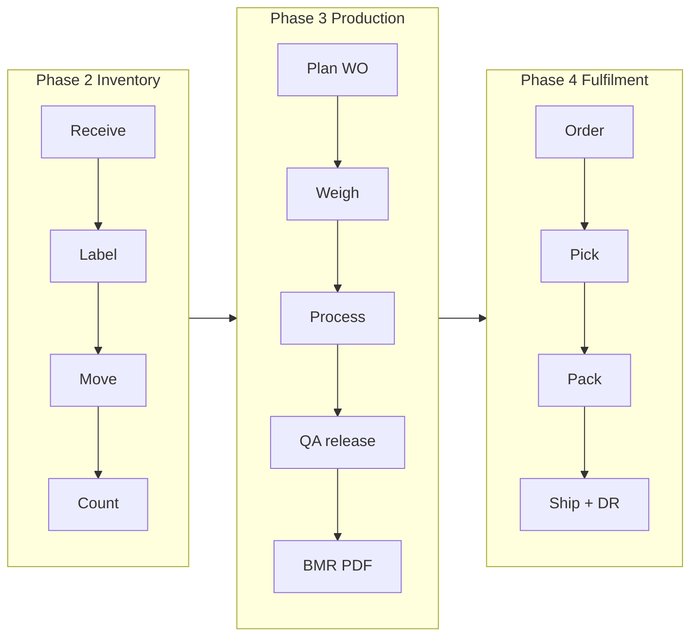
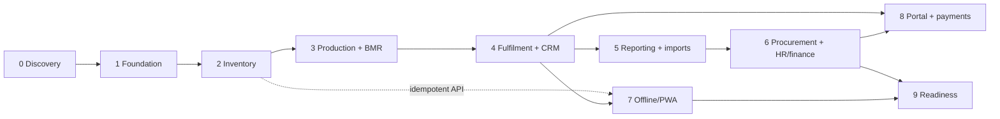

# Product Requirements Document: Bryel's Care ERP/CRM

| Field | Value |
|---|---|
| Status | Phase 0 draft for Gate 0 review (see `docs/team-charter.md`) |
| Owner | product-manager (accountable: principal-architect) |
| Source of truth | `docs/source/master-brief.md`, `docs/source/bmr-acapulco-soap.jpeg`, `docs/decision-log.md` |
| Related | `docs/process-maps.md`, `docs/architecture.md`, `docs/data-model.md`, `docs/permissions-matrix.md`, `docs/ux-system.md`, `docs/offline-sync.md`, `docs/security.md`, `docs/testing.md`, `docs/backlog.md`, `docs/risk-register.md`, `docs/data-migration-plan.md` |
| Conventions | Facts are labelled `F-nn`; assumptions `A-PRD-nn`; functional requirements `FR-<module>-nn`; acceptance criteria `AC-nn`; discovery questions `Q-A/B/C-nn` |

---

## 1. System vision

Bryel's Care Corporation makes soap, lotions and other personal-care products ("Beauty and
Wellness From Nature") at more than one site. Today the work is run on paper and spreadsheets:
a Batch Manufacturing Record (BMR) is printed, filled in by hand at the scale and the mixer,
checked by a second person, signed by QA, and filed. Stock, orders, attendance and money live
in separate files that do not agree with each other.

The system described here is one internal web application, installed on the phones and
tablets people already carry on the floor and used from desktops in the office. It replaces
the paper BMR, stock cards, packing notes and delivery receipts with records that are created
by scanning and tapping, checked by the system as they are entered, and printed when paper is
still needed.

For **operators** it means: scan a lot, see what it is and whether it may be used, and do the
one thing you came to do (receive, weigh, move, pack, dispatch) in the fewest safe steps, with
big targets, plain words and no arithmetic. Mistakes are caught at the scale, not at QA
review.

For **supervisors and QA** it means: a live board of work orders, batches and orders by state;
an approval queue; the ability to release or hold a lot with one recorded decision; and
traceability from any supplier lot forward to every customer, or from any complaint backward
to every batch and box, in seconds instead of days of binder searching.

For **owners and directors** it means: one dashboard whose numbers reconcile to the
underlying transactions (stock value, output and yield, orders shipped on time, holds,
near-expiry stock, receivables where in scope), with a definition behind every number and
drill-down to the records. Approvals that need an owner can be done from a phone.

Success at go-live (Phases 1 to 4) looks like this: every raw material lot received is
labelled and findable; every batch is run from a digital BMR that stores the exact formula
revision, the lots weighed, who weighed and who checked, the yield and QA's disposition, and
prints as a complete PDF; every shipped box can be traced to its batch and its customer; nobody
at Site A can see or change Site B's stock; and the paper BMR is used only where an approved
SOP still requires a wet signature.

What the system is **not**: it is not a general ledger, not a validated regulated
electronic-record system, not a payroll engine until qualified reviewers sign off, and not a
source of legal, tax or cosmetics-regulatory rules. Those remain the responsibility of the
company's qualified people; the system holds their decisions as configuration.

---

## 2. Confirmed facts vs assumptions

### 2.1 Confirmed facts (from the brief and the BMR photo only)

| ID | Fact | Source |
|---|---|---|
| F-01 | The company is Bryel's Care Corporation, a cosmetics and personal-care manufacturer; the logo carries the line "Beauty and Wellness From Nature". | brief; BMR photo |
| F-02 | Product families include soap, lotions and other cosmetics/personal-care or health-related products. Not every product follows the same manufacturing route. | brief, Business context |
| F-03 | Current processes are fragmented and largely manual; the BMR is a printed form completed by hand. | brief, Mission; BMR photo |
| F-04 | The current BMR header holds: product name, batch number, department, batch formula number, batch size, start date, end date. The sample is Acapulco Soap, department Production, batch size 17,600 g, start date 12 October 2026, other header fields blank. | BMR photo |
| F-05 | The dispensing and weighing table columns are: Ingredient (INCI name), Batch Number, Expiration Date, Theoretical Weight/Volume (g), Actual Weigh/Volume (g), Conducted by, Checked by. Material lot identity and expiry are therefore already recorded at dispensing today, with two-person verification. | BMR photo |
| F-06 | Sample formula lines: Coconut Oil 3,723.2 g; Palm Oil 8,687.4 g; 33.33% Lye Solution 4,964.2 g; Acapulco Extract 190.9 g; 6% Green in Oil 34.4 g; printed total 17,600 g. The lines sum to 17,600.1 g, so the printed total is rounded. Two lines are prepared intermediates (lye solution, colourant in oil), not purchased materials. | BMR photo |
| F-07 | The procedure section has five free-text numbered lines (blank on the sample). | BMR photo |
| F-08 | The checklist has seven steps, each with Conducted by and Checked by: 1 Weighing area line clearance; 2 Weighing; 3 Production area line clearance; 4 Mixing and cutting; 5 Production area line clearance; 6 Packaging and labeling; 7 Transfer to quarantine storage area. | BMR photo |
| F-09 | The footer holds: theoretical yield, actual yield, expiration date, test results, test date, conducted, checked by, final disposition (Approved / Disapproved), name and signature of QA, date, remarks. Finished batches go to quarantine before a named QA person dispositions them. | BMR photo |
| F-10 | The BMR photo is a process reference for configurable templates, not a universal schema; values and procedures must be verified with authorised personnel before production use. | brief, Reference materials |
| F-11 | SKUs, clients, formulas, lines, packaging formats and customer requirements must be configurable through versioned routings, formulas/BOMs, work instructions, label templates and customer specifications. | brief, Business context |
| F-12 | The company operates multiple sites; users may only see authorised sites, warehouses, departments and records, enforced on the server and in query scope. | brief, Business context |
| F-13 | Primary devices are phones and tablets, with desktop support; connectivity is unreliable; offline is required for selected workflows only, with explicit sync and conflict handling. | brief, Business context |
| F-14 | Deployment target is Railway with PostgreSQL. | brief |
| F-15 | Barcode/QR workflows cover raw materials, containers, intermediates, finished goods, boxes/cartons, locations and shipment units. | brief |
| F-16 | Required printable documents: BMR, weighing/dispensing sheet, production traveler, packaging/boxing note, delivery receipt, pick list, labels/barcodes, stock movement, purchase documents, invoices/statements where applicable, configurable reports. | brief |
| F-17 | A customer portal and online payments (for example PayMongo) are future work, outside the initial critical path. | brief |
| F-18 | Attendance comes from an existing time-clock machine's downloaded file. | brief, Module 11 |
| F-19 | Compliance, tax, labour, privacy, cosmetics labelling and claims vary by jurisdiction; professional validation is a requirement. The system is not a substitute for qualified QA/regulatory or accounting review. | brief |
| F-20 | The roadmap is Phases 0 to 9 with the exit criteria in the brief; MVP for go-live is Phases 1 to 4. | brief; team brief |
| F-21 | Finance scope (operational support vs full ledger) and payroll scope must be decided with the business before being built. | brief, Modules 10 and 11; ADR-020/021 |
| F-22 | The brief uses the term "night differential" and names PayMongo. These are evidence for the locale assumption, not a confirmed locale. | brief |
| F-23 | Visual direction: calm card-based dashboard, botanical green brand, operator mode with task names such as Receive Materials, Weigh Batch, Move Box, Pack Order, Dispatch Shipment. | brief; `docs/source/ui-inspiration.md` |

### 2.2 Assumptions register

Every assumption below is a default the team will build unless the owner says otherwise.
"Configurable" means the value or behaviour is data or an environment setting, not code.

| ID | Topic | Default chosen | Why | Configurable? | Owner confirmation | Phase |
|---|---|---|---|---|---|---|
| A-PRD-01 | Locale (ADR-019) | Philippines; Asia/Manila; PHP; metric (g, kg, mL, L, pcs); dates `DD MMM YYYY`; English UI | PayMongo and "night differential" point to the Philippines | Timezone per site, currency per organization, date format per user | Yes | 1 |
| A-PRD-02 | Number of sites | Seed and sizing assume 2 to 3 physical sites, each with at least one warehouse and one production line; the model supports any number | Brief says "multi-site" without a count | Yes (data) | Yes | 1 |
| A-PRD-03 | Product families and routes | Two example routes in seed data: bar soap (lye solution preparation, mixing, moulding/cutting, curing hold, packaging) and lotion (heating, mixing/emulsifying, cooling, filling, packaging). Both are placeholders until process owners approve real routings | Brief lists these as examples only | Yes (Routing/RoutingRevision) | Yes (Production) | 3 |
| A-PRD-04 | Lot/batch/box numbering | Defaults in `numbering_rules` (`docs/data-model.md` §9.1; one `{SEQ}` token, zero-padded to `sequence_width`): batch `B-{SITE}-{YYMMDD}-{SEQ}` (width 3, site scope), lot `L-{YYMM}-{SEQ}` (width 5), box `BX-{SEQ}` (width 8), PO/SO/DR/GR `<PREFIX>-{YY}-{SEQ}` (width 5, for example `GR-{YY}-{SEQ}`); legacy paper numbers kept in a `legacy_number` field | Current rules unknown | Yes (per site and document type) | Yes | 1 |
| A-PRD-05 | Printers | A4 laser/inkjet for documents through browser print or PDF; thermal label printers driven by browser printing of label-sized PDFs (default label sizes 50×30 mm and 100×50 mm); no vendor printer language (for example ZPL) in MVP | Hardware unknown | Label sizes per template | Yes (IT) | 2 |
| A-PRD-06 | Scanners | Phone/tablet camera first; USB/Bluetooth keyboard-wedge scanners supported; no rugged terminals | Brief asks for camera plus keyboard-like scanners | Symbology per label template (ADR-017) | Yes (IT) | 2 |
| A-PRD-07 | Scales | Operator reads the scale and types the weight; the scale is selected or scanned as equipment and recorded on the DispenseRecord; no scale data integration in MVP | No integration requirement stated | Adapter later | Yes (Production) | 3 |
| A-PRD-08 | Devices and OS | Mostly Android phones with some iOS; floor devices shared, office devices personal; current Chrome and Safari | Brief: "representative iOS/Android devices" | Device matrix in `docs/testing.md` | Yes (IT) | 1 |
| A-PRD-09 | Connectivity | Wi-Fi reliable in offices, intermittent in warehouse and production areas; MVP is online-first; approved offline workflows arrive in Phase 7 | Brief: unreliable connectivity, offline selective | Offline workflow list in `docs/offline-sync.md` | Yes (IT) | 2, 7 |
| A-PRD-10 | Accounting software | External system kept by the accountant; no general ledger in this product (ADR-020); exports in an accountant-defined CSV/XLSX layout | Brief: do not replace accounting without approved scope | Export layouts | Yes (Accountant) | 6 |
| A-PRD-11 | Payroll software | None or spreadsheet; import-first and reporting-first (ADR-021); no pay computation before qualified sign-off | Brief: phase payroll carefully | Rule catalogue | Yes (HR, Accountant) | 6 |
| A-PRD-12 | Users and volumes (sizing) | ≤60 named users, ≤25 concurrent; ≤300 SKUs; ≤500 materials; ≤200 new lots/month; ≤2,000 stock movements/day; ≤100 batches/month; ≤20 shipments/day | Typical for a small/mid manufacturer; needed for performance targets | n/a | Yes (Owner) | 1, 9 |
| A-PRD-13 | Retention | All records kept online through go-live plus 2 years; archive defaults per record class are defined once in `docs/security.md` §7 (A-SEC-24 to A-SEC-31): quality and batch records 5 years after batch expiry with a 7-year minimum, finance and payroll 10 years, employee data employment + 5 years, attendance import files 3 years. Values validated by qualified reviewers | Brief: retention subject to law and policy | Per record class (`retention_policies`) | Yes (Owner, QA, Accountant) | 9 |
| A-PRD-14 | Electronic sign-off | A sign-off is an authenticated user action with password (or MFA) re-entry, stored as an attestation with actor, time and record revision. It is not a validated regulated e-signature; paper hybrid allowed where SOPs require | Brief: e-records need formal validation before reliance | Re-auth requirement per step type | Yes (QA) | 3 |
| A-PRD-15 | Receipt quality status | Every received lot starts in `quarantine` until qa_qc releases it; material classes (for example packaging) can be configured to auto-release | Brief: inspection state on receipt | Per material class | Yes (QA) | 2 |
| A-PRD-16 | Allocation rule | FEFO when the lot has an expiry or retest date, FIFO otherwise | Brief | Per product/material class and per customer | Yes | 2 |
| A-PRD-17 | Negative stock | Not allowed; posting fails | Brief: prevent unless policy allows | Per site policy | No (informed) | 2 |
| A-PRD-18 | Dispensing tolerance | No system default. Each formula line must carry a tolerance (absolute or percent) entered by the process owner; seed values are fictional | Never invent quality values | Per FormulaRevision line | Yes (Production, QA) | 3 |
| A-PRD-19 | Batch size basis | Batch size is the total theoretical input mass (17,600 g on the sample equals the sum of inputs); expected yield is a percent of batch size or an absolute output quantity, per formula | Matches the sample BMR | Per FormulaRevision | Yes (Production) | 3 |
| A-PRD-20 | Two-person verification | Dispensing lines and checklist steps need a conductor and a different checker, as on the paper BMR | BMR photo | Per routing step | Yes (QA) | 3 |
| A-PRD-21 | Approval thresholds | All stock adjustments and count variances need site_manager approval; placeholder amounts for PO, expense, adjustment and finance-document thresholds are the A-PM-15 defaults in `docs/permissions-matrix.md` §5.2 (PHP 50,000 PO; 5,000 expense; 20,000 adjustment; 100,000 finance documents), enforced when each module ships (Phase 2 inventory, 6 procurement and finance) | Safe default | Threshold rules are data | No (informed) | 2 |
| A-PRD-22 | Language | English UI with plain-language operator labels; a second language only if requested | Brief is in English | i18n keys from Phase 1 | Yes | 1 |
| A-PRD-23 | Sales model | B2B/wholesale accounts with repeat orders; no lead/opportunity pipeline in MVP; quotations are Should | Brief: pipeline only if relevant | Pipeline can be enabled later | Yes (Owner, Sales) | 4 |
| A-PRD-24 | Shipping policy | Partial shipments allowed; over-shipment blocked without site_manager approval | Brief | Per customer | No (informed) | 4 |
| A-PRD-25 | Notification channels | In-app from Phase 2; email via provider adapter from Phase 5; no SMS/chat until consent and policy exist | Brief | Provider adapter | No (informed) | 5 |
| A-PRD-26 | Sessions on shared devices | Idle timeouts per `docs/security.md` §3.4 are role-based (12 h standard, 1 h for holders of a restricted permission; A-SEC-08/09); every operator screen has an explicit sign-out and sign-out clears local caches. A shorter timeout per device class is an open question (`docs/security.md` §9 Q2) that would need `device_registrations` (Phase 7) | Shared floor devices | Per role (`session.idle_minutes`, `session.idle_minutes_privileged`) | Yes | 1 |
| A-PRD-27 | Intermediates | Prepared solutions (lye solution, colourant in oil) are intermediate materials with their own batch, lot and expiry, dispensed like any material | BMR photo lists them as ingredients | Per material (type = intermediate) | Yes (Production) | 3 |
| A-PRD-28 | Expiry basis | Finished-goods expiry = batch completion date + product shelf life; basis switchable to release date | Common practice; value per product | Per Product | Yes (QA) | 3 |
| A-PRD-29 | Rounding | Quantities stored as `numeric(18,6)` and money as `numeric(18,4)` (`docs/data-model.md` A-DM-01); displayed to the UOM's precision (g: 1 decimal) and money to 2 decimals; totals computed from unrounded lines; printed totals rounded per template setting | Sample BMR prints 17,600 for a 17,600.1 sum | Per UOM and template | Yes (QA, Production) | 3 |
| A-PRD-30 | Data migration | Opening balances and active lots loaded as opening receipts at go-live; historical paper BMRs attached as scans, not re-keyed | Brief: document migration; details in `docs/data-migration-plan.md` | n/a | Yes (Owner) | 9 |
| A-PRD-31 | Customer requirements | Customer-specific labels, carton counts and certificates exist and are modelled as CustomerRequirement records; none known yet | Brief | Data | Yes (Sales) | 4 |
| A-PRD-32 | Time-clock export | CSV or XLSX with employee identifier, timestamp and in/out flag; mapping layer absorbs other layouts | Unknown format | Mapping versions | Yes (HR, IT) | 5 |
| A-PRD-33 | Backup objectives | RPO 24 h (daily logical dump plus platform backups), RTO 4 h; see `docs/deployment-railway.md` | Brief: define with company | Env/platform settings | Yes (Owner, IT) | 9 |
| A-PRD-34 | MFA scope | TOTP mandatory from Phase 1b for owner_director, system_admin and any user holding a restricted (R) permission (`docs/security.md` §3.7, `docs/permissions-matrix.md` A-PM-02); optional for everyone else | ADR-004 | Restricted flag per permission | Yes | 1 |
| A-PRD-35 | Offline sync defaults | Defined once in `docs/offline-sync.md` §10 (A-OFF-01 to A-OFF-09), in particular A-OFF-08 retry schedule 5 s, 30 s, 2 min, 10 min, 30 min, then every 30 min (jittered ±20 %) with at most 20 transport attempts per command, and A-OFF-09 maximum queue age 72 h (never below the 12 h authorization snapshot of A-OFF-02) before a command needs re-authentication and conflict review | Brief: offline selective, server authoritative; values unknown | Settings `settings.offline.retry_schedule`, `settings.offline.max_attempts`, `settings.offline.max_queue_age_hours` | Yes (IT, site managers) | 7 |
| A-W1B-01 | Unplanned receipt reason codes | `no_purchase_order` (default while purchasing is not live), `urgent_purchase`, `replacement_delivery`, `sample_or_free_goods`, `other`; code list in `src/modules/inventory/receiving-state.ts` until the reason-code catalogue exists | A-PROC-26 requires a reason; values unknown | Code list (moves to `reason_codes`) | Yes (procurement) | 2 |
| A-W1B-02 | Procurement review of every unplanned receipt before release (A-PROC-26) | Not enforced: only unregistered suppliers and unapproved discrepancies block release, because every receipt is unplanned until POs exist (Phase 6) | Enforcing it now would block all releases | Rule to add as a setting | Yes (owner, procurement) | 2 |
| A-W1B-03 | Materials requiring a CoA before release | `materials.requires_coa` default `false`; demo seed sets it for the botanical extracts MAT-0043 and MAT-0044 only; a CoA counts once attached (QA verification field exists, not yet required) | Which materials need a CoA is a QA rule | Per material (`requires_coa`) | Yes (QA lead) | 2 |
| A-W1B-04 | Hold reason codes | `supplier_complaint`, `suspected_contamination`, `damaged_packaging`, `documentation_issue`, `investigation`, `retest_due`, `other` | Catalogue not built | Code list in `src/modules/inventory/holds.ts` | Yes (QA) | 2 |
| A-W1B-05 | Lifting a hold with resolution "released" | Each lot returns to its status before the hold (a quarantined lot stays quarantined; lifting a hold is never a QA release); released lots past expiry become expired | Avoids releasing un-reviewed stock | No (rule) | Yes (QA lead) | 2 |
| A-W1B-06 | Image uploads | Allow-list JPEG, PNG, WebP, PDF; caps 10 MB / 25 MB; image metadata (EXIF GPS, XMP, comments) is stripped by rewriting the file container, keeping only the orientation tag; pixels are not re-encoded and HEIC is refused until an image library (sharp) is approved as a dependency | No image library in the stack yet | Limits in `src/lib/storage/sanitize.ts` | Yes (IT) | 2 |
| A-W1B-07 | Release on receipt | A material with `requires_incoming_inspection = false` creates lots `released` with a recorded `release` disposition by the poster; default `true` for every material | A-PROC-10 "release on receipt with CoA" class | Per material | Yes (QA lead) | 2 |
| A-W1A-01 | Operator movement types (refines A-PM-06) | A user whose every role is `production_operator` may post only `consumption`, `output` and `transfer`; a transfer must touch a `production` location (source or destination). Any other role lifts the rule | Matrix §3.3 note; production process owner not yet consulted | Setting `inventory.role_movement_types` (organization or site), `src/lib/settings.ts` | Yes (production process owner) | 2 |
| A-W1A-02 | Background job retries | 5 attempts (first run + 4 retries), exponential backoff from 30 s capped at 1 h; then dead-lettered with a critical notification to `system_admin` | Story US-2-03 AC1 | Setting `platform.jobs.max_attempts`; per-job `retryDelaySeconds` | Yes (IT) | 2 |
| A-W1A-03 | What the reversal screen may reverse | `transfer`, `adjustment` and `issue` movements; receipts, consumption, output and shipments are corrected from their source document (goods receipt void, production posting reversal, customer return) so documents and ledger never disagree | `docs/testing.md` §4.2 `ledger.reversal.receipt_with_lot` | `REVERSIBLE_MOVEMENT_TYPES` in `src/modules/inventory/reversal.ts` (engineering rule) | Yes (site managers) | 2 |
| A-W1A-04 | Expiry day in availability | A lot is usable through the end of its expiry day (expired when `expires_on < as_of`), matching the MVP posting rule; `docs/data-model.md` §5.3 previously used `<=` | MVP behaviour of `assertLotUsable` | `bucketOf` in `src/modules/inventory/availability.ts` | Yes (QA lead) | 2 |
| A-W1A-05 | Availability buckets | Each quantity lands in exactly one bucket, precedence recalled → rejected → expired → on_hold → quarantine → released; allocations on blocked stock are reported (not subtracted twice) | Needed for the A-DM-23 identity to hold | Code (pure function + SQL, tested to agree) | No | 2 |
| A-W1A-06 | Nightly reconciliation time | 01:00 Asia/Manila for every site in one run | Registry says "site time"; all sites are in Manila today | Job schedule `inventory.reconcile` | Yes (IT) | 2 |
| A-W1A-07 | Large exports | Synchronous exports stop at 50,000 rows (A-PM-17) with a "narrow the filters" message; the background export job (`analytics.export_job`) waits for file storage (documents stream) | No bucket/file storage yet | Setting `platform.export.max_rows` | Yes (owner) | 2 |
| A-PRD-36 | Logo artwork and brand colours | Vector recreation of the logo printed on the paper BMR; brand greens `#367a24` (green) and `#8dc63f` (light green) sampled from that mark (ADR-024) | No official logo file or brand guide supplied yet | Replace `src/ui/brand.tsx` and `src/app/icon.svg`; colours are tokens in `src/app/globals.css` | Yes (owner to supply official logo files and colour codes) | MVP |
| A-PRD-37 | Revision approval policy (W1D) | Formula and quality-relevant routing revisions: step 1 `qa_qc`, step 2 `site_manager` or `owner_director`; sequencing-only routing change (same step content, new order, computed by the system): one `site_manager`/`owner_director`; work instruction: one approver other than the author; inspection plan: a second `qa_qc`; equipment override: `site_manager` then `qa_qc`. Never the author/submitter/requester, never the same person for two steps | `docs/permissions-matrix.md` §5.2 defaults, A-PM-05, A-PROC-23, A-PROC-41 | Typed data in `src/modules/masterdata/approval-policy.ts` until `approval_rules` (US-1-14) exists | Yes (Production, QA) | 3 |
| A-PRD-38 | Effective dates of revisions (W1D) | The final approver sets the effective date (today or later, never back-dated); the approved revision it overlaps is superseded on that date; batches resolve the formula and routing revision effective on the planned start date | Brief: effective-dated, versioned records | Date per approval | Yes (Production) | 3 |
| A-PRD-39 | Equipment blocking (W1D) | Stored status other than `in_service` always blocks use; overdue calibration/maintenance, cleaning not recorded and pending qualification block when `blocking_rule = block` (default), are recorded as warnings with `warn`, informational with `none`; overrides are time-boxed (1 to 72 h, default 8 h) | Brief module 14; A-DM-28; Q-PR-12 open | `equipment.blocking_rule` per item; validity hours per request | Yes (Production, QA) | 3 |
| A-PRD-40 | Seeded engineering content (W1D) | Acapulco Soap, Guava Bar Soap and Aloe Hand Lotion formulas and routings approved from 180 days ago with fictional 0.5 % tolerances; routing parameters seeded without limits; inspection plans seeded as placeholders (`is_placeholder = true`) with demo specifications; demo equipment register at NFD (SC-02 calibration overdue, MIX-02 out of service) | Brief: fictional seed data only; never invent quality rules | Data | Yes (Production, QA replace before go-live) | 3 |
| A-PRD-41 | Inventory policy defaults shipped with E-2-04/E-2-05 (Wave 1 W1C) | Undo window 60 s (A-UX-15); "Already moved" duplicate window 300 s (A-W1C-01); count recount threshold 2 %, no auto-approve, second approval above 2 % by owner_director (A-PROC-12, A-PM-15); adjustment second approval above PHP 20,000 by owner_director, unknown value (no unit cost) treated as below the threshold (A-W1C-02); reservation TTL 72 h (A-W1C-03); mixed lots per box off (A-PROC-22); expiry buckets 30/60/90 days (A-KPI-03); FEFO default rule (A-PRD-16) | No company figures yet | Rows in the platform `settings` table (site row beats organization row beats the registry in `src/lib/settings.ts`, ADR-028); FEFO/FIFO rules in `allocation_rules` | Yes (owner, site managers, QA) | 2 |
| A-PRD-42 | Count posting basis | A posted count adjusts each line to the final counted quantity relative to the balance at posting time (normally equal to the frozen expected quantity, because counted locations are frozen); expected, counted and the balance at posting are kept on the movement | Freeze is enforced by the W1C services; other posting paths (production, dispatch) still need the freeze check in `postMovement` | `src/modules/inventory/counts.ts` | Yes (warehouse lead, accountant) | 2 |
| A-PRD-43 | Document and label output in Phase 2 (W1E) | Browser print of the recorded, hashed render (`PDF_RENDERER=disabled`); no stored PDF files until the ADR-016 Chromium decision; "Download PDF" shows "setup required" | Chromium would add ~300–400 MB to the image; the print dialog offers "Save as PDF" | Env `PDF_RENDERER` | Yes (principal architect, owner) | 2 |
| A-PRD-44 | Wedge scanner terminator and scan mode (W1E) | Enter by default; Enter, Tab or either selectable and remembered per device (it is a property of the scanner hardware); camera/scanner/type mode remembered per device | `settings.scan.terminator` needs the settings store, not built yet | Per device | Yes (IT contact, Q-RPT-W02) | 2 |
| A-PRD-45 | Reprint reasons (W1E) | `lost_copy`, `damaged_label`, `status_change`, `repack`, `customer_copy`, `other` (note required), from `docs/reports-and-templates.md` §13.3, held in code until the shared `reason_codes` table exists | Seed list in the docs | Code list now, data later | Yes (QA) | 2 |
| A-PRD-46 | One print station required per site before labels print (W1E) | No active print station at a site = "Label printing isn't set up"; demo seed has one at NFD and none at RVS | A-RPT-09 | Yes (data) | Yes (IT contact) | 2 |
| A-W2G-01 | Location codes organization-unique (W2G) | New and renamed location codes must be unique across the organization (scan `BC:LOC`); existing per-site duplicates in the demo data (`RCV`, `QUA-01`, `FG-01`, `SHP`, `REJ`) are tolerated until the company's real codes are loaded, then a database unique index can follow | Demo seed and fixtures reuse codes per site | Service rule | Yes (warehouse lead, IT) | 1 |
| A-W2G-02 | Blocked locations (W2G) | A `blocked` location takes no stock movement in or out (including reversals) until a site manager unblocks it; deactivation needs `masterdata.location.admin`, an empty location and no special-location designation | data-model §3.1 "blocked = no movements in or out" | Status per location | Yes (warehouse lead) | 1 |
| A-W2G-03 | Product families (W2G) | Soap, Lotion, Cream, Oil, Other | data-model §3.2 example list | Setting `masterdata.product_families` | Yes (owner) | 1 |
| A-W2G-04 | Reference units and conversions (W2G) | g, kg, mg, mL, L, pcs with kg→g 1000, mg→g 0.001, L→mL 1000 installed as approved system conversions; density and pack-unit conversions are entered per material and approved by a second administrator | SI facts; the MVP ledger used the same factors | Rows in `uoms` / `uom_conversions` | Yes (QA for densities) | 1 |
| A-W2G-05 | Default reason codes (W2G) | The lists previously in code (reprint A-PRD-45, unplanned receipt A-W1B-01, hold A-W1B-04, adjustment and count variance W1C) merged by code; `other` requires a note everywhere; migration codes `opening_balance`, `expiry_unknown`, `import_voided`, `legacy_release` and `undo_by_actor` added; none requires approval | Vocabulary only | Rows in `reason_codes` | Yes (QA, warehouse lead, site managers) | 1 |
| A-W2G-06 | Material and product lifecycles (W2G) | New products and SKUs start as draft; new materials start active unless saved as draft; discontinued is final; discontinuing a product discontinues its SKUs; an SKU is active only under an active product | Backlog US-1-22/23 state lists | Code state machines | Yes (production planner, QA) | 1 |
| A-PRD-47 | Second label with unchanged content (W1E) | Refused as a new job; must be a reprint with reason. When the status at print changed, a new label is allowed and earlier printed labels are voided as "superseded — destroy" automatically | Keeps reprint control meaningful; A-RPT-10 | No | Yes (QA, warehouse) | 2 |
| A-W2B-01 | Checker signature on a shared device (W2B) | The checker (or exception approver) chooses their name and types their own password on the operator's device; the server verifies it as a one-time co-signature (no session is created), refuses the signed-in operator, audits failures as `identity.co_signature.failed` and locks the account after 5 failures like sign-in. The checker may instead sign later from their own session | Re-authentication (US-1-28) is not built; this is the "checker signs on the device or their own" rule of US-3-09 AC1 | `src/lib/auth/co-sign.ts` | Yes (owner, QA) | 3 |
| A-W2B-02 | Consumption posting timing (W2B, A-PROC-31) | Default: ingredient and packaging consumption are posted at transfer to quarantine (W05-17) together with the output; site option `production.post_consumption_at_dispense` posts each weighing at once (and packaging at the end of the packaging step); a void reverses a posted weighing. Weighings not yet posted reserve their quantity at the lot location (no other batch can weigh it) | Plan default in `docs/process-maps.md` A-PROC-31 | Setting `production.post_consumption_at_dispense` | Yes (owner, warehouse) | 3 |
| A-W2B-03 | Yield range (W2B, A-PROC-33) | Fictional placeholder 95–102 % of the theoretical yield frozen on the batch, per SKU override possible; outside the range the yield needs approval (`production.yield_record.approve`, not the recorder) with a deviation before posting | No limits documented today | Setting `production.yield.limits_pct` | Yes (process owner, QA) | 3 |
| A-W2B-04 | Scrap/rework approval threshold (W2B) | Cumulative scrap (or rework) above 2 % of the theoretical unit count needs approval by another person (`production.scrap_rework_record.approve`) before posting; scrap and rework units are recorded on the batch but never entered into stock (they are not part of the output lot) | Fictional placeholder | Setting `production.scrap.approval_threshold_pct` | Yes (owner, QA) | 3 |
| A-W2B-05 | Scrap/rework reason codes (W2B) | Broken or cracked unit, underweight unit, appearance defect, damaged in packaging, other (note required) | Fictional placeholder list; since the Wave 2 integration these are shared reason codes (categories `scrap`, `rework`) the process owner edits in Reason codes | `reason_codes` rows (installed by the reference data) | Yes (process owner) | 3 |
| A-W2B-06 | Cleaning after use (W2B, W13-02) | Equipment with cleaning rule `per_batch` becomes "cleaning required" when the step that used it ends; it is selectable again after a cleaning service record. `per_changeover` is not evaluated yet (treated as no automatic change) | `docs/data-model.md` §3.1 "line clearance and cleaning records update it" | Setting `production.equipment.mark_dirty_after_batch_use` | Yes (process owner) | 3 |
| A-W2B-07 | Shared equipment (W2B) | A scale may be used by several running batches at once; every other equipment kind (mixer, kettle, mould line, filler…) is held by one batch until the step that uses it ends | Physical capacity, not a quality rule | `SHARED_EQUIPMENT_KINDS` in `src/modules/production/process.ts` | Yes (process owner) | 3 |
| A-W2B-08 | Exceptions on process steps (W2B) | A reading outside the routing limits, an early end of a hold/curing step or a packaging reconciliation mismatch is accepted only with a controlled exception approved on the device by a holder of `production.over_tolerance_dispense.approve` (qa_qc or site_manager), other than the operator, with a reason, and a deviation opened through the quality module. Until the deviations module is connected these exceptions are refused and the step stays blocked | There is no separate permission string for process-parameter exceptions in the catalogue | `approveStepException` | Yes (QA) | 3 |
| A-W2B-09 | Boolean process parameters (W2B) | A yes/no routing parameter is a pass/fail check: "yes" is within limits, "no" blocks the step like a reading outside limits | Seeded lotion step "Appearance conforms" | `evaluateReading` | Yes (QA) | 3 |
| A-W2B-10 | Finished-lot expiry basis (W2B, A-PROC-08) | Manufacture date (batch start date, Asia/Manila) plus product shelf life; option: packaging-step completion date | A-PROC-08 | Setting `production.output.expiry_basis` | Yes (QA) | 3 |
| A-W2C-01 | Inspection due time (W2C) | An inspection is due 48 h after it is created; overdue ones are highlighted in the inspection queue | Scheduling aid, no QA rule known | Setting `quality.inspection.due_hours` (organization or site) | Yes (QA lead) | 3 |
| A-W2C-02 | Deviation severity classes (W2C) | `minor`, `major`, `critical`; chosen by qa_qc when the investigation starts; closing requires a class | The company's QA defines the classes and their meaning | Setting `quality.deviation.severity_levels` | Yes (QA lead) | 3 |
| A-W2C-03 | Bulk disposition size (W2C, US-2-23) | At most 500 lots per run; each lot is decided in its own transaction through the single-lot rules and shares one correlation id; re-authentication = re-entering the user's password (US-1-28 re-auth not built) | Migration volumes unknown (Q-MIG-05) | Setting `quality.bulk_disposition.max_lots` | Yes (QA lead, IT) | 2 |
| A-W2C-04 | Bulk disposition reason codes (W2C) | `legacy_release`, `legacy_reject`, `qa_review` | US-2-23 names `legacy_release` only | Code list `BULK_REASON_CODES` in `src/modules/quality/bulk-disposition.ts` | Yes (QA lead) | 2 |
| A-W2C-05 | Genealogy view for non-QA roles (W2C) | `quality.genealogy.view` stays with qa_qc, site_manager, owner, auditor (and system_admin through view-all) as in Wave 1; the matrix §3.6 grants to PP, PO, WO, PR and SC are not applied yet because a trace names customers and suppliers | Privacy and need-to-know | Role bundles in `src/lib/permissions.ts` | Yes (owner) | 3 |
| A-W2C-06 | Release rules from inspections and deviations (W2C) | A lot or batch cannot be released while an inspection of it is not approved or was rejected, while a live result is out of specification without an OOS deviation closed with "release may proceed", while a deviation naming it is open or was closed with "may not be released"; the user who entered a result cannot review the inspection or decide the disposition; a lot with no inspection keeps the Phase 2 rule (A-PM-18); a batch without a frozen plan keeps the MVP free-form results | US-3-14/15/21 AC; the reviewer-equals-tester waiver of A-PROC-35 is not offered | Rules in `src/modules/quality` (no setting) | Yes (QA lead) | 3 |
| A-W2C-07 | Status label after a QA decision (W2C) | Batch release, conditional release and bulk disposition queue a new label for a lot that already had one (A-RPT-10, setting `labels.reprint_on_status_change`, default on); the single-lot decision screen leaves printing to Print label, as the W1E flow expects | W1E tests model manual printing | Setting `labels.reprint_on_status_change` | Yes (QA, warehouse) | 3 |
| A-W2C-08 | Deviation closure and containment (W2C) | Closing needs a severity, root cause, resolution, QA's release conclusion and a closer other than the raiser; every containment hold placed from the deviation must be lifted first; a closed deviation is final (database trigger) | W07-05 "close with disposition of affected stock" | No (rule) | Yes (QA lead) | 3 |
| A-W2D-01 | Which BMR template a batch uses (W2D) | One organization-wide template code per setting (`documents.bmr.template_code` = `BMR-STD`, `documents.bmr.paper_page_template_code` = `BMR-PAPER`; site override possible); a per-SKU template field comes with SKUs | No SKU table yet; settings keep it configurable | No | Yes (QA, production) | 3 |
| A-W2D-02 | Reopen approval policy (W2D) | Step 1 site_manager (`production.batch.admin`; the requesting site manager's request counts as step 1), step 2 a different qa_qc user (`quality.disposition.approve`); typed data in `closure.ts` until `approval_rules` exists | permissions-matrix §5.2 `batch_reopen`; QA holds no production permission to co-approve with | No | Yes (QA lead, owner) | 3 |
| A-W2D-03 | Signature section page break (W2D) | Seeded `BMR-STD` keeps the paper layout on page 1 (no forced page break before J; the block never splits); A-RPT-05 is one definition change away | Owner asked that the printed BMR look like the company's form | No | Yes (QA, production) | 3 |
| A-W2D-04 | Reopen targets (W2D) | Back to the state it was closed from (record-only amendment; disposition stands) or `quarantined` (QA re-decides). Not `in_process`: output is already posted. Reopen changes no lot status; QA places a hold if the amendment questions released stock | Avoids re-posting output; quality decisions stay with QA | No | Yes (QA lead) | 3 |
| A-W2D-05 | Paper pages (W2D) | Any step can get a blank page (hybrid sites); a `paper_then_transcribe` step needs a reviewed page; every issued page must be reviewed or voided before QA release and closure; the uploader of the scan is the transcriber; dispensing, transfer and reconciliation steps can never be `paper_only` (DB check) | §2.5, A-RPT-06, Q-QA-05 | No | Yes (QA) | 3 |
| A-W2D-06 | Department on the BMR (W2D) | Printed as "PRODUCTION" for every batch until production lines and departments exist | Matches the paper form; Q-RPT-P04 | No | Yes (production) | 3 |
| A-W2E-01 | Shared-device idle timeout (W2E, US-1-12) | 30 minutes when "This is a shared device" is ticked at sign-in; privileged 1 h, standard 12 h idle; 24 h / 7 d absolute (A-SEC-08..10) | Q-A-03 / Q-OFF-02 not answered (are floor tablets shared?) | Settings `session.idle_minutes_shared_device`, `session.idle_minutes*`, `session.absolute_hours*` | Yes (owner, IT contact) | 1 |
| A-W2E-02 | Who may grant a role carrying restricted permissions (W2E, US-1-18) | Only owner_director, when the granting administrator does not hold those restricted permissions ("grant requires owner approval", matrix §2); so by default a system_admin cannot grant site_manager or qa_qc. US-1-15 AC2 describes a system_admin doing that move: set the setting to `false` to allow it (still audited with the restricted list) | Brief: "an admin cannot grant permissions they lack" | Setting `identity.assignment.restricted_grant_requires_owner` (default true) | Yes (owner) | 1 |
| A-W2E-03 | Password deny list (W2E, US-1-11) | A compact bundled list of common/breached passwords plus context rules (email name, display name, "bryel"); the "top 100k" offline list of docs/security.md §3.2 is not bundled yet | Size of the list in the repository | Code list (`src/lib/auth/password-policy.ts`) | Yes (security reviewer) | 1 |
| A-W2E-04 | Email delivery (W2E) | HTTPS email API (`EMAIL_PROVIDER=resend`) instead of SMTP, because Railway blocks outbound SMTP below the Pro plan; with no provider, invitation and admin-forced reset links are shown once to the administrator to pass on in person (audited as `identity.user.reset_link_shown` for resets) | Owner has not chosen an email provider or domain | Env `EMAIL_PROVIDER`, `EMAIL_FROM`, `RESEND_API_KEY` | Yes (owner: provider and sender domain) | 1 |
| A-W2E-05 | First administrator roles (W2E bootstrap) | `pnpm admin:bootstrap` grants owner_director + system_admin organization-wide to the first person (one person doing both jobs gets two assignments, matrix §3) | Small company: the owner is likely the first administrator | Env `BOOTSTRAP_ADMIN_ROLES` | Yes (owner) | 1 |
| A-W2E-06 | Assignments are created at invitation (W2E, US-1-16 AC1) | The invited user's role assignments exist from the invitation (inert until acceptance, because an invited user cannot sign in); acceptance only sets the password and activates. docs/security.md §3.8 earlier described inserting them at acceptance | US-1-16 AC1 audits `identity.site_assignment.granted` at invitation | No | Yes (security reviewer) | 1 |
| A-W2E-07 | owner_director holds every identity administration string (W2E) | Break-glass: owner use of role/assignment administration without a system_admin role is audited as `identity.role.owner_break_glass`; matrix §3.1 lists fewer owner identity grants | Owner must be able to run the system without engineers | Role bundle in code | Yes (owner) | 1 |
| A-W2F-01 | Which settings need a second approver (W2F, US-1-14) | `requiresApproval`: movement types per role, count recount and auto-approve thresholds, unknown adjustment value rule, rate limits, the `approvals.sod.*` switches. Direct (still audited, re-authenticated): export row cap, job attempts, undo/duplicate windows, reservation TTL, mixed lots, expiry buckets, maintenance mode, alert thresholds | Controls that change who may do what or how much needs approval should not be one person's decision | Flag per key in `src/lib/settings.ts` | Yes (owner) | 1 |
| A-W2F-02 | Step 1 of stock adjustments and count variances (W2F) | Any holder of the approve permission at the site (Wave 1 behaviour); the matrix §5.2 table names `site_manager` | Keeps the delivered flow unchanged; the owner can restrict the step to a role in Approval rules | `approval_rules` rows (seeded) | Yes (owner) | 2 |
| A-W2F-03 | Re-authentication for restricted changes (W2F) | Every change under `platform.settings.admin`, `platform.settings.approve`, `platform.approval_rule.admin` and `platform.numbering_rule.admin` asks for the user's password in the same form; a wrong password is audited `identity.reauth.failed`. Session-level re-authentication (`sessions.reauthenticated_at`) arrives with US-1-10 | No re-auth flow existed | Code (`src/modules/governance/reauth.ts`) | Yes (IT) | 1 |
| A-W2F-04 | Rate-limit semantics and keys (W2F, A-SEC-14) | Fixed window from the first request: API 600/min per signed-in user (not per session), scan look-ups 120/min per user, sign-in 20/min and 200/h per client IP from `TRUSTED_PROXY_HEADER`; refused requests do not consume. Before sign-in the limits of the deployment's single organization apply (ADR-011) | docs/security.md §4.5 defaults | Setting `platform.rate_limits` (needs approval) | Yes (IT) | 1 |
| A-W2F-05 | Logging without a logging package (W2F) | A dependency-free JSON logger with pino field names (`time`, `level`, `msg`) and a Sentry-compatible envelope sender instead of pino and the Sentry SDK, to avoid a lockfile change in a parallel wave | docs/deployment-railway.md §7–8 name pino and a Sentry SDK | `src/lib/log` | Yes (devops, integrator) | 1 |
| A-W2F-06 | Quick guides are repository files (W2F, US-2-27) | Guides for receive, move and count are versioned markdown in `docs/help/` (front matter `version`, `updated_at`, `sop`); the author's change is approved by a second person in code review, which stands in for the AC2 draft/publish editor; text only (no images yet); the SOP each guide maps to is named by the warehouse lead (US-9-08) | Brief for Wave 2 | `docs/help/*.md` | Yes (warehouse lead, QA) | 2 |
| A-W2F-07 | Metrics and alerts (W2F) | `platform.metrics_sample` every 5 min (queue depth, failed/dead-lettered jobs, worker heartbeat age, backup age, reconciliation differences, database size, connections); samples kept 90 days, table not partitioned yet; `platform.alerts_evaluate` every 5 min notifies `system_admin` in-app for a silent worker (> 300 s), dead-lettered jobs (last 15 min) and backup age (> 26 h, only when `BACKUP_STATUS_SOURCE=table`), at most once per alert per 60 min; no webhook delivery yet | docs/deployment-railway.md §8.3 defaults (A-DEP-11) | Settings `alerts.*`, `platform.metrics.retention_days` | Yes (IT) | 1 |
| A-W2F-08 | Read-only mode scope (W2F, US-2-30) | Applies to signed-in users and jobs run on their behalf; scheduled system jobs (reconciliation, expiry, reservation expiry, metrics) keep running; marking own notifications read stays allowed; the allow-list is by role (accounts get read-write through their roles) | Runbook §17a.2 lists accounts; the setting holds roles | Setting `platform.maintenance.read_only` | Yes (owner, devops) | 2 |
| A-W2A-01 | Batches without a work order (W2A) | Refused by default: setting `production.batch.allow_without_work_order` is `false`, so batches are created from planned or released work orders (W05-03). The switch exists for legacy/service callers and test fixtures, which turn it on explicitly; turning it on is a setting change request with a second approver | W05-03 creates batches from work orders | Setting `production.batch.allow_without_work_order` | Yes (integration) | 2 |
| A-W2A-02 | Expiry margin for reserved lots (W2A) | A lot is reserved for a work order only when it expires more than 0 days after the planned end | W05-04 "configurable margin"; value unknown | Setting `production.work_order.lot_expiry_margin_days` | Yes (QA, production) | 3 |
| A-W2A-03 | Lifetime of work-order reservations (W2A) | Until planned end + 3 days, unless staged, cancelled or released earlier; planners can reserve again | Prevents forgotten work orders from blocking stock | Setting `production.work_order.reservation_grace_days` | Yes (production, warehouse) | 3 |
| A-W2A-04 | What counts as a staging location (W2A) | Locations of kind `production` (demo: NFD `PRD-01`); staged stock is never reserved for another work order | Location kinds of the MVP have no `production_staging` yet | Setting `production.staging.location_kinds` | Yes (warehouse) | 3 |
| A-W2A-05 | Lifetime of staged-stock reservations (W2A) | 168 h (7 days) unless execution consumes or releases them first (`releaseBatchStagingReservations` for W2B/W2D) | Staged stock must stay with its batch | Setting `production.staging.reservation_ttl_hours` | Yes (production) | 3 |
| A-W2A-06 | Minimum finished-goods stock for planning (W2A) | Per SKU and site in `product_min_stock`; demo seed ACS-135 and GBS-135 = 240 units at NFD; planning net = open confirmed order quantity + minimum − available released stock − units from open work orders (expected units = target units, else bulk × theoretical yield ÷ unit mass) | W05-01 "min-stock"; values unknown | Data (plan page) | Yes (owner, sales) | 5 |
| A-W2A-07 | Production board columns and moves (W2A) | Columns To plan, Planned, Released · to stage, Materials staged, In process, Awaiting QC, Quarantined, Released; drag moves allowed: plan a draft work order, release a planned one, start a staged batch; all other moves explain where they happen | ux §9.3 "configurable set", A-UX-12 | Setting `production.board.columns` | Yes (site managers) | 3 |
| A-INT-01 | In-process inspection start (Wave 2 integration) | Only QA (`quality.inspection.approve`) starts the in-process inspection of an executed step; operators see the step blocked with the reason | The result decides whether a step may close | `createInspection` permission check | Yes (integration) | 2 |
| A-INT-02 | WIP hold for a failed in-process check (integration) | The step stays blocked and an `in_process_check` deviation is opened; no lot hold, because work in process has no lot before posting | W05-12 "WIP hold" | `reviewInspection` | Yes (integration) | 2 |
| A-INT-03 | Legacy batches at closure (integration) | A batch posted before electronic execution records (no `batch_outputs` row) needs no yield record to close; the BMR prints the yield stored on the batch | MVP-era seed and migrated batches | `closureChecks` | Yes (integration) | 3 |
| A-INT-04 | Reason codes before reference data (integration) | While an organization has no reason codes for a category, the shipped defaults are offered and accepted; installing reference data writes the same codes | A fresh database must not block receiving, holds or counts | `reasonCodeOptions`, `assertReasonCode` | Yes (integration) | 3 |
| A-INT-05 | Restricted changes for TOTP users (integration) | A user enrolled in two-step sign-in confirms restricted changes through the session step-up (password + code); the in-form password alone is refused | Keeps the code in force for every restricted change | `requireReauthentication` | Yes (integration) | 2 |
| A-INT-06 | Navigation feedback without route skeletons (Wave 2 hardening, ADR-043) | Client navigations show a progress bar along the top edge of the screen (after 150 ms) and keep the previous page at 60 % opacity (after 300 ms) instead of `loading.tsx` skeletons; in-place actions re-render the page in their own response | Route skeletons left in-place updates uncommitted under the React shipped with Next.js 15.5 (stale screens after saved changes); correctness first | Code (timings in `src/app/globals.css`); skeletons can return when Next.js ships a React with the fix | Yes (owner: acceptable look while pages load) | 2 |
| A-W3A-01 | KPI tables in the `public` schema (W3A) | `kpi_definitions`, `kpi_snapshots`, `kpi_reconciliation_results`, `kpi_refresh_log`, `kpi_saved_views` live in `public`, not a separate `analytics` schema (`docs/analytics-kpis.md` §4.1); nothing outside `src/modules/analytics` reads them | Reset and test scripts drop and recreate `public` only; a second schema would survive resets | Move with a migration once the read-only reporting role (`bc_readonly`) is set up | No (IT informed) | 5 |
| A-W3A-02 | No materialized views yet (W3A) | Dashboard cards run the KPI record queries live (projection for stock); sparklines and trends read the nightly snapshots; `analytics.refresh_mv` is not built | Today's volumes are small (a month of demo data renders in about 2 s); the doc's MVs exist for A-PRD-12 volumes | Add MVs per `docs/analytics-kpis.md` §4.2 when the dashboard p95 exceeds 3 s | No | 5 |
| A-W3A-03 | "Orders confirmed" time basis (W3A) | Since the Wave 3 integration: the first `confirmed` transition in `sales_order_state_transitions`; orders entered before Wave 3 (entry not recorded) keep their entry time; orders waiting for submission or approval, drafts and cancelled orders excluded; order-to-ship time starts at confirmation | W3D records every order transition | KPI-SAL-01/04 definitions (new versions recorded automatically) | Yes (Sales) | 5 |
| A-W3A-04 | Yield time basis (W3A) | Batches count in the period of their first yield record (end of production), with the current (latest) yield record; not the BMR closure date of `docs/analytics-kpis.md` §2.2 | Closure waits for QA and BMR review and would delay yield by days | KPI definition (new version to change) | Yes (Production) | 5 |
| A-W3A-05 | Status as of a past instant (W3A) | Lot quality status, work order status and inspection status at a past as-of are derived backwards from the current status and the dispositions / state transitions after that instant; sales order status uses the current status (no log) | Snapshots are reproducible from posted records only | Code (`src/modules/analytics/kpi/sql.ts`) | No | 5 |
| A-W3A-06 | Order value visibility (W3A) | Order value (KPI-SAL-01V) and shipped value (KPI-FIN-02, Estimate) need `analytics.financial_kpi.view` and W3D's `sales.price_list.view` (owner, finance, auditor; integration) | Money follows the price permission everywhere | KPI permissions in the catalogue, role bundles | Yes (Owner, docs/analytics-kpis.md §8.2 q6) | 5 |
| A-W3A-07 | Owner KPIs without data (W3A) | Gross margin, stock value, labour and cash/AR/AP show "Not available yet" with the reason; no number is invented | Lot unit costs, invoices, attendance and payments are not recorded yet | Catalogue (`UNAVAILABLE_KPIS`) | No | 5/6 |
| A-W3A-08 | Exceptions on the overview (W3A) | KPI-OWN-13 counts distinct open action-centre items (one per alert key, not per recipient), not acknowledged or resolved; owner-class (`analytics.owner_dashboard.view`) because alert titles are addressed to other people | Notifications are per recipient | KPI definition | Yes (Owner) | 5 |
| A-W3A-09 | Stale threshold (W3A) | Snapshot-based visuals show "Stale" after 48 hours or when the last snapshot job failed | Twice the nightly cadence (§1.3) | Setting `analytics.snapshot_stale_hours` | No | 5 |
| A-W3A-10 | Demo month (W3A) | `pnpm db:seed` adds 30 days of fictional production, receipts, orders, holds and deviations and backfills the nightly snapshots; skipped inside vitest (tests seed their own fixed month) | Dashboards and trends need history in the demo | `src/db/seeds/w3a.ts` | No | 5 |
| A-W3B-01 | Rows on screen per report (W3B, US-5-04) | 500 rows on screen; the CSV/XLSX/printable export holds up to the export cap (50,000, A-RPT-18) and says "truncated" above it instead of failing | Screen speed; A-RPT-18 asks for a truncation notice | Setting `reports.screen_rows` | Yes (owner) | 5 |
| A-W3B-02 | Report scope and row permissions (W3B) | A report runs at the sites where the user holds the module view permission (per assignment); files need `analytics.report.export` plus the module `.export` permission when the module has one (production batches, dispositions and holds have none; the sales reports carry no money, so `analytics.report.export` alone applies to them although W3D/W3E added `sales.sales_order.export` and `sales.shipment.export` for the module exports); deviation text needs `quality.test_result.view` | docs/analytics-kpis.md §1.5, matrix §6 | Report definitions in `src/modules/reports/defs` | Yes (owner, QA) | 5 |
| A-W3B-03 | Reports carry no money (W3B) | Stock, receipt and sales reports show quantities only; values arrive with costing and pricing permissions (Phase 4/6) | No cost or price view permissions exist yet | No | Yes (owner, accountant) | 5 |
| A-W3B-04 | Schedule cadence (W3B, US-5-05) | Daily, weekly (weekday) or monthly (day 1–28) at a local time in Asia/Manila instead of a free cron expression; a missed slot (worker down) produces one catch-up delivery | Easier to explain and validate; data-model `cron_expression` replaced by cadence columns | `scheduled_reports` columns | Yes (owner) | 5 |
| A-W3B-05 | Delivered report files (W3B) | Stored in the database (`report_run_files.content`) and cleared after 30 days; the email carries a sign-in link only, never the data; the file can be downloaded only by its recipients, re-checked at download | No bucket required; email is not a safe channel for data | Setting `reports.file_retention_days`, `reports.email_delivery` | Yes (owner, IT) | 5 |
| A-W3B-06 | Weekly access-and-exceptions report (W3B, US-5-14) | Monday 07:00 to owner_director; "restricted-permission use" and "controlled exceptions" are lists of audit event names (defaults from docs/security.md §5); exports listed are all `platform.export.created` events | security.md §2.11 names the sections, not the events | Settings `reports.access_report.*` (restricted) | Yes (owner) | 5 |
| A-W3B-07 | Action-centre thresholds (W3B, US-5-06) | Delivery receipt unacknowledged after W3E's `sales.delivery_receipt.unacknowledged_days` (3 days; the W3B hours setting was dropped at integration); order late the day after its requested date; work order late the day after its planned end; lots expiring within the smallest `inventory.expiry.alert_days` bucket (30 days); every open hold and deviation is listed | Values unknown | Settings `action_centre.*` (organization or site) | Yes (warehouse, sales, production) | 5 |
| A-W3B-08 | Default notification rules (W3B, US-5-07) | Seeded rules: failed jobs/imports and reconciliation differences to system_admin (escalate to owner after 4–24 h), expired stock to QA and site managers, holds and deviations to QA (escalate after 72 h), late work orders to planners and site managers, late orders and unacknowledged DRs to sales; email on escalation | Who should hear what is the owner's call | Data in `notification_rules` (platform.notification_rule.admin) | Yes (owner) | 5 |
| A-W3C-01 | Rows per import posting transaction (W3C) | 500 rows per chunk, one savepoint per row; a restart skips posted rows | `docs/data-migration-plan.md` §9.3 | Setting `platform.imports.chunk_size` | No (technical) | 2 |
| A-W3C-02 | Small imports run in the request (W3C) | Up to 200 rows are validated and posted immediately; larger files run in the worker and notify the uploader | Responsiveness without a worker for small master-data files | Setting `platform.imports.inline_row_limit` | No (technical) | 2 |
| A-W3C-03 | Import approval by a second person (W3C) | On: the uploader and the submitter cannot approve | §9.1 "approver ≠ uploader where the approval rule says so" | Setting `platform.imports.require_second_person` (approval required to change) | Yes (owner) | 2 |
| A-W3C-04 | Opening status rules (W3C, A-MIG-06) | Missing expiry → on hold for raw materials, intermediates and finished products; missing supplier lot → on hold for raw materials; past expiry → expired; otherwise quarantine; never released by an import | QA must confirm which classes need expiry and supplier lot | Setting `imports.opening_stock.status_rules` (approval required) | Yes (QA process owner) | 2 |
| A-W3C-05 | Who may post imports (W3C) | system_admin and site_manager hold `platform.import_job.post`; posting also needs the entity permissions (e.g. opening stock: goods receipt post, movement post, container create — site_manager; suppliers and customers: system_admin, A-W3I-03), procurement prepares and submits only; owner views | `docs/permissions-matrix.md` §3.12 | Roles (identity admin) | Yes (owner) | 2 |
| A-W3C-06 | Opening stock locations (W3C) | Opening stock may be counted into storage, receiving, staging, quarantine, hold or rejected locations; production and shipping locations are refused (no batch in process, A-MIG-10) | Lots start in quarantine but physically sit where they were counted | Code (location kind list) | Yes (site managers) | 2 |
| A-W3C-07 | Opening containers without counts (W3C, A-MIG-07) | Finished goods: full boxes from the product's units per box, the remainder in one `loose` container; materials without a container count: no container (warning) | Count sheets may not record drums or sacks | Per row (container columns) | Yes (site managers) | 2 |
| A-W3C-08 | Loader post guard outside production (W3C) | `--post` needs `MIGRATION_WINDOW_OPEN=true` and the read-only maintenance mode in every environment, so rehearsals follow the cutover procedure; dry runs outside production need neither | A-MIG-08 names production only | Environment | Yes (IT/operations contact) | 2 |
| A-W3D-01 | Sales tax on quotes and orders (W3D; superseded by A-W4B-02, the rate now comes from the reviewed tax configuration) | No tax line: setting `sales.tax.rate_pct` = 0. A rate set later is applied to the subtotal of quotes and orders; which tax applies, inclusive/exclusive prices and statutory wording are decided by the company's accountant, not by the system | Tax rules must not be invented in code | Setting `sales.tax.rate_pct` (restricted, second approver) | Yes (accountant) | 4 |
| A-W3D-02 | Customers without a credit limit (W3D) | Orders auto-confirm when no credit limit is set (only on-hold status and the amount threshold stop them); setting `sales.credit_check.require_limit` = true sends them to approval instead | Avoids blocking the MVP customers before finance sets limits | Setting `sales.credit_check.require_limit` | Yes (finance, owner) | 4 |
| A-W3D-03 | Price list approval (W3D) | `approval_rules` document type `price_list`, one step: finance or owner_director holding `sales.price_list.approve`; the editor, creator and submitter can never approve (mandatory SoD, database CHECK) | Backlog US-4-03 "approved by a user other than the editor" | `approval_rules` rows (owner-editable) | Yes (owner, finance) | 4 |
| A-W3D-04 | Order below the customer's MOQ (W3D) | Warn on the order (warning stored and shown); setting `sales.order.moq_policy` = block refuses submission | US-4-05 AC1 "warns or blocks per setting" | Setting `sales.order.moq_policy` | Yes (sales lead) | 4 |
| A-W3D-05 | Manual prices (W3D) | Allowed when no approved list price exists, only for users with `sales.price_list.view`, recorded as price source `manual` with the discount against the list; a price below the list counts as a discount for the `quote` / `sales_order` approval rules | Customers without a list yet (go-live) | Setting `sales.order.allow_manual_price` (second approver) | Yes (sales lead, finance) | 4 |
| A-W3D-06 | Quotation validity (W3D) | 30 days by default; sent quotes past `valid_until` expire nightly (job `sales.quote_expiry`); conversion copies the quoted prices (price source `quote`), "reorder from history" uses today's list prices | W09-01 "validity" without a value | Setting `sales.quote.validity_days` | Yes (sales lead) | 4 |
| A-W3D-07 | Credit exposure before finance (W3D) | Until receivables exist (Phase 6, A-FIN-27) the open balance used by the credit check is the value of the customer's orders from confirmed to invoiced, all sites, times (1 + tax rate); overdue invoices are not checked yet | Finance module is Phase 6 | Code (`src/modules/sales/credit.ts`), replaced by receivables in Phase 6 | Yes (finance) | 4 |
| A-W3D-08 | Who places a credit hold (W3D) | Placing or lifting a customer credit hold needs `finance.credit_terms.approve` (finance, owner); other status changes need `masterdata.customer.edit`; a held customer's orders always stop at approval (`credit_check_failed`) | Matrix §3.10 credit_terms approve = FI, OD | Role bundles | Yes (owner, finance) | 4 |
| A-W3D-09 | Requirement approval (W3D) | A customer requirement version is approved by any holder of `masterdata.customer_requirement.approve` (qa_qc, owner_director) other than its drafter or submitter; not routed through `approval_rules` | Matrix §3.2 customer_requirement a = QA, OD | Role bundles | Yes (QA, owner) | 4 |
| A-W3D-10 | Finance role bundle (W3D) | A seeded `finance` role (organization-wide) holds credit terms view/approve, price list view/approve, quote and order view/approve/export and customer view/export; demo account `finance@bryels-care.test` | Default `sales_order` rule names finance (A-PM-15) | `ROLE_BUNDLES.finance` | Yes (owner) | 4 |
| A-W3E-01 | Pick substitution (W3E, W09-06) | A scanned box that is not the allocated one replaces it only when it holds the same lot and exactly the allocated quantity, is not allocated elsewhere and is open/sealed; audited `sales.pick.substituted`. `none` refuses every substitute | W09-06 "if the allocation rule allows" | Setting `sales.pick.substitution` (`same_lot` / `none`) | Yes (warehouse lead) | 4 |
| A-W3E-02 | Direct dispatch switched off (W3E) | Dispatch requires pick and pack verification (AC-17); the MVP "dispatch straight from the allocation" path stays in code but refuses unless a site enables it during a transition | AC-17, US-4-11 | Setting `sales.fulfilment.direct_dispatch_allowed` (default off, needs approval) | Yes (owner) | 4 |
| A-W3E-03 | Fulfilment document templates (W3E) | Boxing note `BOXING-NOTE`, pick list `PICK-LIST`, delivery receipt `DR-STD`, box label template of `applies_to = carton`; without an approved template the step still completes and the screen shows "template isn't set up" with a generate button (no fake document) | reports §5–§8 | Settings `documents.boxing_note.template_code`, `documents.pick_list.template_code`, `documents.delivery_receipt.template_code` | Yes (QA approves templates) | 4 |
| A-W3E-04 | Unacknowledged DR reminder (W3E, W09 exception path) | 3 days after dispatch, daily 07:00 in-app reminder to the site's warehouse_operator, site_manager and sales_cs (one per DR and day) | W09 "configurable number of days" | Setting `sales.delivery_receipt.unacknowledged_days`; job `sales.delivery_receipt_reminder` | Yes (sales, warehouse) | 4 |
| A-W3E-05 | Signature / photo embedded in the DR (W3E, A-RPT-14) | Images up to 1 MB are embedded in the regenerated ACKNOWLEDGED DR; larger ones are stored and referenced. Stored as `file_attachments` (`signature` / `photo`, sensitive). Evidence of receipt, not an electronic signature; legal weight for the company and accountant | reports §7, §11.2 | Setting `documents.delivery_receipt.max_embedded_image_kb` | Yes (accountant, QA) | 4 |
| A-W3E-06 | Boxing rules (W3E, W08) | Every box is sealed at creation (a short last box is sealed and flagged PARTIAL); boxing from a batch output allows quarantined and released lots (box inherits the status); a packaging order for a sales order and a customer repack take released lots only; the first verified pack of a SKU is checked box by box, later packs by a sample of 3 boxes (A-PROC-38) | W08-02..04, A-PROC-38 | Setting `inventory.pack.verification_sample_size` | Yes (production, QA) | 4 |
| A-W3E-07 | Allocation by box (W3E, US-4-09) | Whole single-lot boxes first (full before partial), then loose units, and only when nothing else fits part of a box (the picker takes the units out of the box at the shelf; the rest stays in it at dispatch) | W09-05 "lots and boxes" | Service rule | Yes (warehouse lead) | 4 |
| A-W3E-08 | Verifier ≠ picker (W3E, US-4-11) | Mandatory: whoever completed or scanned the pick cannot verify the pack (`packs.checked_by <> packed_by`; SoD `sod.pack.checker_not_packer`). W09-07 says "where staffing allows"; the backlog AC makes it mandatory, so there is no switch | US-4-11 AC, W09-07 | Database check + service rule | Yes (owner: confirm a second person is always on shift) | 4 |
| A-W3E-09 | Shipment reversal vs return (W3E, US-4-12 AC2) | A dispatched, not yet delivered shipment can be reversed with a reason (`sales.shipment.void`): reversal movements back to the original locations, boxes back to `sealed`, allocations re-opened, DR voided, order back to allocated / partially shipped. Delivered goods come back only as a customer return (W3F) | W09-12 | Service rule | Yes (owner, accountant) | 4 |
| A-W3E-10 | Delivery receipt content (W3E, A-RPT-12/13) | Three copies (Customer, Driver, File); no prices ever on pick lists, packing lists or DRs; statutory wording empty until the accountant validates it | reports §7 | Settings `documents.delivery_receipt.copies`, `documents.delivery_receipt.statutory_text` (needs approval) | Yes (accountant) | 4 |
| A-W3F-01 | Complaint categories (W3F, US-4-15) | Product quality, packaging, label or printed information, quantity, foreign matter, reported skin or health reaction, delivery or documents, other | Placeholder list; the company's QA defines the categories and what each obliges | Setting `quality.complaint.categories` (needs approval) | Yes (QA lead) | 4 |
| A-W3F-02 | Complaint severity classes (W3F) | `minor`, `major`, `critical`, set only by qa_qc (`quality.complaint.approve`); closing requires a class | Same pattern as A-W2C-02; meaning defined by QA | Setting `quality.complaint.severity_levels` | Yes (QA lead) | 4 |
| A-W3F-03 | Recall-assessment prompt (W3F) | A complaint classified `critical` is flagged "recall assessment" and notifies qa_qc and the owner with a link to the recall explorer; the system never decides a recall or withdrawal (A-PROC-25) | Recall triggers are the company's regulatory responsibility | Setting `quality.complaint.recall_review_severities` (may be empty) | Yes (QA lead, owner) | 4 |
| A-W3F-04 | Complaint code check (W3F) | When the customer has at least one recorded shipment at the user's sites, the lot or box named must be on one of them (else the complaint is refused with a field error); with no recorded shipment the complaint is accepted as "not verifiable"; switching the setting off accepts it as "not in shipments" | W07-06 "validated against shipments to that customer when known"; history before go-live | Setting `quality.complaint.require_shipment_match` | Yes (sales, QA) | 4 |
| A-W3F-05 | Returns destination and return lots (W3F, US-4-16) | Returned goods are posted as a new `quarantine` lot re-lotted from the shipped lot (origin lot, not the source batch) into a quarantine-class location (default the site's `RET…` location); the poster is the lot's creator, so the receiver rule of W06 applies; returns are always opened against a shipment and can never exceed what it shipped minus other open or posted returns | V-LOC "returns location, status quarantine"; a lot-level status cannot quarantine part of a released lot | Setting `sales.customer_return.location_kinds` (∩ the location-class rule) | Yes (QA, warehouse) | 4 |
| A-W3F-06 | Return reasons (W3F) | Refused at delivery, damaged in transit, wrong item or quantity, quality complaint, short shelf life, recall or withdrawal, other (explain) | Placeholder list | Shared reason codes, category `return` | Yes (sales, QA) | 4 |
| A-W3F-07 | Complaint acknowledgement and return receipt wording (W3F) | Browser-printed pages with placeholder wording; only the customer's description, the customer reply and identification fields print, never internal notes, investigation, root cause, internal resolution or severity | docs/permissions-matrix.md §6 "Internal notes" | Print pages `src/app/print/{complaint-acknowledgement,return-receipt}` (template engine later) | Yes (customer service, QA) | 4 |
| A-W3F-08 | Shipment state after a return (W3F) | A fully returned shipment moves `dispatched | delivered → returned` through W3E's shipment machine (wired at the Wave 3 integration); a partial return stays on the shipment's state and records `sales.shipment.returned` with `partial: true`; the return page shows shipped vs returned per lot | W09-11 "delivered → returned (partial allowed)" | Integration contract in `src/modules/sales/returns-shipments.ts` | Yes (integrator) | 4 |
| A-W3I-01 | Approved requirement replaces the customer default (Wave 3 integration) | An approved `min_remaining_shelf_life_days` requirement replaces the customer's `min_shelf_life_days` (it may be lower), as W3D's order-line snapshot does; allocation and the full-shipment check use the snapshot frozen at submission, so a requirement approved later never changes an accepted order | W3E used the customer value as a floor, W3D as a default; one rule is needed | `src/modules/sales/fulfilment-requirements.ts` | Yes (Sales, QA) | 4 |
| A-W3I-02 | Finance analytics grants (integration) | The finance role holds the matrix §3.11 FI strings except report administration (FI m*), which stays with system_admin | Report administration changes report definitions for everyone | Role bundles (`W3_INTEGRATION_GRANTS`) | Yes (Owner) | 5 |
| A-W3I-03 | Who posts supplier and customer imports (integration, ADR-053) | system_admin posts them (it holds `masterdata.supplier.create` and `masterdata.customer.create`); procurement and sales prepare and submit files, a site manager or another system_admin approves | The poster needs the entity create permission and `platform.import_job.post`; no other seeded role holds both | Role bundles | Yes (Owner) | 5 |
| A-W3I-04 | Action-centre kinds for Wave 3 (integration) | Order, quotation, price-list, requirement, customer-return and import approvals; credit holds (customer status on hold); open complaints; returns received and waiting for QA; failed imports | US-5-06 lists the exception classes, not the Wave 3 records | `src/modules/action-centre/kinds.ts`, detectors | Yes (Owner, QA, Sales) | 5 |
| A-W4A-01 | Closing a PO and reversing PO receipts (W4A) | Procurement closes a sent or partly received PO with a reason, which short-closes the open lines; a reversed goods receipt moves the PO back (received → partially received → sent) with the reversal reason; a closed PO's receipts can no longer be reversed (correct by supplier return or adjustment); amendments of a sent PO are not built (short-close + new PO) | `docs/data-model.md` §6.4 names only the forward path | `PO_TRANSITIONS` (code) | Yes (procurement lead) | 6 |
| A-W4A-02 | Lines not on the PO (W4A) | A PO receipt line that names no PO line (material not ordered) posts only with an approved wrong-item or over-delivery discrepancy (CX-QTY); over-delivery above `procurement.receipt.over_delivery_tolerance_pct` (default 0 %, A-PROC-11) needs an approved `over` discrepancy | W01-02, W01-03 | Setting + discrepancy approval | Yes (procurement lead) | 6 |
| A-W4A-03 | When a PO is late (W4A) | Due date = the supplier's promised date, else the line's expected date (order date + lead time of the supplier-material pair, else the supplier default); late = past due + `procurement.purchase_order.late_grace_days` (default 0) | Action centre and on-time performance need one rule | Setting | Yes (procurement lead) | 6 |
| A-W4A-04 | Sending a PO (W4A) | "Send" records the PO document (template `PO-STD`, role titles only, prices on the supplier copy) and, when the supplier has an email address and `procurement.purchase_order.email_supplier` is on, emails a plain-text summary through the email adapter; the adapter has no attachments, so the printable document is printed or saved as PDF from the browser (ADR-026); "not set up" or "failed" is shown, never a fake "sent" | The email adapter is text-only | Setting; template under Admin → Templates | Yes (owner) | 6 |
| A-W4A-05 | Reorder suggestion method (W4A) | Per site × material policy (minimum, safety stock, preferred supplier); usable on hand = released, in-date stock; expiry risk = usable stock expiring before today + lead time + `procurement.reorder.expiry_window_days` (default 30); open supply = open PO lines (draft to partially received) + unconverted request lines; suggest when projected < minimum: minimum + safety − projected, at least the MOQ; no material forecast; a person accepts (draft request) or dismisses with a reason | `docs/analytics-kpis.md` §6.5 drivers; no forecasting maths invented | `material_reorder_policies`, setting | Yes (procurement, planner) | 6 |
| A-W4A-06 | PO document template and wording (W4A) | Setting `documents.purchase_order.template_code` (default `PO-STD`); terms and statutory wording are empty until the accountant provides them; tax is the amount procurement enters from the supplier quotation (no tax rule computed) | ADR-020/021 | Setting, template versions | Yes (accountant) | 6 |
| A-W4A-07 | Unknown amounts and thresholds (W4A) | A purchase request without estimates, or a supplier return without an expected credit, is evaluated as above every amount bound (the full approval chain applies); warehouse users cannot enter prices, so their returns get the credit from the PO price of the lot's receipt when there is one | Fail-safe; A-PM-15 thresholds are amounts | `approval_rules` | Yes (owner) | 6 |
| A-W4A-08 | Supplier performance measures (W4A) | On time = PO receipt lines posted on or before due + grace; in full = completed PO lines (received or short-closed) with received ≥ ordered; QA rejects = received lots later dispositioned to `rejected` ÷ lots received; discrepancies = receipt lines with a recorded discrepancy; lead time = average days order → receipt vs the agreed lead time; ratios without data show "no data" | KPI-PRO-* not yet catalogued in detail | Code (`src/modules/procurement/performance.ts`) | Yes (procurement, QA) | 6 |
| A-W4A-09 | Supplier returns (W4A) | Only `rejected` lots of the return's supplier (supplier of the receipt that created the lot) are returned, from a receiving, quarantine, hold or rejected location; reason codes of category `return` shared with customer returns, plus `rejected_at_inspection` and `over_delivery`; QA may draft a return, the site manager approves, warehouse or procurement posts (poster ≠ approver) | W04-09, matrix §3.4 | Reason codes (Admin → Reason codes) | Yes (procurement, QA) | 6 |
| A-W4A-10 | Approved-supplier list mechanics (W4A) | Every proposal and decision is a `supplier_material_changes` row; the pair row carries the decided state; one pending proposal per pair; the proposer can withdraw; an import of supplier materials creates proposals only; a suspended or inactive supplier blocks every PO line (V-ASL) while a `new` or `conditional` supplier may be ordered from once QA approved the pair | W04-11, ruling 87 | Code; QA decisions are data | Yes (QA lead) | 6 |
| A-W4A-11 | Supplier prices (W4A) | One current price per supplier × material, per a price unit that converts to the base unit; the price history is the audit trail; PO lines default to the pair price converted to the order unit and may be changed by price viewers | Supplier price lists with validity periods are not in scope yet | Data | Yes (procurement lead) | 6 |
| A-W4A-12 | Forecast details (W4A, US-6-20) | SKU = `products` row; history = up to `analytics.forecast.history_months` (36) complete months from the first month with demand; fewer than 6 months → "Insufficient history (n of 6 months needed)" and no number; MA-3/MA-6 always, SES from 12 months, seasonal naive from 24 months with lag-12 autocorrelation ≥ 0.3; band from one-step residuals with ≥ 12 months; overrides only for the next `analytics.forecast.horizon_months` (3) months, entered as `submitted` (no draft) | `docs/analytics-kpis.md` §6.1–6.4 | Settings | Yes (planner, owner) | 6 |
| A-W4B-01 | Invoice and bill due dates (W4B) | Due date = issue (or bill) date + the customer's (supplier's) payment terms; without terms 30 days | A-FIN-04 | Settings `finance.invoice.default_terms_days`, `finance.bill.default_terms_days` | Yes (accountant) | 6 |
| A-W4B-02 | Default tax codes (W4B, US-6-14) | No tax line until a reviewed code is chosen: settings `finance.tax.default_sales_code` (quotes, orders, invoice lines; replaces W3D's `sales.tax.rate_pct`) and `finance.tax.default_purchase_code` (bill lines) are empty; demo rows FICT-OUT / FICT-IN are FICTIONAL placeholders | No tax rule in code (FR-finance-06) | Settings (restricted, second approver) and `tax_configurations` rows | Yes (accountant) | 6 |
| A-W4B-03 | Poster may equal approver below the threshold (W4B) | For invoice, supplier_bill, credit_note and payment_record the ≤ PHP 100,000 rule has `poster_may_equal_approver = true`; above it the poster must differ from every approver | Permissions matrix §3.10 note (A-PM-10) | `approval_rules` rows | Yes (owner) | 6 |
| A-W4B-04 | Period unlock (W4B, US-6-13) | A finance user requests the unlock with a reason (that request is step 1 of `period_lock_unlock`); a different holder of `finance.period_lock.void` in step 2 (owner_director) approves and the period opens; at least two people always | `finance.period_unlock_two_approvals` | `approval_rules` `period_lock_unlock` | Yes (owner, accountant) | 6 |
| A-W4B-05 | Three-way match quantities (W4B, US-6-11) | Bill quantities are in the material's base unit; a bill may bill less than received (partial bill); billing more than the unbilled received quantity beyond the tolerance (default exact) is a variance; the price leg needs W4A purchase orders | A-FIN-08 | Settings `finance.match.*` per site | Yes (accountant, procurement) | 6 |
| A-W4B-06 | Expense claimant (W4B) | The claimant is a user account (no employee master outside HR scope); outbound payments to claimants use `claimant_user_id` | HR is out of this wave's scope | Data model | Yes (HR, finance) | 6 |
| A-W4B-07 | Credit note tax (W4B) | A credit note's tax share is pro rata to its invoice's tax/total | Placeholder treatment | Code (`createCreditNote`) | Yes (accountant) | 6 |
| A-W4B-08 | Credit note reasons (W4B) | Goods returned, pricing or quantity error, damaged/short without return, invoice issued in error (full void), other | Placeholder list | Setting `finance.credit_note.reasons` | Yes (finance, sales) | 6 |
| A-W4B-09 | Missing tax configuration (W4B) | When a default tax code is configured but has no reviewed rate effective on the day, quotes, orders and invoices are refused (`TAX_CONFIG_MISSING`) instead of silently omitting the tax | V-FIN-TAX | Code rule | Yes (accountant) | 6 |
| A-W4B-10 | Expense categories and receipt limit (W4B) | Travel, meals, supplies, transport, other; receipt mandatory above PHP 500 | A-FIN-21, A-FIN-22 | Settings `finance.expense.categories`, `finance.expense.receipt_required_above` | Yes (owner) | 6 |
| A-W4B-11 | Billing invoice wording (W4B) | Printed invoices are labelled "Billing invoice" with a placeholder company block until the accountant confirms the official document, series and statutory wording | A-FIN-28, Q-FIN-03 | Print page `src/app/print/invoice` | Yes (accountant) | 6 |
| A-DEMO-01 | Demo mode switch (ADR-055) | `DEMO_MODE=true` turns the demo on (fictional data loaded into an empty database at start, "Try the demo" one-click sign-in, demo banner, owner-only reset); `ALLOW_DEMO_SEED=true` is read as the same switch; `APP_ENV=production` always forces it off | The owner demos on Railway from the dashboard only | Environment variable | Yes (owner) | 1 |
| A-DEMO-02 | What counts as demo data | Demo data may be loaded or wiped only while every account's email ends in `@bryels-care.test` (plus the system actor `system@bryels-care.invalid`); otherwise seed, auto-load and every reset refuse; in demo mode invitations accept only `@bryels-care.test` addresses | Real company data must never be mixed or wiped | Code rule (`src/lib/demo.ts`) | Yes (owner) | 1 |
| A-DEMO-03 | One-click demo sign-in | Shown and accepted only in demo mode and only for active demo accounts; uses the published password `demo1234` through the normal password path (lockout, TOTP step, audit unchanged); audited `identity.session.demo_sign_in`; same per-IP limit as the sign-in form; a demo account whose password was changed is refused without counting a failure | A demo must be instant for non-technical visitors | Environment variable (`DEMO_MODE`) | Yes (owner) | 1 |
| A-DEMO-04 | Who resets the demo | Owner/Director only, after step-up re-authentication and typing `RESET`; everything in the application tables is deleted (including the audit trail and sessions) and reloaded; the reset is recorded in Railway's logs and as `platform.demo.reset` in the fresh data; uploaded files in the bucket are left orphaned | A demo is reused across sessions; the system administrator should not wipe the owner's demo | Code rule | Yes (owner) | 1 |
| A-DEMO-05 | Two-step sign-in in the demo | Demo accounts are never blocked by the TOTP enrolment deadline (A-SEC-13) in demo mode; enrolment remains possible | Visitors cannot enrol an authenticator for a shared demo account | Code rule tied to `DEMO_MODE` | Yes (security reviewer) | 1 |
| A-DEMO-06 | Demo-only secrets | In demo mode an unset `FILE_URL_SECRET` / `DATA_ENCRYPTION_KEY` is derived from `DATABASE_URL` (HMAC-SHA256), logged as "Demo only"; never outside demo mode, where the variables must be generated | Railway has no secret generator for existing service variables (template functions only) and the owner has no terminal | Environment variables override it | Yes (security reviewer) | 1 |
| A-DEMO-07 | Client IP on Railway | `TRUSTED_PROXY_HEADER` defaults to `x-real-ip` when running on Railway, the header Railway documents for the client's remote IP; Railway documents no append/overwrite rule for `X-Forwarded-For` | Per-IP sign-in limits need a trustworthy client IP | Environment variable | Yes (security reviewer; re-test with spoofed headers on staging) | 1 |
| A-DEMO-08 | Demo file storage | A Railway Bucket (shared by web and worker) is the recommended demo storage; a Railway volume on `web` works for web uploads only (the worker's import result files then fail) | A volume attaches to one service only | Environment variables | No | 1 |

---

## 3. Actors and personas

Role codes and display names are the shared vocabulary (`docs/permissions-matrix.md`). Pain
points are inferred from the brief and the paper BMR and will be validated in Phase 0
interviews (`docs/process-maps.md`).

| Role | Goals | Devices and environment | Top tasks | Pain today (inferred) | "Easier" means |
|---|---|---|---|---|---|
| owner_director "Owner/Director" | See the whole business, approve what matters, trust the numbers | Phone and laptop; office, travelling | Dashboard, exception review, high-value approvals, gate decisions, site comparison | Numbers assembled by hand from spreadsheets and paper; problems found late | One reconciled view with drill-down; approvals from a phone; alerts for exceptions only |
| system_admin "System Administrator" | Keep the system configured, secure and healthy without engineers | Desktop | Users, roles, site assignments, numbering rules, templates, settings, integrations, audit log, health | Role is new; no tooling exists | Self-service admin with audit visibility and no secrets on screen |
| site_manager "Site Manager" | Run the site day to day; nothing stuck, nothing unsafe | Tablet and desktop; moves between floor and office | Boards (production, orders), approval queue (adjustments, exceptions, over-shipment), team coverage, site KPIs | Chasing paper to know batch or order status; approvals by walking around | Live boards, approval queue, site KPIs, exceptions surfaced |
| production_planner "Production Planner" | Turn demand into feasible work orders | Desktop and tablet; office | Availability check, reservations, work orders, line schedule, shortages | Manual availability checks; surprises at staging | Available-to-promise view, shortage list, work order from demand in a few taps |
| production_operator "Production Operator" | Make the batch right the first time | Shared phone or tablet; production area; gloves, wet hands, lye, noise | Line clearance, weigh/dispense with lot scan, record readings, complete steps, record yield, move to quarantine | Handwritten BMR, mental arithmetic, lookups, errors found at QA review | Guided steps, large targets, scan the lot, tolerance checked instantly, nothing re-typed |
| warehouse_operator "Warehouse Operator" | Know what is where and move it safely | Phone plus scanner; warehouse, receiving bay | Receive, label, put away, move, pick, pack, count | Manual stock cards, lot mix-ups, hunting for stock, expiry surprises | Scan shows identity, status and allowed actions; FEFO suggested; labels printed at receipt |
| qa_qc "QA/QC" | Release only what meets specification; prove it later | Tablet and desktop; lab, office, floor | Inspection queue, test entry, holds, dispositions, deviations, CAPA, genealogy and recall explorer | Paper results, signature chasing, traceability by binder search | Queue-driven work, one recorded decision per lot/batch, trace in seconds |
| procurement "Procurement" | Right material, right time, approved supplier | Desktop | Suppliers, purchase requests/orders, expected receipts, discrepancies, reorder review | Stockouts discovered late; no supplier history | Reorder suggestions with reasons; receipt status visible |
| sales_cs "Sales/Customer Service" | Take orders accurately; answer "where is my order" | Desktop and phone | Customers, requirements, quotes, orders, status, complaints, returns | Status by phoning the warehouse; requirements in emails and memory | Order status on screen; requirements attached to the customer; DR ready at dispatch |
| finance "Finance/Accounting" | Bill, pay, cost and hand clean data to the accountant | Desktop | Invoices, bills, payments, credit notes, expenses, costing, exports, period locks | Re-keying into the accounting system; batch cost unknown | Exports in the accountant's layout; estimate vs actual cost per batch |
| hr_payroll "HR/Payroll" | Correct attendance, fair pay, private data | Desktop | Employees, shifts, attendance import, exception review, time summaries, payroll support | Time-clock file massaged in spreadsheets; missing punches fixed from memory | Import wizard with exception queue, approvals and audit |
| auditor "Auditor (read-only)" | Verify records without changing them | Desktop | Audit log, traceability, document history, controlled exports | Evidence scattered | Everything searchable, immutable, exportable with permission |
| customer_portal_user "Customer Portal User (future)" | Order and reorder, see status and documents | Phone and desktop; external | Catalogue, order, status, documents, reorder | Orders by message or call | Self-service with only their own data (Phase 8) |

---

## 4. Domain and module map

The brief's fifteen functional modules map onto twelve code modules
(`src/modules/<name>`, ADR-001). Entities use the names in `docs/data-model.md`.

| Brief module | Code module(s) | Key entities | First delivery | Notes |
|---|---|---|---|---|
| 1 Identity, roles, sites, governance | identity, platform (audit, approvals) | Organization, Site, Department, User, Role, Permission, UserSiteAssignment, Session, AuditEvent, ApprovalRule, ApprovalDecision | Phase 1 | Approval thresholds and separation of duties are platform services used by every module |
| 2 Master data and configuration | masterdata | Product, Sku, Uom, UomConversion, Material, Supplier, Customer, CustomerRequirement, Formula, FormulaRevision, BomLine, Routing, RoutingRevision, RoutingStep, WorkInstructionRevision, LabelTemplate, Warehouse, Location, ProductionLine, Equipment, ReasonCode, MaterialAlias | Phase 1 (basics), 2 (material aliases), 3 (formulas/routings), 4 (customers) | Effective-dated revisions from day one |
| 3 Inventory, warehouse, scanning | inventory, documents (labels) | InventoryLot, InventoryBalance, StockMovement, StockReservation, StockAllocation, StockCount, StockCountScope, StockCountLine, StockAdjustment, TransferRequest, Container, ContainerContent, ContainerLineage, Pack, PackVerificationScan, LabelJob | Phase 2 (Pack and PackVerificationScan from 3) | Scan-to-action shell lives in `src/ui` and is reused by production and sales |
| 4 Procurement and suppliers | procurement, masterdata (Supplier) | PurchaseRequest, PurchaseOrder, PurchaseOrderLine, PurchaseOrderAmendment, GoodsReceipt, GoodsReceiptLine, SupplierLotDocument, SupplierReturn | Phase 2 (unplanned receipts, supplier lot documents), 6 (PR/PO, PO amendments, supplier returns) | GoodsReceipt belongs to procurement; posting goes through inventory |
| 5 Production planning and execution | production | ProductionPlan, WorkOrder, Batch, BatchMaterial, DispenseRecord, ProcessStepRecord, EquipmentUse, BatchOutput, YieldRecord, ScrapReworkRecord, Deviation | Phase 3 | ProductionPlan from demand in Phase 5 |
| 6 Quality and traceability | quality | InspectionPlan, Inspection, InspectionSample, TestResult, QualityHold, Capa, CapaAction, ChangeControl, Complaint, RecallCase, RecallCaseCustomer, Disposition | Phase 2 (lot holds, lot dispositions and release), 3 (inspections, batch dispositions, deviations), 4 (complaints, returns, recall explorer), 6 (CAPA, recall cases, change control) | Genealogy is a query across inventory, production and sales |
| 7 BMR and document generation | documents | DocumentTemplate, DocumentTemplateVersion, GeneratedDocument, FileAttachment, LegacyDocument | Phase 2 (labels, attachments, legacy documents), 3 (BMR, dispensing sheet) | Rendering per ADR-016 |
| 8 Packaging, boxing, dispatch, delivery documents | inventory (Pack, PackVerificationScan, Container), sales (Pick, Shipment, DeliveryReceipt), documents | Pack, PackVerificationScan, Container, ContainerContent, Pick, Shipment, DeliveryReceipt | Phase 3 (Pack from batch output), 4 (Pick, Shipment, DeliveryReceipt) | Pack lives in inventory (`docs/data-model.md` A-DM-29; permissions `inventory.pack.{view,create,submit,approve}`); shipment posting is an inventory command |
| 9 Sales, CRM, portal | sales | Quote, PriceList, SalesOrder, SalesOrderLine, CustomerReturn; portal tenant (Phase 8) | Phase 4; portal Phase 8 | Pricing fields are sensitive (permissions matrix) |
| 10 Finance and accounting support | finance | Invoice, SupplierBill, PaymentRecord, CreditNote, ExpenseClaim, CostingRun, Reconciliation, JournalEntry (only if GL approved) | Phase 6 | Scope per ADR-020 |
| 11 HR, attendance, shifts, payroll | hr | Employee, Shift, ShiftAssignment, AttendanceImport, AttendanceEvent, AttendanceException, LeaveRequest, OvertimeRequest, PayrollPeriod, PayrollLine, Payslip, PayrollApproval | Phase 5 (employees, import), 6 (rules, leave and overtime, payroll support) | Scope per ADR-021 |
| 12 Analytics, forecasting, dashboards | analytics | KPI definitions, ScheduledReport, reporting views | Phase 5 | Catalogue in `docs/analytics-kpis.md` |
| 13 Notifications, tasks, monitoring | platform (notifications, jobs, settings) | Notification, BackgroundJob, ScheduledReport, Setting, SettingChangeRequest | Phase 1 (health, settings, diagnostics cards Health/Backups/Variables), 2 (jobs, in-app, Jobs and Reconciliation cards), 5 (action center, email, remaining diagnostics cards), 7 (Sync card) | Action Center and diagnostics per FR-platform-07 and FR-platform-09; settings changes that require approval go through SettingChangeRequest (S1-03) |
| 14 Maintenance, equipment, calibration | masterdata (Equipment), production (EquipmentUse, EquipmentServiceRecord, DowntimeEvent, blocking rules) | Equipment, EquipmentUse, EquipmentServiceRecord, DowntimeEvent | Phase 1 (register), 3 (service records, downtime events, derived availability, blocking), later (PM plans, maintenance work orders, spares; A-DM-30) | No separate module; added if maintenance scope grows |
| 15 Import/export and integration | platform (imports, files, numbering), `/api/v1` | ImportJob, FileAttachment, NumberingRule, SyncCommand, SyncConflict, DeviceRegistration | Phase 1 (API, numbering), 2 (exports), 5 (import wizard), 7 (sync, device registrations) | Provider adapters: email, storage, payment, time-clock, accounting |

---

## 5. Scope

### 5.1 MVP for go-live (Phases 1 to 4)

| Flow | Included at go-live | Proven by |
|---|---|---|
| Foundation | Sign-in, sessions, MFA for privileged roles, sites, roles, site-scoped permissions, audit log, master data, numbering, health, staging deploy (production deploy at G9) | G1 |
| Receive → label → move → count | Unplanned and PO-less receipts, lots with expiry/retest, quarantine by default, labels (QR/Code 128), scan-to-action, moves and transfers, boxes with lineage, cycle and blind counts with approved variance posting, expiry alerts, stock card | G2 |
| Plan → weigh → produce → QA release → BMR | Versioned formulas and routings, work orders and batches, line clearance, dispensing with lot scan and tolerance, process readings, step checklist with conductor/checker, holds, deviations, yield and reconciliation, lot and batch disposition, BMR and dispensing sheet PDFs with reprint audit | G3 |
| Order → pick → pack → ship | Customer master and requirements, sales orders with approval, allocation by FEFO/FIFO, pick lists, pack verification by box scan, packaging reconciliation, shipment posting, delivery receipt, customer order status, complaints and returns capture | G4 |

### 5.2 Later phases

| Phase | Scope added |
|---|---|
| 5 Reporting + imports | Owner and operations dashboards, scheduled reports, CSV/XLSX import wizard, attendance import and exception review, action center, email notifications |
| 6 Procurement + HR/finance | Purchase requests and orders, expected and partial receipts, supplier performance, reorder suggestions, shifts and attendance rules, payroll support or accounting exports per approved scope, CAPA, recall cases and change control, equipment maintenance plans only if the owner approves that scope (FR-production-15, Later) |
| 7 Offline/PWA hardening | Installability, approved offline workflows, outbox, conflict queue, device testing |
| 8 Customer portal + payments | External ordering with tenant isolation, payment provider adapter, verified webhooks, reconciliation |
| 9 Production readiness | Load and security testing, backup/restore drill, monitoring, SOPs, training, migration rehearsal, rollback plan |

### 5.3 Explicitly out of scope

| Item | Why |
|---|---|
| Double-entry general ledger | ADR-020; the accountant's system remains the ledger unless owners approve GL scope |
| Payroll calculation before qualified sign-off | ADR-021; statutory rules must be validated, never invented |
| Validated regulated electronic signatures (for example 21 CFR Part 11 style) | Requires formal validation outside this team; A-PRD-14 defines attestation only |
| Lead/opportunity pipeline | Not confirmed as part of the sales process (A-PRD-23) |
| Scale, PLC or lab-instrument integrations | No stated requirement; values are typed (A-PRD-07) |
| SMS, chat or push notification channels | Need consent, provider and policy first (A-PRD-25) |
| Vendor printer languages (ZPL/EPL) | Browser printing covers the assumed hardware (A-PRD-05) |
| Advanced or AI forecasting | Brief: descriptive analytics first; baseline forecasting is Phase 6+ and labelled |
| Multi-organization SaaS tenancy | ADR-011: one organization; portal tenants are the only external boundary |
| Editing historical balances or posted records | Forbidden by the brief; corrections are reversals |

### 5.4 Not a substitute for

- An accounting system: the product records operational finance and exports to the accountant; it does not produce statutory financial statements.
- A regulated electronic-record system: sign-offs are attestations; where SOPs or customers require validated e-signatures, the paper hybrid procedure applies until validation exists.
- Legal, tax, labour, cosmetics-regulatory or quality advice: all such rules are configuration entered and validated by the company's qualified reviewers.

---

## 6. Functional requirements

Priority: **Must** (needed for the phase's gate), **Should** (planned in the phase, may slip
one phase with owner agreement), **Later** (post-MVP). Each row names the phase of first
delivery and a one-line acceptance hint; full acceptance criteria live in `docs/backlog.md`.

### 6.1 identity

| ID | Requirement | Priority | Phase | Acceptance hint |
|---|---|---|---|---|
| FR-identity-01 | Users with status lifecycle (invited, active, locked, deactivated), invitations, password reset, deactivation | Must | 1 | Deactivated user cannot sign in; open sessions revoked |
| FR-identity-02 | Roles per the shared vocabulary bundling permissions `module.entity.action` | Must | 1 | Every service call checks a permission string |
| FR-identity-03 | Site assignments (`user_site_assignments`) with organization-wide assignment only for owner_director, system_admin, auditor; department, line and warehouse sub-scopes | Must (site) / Should (sub-scope) | 1 / 2 | User with Site A only never receives Site B rows |
| FR-identity-04 | Action-level, scope-aware permissions; requester cannot approve own submission; configurable approval thresholds as data | Must | 1 | Approve on own record returns denied and is audited |
| FR-identity-05 | Session management: list devices, revoke one or all, idle and absolute expiry, device-class timeouts | Must | 1 | Revoked session fails next request |
| FR-identity-06 | MFA (TOTP) for privileged roles (A-PRD-34) | Should | 1 | Owner cannot complete sign-in without code |
| FR-identity-07 | Deny by default, least privilege, server-side enforcement; negative tests for URL, body, query and export manipulation in CI | Must | 1 | CI fails on any cross-site leak |
| FR-identity-08 | Audit events for auth-sensitive changes, permission and assignment changes, and a per-module hook for formula revisions, stock adjustments, approvals, payroll changes, financial postings and document reprints | Must | 1 (framework) | Permission change writes AuditEvent with before/after |

### 6.2 masterdata

| ID | Requirement | Priority | Phase | Acceptance hint |
|---|---|---|---|---|
| FR-masterdata-01 | Products and SKUs: variants, family, status, shelf life, storage conditions, barcode/QR format | Must | 1 | SKU with shelf life yields computed expiry on batch |
| FR-masterdata-02 | SKU packaging configuration (container, cap, label, carton, inserts, units per box) and customer-specific SKU mapping | Must | 4 | Packaging order lists components from SKU config |
| FR-masterdata-03 | UOM and conversions, dimensionally valid; density conversions material-specific and versioned (ADR-010) | Must | 1 | g↔L conversion rejected without material density |
| FR-masterdata-04 | Materials: INCI and common names, type (raw, packaging, intermediate), supplier part number, specification, approved suppliers, unit, storage conditions, retest/expiry rules, allergen/hazard notes, required quality documents | Must (basics) / Should (approved suppliers, required documents) | 1 / 2 (required documents) / 6 (approved suppliers) | Receipt of a material missing a required document is flagged |
| FR-masterdata-05 | Versioned formulas/BOMs: lines with theoretical quantity, tolerance, expected yield, effective dates, approval; packaging BOM; label template link | Must | 3 | Draft revision cannot be used by a batch |
| FR-masterdata-06 | Versioned routings: steps, equipment/line requirements, work instruction revisions, QC checkpoints, required checks and sign-off rules per step | Must | 3 | Routing step with checker required blocks completion without checker |
| FR-masterdata-07 | Sites, warehouses, zones/bins/racks, special locations (receiving/staging, quarantine, hold, rejected, recall), production lines, equipment register | Must | 1 | Special locations exist per warehouse in seed |
| FR-masterdata-08 | Reason codes per transaction type and numbering rules per site and document type (ADR-009) | Must | 1 | Numbers unique per organization; reset period honoured |
| FR-masterdata-09 | Customers: profiles, contacts, ship-to addresses, contract/pricing rules, lead times, credit/terms, specifications, artwork/label versions, required documents, notes | Must | 4 | Order picks customer pricing and artwork version |
| FR-masterdata-10 | Supplier basics (name, contacts, status) for receipts; full supplier master in procurement | Must | 2 | Receipt requires an active supplier |
| FR-masterdata-11 | Label templates, versioned, with configurable content and symbology (ADR-017) | Must | 2 | Reprint uses the template version recorded on the label job |
| FR-masterdata-12 | Shifts, holiday calendars and site calendars | Should | 6 (Phase 5 has one default shift per site) | Attendance rules reference the calendar |
| FR-masterdata-13 | Effective-dated, versioned records; a batch keeps the exact formula, routing, specification and instruction revisions used at creation | Must | 3 | Revising a formula does not change an existing BMR |
| FR-masterdata-14 | Equipment calibration, cleaning and maintenance due dates on the register | Should | 3 | Weighing on a scale past calibration due raises a blocking or warning rule per config |

### 6.3 inventory

| ID | Requirement | Priority | Phase | Acceptance hint |
|---|---|---|---|---|
| FR-inventory-01 | Receiving (unplanned or against a PO): supplier, item, quantity, UOM, supplier lot, internal lot, manufacture/expiry/retest dates, inspection state, documents and photos, put-away, discrepancy workflow | Must (unplanned) / Must (PO) | 2 / 6 | Posting creates InventoryLot, StockMovement(receipt) and label job |
| FR-inventory-02 | Append-only ledger: receipt, issue, transfer, consumption, output, adjustment, return, shipment, reversal with source document, user, time, site, location, lot, quantity (entered and base), UOM, reason; corrections by reversal plus replacement | Must | 2 | No UPDATE/DELETE on posted movements; reversal links original |
| FR-inventory-03 | Scan-to-action: scan lot, box or location, show identity, status, quantity and location, then offer only allowed actions; manual code entry fallback | Must | 2 | Scanning a quarantined lot offers Move but not Issue |
| FR-inventory-04 | Labels: single and batch printing for raw materials, WIP, finished goods, cartons, pallets and locations; content configurable (human-readable text, QR/barcode, unique ID, product, lot, dates, status, quantity) | Must | 2 | Label job records template version and printer page size |
| FR-inventory-05 | Symbology configurable; camera scanning on representative iOS/Android devices; keyboard-wedge USB/Bluetooth scanners | Must | 2 | Device matrix in `docs/testing.md` passes |
| FR-inventory-06 | FEFO/FIFO recommendation per product/material class and customer; recommended lot and location shown; expired, recalled, rejected and QA-held stock blocked from issue/allocation unless an authorised controlled exception is recorded | Must | 2 (recommend), 3 (issue), 4 (allocate) | Expired lot cannot be issued through normal flow (AC-12) |
| FR-inventory-07 | Container (box/carton/pallet) with unique ID, contents (item, lot, quantity), packing date, status, location; move requires scanning box and destination; split, merge and repack preserve lineage | Must | 2 (materials), 4 (finished goods) | Box scan shows SKU, lot, quantity, status, location (AC-16) |
| FR-inventory-08 | Stock counts: cycle count plans, blind counts, recount, variance approval, reconciliation posting with reason codes; original counts and history never erased | Must | 2 | Variance posting is an adjustment movement with approver |
| FR-inventory-09 | Reservations and available-to-promise distinguishing on-hand, reserved, allocated, quarantined, on-hold, expired, recalled and available per site/location | Must | 2 (projection, reservations), 4 (allocations) | Availability formula in shared vocabulary verified by test |
| FR-inventory-10 | Moves and transfers between locations, warehouses and sites with in-transit state for inter-site | Must / Should (inter-site) | 2 | Transfer out and in are two linked movements |
| FR-inventory-11 | Adjustments with reason and threshold-based approval | Must | 2 | Unapproved adjustment never posts |
| FR-inventory-12 | Lot quality status machine (quarantine, released, on_hold, rejected, expired, recalled) with scheduled expiry job and alerts | Must | 2 | Lot past expiry becomes `expired` and appears in alerts |
| FR-inventory-13 | Stock card / movement report per lot and location with opening, movements and closing balance | Must | 2 | Report totals equal projection |
| FR-inventory-14 | Offline scanning for approved workflows with device/user scope, durable queue, idempotency keys and pending/synced/failed/conflict states | Later | 7 (API idempotency from 2) | AC-20 |

### 6.4 procurement

| ID | Requirement | Priority | Phase | Acceptance hint |
|---|---|---|---|---|
| FR-procurement-01 | Supplier lot to internal lot mapping; certificates and specifications attached to the receipt (SupplierLotDocument) | Must | 2 | Lot detail shows supplier lot and its documents |
| FR-procurement-02 | Supplier master: contacts, approved-material list, pricing, lead times, MOQ, quality status, documents | Must | 6 | PO line rejects unapproved supplier/material pair |
| FR-procurement-03 | Purchase requests with approval, purchase orders (state machine), expected receipts, partial receipts, discrepancies, supplier returns | Must | 6 | PO `received` only when all lines received or closed short |
| FR-procurement-04 | Supplier performance (on-time, in-full, quality rejections, lead-time variance) | Should | 6 | Metrics reconcile to receipts |
| FR-procurement-05 | Reorder suggestions from min/max, lead time, safety stock, open POs, demand history and expiry risk; human review required, drivers shown | Should | 6 | Suggestion lists its inputs; nothing ordered automatically |

### 6.5 production

| ID | Requirement | Priority | Phase | Acceptance hint |
|---|---|---|---|---|
| FR-production-01 | Work orders (planning: what, how much, when, site/line) and batches (execution) with state machines from the shared vocabulary | Must | 3 | Illegal transition rejected with reason |
| FR-production-02 | Batch record fields: batch number, product/SKU, formula revision, target quantity, planned dates, site/line/equipment, status, assigned personnel, raw-material lots, actual quantities, process readings, deviations, yield, scrap/rework, samples, QC results, attachments | Must | 3 | All fields present in BMR export |
| FR-production-03 | Material staging and availability check against reserved lots before start | Must | 3 | Batch cannot enter `materials_staged` with short material |
| FR-production-04 | Dispensing/weighing: target, tolerance, actual, UOM, scale (equipment), operator, checker, material lot scan, tare/gross/net where needed, timestamp, sign-off; wrong material/lot and out-of-tolerance blocked unless a controlled exception is approved | Must | 3 | AC-14 |
| FR-production-05 | Process parameters: units, limits, actuals, timestamp, equipment, operator, review status; step completion depends on required checks and prerequisites | Must | 3 | Step with unmet prerequisite cannot complete |
| FR-production-06 | Line clearance records (weighing area, production area) with conductor and checker; configurable per routing | Must | 3 | Dispensing blocked until weighing-area clearance signed |
| FR-production-07 | Equipment cleaning/maintenance/calibration status and changeover: service records (EquipmentServiceRecord: cleaning, calibration, maintenance, repair, qualification), equipment state transitions and downtime events (DowntimeEvent) per line or equipment; availability is derived from them; configurable blocking with auditable exception | Should | 3 | Overdue calibration blocks scale selection when rule is `block`; equipment history lists its service records and downtime |
| FR-production-08 | WIP holds, rework, scrap and deviations raised from any step | Must | 3 | Deviation links to batch and step; hold blocks progress |
| FR-production-09 | Yield: expected vs actual, variance, batch reconciliation, finished quantity, disposition; controlled amendment and reopen with audit | Must | 3 | AC-15 |
| FR-production-10 | Consumption and output post atomically into the stock ledger with lot genealogy (BatchMaterial, BatchOutput) | Must | 3 | Output lot traces to every consumed lot |
| FR-production-11 | Production board by work order and batch state; start batch from the board | Must | 3 | Board reflects state within one refresh |
| FR-production-12 | Packaging and label component reconciliation (issued, used, damaged, returned) | Must | 4 | Reconciliation variance outside tolerance raises deviation |
| FR-production-13 | Demand-to-production: production plan from sales orders and forecast with availability and reservations | Should | 5 | Plan line creates work order with reserved materials |
| FR-production-14 | Intermediates (prepared solutions) produced as their own batch and dispensed as materials (A-PRD-27) | Must | 3 | Lye solution batch appears as a lot on the soap BMR |
| FR-production-15 | Preventive maintenance plans, maintenance work orders, spare parts, responsible technician (service records and downtime events ship in FR-production-07; `docs/data-model.md` A-DM-30) | Later | 6+ | PM plan due dates appear in the Action Center |

### 6.6 quality

| ID | Requirement | Priority | Phase | Acceptance hint |
|---|---|---|---|---|
| FR-quality-01 | Lot disposition: decisions release, reject, hold, conditional_release and recall (Disposition) move the lot between the quality statuses quarantine, released, on_hold, rejected and recalled (`expired` is set by the expiry job); only qa_qc (or configured role) may release | Must | 2 | Warehouse operator cannot release |
| FR-quality-02 | Quality holds on lot, batch, box or location with reason, owner and release | Must | 2 (lot), 3 (batch) | Held stock excluded from availability |
| FR-quality-03 | Inspections: incoming, in-process, finished product; sampling plans, test methods, specifications, acceptance criteria, results with units, attachments, reviewer, approval | Must | 3 (lot release at receipt in 2 via dispositions, A-PM-18) | Out-of-spec result cannot be approved as pass |
| FR-quality-04 | Batch disposition: release, reject, conditional_release (with conditions and review date), rework; only authorised roles | Must | 3 | Batch `released` only by qa_qc with sign-off |
| FR-quality-05 | Deviations with investigation, root cause and linkage to batch/lot/step | Must | 3 | Open deviation blocks batch release unless closed or waived with approval |
| FR-quality-06 | Complaints and customer returns with linkage to shipment, lot and batch | Should | 4 | Complaint opens reverse trace |
| FR-quality-07 | CAPA and change control workflows (deviations themselves are FR-quality-05, Phase 3) | Should | 6 | CAPA cannot close without effectiveness check |
| FR-quality-08 | Recall/withdrawal case: scope, affected lots/boxes/customers, actions, status | Should | 6 (explorer in 4) | Recall marks lots `recalled` and blocks allocation |
| FR-quality-09 | Genealogy forward (supplier lot → receipt → storage → batch → finished lot → box → order → delivery) and reverse | Must | 3 (to finished lot), 4 (to customer) | Trace returns all nodes within 2 s for seed data |
| FR-quality-10 | Immutable audit of results and decisions; corrections appended with reason, actor and time | Must | 3 | Edited result shows history |

### 6.7 documents

| ID | Requirement | Priority | Phase | Acceptance hint |
|---|---|---|---|---|
| FR-documents-01 | Configurable, versioned BMR template engine seeded with the Acapulco Soap layout as the first example | Must | 3 | Template version recorded on each generated BMR |
| FR-documents-02 | BMR header: product, SKU, batch number, formula number/revision, department, site/line, batch size, start/end dates, planned/actual yield, expiry/retest date, document revision | Must | 3 | AC-18 |
| FR-documents-03 | BMR ingredients table: INCI/common name, material code, supplier/internal lot, expiry/retest, theoretical, tolerance, actual, UOM, dispensed by, checked by, timestamps, deviation flag | Must | 3 | Matches F-05 columns plus new fields |
| FR-documents-04 | BMR process section: numbered steps, instruction revision, readings, equipment, operator, checker, timestamps, completion, exceptions | Must | 3 | Every completed step printed |
| FR-documents-05 | BMR checklist/sign-off section configurable per routing (line clearances, weighing, product-specific steps, packaging/labeling, reconciliation, transfer to quarantine) | Must | 3 | Seven-step soap checklist reproduced |
| FR-documents-06 | BMR QC section: results, specification limits, actuals, test date, conducted by, checked by, disposition, approval, date, remarks | Must | 3 | Disposition printed with approver and time |
| FR-documents-07 | Print-ready PDF: page breaks, document number and revision, batch identity on every page, footer with page x of y, signature areas, optional QR to the internal record; on-screen preview; controlled reprint with reason and audit | Must | 3 | AC-18 |
| FR-documents-08 | Hybrid paper procedure: handwritten completion where SOPs require; scan, attach, review and link to the digital record | Should | 3 | Attached scan linked to batch with reviewer |
| FR-documents-09 | Document set: raw material label, box/carton label, location label, weighing/dispensing sheet, production traveler, boxing/packing note, pick list, delivery receipt, stock movement report, purchase documents, invoice/statement where in scope, attendance import exception report | Must (per phase) | 2, 3, 4, 5, 6 | Each document in `docs/reports-and-templates.md` |
| FR-documents-10 | A4 default with configurable page size for thermal labels; printer-friendly CSS and PDF; reprint reason; document version | Must | 2 | Label prints at configured size without scaling |
| FR-documents-11 | Generated documents store generator, time, template version, source record revision, reprint history | Must | 2 | Reprint creates AuditEvent |
| FR-documents-12 | File attachments on receipts, lots, batches, inspections, complaints: type and size checks, object storage, scoped download links | Must | 2 | Non-allowed file type rejected |

### 6.8 sales

| ID | Requirement | Priority | Phase | Acceptance hint |
|---|---|---|---|---|
| FR-sales-01 | Accounts, contacts, order history, open orders, shipments, complaints, agreed requirements (customer 360); pricing and financial fields restricted by role | Must | 4 | sales_cs without `sales.price_list.view` sees no prices |
| FR-sales-02 | Sales order state machine from the shared vocabulary with credit/approval check, controlled cancellation and reversal | Must | 4 | Order above credit limit stops at `pending_approval` |
| FR-sales-03 | Customer-specific pricing, MOQ, lead time, packaging/label/artwork version, documentation, credit terms, ship-to, notes applied at order entry | Must | 4 | Order below MOQ warns or blocks per customer setting |
| FR-sales-04 | Quotations convertible to orders; repeat order from history | Should | 4 | Reorder copies lines and current pricing |
| FR-sales-05 | Packaging orders from SKU/customer configuration with units per box, lot/expiry printing and reconciliation | Must | 4 | Packaging order lists components and expected boxes |
| FR-sales-06 | Allocation of eligible lots by FEFO/FIFO; pick list; scan each picked box; quantity verification; partial shipment; carrier and tracking; over-shipment blocked without approval | Must | 4 | AC-17 |
| FR-sales-07 | Boxing note/packing list: order, customer, SKU, batch/lot, quantity per box, box IDs, gross/net weight, packer/checker, date, shipping marks | Must | 4 | Every box on the note has a Container record |
| FR-sales-08 | Shipment state machine; stock issued only at `dispatched` posting, never on draft documents | Must | 4 | AC-17 |
| FR-sales-09 | Delivery receipt and acknowledgment: company, customer, ship-to, document numbers, items, lots, quantities, date/time, driver/carrier, received-by name/signature, remarks | Must | 4 | DR reprint audited |
| FR-sales-10 | Customer order status view for internal users; complaint and return capture linked to shipment | Must | 4 | Status matches state machine |
| FR-sales-11 | Lead/opportunity pipeline | Later | — | Only if confirmed (A-PRD-23) |
| FR-sales-12 | Customer portal: separate auth boundary, tenant isolation, approved catalogue, order placement, quote/order status, downloadable documents, reorder; no internal notes, other customers or stock locations | Later | 8 | Portal tenant cannot read internal tables |
| FR-sales-13 | Payment provider adapter (for example PayMongo): verified webhooks, idempotent payment records, refund and reconciliation, secrets in environment, sandbox tests; no raw card data; never mark paid on redirect alone | Later | 8 | Duplicate webhook does not double-post |

### 6.9 hr

| ID | Requirement | Priority | Phase | Acceptance hint |
|---|---|---|---|---|
| FR-hr-01 | Employee profiles: employment status, department, site, supervisor, job/skill assignments, documents with access control | Must | 5 | Only hr_payroll and owner_director read personal data |
| FR-hr-02 | Attendance import wizard: upload CSV/XLSX, map employee identifiers and timestamps, preview, flag duplicates, unknown employees and missing punches, show errors, require review before posting | Must | 5 | AC-19 |
| FR-hr-03 | Import provenance: original file, checksum, uploader, timestamp, mapping version, row-level result, corrections; anomalous rows never silently discarded | Must | 5 | Rejected rows listed in exception report |
| FR-hr-04 | Time summaries per employee and period from posted attendance events | Must | 5 | Summary reconciles to events |
| FR-hr-05 | Shifts, shift assignments, holiday calendar, leave requests, overtime approvals | Should | 6 | Leave approval by supervisor, audited |
| FR-hr-06 | Attendance rules (time zone, rounding/grace, breaks, overtime, night differential, rest days, holidays, absences, incomplete punches, manager corrections) as effective-dated configuration validated by HR | Should | 6 | Rule change has effective date and approver |
| FR-hr-07 | Payroll support per approved scope: periods, earnings, deductions, allowances, overtime, statutory configuration, payslips, approval, payment export, corrections; no hard-coded statutory rates; qualified reviewer sign-off before reliance | Later | 6+ | Payroll run blocked until rule set is marked validated |
| FR-hr-08 | Audit of edits, exports and approvals on employee and payroll data | Must | 5 | Export of employee data writes AuditEvent |

### 6.10 finance

| ID | Requirement | Priority | Phase | Acceptance hint |
|---|---|---|---|---|
| FR-finance-01 | Scope decision recorded: operational finance support (ADR-020); current accounting process mapped in `docs/modules/finance.md` | Must | 0 | Owner decision at G0 or G5 |
| FR-finance-02 | Customer invoices and receivables; supplier bills and payables; payment tracking; credit notes | Must | 6 | Invoice from shipment; posted invoice immutable |
| FR-finance-03 | Expense requests with approval limits | Should | 6 | Over-limit claim routes to owner_director |
| FR-finance-04 | Cash/bank reconciliation imports and reconciliation reports | Should | 6 | Unmatched lines listed |
| FR-finance-05 | Costing runs: material, packaging, direct labour where available, overhead allocation method, scrap/rework, yield variance, landed procurement cost; estimates vs actuals labelled | Should | 6 | Batch cost shows estimate and actual side by side |
| FR-finance-06 | Tax configuration as data validated by the accountant | Must | 6 | No tax rate in code |
| FR-finance-07 | Posted/unposted states, period locks, controlled reversals, audit history; double-entry only if a GL is approved | Must | 6 | Posting into a locked period rejected |
| FR-finance-08 | Export to the accountant's system in agreed layouts | Must | 6 | Export file reconciles to posted records |
| FR-finance-09 | Payment-provider events kept separate from postings with an explicit reconciliation link | Later | 8 | Webhook record ≠ PaymentRecord until reconciled |

### 6.11 analytics

| ID | Requirement | Priority | Phase | Acceptance hint |
|---|---|---|---|---|
| FR-analytics-01 | Owner overview: sales/orders, revenue/margin where reliable, plan vs actual, output/yield, material availability, stock value, near-expiry/expired stock, fulfilment, quality holds, attendance/labour summary, cash/AR/AP indicators if in scope, exceptions | Must | 5 | AC-21 |
| FR-analytics-02 | Operations dashboards: line utilisation, work order status, bottlenecks, planned vs actual cycle time, yield loss, scrap/rework, downtime, schedule adherence, labour coverage, QC turnaround | Should | 5 | Each tile links to its KPI definition |
| FR-analytics-03 | Inventory dashboards: on-hand/available/reserved, aging, FEFO risk, slow/fast movers, stockout risk, supplier lead-time variance, count variances, lot traceability | Must | 5 | Totals equal ledger projection |
| FR-analytics-04 | Sales/CRM: pipeline of orders, repeat activity, on-time/in-full, fill rate, returns/complaints, forecast vs actual, customer service metrics | Should | 5 | OTIF computed from shipment postings |
| FR-analytics-05 | Every KPI has definition, calculation, time basis, source tables, refresh cadence and drill-down (`docs/analytics-kpis.md`); dashboards reconcile to transactions | Must | 5 | Reconciliation query per KPI documented |
| FR-analytics-06 | Reports filterable by date, site, product, client, line, status; export PDF/CSV/XLSX by permission; scheduled daily/weekly/monthly delivery to authorised recipients | Must | 5 | Scheduled report delivered with generated-at timestamp |
| FR-analytics-07 | Role-based visibility: owners aggregate across sites; site users see authorised sites only | Must | 5 | Site manager dashboard excludes other sites |
| FR-analytics-08 | Forecasting: transparent baseline methods, data sufficiency, error metrics, seasonality, lead times, manual overrides; actual/estimate/forecast/override labelled | Later | 6+ | Forecast hidden when history is insufficient |

### 6.12 platform

| ID | Requirement | Priority | Phase | Acceptance hint |
|---|---|---|---|---|
| FR-platform-01 | Health (`/api/health`) and readiness (`/api/ready`) endpoints; structured logs with correlation IDs | Must | 1 | Readiness fails when database unreachable |
| FR-platform-02 | Audit log viewer with filters (actor, entity, site, action, date) and export by permission | Must | 1 | Auditor reads, cannot modify |
| FR-platform-03 | Numbering rules service used inside posting transactions | Must | 1 | Concurrent posts never share a number |
| FR-platform-04 | Site and organization settings (timezone, currency, policies, thresholds) | Must | 1 | Setting change audited |
| FR-platform-05 | Background jobs (pg-boss, ADR-015): idempotent, keyed, retried with backoff, visible status | Must | 2 | Failed job appears in diagnostics |
| FR-platform-06 | Notifications: in-app from Phase 2, email adapter from Phase 5; other channels only after consent and policy | Must | 2 / 5 | Approval request notifies approver |
| FR-platform-07 | Action center: pending approvals, late work orders, low stock, expiring lots, failed imports, sync conflicts, quality holds, overdue maintenance, complaints, unshipped orders | Must | 5 (approvals from 2) | Items clear when resolved |
| FR-platform-08 | Recurring checks and escalation rules: owner, due date, severity, acknowledgement, resolution notes, audit | Should | 5 | Unacknowledged item escalates after configured time |
| FR-platform-09 | Monitoring: API and worker health, failed jobs, error rates, latency, storage, database capacity, sync backlog, backup status; admin diagnostics view without secrets | Must | 1 (health endpoints; diagnostics cards Health, Backups, Variables), 2 (Jobs, Reconciliation cards), 5 (Database, Imports, Errors, Alerts, Integrations cards), 7 (Sync card) | Diagnostics page shows no environment values; Phase 1 cards are Gate 1 evidence (`docs/deployment-railway.md` §14, `docs/operations-runbook.md` §17) |
| FR-platform-10 | CSV/XLSX import wizard: preview, mapping, validation, duplicate detection, error file, resumable processing, audit | Must | 5 (command-line loader in Phase 2 if early go-live after G4, Q-MIG-13) | Re-running an import does not duplicate rows |
| FR-platform-11 | Exports of reports, master data and transactions by permission; spreadsheet formula injection protection | Must | 2 | Cell starting with `=` is escaped |
| FR-platform-12 | Versioned internal API (`/api/v1`) with typed client; provider adapters for email, storage, payment, time-clock import, accounting export | Must | 1 (API), as needed | Breaking change requires `/api/v2` |
| FR-platform-13 | Offline sync infrastructure: SyncCommand outbox, replay with idempotency, SyncConflict review queue, sync status UI (`docs/offline-sync.md`) | Later | 7 | AC-20 |
| FR-platform-14 | Data migration tooling per `docs/data-migration-plan.md`: identifier generation, duplicate reconciliation, sign-off | Must | 9 (plan in 0; loader, QA bulk disposition and label verification in Phase 2 if early go-live after G4, Q-MIG-13) | Migration rehearsal recorded |
| FR-platform-15 | Fictional seed data for development and staging; production data never overwritten | Must | 1 | Seed refuses to run against production |
| FR-platform-16 | In-app help and quick guides (brief: Global screens): a per-screen help entry (user menu and the operator-mode `?`) opens a short task guide (text and images) for the current workflow without leaving the task; guides are versioned, organization-wide content records (`help_guides`, edited with `platform.help_guide.admin` and published by a second holder of that permission), cached for offline reading, and on a batch step link to the work-instruction revision snapshot; content authored by site managers with the ux-ui-designer and mapped to SOPs in Phase 9 | Should | 2 (receive, move, count), extended every phase; SOP mapping and training 9 | Every operator-mode screen has a help entry that opens without leaving the task; a guide edit creates a new version and is audited |

---

## 7. Non-functional requirements

| Area | Requirement |
|---|---|
| Mobile and touch | Core operator workflows work at 360 px width with no horizontal scroll; touch targets ≥44 px; sticky primary action; one-handed layouts for scan screens; camera scan and keyboard-wedge input on every scan field; card lists instead of wide tables on phones (`docs/ux-system.md`) |
| Performance on phones | Targets on a mid-range Android phone over 4G: first interactive ≤3 s for the operator shell, scan-to-result ≤1 s with cached reference data, posting command p95 ≤500 ms server time, dashboards ≤3 s for a month of seed data at A-PRD-12 volumes |
| Offline | Online-first until Phase 7; only workflows listed in `docs/offline-sync.md` may run offline; commands carry client UUIDv7 ids and idempotency keys from Phase 2; server is authoritative; conflicts go to a review queue; data freshness and sync status always visible; sensitive cache cleared on logout; periodic authorisation refresh |
| Security | Per `docs/security.md` and `docs/permissions-matrix.md`: argon2id, HttpOnly/Secure/SameSite cookies, CSRF checks, rate limits, MFA for privileged roles, server-side scope on every query, upload type/size checks, scoped download links, least-privilege database roles, secrets only in environment, no passwords or tokens in logs or audit |
| Accessibility | WCAG 2.1 AA contrast; visible focus states; labels on every input; keyboard operation on desktop; status conveyed by icon + text + colour, never colour alone; readable at 200 % zoom |
| Auditability | Append-only AuditEvent with actor, action, entity, site, correlation id, reason and before/after for the actions in FR-identity-08; posted ledgers immutable (ADR-006); document reprints audited |
| Reliability | Every posting command idempotent (repeat returns original result); transactions for multi-step operations; row locks on lot/location balances; daily backups and rehearsed restore (A-PRD-33); migrations applied as a pre-deploy step with rollback notes (`docs/deployment-railway.md`) |
| Observability | Structured JSON logs with request and correlation ids; error reporting; job and sync backlog metrics; health and readiness endpoints; alerts for failed jobs and backup failures (`docs/operations-runbook.md`) |
| Printing | A4 default; label sizes per template; print preview; PDF identical to preview; batch identity on every BMR page; printer-tested templates before gate approval (`docs/reports-and-templates.md`) |
| Data integrity | `numeric` for quantities and money (ADR-010); UUIDv7 keys; explicit state machines; no free-form status strings; foreign keys and unique constraints in migrations |
| Maintainability | Module boundaries enforced by lint (ADR-013); shared Zod schemas (ADR-008); docs updated in the same change; TypeScript strict |

---

## 8. Acceptance criteria

Restated from the brief's "Testing and acceptance criteria" (items 10 to 23). Numbers are
kept aligned with the brief. Test procedures: `docs/testing.md` (acceptance procedures,
referenced by AC id).

| AC | Criterion | Proven in phase | Test reference |
|---|---|---|---|
| AC-10 | A warehouse_operator assigned to Site A cannot see or change Site B inventory by manipulating a URL, request body, query parameter or exported file | 1 (framework), 2 (inventory) | `docs/testing.md` → authorization negative tests |
| AC-11 | Receiving a material lot creates a traceable InventoryLot and a posted StockMovement only after valid posting; a duplicate submission does not double the quantity | 2 | `docs/testing.md` → receipt idempotency |
| AC-12 | A material lot with status expired, recalled, rejected or on_hold cannot be issued to production through normal flows | 2 (status), 3 (issue) | `docs/testing.md` → blocked-stock tests |
| AC-13 | A batch stores the formula and routing revisions approved when it was created; later revisions do not alter the historical BMR output | 3 | `docs/testing.md` → batch snapshot |
| AC-14 | A dispensing entry enforces material/lot identity, unit, target tolerance and operator/checker rules, and records exceptions with approval | 3 | `docs/testing.md` → dispensing rules |
| AC-15 | Completing a batch records material consumption, actual output, yield, scrap/rework, QC results and disposition without losing the transaction trail | 3 | `docs/testing.md` → batch completion |
| AC-16 | A finished-goods box can be scanned to show SKU, lot, quantity, status and location; moving it updates traceability and is idempotent on retry | 2 (box), 4 (finished goods) | `docs/testing.md` → box move idempotency |
| AC-17 | A shipment cannot exceed eligible allocated stock without an authorised exception; shipment posting and inventory issue reconcile | 4 | `docs/testing.md` → shipment reconciliation |
| AC-18 | The BMR PDF includes all required fields, page numbering, batch identity on every page, revision, signatures/approvals, and a controlled reprint audit event | 3 | `docs/testing.md` → document output |
| AC-19 | Attendance import preserves the original file, detects duplicates and unmatched employees, displays row errors and does not post ambiguous rows silently | 5 | `docs/testing.md` → import validation |
| AC-20 | Offline commands survive app restart, show their status, sync exactly once and route conflicts to a human review queue rather than overwriting server data | 7 | `docs/testing.md` → offline replay |
| AC-21 | Owner KPI totals reconcile with source records for a defined test period and display filters and refresh time | 5 | `docs/testing.md` → KPI reconciliation |
| AC-22 | Every critical business action is permission-checked on the server and covered by automated tests | 1 onward, every phase | `docs/testing.md` → permission coverage |
| AC-23 | The application deploys to Railway from documented instructions with environment variables, migrations, health checks and a tested backup/restore procedure | 1 (deploy), 9 (restore drill) | `docs/testing.md` → deployment check; `docs/deployment-railway.md` |

---

## 9. Discovery questions

Owners who can answer: Owner, Production, QA, Accountant, HR, IT.

### 9.1 (a) Decisions that block architecture

| ID | Question | Why it matters | Default assumption | Owner |
|---|---|---|---|---|
| Q-A-01 | How many physical sites, warehouses, production lines and storage locations exist, and which roles need cross-site visibility? | Site scope model, seed data, dashboards, org-wide roles | A-PRD-02; cross-site only owner_director, system_admin, auditor | Owner |
| Q-A-02 | What connectivity exists in production and warehouse areas, and which exact tasks must work offline? | Fixes the Phase 7 offline list and the Phase 2 API contract | A-PRD-09; offline candidates: view tasks, scan-to-move, dispensing capture | IT, Production |
| Q-A-03 | Which phones, tablets, scanners, printers and scales are used, and are devices shared or assigned? | Scanning stack, session policy, label sizes, device matrix | A-PRD-05 to A-PRD-08 | IT |
| Q-A-04 | Which accounting software and accountant workflow must be supported, and is a general ledger wanted in this system? | Finance data model and ADR-020 | Operational finance only; exports | Accountant, Owner |
| Q-A-05 | Should the system compute payroll, or only import attendance and report? Who validates payroll rules? | ADR-021 and HR data model | Import and report first | HR, Accountant, Owner |
| Q-A-06 | Can representative anonymised time-clock export files be supplied now? | Import mapping design cannot be finalised without them | A-PRD-32 | HR, IT |
| Q-A-07 | Do any customers or regulators require validated electronic signatures on batch records? | Decides attestation vs validated e-signature and the hybrid paper procedure | A-PRD-14 | QA, Owner |
| Q-A-08 | What are the current lot and batch numbering rules, and must existing numbers be preserved on migration? | Numbering rules and migration identifiers | A-PRD-04 | Production, QA |
| Q-A-09 | Confirm locale: country, timezone(s), currency, language of the UI | ADR-019 affects every date, amount and label | A-PRD-01 | Owner |
| Q-A-10 | What is the minimum viable go-live date, preferred launch sequence, and which process causes the greatest loss today? | Orders the MVP and decides whether Phase 2 or 3 goes live first | Phases 1 to 4 in order; production/BMR is the biggest pain | Owner |

### 9.2 (b) Decisions that can be configuration (default we will ship)

| ID | Question | Why it matters | Default shipped | Owner |
|---|---|---|---|---|
| Q-B-01 | Which product families and routes exist, and which steps/parameters differ by SKU? | Routing templates in seed; real values later | A-PRD-03 example routes | Production |
| Q-B-02 | Are formulas, BOMs and tolerances documented? Who approves revisions and releases batches? | Formula approval workflow and release permission | Production approves formulas; qa_qc releases | Production, QA |
| Q-B-03 | Dispensing tolerance per ingredient (absolute or percent) | Blocks or allows weights | No default; required per line (A-PRD-18) | Production, QA |
| Q-B-04 | Expiry and retest rules per material and shelf life per product; expiry basis | Status transitions and FEFO | A-PRD-28; per material/product | QA |
| Q-B-05 | Which units are used for purchasing, weighing, production, packaging and selling; which conversions are needed? | UOM tables | g, kg, mL, L, pcs; mass/volume via material density | Production, Procurement |
| Q-B-06 | Should received lots default to quarantine; which material classes auto-release? | Inspection workload | A-PRD-15 | QA |
| Q-B-07 | FEFO or FIFO per material class and per customer; any exceptions? | Allocation engine settings | A-PRD-16 | Production, Sales |
| Q-B-08 | Is negative stock ever acceptable (for example backflush)? | Posting policy | Never (A-PRD-17) | Owner |
| Q-B-09 | Approval thresholds: adjustments, count variances, over-shipment, expenses, POs | Threshold rules | All adjustments and variances approved by site_manager; others set in Phase 6 (A-PRD-21) | Owner |
| Q-B-10 | Label content and sizes for raw materials, boxes, pallets, locations; QR or Code 128 | Label templates | QR, 50×30 and 100×50 mm (A-PRD-05, ADR-017) | IT, Production |
| Q-B-11 | Must dispensing and checklist steps keep two-person verification? Can the checker be the supervisor? | Routing step rules | Conductor ≠ checker (A-PRD-20) | QA |
| Q-B-12 | Rounding and display precision for weights and printed totals | UOM precision, template setting | A-PRD-29 | QA, Production |
| Q-B-13 | Sales process: quotations, credit/approval checks, invoicing, delivery receipt format and signatures | Order state settings, DR template | A-PRD-23, A-PRD-24 | Owner, Sales |
| Q-B-14 | Customer-specific requirements: labels, carton counts, certificates, order minimums, lead times, delivery documents | CustomerRequirement records | None seeded (A-PRD-31) | Sales |
| Q-B-15 | Attendance policy: time zone, rounding/grace, breaks, overtime, night differential, rest days, holidays, incomplete punches, corrections | Effective-dated attendance rules | Configuration only; nothing computed until validated | HR |
| Q-B-16 | Session timeouts and MFA roles | Security settings | A-PRD-26, A-PRD-34 | Owner, IT |
| Q-B-17 | Which users receive which notifications and by which channel? | Notification rules | In-app; email from Phase 5 (A-PRD-25) | Owner |
| Q-B-18 | Record retention periods per record class | Archive policy | A-PRD-13 | Owner, QA, Accountant |
| Q-B-19 | Which reason codes are used for adjustments, scrap, holds, deviations and returns? | Reason code lists | Seeded generic lists | Production, QA, Warehouse |
| Q-B-20 | Backup RPO/RTO acceptable to the business | Backup schedule | A-PRD-33 | Owner, IT |

### 9.3 (c) Questions that can wait

| ID | Question | Why it matters | Default assumption | Owner |
|---|---|---|---|---|
| Q-C-01 | Expected user count, concurrency, SKUs, lots, transaction volumes | Sizing and load tests in Phase 9 | A-PRD-12 | Owner |
| Q-C-02 | What data exists in spreadsheets, paper and legacy tools; what history must be migrated? | `docs/data-migration-plan.md`, Phase 9 | A-PRD-30 | Owner |
| Q-C-03 | Is a customer portal wanted, for which customers, and with which payment methods? | Phase 8 | Deferred | Owner, Sales |
| Q-C-04 | Is a lead/opportunity pipeline needed? | Phase 4+ | Not built (A-PRD-23) | Owner, Sales |
| Q-C-05 | Which forecasting horizon and level (SKU/site/week or month) would be useful? | Phase 6+ | Baseline methods only | Owner |
| Q-C-06 | Preventive maintenance and calibration programme details | Phase 6+ | Register and due dates only | Production |
| Q-C-07 | Overhead allocation method and labour costing source | Costing in Phase 6 | Material and packaging cost first | Accountant |
| Q-C-08 | Second UI language | Phase 5+ | English only (A-PRD-22) | Owner |
| Q-C-09 | Supplier performance metrics wanted | Phase 6 | OTIF, rejections, lead-time variance | Procurement |
| Q-C-10 | Any current QC test methods and specifications to load as inspection plans | Phase 3 seed | Fictional seed; real plans entered by QA | QA |

---

## 10. Phased roadmap

Exit criteria are quoted from the brief. Gates are defined in `docs/team-charter.md`.

| Phase | Scope | Exit criteria (brief) | Depends on | Gate |
|---|---|---|---|---|
| 0 Discovery and process mapping | Interviews and process maps (procurement, warehouse, production, QA, packaging, sales, attendance/payroll, finance, reporting); existing files and machine export formats; this document set | Approved glossary, workflows, roles/sites matrix, MVP scope, assumptions/risk register, data migration plan | Owner availability for interviews | G0 |
| 1 Foundation | Repository, environments, design system, auth, sites/RBAC, audit events, master data, migrations, seed data, CI, logging (Slice 1, section 11) | Permission tests pass; staging deploy works; basic mobile layout and operational shell approved | G0 approval of ADR-001 to 014, 019 to 021, 023 | G1 |
| 2 Inventory MVP | Receipts, lots, locations, stock ledger, reservations, labels, scan-to-move, FIFO/FEFO recommendations, stock counts, boxes, holds and lot release, jobs, exports | End-to-end receive → label → move → count flow tested; concurrency and multi-site isolation verified | Phase 1; hardware answers (Q-A-03) | G2 |
| 3 Production + BMR | Versioned formulas/routings, work orders, batches, weighing, process records, QA hold/release, deviations, yield, BMR and dispensing sheet PDFs, intermediates | Run a representative soap batch in staging with traceability and printable record reviewed by production/QA | Phase 2 ledger; approved routings (Q-B-01, Q-B-02); ADR-016 decision | G3 |
| 4 Packaging + fulfilment + CRM | Customer master and requirements, orders, allocation, pick/pack, box IDs, packaging reconciliation, shipments, delivery receipts, order status, complaints/returns | Order-to-shipment flow reconciles stock and every shipped box is traceable | Phases 2 and 3 | G4 |
| 5 Reporting + imports | Owner and operations dashboards, operational reports, scheduled reports, action center, email, import wizard, attendance import and exception review, employees | KPIs reconcile to source data; attendance import validated against representative time-clock files | Phase 4 data; time-clock files (Q-A-06) | G5 |
| 6 Procurement + HR/finance scope | Purchase requests/orders, supplier performance, reorder suggestions, shifts/attendance rules, payroll support and/or accounting exports, invoices/bills/payments, costing, CAPA, recall cases and change control, maintenance plans only if the owner approves that scope (FR-production-15, Later) | Qualified business owners validate calculations and approvals; sensitive access tests pass | Phase 5; scope decisions (Q-A-04, Q-A-05) | G6 |
| 7 Offline/PWA hardening | Installability, approved offline workflows, outbox, conflict queue, device testing | Offline acceptance tests pass on representative phones/tablets; conflicts are visible and recoverable | Idempotent commands from Phase 2; offline list (Q-A-02) | G7 |
| 8 Customer portal + payment | External ordering, customer-specific access, provider adapter, verified webhooks, reconciliation | Security review, sandbox payment tests, idempotency and failure/refund tests pass | Phase 4 orders; Phase 6 invoices; decision Q-C-03 | G8 |
| 9 Production readiness | Load/security testing, backup/restore, monitoring, SOPs, training, data migration rehearsal, rollback plan | Go-live checklist signed by company owners; support ownership and incident procedure established | All phases in the go-live set | G9 |

Indicative sequencing:

1. Phase 0 documents are written in parallel by the personas and reconciled by the principal architect before G0.
2. Phase 1 is one slice (section 11). Design-system work for Phase 2 screens starts during Phase 1 build.
3. Phases 2 and 3 overlap: process-engineering and template design for Phase 3 run while Phase 2 is being built; Phase 3 code starts once the ledger (FR-inventory-02) is merged.
4. Phase 4 customer master and sales order work can start when Phase 3 has a released batch to ship; packaging reconciliation needs Phase 3 output lots.
5. Phase 5 attendance import can be built as soon as representative files arrive, independent of Phase 4; KPI work needs Phase 4 data.
6. Phase 7 groundwork (idempotency keys, client ids, outbox contract) is part of Phase 2's API design; the PWA hardening itself waits for Phase 4 screens to stabilise.
7. A production go-live after G4 is possible without Phases 5 to 8 if the owner accepts spreadsheets for reporting and procurement for a period; Phase 9 activities (backup drill, security review, migration rehearsal) must then be pulled forward and backlog epic E-2-07 (loader, QA bulk disposition, label verification, opening receipts, legacy document index) becomes Must (Q-MIG-13, R-08).
8. Security review runs continuously on anything touching auth, scope, uploads, exports or webhooks (charter working agreement 6).

---

## 11. Slice 1 definition: Phase 1 Foundation, first vertical slice

### 11.1 Scope in plain terms

| Area | What Slice 1 delivers |
|---|---|
| Repository and tooling | pnpm workspace, TypeScript strict, Next.js App Router, Drizzle, ESLint boundaries, Prettier, Husky, Vitest, Playwright (ADR-001, 003, 012, 013) |
| Environments | Local (Docker Postgres) and staging on Railway with separate databases and secrets; the production project is created in Phase 9 with the same IaC (promotion workflow dry-run only in Slice 1); migrations as pre-deploy step (ADR-014) |
| Design system shell | Tokens, base components, responsive shell: desktop left navigation with collapsible groups, mobile bottom/drawer navigation, page title, site switcher, user menu; loading/empty/error/denied states; operator mode entry point (`docs/ux-system.md`) |
| Sign-in and sessions | Email + password (argon2id), invitation and password reset, session list and revocation, idle and absolute expiry, account states; MFA (TOTP) for privileged roles in Phase 1b (ADR-004) |
| Sites and role/permission administration | Organization, sites, roles seeded from `docs/permissions-matrix.md`, user management, user_site_assignments, org-wide assignment for owner_director/system_admin/auditor |
| Site-scoped authorization | AuthContext built per request; scoped repository helpers; permission check in every service; separation of duties helper; approval threshold table |
| Audit log | AuditEvent table and writer; events for sign-in/out, failed sign-in, password reset, user and role changes, assignment changes, settings changes; audit viewer with filters |
| Master data basics | UOM and conversions, sites, warehouses, locations (with special locations), production lines and equipment register (`production_lines`, `equipment`; register fields only, service records Phase 3; FR-masterdata-07), products and SKUs (basic fields), materials (basic fields), reason codes, numbering rules, settings |
| Migrations and seed | Migrations from zero creating the 33 Slice 1 tables (`docs/data-model.md` §13.6); fictional seed (two sites, warehouses, locations, users per role, a few products and materials); seed guard against production |
| CI | GitHub Actions: lint, typecheck, unit, integration against Postgres service, Playwright smoke at 360 px and desktop; permission negative tests mandatory |
| Health and diagnostics | `/api/health` and `/api/ready`; structured logs with correlation id; admin diagnostics page with the Health, Backups and Variables cards only (names and booleans, never values; FR-platform-09 Phase 1 part, `platform.diagnostics.view`) |
| Staging deploy | Documented deploy from `docs/deployment-railway.md`; health checks green; seed loaded |

### 11.2 Explicitly not in Slice 1

- No stock movements, lots, labels, scanning or printing (Phase 2).
- No formulas, routings, work orders or batches (Phase 3).
- No customers, orders or shipments (Phase 4).
- No background jobs, email, import wizard, dashboards or offline (Phases 2, 5, 7).
- No department/line/warehouse sub-scopes (Phase 2); site scope only.
- No MFA in Slice 1a (Phase 1b); no password-less or SSO.
- No real company data; seed is fictional.

### 11.3 Acceptance tests (Given/When/Then)

| # | Test |
|---|---|
| S1-01 | Given a user assigned warehouse_operator at Site A only, when they open `/sites/<site-b-id>/locations` or call `GET /api/v1/locations?siteId=<site-b-id>`, then the response is 403 (denied) and the list contains no Site B rows, and an AuditEvent `identity.authorization.denied` is written. |
| S1-02 | Given the same user, when they call `POST /api/v1/locations` with `siteId` of Site B in the body, then the service rejects it before any write and the Site B location count is unchanged. |
| S1-03 | Given a system_admin who submitted a setting change that requires approval (a SettingChangeRequest), when they attempt to approve it, then 409 `separation_of_duties` is returned and audited (`identity.authorization.denied`); the owner_director, or a second system_admin, holding `platform.settings.approve` can approve it. A site_manager holds no `platform.settings.*` permission and can neither submit nor approve. |
| S1-04 | Given a system_admin holding `identity.role.admin`, when they attempt to change the permission set of a seeded role (`is_system = true`, for example site_manager), then the change is rejected and no `role_permissions` row changes (seeded roles are read-only templates; editable custom roles by cloning arrive in Phase 1b, US-1-29). Given a system_admin holding `identity.site_assignment.admin`, when they change a user's role assignment at Site A (for example warehouse_operator to site_manager), then `identity.site_assignment.*` AuditEvents (`revoked`, `granted`) record actor, time, user, role, site and before/after, the change is visible in the audit viewer, and the user's effective permissions change at their next request. |
| S1-05 | Given a user with two active sessions, when a system_admin revokes all sessions for that user, then the user's next request on either device is redirected to sign-in and the sessions show `revoked` with the actor. |
| S1-06 | Given a user whose account is deactivated, when they attempt to sign in with correct credentials, then sign-in fails with a generic message, no session is created, and the failed attempt is audited. |
| S1-07 | Given a phone viewport of 360 × 640 px, when any Slice 1 page is opened, then there is no horizontal scroll, every interactive element is at least 44 px tall and the primary action is reachable without scrolling the navigation. |
| S1-08 | Given the web service is running and the database is reachable, when `/api/health` and `/api/ready` are called, then both return 200 with JSON; when the database is unreachable, `/api/ready` returns 503 while `/api/health` still returns 200. |
| S1-09 | Given an empty PostgreSQL database, when `pnpm db:migrate` runs, then all migrations apply in order without error, and running it again is a no-op. |
| S1-10 | Given the seed script, when it runs against a database whose `APP_ENV` is `production`, then it refuses and exits non-zero; when it runs against development or staging, then every person, customer, supplier and product name is from the fictional list and no real credentials are present. |
| S1-11 | Given an owner_director with an organization-wide assignment, when they open the site switcher, then every site is listed; given a warehouse_operator assigned to Site A, then only Site A is listed and the switcher is hidden if there is one site. |
| S1-12 | Given a UOM conversion from `g` to `mL` with no material density, when it is saved, then validation rejects it as dimensionally inconsistent; `g` to `kg` saves. |
| S1-13 | Given the organization-wide numbering rule `GR-{YY}-{SEQ}` with sequence width 5, when 20 numbers are requested concurrently inside transactions, then 20 distinct consecutive numbers are issued; a site-scoped rule must contain `{SITE}` (for example `GR-{SITE}-{YY}-{SEQ}`) or validation rejects it. |
| S1-14 | Given a signed-in user whose session has exceeded the idle timeout for their role sensitivity (`session.idle_minutes`, or `session.idle_minutes_privileged` for holders of a restricted permission; `docs/security.md` §3.4), when they make a request, then it is rejected and they must sign in again; an active session within the absolute lifetime continues. |
| S1-15 | Given CI runs on a pull request, when any of lint, typecheck, unit, integration or the Playwright smoke fails, then the pull request is blocked; the permission negative tests (S1-01 to S1-03) are part of the required set. |

---

## 12. Glossary

| Term | Plain-language definition |
|---|---|
| Allocation | Assignment of specific lots and boxes to a confirmed sales order line, done before picking; distinct from a reservation. |
| Approved-supplier list (ASL) | The supplier × material pairs QA has approved (`supplier_materials.is_approved`); only these pairs can be put on a purchase order (V-ASL). Procurement proposes, QA decides, never the same person. |
| Approval decision | One row in the `approval_decisions` ledger recording who approved or rejected one step of an approvable record, when and why; never edited. |
| Approval threshold | A configured value (quantity, amount or always) above which a transaction needs a second person's approval. |
| ATP (available-to-promise) | Stock that can be promised to a new order: on-hand minus reserved, allocated, quarantined, on-hold, expired and recalled quantities. |
| Attestation | A recorded "I did/checked this" by an authenticated user with re-entered credentials; not a validated regulated e-signature. |
| Awaiting check (`awaiting_check`) | Process step state (W2B): the conductor finished the step and it waits for a second person (the checker) to sign; the next step cannot start until it is signed. |
| Expected receipt | An open line of a sent purchase order: what the warehouse is waiting for, with its due date (promised, else expected). |
| Import job | One uploaded CSV/XLSX file of one import kind for one site, taken through mapping, validation (dry run), duplicate review, approval and posting; rows keep their raw values and the record they created (crosswalk). |
| Legacy document | A scanned historical paper record (BMR, DR, invoice, test record) indexed by its header fields; history only, never a batch or stock (A-DM-09). |
| Opening balance receipt | The posted goods receipt of kind `opening_balance` that brings the go-live count into the ledger, one per import and warehouse. |
| Co-signature | A second person's signature typed on the operator's device with their own password (checker or exception approver); it is checked once and creates no session (A-W2B-01). |
| Production posting | One batch-side stock event (consumption, output or reversal), linked 1:1 to a stock movement; the batch's ledger of what it consumed and produced. |
| Packaging reconciliation | For each packaging or label lot issued to a batch: issued − used − damaged − returned; any unexplained difference beyond the configured tolerance blocks the packaging step. |
| Goods receipt (draft / posted / reversed) | The record of one supplier delivery. A draft holds lines but creates no stock; posting creates one quarantined lot and one receipt movement per line; a posted receipt is corrected only by reversal. |
| Hold lifted (`hold_lifted`) | Disposition value written when a QA hold is lifted and a lot returns to its pre-hold status (for example quarantine). |
| Put-away | Moving a received lot from the receiving dock to a location allowed for its quality status, by scanning the lot and the location. |
| Audit event | An unchangeable record of who did what to which record, when, at which site, and why. |
| Background job | Work the worker service does after a command (reconciliation, rebuilds, later PDFs and imports). Recorded in `background_jobs` with attempts and last error; a job that keeps failing is dead-lettered and an administrator is notified. |
| Command envelope | The standard wrapper every `/api/v1` command carries: the device's own command id (UUIDv7), the site, optional device id and device clock, the payload, plus an `Idempotency-Key` header, so a retried or replayed command never posts twice. |
| Correction group | The reversal of a wrong movement and its replacement, linked by one `correlation_id` so the stock card shows them together. |
| Dead-lettered | A background job that failed every allowed attempt; it stops retrying and appears on the diagnostics Jobs card for a person to retry or cancel. |
| Projection rebuild | Recomputing the balance table from the stock ledger for chosen lots after a confirmed reconciliation difference; never edits the ledger. |
| Batch | One execution of a work order with its own batch number and BMR; the unit of production traceability. |
| Batch size | The planned total quantity of a batch; on the sample BMR it is the total theoretical input mass (17,600 g). |
| BMR (Batch Manufacturing Record) | The document that records everything about a batch: formula, materials and lots weighed, steps, checks, yield, tests and QA decision. |
| BOM / formula | The list of materials and quantities needed to make a product; "formula" is used for the recipe, "packaging BOM" for packaging components. |
| CAPA | Corrective and preventive action: the plan that fixes the cause of a deviation or complaint and checks that the fix worked. |
| CAPA action | One task inside a CAPA with its own owner, due date and verification (CapaAction); overdue actions appear in the Action Center while the CAPA owner stays accountable for the whole plan. |
| Change control | The approval process for changing a formula, routing, specification or template. |
| Checker | The second person who verifies a weighing or step (the "Checked by" column); must differ from the conductor. |
| Checklist item | One line of a line-clearance or step checklist defined on a routing step (RoutingStepChecklistItem); the operator's tick and the checker's confirmation are recorded per batch step. |
| Container (box/carton/pallet) | A physical package with a unique ID that holds quantities of one or more lots; not the same as a lot or a product. |
| Costing run | A finance calculation of estimated versus actual cost for the batches in a period (CostingRun); `final` runs are immutable and corrected by a new run. |
| Demo mode | A switch (`DEMO_MODE=true`) for a demonstration copy of the system with a fictional company: demo accounts with one-click sign-in, a "Demo environment" banner and an owner-only reset. Never on real data (ADR-055, A-DEMO-01). |
| Deviation | Any departure from the approved procedure or limits during a batch, recorded for investigation. |
| Disposition | QA's recorded decision about a lot or batch; one of release, reject, hold, conditional_release, rework, recall or expire (the last is written by the nightly expiry job). |
| Dispensing | Weighing or measuring each ingredient for a batch against its target and tolerance. |
| Downtime event | A period during which a production line or piece of equipment was unavailable, with start, end and reason (DowntimeEvent); opened and closed by equipment state changes. |
| Effective-dated | A record version that applies from a given date until replaced by a newer version. |
| Expiry date | The date after which a lot must not be used or shipped. |
| FEFO | First-expired, first-out: use the lot that expires soonest. |
| FIFO | First-in, first-out: use the oldest received lot when expiry does not apply. |
| Forecast assumptions | The owner screen that shows, per SKU and site, how each forecast was made: method, history length, backtest error, confidence band (or why there is none) and the drivers in words; forecasts are labelled as estimates, never actuals (Phase 6 and later, `analytics.forecast.view`; `docs/ux-system.md` §9.15, `docs/analytics-kpis.md`). |
| Genealogy | The full chain from supplier lot to receipt, batch, finished lot, box, order and delivery, in either direction. |
| Goods receipt | The record of materials arriving, which creates lots and a receipt movement when posted. |
| Idempotency key | A unique key sent with a command so that sending it twice (retry, replay) has the same effect as once. |
| INCI name | The standard ingredient name used in cosmetics (International Nomenclature of Cosmetic Ingredients). |
| Intermediate | A prepared material (for example lye solution) made in-house and then used as an ingredient. |
| Inventory balance | The projected on-hand quantity per lot, location and status, always reconcilable to the movement ledger. |
| Landed cost | The cost of a received material including the purchase price plus freight, duties and other charges attributed to the receipt; used for lot costing. |
| Legacy document | A scanned historical paper record (BMR, delivery receipt, invoice, test record) indexed for search and genealogy context (LegacyDocument); it never enters a state machine or the stock ledger. |
| Legacy number | The number a record carried in the paper or spreadsheet system before go-live, kept in a `legacy_number` field next to the new system number. |
| Legal hold | A flag placed on records that blocks every retention action (archive, anonymise, delete) until the hold is lifted, for example during an investigation or recall. |
| Line clearance | The check that a work area is clean and free of previous materials and labels before a step begins. |
| Lot | A quantity of one material or product with the same origin, received or produced together, with its own number, status and dates. |
| Lot quality status | quarantine, released, on_hold, rejected, expired or recalled. |
| Mapping profile | A saved, versioned description of how the columns of a time-clock or spreadsheet file map to system fields (ImportMapping); reused for every import of the same layout. |
| Material alias | An alternate name or code that resolves to one material in search, scan fallback and imports (MaterialAlias), so old labels and supplier names still find the right record. |
| Minute class | The category a worked minute falls into for attendance summaries (for example regular, overtime, night differential, rest day, holiday), as defined by the attendance rule set. |
| Numbering rule | The configured pattern that generates human-readable numbers per site and document type. |
| Open item | An invoice, bill or credit note that has not yet been fully paid or applied; the list of open items per customer or supplier is the basis of statements and aging. |
| Operator mode | The simplified task-oriented view for floor users: large targets, plain words, one task per screen. |
| Overhead pool | The period's indirect production cost total entered by finance from the accountant's figures and spread over batches in a costing run. |
| Overtime request | A request for approved overtime hours for an employee (OvertimeRequest), approved by someone other than the employee before it counts in time summaries. |
| Pack | One boxing and verification session that produces containers from a batch output or for a sales order (Pack); the boxing note / packing list is generated from it. |
| Pack verification scan | Each checker scan of a box during pack verification (PackVerificationScan); kept as evidence and never edited; failures feed the pack verification KPI. |
| Packaging order | The instruction to box a quantity of one SKU, from a batch output or for a sales order, with the resolved packaging configuration (SKU default or approved customer requirement), components to issue and expected boxes; it is recorded as a Pack (`inventory.pack.create`; FR-sales-05, `docs/ux-system.md` §9.7a). |
| Packaging reconciliation | Comparing packaging and label components issued, used, damaged and returned for a batch. |
| Pairing | Matching attendance punches into in/out pairs per employee and work date so worked minutes can be computed; unmatched punches become exceptions. |
| Paper record page | A scanned page of a paper record kept for a batch step that the company's SOPs still require on paper (BatchPaperRecord); part of the hybrid batch record. |
| Parallel run | A period in which the system's attendance or payroll figures are computed alongside the existing process and compared before anyone relies on them. |
| Payment application | Assigning a recorded customer or supplier payment to one or more open items; the unapplied remainder stays visible until applied. |
| Payment confirmation | The step in which HR or finance records that a payroll period's amounts were actually paid (date and reference), closing the period. |
| Period lock | Closing an accounting period so that nothing dated inside it can be posted, reversed or applied; unlocking needs approval and is audited. |
| Pick | Collecting allocated boxes for an order (sales module); Pack: verifying and sealing them into containers (inventory module, `inventory.pack.*`); Dispatch: posting the shipment. |
| Posting | Making a transaction final; posted records are immutable and only reversible. |
| Posting date | The date a finance document is recorded against (issue, bill, paid-at or approval date); it must fall in an open accounting period. |
| Provider event | A verified message from an external provider (for example a payment webhook) stored and processed idempotently; the system never marks anything paid on a redirect alone. |
| Punch | A single time-clock record of an employee's badge or biometric event with a timestamp and, where the device gives it, an in/out direction. |
| Purchase order (PO) | A commitment to buy from a supplier; receipts are matched to its lines. |
| QA hold | A quality decision that stops a lot, batch, box or location from being used until lifted. |
| Qualified reviewer | A named person with the competence and authority to validate a class of configuration (formulas and routings, quality rules, tax and finance, attendance and payroll, devices); the team never invents these rules. |
| Quarantine | The default status of received or newly produced stock until QA releases it. |
| Quick guide | A short, versioned in-app task guide (text and images) opened from the user menu or the operator-mode `?` for the current screen (FR-platform-16); on a batch step it links to the work-instruction revision in force. |
| Read-only maintenance mode | An application setting (`platform.maintenance.read_only`, A-DEP-21: on/off plus a list of roles that keep write access; Phase 2) used during the cutover load window so that only the loader roles can write while everyone else sees a banner and read-only screens; distinct from the `MAINTENANCE_MODE=1` environment variable (full 503 page), which is used only for restores; procedure in `docs/operations-runbook.md` §17a.2. |
| Reservation | Earmarking stock for a planned need (for example a work order) without choosing specific boxes; distinct from allocation. |
| Retention policy | The configured rule per data class saying how long records are kept online and what happens afterwards (archive, anonymise, delete); defaults in `docs/security.md` §7, validated by qualified reviewers. |
| Retest date | The date by which a material must be re-tested before further use. |
| Reversal | A posted transaction that cancels an earlier one, linked to it, with reason and actor; the original stays visible. |
| Routing | The ordered steps, equipment and checks to make a product; versioned. |
| Rule set version | An approved, effective-dated version of the attendance or payroll rules; the version in force on a work date is recorded on every summary and payroll line computed from it. |
| Sales order (SO) | A customer's confirmed request to buy, moving through the order state machine. |
| Scan box contents | The operator-mode screen that builds one box at a time inside a Pack: the system allocates the box number and label, the operator scans the lot or units into the box until the count matches units per box, and the last box can be closed as partial (`docs/ux-system.md` §9.7a). |
| Scan-to-action | Scan a code, see what it is and its status, then choose from only the actions allowed. |
| Setting change request | A proposed change to a setting that requires approval (SettingChangeRequest); it is applied only when a different authorised user approves it. |
| Shipment | The posted dispatch of boxes to a customer; this is when stock leaves the ledger. |
| Site | A physical operating location with its own warehouses, lines and user assignments. |
| Statement of account | A customer-facing (or supplier) document listing open items, aging buckets, payments and credits for a period. |
| Stock adjustment (document) | The approvable document behind an adjustment (StockAdjustment) with lines, reason codes and approver; posting it writes one `adjustment` movement per line. |
| Supplementary period | An extra payroll period opened to pay amounts missed or corrected after a regular period was closed, instead of editing the closed one. |
| Sync conflict | A queued offline command the server could not apply as-is; it waits in a review queue for a person to resolve. |
| Three-way match | Checking a supplier bill line against the purchase order (quantity, price) and the goods receipt (quantity) before approval; variances outside tolerance need approval. |
| Time summary | The computed worked minutes per employee, work date and minute class, derived from paired punches and the rule set version in force; the input to payroll support. |
| Tolerance | The allowed difference between target and actual quantity for an ingredient. |
| Traceability explorer | The quality screen that searches a lot, box, batch, complaint or supplier lot and walks the genealogy forward (to shipments and customers) or in reverse (to input lots, equipment and operators), listing affected customers; each trace is audited (`quality.genealogy.view`, `quality.genealogy.viewed`; `docs/ux-system.md` §9.14). |
| Transfer request | The source document behind a move between locations, warehouses or sites (TransferRequest); a scan-to-move creates and posts one in a single step, inter-site transfers post out and in separately. |
| Traveler | A printed sheet that follows a batch through the process steps. |
| UOM | Unit of measure; conversions must stay within one dimension unless a material density is defined. |
| Undo window | The short period (default 60 seconds, `settings.ux.undo_window_seconds`) during which an operator can undo their own stock move from the confirmation toast; the undo posts a linked reversal movement and is refused if anything else has touched the lot, box or location since (`docs/ux-system.md` §5.17, A-UX-15). |
| Work date | The calendar day a punch is credited to, derived by the rule set (night shifts crossing midnight belong to one work date), not simply the punch timestamp's date. |
| Work order (WO) | The plan to make a quantity of a product at a site and line by a date; executed as one or more batches. |
| Yield | Actual output compared with expected output; the variance is recorded and explained. |
| Reorder suggestion | A computed proposal to buy a material, with its drivers (stock, reservations, open purchase orders, lead time, expiry risk, MOQ); nothing is ordered until a person accepts it into a purchase request. |
| Short-close | Closing a purchase order line with a reason when the rest will not be delivered; received quantities stay as received. |
| Supplier return | Rejected stock sent back to the supplier: drafted, approved by a second person and posted as a stock issue. |
| Billing invoice | The invoice the system issues for a dispatched shipment (numbered, posted, printable); whether it is the official tax invoice is decided by the company's accountant (A-W4B-11). |
| Financial posting | One immutable row of `financial_postings` written when an invoice, bill, payment, credit note or expense claim is posted; a correction is a reversal posting with a reason. Not a general-ledger journal (ADR-020). |
| Supplier credit | A supplier bill of kind `credit` that reduces the open amount of one posted bill of the same supplier. |
| Tax configuration | A reviewed, effective-dated tax code and rate (`tax_configurations`); effective only after a second person approves it; documents keep the rate they were posted with. |

---

## 13. Open questions and decisions awaiting the owner

These are reviewed at Gate 0 (`docs/team-charter.md`, G0). Nothing in Phase 1 starts until
items 1 to 3 are answered.

1. Approve or amend ADR-001 to ADR-014, ADR-019 to ADR-021 and ADR-023 (`docs/decision-log.md`).
2. Answer the ten blocking questions Q-A-01 to Q-A-10 (section 9.1); the defaults will be
   used for any left unanswered, and the resulting assumptions become binding until changed.
3. Confirm the MVP boundary (section 5.1) and the launch sequence (Q-A-10), including whether
   an early go-live after G4 without reporting and procurement is acceptable.
4. Confirm the assumptions marked "Owner confirmation: Yes" in section 2.2, in particular
   A-PRD-01 (locale), A-PRD-14 (attestation vs e-signature), A-PRD-15 (quarantine on
   receipt), A-PRD-18 (tolerances are mandatory per formula line), A-PRD-19 (batch size
   basis), A-PRD-20 (two-person verification) and A-PRD-27 (intermediates as materials).
5. Name the qualified reviewers for formulas and routings (Production), quality rules (QA),
   finance and tax (Accountant), attendance and payroll (HR, Accountant), and devices and
   connectivity (IT), so that configuration can be validated per phase.
6. Provide the inputs the team cannot invent: representative time-clock export files,
   current numbering conventions, label and printer specifications, a list of sites and
   lines, and any customer-specific requirements documents.
7. Decide finance scope (ADR-020) and payroll scope (ADR-021) no later than G5 so Phase 6
   can be planned.
