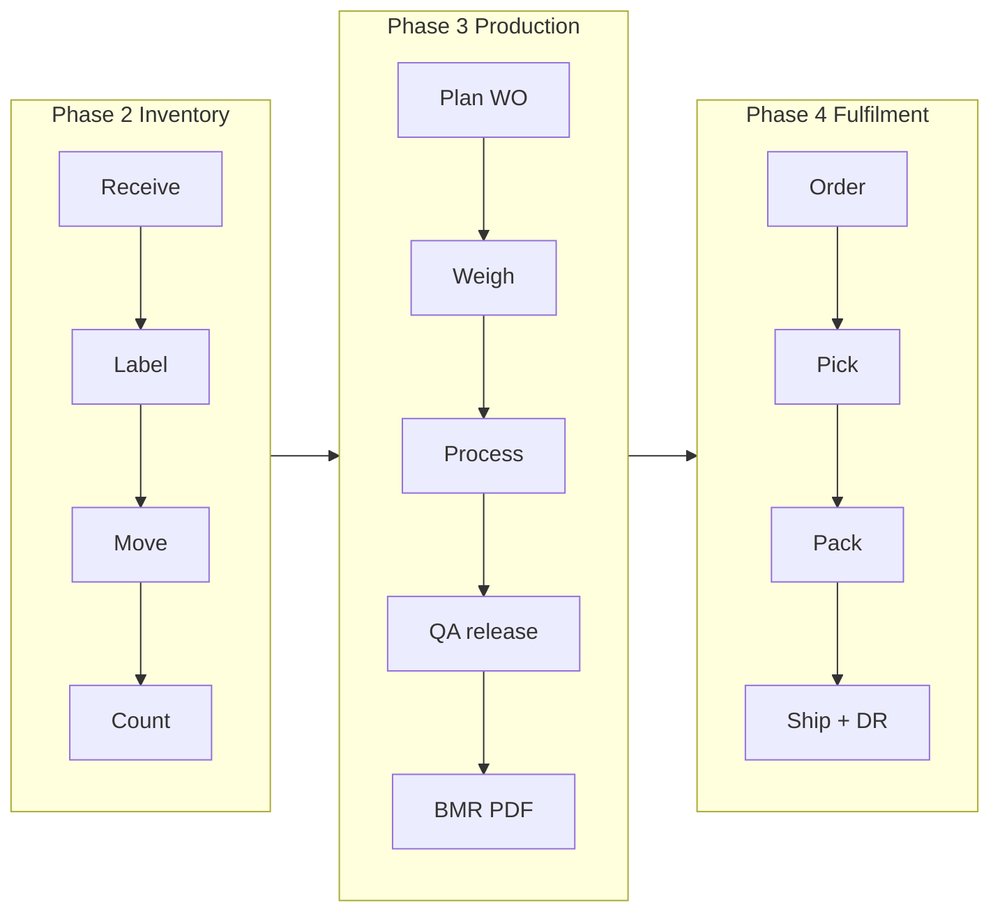
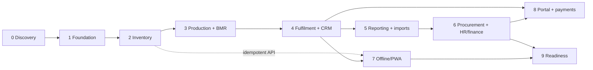

# Product Requirements Document: Bryel's Care ERP/CRM

| Field | Value |
|---|---|
| Status | Phase 0 draft for Gate 0 review (see `docs/team-charter.md`) |
| Owner | product-manager (accountable: principal-architect) |
| Source of truth | `docs/source/master-brief.md`, `docs/source/bmr-acapulco-soap.jpeg`, `docs/decision-log.md` |
| Related | `docs/process-maps.md`, `docs/architecture.md`, `docs/data-model.md`, `docs/permissions-matrix.md`, `docs/ux-system.md`, `docs/offline-sync.md`, `docs/security.md`, `docs/testing.md`, `docs/backlog.md`, `docs/risk-register.md`, `docs/data-migration-plan.md` |
| Conventions | Facts are labelled `F-nn`; assumptions `A-PRD-nn`; functional requirements `FR-<module>-nn`; acceptance criteria `AC-nn`; discovery questions `Q-A/B/C-nn` |

---

## 1. System vision

Bryel's Care Corporation makes soap, lotions and other personal-care products ("Beauty and
Wellness From Nature") at more than one site. Today the work is run on paper and spreadsheets:
a Batch Manufacturing Record (BMR) is printed, filled in by hand at the scale and the mixer,
checked by a second person, signed by QA, and filed. Stock, orders, attendance and money live
in separate files that do not agree with each other.

The system described here is one internal web application, installed on the phones and
tablets people already carry on the floor and used from desktops in the office. It replaces
the paper BMR, stock cards, packing notes and delivery receipts with records that are created
by scanning and tapping, checked by the system as they are entered, and printed when paper is
still needed.

For **operators** it means: scan a lot, see what it is and whether it may be used, and do the
one thing you came to do (receive, weigh, move, pack, dispatch) in the fewest safe steps, with
big targets, plain words and no arithmetic. Mistakes are caught at the scale, not at QA
review.

For **supervisors and QA** it means: a live board of work orders, batches and orders by state;
an approval queue; the ability to release or hold a lot with one recorded decision; and
traceability from any supplier lot forward to every customer, or from any complaint backward
to every batch and box, in seconds instead of days of binder searching.

For **owners and directors** it means: one dashboard whose numbers reconcile to the
underlying transactions (stock value, output and yield, orders shipped on time, holds,
near-expiry stock, receivables where in scope), with a definition behind every number and
drill-down to the records. Approvals that need an owner can be done from a phone.

Success at go-live (Phases 1 to 4) looks like this: every raw material lot received is
labelled and findable; every batch is run from a digital BMR that stores the exact formula
revision, the lots weighed, who weighed and who checked, the yield and QA's disposition, and
prints as a complete PDF; every shipped box can be traced to its batch and its customer; nobody
at Site A can see or change Site B's stock; and the paper BMR is used only where an approved
SOP still requires a wet signature.

What the system is **not**: it is not a general ledger, not a validated regulated
electronic-record system, not a payroll engine until qualified reviewers sign off, and not a
source of legal, tax or cosmetics-regulatory rules. Those remain the responsibility of the
company's qualified people; the system holds their decisions as configuration.

---

## 2. Confirmed facts vs assumptions

### 2.1 Confirmed facts (from the brief and the BMR photo only)

| ID | Fact | Source |
|---|---|---|
| F-01 | The company is Bryel's Care Corporation, a cosmetics and personal-care manufacturer; the logo carries the line "Beauty and Wellness From Nature". | brief; BMR photo |
| F-02 | Product families include soap, lotions and other cosmetics/personal-care or health-related products. Not every product follows the same manufacturing route. | brief, Business context |
| F-03 | Current processes are fragmented and largely manual; the BMR is a printed form completed by hand. | brief, Mission; BMR photo |
| F-04 | The current BMR header holds: product name, batch number, department, batch formula number, batch size, start date, end date. The sample is Acapulco Soap, department Production, batch size 17,600 g, start date 12 October 2026, other header fields blank. | BMR photo |
| F-05 | The dispensing and weighing table columns are: Ingredient (INCI name), Batch Number, Expiration Date, Theoretical Weight/Volume (g), Actual Weigh/Volume (g), Conducted by, Checked by. Material lot identity and expiry are therefore already recorded at dispensing today, with two-person verification. | BMR photo |
| F-06 | Sample formula lines: Coconut Oil 3,723.2 g; Palm Oil 8,687.4 g; 33.33% Lye Solution 4,964.2 g; Acapulco Extract 190.9 g; 6% Green in Oil 34.4 g; printed total 17,600 g. The lines sum to 17,600.1 g, so the printed total is rounded. Two lines are prepared intermediates (lye solution, colourant in oil), not purchased materials. | BMR photo |
| F-07 | The procedure section has five free-text numbered lines (blank on the sample). | BMR photo |
| F-08 | The checklist has seven steps, each with Conducted by and Checked by: 1 Weighing area line clearance; 2 Weighing; 3 Production area line clearance; 4 Mixing and cutting; 5 Production area line clearance; 6 Packaging and labeling; 7 Transfer to quarantine storage area. | BMR photo |
| F-09 | The footer holds: theoretical yield, actual yield, expiration date, test results, test date, conducted, checked by, final disposition (Approved / Disapproved), name and signature of QA, date, remarks. Finished batches go to quarantine before a named QA person dispositions them. | BMR photo |
| F-10 | The BMR photo is a process reference for configurable templates, not a universal schema; values and procedures must be verified with authorised personnel before production use. | brief, Reference materials |
| F-11 | SKUs, clients, formulas, lines, packaging formats and customer requirements must be configurable through versioned routings, formulas/BOMs, work instructions, label templates and customer specifications. | brief, Business context |
| F-12 | The company operates multiple sites; users may only see authorised sites, warehouses, departments and records, enforced on the server and in query scope. | brief, Business context |
| F-13 | Primary devices are phones and tablets, with desktop support; connectivity is unreliable; offline is required for selected workflows only, with explicit sync and conflict handling. | brief, Business context |
| F-14 | Deployment target is Railway with PostgreSQL. | brief |
| F-15 | Barcode/QR workflows cover raw materials, containers, intermediates, finished goods, boxes/cartons, locations and shipment units. | brief |
| F-16 | Required printable documents: BMR, weighing/dispensing sheet, production traveler, packaging/boxing note, delivery receipt, pick list, labels/barcodes, stock movement, purchase documents, invoices/statements where applicable, configurable reports. | brief |
| F-17 | A customer portal and online payments (for example PayMongo) are future work, outside the initial critical path. | brief |
| F-18 | Attendance comes from an existing time-clock machine's downloaded file. | brief, Module 11 |
| F-19 | Compliance, tax, labour, privacy, cosmetics labelling and claims vary by jurisdiction; professional validation is a requirement. The system is not a substitute for qualified QA/regulatory or accounting review. | brief |
| F-20 | The roadmap is Phases 0 to 9 with the exit criteria in the brief; MVP for go-live is Phases 1 to 4. | brief; team brief |
| F-21 | Finance scope (operational support vs full ledger) and payroll scope must be decided with the business before being built. | brief, Modules 10 and 11; ADR-020/021 |
| F-22 | The brief uses the term "night differential" and names PayMongo. These are evidence for the locale assumption, not a confirmed locale. | brief |
| F-23 | Visual direction: calm card-based dashboard, botanical green brand, operator mode with task names such as Receive Materials, Weigh Batch, Move Box, Pack Order, Dispatch Shipment. | brief; `docs/source/ui-inspiration.md` |

### 2.2 Assumptions register

Every assumption below is a default the team will build unless the owner says otherwise.
"Configurable" means the value or behaviour is data or an environment setting, not code.

| ID | Topic | Default chosen | Why | Configurable? | Owner confirmation | Phase |
|---|---|---|---|---|---|---|
| A-PRD-01 | Locale (ADR-019) | Philippines; Asia/Manila; PHP; metric (g, kg, mL, L, pcs); dates `DD MMM YYYY`; English UI | PayMongo and "night differential" point to the Philippines | Timezone per site, currency per organization, date format per user | Yes | 1 |
| A-PRD-02 | Number of sites | Seed and sizing assume 2 to 3 physical sites, each with at least one warehouse and one production line; the model supports any number | Brief says "multi-site" without a count | Yes (data) | Yes | 1 |
| A-PRD-03 | Product families and routes | Two example routes in seed data: bar soap (lye solution preparation, mixing, moulding/cutting, curing hold, packaging) and lotion (heating, mixing/emulsifying, cooling, filling, packaging). Both are placeholders until process owners approve real routings | Brief lists these as examples only | Yes (Routing/RoutingRevision) | Yes (Production) | 3 |
| A-PRD-04 | Lot/batch/box numbering | Defaults in `numbering_rules`: batch `B-{SITE}-{YYMMDD}-{SEQ3}`, lot `L-{YYMM}-{SEQ5}`, box `BX-{SEQ8}`, PO/SO/DR/GR `{TYPE}-{YY}-{SEQ5}`; legacy paper numbers kept in a `legacy_number` field | Current rules unknown | Yes (per site and document type) | Yes | 1 |
| A-PRD-05 | Printers | A4 laser/inkjet for documents through browser print or PDF; thermal label printers driven by browser printing of label-sized PDFs (default label sizes 50×30 mm and 100×50 mm); no vendor printer language (for example ZPL) in MVP | Hardware unknown | Label sizes per template | Yes (IT) | 2 |
| A-PRD-06 | Scanners | Phone/tablet camera first; USB/Bluetooth keyboard-wedge scanners supported; no rugged terminals | Brief asks for camera plus keyboard-like scanners | Symbology per label template (ADR-017) | Yes (IT) | 2 |
| A-PRD-07 | Scales | Operator reads the scale and types the weight; the scale is selected or scanned as equipment and recorded on the DispenseRecord; no scale data integration in MVP | No integration requirement stated | Adapter later | Yes (Production) | 3 |
| A-PRD-08 | Devices and OS | Mostly Android phones with some iOS; floor devices shared, office devices personal; current Chrome and Safari | Brief: "representative iOS/Android devices" | Device matrix in `docs/testing.md` | Yes (IT) | 1 |
| A-PRD-09 | Connectivity | Wi-Fi reliable in offices, intermittent in warehouse and production areas; MVP is online-first; approved offline workflows arrive in Phase 7 | Brief: unreliable connectivity, offline selective | Offline workflow list in `docs/offline-sync.md` | Yes (IT) | 2, 7 |
| A-PRD-10 | Accounting software | External system kept by the accountant; no general ledger in this product (ADR-020); exports in an accountant-defined CSV/XLSX layout | Brief: do not replace accounting without approved scope | Export layouts | Yes (Accountant) | 6 |
| A-PRD-11 | Payroll software | None or spreadsheet; import-first and reporting-first (ADR-021); no pay computation before qualified sign-off | Brief: phase payroll carefully | Rule catalogue | Yes (HR, Accountant) | 6 |
| A-PRD-12 | Users and volumes (sizing) | ≤60 named users, ≤25 concurrent; ≤300 SKUs; ≤500 materials; ≤200 new lots/month; ≤2,000 stock movements/day; ≤100 batches/month; ≤20 shipments/day | Typical for a small/mid manufacturer; needed for performance targets | n/a | Yes (Owner) | 1, 9 |
| A-PRD-13 | Retention | All records kept online through go-live plus 2 years; archive policy default 7 years for batch, quality and finance records; employee data per HR policy. Values validated by qualified reviewers | Brief: retention subject to law and policy | Per record class | Yes (Owner, QA, Accountant) | 9 |
| A-PRD-14 | Electronic sign-off | A sign-off is an authenticated user action with password (or MFA) re-entry, stored as an attestation with actor, time and record revision. It is not a validated regulated e-signature; paper hybrid allowed where SOPs require | Brief: e-records need formal validation before reliance | Re-auth requirement per step type | Yes (QA) | 3 |
| A-PRD-15 | Receipt quality status | Every received lot starts in `quarantine` until qa_qc releases it; material classes (for example packaging) can be configured to auto-release | Brief: inspection state on receipt | Per material class | Yes (QA) | 2 |
| A-PRD-16 | Allocation rule | FEFO when the lot has an expiry or retest date, FIFO otherwise | Brief | Per product/material class and per customer | Yes | 2 |
| A-PRD-17 | Negative stock | Not allowed; posting fails | Brief: prevent unless policy allows | Per site policy | No (informed) | 2 |
| A-PRD-18 | Dispensing tolerance | No system default. Each formula line must carry a tolerance (absolute or percent) entered by the process owner; seed values are fictional | Never invent quality values | Per FormulaRevision line | Yes (Production, QA) | 3 |
| A-PRD-19 | Batch size basis | Batch size is the total theoretical input mass (17,600 g on the sample equals the sum of inputs); expected yield is a percent of batch size or an absolute output quantity, per formula | Matches the sample BMR | Per FormulaRevision | Yes (Production) | 3 |
| A-PRD-20 | Two-person verification | Dispensing lines and checklist steps need a conductor and a different checker, as on the paper BMR | BMR photo | Per routing step | Yes (QA) | 3 |
| A-PRD-21 | Approval thresholds | All stock adjustments and count variances need site_manager approval; expense and PO thresholds are set in Phase 6 | Safe default | Threshold rules are data | No (informed) | 2 |
| A-PRD-22 | Language | English UI with plain-language operator labels; a second language only if requested | Brief is in English | i18n keys from Phase 1 | Yes | 1 |
| A-PRD-23 | Sales model | B2B/wholesale accounts with repeat orders; no lead/opportunity pipeline in MVP; quotations are Should | Brief: pipeline only if relevant | Pipeline can be enabled later | Yes (Owner, Sales) | 4 |
| A-PRD-24 | Shipping policy | Partial shipments allowed; over-shipment blocked without site_manager approval | Brief | Per customer | No (informed) | 4 |
| A-PRD-25 | Notification channels | In-app from Phase 2; email via provider adapter from Phase 5; no SMS/chat until consent and policy exist | Brief | Provider adapter | No (informed) | 5 |
| A-PRD-26 | Sessions on shared devices | Shorter idle timeout on floor devices than office devices; values in `docs/security.md` | Shared floor devices | Per device class | Yes | 1 |
| A-PRD-27 | Intermediates | Prepared solutions (lye solution, colourant in oil) are intermediate materials with their own batch, lot and expiry, dispensed like any material | BMR photo lists them as ingredients | Per material (type = intermediate) | Yes (Production) | 3 |
| A-PRD-28 | Expiry basis | Finished-goods expiry = batch completion date + product shelf life; basis switchable to release date | Common practice; value per product | Per Product | Yes (QA) | 3 |
| A-PRD-29 | Rounding | Quantities stored to 4 decimals; displayed to the UOM's precision (g: 1 decimal); totals computed from unrounded lines; printed totals rounded per template setting | Sample BMR prints 17,600 for a 17,600.1 sum | Per UOM and template | Yes (QA, Production) | 3 |
| A-PRD-30 | Data migration | Opening balances and active lots loaded as opening receipts at go-live; historical paper BMRs attached as scans, not re-keyed | Brief: document migration; details in `docs/data-migration-plan.md` | n/a | Yes (Owner) | 9 |
| A-PRD-31 | Customer requirements | Customer-specific labels, carton counts and certificates exist and are modelled as CustomerRequirement records; none known yet | Brief | Data | Yes (Sales) | 4 |
| A-PRD-32 | Time-clock export | CSV or XLSX with employee identifier, timestamp and in/out flag; mapping layer absorbs other layouts | Unknown format | Mapping versions | Yes (HR, IT) | 5 |
| A-PRD-33 | Backup objectives | RPO 24 h (daily logical dump plus platform backups), RTO 4 h; see `docs/deployment-railway.md` | Brief: define with company | Env/platform settings | Yes (Owner, IT) | 9 |
| A-PRD-34 | MFA scope | TOTP required for owner_director, system_admin, finance, hr_payroll and qa_qc from Phase 1b; optional for others | ADR-004 | Per role | Yes | 1 |

---

## 3. Actors and personas

Role codes and display names are the shared vocabulary (`docs/permissions-matrix.md`). Pain
points are inferred from the brief and the paper BMR and will be validated in Phase 0
interviews (`docs/process-maps.md`).

| Role | Goals | Devices and environment | Top tasks | Pain today (inferred) | "Easier" means |
|---|---|---|---|---|---|
| owner_director "Owner/Director" | See the whole business, approve what matters, trust the numbers | Phone and laptop; office, travelling | Dashboard, exception review, high-value approvals, gate decisions, site comparison | Numbers assembled by hand from spreadsheets and paper; problems found late | One reconciled view with drill-down; approvals from a phone; alerts for exceptions only |
| system_admin "System Administrator" | Keep the system configured, secure and healthy without engineers | Desktop | Users, roles, site assignments, numbering rules, templates, settings, integrations, audit log, health | Role is new; no tooling exists | Self-service admin with audit visibility and no secrets on screen |
| site_manager "Site Manager" | Run the site day to day; nothing stuck, nothing unsafe | Tablet and desktop; moves between floor and office | Boards (production, orders), approval queue (adjustments, exceptions, over-shipment), team coverage, site KPIs | Chasing paper to know batch or order status; approvals by walking around | Live boards, approval queue, site KPIs, exceptions surfaced |
| production_planner "Production Planner" | Turn demand into feasible work orders | Desktop and tablet; office | Availability check, reservations, work orders, line schedule, shortages | Manual availability checks; surprises at staging | Available-to-promise view, shortage list, work order from demand in a few taps |
| production_operator "Production Operator" | Make the batch right the first time | Shared phone or tablet; production area; gloves, wet hands, lye, noise | Line clearance, weigh/dispense with lot scan, record readings, complete steps, record yield, move to quarantine | Handwritten BMR, mental arithmetic, lookups, errors found at QA review | Guided steps, large targets, scan the lot, tolerance checked instantly, nothing re-typed |
| warehouse_operator "Warehouse Operator" | Know what is where and move it safely | Phone plus scanner; warehouse, receiving bay | Receive, label, put away, move, pick, pack, count | Manual stock cards, lot mix-ups, hunting for stock, expiry surprises | Scan shows identity, status and allowed actions; FEFO suggested; labels printed at receipt |
| qa_qc "QA/QC" | Release only what meets specification; prove it later | Tablet and desktop; lab, office, floor | Inspection queue, test entry, holds, dispositions, deviations, CAPA, genealogy and recall explorer | Paper results, signature chasing, traceability by binder search | Queue-driven work, one recorded decision per lot/batch, trace in seconds |
| procurement "Procurement" | Right material, right time, approved supplier | Desktop | Suppliers, purchase requests/orders, expected receipts, discrepancies, reorder review | Stockouts discovered late; no supplier history | Reorder suggestions with reasons; receipt status visible |
| sales_cs "Sales/Customer Service" | Take orders accurately; answer "where is my order" | Desktop and phone | Customers, requirements, quotes, orders, status, complaints, returns | Status by phoning the warehouse; requirements in emails and memory | Order status on screen; requirements attached to the customer; DR ready at dispatch |
| finance "Finance/Accounting" | Bill, pay, cost and hand clean data to the accountant | Desktop | Invoices, bills, payments, credit notes, expenses, costing, exports, period locks | Re-keying into the accounting system; batch cost unknown | Exports in the accountant's layout; estimate vs actual cost per batch |
| hr_payroll "HR/Payroll" | Correct attendance, fair pay, private data | Desktop | Employees, shifts, attendance import, exception review, time summaries, payroll support | Time-clock file massaged in spreadsheets; missing punches fixed from memory | Import wizard with exception queue, approvals and audit |
| auditor "Auditor (read-only)" | Verify records without changing them | Desktop | Audit log, traceability, document history, controlled exports | Evidence scattered | Everything searchable, immutable, exportable with permission |
| customer_portal_user "Customer Portal User (future)" | Order and reorder, see status and documents | Phone and desktop; external | Catalogue, order, status, documents, reorder | Orders by message or call | Self-service with only their own data (Phase 8) |

---

## 4. Domain and module map

The brief's fifteen functional modules map onto twelve code modules
(`src/modules/<name>`, ADR-001). Entities use the names in `docs/data-model.md`.

| Brief module | Code module(s) | Key entities | First delivery | Notes |
|---|---|---|---|---|
| 1 Identity, roles, sites, governance | identity, platform (audit) | Organization, Site, Department, User, Role, Permission, UserSiteAssignment, Session, AuditEvent | Phase 1 | Approval thresholds and separation of duties are platform services used by every module |
| 2 Master data and configuration | masterdata | Product, Sku, Uom, UomConversion, Material, Supplier, Customer, CustomerRequirement, Formula, FormulaRevision, BomLine, Routing, RoutingRevision, RoutingStep, WorkInstructionRevision, LabelTemplate, Warehouse, Location, ProductionLine, Equipment, NumberingRule | Phase 1 (basics), 3 (formulas/routings), 4 (customers) | Effective-dated revisions from day one |
| 3 Inventory, warehouse, scanning | inventory, documents (labels) | InventoryLot, InventoryBalance, StockMovement, StockReservation, StockAllocation, StockCount, StockCountLine, Container, ContainerContent, LabelJob | Phase 2 | Scan-to-action shell lives in `src/ui` and is reused by production and sales |
| 4 Procurement and suppliers | procurement, masterdata (Supplier) | PurchaseRequest, PurchaseOrder, PurchaseOrderLine, GoodsReceipt, GoodsReceiptLine, SupplierLotDocument | Phase 2 (unplanned receipts, supplier lot documents), 6 (PR/PO) | GoodsReceipt belongs to procurement; posting goes through inventory |
| 5 Production planning and execution | production | ProductionPlan, WorkOrder, Batch, BatchMaterial, DispenseRecord, ProcessStepRecord, EquipmentUse, BatchOutput, YieldRecord, ScrapReworkRecord, Deviation | Phase 3 | ProductionPlan from demand in Phase 5 |
| 6 Quality and traceability | quality | InspectionPlan, Inspection, TestResult, QualityHold, Capa, ChangeControl, Complaint, RecallCase, Disposition | Phase 2 (lot holds and release), 3 (inspections, dispositions, deviations), 4 (complaints, returns, recall explorer), 6 (CAPA, change control) | Genealogy is a query across inventory, production and sales |
| 7 BMR and document generation | documents | DocumentTemplate, DocumentTemplateVersion, GeneratedDocument, FileAttachment | Phase 2 (labels, attachments), 3 (BMR, dispensing sheet) | Rendering per ADR-016 |
| 8 Packaging, boxing, dispatch, delivery documents | sales (Pick, Pack, Shipment, DeliveryReceipt), inventory (Container), documents | Pick, Pack, Shipment, DeliveryReceipt, Container, ContainerContent | Phase 4 | Shipment posting is an inventory command |
| 9 Sales, CRM, portal | sales | Quote, SalesOrder, SalesOrderLine, CustomerReturn; portal tenant (Phase 8) | Phase 4; portal Phase 8 | Pricing fields are sensitive (permissions matrix) |
| 10 Finance and accounting support | finance | Invoice, SupplierBill, PaymentRecord, CreditNote, ExpenseClaim, CostingRun, Reconciliation, JournalEntry (only if GL approved) | Phase 6 | Scope per ADR-020 |
| 11 HR, attendance, shifts, payroll | hr | Employee, Shift, ShiftAssignment, AttendanceImport, AttendanceEvent, AttendanceException, LeaveRequest, PayrollPeriod, PayrollLine, Payslip, PayrollApproval | Phase 5 (employees, import), 6 (rules, payroll support) | Scope per ADR-021 |
| 12 Analytics, forecasting, dashboards | analytics | KPI definitions, ScheduledReport, reporting views | Phase 5 | Catalogue in `docs/analytics-kpis.md` |
| 13 Notifications, tasks, monitoring | platform (notifications, jobs, settings) | Notification, BackgroundJob, ScheduledReport | Phase 1 (health), 2 (jobs, in-app), 5 (action center, email, diagnostics) | |
| 14 Maintenance, equipment, calibration | masterdata (Equipment), production (EquipmentUse, blocking rules) | Equipment, EquipmentUse | Phase 3 (register, calibration dates, blocking), later (PM plans, downtime, spares) | No separate module; added if maintenance scope grows |
| 15 Import/export and integration | platform (imports, files, numbering), `/api/v1` | ImportJob, FileAttachment, NumberingRule, SyncCommand, SyncConflict | Phase 1 (API, numbering), 2 (exports), 5 (import wizard), 7 (sync) | Provider adapters: email, storage, payment, time-clock, accounting |

---

## 5. Scope

### 5.1 MVP for go-live (Phases 1 to 4)

| Flow | Included at go-live | Proven by |
|---|---|---|
| Foundation | Sign-in, sessions, MFA for privileged roles, sites, roles, site-scoped permissions, audit log, master data, numbering, health, staging and production deploy | G1 |
| Receive → label → move → count | Unplanned and PO-less receipts, lots with expiry/retest, quarantine by default, labels (QR/Code 128), scan-to-action, moves and transfers, boxes with lineage, cycle and blind counts with approved variance posting, expiry alerts, stock card | G2 |
| Plan → weigh → produce → QA release → BMR | Versioned formulas and routings, work orders and batches, line clearance, dispensing with lot scan and tolerance, process readings, step checklist with conductor/checker, holds, deviations, yield and reconciliation, lot and batch disposition, BMR and dispensing sheet PDFs with reprint audit | G3 |
| Order → pick → pack → ship | Customer master and requirements, sales orders with approval, allocation by FEFO/FIFO, pick lists, pack verification by box scan, packaging reconciliation, shipment posting, delivery receipt, customer order status, complaints and returns capture | G4 |

### 5.2 Later phases

| Phase | Scope added |
|---|---|
| 5 Reporting + imports | Owner and operations dashboards, scheduled reports, CSV/XLSX import wizard, attendance import and exception review, action center, email notifications |
| 6 Procurement + HR/finance | Purchase requests and orders, expected and partial receipts, supplier performance, reorder suggestions, shifts and attendance rules, payroll support or accounting exports per approved scope, CAPA and change control, equipment maintenance plans |
| 7 Offline/PWA hardening | Installability, approved offline workflows, outbox, conflict queue, device testing |
| 8 Customer portal + payments | External ordering with tenant isolation, payment provider adapter, verified webhooks, reconciliation |
| 9 Production readiness | Load and security testing, backup/restore drill, monitoring, SOPs, training, migration rehearsal, rollback plan |

### 5.3 Explicitly out of scope

| Item | Why |
|---|---|
| Double-entry general ledger | ADR-020; the accountant's system remains the ledger unless owners approve GL scope |
| Payroll calculation before qualified sign-off | ADR-021; statutory rules must be validated, never invented |
| Validated regulated electronic signatures (for example 21 CFR Part 11 style) | Requires formal validation outside this team; A-PRD-14 defines attestation only |
| Lead/opportunity pipeline | Not confirmed as part of the sales process (A-PRD-23) |
| Scale, PLC or lab-instrument integrations | No stated requirement; values are typed (A-PRD-07) |
| SMS, chat or push notification channels | Need consent, provider and policy first (A-PRD-25) |
| Vendor printer languages (ZPL/EPL) | Browser printing covers the assumed hardware (A-PRD-05) |
| Advanced or AI forecasting | Brief: descriptive analytics first; baseline forecasting is Phase 6+ and labelled |
| Multi-organization SaaS tenancy | ADR-011: one organization; portal tenants are the only external boundary |
| Editing historical balances or posted records | Forbidden by the brief; corrections are reversals |

### 5.4 Not a substitute for

- An accounting system: the product records operational finance and exports to the accountant; it does not produce statutory financial statements.
- A regulated electronic-record system: sign-offs are attestations; where SOPs or customers require validated e-signatures, the paper hybrid procedure applies until validation exists.
- Legal, tax, labour, cosmetics-regulatory or quality advice: all such rules are configuration entered and validated by the company's qualified reviewers.

---

## 6. Functional requirements

Priority: **Must** (needed for the phase's gate), **Should** (planned in the phase, may slip
one phase with owner agreement), **Later** (post-MVP). Each row names the phase of first
delivery and a one-line acceptance hint; full acceptance criteria live in `docs/backlog.md`.

### 6.1 identity

| ID | Requirement | Priority | Phase | Acceptance hint |
|---|---|---|---|---|
| FR-identity-01 | Users with status lifecycle (invited, active, locked, deactivated), invitations, password reset, deactivation | Must | 1 | Deactivated user cannot sign in; open sessions revoked |
| FR-identity-02 | Roles per the shared vocabulary bundling permissions `module.entity.action` | Must | 1 | Every service call checks a permission string |
| FR-identity-03 | Site assignments (`user_site_assignments`) with organization-wide assignment only for owner_director, system_admin, auditor; department, line and warehouse sub-scopes | Must (site) / Should (sub-scope) | 1 / 2 | User with Site A only never receives Site B rows |
| FR-identity-04 | Action-level, scope-aware permissions; requester cannot approve own submission; configurable approval thresholds as data | Must | 1 | Approve on own record returns denied and is audited |
| FR-identity-05 | Session management: list devices, revoke one or all, idle and absolute expiry, device-class timeouts | Must | 1 | Revoked session fails next request |
| FR-identity-06 | MFA (TOTP) for privileged roles (A-PRD-34) | Should | 1 | Owner cannot complete sign-in without code |
| FR-identity-07 | Deny by default, least privilege, server-side enforcement; negative tests for URL, body, query and export manipulation in CI | Must | 1 | CI fails on any cross-site leak |
| FR-identity-08 | Audit events for auth-sensitive changes, permission and assignment changes, and a per-module hook for formula revisions, stock adjustments, approvals, payroll changes, financial postings and document reprints | Must | 1 (framework) | Permission change writes AuditEvent with before/after |

### 6.2 masterdata

| ID | Requirement | Priority | Phase | Acceptance hint |
|---|---|---|---|---|
| FR-masterdata-01 | Products and SKUs: variants, family, status, shelf life, storage conditions, barcode/QR format | Must | 1 | SKU with shelf life yields computed expiry on batch |
| FR-masterdata-02 | SKU packaging configuration (container, cap, label, carton, inserts, units per box) and customer-specific SKU mapping | Must | 4 | Packaging order lists components from SKU config |
| FR-masterdata-03 | UOM and conversions, dimensionally valid; density conversions material-specific and versioned (ADR-010) | Must | 1 | g↔L conversion rejected without material density |
| FR-masterdata-04 | Materials: INCI and common names, type (raw, packaging, intermediate), supplier part number, specification, approved suppliers, unit, storage conditions, retest/expiry rules, allergen/hazard notes, required quality documents | Must (basics) / Should (approved suppliers, required documents) | 1 / 2 | Receipt of a material missing a required document is flagged |
| FR-masterdata-05 | Versioned formulas/BOMs: lines with theoretical quantity, tolerance, expected yield, effective dates, approval; packaging BOM; label template link | Must | 3 | Draft revision cannot be used by a batch |
| FR-masterdata-06 | Versioned routings: steps, equipment/line requirements, work instruction revisions, QC checkpoints, required checks and sign-off rules per step | Must | 3 | Routing step with checker required blocks completion without checker |
| FR-masterdata-07 | Sites, warehouses, zones/bins/racks, special locations (receiving/staging, quarantine, hold, rejected, recall), production lines, equipment register | Must | 1 | Special locations exist per warehouse in seed |
| FR-masterdata-08 | Reason codes per transaction type and numbering rules per site and document type (ADR-009) | Must | 1 | Numbers unique per organization; reset period honoured |
| FR-masterdata-09 | Customers: profiles, contacts, ship-to addresses, contract/pricing rules, lead times, credit/terms, specifications, artwork/label versions, required documents, notes | Must | 4 | Order picks customer pricing and artwork version |
| FR-masterdata-10 | Supplier basics (name, contacts, status) for receipts; full supplier master in procurement | Must | 2 | Receipt requires an active supplier |
| FR-masterdata-11 | Label templates, versioned, with configurable content and symbology (ADR-017) | Must | 2 | Reprint uses the template version recorded on the label job |
| FR-masterdata-12 | Shifts, holiday calendars and site calendars | Should | 5 | Attendance rules reference the calendar |
| FR-masterdata-13 | Effective-dated, versioned records; a batch keeps the exact formula, routing, specification and instruction revisions used at creation | Must | 3 | Revising a formula does not change an existing BMR |
| FR-masterdata-14 | Equipment calibration, cleaning and maintenance due dates on the register | Should | 3 | Weighing on a scale past calibration due raises a blocking or warning rule per config |

### 6.3 inventory

| ID | Requirement | Priority | Phase | Acceptance hint |
|---|---|---|---|---|
| FR-inventory-01 | Receiving (unplanned or against a PO): supplier, item, quantity, UOM, supplier lot, internal lot, manufacture/expiry/retest dates, inspection state, documents and photos, put-away, discrepancy workflow | Must (unplanned) / Must (PO) | 2 / 6 | Posting creates InventoryLot, StockMovement(receipt) and label job |
| FR-inventory-02 | Append-only ledger: receipt, issue, transfer, consumption, output, adjustment, return, shipment, reversal with source document, user, time, site, location, lot, quantity (entered and base), UOM, reason; corrections by reversal plus replacement | Must | 2 | No UPDATE/DELETE on posted movements; reversal links original |
| FR-inventory-03 | Scan-to-action: scan lot, box or location, show identity, status, quantity and location, then offer only allowed actions; manual code entry fallback | Must | 2 | Scanning a quarantined lot offers Move but not Issue |
| FR-inventory-04 | Labels: single and batch printing for raw materials, WIP, finished goods, cartons, pallets and locations; content configurable (human-readable text, QR/barcode, unique ID, product, lot, dates, status, quantity) | Must | 2 | Label job records template version and printer page size |
| FR-inventory-05 | Symbology configurable; camera scanning on representative iOS/Android devices; keyboard-wedge USB/Bluetooth scanners | Must | 2 | Device matrix in `docs/testing.md` passes |
| FR-inventory-06 | FEFO/FIFO recommendation per product/material class and customer; recommended lot and location shown; expired, recalled, rejected and QA-held stock blocked from issue/allocation unless an authorised controlled exception is recorded | Must | 2 (recommend), 3 (issue), 4 (allocate) | Expired lot cannot be issued through normal flow (AC-12) |
| FR-inventory-07 | Container (box/carton/pallet) with unique ID, contents (item, lot, quantity), packing date, status, location; move requires scanning box and destination; split, merge and repack preserve lineage | Must | 2 (materials), 4 (finished goods) | Box scan shows SKU, lot, quantity, status, location (AC-16) |
| FR-inventory-08 | Stock counts: cycle count plans, blind counts, recount, variance approval, reconciliation posting with reason codes; original counts and history never erased | Must | 2 | Variance posting is an adjustment movement with approver |
| FR-inventory-09 | Reservations and available-to-promise distinguishing on-hand, reserved, allocated, quarantined, on-hold, expired, recalled and available per site/location | Must | 2 (projection, reservations), 4 (allocations) | Availability formula in shared vocabulary verified by test |
| FR-inventory-10 | Moves and transfers between locations, warehouses and sites with in-transit state for inter-site | Must / Should (inter-site) | 2 | Transfer out and in are two linked movements |
| FR-inventory-11 | Adjustments with reason and threshold-based approval | Must | 2 | Unapproved adjustment never posts |
| FR-inventory-12 | Lot quality status machine (quarantine, released, on_hold, rejected, expired, recalled) with scheduled expiry job and alerts | Must | 2 | Lot past expiry becomes `expired` and appears in alerts |
| FR-inventory-13 | Stock card / movement report per lot and location with opening, movements and closing balance | Must | 2 | Report totals equal projection |
| FR-inventory-14 | Offline scanning for approved workflows with device/user scope, durable queue, idempotency keys and pending/synced/failed/conflict states | Later | 7 (API idempotency from 2) | AC-20 |

### 6.4 procurement

| ID | Requirement | Priority | Phase | Acceptance hint |
|---|---|---|---|---|
| FR-procurement-01 | Supplier lot to internal lot mapping; certificates and specifications attached to the receipt (SupplierLotDocument) | Must | 2 | Lot detail shows supplier lot and its documents |
| FR-procurement-02 | Supplier master: contacts, approved-material list, pricing, lead times, MOQ, quality status, documents | Must | 6 | PO line rejects unapproved supplier/material pair |
| FR-procurement-03 | Purchase requests with approval, purchase orders (state machine), expected receipts, partial receipts, discrepancies, supplier returns | Must | 6 | PO `received` only when all lines received or closed short |
| FR-procurement-04 | Supplier performance (on-time, in-full, quality rejections, lead-time variance) | Should | 6 | Metrics reconcile to receipts |
| FR-procurement-05 | Reorder suggestions from min/max, lead time, safety stock, open POs, demand history and expiry risk; human review required, drivers shown | Should | 6 | Suggestion lists its inputs; nothing ordered automatically |

### 6.5 production

| ID | Requirement | Priority | Phase | Acceptance hint |
|---|---|---|---|---|
| FR-production-01 | Work orders (planning: what, how much, when, site/line) and batches (execution) with state machines from the shared vocabulary | Must | 3 | Illegal transition rejected with reason |
| FR-production-02 | Batch record fields: batch number, product/SKU, formula revision, target quantity, planned dates, site/line/equipment, status, assigned personnel, raw-material lots, actual quantities, process readings, deviations, yield, scrap/rework, samples, QC results, attachments | Must | 3 | All fields present in BMR export |
| FR-production-03 | Material staging and availability check against reserved lots before start | Must | 3 | Batch cannot enter `materials_staged` with short material |
| FR-production-04 | Dispensing/weighing: target, tolerance, actual, UOM, scale (equipment), operator, checker, material lot scan, tare/gross/net where needed, timestamp, sign-off; wrong material/lot and out-of-tolerance blocked unless a controlled exception is approved | Must | 3 | AC-14 |
| FR-production-05 | Process parameters: units, limits, actuals, timestamp, equipment, operator, review status; step completion depends on required checks and prerequisites | Must | 3 | Step with unmet prerequisite cannot complete |
| FR-production-06 | Line clearance records (weighing area, production area) with conductor and checker; configurable per routing | Must | 3 | Dispensing blocked until weighing-area clearance signed |
| FR-production-07 | Equipment cleaning/maintenance/calibration status and changeover; configurable blocking with auditable exception | Should | 3 | Overdue calibration blocks scale selection when rule is `block` |
| FR-production-08 | WIP holds, rework, scrap and deviations raised from any step | Must | 3 | Deviation links to batch and step; hold blocks progress |
| FR-production-09 | Yield: expected vs actual, variance, batch reconciliation, finished quantity, disposition; controlled amendment and reopen with audit | Must | 3 | AC-15 |
| FR-production-10 | Consumption and output post atomically into the stock ledger with lot genealogy (BatchMaterial, BatchOutput) | Must | 3 | Output lot traces to every consumed lot |
| FR-production-11 | Production board by work order and batch state; start batch from the board | Must | 3 | Board reflects state within one refresh |
| FR-production-12 | Packaging and label component reconciliation (issued, used, damaged, returned) | Must | 4 | Reconciliation variance outside tolerance raises deviation |
| FR-production-13 | Demand-to-production: production plan from sales orders and forecast with availability and reservations | Should | 5 | Plan line creates work order with reserved materials |
| FR-production-14 | Intermediates (prepared solutions) produced as their own batch and dispensed as materials (A-PRD-27) | Must | 3 | Lye solution batch appears as a lot on the soap BMR |
| FR-production-15 | Preventive maintenance plans, downtime log, maintenance work orders, spare parts, service records, responsible technician | Later | 6+ | Equipment history visible |

### 6.6 quality

| ID | Requirement | Priority | Phase | Acceptance hint |
|---|---|---|---|---|
| FR-quality-01 | Lot disposition: quarantine, release, reject, on_hold, recalled; only qa_qc (or configured role) may release | Must | 2 | Warehouse operator cannot release |
| FR-quality-02 | Quality holds on lot, batch, box or location with reason, owner and release | Must | 2 (lot), 3 (batch) | Held stock excluded from availability |
| FR-quality-03 | Inspections: incoming, in-process, finished product; sampling plans, test methods, specifications, acceptance criteria, results with units, attachments, reviewer, approval | Must | 3 (incoming minimal in 2) | Out-of-spec result cannot be approved as pass |
| FR-quality-04 | Batch disposition: release, reject, conditional hold, rework approved; only authorised roles | Must | 3 | Batch `released` only by qa_qc with sign-off |
| FR-quality-05 | Deviations with investigation, root cause and linkage to batch/lot/step | Must | 3 | Open deviation blocks batch release unless closed or waived with approval |
| FR-quality-06 | Complaints and customer returns with linkage to shipment, lot and batch | Should | 4 | Complaint opens reverse trace |
| FR-quality-07 | CAPA and change control workflows | Should | 6 | CAPA cannot close without effectiveness check |
| FR-quality-08 | Recall/withdrawal case: scope, affected lots/boxes/customers, actions, status | Should | 6 (explorer in 4) | Recall marks lots `recalled` and blocks allocation |
| FR-quality-09 | Genealogy forward (supplier lot → receipt → storage → batch → finished lot → box → order → delivery) and reverse | Must | 3 (to finished lot), 4 (to customer) | Trace returns all nodes within 2 s for seed data |
| FR-quality-10 | Immutable audit of results and decisions; corrections appended with reason, actor and time | Must | 3 | Edited result shows history |

### 6.7 documents

| ID | Requirement | Priority | Phase | Acceptance hint |
|---|---|---|---|---|
| FR-documents-01 | Configurable, versioned BMR template engine seeded with the Acapulco Soap layout as the first example | Must | 3 | Template version recorded on each generated BMR |
| FR-documents-02 | BMR header: product, SKU, batch number, formula number/revision, department, site/line, batch size, start/end dates, planned/actual yield, expiry/retest date, document revision | Must | 3 | AC-18 |
| FR-documents-03 | BMR ingredients table: INCI/common name, material code, supplier/internal lot, expiry/retest, theoretical, tolerance, actual, UOM, dispensed by, checked by, timestamps, deviation flag | Must | 3 | Matches F-05 columns plus new fields |
| FR-documents-04 | BMR process section: numbered steps, instruction revision, readings, equipment, operator, checker, timestamps, completion, exceptions | Must | 3 | Every completed step printed |
| FR-documents-05 | BMR checklist/sign-off section configurable per routing (line clearances, weighing, product-specific steps, packaging/labeling, reconciliation, transfer to quarantine) | Must | 3 | Seven-step soap checklist reproduced |
| FR-documents-06 | BMR QC section: results, specification limits, actuals, test date, conducted by, checked by, disposition, approval, date, remarks | Must | 3 | Disposition printed with approver and time |
| FR-documents-07 | Print-ready PDF: page breaks, document number and revision, batch identity on every page, footer with page x of y, signature areas, optional QR to the internal record; on-screen preview; controlled reprint with reason and audit | Must | 3 | AC-18 |
| FR-documents-08 | Hybrid paper procedure: handwritten completion where SOPs require; scan, attach, review and link to the digital record | Should | 3 | Attached scan linked to batch with reviewer |
| FR-documents-09 | Document set: raw material label, box/carton label, location label, weighing/dispensing sheet, production traveler, boxing/packing note, pick list, delivery receipt, stock movement report, purchase documents, invoice/statement where in scope, attendance import exception report | Must (per phase) | 2, 3, 4, 5, 6 | Each document in `docs/reports-and-templates.md` |
| FR-documents-10 | A4 default with configurable page size for thermal labels; printer-friendly CSS and PDF; reprint reason; document version | Must | 2 | Label prints at configured size without scaling |
| FR-documents-11 | Generated documents store generator, time, template version, source record revision, reprint history | Must | 2 | Reprint creates AuditEvent |
| FR-documents-12 | File attachments on receipts, lots, batches, inspections, complaints: type and size checks, object storage, scoped download links | Must | 2 | Non-allowed file type rejected |

### 6.8 sales

| ID | Requirement | Priority | Phase | Acceptance hint |
|---|---|---|---|---|
| FR-sales-01 | Accounts, contacts, order history, open orders, shipments, complaints, agreed requirements (customer 360); pricing and financial fields restricted by role | Must | 4 | sales_cs without `sales.pricing.view` sees no prices |
| FR-sales-02 | Sales order state machine from the shared vocabulary with credit/approval check, controlled cancellation and reversal | Must | 4 | Order above credit limit stops at `pending_approval` |
| FR-sales-03 | Customer-specific pricing, MOQ, lead time, packaging/label/artwork version, documentation, credit terms, ship-to, notes applied at order entry | Must | 4 | Order below MOQ warns or blocks per customer setting |
| FR-sales-04 | Quotations convertible to orders; repeat order from history | Should | 4 | Reorder copies lines and current pricing |
| FR-sales-05 | Packaging orders from SKU/customer configuration with units per box, lot/expiry printing and reconciliation | Must | 4 | Packaging order lists components and expected boxes |
| FR-sales-06 | Allocation of eligible lots by FEFO/FIFO; pick list; scan each picked box; quantity verification; partial shipment; carrier and tracking; over-shipment blocked without approval | Must | 4 | AC-17 |
| FR-sales-07 | Boxing note/packing list: order, customer, SKU, batch/lot, quantity per box, box IDs, gross/net weight, packer/checker, date, shipping marks | Must | 4 | Every box on the note has a Container record |
| FR-sales-08 | Shipment state machine; stock issued only at `dispatched` posting, never on draft documents | Must | 4 | AC-17 |
| FR-sales-09 | Delivery receipt and acknowledgment: company, customer, ship-to, document numbers, items, lots, quantities, date/time, driver/carrier, received-by name/signature, remarks | Must | 4 | DR reprint audited |
| FR-sales-10 | Customer order status view for internal users; complaint and return capture linked to shipment | Must | 4 | Status matches state machine |
| FR-sales-11 | Lead/opportunity pipeline | Later | — | Only if confirmed (A-PRD-23) |
| FR-sales-12 | Customer portal: separate auth boundary, tenant isolation, approved catalogue, order placement, quote/order status, downloadable documents, reorder; no internal notes, other customers or stock locations | Later | 8 | Portal tenant cannot read internal tables |
| FR-sales-13 | Payment provider adapter (for example PayMongo): verified webhooks, idempotent payment records, refund and reconciliation, secrets in environment, sandbox tests; no raw card data; never mark paid on redirect alone | Later | 8 | Duplicate webhook does not double-post |

### 6.9 hr

| ID | Requirement | Priority | Phase | Acceptance hint |
|---|---|---|---|---|
| FR-hr-01 | Employee profiles: employment status, department, site, supervisor, job/skill assignments, documents with access control | Must | 5 | Only hr_payroll and owner_director read personal data |
| FR-hr-02 | Attendance import wizard: upload CSV/XLSX, map employee identifiers and timestamps, preview, flag duplicates, unknown employees and missing punches, show errors, require review before posting | Must | 5 | AC-19 |
| FR-hr-03 | Import provenance: original file, checksum, uploader, timestamp, mapping version, row-level result, corrections; anomalous rows never silently discarded | Must | 5 | Rejected rows listed in exception report |
| FR-hr-04 | Time summaries per employee and period from posted attendance events | Must | 5 | Summary reconciles to events |
| FR-hr-05 | Shifts, shift assignments, holiday calendar, leave requests, overtime approvals | Should | 6 | Leave approval by supervisor, audited |
| FR-hr-06 | Attendance rules (time zone, rounding/grace, breaks, overtime, night differential, rest days, holidays, absences, incomplete punches, manager corrections) as effective-dated configuration validated by HR | Should | 6 | Rule change has effective date and approver |
| FR-hr-07 | Payroll support per approved scope: periods, earnings, deductions, allowances, overtime, statutory configuration, payslips, approval, payment export, corrections; no hard-coded statutory rates; qualified reviewer sign-off before reliance | Later | 6+ | Payroll run blocked until rule set is marked validated |
| FR-hr-08 | Audit of edits, exports and approvals on employee and payroll data | Must | 5 | Export of employee data writes AuditEvent |

### 6.10 finance

| ID | Requirement | Priority | Phase | Acceptance hint |
|---|---|---|---|---|
| FR-finance-01 | Scope decision recorded: operational finance support (ADR-020); current accounting process mapped in `docs/modules/finance.md` | Must | 0 | Owner decision at G0 or G5 |
| FR-finance-02 | Customer invoices and receivables; supplier bills and payables; payment tracking; credit notes | Must | 6 | Invoice from shipment; posted invoice immutable |
| FR-finance-03 | Expense requests with approval limits | Should | 6 | Over-limit claim routes to owner_director |
| FR-finance-04 | Cash/bank reconciliation imports and reconciliation reports | Should | 6 | Unmatched lines listed |
| FR-finance-05 | Costing runs: material, packaging, direct labour where available, overhead allocation method, scrap/rework, yield variance, landed procurement cost; estimates vs actuals labelled | Should | 6 | Batch cost shows estimate and actual side by side |
| FR-finance-06 | Tax configuration as data validated by the accountant | Must | 6 | No tax rate in code |
| FR-finance-07 | Posted/unposted states, period locks, controlled reversals, audit history; double-entry only if a GL is approved | Must | 6 | Posting into a locked period rejected |
| FR-finance-08 | Export to the accountant's system in agreed layouts | Must | 6 | Export file reconciles to posted records |
| FR-finance-09 | Payment-provider events kept separate from postings with an explicit reconciliation link | Later | 8 | Webhook record ≠ PaymentRecord until reconciled |

### 6.11 analytics

| ID | Requirement | Priority | Phase | Acceptance hint |
|---|---|---|---|---|
| FR-analytics-01 | Owner overview: sales/orders, revenue/margin where reliable, plan vs actual, output/yield, material availability, stock value, near-expiry/expired stock, fulfilment, quality holds, attendance/labour summary, cash/AR/AP indicators if in scope, exceptions | Must | 5 | AC-21 |
| FR-analytics-02 | Operations dashboards: line utilisation, work order status, bottlenecks, planned vs actual cycle time, yield loss, scrap/rework, downtime, schedule adherence, labour coverage, QC turnaround | Should | 5 | Each tile links to its KPI definition |
| FR-analytics-03 | Inventory dashboards: on-hand/available/reserved, aging, FEFO risk, slow/fast movers, stockout risk, supplier lead-time variance, count variances, lot traceability | Must | 5 | Totals equal ledger projection |
| FR-analytics-04 | Sales/CRM: pipeline of orders, repeat activity, on-time/in-full, fill rate, returns/complaints, forecast vs actual, customer service metrics | Should | 5 | OTIF computed from shipment postings |
| FR-analytics-05 | Every KPI has definition, calculation, time basis, source tables, refresh cadence and drill-down (`docs/analytics-kpis.md`); dashboards reconcile to transactions | Must | 5 | Reconciliation query per KPI documented |
| FR-analytics-06 | Reports filterable by date, site, product, client, line, status; export PDF/CSV/XLSX by permission; scheduled daily/weekly/monthly delivery to authorised recipients | Must | 5 | Scheduled report delivered with generated-at timestamp |
| FR-analytics-07 | Role-based visibility: owners aggregate across sites; site users see authorised sites only | Must | 5 | Site manager dashboard excludes other sites |
| FR-analytics-08 | Forecasting: transparent baseline methods, data sufficiency, error metrics, seasonality, lead times, manual overrides; actual/estimate/forecast/override labelled | Later | 6+ | Forecast hidden when history is insufficient |

### 6.12 platform

| ID | Requirement | Priority | Phase | Acceptance hint |
|---|---|---|---|---|
| FR-platform-01 | Health (`/api/health`) and readiness (`/api/ready`) endpoints; structured logs with correlation IDs | Must | 1 | Readiness fails when database unreachable |
| FR-platform-02 | Audit log viewer with filters (actor, entity, site, action, date) and export by permission | Must | 1 | Auditor reads, cannot modify |
| FR-platform-03 | Numbering rules service used inside posting transactions | Must | 1 | Concurrent posts never share a number |
| FR-platform-04 | Site and organization settings (timezone, currency, policies, thresholds) | Must | 1 | Setting change audited |
| FR-platform-05 | Background jobs (pg-boss, ADR-015): idempotent, keyed, retried with backoff, visible status | Must | 2 | Failed job appears in diagnostics |
| FR-platform-06 | Notifications: in-app from Phase 2, email adapter from Phase 5; other channels only after consent and policy | Must | 2 / 5 | Approval request notifies approver |
| FR-platform-07 | Action center: pending approvals, late work orders, low stock, expiring lots, failed imports, sync conflicts, quality holds, overdue maintenance, complaints, unshipped orders | Must | 5 (approvals from 2) | Items clear when resolved |
| FR-platform-08 | Recurring checks and escalation rules: owner, due date, severity, acknowledgement, resolution notes, audit | Should | 5 | Unacknowledged item escalates after configured time |
| FR-platform-09 | Monitoring: API and worker health, failed jobs, error rates, latency, storage, database capacity, sync backlog, backup status; admin diagnostics view without secrets | Must | 1 (health), 5 (diagnostics) | Diagnostics page shows no environment values |
| FR-platform-10 | CSV/XLSX import wizard: preview, mapping, validation, duplicate detection, error file, resumable processing, audit | Must | 5 (master data imports Should in 1) | Re-running an import does not duplicate rows |
| FR-platform-11 | Exports of reports, master data and transactions by permission; spreadsheet formula injection protection | Must | 2 | Cell starting with `=` is escaped |
| FR-platform-12 | Versioned internal API (`/api/v1`) with typed client; provider adapters for email, storage, payment, time-clock import, accounting export | Must | 1 (API), as needed | Breaking change requires `/api/v2` |
| FR-platform-13 | Offline sync infrastructure: SyncCommand outbox, replay with idempotency, SyncConflict review queue, sync status UI (`docs/offline-sync.md`) | Later | 7 | AC-20 |
| FR-platform-14 | Data migration tooling per `docs/data-migration-plan.md`: identifier generation, duplicate reconciliation, sign-off | Must | 9 (plan in 0) | Migration rehearsal recorded |
| FR-platform-15 | Fictional seed data for development and staging; production data never overwritten | Must | 1 | Seed refuses to run against production |

---

## 7. Non-functional requirements

| Area | Requirement |
|---|---|
| Mobile and touch | Core operator workflows work at 360 px width with no horizontal scroll; touch targets ≥44 px; sticky primary action; one-handed layouts for scan screens; camera scan and keyboard-wedge input on every scan field; card lists instead of wide tables on phones (`docs/ux-system.md`) |
| Performance on phones | Targets on a mid-range Android phone over 4G: first interactive ≤3 s for the operator shell, scan-to-result ≤1 s with cached reference data, posting command p95 ≤500 ms server time, dashboards ≤3 s for a month of seed data at A-PRD-12 volumes |
| Offline | Online-first until Phase 7; only workflows listed in `docs/offline-sync.md` may run offline; commands carry client UUIDv7 ids and idempotency keys from Phase 2; server is authoritative; conflicts go to a review queue; data freshness and sync status always visible; sensitive cache cleared on logout; periodic authorisation refresh |
| Security | Per `docs/security.md` and `docs/permissions-matrix.md`: argon2id, HttpOnly/Secure/SameSite cookies, CSRF checks, rate limits, MFA for privileged roles, server-side scope on every query, upload type/size checks, scoped download links, least-privilege database roles, secrets only in environment, no passwords or tokens in logs or audit |
| Accessibility | WCAG 2.1 AA contrast; visible focus states; labels on every input; keyboard operation on desktop; status conveyed by icon + text + colour, never colour alone; readable at 200 % zoom |
| Auditability | Append-only AuditEvent with actor, action, entity, site, correlation id, reason and before/after for the actions in FR-identity-08; posted ledgers immutable (ADR-006); document reprints audited |
| Reliability | Every posting command idempotent (repeat returns original result); transactions for multi-step operations; row locks on lot/location balances; daily backups and rehearsed restore (A-PRD-33); migrations applied as a pre-deploy step with rollback notes (`docs/deployment-railway.md`) |
| Observability | Structured JSON logs with request and correlation ids; error reporting; job and sync backlog metrics; health and readiness endpoints; alerts for failed jobs and backup failures (`docs/operations-runbook.md`) |
| Printing | A4 default; label sizes per template; print preview; PDF identical to preview; batch identity on every BMR page; printer-tested templates before gate approval (`docs/reports-and-templates.md`) |
| Data integrity | `numeric` for quantities and money (ADR-010); UUIDv7 keys; explicit state machines; no free-form status strings; foreign keys and unique constraints in migrations |
| Maintainability | Module boundaries enforced by lint (ADR-013); shared Zod schemas (ADR-008); docs updated in the same change; TypeScript strict |

---

## 8. Acceptance criteria

Restated from the brief's "Testing and acceptance criteria" (items 10 to 23). Numbers are
kept aligned with the brief. Test procedures: `docs/testing.md` (acceptance procedures,
referenced by AC id).

| AC | Criterion | Proven in phase | Test reference |
|---|---|---|---|
| AC-10 | A warehouse_operator assigned to Site A cannot see or change Site B inventory by manipulating a URL, request body, query parameter or exported file | 1 (framework), 2 (inventory) | `docs/testing.md` → authorization negative tests |
| AC-11 | Receiving a material lot creates a traceable InventoryLot and a posted StockMovement only after valid posting; a duplicate submission does not double the quantity | 2 | `docs/testing.md` → receipt idempotency |
| AC-12 | A material lot with status expired, recalled, rejected or on_hold cannot be issued to production through normal flows | 2 (status), 3 (issue) | `docs/testing.md` → blocked-stock tests |
| AC-13 | A batch stores the formula and routing revisions approved when it was created; later revisions do not alter the historical BMR output | 3 | `docs/testing.md` → batch snapshot |
| AC-14 | A dispensing entry enforces material/lot identity, unit, target tolerance and operator/checker rules, and records exceptions with approval | 3 | `docs/testing.md` → dispensing rules |
| AC-15 | Completing a batch records material consumption, actual output, yield, scrap/rework, QC results and disposition without losing the transaction trail | 3 | `docs/testing.md` → batch completion |
| AC-16 | A finished-goods box can be scanned to show SKU, lot, quantity, status and location; moving it updates traceability and is idempotent on retry | 2 (box), 4 (finished goods) | `docs/testing.md` → box move idempotency |
| AC-17 | A shipment cannot exceed eligible allocated stock without an authorised exception; shipment posting and inventory issue reconcile | 4 | `docs/testing.md` → shipment reconciliation |
| AC-18 | The BMR PDF includes all required fields, page numbering, batch identity on every page, revision, signatures/approvals, and a controlled reprint audit event | 3 | `docs/testing.md` → document output |
| AC-19 | Attendance import preserves the original file, detects duplicates and unmatched employees, displays row errors and does not post ambiguous rows silently | 5 | `docs/testing.md` → import validation |
| AC-20 | Offline commands survive app restart, show their status, sync exactly once and route conflicts to a human review queue rather than overwriting server data | 7 | `docs/testing.md` → offline replay |
| AC-21 | Owner KPI totals reconcile with source records for a defined test period and display filters and refresh time | 5 | `docs/testing.md` → KPI reconciliation |
| AC-22 | Every critical business action is permission-checked on the server and covered by automated tests | 1 onward, every phase | `docs/testing.md` → permission coverage |
| AC-23 | The application deploys to Railway from documented instructions with environment variables, migrations, health checks and a tested backup/restore procedure | 1 (deploy), 9 (restore drill) | `docs/testing.md` → deployment check; `docs/deployment-railway.md` |

---

## 9. Discovery questions

Owners who can answer: Owner, Production, QA, Accountant, HR, IT.

### 9.1 (a) Decisions that block architecture

| ID | Question | Why it matters | Default assumption | Owner |
|---|---|---|---|---|
| Q-A-01 | How many physical sites, warehouses, production lines and storage locations exist, and which roles need cross-site visibility? | Site scope model, seed data, dashboards, org-wide roles | A-PRD-02; cross-site only owner_director, system_admin, auditor | Owner |
| Q-A-02 | What connectivity exists in production and warehouse areas, and which exact tasks must work offline? | Fixes the Phase 7 offline list and the Phase 2 API contract | A-PRD-09; offline candidates: view tasks, scan-to-move, dispensing capture | IT, Production |
| Q-A-03 | Which phones, tablets, scanners, printers and scales are used, and are devices shared or assigned? | Scanning stack, session policy, label sizes, device matrix | A-PRD-05 to A-PRD-08 | IT |
| Q-A-04 | Which accounting software and accountant workflow must be supported, and is a general ledger wanted in this system? | Finance data model and ADR-020 | Operational finance only; exports | Accountant, Owner |
| Q-A-05 | Should the system compute payroll, or only import attendance and report? Who validates payroll rules? | ADR-021 and HR data model | Import and report first | HR, Accountant, Owner |
| Q-A-06 | Can representative anonymised time-clock export files be supplied now? | Import mapping design cannot be finalised without them | A-PRD-32 | HR, IT |
| Q-A-07 | Do any customers or regulators require validated electronic signatures on batch records? | Decides attestation vs validated e-signature and the hybrid paper procedure | A-PRD-14 | QA, Owner |
| Q-A-08 | What are the current lot and batch numbering rules, and must existing numbers be preserved on migration? | Numbering rules and migration identifiers | A-PRD-04 | Production, QA |
| Q-A-09 | Confirm locale: country, timezone(s), currency, language of the UI | ADR-019 affects every date, amount and label | A-PRD-01 | Owner |
| Q-A-10 | What is the minimum viable go-live date, preferred launch sequence, and which process causes the greatest loss today? | Orders the MVP and decides whether Phase 2 or 3 goes live first | Phases 1 to 4 in order; production/BMR is the biggest pain | Owner |

### 9.2 (b) Decisions that can be configuration (default we will ship)

| ID | Question | Why it matters | Default shipped | Owner |
|---|---|---|---|---|
| Q-B-01 | Which product families and routes exist, and which steps/parameters differ by SKU? | Routing templates in seed; real values later | A-PRD-03 example routes | Production |
| Q-B-02 | Are formulas, BOMs and tolerances documented? Who approves revisions and releases batches? | Formula approval workflow and release permission | Production approves formulas; qa_qc releases | Production, QA |
| Q-B-03 | Dispensing tolerance per ingredient (absolute or percent) | Blocks or allows weights | No default; required per line (A-PRD-18) | Production, QA |
| Q-B-04 | Expiry and retest rules per material and shelf life per product; expiry basis | Status transitions and FEFO | A-PRD-28; per material/product | QA |
| Q-B-05 | Which units are used for purchasing, weighing, production, packaging and selling; which conversions are needed? | UOM tables | g, kg, mL, L, pcs; mass/volume via material density | Production, Procurement |
| Q-B-06 | Should received lots default to quarantine; which material classes auto-release? | Inspection workload | A-PRD-15 | QA |
| Q-B-07 | FEFO or FIFO per material class and per customer; any exceptions? | Allocation engine settings | A-PRD-16 | Production, Sales |
| Q-B-08 | Is negative stock ever acceptable (for example backflush)? | Posting policy | Never (A-PRD-17) | Owner |
| Q-B-09 | Approval thresholds: adjustments, count variances, over-shipment, expenses, POs | Threshold rules | All adjustments and variances approved by site_manager; others set in Phase 6 (A-PRD-21) | Owner |
| Q-B-10 | Label content and sizes for raw materials, boxes, pallets, locations; QR or Code 128 | Label templates | QR, 50×30 and 100×50 mm (A-PRD-05, ADR-017) | IT, Production |
| Q-B-11 | Must dispensing and checklist steps keep two-person verification? Can the checker be the supervisor? | Routing step rules | Conductor ≠ checker (A-PRD-20) | QA |
| Q-B-12 | Rounding and display precision for weights and printed totals | UOM precision, template setting | A-PRD-29 | QA, Production |
| Q-B-13 | Sales process: quotations, credit/approval checks, invoicing, delivery receipt format and signatures | Order state settings, DR template | A-PRD-23, A-PRD-24 | Owner, Sales |
| Q-B-14 | Customer-specific requirements: labels, carton counts, certificates, order minimums, lead times, delivery documents | CustomerRequirement records | None seeded (A-PRD-31) | Sales |
| Q-B-15 | Attendance policy: time zone, rounding/grace, breaks, overtime, night differential, rest days, holidays, incomplete punches, corrections | Effective-dated attendance rules | Configuration only; nothing computed until validated | HR |
| Q-B-16 | Session timeouts and MFA roles | Security settings | A-PRD-26, A-PRD-34 | Owner, IT |
| Q-B-17 | Which users receive which notifications and by which channel? | Notification rules | In-app; email from Phase 5 (A-PRD-25) | Owner |
| Q-B-18 | Record retention periods per record class | Archive policy | A-PRD-13 | Owner, QA, Accountant |
| Q-B-19 | Which reason codes are used for adjustments, scrap, holds, deviations and returns? | Reason code lists | Seeded generic lists | Production, QA, Warehouse |
| Q-B-20 | Backup RPO/RTO acceptable to the business | Backup schedule | A-PRD-33 | Owner, IT |

### 9.3 (c) Questions that can wait

| ID | Question | Why it matters | Default assumption | Owner |
|---|---|---|---|---|
| Q-C-01 | Expected user count, concurrency, SKUs, lots, transaction volumes | Sizing and load tests in Phase 9 | A-PRD-12 | Owner |
| Q-C-02 | What data exists in spreadsheets, paper and legacy tools; what history must be migrated? | `docs/data-migration-plan.md`, Phase 9 | A-PRD-30 | Owner |
| Q-C-03 | Is a customer portal wanted, for which customers, and with which payment methods? | Phase 8 | Deferred | Owner, Sales |
| Q-C-04 | Is a lead/opportunity pipeline needed? | Phase 4+ | Not built (A-PRD-23) | Owner, Sales |
| Q-C-05 | Which forecasting horizon and level (SKU/site/week or month) would be useful? | Phase 6+ | Baseline methods only | Owner |
| Q-C-06 | Preventive maintenance and calibration programme details | Phase 6+ | Register and due dates only | Production |
| Q-C-07 | Overhead allocation method and labour costing source | Costing in Phase 6 | Material and packaging cost first | Accountant |
| Q-C-08 | Second UI language | Phase 5+ | English only (A-PRD-22) | Owner |
| Q-C-09 | Supplier performance metrics wanted | Phase 6 | OTIF, rejections, lead-time variance | Procurement |
| Q-C-10 | Any current QC test methods and specifications to load as inspection plans | Phase 3 seed | Fictional seed; real plans entered by QA | QA |

---

## 10. Phased roadmap

Exit criteria are quoted from the brief. Gates are defined in `docs/team-charter.md`.

| Phase | Scope | Exit criteria (brief) | Depends on | Gate |
|---|---|---|---|---|
| 0 Discovery and process mapping | Interviews and process maps (procurement, warehouse, production, QA, packaging, sales, attendance/payroll, finance, reporting); existing files and machine export formats; this document set | Approved glossary, workflows, roles/sites matrix, MVP scope, assumptions/risk register, data migration plan | Owner availability for interviews | G0 |
| 1 Foundation | Repository, environments, design system, auth, sites/RBAC, audit events, master data, migrations, seed data, CI, logging (Slice 1, section 11) | Permission tests pass; staging deploy works; basic mobile layout and operational shell approved | G0 approval of ADR-001 to 014, 019 to 021 | G1 |
| 2 Inventory MVP | Receipts, lots, locations, stock ledger, reservations, labels, scan-to-move, FIFO/FEFO recommendations, stock counts, boxes, holds and lot release, jobs, exports | End-to-end receive → label → move → count flow tested; concurrency and multi-site isolation verified | Phase 1; hardware answers (Q-A-03) | G2 |
| 3 Production + BMR | Versioned formulas/routings, work orders, batches, weighing, process records, QA hold/release, deviations, yield, BMR and dispensing sheet PDFs, intermediates | Run a representative soap batch in staging with traceability and printable record reviewed by production/QA | Phase 2 ledger; approved routings (Q-B-01, Q-B-02); ADR-016 decision | G3 |
| 4 Packaging + fulfilment + CRM | Customer master and requirements, orders, allocation, pick/pack, box IDs, packaging reconciliation, shipments, delivery receipts, order status, complaints/returns | Order-to-shipment flow reconciles stock and every shipped box is traceable | Phases 2 and 3 | G4 |
| 5 Reporting + imports | Owner and operations dashboards, operational reports, scheduled reports, action center, email, import wizard, attendance import and exception review, employees | KPIs reconcile to source data; attendance import validated against representative time-clock files | Phase 4 data; time-clock files (Q-A-06) | G5 |
| 6 Procurement + HR/finance scope | Purchase requests/orders, supplier performance, reorder suggestions, shifts/attendance rules, payroll support and/or accounting exports, invoices/bills/payments, costing, CAPA/change control, maintenance plans | Qualified business owners validate calculations and approvals; sensitive access tests pass | Phase 5; scope decisions (Q-A-04, Q-A-05) | G6 |
| 7 Offline/PWA hardening | Installability, approved offline workflows, outbox, conflict queue, device testing | Offline acceptance tests pass on representative phones/tablets; conflicts are visible and recoverable | Idempotent commands from Phase 2; offline list (Q-A-02) | G7 |
| 8 Customer portal + payment | External ordering, customer-specific access, provider adapter, verified webhooks, reconciliation | Security review, sandbox payment tests, idempotency and failure/refund tests pass | Phase 4 orders; Phase 6 invoices; decision Q-C-03 | G8 |
| 9 Production readiness | Load/security testing, backup/restore, monitoring, SOPs, training, data migration rehearsal, rollback plan | Go-live checklist signed by company owners; support ownership and incident procedure established | All phases in the go-live set | G9 |

Indicative sequencing:

1. Phase 0 documents are written in parallel by the personas and reconciled by the principal architect before G0.
2. Phase 1 is one slice (section 11). Design-system work for Phase 2 screens starts during Phase 1 build.
3. Phases 2 and 3 overlap: process-engineering and template design for Phase 3 run while Phase 2 is being built; Phase 3 code starts once the ledger (FR-inventory-02) is merged.
4. Phase 4 customer master and sales order work can start when Phase 3 has a released batch to ship; packaging reconciliation needs Phase 3 output lots.
5. Phase 5 attendance import can be built as soon as representative files arrive, independent of Phase 4; KPI work needs Phase 4 data.
6. Phase 7 groundwork (idempotency keys, client ids, outbox contract) is part of Phase 2's API design; the PWA hardening itself waits for Phase 4 screens to stabilise.
7. A production go-live after G4 is possible without Phases 5 to 8 if the owner accepts spreadsheets for reporting and procurement for a period; Phase 9 activities (backup drill, security review, migration rehearsal) must then be pulled forward.
8. Security review runs continuously on anything touching auth, scope, uploads, exports or webhooks (charter working agreement 6).

---

## 11. Slice 1 definition: Phase 1 Foundation, first vertical slice

### 11.1 Scope in plain terms

| Area | What Slice 1 delivers |
|---|---|
| Repository and tooling | pnpm workspace, TypeScript strict, Next.js App Router, Drizzle, ESLint boundaries, Prettier, Husky, Vitest, Playwright (ADR-001, 003, 012, 013) |
| Environments | Local (Docker Postgres), staging and production on Railway with separate databases and secrets; migrations as pre-deploy step (ADR-014) |
| Design system shell | Tokens, base components, responsive shell: desktop left navigation with collapsible groups, mobile bottom/drawer navigation, page title, site switcher, user menu; loading/empty/error/denied states; operator mode entry point (`docs/ux-system.md`) |
| Sign-in and sessions | Email + password (argon2id), invitation and password reset, session list and revocation, idle and absolute expiry, account states; MFA (TOTP) for privileged roles in Phase 1b (ADR-004) |
| Sites and role/permission administration | Organization, sites, roles seeded from `docs/permissions-matrix.md`, user management, user_site_assignments, org-wide assignment for owner_director/system_admin/auditor |
| Site-scoped authorization | AuthContext built per request; scoped repository helpers; permission check in every service; separation of duties helper; approval threshold table |
| Audit log | AuditEvent table and writer; events for sign-in/out, failed sign-in, password reset, user and role changes, assignment changes, settings changes; audit viewer with filters |
| Master data basics | UOM and conversions, sites, warehouses, locations (with special locations), products and SKUs (basic fields), materials (basic fields), reason codes, numbering rules, settings |
| Migrations and seed | Migrations from zero; fictional seed (two sites, warehouses, locations, users per role, a few products and materials); seed guard against production |
| CI | GitHub Actions: lint, typecheck, unit, integration against Postgres service, Playwright smoke at 360 px and desktop; permission negative tests mandatory |
| Health | `/api/health` and `/api/ready`; structured logs with correlation id |
| Staging deploy | Documented deploy from `docs/deployment-railway.md`; health checks green; seed loaded |

### 11.2 Explicitly not in Slice 1

- No stock movements, lots, labels, scanning or printing (Phase 2).
- No formulas, routings, work orders or batches (Phase 3).
- No customers, orders or shipments (Phase 4).
- No background jobs, email, import wizard, dashboards or offline (Phases 2, 5, 7).
- No department/line/warehouse sub-scopes (Phase 2); site scope only.
- No MFA in Slice 1a (Phase 1b); no password-less or SSO.
- No real company data; seed is fictional.

### 11.3 Acceptance tests (Given/When/Then)

| # | Test |
|---|---|
| S1-01 | Given a user assigned warehouse_operator at Site A only, when they open `/sites/<site-b-id>/locations` or call `GET /api/v1/locations?siteId=<site-b-id>`, then the response is 403 (denied) and the list contains no Site B rows, and an AuditEvent `authz.denied` is written. |
| S1-02 | Given the same user, when they call `POST /api/v1/locations` with `siteId` of Site B in the body, then the service rejects it before any write and the Site B location count is unchanged. |
| S1-03 | Given a site_manager who submitted a settings change that requires approval, when they attempt to approve it, then the approval is denied with reason `separation_of_duties` and audited; a different site_manager can approve it. |
| S1-04 | Given a system_admin, when they add permission `inventory.adjustment.approve` to the site_manager role, then an AuditEvent records actor, time, role, before and after permission sets, and the change is visible in the audit viewer. |
| S1-05 | Given a user with two active sessions, when a system_admin revokes all sessions for that user, then the user's next request on either device is redirected to sign-in and the sessions show `revoked` with the actor. |
| S1-06 | Given a user whose account is deactivated, when they attempt to sign in with correct credentials, then sign-in fails with a generic message, no session is created, and the failed attempt is audited. |
| S1-07 | Given a phone viewport of 360 × 640 px, when any Slice 1 page is opened, then there is no horizontal scroll, every interactive element is at least 44 px tall and the primary action is reachable without scrolling the navigation. |
| S1-08 | Given the web service is running and the database is reachable, when `/api/health` and `/api/ready` are called, then both return 200 with JSON; when the database is unreachable, `/api/ready` returns 503 while `/api/health` still returns 200. |
| S1-09 | Given an empty PostgreSQL database, when `pnpm db:migrate` runs, then all migrations apply in order without error, and running it again is a no-op. |
| S1-10 | Given the seed script, when it runs against a database whose `APP_ENV` is `production`, then it refuses and exits non-zero; when it runs against development or staging, then every person, customer, supplier and product name is from the fictional list and no real credentials are present. |
| S1-11 | Given an owner_director with an organization-wide assignment, when they open the site switcher, then every site is listed; given a warehouse_operator assigned to Site A, then only Site A is listed and the switcher is hidden if there is one site. |
| S1-12 | Given a UOM conversion from `g` to `mL` with no material density, when it is saved, then validation rejects it as dimensionally inconsistent; `g` to `kg` saves. |
| S1-13 | Given numbering rule `GR-{YY}-{SEQ5}` for Site A, when 20 numbers are requested concurrently inside transactions, then 20 distinct consecutive numbers are issued. |
| S1-14 | Given a signed-in user whose session has exceeded the idle timeout for their device class, when they make a request, then it is rejected and they must sign in again; an active session within the absolute lifetime continues. |
| S1-15 | Given CI runs on a pull request, when any of lint, typecheck, unit, integration or the Playwright smoke fails, then the pull request is blocked; the permission negative tests (S1-01 to S1-03) are part of the required set. |

---

## 12. Glossary

| Term | Plain-language definition |
|---|---|
| Allocation | Assignment of specific lots and boxes to a confirmed sales order line, done before picking; distinct from a reservation. |
| Approval threshold | A configured value (quantity, amount or always) above which a transaction needs a second person's approval. |
| ATP (available-to-promise) | Stock that can be promised to a new order: on-hand minus reserved, allocated, quarantined, on-hold, expired and recalled quantities. |
| Attestation | A recorded "I did/checked this" by an authenticated user with re-entered credentials; not a validated regulated e-signature. |
| Audit event | An unchangeable record of who did what to which record, when, at which site, and why. |
| Batch | One execution of a work order with its own batch number and BMR; the unit of production traceability. |
| Batch size | The planned total quantity of a batch; on the sample BMR it is the total theoretical input mass (17,600 g). |
| BMR (Batch Manufacturing Record) | The document that records everything about a batch: formula, materials and lots weighed, steps, checks, yield, tests and QA decision. |
| BOM / formula | The list of materials and quantities needed to make a product; "formula" is used for the recipe, "packaging BOM" for packaging components. |
| CAPA | Corrective and preventive action: the plan that fixes the cause of a deviation or complaint and checks that the fix worked. |
| Change control | The approval process for changing a formula, routing, specification or template. |
| Checker | The second person who verifies a weighing or step (the "Checked by" column); must differ from the conductor. |
| Container (box/carton/pallet) | A physical package with a unique ID that holds quantities of one or more lots; not the same as a lot or a product. |
| Deviation | Any departure from the approved procedure or limits during a batch, recorded for investigation. |
| Disposition | QA's decision about a lot or batch: release, reject, hold, rework. |
| Dispensing | Weighing or measuring each ingredient for a batch against its target and tolerance. |
| Effective-dated | A record version that applies from a given date until replaced by a newer version. |
| Expiry date | The date after which a lot must not be used or shipped. |
| FEFO | First-expired, first-out: use the lot that expires soonest. |
| FIFO | First-in, first-out: use the oldest received lot when expiry does not apply. |
| Genealogy | The full chain from supplier lot to receipt, batch, finished lot, box, order and delivery, in either direction. |
| Goods receipt | The record of materials arriving, which creates lots and a receipt movement when posted. |
| Idempotency key | A unique key sent with a command so that sending it twice (retry, replay) has the same effect as once. |
| INCI name | The standard ingredient name used in cosmetics (International Nomenclature of Cosmetic Ingredients). |
| Intermediate | A prepared material (for example lye solution) made in-house and then used as an ingredient. |
| Inventory balance | The projected on-hand quantity per lot, location and status, always reconcilable to the movement ledger. |
| Line clearance | The check that a work area is clean and free of previous materials and labels before a step begins. |
| Lot | A quantity of one material or product with the same origin, received or produced together, with its own number, status and dates. |
| Lot quality status | quarantine, released, on_hold, rejected, expired or recalled. |
| Numbering rule | The configured pattern that generates human-readable numbers per site and document type. |
| Operator mode | The simplified task-oriented view for floor users: large targets, plain words, one task per screen. |
| Packaging reconciliation | Comparing packaging and label components issued, used, damaged and returned for a batch. |
| Pick | Collecting allocated boxes for an order; Pack: verifying and sealing them; Dispatch: posting the shipment. |
| Posting | Making a transaction final; posted records are immutable and only reversible. |
| Purchase order (PO) | A commitment to buy from a supplier; receipts are matched to its lines. |
| QA hold | A quality decision that stops a lot, batch, box or location from being used until lifted. |
| Quarantine | The default status of received or newly produced stock until QA releases it. |
| Reservation | Earmarking stock for a planned need (for example a work order) without choosing specific boxes; distinct from allocation. |
| Retest date | The date by which a material must be re-tested before further use. |
| Reversal | A posted transaction that cancels an earlier one, linked to it, with reason and actor; the original stays visible. |
| Routing | The ordered steps, equipment and checks to make a product; versioned. |
| Sales order (SO) | A customer's confirmed request to buy, moving through the order state machine. |
| Scan-to-action | Scan a code, see what it is and its status, then choose from only the actions allowed. |
| Shipment | The posted dispatch of boxes to a customer; this is when stock leaves the ledger. |
| Site | A physical operating location with its own warehouses, lines and user assignments. |
| Sync conflict | A queued offline command the server could not apply as-is; it waits in a review queue for a person to resolve. |
| Tolerance | The allowed difference between target and actual quantity for an ingredient. |
| Traveler | A printed sheet that follows a batch through the process steps. |
| UOM | Unit of measure; conversions must stay within one dimension unless a material density is defined. |
| Work order (WO) | The plan to make a quantity of a product at a site and line by a date; executed as one or more batches. |
| Yield | Actual output compared with expected output; the variance is recorded and explained. |

---

## 13. Open questions and decisions awaiting the owner

These are reviewed at Gate 0 (`docs/team-charter.md`, G0). Nothing in Phase 1 starts until
items 1 to 3 are answered.

1. Approve or amend ADR-001 to ADR-014 and ADR-019 to ADR-021 (`docs/decision-log.md`).
2. Answer the ten blocking questions Q-A-01 to Q-A-10 (section 9.1); the defaults will be
   used for any left unanswered, and the resulting assumptions become binding until changed.
3. Confirm the MVP boundary (section 5.1) and the launch sequence (Q-A-10), including whether
   an early go-live after G4 without reporting and procurement is acceptable.
4. Confirm the assumptions marked "Owner confirmation: Yes" in section 2.2, in particular
   A-PRD-01 (locale), A-PRD-14 (attestation vs e-signature), A-PRD-15 (quarantine on
   receipt), A-PRD-18 (tolerances are mandatory per formula line), A-PRD-19 (batch size
   basis), A-PRD-20 (two-person verification) and A-PRD-27 (intermediates as materials).
5. Name the qualified reviewers for formulas and routings (Production), quality rules (QA),
   finance and tax (Accountant), attendance and payroll (HR, Accountant), and devices and
   connectivity (IT), so that configuration can be validated per phase.
6. Provide the inputs the team cannot invent: representative time-clock export files,
   current numbering conventions, label and printer specifications, a list of sites and
   lines, and any customer-specific requirements documents.
7. Decide finance scope (ADR-020) and payroll scope (ADR-021) no later than G5 so Phase 6
   can be planned.
