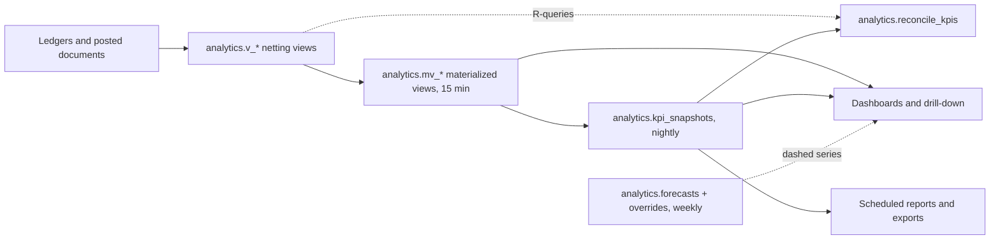

# Analytics and KPI catalogue

| | |
|---|---|
| Status | Draft for Gate G0. Built in Phase 5 (dashboards, reports, exports); procurement, HR-rule and finance KPIs in Phase 6 (ADR-020, ADR-021); forecasting Phase 6+. |
| Owner (team) | `analytics-specialist` (R); `product-manager` (A); consulted: `finance-specialist`, `manufacturing-process-engineer`, `warehouse-procurement-specialist`, `security-engineer` (exports). |
| Sources | `docs/source/master-brief.md` (module 12, "Analytics and forecasting governance", AC-21); `docs/PRD.md` FR-analytics-01..08, section 7; `docs/process-maps.md` W11 and the "KPIs touched" line of every workflow; `docs/data-model.md` (source tables); `docs/permissions-matrix.md` 2.11, 3.11, 4.2, 6; `docs/ux-system.md` 2.6, 5.12, 9.2; `docs/decision-log.md` ADR-006, 015, 016, 020, 021. |
| Date | 2026-10-16 |

Plain language: every number on a dashboard must be something a person can click on and see
the exact receipts, batches, orders or punches that made it. If we cannot show those
records, we do not show the number. Nothing here is a legal, tax, payroll or quality rule;
thresholds and limits are configuration validated by Bryel's qualified reviewers.

Sections: 1 Principles · 2 KPI catalogue · 3 Dashboard compositions · 4 Reporting views and
materialized aggregates · 5 Scheduled reports and exports · 6 Forecasting governance ·
7 Data quality prerequisites and limitations · 8 Assumptions and open questions.

---

## 1. Principles

### 1.1 The explainability contract (brief principle 6, FR-analytics-05)

Every KPI tile, chart and report column carries the ten elements below. They are read from
the versioned `kpi_definitions` table (section 4), not typed into the UI.

| Element | What the user sees | Source |
|---|---|---|
| Definition | one plain sentence ("Share of confirmed order lines shipped in full by the requested date") | `kpi_definitions.definition` |
| Formula | numerator / denominator in words and in SQL (the R-query of section 2) | `kpi_definitions.formula_text`, `reconciliation_sql` |
| Time basis | which timestamp buckets the record ("by dispatch date") and the period boundaries | `kpi_definitions.time_basis` |
| Filters | the active scope in text: "Site A · This month · SKU: all · Customer: all" | request parameters |
| Sources | tables and columns (section 2 "Sources") | `kpi_definitions.sources` |
| Refresh | cadence class and "Updated HH:MM" from the view refresh or snapshot time | `analytics.refresh_log` |
| Value label | chip: Actual, Estimate, Forecast or Overridden (1.2) | computed per value |
| Coverage | "Basis: 97 % of lots carry a cost" when a KPI depends on optional master data (section 7) | coverage query per KPI |
| Drill-down | the whole card links to the list page that runs the same scoped query (W11-02) | `kpi_definitions.drill_route` |
| Version | "Definition v3 since 12 Jan 2027" with a link to the change note | `kpi_definitions.version_no` |

### 1.2 Value labels

| Label | Rule | Rendering (`docs/ux-system.md` 5.12) |
|---|---|---|
| Actual | computed only from posted, immutable records (ledgers, state transitions, posted documents) | normal weight, solid series |
| Estimate | uses a value that is not yet posted or is derived from a proxy (order price instead of invoice, standard cost instead of a finalised costing run, BOM-scaled theoretical yield) | "Estimate" chip, dashed series, muted colour; never in a hero figure without the chip |
| Forecast | produced by a method in section 6 from history; carries method, horizon and error metric | dashed series, "Forecast" legend entry, confidence band at 10 % wash; hidden entirely when history is insufficient |
| Overridden | a forecast or plan value replaced by a person with a reason (`forecast_overrides`) | "Overridden by {name}, {date}: {reason}" on hover; original shown in the tooltip |

A value can never move from Estimate to Actual silently: the switch happens only when the
posted record exists, and the tooltip names the record (for example "Invoice INV-27-00041").

### 1.3 Freshness and offline

| Refresh class | Meaning | Used for |
|---|---|---|
| `post` | updated inside the posting transaction (projections of ADR-006); read live | balances, availability, work order status |
| `live` | direct query at view time, server cache ≤ 60 s | counts by status, open items |
| `mv15` | materialized view refreshed every 15 minutes by `analytics.refresh_mv` | yields, cycle times, fulfilment, quality ages |
| `night` | daily KPI snapshot at 01:30 site time, after `inventory.reconcile` (01:00) | sparklines, trends, site comparison, scheduled reports |
| `wk` | weekly | forecasts, movers classification |

Rules: a tile older than twice its cadence shows a "Stale" badge and the reason (failed job
id). Offline, dashboards show the last cached snapshot with its timestamp and "may be
outdated" (`docs/offline-sync.md`: 24 h cache); the word "live" never appears offline.

### 1.4 Reconciliation (AC-21)

1. Every KPI has a reconciliation query `R-<area>-nn` (section 2) that computes the same
   value directly from transactions (ledgers, posted documents, state transitions) for a
   period and scope, bypassing views and snapshots.
2. The drill-down list page runs the R-query, so the records a user sees are by
   construction the records the number was made from (W11-02).
3. Nightly job `analytics.reconcile_kpis` recomputes yesterday's and month-to-date values
   from the R-queries, compares them with `kpi_snapshots`, and writes
   `kpi_reconciliation_results`. Tolerance: zero for counts and quantities; ±0.01 per currency
   rounding for money (A-KPI-20). Any mismatch is a `critical` notification to `system_admin`
   and the KPI owner; nothing is "fixed" silently.
4. Owner (cross-site) figures must equal the sum of per-site figures for additive KPIs;
   ratio KPIs are recomputed from summed numerators and denominators, never averaged.
5. Gate G5 evidence: the R-queries for the owner KPIs executed over the seeded test period
   with results attached to the acceptance test (`docs/testing.md` → KPI reconciliation).

### 1.5 Role-based visibility (FR-analytics-07, `docs/permissions-matrix.md` 4.2 and 6)

| KPI class | Required permission(s) | Scope |
|---|---|---|
| Operational (quantities, counts, times) | `analytics.dashboard.view` | `site_id = ANY(allowedSiteIds)`; "All sites" selector only with `analytics.owner_dashboard.view` |
| Cost and stock value | + `finance.cost.view` | same; masked in the DTO (`_masked`), never in the UI alone |
| Price, order value, revenue, margin, AR/AP, cash | + `sales.price_list.view` for order values; + `analytics.financial_kpi.view` for revenue, margin, AR/AP, cash | organization-wide roles only by default (owner_director, finance, auditor) |
| Labour summaries | + `analytics.labor_kpi.view` | aggregated per site/department/shift; groups under the minimum size are suppressed (A-KPI-09); no per-person values on any dashboard |
| Raw QC results and deviation text | + `quality.test_result.view` | otherwise only outcome and status |
| Exports | + `analytics.report.export` and the module `.export` permission for the rows | same query, same masking, audit `platform.export.created` |

A site manager assigned to two sites comparing them sees exactly those two sites. Site
comparison never lists a site outside the caller's scope, not even its name.

### 1.6 Counting conventions

| Convention | Rule |
|---|---|
| Periods | half-open `[from, to)` in `sites.timezone`; cross-site periods use the organization timezone (A-KPI-01); day = calendar day, week = Monday to Sunday, month = calendar month |
| Point-in-time KPIs | "as of" the period end (or now for the current period); the as-of instant is printed |
| Reversals | the ledger netting views (1.7) remove a reversed row and its reversal; dashboards therefore show restated figures; snapshots keep what was reported and a "restated" marker appears when a reversal touches a closed period |
| Superseded and voided rows | only the latest row of a `supersedes_id` chain counts; `voided_at IS NOT NULL` rows never count |
| Cancelled documents | excluded from numerators and denominators unless the KPI is about cancellations |
| Reopened batches | counted once, at the latest closure |
| Quantities | base UOM per dimension (g, mL, pcs); never summed across dimensions; the tile states the unit |
| Money | organization currency (PHP, ADR-019); FX is out of scope until a second currency exists |
| Ratios | from summed numerator and denominator; `NULLIF(denominator, 0)` yields "n/a", never 0 % |
| Business date | every date-dependent query takes `$as_of` (business date in site time from the service clock, `docs/data-model.md` 5.3); no KPI, availability or expiry SQL uses `CURRENT_DATE`, so tests can pin the date (`docs/testing.md` Q-TST-05) |

### 1.7 Shared netting views

```sql
CREATE VIEW analytics.v_stock_movements_net AS
SELECT m.* FROM stock_movements m
WHERE m.movement_type <> 'reversal'
  AND NOT EXISTS (SELECT 1 FROM stock_movements r WHERE r.reversal_of_id = m.id);
-- identical shape: analytics.v_production_postings_net (production_postings),
-- analytics.v_financial_postings_net (financial_postings), filtering posting_type <> 'reversal'.
```

---

## 2. KPI catalogue

Legend. **Filters**: S site, W warehouse, M material, P product/SKU, L production line,
C customer, Sup supplier, St status, D department/shift (aggregated). **Time basis**: the
column named is the one that buckets the record into the period; "as-of" = point-in-time.
**Refresh**: classes of 1.3. **Label**: A actual, E estimate, F forecast, O override-capable.
**Phase**: first phase in which the KPI can be computed from posted data. **Drill-down**:
route under the operational shell; each route runs the R-query with the same filters.
Parameters in R-queries: `$site_ids uuid[]` (allowed and selected sites), `$from`, `$to`
timestamptz computed from the period in site time, `$as_of` timestamptz.

### 2.1 Owner overview (`analytics.owner_dashboard.view`)

Owner KPIs are the detailed KPIs below aggregated over all allowed sites; their R-query is
the referenced R-query with `$site_ids` = all allowed sites (additivity rule 1.4.4).

| Id | Name (plain language) | Built from | Label | Phase |
|---|---|---|---|---|
| KPI-OWN-01 | Orders confirmed this period (count; value when permitted) | KPI-SAL-01 | A | 4/5 |
| KPI-OWN-02 | Revenue: invoiced (Phase 6) or shipped value at order price (before) | KPI-FIN-01, KPI-FIN-02 | A / E | 5 (E), 6 (A) |
| KPI-OWN-03 | Gross margin | KPI-FIN-03 | E until costing runs are final | 6 |
| KPI-OWN-04 | Production: planned vs actual output | KPI-OPS-01 | A | 3/5 |
| KPI-OWN-05 | Output and yield % | KPI-OPS-02 | A | 3/5 |
| KPI-OWN-06 | Material availability: planned work orders fully covered by released stock | KPI-INV-07 | A | 5 |
| KPI-OWN-07 | Stock value | KPI-INV-12 | A with coverage; E for output lots without a costing run | 5 |
| KPI-OWN-08 | Stock at FEFO risk: expiring within 30 days and expired | KPI-INV-04 | A | 2/5 |
| KPI-OWN-09 | Order fulfilment: on time / late / open, OTIF | KPI-SAL-02 | A | 4/5 |
| KPI-OWN-10 | Quality holds open | KPI-QUA-03 | A | 3/5 |
| KPI-OWN-11 | Labour: headcount present vs scheduled (aggregated) | KPI-HR-01 | A (present), E (scheduled before Phase 6 shifts) | 5/6 |
| KPI-OWN-12 | Cash, receivables, payables indicators (ADR-020 scope) | KPI-FIN-04, 05, 06 | A | 6 |
| KPI-OWN-13 | Exceptions: open action-centre items by severity | R-OWN-13 below | A | 5 |
| KPI-OWN-14 | Site comparison: output, yield, OTIF, holds, FEFO risk, stock value (where permitted) per site | KPI-OPS-01/02, SAL-02, QUA-03, INV-04/12 | as referenced | 5 |

```sql
-- R-OWN-13 open action-centre items (platform notifications, FR-platform-07)
SELECT kind, severity, COUNT(*) FROM notifications
WHERE (site_id = ANY($site_ids) OR site_id IS NULL) AND resolved_at IS NULL   -- resolved_at: docs/data-model.md 3.10 (notifications)
GROUP BY 1, 2;
```

### 2.2 Operations dashboard (`analytics.dashboard.view`; FR-analytics-02; W05, W12, W13)

| Id | Name | Definition and formula | Time basis | Filters | Sources | Refresh | Drill-down | Label | Phase |
|---|---|---|---|---|---|---|---|---|---|
| KPI-OPS-01 | Planned vs actual output | Σ `work_orders.qty_planned_base` with `planned_end` in period vs Σ net `output` postings in period, per UOM dimension | `planned_end`; `production_postings.posted_at` | S, P, L | `work_orders`, `production_postings`, `stock_movements` | mv15 | `/production/work-orders?period=&site=` | A | 3 |
| KPI-OPS-02 | Yield % and variance | Σ actual / Σ theoretical of the latest `yield_records` per batch closed in period; variance = 1 − that | `batches.closed_at` | S, P, L | `yield_records`, `batches` | mv15 | `/production/batches?status=closed&period=` | A | 3 |
| KPI-OPS-03 | Yield loss quantity | Σ (theoretical − actual) over the same batches | `batches.closed_at` | S, P, L | as above | mv15 | same | A | 3 |
| KPI-OPS-04 | Scrap % and rework % | Σ `scrap` postings / Σ `output` postings; Σ `rework_return` / Σ output | `posted_at` | S, P, L | `production_postings` | mv15 | `/production/batches?has=scrap` | A | 3 |
| KPI-OPS-05 | Work order status | count of work orders per state (board columns) | as-of | S, P, L | `work_orders.status` | post | `/production/board` | A | 3 |
| KPI-OPS-06 | Line utilisation | hours a line had a batch in `in_process` / available hours (setting `production.line_available_hours`, A-KPI-06) | `batch_state_transitions.occurred_at` | S, L | `batch_state_transitions`, `batches`, settings | mv15 | `/production/batches?line=` | A (busy), E (available) | 3 |
| KPI-OPS-07 | Planned vs actual cycle time per step | avg (completed − started) minutes vs `routing_steps.expected_duration_minutes`, per step kind | `process_step_records.completed_at` | S, P, L | `process_step_records`, `routing_steps` | mv15 | `/production/batches/{id}#steps` | A | 3 |
| KPI-OPS-08 | Bottleneck step | step with the largest Σ positive overrun minutes in the period (from KPI-OPS-07) | same | S, P, L | same | mv15 | same | A | 3 |
| KPI-OPS-09 | Downtime hours | Σ downtime per line/equipment with reason | `downtime_events.started_at` | S, L | `downtime_events` | mv15 | `/production/equipment/{id}#downtime` | A | 6+ |
| KPI-OPS-10 | Schedule adherence | % batches whose `in_process` transition is within ± grace of `work_orders.planned_start` (A-KPI-07); % work orders completed by `planned_end` | transition `occurred_at` | S, P, L | `batch_state_transitions`, `work_orders` | mv15 | `/production/work-orders?late=1` | A | 3 |
| KPI-OPS-11 | Labour coverage per line/shift | present headcount / scheduled headcount (KPI-HR-01 by line) | work date | S, L, D | `attendance_events`, `shift_assignments` | night | `/hr/attendance/summary` | A / E | 6 |
| KPI-OPS-12 | QC turnaround | same as KPI-QUA-01 (shown on the operations dashboard; one definition, one snapshot) | `reviewed_at` | S, P, M, St | `inspections` | mv15 | `/quality/inspections?period=` | A | 3 |
| KPI-OPS-13 | Deviations per batch; right-first-time | deviations raised / batches closed; % closed batches with no deviation and no controlled exception (CX-TOL, CX-MAT, CX-CAL, skipped step) | `batches.closed_at` | S, P, L | `deviations`, `dispense_records`, `process_step_records` | mv15 | `/quality/deviations?period=` | A | 3 |
| KPI-OPS-14 | Late work orders | count with status in (planned, released, in_progress) and `planned_end` < now | as-of | S, P, L | `work_orders` | live | `/production/work-orders?late=1` | A | 3 |
| KPI-OPS-15 | Equipment overdue; batches under equipment exception | `in_service` equipment with `calibration_due_date` < today; batches with a CX-CAL deviation in period | as-of; `deviations.raised_at` | S, L | `equipment`, `deviations`, `equipment_uses` | live | `/production/equipment?overdue=1` | A | 3 |
| KPI-OPS-16 | Dispensing first-time-in-tolerance | % first (non-superseded, non-voided) dispense records with `is_within_tolerance` | `dispensed_at` | S, P, L, M | `dispense_records` | mv15 | `/production/batches/{id}#dispensing` | A | 3 |

```sql
-- R-OPS-01
SELECT (SELECT SUM(qty_planned_base) FROM work_orders WHERE site_id = ANY($site_ids)
          AND status <> 'cancelled' AND planned_end >= $from AND planned_end < $to) AS planned,
       (SELECT SUM(qty_base) FROM analytics.v_production_postings_net WHERE site_id = ANY($site_ids)
          AND posting_type = 'output' AND posted_at >= $from AND posted_at < $to) AS actual;
-- R-OPS-02 / R-OPS-03 (latest yield record per closed batch)
SELECT SUM(y.actual_base) / NULLIF(SUM(y.theoretical_base), 0) AS yield_pct,
       SUM(y.theoretical_base - y.actual_base) AS yield_loss
FROM yield_records y JOIN batches b ON b.id = y.batch_id
WHERE b.site_id = ANY($site_ids) AND b.status = 'closed' AND b.closed_at >= $from AND b.closed_at < $to
  AND NOT EXISTS (SELECT 1 FROM yield_records n WHERE n.supersedes_id = y.id);
-- R-OPS-04
SELECT posting_type, SUM(qty_base) FROM analytics.v_production_postings_net
WHERE site_id = ANY($site_ids) AND posted_at >= $from AND posted_at < $to
  AND posting_type IN ('output', 'scrap', 'rework_return') GROUP BY 1;
-- R-OPS-06 busy hours per line (clipped to the period)
SELECT b.production_line_id, SUM(EXTRACT(EPOCH FROM (LEAST(t2.occurred_at, $to) - GREATEST(t1.occurred_at, $from)))) / 3600
FROM batches b
JOIN batch_state_transitions t1 ON t1.batch_id = b.id AND t1.to_state = 'in_process'
LEFT JOIN batch_state_transitions t2 ON t2.batch_id = b.id AND t2.from_state = 'in_process'
WHERE b.site_id = ANY($site_ids) AND t1.occurred_at < $to AND COALESCE(t2.occurred_at, $as_of) >= $from GROUP BY 1;
-- R-OPS-07 / R-OPS-08
SELECT rs.step_kind, rs.name, AVG(EXTRACT(EPOCH FROM (r.completed_at - r.started_at)) / 60) AS actual_min,
       AVG(rs.expected_duration_minutes) AS expected_min,
       SUM(GREATEST(EXTRACT(EPOCH FROM (r.completed_at - r.started_at)) / 60 - rs.expected_duration_minutes, 0)) AS overrun_min
FROM process_step_records r JOIN routing_steps rs ON rs.id = r.routing_step_id
WHERE r.site_id = ANY($site_ids) AND r.status = 'completed' AND r.completed_at >= $from AND r.completed_at < $to
GROUP BY 1, 2 ORDER BY overrun_min DESC;
-- R-OPS-13 right-first-time
SELECT COUNT(*) FILTER (WHERE NOT EXISTS (SELECT 1 FROM deviations d WHERE d.batch_id = b.id)
         AND NOT EXISTS (SELECT 1 FROM dispense_records x WHERE x.batch_id = b.id AND x.exception_approved_by IS NOT NULL)
         AND NOT EXISTS (SELECT 1 FROM process_step_records p WHERE p.batch_id = b.id
                         AND (p.exception_approved_by IS NOT NULL OR p.status = 'skipped')))::numeric
       / NULLIF(COUNT(*), 0) AS right_first_time
FROM batches b WHERE b.site_id = ANY($site_ids) AND b.status = 'closed' AND b.closed_at >= $from AND b.closed_at < $to;
-- R-OPS-16
SELECT COUNT(*) FILTER (WHERE is_within_tolerance)::numeric / NULLIF(COUNT(*), 0)
FROM dispense_records WHERE site_id = ANY($site_ids) AND supersedes_id IS NULL AND voided_at IS NULL
  AND dispensed_at >= $from AND dispensed_at < $to;
-- R-OPS-05, -14, -15 are single-table counts over work_orders / equipment with the filters stated in the table.
```

### 2.3 Inventory dashboard (`analytics.dashboard.view`; FR-analytics-03; W01, W02, W03)

| Id | Name | Definition and formula | Time basis | Filters | Sources | Refresh | Drill-down | Label | Phase |
|---|---|---|---|---|---|---|---|---|---|
| KPI-INV-01 | On hand / reserved / allocated / available | the availability query of `docs/data-model.md` 5.3 per item; available = released, unexpired on-hand − reserved − allocated | as-of | S, W, M, P, St | `inventory_balances`, `inventory_lots` | post | `/inventory/lots?item=&status=` | A | 2 |
| KPI-INV-02 | Blocked stock | on-hand in `quarantine`, `on_hold`, `rejected`, `recalled`, `expired` (qty per status; value with cost permission) | as-of | S, W, M, P | same | post | `/inventory/lots?status=` | A | 2 |
| KPI-INV-03 | Inventory aging | on-hand bucketed by days since `goods_receipts.received_at` (received lots) or `batches.ended_at` (output lots): 0–30, 31–90, 91–180, 180+ | as-of | S, W, M, P | `inventory_balances`, `inventory_lots`, `goods_receipt_lines`, `batch_outputs` | mv15 | `/inventory/lots?age_min=` | A | 2 |
| KPI-INV-04 | FEFO risk | on-hand with `expiry_date` within 30 / 60 / 90 days (A-KPI-03) and expired on-hand; `retest_date` shown separately | as-of | S, W, M, P | `inventory_balances`, `inventory_lots` | post | `/inventory/lots?expiry_before=` | A | 2 |
| KPI-INV-05 | Slow and fast movers | trailing-90-day outflow (consumption + shipment + issue) per item; slow = zero outflow with on-hand > 0; fast = top 20 % of items by outflow (A-KPI-04) | `posted_at` trailing 90 d | S, W, M, P | `v_stock_movements_net` | wk | `/inventory/items?mover=slow` | A | 2 |
| KPI-INV-06 | Stockout risk | days of cover = available / average daily outflow (90 d); at risk when days of cover < supplier lead time (`supplier_materials.lead_time_days`, else `suppliers.default_lead_time_days`) or available ≤ 0 with active reservations | as-of | S, M | `inventory_balances`, `v_stock_movements_net`, `stock_reservations`, `supplier_materials` | night | `/inventory/items?risk=stockout` | A (cover), E (lead time) | 2 (6 with POs) |
| KPI-INV-07 | Material coverage of planned work orders | % of work orders in (planned, released) whose every `batch_materials` target is ≤ available of that material at the site | as-of | S, P, L | `work_orders`, `batches`, `batch_materials`, availability | mv15 | `/production/work-orders?coverage=short` | A | 3 |
| KPI-INV-08 | Count accuracy and variance | posted count lines with variance 0 / lines; Σ abs(variance) × lot unit cost (cost permission); recount rate = lines recounted / lines | `stock_counts.posted_at` | S, W | `stock_count_lines`, `stock_counts`, `inventory_lots` | mv15 | `/inventory/counts/{id}` | A | 2 |
| KPI-INV-09 | Dock-to-stock time | median hours from `goods_receipts.received_at` to the lot's first `dispositions` row with `to_status = 'released'` | disposition `posted_at` | S, W, M, Sup | `goods_receipts`, `goods_receipt_lines`, `dispositions` | mv15 | `/inventory/receipts?period=` | A | 2 |
| KPI-INV-10 | Receipt discrepancy rate | receipt lines with `discrepancy_kind` not null / posted receipt lines, by kind | `goods_receipts.posted_at` | S, W, Sup, M | `goods_receipt_lines` | mv15 | `/inventory/receipts?discrepancy=1` | A | 2 |
| KPI-INV-11 | Moves per operator-day; label reprint rate | `transfer` movements per `posted_by` per day (median); label jobs with `reprint_of_id` / printed label jobs | `posted_at`; `label_jobs.updated_at` | S, W | `v_stock_movements_net`, `label_jobs` | night | `/inventory/movements?type=transfer` | A | 2 |
| KPI-INV-12 | Stock value | Σ on-hand × `inventory_lots.unit_cost_amount`; output lots use the latest final `costing_run_lines.unit_cost_amount`, else flagged Estimate; coverage % shown (A-KPI-08) | as-of | S, W, M, P, St | `inventory_balances`, `inventory_lots`, `costing_run_lines` | mv15 | `/inventory/valuation` | A / E | 2 (6 for output lots) |
| KPI-INV-13 | Traceability completeness | % received lots with `supplier_lot_number`; % closed batches whose `batch_materials` are all `complete`; % shipped containers with a `shipment_id` | as-of / `closed_at` | S | `inventory_lots`, `batch_materials`, `containers` | night | `/quality/traceability` | A | 3 |
| KPI-INV-14 | Ledger reconciliation status | `differences_count` and `run_at` of the last `inventory.reconcile` run per `kind` (`status` must be `clean`, count 0) | `reconciliation_runs.run_at` | S | `reconciliation_runs` | night | `/admin/diagnostics/jobs` | A | 2 |
| KPI-INV-15 | Sync conflict rate | open `sync_conflicts` / replayed `sync_commands` in period | `sync_commands.replayed_at` | S | `sync_commands`, `sync_conflicts` | live | `/admin/sync/conflicts` | A | 7 |

```sql
-- R-INV-01 / R-INV-02 / R-INV-04: the availability query of docs/data-model.md 5.3 with
-- extra FILTER clauses, proven against the ledger by R-INV-14:
SELECT SUM(on_hand_base) FILTER (WHERE l.expiry_date BETWEEN $as_of::date AND $as_of::date + 30) AS expiring_30d,
       SUM(on_hand_base) FILTER (WHERE b.quality_status = 'expired' OR l.expiry_date < $as_of::date) AS expired
FROM inventory_balances b JOIN inventory_lots l ON l.id = b.lot_id WHERE b.site_id = ANY($site_ids);
-- R-INV-14 ledger vs projection (must return zero rows): docs/data-model.md 5.6 verbatim.
-- R-INV-05 / R-INV-06 trailing outflow per item
SELECT l.material_id, l.sku_id, SUM(m.qty_base) / 90.0 AS avg_daily_outflow
FROM analytics.v_stock_movements_net m JOIN inventory_lots l ON l.id = m.lot_id
WHERE m.site_id = ANY($site_ids) AND m.movement_type IN ('consumption', 'shipment', 'issue')
  AND m.posted_at >= $as_of - INTERVAL '90 days' AND m.posted_at < $as_of GROUP BY 1, 2;
-- R-INV-08
SELECT COUNT(*) FILTER (WHERE variance_qty_base = 0)::numeric / NULLIF(COUNT(*), 0) AS accuracy,
       COUNT(*) FILTER (WHERE recount_qty_base IS NOT NULL)::numeric / NULLIF(COUNT(*), 0) AS recount_rate,
       SUM(ABS(cl.variance_qty_base) * COALESCE(l.unit_cost_amount, 0)) AS variance_value   -- cost permission
FROM stock_count_lines cl JOIN stock_counts c ON c.id = cl.stock_count_id JOIN inventory_lots l ON l.id = cl.lot_id
WHERE c.site_id = ANY($site_ids) AND c.status = 'posted' AND c.posted_at >= $from AND c.posted_at < $to;
-- R-INV-09
SELECT percentile_cont(0.5) WITHIN GROUP (ORDER BY EXTRACT(EPOCH FROM (d.posted_at - g.received_at)) / 3600) AS median_hours
FROM goods_receipt_lines gl JOIN goods_receipts g ON g.id = gl.goods_receipt_id
JOIN LATERAL (SELECT MIN(posted_at) AS posted_at FROM dispositions WHERE lot_id = gl.lot_id AND to_status = 'released') d ON true
WHERE g.site_id = ANY($site_ids) AND g.status = 'posted' AND d.posted_at >= $from AND d.posted_at < $to;
-- R-INV-12
SELECT SUM(b.on_hand_base * l.unit_cost_amount) AS stock_value,
       SUM(b.on_hand_base) FILTER (WHERE l.unit_cost_amount IS NOT NULL) / NULLIF(SUM(b.on_hand_base), 0) AS cost_coverage
FROM inventory_balances b JOIN inventory_lots l ON l.id = b.lot_id WHERE b.site_id = ANY($site_ids);
```

### 2.4 Quality dashboard (`analytics.dashboard.view`; W06, W07, W12)

| Id | Name | Definition and formula | Time basis | Filters | Sources | Refresh | Drill-down | Label | Phase |
|---|---|---|---|---|---|---|---|---|---|
| KPI-QUA-01 | QC turnaround | median and p90 hours from `inspections.sampled_at` to `reviewed_at`, per `inspection_kind` | `reviewed_at` | S, P, M, St | `inspections` | mv15 | `/quality/inspections?period=` | A | 3 |
| KPI-QUA-02 | First-pass release rate | finished-product inspections with `outcome = 'pass'` / reviewed finished-product inspections; same for incoming per supplier | `reviewed_at` | S, P, M, Sup | `inspections` | mv15 | `/quality/inspections?outcome=fail` | A | 3 |
| KPI-QUA-03 | Holds open and age | count of `quality_holds` with status ≠ closed; age = now − `opened_at`; oldest shown | as-of | S, St | `quality_holds` | live | `/quality/holds?status=open` | A | 2 |
| KPI-QUA-04 | Out-of-specification rate | latest `test_results` with `is_within_spec = false` / all latest results | `tested_at` | S, P, M | `test_results` | mv15 | `/quality/inspections/{id}` (results need `quality.test_result.view`) | A | 3 |
| KPI-QUA-05 | Lots rejected; rejected stock on hand | `dispositions` with `to_status = 'rejected'` in period (count of lots/batches); on-hand qty and value in status `rejected` as-of | `dispositions.posted_at`; as-of | S, P, M | `dispositions`, `inventory_balances` | mv15 | `/inventory/lots?status=rejected` | A | 3 |
| KPI-QUA-06 | Deviations raised; time to close | count by severity; median days `closed_at − raised_at` | `raised_at`; `closed_at` | S, P, L, St | `deviations` | mv15 | `/quality/deviations` | A | 3 |
| KPI-QUA-07 | Overdue CAPA | `capas` with status ≠ closed and `due_date` < today; count and oldest | as-of | S, St | `capas` | live | `/quality/capa?overdue=1` | A | 6 |
| KPI-QUA-08 | Complaints per 10,000 units shipped | complaints `received_at` in period × 10,000 / Σ `shipment_lines.qty_base` (pcs) dispatched in period (A-KPI-16) | `received_at`; `dispatched_at` | S, P, C | `complaints`, `shipment_lines`, `shipments` | mv15 | `/quality/complaints` | A | 4 |
| KPI-QUA-09 | Recall reconciliation % | for each open recall: (qty of recalled lots on hand in `recall` locations + returned via `customer_return_lines`) / (on hand + shipped qty of those lots) | as-of | recall case | `recall_case_lots`, `inventory_balances`, `shipment_lines`, `customer_return_lines` | live | `/quality/recalls/{id}` | A | 4 |
| KPI-QUA-10 | Open change controls; revision lead time | `change_controls` not in (closed, rejected); median days `approved_at − submitted_at` of `formula_revisions` and `routing_revisions` approved in period | as-of; `approved_at` | S | `change_controls`, `formula_revisions`, `routing_revisions` | live | `/masterdata/change-controls` | A | 3 (6 for CC) |
| KPI-QUA-11 | Incoming inspection backlog | `inspections` kind incoming in (pending, in_progress): count and oldest `created_at` | as-of | S, W, Sup | `inspections` | live | `/quality/inspections?kind=incoming&open=1` | A | 2 |

```sql
-- R-QUA-01
SELECT inspection_kind,
       percentile_cont(0.5) WITHIN GROUP (ORDER BY EXTRACT(EPOCH FROM (reviewed_at - sampled_at)) / 3600) AS median_h,
       percentile_cont(0.9) WITHIN GROUP (ORDER BY EXTRACT(EPOCH FROM (reviewed_at - sampled_at)) / 3600) AS p90_h
FROM inspections WHERE site_id = ANY($site_ids) AND status IN ('approved', 'rejected')
  AND reviewed_at >= $from AND reviewed_at < $to GROUP BY 1;
-- R-QUA-04 latest result per chain
SELECT COUNT(*) FILTER (WHERE NOT t.is_within_spec)::numeric / NULLIF(COUNT(*), 0)
FROM test_results t WHERE t.site_id = ANY($site_ids) AND t.tested_at >= $from AND t.tested_at < $to
  AND NOT EXISTS (SELECT 1 FROM test_results n WHERE n.supersedes_id = t.id);
-- R-QUA-08
SELECT (SELECT COUNT(*) FROM complaints WHERE (site_id = ANY($site_ids) OR site_id IS NULL)
          AND received_at >= $from AND received_at < $to) * 10000.0
       / NULLIF((SELECT SUM(sl.qty_base) FROM shipment_lines sl JOIN shipments s ON s.id = sl.shipment_id
          WHERE s.site_id = ANY($site_ids) AND s.status IN ('dispatched', 'delivered', 'returned')
            AND s.dispatched_at >= $from AND s.dispatched_at < $to), 0);
-- R-QUA-09 per recall case
SELECT rc.id,
       (SELECT COALESCE(SUM(b.on_hand_base), 0) FROM inventory_balances b JOIN locations lo ON lo.id = b.location_id
         WHERE b.lot_id IN (SELECT lot_id FROM recall_case_lots WHERE recall_case_id = rc.id) AND lo.location_kind = 'recall')
     + (SELECT COALESCE(SUM(qty_base), 0) FROM customer_return_lines
         WHERE lot_id IN (SELECT lot_id FROM recall_case_lots WHERE recall_case_id = rc.id)) AS recovered,
       (SELECT COALESCE(SUM(qty_base), 0) FROM shipment_lines
         WHERE lot_id IN (SELECT lot_id FROM recall_case_lots WHERE recall_case_id = rc.id)) AS shipped
FROM recall_cases rc WHERE rc.status <> 'closed';
-- R-QUA-03, -05, -06, -07, -10, -11 are counts / medians over one table each with the stated filters.
```

### 2.5 Sales / CRM dashboard (`analytics.dashboard.view`; FR-analytics-04; W08, W09)

| Id | Name | Definition and formula | Time basis | Filters | Sources | Refresh | Drill-down | Label | Phase |
|---|---|---|---|---|---|---|---|---|---|
| KPI-SAL-01 | Order pipeline | sales orders per state: count, Σ ordered qty, Σ `total_amount` (price permission); confirmed in period = `confirmed` transition in period | as-of; `sales_order_state_transitions.occurred_at` | S, C, P, St | `sales_orders`, `sales_order_state_transitions` | live | `/sales/orders?status=` | A | 4 |
| KPI-SAL-02 | On time in full (OTIF) | orders whose every line reached `qty_shipped_base ≥ qty_base` with the last dispatch on or before `requested_delivery_date` / orders due in period; donut: on time, late, open (A-KPI-02) | `requested_delivery_date` | S, C, P | `sales_orders`, `sales_order_lines`, `shipments`, `shipment_lines` | mv15 | `/sales/orders?otif=late` | A | 4 |
| KPI-SAL-03 | Fill rate | Σ qty on the first dispatched shipment per line / Σ ordered qty, for lines first shipped in period | first `dispatched_at` | S, C, P | `shipment_lines`, `shipments`, `sales_order_lines` | mv15 | `/sales/orders?partial=1` | A | 4 |
| KPI-SAL-04 | Order-to-ship time | median days from the `confirmed` transition to the first `dispatched_at` | first `dispatched_at` | S, C, P | `sales_order_state_transitions`, `shipments` | mv15 | `/sales/orders?period=` | A | 4 |
| KPI-SAL-05 | Repeat customer activity | customers with ≥ 2 confirmed orders in trailing 90 days / customers with ≥ 1; days since last confirmed order per customer | `confirmed` transition | C | `sales_orders`, `customers` | night | `/sales/customers?inactive_days=` | A | 4 |
| KPI-SAL-06 | Returns rate; complaints | Σ `customer_return_lines.qty_base` received in period / Σ shipped qty in period; complaints count (KPI-QUA-08) | `customer_returns.received_at` | S, C, P | `customer_return_lines`, `customer_returns`, `shipment_lines` | mv15 | `/sales/returns` | A | 4 |
| KPI-SAL-07 | Forecast vs actual demand | forecast qty (section 6) vs Σ confirmed order line qty per SKU × site × month; error metrics shown | order month | S, P, C | `forecasts`, `sales_order_lines` | wk | `/analytics/forecasts/{sku}` | F vs A | 6+ |
| KPI-SAL-08 | Customer service metrics | OTIF per customer; lot-age compliance = shipped lines with `max_lot_age_days` where `dispatched_at − manufacture_date` ≤ limit / such lines; requirement coverage = lines with a `customer_requirement_id` | `dispatched_at` | C, P | `shipment_lines`, `sales_order_lines`, `inventory_lots`, `customer_requirements` | mv15 | `/sales/customers/{id}#service` | A | 4 |
| KPI-SAL-09 | Unacknowledged delivery receipts | `delivery_receipts` in status `issued` older than N days (A-KPI-21) | as-of | S, C | `delivery_receipts` | live | `/sales/delivery-receipts?status=issued` | A | 4 |
| KPI-SAL-10 | Picks per hour; boxes packed per hour | `pick_lines` / pick duration hours (`completed_at − started_at`); containers sealed per pack session hour (`verified_at − created_at`) | `picks.completed_at`; `packs.verified_at` | S, W | `picks`, `pick_lines`, `packs`, `containers` | mv15 | `/sales/picks?period=` | A | 4 |
| KPI-SAL-11 | Unshipped orders past requested date | orders in (confirmed, allocated, picking, packed, partially_shipped) with `requested_delivery_date` < today | as-of | S, C, P | `sales_orders` | live | `/sales/orders?overdue=1` | A | 4 |

```sql
-- R-SAL-02 OTIF (order level) for orders due in period
WITH due AS (SELECT o.id, o.requested_delivery_date FROM sales_orders o
             WHERE o.site_id = ANY($site_ids) AND o.status <> 'cancelled'
               AND o.requested_delivery_date >= $from::date AND o.requested_delivery_date < $to::date),
line AS (SELECT l.sales_order_id, bool_and(l.qty_shipped_base >= l.qty_base) AS in_full,
                MAX(s.dispatched_at) AS last_dispatch
         FROM sales_order_lines l LEFT JOIN shipment_lines sl ON sl.sales_order_line_id = l.id
         LEFT JOIN shipments s ON s.id = sl.shipment_id AND s.status IN ('dispatched', 'delivered', 'returned')
         WHERE l.sales_order_id IN (SELECT id FROM due) GROUP BY 1)
SELECT COUNT(*) FILTER (WHERE in_full AND last_dispatch::date <= requested_delivery_date) AS on_time_in_full,
       COUNT(*) FILTER (WHERE in_full AND last_dispatch::date > requested_delivery_date) AS late,
       COUNT(*) FILTER (WHERE NOT in_full) AS open_or_short, COUNT(*) AS due
FROM due JOIN line ON line.sales_order_id = due.id;
-- R-SAL-03 fill rate on first shipment
SELECT SUM(f.qty) / NULLIF(SUM(l.qty_base), 0) FROM sales_order_lines l
JOIN LATERAL (SELECT sl.qty_base AS qty, s.dispatched_at FROM shipment_lines sl JOIN shipments s ON s.id = sl.shipment_id
              WHERE sl.sales_order_line_id = l.id AND s.dispatched_at IS NOT NULL ORDER BY s.dispatched_at LIMIT 1) f ON true
WHERE l.site_id = ANY($site_ids) AND f.dispatched_at >= $from AND f.dispatched_at < $to;
-- R-SAL-04
SELECT percentile_cont(0.5) WITHIN GROUP (ORDER BY EXTRACT(EPOCH FROM (s.first_dispatch - t.occurred_at)) / 86400)
FROM sales_order_state_transitions t
JOIN LATERAL (SELECT MIN(dispatched_at) AS first_dispatch FROM shipments WHERE sales_order_id = t.sales_order_id) s ON true
WHERE t.site_id = ANY($site_ids) AND t.to_state = 'confirmed' AND s.first_dispatch >= $from AND s.first_dispatch < $to;
-- R-SAL-01, -05, -06, -09, -10, -11 are counts / sums over the stated tables with the stated filters.
```

### 2.6 Procurement dashboard (`analytics.dashboard.view`; W01, W04; Phase 6 except receipts)

| Id | Name | Definition and formula | Time basis | Filters | Sources | Refresh | Drill-down | Label | Phase |
|---|---|---|---|---|---|---|---|---|---|
| KPI-PRO-01 | Supplier on time in full | PO lines with `qty_received_base ≥ qty_base` and last posted receipt ≤ `expected_date` / PO lines due in period, per supplier | `purchase_order_lines.expected_date` | S, Sup, M | `purchase_order_lines`, `goods_receipt_lines`, `goods_receipts` | mv15 | `/procurement/orders?otif=late` | A | 6 |
| KPI-PRO-02 | Supplier lead-time variance | actual lead time = first posted receipt `received_at − purchase_orders.order_date`; variance = actual − `supplier_materials.lead_time_days`; mean and standard deviation per supplier/material | `received_at` | Sup, M | `goods_receipts`, `purchase_orders`, `supplier_materials` | night | `/procurement/suppliers/{id}#performance` | A (actual), E (promised) | 6 |
| KPI-PRO-03 | PR-to-PO cycle; PO approval lead time | median days PR `submitted_at` → PO `created_at` (via `converted_po_line_id`); median hours PO `submitted_at → approved_at` | PO `created_at`; `approved_at` | S, Sup | `purchase_requests`, `purchase_request_lines`, `purchase_orders` | mv15 | `/procurement/requests?period=` | A | 6 |
| KPI-PRO-04 | Price variance | (PO line `unit_amount` − `supplier_materials.unit_price`) / `unit_price`, weighted by qty (supplier-price permission) | `purchase_orders.approved_at` | Sup, M | `purchase_order_lines`, `supplier_materials` | mv15 | `/procurement/orders/{id}` | A | 6 |
| KPI-PRO-05 | Open POs; overdue expected receipts | PO lines with `qty_received_base < qty_base` on orders in (sent, partially_received); overdue when `expected_date` < today | as-of | S, Sup, M | `purchase_order_lines`, `purchase_orders` | live | `/procurement/expected-receipts?overdue=1` | A | 6 |
| KPI-PRO-06 | Incoming rejection rate per supplier | incoming inspections `outcome = 'fail'` / reviewed incoming inspections, joined to the receipt line's supplier | `reviewed_at` | Sup, M | `inspections`, `goods_receipt_lines`, `goods_receipts` | mv15 | `/quality/inspections?kind=incoming&supplier=` | A | 3 |
| KPI-PRO-07 | Reorder suggestions reviewed | suggestions accepted / suggestions produced in period; stockouts that occurred on items with an unactioned suggestion | suggestion `created_at` | S, M | `reorder_suggestions` (`docs/data-model.md` §3.4; written by job `procurement.reorder_suggest`) | night | `/procurement/reorder` | A | 6 |

```sql
-- R-PRO-01
SELECT po.supplier_id, COUNT(*) FILTER (WHERE pl.qty_received_base >= pl.qty_base AND r.last_receipt::date <= pl.expected_date)::numeric
       / NULLIF(COUNT(*), 0) AS otif
FROM purchase_order_lines pl JOIN purchase_orders po ON po.id = pl.purchase_order_id
LEFT JOIN LATERAL (SELECT MAX(g.received_at) AS last_receipt FROM goods_receipt_lines gl JOIN goods_receipts g ON g.id = gl.goods_receipt_id
                   WHERE gl.purchase_order_line_id = pl.id AND g.status = 'posted') r ON true
WHERE po.site_id = ANY($site_ids) AND po.status <> 'cancelled' AND pl.expected_date >= $from::date AND pl.expected_date < $to::date
GROUP BY 1;
-- R-PRO-02
SELECT po.supplier_id, pl.material_id, AVG((g.received_at::date - po.order_date) - sm.lead_time_days) AS variance_days,
       stddev_samp(g.received_at::date - po.order_date) AS lead_time_sd
FROM goods_receipt_lines gl JOIN goods_receipts g ON g.id = gl.goods_receipt_id
JOIN purchase_order_lines pl ON pl.id = gl.purchase_order_line_id JOIN purchase_orders po ON po.id = pl.purchase_order_id
LEFT JOIN supplier_materials sm ON sm.id = pl.supplier_material_id
WHERE g.site_id = ANY($site_ids) AND g.status = 'posted' AND g.received_at >= $from AND g.received_at < $to GROUP BY 1, 2;
```

### 2.7 HR / labour dashboard (`analytics.labor_kpi.view`; W10; aggregated only)

Every value is an aggregate per site, department or shift. Groups smaller than the minimum
(A-KPI-09) are suppressed. Per-person punches and pay live in the HR module under their own
permissions (`docs/permissions-matrix.md` 6), never on a dashboard.

| Id | Name | Definition and formula | Time basis | Filters | Sources | Refresh | Drill-down | Label | Phase |
|---|---|---|---|---|---|---|---|---|---|
| KPI-HR-01 | Attendance coverage | present headcount = distinct employees with an active `in` event on the work date; scheduled headcount = active `shift_assignments` for that date (Phase 6); coverage = present / scheduled | work date (site time) | S, D | `attendance_events`, `shift_assignments`, `employees` | night | `/hr/attendance/summary?date=` | A (present), E (scheduled before Phase 6) | 5 / 6 |
| KPI-HR-02 | Import exception rate | (rows_total − rows_accepted) / rows_total per import; split by duplicate, unknown employee, missing punch, error | `uploaded_at` | S | `attendance_imports` | live | `/hr/attendance/imports/{id}` | A | 5 |
| KPI-HR-03 | Time to post an import | median hours `posted_at − uploaded_at` | `posted_at` | S | `attendance_imports` | live | `/hr/attendance/imports` | A | 5 |
| KPI-HR-04 | Open attendance exceptions | `attendance_exceptions` with status `open`: count by kind and age | as-of | S, D | `attendance_exceptions` | live | `/hr/attendance/exceptions?status=open` | A | 5 |
| KPI-HR-05 | Overtime hours (aggregated) | Σ overtime minutes computed by the approved `attendance_rule_sets`; shown only after the rule set is approved and signed off (ADR-021) | work date | S, D | `attendance_events`, `attendance_rule_values` | night | `/hr/attendance/summary` | E until sign-off, then A | 6 |
| KPI-HR-06 | Late and absence rate (aggregated) | exceptions of kind `late` / scheduled person-days; `absent` / scheduled person-days | work date | S, D | `attendance_exceptions`, `shift_assignments` | night | same | A | 6 |
| KPI-HR-07 | Leave requests pending | `leave_requests` in `submitted`: count and oldest | as-of | S, D | `leave_requests` | live | `/hr/leave?status=submitted` | A | 6 |

```sql
-- R-HR-01 (site/department aggregate; suppressed when scheduled < $min_group)
SELECT e.site_id, e.department_id, (a.occurred_at AT TIME ZONE s.timezone)::date AS work_date,
       COUNT(DISTINCT a.employee_id) AS present
FROM attendance_events a JOIN employees e ON e.id = a.employee_id JOIN sites s ON s.id = e.site_id
WHERE a.site_id = ANY($site_ids) AND a.event_kind = 'in' AND a.status = 'active'
  AND a.occurred_at >= $from AND a.occurred_at < $to GROUP BY 1, 2, 3;
-- R-HR-02
SELECT id, (rows_total - rows_accepted)::numeric / NULLIF(rows_total, 0) FROM attendance_imports
WHERE site_id = ANY($site_ids) AND uploaded_at >= $from AND uploaded_at < $to;
```

### 2.8 Finance indicators (`analytics.financial_kpi.view`; Phase 6; scope per ADR-020)

These are operational finance indicators, not financial statements. They exist only once
the owners approve the Phase 6 finance scope; before that the owner overview shows
KPI-FIN-02 as an Estimate or hides the finance row (UX open question 6).

| Id | Name | Definition and formula | Time basis | Filters | Sources | Refresh | Drill-down | Label | Phase |
|---|---|---|---|---|---|---|---|---|---|
| KPI-FIN-01 | Revenue invoiced | Σ `invoices.total_amount` issued in period − Σ `credit_notes.amount` issued in period; ties to `financial_postings` | `invoices.issue_date` | S, C, P | `invoices`, `credit_notes`, `financial_postings` | mv15 | `/finance/invoices?period=` | A | 6 |
| KPI-FIN-02 | Shipped value at order price | Σ `shipment_lines.qty_base × sales_order_lines.unit_amount` dispatched in period (A-KPI-10) | `dispatched_at` | S, C, P | `shipment_lines`, `sales_order_lines`, `shipments` | mv15 | `/sales/shipments?period=` | E | 4/5 |
| KPI-FIN-03 | Gross margin | KPI-FIN-01 − Σ (invoiced qty × unit cost from the latest final `costing_run_lines` for the SKU); Estimate while any line uses `basis = 'estimate'` | `issue_date` | S, C, P | `invoice_lines`, `costing_run_lines` | mv15 | `/finance/costing` | E / A | 6 |
| KPI-FIN-04 | Receivables outstanding and aging | Σ (`total_amount − paid_amount`) for invoices in (issued, partially_paid); buckets by days past `due_date`: current, 1–30, 31–60, 61–90, 90+ | as-of | C | `invoices` | live | `/finance/receivables` | A | 6 |
| KPI-FIN-05 | Payables outstanding and aging | same over `supplier_bills` with `status IN ('posted', 'partially_paid')` (a bill is owed once posted, `docs/modules/finance.md` 2.3) | as-of | Sup | `supplier_bills` | live | `/finance/payables` | A | 6 |
| KPI-FIN-06 | Net recorded payments | Σ inbound − Σ outbound `payment_records` not voided, `paid_at` in period; labelled "not a bank balance" | `paid_at` | S | `payment_records` | live | `/finance/payments?period=` | A | 6 |
| KPI-FIN-07 | Batch cost: estimate vs actual | per batch, `costing_run_lines` `basis = 'estimate'` vs `basis = 'actual'`: material, packaging, labour, overhead, scrap, yield variance | `costing_runs.finalised_at` | S, P | `costing_run_lines` | mv15 | `/finance/costing/{run}` | E and A side by side | 6 |
| KPI-FIN-08 | Expense claims pending and approved amount | count and Σ amount in `submitted`; Σ approved in period | `submitted_at`; `approved_at` | S | `expense_claims` | live | `/finance/expenses?status=submitted` | A | 6 |
| KPI-FIN-09 | Unreconciled payments | `payment_records` in `recorded` older than N days (A-KPI-21); unmatched `reconciliation_lines` | as-of | S | `payment_records`, `reconciliation_lines` | live | `/finance/reconciliation` | A | 6 |

```sql
-- R-FIN-01 (document side) and its ledger tie-out (posting side); both must agree
SELECT (SELECT SUM(total_amount) FROM invoices WHERE site_id = ANY($site_ids) AND status IN ('issued','partially_paid','paid','closed')
          AND issue_date >= $from::date AND issue_date < $to::date)
     - (SELECT COALESCE(SUM(amount), 0) FROM credit_notes WHERE site_id = ANY($site_ids) AND status IN ('issued','applied')
          AND posted_at >= $from AND posted_at < $to) AS revenue_documents,
       (SELECT SUM(CASE posting_type WHEN 'invoice_issue' THEN amount WHEN 'credit_note' THEN -amount END)
          FROM analytics.v_financial_postings_net WHERE site_id = ANY($site_ids)
           AND posting_type IN ('invoice_issue','credit_note') AND posted_at >= $from AND posted_at < $to) AS revenue_ledger;
-- R-FIN-04 aging
SELECT CASE WHEN due_date >= $as_of::date THEN 'current' WHEN $as_of::date - due_date <= 30 THEN '1-30'
            WHEN $as_of::date - due_date <= 60 THEN '31-60' WHEN $as_of::date - due_date <= 90 THEN '61-90' ELSE '90+' END AS bucket,
       SUM(total_amount - paid_amount)
FROM invoices WHERE site_id = ANY($site_ids) AND status IN ('issued', 'partially_paid') GROUP BY 1;
```

---

## 3. Dashboard compositions

Chart rules are those of `docs/ux-system.md` 2.6 and 5.12: categorical series use
`--chart-1..6` in fixed order; good/bad series use `--viz-good`/`--viz-bad`; estimates and
forecasts are dashed; every chart has a Table toggle, "Updated HH:MM" and the filter scope;
donuts are part-to-whole with ≤ 4 segments; light-mode slots 5 and 6 require direct labels.
Default period: this week (owner), today (operations), as-of now (inventory), this month
(quality, sales, procurement, HR, finance). Filters follow section 2 and persist per user.

| Dashboard | KPI row (cards) | Charts | Tables / lists | Permission |
|---|---|---|---|---|
| Owner overview (`docs/ux-system.md` 9.2) | KPI-OWN-01 Orders, KPI-OWN-04 Output vs plan (meter), KPI-OWN-08 FEFO risk, KPI-OWN-10 QA holds; optional second row KPI-OWN-02, 03, 07, 12 when permitted | Production board summary (Planned / In process / Awaiting QC / Released counts); fulfilment donut on time / late / open (`--viz-good`, `--viz-bad`, `--viz-neutral`); 12-point sparklines from `kpi_snapshots` | Near-expiry lots (lot, item, expiry, qty, location, status chip, sorted by expiry); exceptions list (KPI-OWN-13); site comparison (KPI-OWN-14, one row per allowed site, "n/a" for masked columns) | `analytics.owner_dashboard.view` (+ class permissions of 1.5) |
| Operations | KPI-OPS-05 board counts, KPI-OPS-01, KPI-OPS-02, KPI-OPS-14 late WOs | Column: planned vs actual output per day (slots 1, 2); bar: step overrun minutes by step kind (KPI-OPS-07/08, sorted desc); line: yield % trend with the formula's expected yield as a reference line; meter: line utilisation per line | Late work orders; batches with open deviations; equipment overdue (KPI-OPS-15); dispensing exceptions (KPI-OPS-16 drill) | `analytics.dashboard.view` |
| Inventory | KPI-INV-01 available (per dimension), KPI-INV-02 blocked, KPI-INV-04 expiring 30 d, KPI-INV-06 items at stockout risk; KPI-INV-12 value when permitted | Stacked bar: on-hand by status per warehouse (statuses in risk colours, never colour alone); aging histogram (sequential ramp); small multiples: top 10 movers | FEFO risk list; stockout risk list with days of cover and lead time; last count results (KPI-INV-08); reconciliation status banner (KPI-INV-14) | `analytics.dashboard.view`; `finance.cost.view` for value |
| Quality | KPI-QUA-03 holds open, KPI-QUA-01 turnaround, KPI-QUA-02 first-pass, KPI-QUA-07 overdue CAPA | Line: turnaround median and p90 per week; column: deviations by severity per month; donut: incoming inspection outcomes | Open holds (age sorted); incoming backlog; open deviations; open change controls; recall reconciliation per open case | `analytics.dashboard.view`; `quality.test_result.view` for raw results |
| Sales / CRM | KPI-SAL-01 confirmed orders, KPI-SAL-02 OTIF, KPI-SAL-03 fill rate, KPI-SAL-11 overdue orders | Stage board: orders per state (board pattern from `docs/source/ui-inspiration.md`); donut OTIF; line: order-to-ship median per week; forecast vs actual per SKU (dashed forecast, Phase 6+) | Overdue orders; unacknowledged DRs; returns and complaints; customers inactive > 60 days; per-customer service table (KPI-SAL-08) | `analytics.dashboard.view`; `sales.price_list.view` for values |
| Procurement (Phase 6) | KPI-PRO-05 open POs, KPI-PRO-01 supplier OTIF, KPI-PRO-02 lead-time variance, KPI-PRO-06 rejection rate | Scatter (≤ 3 series): promised vs actual lead time per supplier; bar: OTIF per supplier | Overdue expected receipts; reorder suggestions with drivers (section 2.6, KPI-PRO-07, and 7.2); price variances (supplier-price permission) | `analytics.dashboard.view`; `masterdata.supplier_price.view` |
| HR / labour | KPI-HR-01 coverage, KPI-HR-04 open exceptions, KPI-HR-02 exception rate of the latest import | Column: present vs scheduled per shift per day (slots 1, 2); line: exception rate per import | Imports (status, counts, time to post); open exceptions by kind (aggregated) | `analytics.labor_kpi.view` |
| Finance (Phase 6) | KPI-FIN-01 revenue, KPI-FIN-04 AR outstanding, KPI-FIN-05 AP outstanding, KPI-FIN-06 net payments | Stacked bar: AR and AP aging buckets; line: revenue invoiced vs shipped value estimate (dashed); column: batch cost estimate vs actual | Overdue invoices; overdue bills; unreconciled payments; pending expense claims | `analytics.financial_kpi.view` |

Page states for all dashboards: loading (per card), refetch, error (per card with reference
id), permission denied (card replaced by the lock state; the row never collapses so layout
does not leak which KPI exists), offline cached snapshot with timestamp
(`docs/ux-system.md` 6).

---

## 4. Reporting views and materialized aggregates



### 4.1 Naming and placement

| Object | Rule |
|---|---|
| Postgres schema | `analytics` (views, materialized views, snapshot and definition tables); application tables stay in `public`. `bc_readonly` gets SELECT on `analytics.*` only (`docs/security.md` 6). |
| Views | `analytics.v_<subject>` (plain views, netting and scoping helpers) |
| Materialized views | `analytics.mv_<subject>`; every MV has a unique index so `REFRESH MATERIALIZED VIEW CONCURRENTLY` works; every MV carries `site_id` as its first indexed column so scoped repositories filter it like any operational table |
| Tables | `analytics.kpi_definitions` (versioned, `ver` set), `analytics.kpi_snapshots` (append-only), `analytics.kpi_reconciliation_results`, `analytics.refresh_log`, `analytics.forecasts`, `analytics.report_runs` (pending catalogue entries, `docs/data-model.md` 13.7; status in 8.3). `forecast_overrides` is an application table in `public` with the `approval?` column set (`docs/data-model.md` 3.10), not an `analytics.*` table, because it is an approved business record written by users, not a derived aggregate. |
| Code | `src/modules/analytics/` with `kpi/` (definitions as typed data mirrored into `kpi_definitions`), `views/` (SQL files applied by migrations), `jobs/`, `reports/`, `exports/`, public `index.ts`; other modules never read `analytics.*` |

### 4.2 Materialized views

| MV | Grain | Serves | Refresh | Unique index |
|---|---|---|---|---|
| `mv_inventory_position` | site × lot × location × status with expiry bucket, age bucket, unit cost, days of cover | INV-01..07, INV-12 (value), OWN-07/08 | mv15 + after `inventory.reconcile` | `(site_id, lot_id, location_id, container_id, quality_status)` NULLS NOT DISTINCT |
| `mv_stock_flow_daily` | site × item × movement_type × day: qty in, qty out | INV-05/06, OPS-01 actual, FIN-02 | mv15 (last 2 days) + nightly full | `(site_id, item_kind, material_id, sku_id, movement_type, day)` |
| `mv_batch_summary` | one row per batch: planned qty, output, theoretical, actual, variance, scrap, rework, start/end, in_process hours, deviation count, exception flags, QC sampled/reviewed, disposition | OPS-01..04, 06, 10, 13, 16; QUA-02; OWN-04/05 | mv15 | `(batch_id)` + `(site_id, closed_at)` |
| `mv_step_cycle_times` | process step record × routing step: actual minutes, expected minutes, overrun | OPS-07/08 | mv15 | `(process_step_record_id)` |
| `mv_order_fulfilment` | one row per sales order line: ordered, first/last dispatch, shipped qty, in-full flag, on-time flag, lot-age compliance | SAL-02/03/04/08/11, OWN-09 | mv15 | `(sales_order_line_id)` + `(site_id, requested_delivery_date)` |
| `mv_quality_events` | inspections, holds, deviations, CAPA, change controls with ages and turnaround | QUA-01..07, 10, 11 | mv15 | `(event_type, event_id)` |
| `mv_supplier_performance` | supplier × material × month: OTIF, lead-time mean/sd, rejection rate, price variance | PRO-01..06 | night | `(supplier_id, material_id, month)` |
| `mv_attendance_daily` | site × department × shift × work date: present, scheduled, exceptions by kind (counts only) | HR-01, 05, 06; OPS-11; OWN-11 | night | `(site_id, department_id, shift_id, work_date)` NULLS NOT DISTINCT |
| `mv_finance_position` | invoices and bills with aging bucket; payments by direction and day | FIN-01, 04..06, 09; OWN-12 | mv15 | `(document_type, document_id)` |

### 4.3 Jobs (pg-boss, ADR-015; worker service, ADR-014)

| Job | Schedule | Idempotency key | Behaviour |
|---|---|---|---|
| `analytics.refresh_mv` | every 15 min, one job per MV, staggered | `(mv_name, floor(now, 15 min))` | `REFRESH MATERIALIZED VIEW CONCURRENTLY`; writes `refresh_log(mv_name, started_at, finished_at, rows, status)`; skips if the previous refresh of the same MV is still running |
| `analytics.snapshot_kpis` | 01:30 site time, after `inventory.reconcile` (01:00) | `(kpi_id, site_id, as_of_date, filters_hash)` | computes every KPI for yesterday, week-to-date and month-to-date per site and all-sites, inserts `kpi_snapshots` (value, label, definition version, coverage) |
| `analytics.reconcile_kpis` | 02:00 site time | `(as_of_date)` | runs the R-queries, compares with snapshots within tolerance (1.4), writes `kpi_reconciliation_results`; mismatch → `critical` notification |
| `analytics.scheduled_report` | per `scheduled_reports.cron_expression` in its timezone | `(scheduled_report_id, period_key)` | section 5 |
| `analytics.forecast_baseline` | weekly, Sunday 03:00 | `(sku_id, site_id, iso_week)` | section 6; produces nothing when sufficiency fails |
| `analytics.movers_classify` | weekly | `(site_id, iso_week)` | INV-05 classification |

All jobs run with the system AuthContext, write audit events, and surface in the admin
diagnostics view (`FR-platform-09`). A failed refresh leaves the previous MV content in
place; the tile shows "Stale".

### 4.4 Indexes requested on source tables (for the database architect)

`stock_movements (site_id, movement_type, posted_at)`; `production_postings (site_id,
posting_type, posted_at)`; `batches (site_id, status, closed_at)`; `batch_state_transitions
(site_id, to_state, occurred_at)`; `process_step_records (site_id, status, completed_at)`;
`dispense_records (site_id, dispensed_at) WHERE supersedes_id IS NULL AND voided_at IS NULL`;
`inspections (site_id, inspection_kind, status, reviewed_at)`; `quality_holds (site_id,
status, opened_at)`; `deviations (site_id, status, raised_at)`; `shipments (site_id, status,
dispatched_at)`; `sales_orders (site_id, status, requested_delivery_date)`;
`sales_order_state_transitions (site_id, to_state, occurred_at)`; `goods_receipts (site_id,
status, received_at)`; `dispositions (lot_id, to_status, posted_at)`; `attendance_events
(site_id, event_kind, occurred_at) WHERE status = 'active'`; `invoices (site_id, status,
due_date)`; `notifications (site_id, resolved_at) WHERE resolved_at IS NULL`.

---

## 5. Scheduled reports and exports (FR-analytics-06; W11-03, W11-04)

### 5.1 Standard report catalogue

| Code | Report | Content | Default cadence | Default recipients (roles; must hold the permissions) | Formats | Phase |
|---|---|---|---|---|---|---|
| RPT-OWN-DAILY | Owner daily digest | owner KPI row, exceptions, near-expiry, late orders, all sites | daily 07:00 | owner_director | PDF, in-app | 5 |
| RPT-OWN-WEEKLY | Owner weekly review | KPI-OWN-01..14 with week-over-week deltas and site comparison | Monday 07:00 | owner_director, finance (finance rows only when permitted) | PDF, XLSX | 5 |
| RPT-OPS-DAILY | Operations daily | board counts, output vs plan, late WOs, deviations, equipment overdue | daily 06:30 per site | site_manager, production_planner | PDF | 5 |
| RPT-INV-EXPIRY | Near-expiry and expired stock | KPI-INV-04 list, per site, 30/60/90 buckets | weekly Monday | site_manager, warehouse (view), qa_qc | XLSX, CSV | 5 |
| RPT-INV-VALUATION | Stock valuation and aging | KPI-INV-03, KPI-INV-12 with coverage | monthly, 1st | finance, owner_director | XLSX | 5 (value Phase 6 for output lots) |
| RPT-INV-STOCKCARD | Stock card / movement report (`docs/reports-and-templates.md`) | opening, receipts, issues, transfers, adjustments, closing per lot/location with references | on demand | roles with `inventory.movement.view` | PDF, CSV | 2 |
| RPT-QUA-WEEKLY | Quality weekly | turnaround, first-pass, holds, OOS, deviations, CAPA, backlog | Monday | qa_qc, site_manager | PDF | 5 |
| RPT-SAL-OTIF | Customer service monthly | OTIF, fill rate, order-to-ship, returns per customer | monthly, 1st | sales_cs, owner_director | PDF, XLSX | 5 |
| RPT-HR-IMPORT | Attendance import exception report (brief table) | original file reference, rows by result, unknown employees, missing punches, corrections, approver | per import, on post | hr_payroll, site_manager (own site) | PDF, XLSX | 5 |
| RPT-PRO-SUPPLIER | Supplier performance | KPI-PRO-01..06 per supplier | monthly | procurement, qa_qc | XLSX | 6 |
| RPT-FIN-AGING | AR / AP aging | KPI-FIN-04/05 buckets with document lists | weekly | finance, owner_director | XLSX, PDF | 6 |
| RPT-FIN-ACCOUNTANT | Accountant export (layout per `docs/modules/finance.md`, A-PRD-10) | invoices, bills, payments, credit notes for the period | monthly | finance (re-authentication, R class) | CSV/XLSX | 6 |

### 5.2 Rules

1. A schedule (`scheduled_reports`, `scheduled_report_recipients`) stores report code, cron
   and timezone, filters (`parameters`), format and recipients. Creating one requires
   `analytics.scheduled_report.create`; the creator becomes the schedule owner
   (`scheduled_reports.owner_user_id`, `docs/data-model.md` 3.10). Recipients must be system users (A-PROC-40; external accountant
   delivery is open question 2).
2. At each run the worker rebuilds an AuthContext for every recipient and checks the report
   permission, the class permissions of 1.5 and site scope. The report is rendered once per
   distinct (permission set, allowed sites) group, so two recipients never share a file
   that one of them could not open on screen. A recipient who lost a permission is skipped,
   logged in `report_runs`, and the schedule owner is notified.
3. Every run writes `generated_documents` (template version, parameters, generator = system,
   generated_at) and `report_runs(scheduled_report_id, period_key, status, recipients_sent,
   recipients_skipped, file ids)`; delivery is an in-app notification with a signed
   short-lived link (`docs/security.md` 4.8) and, from Phase 5, email through the provider
   adapter (A-PRD-25). Files are retained per A-KPI-15.
4. Every page or sheet carries: report name, definition versions, filters, period, site
   scope, generated-at (site time), generated-by, data freshness per KPI (snapshot or MV
   time), value labels, and "contains personal data" or "contains cost/price data" markers
   where applicable.
5. PDF reports are `document_templates` of kind `report` rendered per ADR-016 (A4 default,
   page numbers, batch/period identity in the footer). CSV and XLSX are produced by the
   shared export layer.

### 5.3 Exports (W11-03; `docs/permissions-matrix.md` 6; `docs/security.md` 4.7)

| Rule | Implementation |
|---|---|
| Permission | `analytics.report.export` plus the module `.export` permission of the rows; sensitive classes per 1.5; R-class exports require re-authentication within 10 minutes |
| Scope and masking | the export runs the same scoped repository query and the same DTO masking as the screen; masked columns are omitted, not blanked |
| Formula-injection neutralisation | shared `neutralizeCell()`: a string cell starting with `=`, `+`, `-`, `@`, tab or carriage return is prefixed with `'`; XLSX cells are written as string type, never formula; CSV quotes every field and uses `\r\n`; unit tests `export.formula_neutralized` |
| Header block | first rows: report, generated-at, generated-by, site filter, period, definition versions, markers (personal data, cost/price) |
| Numbers and dates | numeric columns exported as numbers in base UOM with a unit column; dates ISO `YYYY-MM-DD` in site time plus a timezone column; money with a currency column; no rounding beyond display precision unless the report says so |
| Limits | 50,000 rows per synchronous export (A-PM-17); larger extracts run as `analytics.export_job` with the same checks and an audited file |
| Audit | `analytics.report.exported` and `platform.export.created` with filters, row count, format, file hash |
| Reconciliation | the export of a KPI drill-down is the R-query result; its total row equals the tile |

---

## 6. Forecasting governance (FR-analytics-08; brief "Analytics and forecasting governance"; Phase 6+)

Descriptive analytics ship first (Phase 5). Forecasts appear only when the checks below
pass, and never in a hero figure, an Actual column, a posted document or an automatic
posting.

### 6.1 Level, horizon and inputs

| Item | Default (A-KPI-13, configurable per organization) |
|---|---|
| Level | SKU × site × month; week only when weekly sufficiency passes |
| Horizon | 3 months (13 weeks) |
| Demand history | confirmed sales order line quantity by confirmed date (`sales_order_state_transitions`), base UOM; cancelled orders excluded; portal orders included once Phase 8 exists |
| Drivers shown | demand history, seasonality factor, lead time (`supplier_materials` / `customers.default_lead_time_days`), open orders, safety stock setting, expiry risk, MOQ, manual demand events (promotions, holidays: `demand_events`, 8.3) |

### 6.2 Baseline methods (transparent, no tuning hidden from the user)

| Method | Formula | Used when |
|---|---|---|
| Moving average (MA-3, MA-6) | mean of the last n periods | ≥ 6 periods of history |
| Seasonal naive | value of the same period one season ago (12 months / 52 weeks), scaled by the trailing-12 mean ratio | ≥ 24 periods and a seasonality test passes (autocorrelation at lag 12 ≥ 0.3) |
| Simple exponential smoothing (α shown, default 0.3) | level_t = α·actual + (1 − α)·level_(t−1) | ≥ 12 periods |
| Method choice | the method with the lowest backtest WAPE over the holdout is selected per SKU × site; the name and the loser's error are shown | always |

### 6.3 Data sufficiency and error metrics

| Check | Rule | If it fails |
|---|---|---|
| History length | thresholds above, counting periods with any demand | "Insufficient history (n of 12 months)"; no number shown |
| Zero-heavy demand | > 50 % zero periods | intermittent flag; only MA shown with a wide band; reorder suggestions use min/max only |
| Master data | SKU active, base UOM consistent across history | forecast hidden; data-quality item raised (section 7) |
| Backtest | rolling holdout of the last 3 periods | metrics: MAE, WAPE (Σ abs error / Σ actual; replaces MAPE because of zeros), bias (Σ error / Σ actual); shown next to the forecast |
| Prediction band | empirical P10–P90 of backtest residuals, only when ≥ 12 periods | otherwise no band and the text "no confidence band: too little history" |

### 6.4 Manual overrides

`public.forecast_overrides` (`docs/data-model.md` 3.10; `std +site?` + `approval?` column
sets): `sku_id`, `site_id`, `period_start`, `period_end`, `baseline_qty_base` (the forecast
value being replaced), `override_qty_base`, `uom_base_id`, `reason`, `status` in (`draft`,
`submitted`, `approved`, `rejected`, `retired`); at most one `approved` override per
(`sku_id`, `site_id`, `period_start`). A `forecast_id` to `analytics.forecasts` is added once
that table is catalogued (8.3). Entry needs `analytics.forecast.edit` and a reason; use for
planning needs `analytics.forecast.approve` by a different user (SoD per setting
`approvals.sod.forecast_override`, A-DM-31); an override expires at `period_end`, so it
never outlives the horizon, and is `retired` when the baseline is re-forecast; the original
forecast stays visible; audit `analytics.forecast.overridden`. Overridden values render as
Overridden (1.2).

### 6.5 What is never shown as fact

A forecast or override never appears: as an Actual; in KPI-OWN or any A-labelled tile; on a
printed document except a report page titled "Forecast (estimate)"; as an automatic work
order, purchase order or reservation. Reorder suggestions (brief module 4) are rows a
person accepts or dismisses with a reason, each showing its drivers in words:
"Demand 1,200 pcs/month (MA-3, WAPE 18 %), lead time 14 d, open PO 2,000 pcs, safety stock
600 pcs, 300 pcs expire within 60 d, MOQ 5,000 pcs → suggest 5,000 pcs by 03 Feb."

---

## 7. Data quality prerequisites and limitations

### 7.1 Prerequisites (coverage shown on the tile; items below the threshold raise a data-quality notification)

| KPI(s) | Needs | Coverage check | Fallback |
|---|---|---|---|
| OPS-01, 10, 14 | `work_orders.planned_start/planned_end`, `qty_planned_base` | % work orders with both dates | KPI shows "n/a" for the uncovered share |
| OPS-07, 08 | `routing_steps.expected_duration_minutes` | % steps with a value | actual minutes only, no overrun |
| OPS-06 | setting `production.line_available_hours` per line, working-day calendar (A-KPI-06, 19) | setting present | utilisation hidden, busy hours shown |
| INV-04, 06 | `inventory_lots.expiry_date`, supplier lead times | % on-hand with expiry; % materials with lead time | items without a date listed separately as "no expiry recorded" |
| INV-12, INV-08 value, FIN-03 | `inventory_lots.unit_cost_amount`; final costing runs | % on-hand qty with a cost | value marked Estimate below 100 % coverage; hidden below 50 % |
| SAL-02, 11 | `sales_orders.requested_delivery_date` | % orders with a date | orders without a date excluded and counted in a "no date" bucket |
| SAL-08 lot age | `inventory_lots.manufacture_date`, `max_lot_age_days` | % shipped lines with both | compliance "n/a" |
| HR-01 | `employees.time_clock_identifier`; shift assignments (Phase 6) | % active employees with identifier | scheduled = Estimate from headcount |
| QUA-08 | shipped quantities in `pcs` | % shipment lines in count UOM | rate per 10,000 only over count lines |
| PRO-02, 04 | `supplier_materials.lead_time_days`, `unit_price` | % PO lines with a supplier-material reference | actual lead time only |

### 7.2 Limitations (stated on the KPI definition page)

1. Nothing is real time: `post`-class numbers are current at render; others say when they
   were refreshed; offline shows a cached snapshot.
2. Restatement: reversals change past periods on dashboards (1.6); delivered scheduled
   reports are snapshots and are not regenerated.
3. Projections (`inventory_balances`) are trusted only while `inventory.reconcile` reports
   zero mismatches; KPI-INV-14 is shown on the inventory dashboard for that reason.
4. Quantities are per UOM dimension; a "units" total mixes nothing: bars (pcs) and bulk
   (g) are separate tiles.
5. Period boundaries follow the site timezone; cross-site figures use the organization
   timezone; a site in a different timezone (none today) would make daily totals differ by
   a few hours, which the tooltip states.
6. Labour KPIs are aggregates; small groups are suppressed; no KPI computes pay.
7. Finance indicators are operational (ADR-020); they are not statements of account and
   are reconciled to the accountant's system only through the export.
8. Forecasts are baselines with stated error; they are hidden when history is thin.
9. Owner dashboard performance target (`docs/PRD.md` 7): ≤ 3 s for a month at A-PRD-12
   volumes; the MVs and snapshots exist to meet it, the R-queries are not run on page view.

---

## 8. Assumptions and open questions

### 8.1 Assumptions (`A-KPI-nn`; defaults built unless the owner says otherwise)

| Id | Assumption (default chosen) | Configurable | Needs owner confirmation |
|---|---|---|---|
| A-KPI-01 | Periods in site timezone; cross-site in organization timezone (Asia/Manila, ADR-019) | per site/org | Yes |
| A-KPI-02 | OTIF date basis is `shipments.dispatched_at` vs `requested_delivery_date`, zero grace days; `delivered_at` becomes the basis once it is captured consistently | setting `analytics.otif_basis`, `otif_grace_days` | Yes (Sales) |
| A-KPI-03 | Near-expiry buckets 30 / 60 / 90 days; owner tile uses 30 | per material class | Yes (QA) |
| A-KPI-04 | Slow mover = no outflow in 90 days with stock on hand; fast = top 20 % by outflow | settings | No (informed) |
| A-KPI-05 | Days-of-cover window 90 trailing days | setting | No |
| A-KPI-06 | Line available hours 8 h/day on working days, per line setting | per line | Yes (Production) |
| A-KPI-07 | Schedule adherence grace ± 1 day on batch start | setting | No |
| A-KPI-08 | Stock value = on-hand × lot landed unit cost; output lots at latest final costing unit cost; this is operational, not an accounting valuation method | finance configuration | Yes (Accountant) |
| A-KPI-09 | Labour aggregates suppress groups under 5 employees | setting | Yes (HR) |
| A-KPI-10 | Before Phase 6, revenue on the owner overview = shipped value at order price, labelled Estimate, visible only with `analytics.financial_kpi.view` | setting to hide | Yes (Owner; UX open question 6) |
| A-KPI-11 | MV refresh every 15 min; snapshots 01:30; reconciliation 02:00 site time | job settings | No |
| A-KPI-12 | Scheduled report recipients are internal users only (A-PROC-40) | — | Yes (Q-OW-02) |
| A-KPI-13 | Forecast level SKU × site × month, horizon 3 months, sufficiency 6 / 12 / 24 periods | settings | Yes (Q-C-05) |
| A-KPI-14 | Dashboard live-query cache 60 s; offline snapshot 24 h | settings | No |
| A-KPI-15 | Generated scheduled-report files are kept 30 days in the bucket, then deleted (`docs/security.md` 7, A-SEC-30, the single retention authority); report definitions (`kpi_definitions`, `scheduled_reports`) and run logs (`report_runs`) are kept 2 years; a report needed longer is re-run from its snapshot | per report (file retention is not extendable past A-SEC-30) | Yes |
| A-KPI-16 | Complaint rate denominator = units shipped (pcs) in the same period | setting | No |
| A-KPI-17 | A KPI definition change creates a new version; old snapshots keep their version; change needs `analytics.report.admin` and is audited (`analytics.kpi_definition.changed`) | — | No |
| A-KPI-18 | Owner first-screen five: orders this week, output vs plan, stock at FEFO risk, QA holds, OTIF | per user layout | Yes (Q-OW-01) |
| A-KPI-19 | Working days Monday to Saturday until `holiday_calendars` exist (Phase 6) | per site | Yes |
| A-KPI-20 | Reconciliation tolerance: 0 for counts and quantities; ±0.01 for money | — | No |
| A-KPI-21 | "Old" thresholds: unacknowledged DR 7 days; unreconciled payment 14 days | settings | Yes (Sales, Finance) |

### 8.2 Open questions for the owner

1. Which five numbers go on the first screen, and how often must they refresh (Q-OW-01)?
   Default: A-KPI-18 with 15-minute refresh.
2. Should scheduled reports go to the external accountant by email (Q-OW-02)? Default: no;
   finance exports the file manually.
3. Show finance indicators at go-live (shipped value estimate) or only after the ADR-020
   scope is approved (`docs/ux-system.md` open question 6)?
4. Is dispatch date the right OTIF basis, or must the customer's acknowledged delivery date
   be used (A-KPI-02)?
5. Working calendar and line available hours per site (A-KPI-06, A-KPI-19).
6. May site managers see stock value and order values for their sites (default: stock value
   yes via `finance.cost.view`; order values no)?
7. Forecast level and horizon that would be useful (Q-C-05).
8. Minimum group size for labour aggregates (A-KPI-09) and whether supervisors may see
   department-level late/absence rates.

### 8.3 Tables and columns requested from `docs/data-model.md` (reconciliation with the database architect)

Status as of the data model revision recorded in `docs/data-model.md` 14.3: "applied" rows are
defined there and this document reads them as sources; "pending" rows are accepted in principle
(`docs/data-model.md` 13.7) and are catalogued before their Phase 5/6 migrations are generated.

| Requested | Why | Data model location | Status |
|---|---|---|---|
| `analytics.kpi_definitions` (versioned), `analytics.kpi_snapshots`, `analytics.kpi_reconciliation_results`, `analytics.refresh_log`, `analytics.report_runs` | section 1.1, 1.4, 4.1, 5.2 | 13.7 (P5/P6 list) | pending; schema name `analytics` confirmed |
| `analytics.forecasts`, `demand_events` | section 6 | 13.7 | pending |
| `forecast_overrides` | section 6.4 | 3.10, `public` schema, `approval?` set | applied; placement in `public` confirmed (4.1) |
| `scheduled_reports.owner_user_id` | notify the schedule owner when a recipient is skipped (`docs/permissions-matrix.md` 6, rule 3) | 3.10 `scheduled_reports` | applied |
| `notifications.resolved_at` | "items clear when resolved" (FR-platform-07); KPI-OWN-13 | 3.10 `notifications` | applied |
| `downtime_events(site_id, production_line_id, equipment_id, started_at, ended_at, reason_code_id, note)` | KPI-OPS-09; brief module 14 | 3.1 `downtime_events` (P3), 6 equipment transitions | applied |
| `production_lines` available-hours setting or `production_line_calendars` | KPI-OPS-06 | 13.7 | pending (setting `production.line_available_hours`, A-KPI-06, is the interim) |
| `equipment_uses.exception_approved_by`, `deviation_id` | `docs/process-maps.md` W13-04 names `EquipmentUse.exception`; KPI-OPS-15 | 3.5 `equipment_uses` | applied |
| `shift_assignments.production_line_id` | KPI-OPS-11 labour coverage per line | 3.8 `shift_assignments` | applied |
| `packs` verification outcome | W08 "pack verification failures" KPI | 3.7 `packs.verification_failure_count` (projection) + `pack_verification_scans` | applied; KPI to be catalogued in 2.5 in the Phase 3 revision |
| `reorder_suggestions` | KPI-PRO-07; brief module 4 | 3.4 `reorder_suggestions` (P6, `public`; job `procurement.reorder_suggest`) | applied |
| `dispositions.qty_base_at_decision` | rejected quantity per disposition (KPI-QUA-05) without reconstructing balances | 3.6 `dispositions` | applied |
| `stock_movements.unit_cost_amount` at posting | period valuation and count-variance value that ties to the ledger (KPI-INV-08, INV-12 over time) | 3.3 `stock_movements` (A-DM-34) | applied |
| `sync_commands.replayed_at` | KPI-INV-15 (Phase 7) | 11.2 `sync_commands` | applied |
| `reconciliation_runs` | KPI-INV-14 reads the stored result instead of `background_jobs` | 3.10 `reconciliation_runs` (P2) | applied (added by the devops items, used here) |
