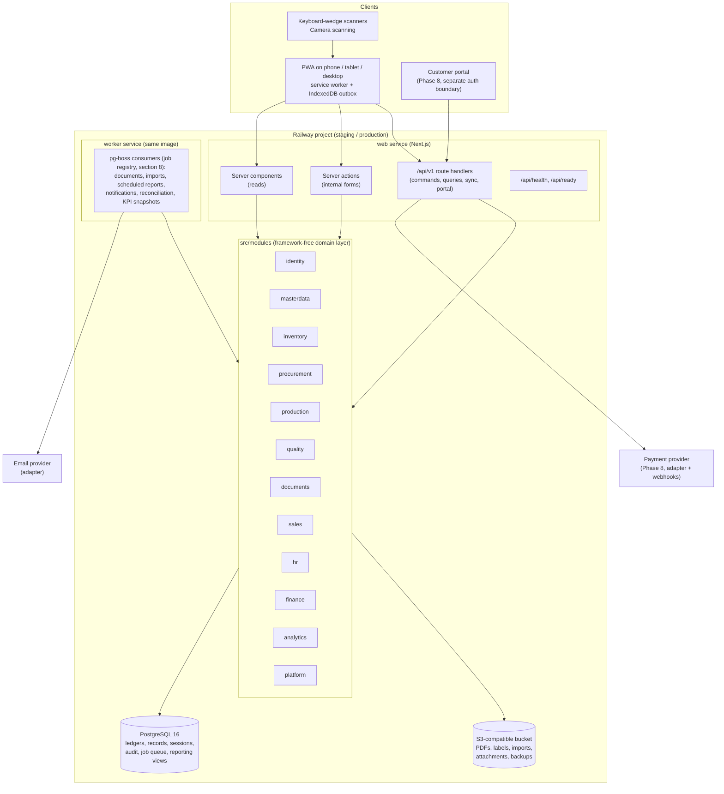

# Architecture

Owner: `principal-architect`. Status: Proposed for Gate 0. Binding decisions are in
`docs/decision-log.md` (ADR numbers are referenced below). Data structures are in
`docs/data-model.md`; authorization rules in `docs/permissions-matrix.md`; offline details in
`docs/offline-sync.md`; deployment in `docs/deployment-railway.md`.

## 1. What the system is, in one paragraph

One web application, installable on phones and tablets, that is the single place where
Bryel's Care receives materials, labels and moves stock, plans and runs batches, records the
Batch Manufacturing Record, releases quality, boxes and ships customer orders, imports
attendance, and shows owners what is happening. It is a **modular monolith**: one deployable
codebase with strict internal module boundaries, one PostgreSQL database that holds the
truth, one worker process for slow or scheduled work, and one object store for files. Nothing
is a microservice until there is evidence that it needs to be.

## 2. Architecture options considered

The brief asks for options with cost, complexity, maintainability, offline limits and Railway
fit. Three were weighed.

| Option | Cost (Railway services) | Complexity | Maintainability | Offline fit | Railway fit | Verdict |
|---|---|---|---|---|---|---|
| **A. Modular monolith: Next.js web + worker, one Postgres, one bucket** | 2 compute services + DB + bucket | Low: one repo, one schema, one deploy | High if module boundaries are enforced by lint; risk of "big ball of mud" if not | Good: one API surface for the PWA outbox | Excellent: Railway is built for this shape | **Recommended** |
| B. Separate API (NestJS/Fastify) + SPA + worker | 3 compute services + DB + bucket | Medium: two codebases or a monorepo, duplicated validation unless shared packages are set up | Good; cleaner API contract for the future portal | Good, same API | Good | Defer; Option A's modules can be lifted behind a standalone server later with no schema change |
| C. Domain services (inventory, production, sales, HR/finance as separate deployables) | 6+ services + message broker + DB per service or shared DB | High: distributed transactions for stock + production postings, cross-service traceability queries | Poor at this team size | Hard: offline replay would cross services | Costly | Rejected for this stage (brief: avoid premature microservices) |

Option A is chosen (ADR-001). The portal (Phase 8) will be a second Next.js app or route
group with its own auth boundary that imports the same domain modules read-only through a
narrow façade; the decision between "route group" and "separate app" is taken at Phase 8 with
the security review.

## 3. Component map



## 4. Code layout and module boundaries

```
src/
  app/                      Next.js App Router: layouts, pages, route handlers (thin)
    (app)/...               authenticated application routes
    (auth)/...              sign-in, reset, invitation acceptance
    api/v1/...              versioned JSON API (commands, queries, sync, documents)
    api/health, api/ready   liveness and readiness
  modules/
    identity/               users, roles, permissions, sessions, site assignments, invitations, MFA
    masterdata/             products, SKUs, UOM, materials, suppliers, customers, customer requirements, formulas, routings, sites, locations, lines, equipment master, reason codes
    inventory/              lots, balances, movements, reservations, allocations, containers, counts, pack and pack verification, label jobs, FEFO/FIFO
    procurement/            purchase requests, orders, goods receipts, supplier documents, reorder suggestions
    production/             plans, work orders, batches, dispensing, process steps, equipment service records and uses, yield, scrap/rework, BMR data
    quality/                inspections, results, holds, dispositions, deviations, CAPA, change control, complaints, recalls, genealogy
    documents/              templates, versions, generation, reprints, print layouts
    sales/                  quotes, orders, picks, shipments, delivery receipts, returns (allocations and pack are inventory; customer requirements are masterdata)
    hr/                     employees, shifts, attendance imports, exceptions, leave, payroll periods (phased)
    finance/                invoices, bills, payments, credit notes, expenses, costing, reconciliation (phased)
    analytics/              KPI definitions, reporting views, scheduled reports, exports
    platform/               audit events, background jobs, notifications, numbering rules, files, imports, settings, feature flags
  db/
    schema/                 Drizzle schema, one file per module: src/db/schema/<module>.ts (identity, platform, masterdata, inventory, procurement, production, quality, documents, sales, hr, finance, analytics), exported from index.ts (docs/data-model.md section 13.2)
    migrations/             generated SQL migrations (reviewed, committed)
    seed/                   fictional seed data scripts (dev/staging only)
  lib/                      cross-cutting infrastructure (not business rules)
    auth/                   session cookie handling, AuthContext builder, require()/requireSite()
    db.ts                   connection, transaction helper
    result.ts               ok/err result type and error codes
    idempotency.ts          idempotency key storage and replay
    export.ts               export layer: scope, masking, formula neutralisation, row cap, audit (US-2-21)
    settings.ts             typed settings registry with defaults (job registry: modules/platform, section 8.1)
    audit.ts                audit event writer
    state-machine.ts        typed transition tables
    money.ts, quantity.ts   decimal helpers, UOM conversion
    logging.ts              structured logger with correlation ids
    api/                    typed client, response envelopes
  ui/                       design system components (tokens, primitives, patterns, states)
tests/
  unit/                     pure logic
  integration/<module>/     service tests on real Postgres
  e2e/                      Playwright flows (desktop + 360 px mobile)
```

Each module exposes **one public surface**, `src/modules/<name>/index.ts`, that exports
command and query functions, Zod schemas and types. Other modules and the app layer import
only from that surface; `eslint-plugin-boundaries` fails the build otherwise (ADR-013).
Inside a module:

```
modules/inventory/
  index.ts            public surface
  schemas/            Zod command/query schemas (shared with forms and offline replay)
  commands/           one file per command: validate → authorize → transact → audit → result
  queries/            scoped read functions (list, detail, availability, trace)
  services/           domain rules (FEFO selection, availability maths, container lineage)
  repositories/       Drizzle access, always through scoped helpers
  state/              state machines for this module's records
```

Dependency direction between modules is explicit and acyclic:

```
platform ← identity ← masterdata ← inventory ← procurement
                                 ↑          ↖ production ← quality
                                 ↑                 ↑
                                 sales ← documents ┘        hr   finance   analytics (reads all via views)
```

`inventory` never imports `production`; production posts consumption/output by calling
inventory's `postMovement` command. `analytics` reads through database views, not through
other modules' repositories, so reporting cannot accidentally mutate state.

## 5. Request lifecycle and the authorization contract

Every mutation, whether it arrives as a server action, a `/api/v1` command, an offline
replay or a background job, runs the same pipeline:

1. **Parse** the input with the command's Zod schema (ADR-008). Invalid → `err('validation')`
   with field paths.
2. **Build `AuthContext`** from the session: user id, organization id, roles, flattened
   permission set, allowed site ids (or `all`), request/correlation id, device id for sync.
   Jobs build a system context with an explicit service identity, never a user's.
3. **Authorize**: `ctx.require('inventory.movement.post')` and `ctx.requireSite(siteId)`
   (ADR-005). Separation of duties checks (`submitted_by !== ctx.userId` for approvals) live
   here too. Failure → `err('forbidden')`, logged as an audit event when the action is
   sensitive.
4. **Idempotency**: commands that can be retried (scans, postings, imports, webhooks, sync
   replay) carry an `idempotencyKey`. The key is reserved inside the transaction; a repeat
   returns the stored result and performs nothing (ADR-006).
5. **Transact**: one `db.transaction` for the whole command. Stock and production postings
   lock affected balance rows in a deterministic order. State transitions are validated
   against the record's state machine.
6. **Audit**: an `audit_events` row in the same transaction for auditable actions
   (catalogue in `docs/security.md`).
7. **Result**: `ok(value)` or `err(code, message, details)`. Route handlers map codes to HTTP
   (`validation` 422, `forbidden` 403, `not_found` 404, `conflict` 409, `state` 409,
   `rate_limited` 429); server actions map them to form state.

Reads go through server components or `/api/v1` queries, always through scoped repository
helpers (`repo.forSites(ctx.allowedSiteIds)`) that fail closed if the site set is empty.
Exports use the same scoped queries, so a CSV can never contain another site's rows.

## 6. API conventions (`/api/v1`)

- Contract in code (US-2-22): `src/lib/api/contract.ts` lists every command and query with its
  payload schema, permission, idempotent flag and offline eligibility (`docs/process-maps.md`
  §6); `pnpm api:contract` writes `docs/api/v1-contract.json` and a test fails when it is stale.
  The server pipeline is `src/lib/api/server.ts` (`commandRoute`, `queryRoute`), the typed
  client `src/lib/api/client.ts`. Route files are one line each.
- Command envelope (ADR-018 groundwork): `POST` body
  `{ commandId: <client UUIDv7>, siteId, deviceId?, clientCreatedAt?, payload }` (strict) plus
  header `Idempotency-Key: <uuid>` (required for every idempotent command, `422
  IDEMPOTENCY_KEY_REQUIRED` otherwise). The key, user, request hash, command id, device id and
  client time are stored in `idempotency_keys`; a repeat returns the stored response with
  `Idempotent-Replayed: true`; same key with another body or user → `422
  IDEMPOTENCY_KEY_REUSED`; a concurrent duplicate → `409 IDEMPOTENCY_IN_PROGRESS`.
- Error codes: `PERMISSION_DENIED` 403, `NOT_FOUND` 404, `VALIDATION` 422,
  `STOCK_INSUFFICIENT` 409, `STOCK_NOT_ELIGIBLE` 409, `INVALID_STATE` 409, `CONFLICT` 409,
  `EXPORT_TOO_LARGE` 413, `REAUTH_REQUIRED` 401, `UNAUTHENTICATED` 401.
- JSON only; `Content-Type: application/json`; responses wrapped as
  `{ ok: true, data }` or `{ ok: false, error: { code, message, details } }`.
- Commands are `POST /api/v1/<module>/<entity>/<verb>` (e.g. `POST /api/v1/inventory/movements/post`), queries are `GET` with filters. Verbs mirror the permission action where possible.
- Idempotency: `Idempotency-Key` header (UUID) or body field; required for postings.
- Undo: a command whose result the same actor may safely reverse within
  `settings.ux.undo_window_seconds` (default 60, `docs/data-model.md` settings registry) returns
  `undo: { until, command }` in `data`; the undo command posts a linked `reversal` row with
  idempotency key `undo:<movement_id>` and writes `<module>.<entity>.reversed`
  (`docs/data-model.md` §8.1). The server decides undoability per call (which actions qualify:
  `docs/ux-system.md` §5.17 rules); the client never infers it.
- Versioning: path version; breaking changes create `/api/v2` routes that coexist for one
  release cycle; non-breaking additions do not bump.
- Pagination: cursor-based (`?cursor=&limit=`), stable ordering by `(created_at, id)`.
- Site context: explicit `siteId` in each request; never inferred from a cookie alone, so
  tests can prove cross-site denial by changing the parameter.
- Correlation: `X-Request-Id` accepted or generated, echoed in responses and logs.
- CSRF: cookie is `SameSite=Lax`; mutating requests must carry `Origin` matching the app
  origin; non-JSON form posts carry an anti-CSRF token (ADR-004).
- Rate limits on auth, scan and export routes (per user and per IP) with 429.
- Sync endpoints (Phase 7): `POST /api/v1/sync/commands` (batch of queued commands, each
  with client UUID, idempotency key, client timestamp, device id) and
  `GET /api/v1/sync/reference?since=` for cached reference data.

## 7. Security boundaries

| Boundary | Inside | Outside | Control |
|---|---|---|---|
| Browser ↔ web | Rendered pages, scoped data | Session cookie only | HttpOnly/Secure/SameSite cookie, Origin check, CSP, HSTS |
| App ↔ domain modules | AuthContext-bearing calls | Raw table access | Only module public surfaces; scoped repositories |
| Site ↔ site | Assigned sites | Every other site | `requireSite`, `forSites`, negative tests per module |
| Internal app ↔ customer portal | Internal records | Portal users | Separate auth table and session namespace, façade queries that expose only approved fields (Phase 8) |
| App ↔ files | Signed, short-lived URLs | Public bucket access | Private bucket, server-side signing, type/size checks on upload |
| App ↔ providers | Adapters with verified webhooks | Direct provider calls from UI | Provider adapter interfaces in `platform`, secrets in environment |
| Runtime ↔ database | Runtime role (DML only) | Schema changes | Separate migration role; RLS evaluated later (ADR-022) |

## 8. Background work (job registry)

pg-boss (ADR-015) runs in the worker service against the same database. This table is the
**job registry**: every job code used anywhere in the documentation or code appears here, and
nowhere else may a new code be introduced. Rules:

1. A job code is `<module>.<job_name>`; `job_name` is lower snake case and may itself be
   `entity.verb` (pattern `^[a-z]+\.[a-z_]+(\.[a-z_]+)?$`, for example `inventory.reconcile`,
   `finance.costing.compute`). The owning module is the first segment.
2. The code registry is the list returned by `jobDefinitions()` in `src/modules/platform/job-handlers.ts`
   (implemented in Phase 2, US-2-03; this replaces the earlier `src/lib/jobs.ts` plan). Each
   entry is built with `defineJob` (contract below): payload Zod schema, idempotency key tuple,
   handler, optional schedule. Enqueuing or running a code that is not in the list fails.
   `background_jobs.job_kind` (`docs/data-model.md` §3.10) stores the code; the runbook
   (`docs/operations-runbook.md` §6) and the diagnostics page show the same code.
3. The idempotency key is `<code>:<key tuple>`; pg-boss `singletonKey` carries the same value
   so a duplicate enqueue is dropped, and a retry never repeats a posting.
4. Jobs run with a system `AuthContext` (`system:<code>`, `on_behalf_of` the triggering user
   when there is one) and still write audit events. A scheduled job with no triggering user acts
   as the organization's system actor (one `users` row with status `system`, ADR-029), so rows
   that need a person by foreign key can be attributed; audit rows carry actor_label `system:<code>`. Scheduled times are in the site's
   timezone unless stated; test suites call job functions directly with an `asOf` clock
   (`docs/testing.md` §2).

| Job code | Module | Trigger | Idempotency key tuple | Phase | Notes |
|---|---|---|---|---|---|
| `identity.session_purge` | identity | daily 02:30 Asia/Manila | `(as_of_date)` | 1 | deletes session rows 30 days after expiry or revocation (`docs/security.md` A-SEC-11, setting `session.purge_after_days`) and closes assignments whose `valid_to` has passed (`identity.site_assignment.revoked` by the system actor); built in W2E (`src/modules/identity/jobs.ts`) |
| `platform.partition_maintenance` | platform | monthly (1st) and after migration | `(partition_name)` | 1 | creates `audit_events_YYYY_MM` three months ahead; non-empty `DEFAULT` partition raises S2 (`docs/data-model.md` §8.2) |
| `platform.reencrypt` | platform | on demand after `DATA_ENCRYPTION_KEY` rotation | `(from_key_id, to_key_id, table_name)` | 1 | re-encrypts rows carrying the previous key id in batches (`docs/operations-runbook.md` §15) |
| `db.backfill` | db (migrations) | dedicated migration or post-deploy step | `(migration_id, table_name)` | 1 | expand/backfill/contract loops of 5,000 rows, resumable, row counts logged (`docs/data-model.md` §13.3) |
| `platform.backup_dump` | platform | daily cron 18:17 UTC (02:17 Manila) | `(scheduled_for_date)` | 1 | **not a pg-boss job**: it is the Railway `backup` cron service (`docs/deployment-railway.md` §2, §9); registered here so `backup_runs`, the Backups card and alerts use one name |
| `platform.metrics_sample` | platform | every 5 min | `(floor(now, 5 min))` | 1 (implemented, Wave 2 W2F; `src/modules/governance/jobs/metrics.ts`) | writes `metrics_samples` (queue depth, failed jobs, sync backlog, reconciliation differences, backup age) from the first staging deploy; web replicas also write request counters directly (`docs/deployment-railway.md` §8.2) |
| `platform.alerts_evaluate` | platform | every 5 min, after the sample | `(floor(now, 5 min))` | 2 (implemented, Wave 2 W2F: in-app only, conditions read live, so it does not depend on the sample order) | evaluates alert rules, deduplicates per rule and window, delivers in-app/webhook (`docs/deployment-railway.md` §8) |
| `platform.notification_dispatch` | platform | domain events (approval requested, dead-lettered job, alert, action-centre item) | `(notification_id, channel)` | 2 in-app / 5 email | email only when `EMAIL_PROVIDER` is configured; otherwise in-app only, never a fake send |
| `platform.import_job.process` | platform | upload completes and mapping approved (master-data and opening-balance imports) | `(import_job_id)` | 5 (loader rehearsal earlier per `docs/data-migration-plan.md`) | row-level results in `import_job_rows`; posting is a separate user command (`platform.import_job.post`) |
| `platform.retention_sweep` | platform | weekly | `(retention_policy_id, iso_week)` | 2 | deletes or anonymises per `retention_policies`, honours `legal_holds` (`docs/data-model.md` §12.4, `docs/security.md` §7) |
| `documents.render` | documents | a `generated_documents` row needs (re)rendering, e.g. a failed render retried; the web request path renders synchronously with the same function | `(generated_document_id)` | 2 (implemented, Wave 1; HTML render) | Phase 2: renders the frozen dataset with the pinned template version to HTML, records sha256 and page count and marks a linked `label_jobs` row ready/failed; output is printed from the browser, no PDF object is stored (ADR-026 amending ADR-016). Later: Chromium PDF, bucket object and `file_attachments` row (`docs/reports-and-templates.md` §4, §8.5); labels render through this job with kind `label` (no separate label job code); `src/modules/documents/jobs/render.ts` |
| `inventory.reconcile` | inventory | nightly 01:00 site time and on demand | `(kind, as_of_date)` | 2 (implemented, Wave 1) | ledger vs projection per `docs/data-model.md` §5.6; writes `reconciliation_runs`; differences notify, never auto-fix |
| `inventory.rebuild_balances` | inventory | on demand by `inventory.balance.admin` after a reconciliation difference | `(reconciliation_run_id, balance_keys_hash)` | 2 (implemented, Wave 1) | recomputes projection rows from the ledger for the listed keys; audited (`docs/operations-runbook.md` §9) |
| `inventory.expiry_check` | inventory | daily 00:15 Asia/Manila (scheduled) and on demand (`asOf`) | `(trigger, as_of_date)` | 2 (implemented, Wave 1) | runs as the organization's system actor (ADR-029); lots past expiry become `expired` and released lots at their retest date `on_hold`, each with a disposition row and audit; deduplicated `expiring_lot` in-app notifications to the site's site_manager and qa_qc per lot and bucket (setting `inventory.expiry.alert_days`, US-2-16, FR-inventory-12); `src/modules/inventory/jobs/expiry-check.ts` |
| `inventory.reservation_expiry` | inventory | every 15 min (scheduled) | `(floor(now, 1 min))` | 2 (implemented, Wave 1) | active reservations past their TTL (setting `inventory.reservation.ttl_hours`) become `expired`, one `inventory.stock_reservation.expired` audit each (US-2-20); `src/modules/inventory/jobs.ts` |
| `sales.delivery_receipt_reminder` | sales | daily 07:00 Asia/Manila (scheduled) | `(as_of_date)` | 4 (implemented, Wave 3 W3E) | dispatched shipments whose delivery receipt is not acknowledged after `sales.delivery_receipt.unacknowledged_days` (default 3) notify the site's warehouse_operator, site_manager and sales_cs in the action centre, one per DR and day (US-4-13); `src/modules/sales/jobs/dr-reminder.ts` |
| `production.equipment_status` | production | nightly | `(site_id, as_of_date)` | 3 | nightly recompute of derived equipment availability (`docs/process-maps.md` W13-02); equipment with a passed calibration/maintenance due date and `blocking_rule = 'block'` moves to `maintenance` (`docs/data-model.md` §3.5, §6.11) |
| `hr.attendance_import.parse` | hr | mapping chosen on an uploaded attendance file | `(attendance_import_id)` | 5 | `uploaded → parsed` (`docs/modules/hr-attendance-payroll.md` §3) |
| `hr.attendance.evaluate_day` | hr | after an import is posted; nightly for the previous work date | `(employee_id, work_date, rule_set_version)` | 5 | pairs punches and classifies minutes (HR §5.3) |
| `hr.attendance.reconcile` | hr | nightly | `(as_of_date)` | 5 | compares events with summaries, reports differences (HR §5) |
| `hr.payroll.compute` | hr | `hr.payroll_period.submit` (`locked → computed`) | `(payroll_period_id, run_no)` | 6 (gated by ADR-021) | one transaction per employee; `payroll_runs` row records inputs hash and rule-set versions (HR §8.4) |
| `analytics.refresh_mv` | analytics | every 15 min, one job per materialized view, staggered | `(mv_name, floor(now, 15 min))` | 5 | `REFRESH MATERIALIZED VIEW CONCURRENTLY`; `refresh_log` (`docs/analytics-kpis.md` §4) |
| `analytics.snapshot_kpis` | analytics | 01:30 site time, after `inventory.reconcile` | `(kpi_id, site_id, as_of_date, filters_hash)` | 5 | inserts `kpi_snapshots` |
| `analytics.reconcile_kpis` | analytics | 02:00 site time | `(as_of_date)` | 5 | R-queries vs snapshots; mismatch raises a `critical` notification |
| `analytics.scheduled_report` | analytics | `scheduled_reports.cron_expression` in its timezone | `(scheduled_report_id, period_key)` | 5 | files kept 30 days (A-SEC-30) |
| `analytics.forecast_baseline` | analytics | weekly, Sunday 03:00 | `(sku_id, site_id, iso_week)` | 6+ | after FR-analytics-08 is scheduled; produces nothing when data sufficiency fails (`docs/analytics-kpis.md` §6) |
| `analytics.movers_classify` | analytics | weekly | `(site_id, iso_week)` | 5 | fast/slow mover classification (KPI-INV-05) |
| `analytics.export_job` | analytics | export request above the synchronous row limit (A-PM-17) | `(export_request_id)` | 5 | same scope checks as the synchronous export; audited file |
| `procurement.reorder_suggest` | procurement | nightly per site | `(site_id, as_of_date)` | 6 | writes `reorder_suggestions` rows with their drivers (`docs/data-model.md` §3.4, W04-01, KPI-PRO-07); never creates a purchase request or PO |
| `finance.period_maintenance` | finance | monthly and on demand | `(fiscal_calendar_version, as_of_month)` | 6 | keeps 12 future periods open (`docs/modules/finance.md` §3) |
| `finance.statements` | finance | user request or statement schedule | `(customer_id, period_key)` | 6 | statement of account document via `documents.render` |
| `finance.overdue_scan` | finance | nightly | `(as_of_date)` | 6 | flags overdue invoices, updates customer open balance, notifies |
| `finance.costing.compute` | finance | costing run submitted | `(costing_run_id)` | 6 | one line per closed batch (finance §6) |
| `finance.accountant_export` | finance | user request (`finance.accountant_export.export`) | `(export_run_id)` | 6 | files deleted after 30 days; run record stays |
| `finance.provider.process_event` | finance | payment provider webhook verified | `(provider, provider_event_id)` | 8 | `payment_provider_events` ledger (`docs/security.md` §4.11) |

Not jobs: offline command replay runs synchronously inside `POST /api/v1/sync/commands`
(`docs/offline-sync.md` §4), so there is no `platform.sync_replay` code; the sync backlog is
observed by `platform.metrics_sample`. `platform.backup_dump` is the only registry code that
runs outside pg-boss (the Railway `backup` cron service, ADR-014). A
server-side replay job is introduced only if Phase 7 measurements show batches exceeding the
request budget, through a new row here.

Failed jobs are visible in the admin diagnostics view with retry controls
(`docs/operations-runbook.md` §6).

### 8.1 Job contract (implemented, US-2-03)

Adding a job takes one file and two lines; no platform file changes:

```ts
// src/modules/<module>/jobs/<name>.ts (or src/modules/<module>/jobs.ts)
import { z } from "zod";
import { defineJob } from "@/modules/platform/job-definition"; // no runtime deps: safe from any module

export const documentsRenderJob = defineJob<{ generatedDocumentId: string }>({
  code: "documents.render",                       // must be a row of the table above
  title: "Render a document",
  description: "Renders a generated_documents row to PDF.",
  payload: z.object({ generatedDocumentId: z.uuid() }).strict(),
  keyTuple: (p) => [p.generatedDocumentId],      // key = "documents.render:<id>" (rule 3)
  run: async ({ ctx, job, idempotencyKey, asOf }, p) => { /* call the module service with ctx */ return { pages: 3 }; },
  // optional: schedule: { cron: "0 1 * * *", tz: "Asia/Manila", payload: (now) => ({ ... }) },
  //           systemPermissions: [...]  (scheduled jobs: what the system context may do)
  //           maxAttempts, retryDelaySeconds, timeoutSeconds, summarize
});
```

then in `src/modules/platform/job-handlers.ts` add the import line and the list entry.

| Piece | Where | Behaviour |
|---|---|---|
| Enqueue | `enqueueJob(txOrDb, ctx, def, payload, { siteId? })` in `src/modules/platform/jobs.ts` | validates the payload (Zod) and the site scope, inserts a `background_jobs` row in the caller's transaction (the outbox), deduplicates on `(organization_id, idempotency_key)` and returns `{ job, created }`; a rolled-back command never runs a job |
| Relay | `src/worker.ts` every 2 s | sends queued rows to pg-boss (`id` new, `singletonKey` = idempotency key, `startAfter` = `run_after`) and records `pgboss_job_id` |
| Run | `runJob(jobId)` | claims the row (`queued → running`, attempts + 1), validates the payload again, rebuilds the context: `system:<code>` on behalf of `requested_by` with that user's **current** roles and sites (`buildContextForUser`), or a pure system context with `systemPermissions` for scheduled jobs; runs the handler; records `succeeded` + result |
| Failure | `runJob` | `DomainError`, invalid payload, unregistered code or lost access → `failed` at once; other errors → back to `queued` with backoff (pg-boss retries) until `max_attempts` (setting `platform.jobs.max_attempts`, default 5), then `failed`, `dead_lettered_at` and a `critical` in-app notification to `system_admin` |
| Retry / cancel | `retryJob` / `cancelJob` (`platform.job.admin`) | audited `platform.background_job.retried` / `.cancelled`; the idempotency key is unchanged, so a handler that already posted replays instead of posting twice |
| Schedules | worker start | `boss.schedule(code, cron, { scheduled: true }, { tz })`; a tick creates the keyed row per organization and runs it |
| Audit | `src/lib/audit.ts` | job writes carry `actor_label = system:<code>`, `on_behalf_of` = requester, `correlation_id` = the job's |
| Tests | `tests/integration/platform/jobs.test.ts` | build a test registry with `createJobRegistry([...jobDefinitions(), testJob])` and call `enqueueJob`/`runJob` directly with `{ registry }` (no pg-boss) |

Registered in Phase 2 so far: `inventory.reconcile` (nightly 01:00 Asia/Manila, all sites;
on demand per site) and `inventory.rebuild_balances`. `platform.notification_dispatch` is not
registered yet: in-app notifications are written directly by `notifyUsers`/`notifyRoles`
(`src/modules/platform/notifications.ts`); the job is registered when email delivery arrives.

## 9. Documents and printing

Templates are versioned records (`document_template_versions`) whose `definition` is a
versioned JSON configuration (schema `document_template/v1`: renderer id and version, dataset,
page settings, section selection, labels, options). The HTML/CSS is produced by code-defined
renderers in `src/modules/documents/renderers/<id>-v<n>.ts` (`docs/reports-and-templates.md` §1.4.1); **no HTML is stored in or
executed from the database** (ADR-016 as amended, `docs/reports-and-templates.md` §1.2,
A-RPT-01). Generation enqueues `documents.render` (§8), which renders the definition against a
frozen snapshot of the source record revision, stores the PDF in the bucket, and records
`generated_documents` (who, when, template version, source revision, checksum, reprint
reason). On-screen preview uses the same renderer. Labels share the pipeline with label-sized
page settings and barcode rendering (ADR-017). Controlled reprint writes an audit event.

## 10. Offline strategy (summary)

The server is authoritative. The PWA caches the app shell and approved reference data and
keeps a durable outbox of commands for the workflows allowed offline (scan-and-move request,
dispensing capture on a managed device with a pre-assigned batch, task and instruction
viewing). Each queued command carries a client-generated UUIDv7, an idempotency key and the
device id; the server re-validates everything on replay and routes conflicts to a review
queue. Online-only: QA release, financial posting, payroll approval, permission changes.
Details, cached data policy, conflict rules and device security are in
`docs/offline-sync.md` (ADR-018). Phase 2 designs the command API for replay even though the
service worker ships in Phase 7.

## 11. Observability and operations

- Structured JSON logs with `requestId`, `userId`, `siteId`, `module`, `command`, duration
  and outcome; no secrets or personal data in logs. As built (W2F): `src/lib/log` (JSON lines,
  redaction, AsyncLocalStorage request context), `src/middleware.ts` sets and echoes `X-Request-Id`,
  which becomes the AuthContext correlation id and so `audit_events.correlation_id`;
  `src/instrumentation.ts` and the API pipeline send unexpected errors to
  `src/lib/log/error-reporter.ts` (`ERROR_REPORTING_DSN`). Rate limits use the shared Postgres store
  `src/lib/rate-limit` (`rate_limit_buckets`).
- `/api/health` (process alive) and `/api/ready` (database reachable, migrations current,
  queue reachable) for Railway health checks.
- Error reporting hook (provider adapter; Sentry-compatible) with release tagging.
- Admin diagnostics page: failed jobs, sync backlog, import failures, reconciliation
  differences, last backup, migration version; no secrets shown.
- Alerts: failed job rate, error rate, p95 latency, database size, backup age, sync backlog
  (`docs/deployment-railway.md`).

## 12. Environments and configuration

The authoritative variable table (name, type, group, which service receives it, per-environment
values) is `docs/deployment-railway.md` §4; this summary names the groups the architecture
depends on.

| Setting | Source | Notes |
|---|---|---|
| `DATABASE_URL`, `DATABASE_MIGRATION_URL`, `DATABASE_BACKUP_URL` | Railway Postgres | runtime role `bc_app` (web and worker), migration role `bc_migrate` (web pre-deploy only), read-only role `bc_backup` (backup cron only) |
| `SESSION_SECRET`, `CSRF_SECRET`, `FILE_URL_SECRET`, `DATA_ENCRYPTION_KEY` (each with a `_PREVIOUS` twin during rotation), `APP_ORIGIN`, `TRUSTED_PROXY_HEADER` | Railway variables | cookie signing, anti-CSRF tokens, signed download URLs, column encryption with key id, Origin checks, client IP for rate limits |
| `S3_*`, `BACKUP_*` | bucket credentials | private bucket; backup encryption public key and offsite bucket on the backup service only |
| `EMAIL_*`, `PDF_RENDERER`, `WORKER_CONCURRENCY` | provider / worker | adapters render "setup required" when unset; `PDF_RENDERER=disabled` until Phase 3 |
| `APP_ENV`, `MAINTENANCE_MODE`, `LOG_LEVEL`, `NODE_ENV`, `RAILWAY_ENVIRONMENT` | platform | `APP_ENV` is the authoritative environment flag (seed guard, badge); `MAINTENANCE_MODE=1` answers 503 except `/api/health`; `RAILWAY_*` are injected read-only and logged |
| Business configuration (timezone, currency, numbering, approval rules, FEFO rules, attendance rules) | `settings` and rule tables in the database, editable by `system_admin` | never environment variables |

## 13. Cross-cutting patterns

- **State machines**: a typed transition table per status-bearing record type
  (`state/<record>.ts`), checked in the command before any write. No free-form status
  strings. Transitions of the records listed in `docs/data-model.md` §6.1 (equipment,
  purchase order, work order, batch, inspection, quality hold, sales order, shipment, payroll
  period, invoice; attendance import pending) are also recorded in their
  `*_state_transitions` ledger table; every other status change is recorded as an
  `audit_events` row carrying the before and after status, actor, reason and time.
- **Versioned master data**: effective-dated revisions with approval; operational records
  reference revision ids and store a frozen snapshot of what they used.
- **Numbering**: `numbering_rules` allocate human-readable numbers inside the posting
  transaction (ADR-009).
- **Quantities and money**: `decimal.js` and `numeric` columns; entered and base units
  stored (ADR-010).
- **Result type**: no thrown exceptions for expected failures; typed error codes map to HTTP
  and to form errors.
- **Feature flags**: `platform.settings` flags gate integrations; unconfigured integrations
  render a "setup required" state, never a fake success.

## 14. Major decisions and their status

See `docs/decision-log.md`. Decisions needing owner approval at Gate 0: ADR-001 to 014,
ADR-019 to 021 and ADR-023. ADR-023 records the Phase 0 reconciliation rulings (Pack in
inventory, audit naming, idempotency scope, device table, finance postings without GL, negative
stock). ADR-015 to 018 are Proposed and go for approval at the gate before the phase that first
implements them (`docs/team-charter.md` gate table): ADR-015 and 017 at G1, before Phase 2
starts (US-2-03, US-2-13); ADR-016 at G2, before Phase 3; ADR-018 at G6, before Phase 7, with
its API groundwork (idempotent `/api/v1` commands) built from Phase 2 under ADR-006 and §6.
ADR-022 is Deferred (evaluated at the end of Phase 2).

## 15. Risks specific to this architecture

| Risk | Mitigation |
|---|---|
| Module boundaries erode inside one codebase | lint-enforced boundaries, public surfaces only, architect review on cross-module PRs |
| Next.js server actions tempt business logic into the UI layer | actions are adapters; rule: no Drizzle import outside `modules/` and `db/` |
| Postgres as queue and store under load | pg-boss is adequate for this scale; revisit when job volume or latency demands (ADR-015) |
| Chromium PDF rendering memory on Railway | measure in Phase 3; fallback to `@react-pdf/renderer` (ADR-016) |
| Offline replay creating duplicate postings | idempotency keys reserved in-transaction; conflict queue; replay tests (Phase 7) |
