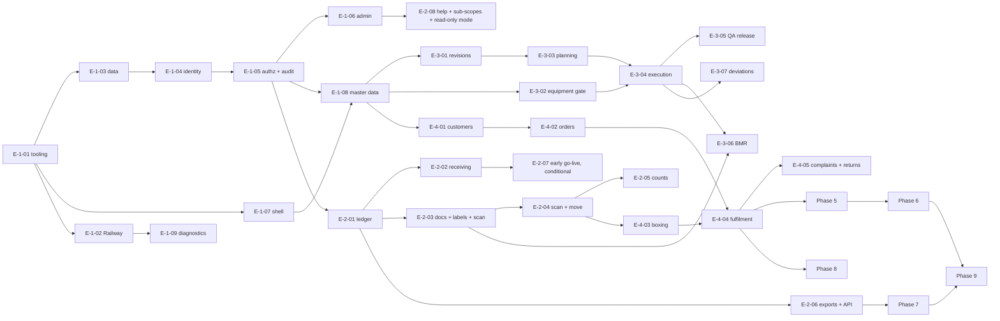

# Backlog: epics, user stories and acceptance criteria

| Field | Value |
|---|---|
| Status | Phase 0 draft for Gate 0 review (`docs/team-charter.md`, G0) |
| Owner | product-manager (structure agreed with principal-architect; accountable: principal-architect) |
| Sources | `docs/source/master-brief.md`; `docs/PRD.md` (FR ids, AC-10..AC-23, §10 roadmap, §11 Slice 1 and S1-01..S1-15); `docs/decision-log.md` (ADR-001..023); `docs/team-charter.md` (gates); `docs/architecture.md`; `docs/data-model.md` (§13.6 Slice 1 tables, §14 assumptions); `docs/permissions-matrix.md` (permission catalogue §2, SoD §5, tests §8); `docs/security.md` (§3, §4, §5, §8); `docs/process-maps.md` (W01–W13, V-*/CX-* catalogue); `docs/ux-system.md` (§2, §3, §5, §6, §9); `docs/offline-sync.md`; `docs/reports-and-templates.md`; `docs/testing.md` (test ids, §9 procedures); `docs/deployment-railway.md` (§2, §3, §14); `docs/operations-runbook.md`; `docs/analytics-kpis.md`; `docs/modules/hr-attendance-payroll.md`; `docs/modules/finance.md`; `docs/risk-register.md`; `docs/data-migration-plan.md` (§9.4, §14) |
| Related | `docs/PRD.md` §6 (requirements), §8 (acceptance criteria), §12 (glossary) |

Plain-language summary for owners: this is the ordered list of work the team will build, phase by
phase. Each story says who it is for, what they get, how we prove it works, who may do it, what the
system records, and what it depends on. Phase 1 is written in full detail because it is the next thing
to build; Phases 2 to 4 (the go-live set) are detailed per workflow; Phases 5 to 9 are epics with
their key stories. Nothing here invents a quality, tax, payroll or regulatory rule: those are
configuration entered and validated by the company's qualified people.

---

## 1. How to read this backlog

### 1.1 Identifiers

| Id | Meaning |
|---|---|
| `E-<phase>-<nn>` | Epic: a group of stories with one goal and one piece of gate evidence (section 2) |
| `US-<phase>-<nn>` | User story; numbered in recommended implementation order within the phase. Phase 1b hardening stories keep the `US-1-` prefix and carry phase "1b". Stories added after the first numbering take the next free number and are listed inside the epic they belong to (ids are never reused or renumbered); a story split before it starts keeps its id with a letter suffix (`US-5-11a`..`d`) |
| `W01`..`W13`, `V-*`, `CX-*`, `G-Wnn-x` | Workflows, blocking validations, controlled exceptions and approval gates from `docs/process-maps.md` |
| `S1-nn`, `AC-nn`, `FR-<module>-nn` | Slice 1 tests and acceptance criteria (`docs/PRD.md` §11.3, §8), functional requirements (`docs/PRD.md` §6) |
| `R-nn`, `A-<doc>-nn`, `Q-*` | Risks (`docs/risk-register.md`), assumptions and owner questions in the document named by the prefix |
| `MC-nn`, `T-nn` | Migration acceptance checks (`docs/data-migration-plan.md` §11) and printer/label tests (`docs/reports-and-templates.md` §12) |

### 1.2 Story card

Every story uses the same compact card:

```
#### US-p-nn Title (estimate, priority) — FR/AC/S1 ids satisfied
**As** <role> **I want** <goal> **so that** <reason>.
- Permissions: <exact strings> · Entities: <data-model tables or entity names>
- AC1 Given … When … Then …   (one or more; Then always names the observable result and the record written)
- States: <codes> · Audit: <module.entity.event names> · Depends: <→ ids> · Tests: <docs/testing.md ids and §>
```

State codes (page-state matrix in `docs/ux-system.md` §6): **L** loading (first and refetch), **E** empty
(no data and filtered), **X** error (load and action), **V** validation, **D** permission denied, **N** not
found / out of scope (identical to denied, no existence leak), **O** offline (read and write states),
**S** setup required (integration not configured), **A** approval required banner, **P** sync pending
chip (Phase 7). "standard" means the page-type matrix applies without additions: list pages L E X D N,
detail pages L X D N, forms and guided steps L X V D N, scanner pages add O and N.

### 1.3 Estimates

| Size | Effort (one backend + one frontend engineer, whole definition of done) | Rule |
|---|---|---|
| XS | ≤ 0.5 day | configuration, a single command, a single component |
| S | 1 to 2 days | one command with tests and one screen state set |
| M | 3 to 5 days | a small vertical slice: model, commands, screen, negative tests |
| L | 6 to 10 days | a full workflow segment with documents or jobs |
| XL | > 10 days | not allowed to start; split first (R-09) |

Estimates are rough orders of magnitude for planning and are re-estimated when the story is pulled.
They include the definition of done below, not only the code.

### 1.4 Dependency notation

`→ US-x-nn` hard (cannot start until merged); `⇢ US-x-nn` soft (can start, cannot be accepted before);
`[Q-..]` an owner or process-owner answer is needed before acceptance (default assumption applies
meanwhile); `[DOC: path]` a document that must change in the same pull request; `[HW]` the company's
hardware is needed for the manual acceptance step.

### 1.5 Definition of done (binding for every story)

From `CLAUDE.md` and `docs/testing.md` §1.2. A story is done only when all of the following exist in
the same change and CI is green:

1. Data model with migration, constraints and indexes; `docs/data-model.md` updated.
2. Every command checks a permission string from the catalogue; the negative authorization set of
   `docs/permissions-matrix.md` §8 exists for every new entity (`authz-coverage` passes).
3. Zod `.strict()` schemas and integration tests for every `V-*` validation the process map cites.
4. State transitions through `src/lib/state-machine.ts` with `statemachine.*` tests; no free-form status.
5. Audit events from the catalogue, asserted by `audit.*` tests; posted records immutable (reversal only).
6. Loading, empty, error, validation, permission-denied and (where relevant) offline states, covered by
   the slice's e2e test on `desktop-chromium` and `mobile-360`.
7. Documentation updated (`docs/*.md`, README commands, environment variables, runbook entries).
8. Deployment notes: migration order, new variables, rollback, in the slice report.
9. Slice report with verbatim test output: completed, tested, not completed, known risks, commands run,
   migrations, environment variables, exact next steps.

No placeholder buttons: an unconfigured integration renders the **S** state, never a fake success.

### 1.6 Vocabulary rules

- Roles and permission strings come only from `docs/permissions-matrix.md` §2. Every string this
  backlog cites is catalogued there (the round-1 gaps are closed); a new string needed by a later
  story is added to the catalogue in the same change as the story card, never invented in code.
- Audit event names follow `module.entity.event` (`docs/data-model.md` §8.1); where `docs/security.md` §5
  still uses the two-segment form, the mapping table in §8.1 applies.
- Entity, table and state names come from `docs/data-model.md` §3 and §6; the Slice 1 tables are the 33
  listed in §13.6.
- Scan payloads follow ADR-017: `BC:LOT`, `BC:BOX`, `BC:LOC`, `BC:MAT`, `BC:SKU`, `BC:EQP`, `BC:DOC`.
- Pack permissions are `inventory.pack.{view,create,submit,approve}` (`docs/permissions-matrix.md` §2.3, P3).

### 1.7 Priority and phasing

Must / Should / Later follow `docs/PRD.md` §6. The MVP for go-live is Phases 1 to 4 (gates G1 to G4).
If the owner chooses an early go-live after G4 (R-08, Q-MIG-13), epic E-2-07, US-2-30 and the Phase 9 items
marked "pull forward" in section 5.5 become Must.

---

## 2. Epic map

### 2.1 Phases and exit criteria (quoted from `docs/PRD.md` §10)

| Phase | Gate | Exit criteria | Epics |
|---|---|---|---|
| 1 Foundation | G1 | Permission tests pass; staging deploy works; basic mobile layout and operational shell approved | E-1-01..E-1-10 |
| 2 Inventory MVP | G2 | End-to-end receive → label → move → count flow tested; concurrency and multi-site isolation verified | E-2-01..E-2-08 |
| 3 Production + BMR | G3 | Run a representative soap batch in staging with traceability and printable record reviewed by production/QA | E-3-01..E-3-07 |
| 4 Packaging + fulfilment + CRM | G4 | Order-to-shipment flow reconciles stock and every shipped box is traceable | E-4-01..E-4-05 |
| 5 Reporting + imports | G5 | KPIs reconcile to source data; attendance import validated against representative time-clock files | E-5-01..E-5-07 |
| 6 Procurement + HR/finance | G6 | Qualified business owners validate calculations and approvals; sensitive access tests pass | E-6-01..E-6-07 |
| 7 Offline/PWA hardening | G7 | Offline acceptance tests pass on representative phones/tablets; conflicts are visible and recoverable | E-7-01..E-7-04 |
| 8 Customer portal + payment | G8 | Security review, sandbox payment tests, idempotency and failure/refund tests pass | E-8-01..E-8-03 |
| 9 Production readiness | G9 | Go-live checklist signed by company owners; support ownership and incident procedure established | E-9-01..E-9-04 |

### 2.2 Epics

| Epic | Goal (plain language) | Gate evidence | Depends on | Risks |
|---|---|---|---|---|
| E-1-01 Repository, tooling, CI | One repository where every change is linted, type-checked and tested before merge (ADR-013) | S1-15; `authz-coverage` and `migrations` jobs required | G0 approval of ADR-001..014, 019..021, 023 | R-09, R-42, R-43, R-48 |
| E-1-02 Environments and deployment | Staging on Railway from documented steps; health, readiness, backups, external monitor (ADR-014) | S1-08; `docs/deployment-railway.md` §14 checklist complete | E-1-01; Railway plan and region (A-DEP-01..03) | R-36, R-23, R-37 |
| E-1-03 Data foundation | Migrations from zero for the 33 Slice 1 tables; fictional seed with a production guard (ADR-003, ADR-009, ADR-010) | S1-09, S1-10, S1-12, S1-13 | E-1-01 | R-16, R-17 |
| E-1-04 Identity and sessions | Sign in and out, invitations, password reset, lockout, session listing and revocation, device-class timeouts (ADR-004) | S1-05, S1-06, S1-14 | E-1-03 | R-20, R-27 |
| E-1-05 Authorization framework and audit | AuthContext, scoped repositories, separation of duties, approval rules, append-only audit with viewer (ADR-005, ADR-006) | S1-01..S1-04; AC-10 framework; AC-22 | E-1-03, E-1-04 | R-14, R-13 |
| E-1-06 Administration | Users, roles, site assignments, settings, numbering rules, approval rules administered without engineers | S1-04, S1-11, S1-13 | E-1-05 | R-07, R-49 |
| E-1-07 Design system and shell | Tokens, components, desktop nav, phone tabs, operator home, every page state (ADR-007) | S1-07; shell approved by the owner on phone and desktop | E-1-01 | R-26, R-27, R-44 |
| E-1-08 Master data basics | Sites, warehouses, locations, lines, equipment register, UOM and conversions, products, SKUs, materials, reason codes | S1-12; seeded structure visible per site | E-1-05, E-1-07 | R-16, R-49 |
| E-1-09 Observability and diagnostics (Phase 1 part) | Structured logs with correlation ids, error reporting adapter, diagnostics cards Health, Backups, Variables (FR-platform-09 split) | S1-08; diagnostics shows no secrets | E-1-02, E-1-05 | R-36, R-47 |
| E-1-10 Phase 1b hardening | TOTP for privileged roles, custom roles, quick-switch PIN evaluation (ADR-004, A-PRD-34) | FR-identity-06 tests; owner decision on PIN | E-1-04, E-1-06 | R-27, R-20 |
| E-2-01 Stock ledger core and jobs | Append-only movements, balance projection, locking, idempotency, reversal, reconciliation, pg-boss, in-app notifications (ADR-006, ADR-015) | AC-11 idempotency; `ledger.*`, `concurrency.*` green; ADR-022 (RLS) evaluated at the end of Phase 2 and the adopt/defer decision recorded in `docs/decision-log.md` (final confirmation US-9-05) | E-1-03, E-1-05 | R-11, R-15, R-41 |
| E-2-02 Receiving (W01) | Unplanned receipt to labelled lot in quarantine with documents and put-away | AC-11; 9.2 manual procedure | E-2-01, E-2-03 | R-12, R-46 |
| E-2-03 Documents, labels and scanning infrastructure | Template versions, generated documents, label jobs, print station, scan input with payload grammar (ADR-016 pipeline, ADR-017) | T-01..T-07; label QR round trip | E-2-01; printers and scanners [HW] | R-39, R-45, R-44 |
| E-2-04 Scan, move and containers (W02) | Scan anything, see status and allowed actions, move safely, undo an own move within the window, split/merge/repack with lineage | AC-16 box part; 9.7 steps 1 to 4 | E-2-03 | R-26, R-11 |
| E-2-05 Counts, adjustments, reservations (W03) | Blind counts with recount and approval, adjustment documents, reservations and FEFO/FIFO recommendation | `count.*`, `fefo.*`; 9.6 screen walk-through | E-2-01, E-2-04 | R-12, R-18 |
| E-2-06 Exports and idempotent command API | Scoped exports with formula neutralisation and audit; `/api/v1` command contract designed for replay (ADR-018 groundwork) | `export.formula_neutralized`; `authz.cross_site.export` | E-2-01 | R-14, R-11 |
| E-2-07 Early go-live enablement (conditional) | QA bulk disposition, label verification scan, command-line loader with `MIGRATION_WINDOW_OPEN`, opening-balance receipts, legacy document index | MC-06, MC-07, MC-16 on staging R1 | E-2-02, E-2-04; [Q-MIG-13] | R-08, R-12, R-51 |
| E-2-08 Platform refinements: in-app help, assignment sub-scopes, read-only maintenance mode | A "?" on every operator screen opens a short versioned guide without leaving the task (FR-platform-16); write access limited to listed warehouses where the site wants it (FR-identity-03 sub-scope); an application read-only mode for the cutover load window (A-DEP-21) | help sheet e2e on both viewports; `authz.subscope.warehouse_write`; read-only mode refuses writes outside the allow-list | E-1-06, E-1-07, E-2-01 | R-26, R-14 |
| E-3-01 Versioned formulas, routings, instructions, inspection plans (W12) | Effective-dated revisions with two approvals; tolerance per line; nothing approved by the author | `batch.snapshot.*`, `masterdata.revision_child_edit_after_draft_rejected` | E-1-08 | R-04, R-13 |
| E-3-02 Equipment gate (W13) | Service records, derived availability, blocking rule, controlled override | `production.equipment_override_requires_approver` | E-1-08 | R-28 |
| E-3-03 Planning: work orders, batches, board, staging (W05-01..05) | Work order to batch with frozen revisions, reservations, staging by scan, dispensing sheet | AC-13; 9.4 | E-3-01, E-2-05 | R-04, R-13 |
| E-3-04 Batch execution (W05-06..17) | Line clearances, dispensing with lot scan and tolerance, process steps, packaging reconciliation, yield, transfer to quarantine | AC-14, AC-15; 9.5, 9.6 | E-3-03, E-3-02 | R-28, R-10, R-40 |
| E-3-05 QA release and genealogy (W06) | Inspections, append-only results, review, disposition by qa_qc only, genealogy to finished lot | AC-12 issue part; `quality.disposition_only_qa`; `genealogy.forward_and_backward` | E-3-04 | R-46, R-31 |
| E-3-06 BMR and production documents | Template engine configured by JSON, BMR PDF with page identity and controlled reprint, traveler, hybrid paper pages, closure and reopen | AC-18; T-08..T-11; printed BMR initialled by production and QA | E-2-03, E-3-04 | R-38, R-10, R-34 |
| E-3-07 Deviations and holds (W07 part) | Deviation from any step, containment holds, closure with SoD | `quality.hold_lift_not_creator`; deviation blocks release | E-3-04 | R-31 |
| E-4-01 Customer master and requirements | Customers, addresses, contacts, requirements with artwork versions, SKU packaging configuration, price lists with masking | `sales.credit_terms_masked`, `authz.sensitive_fields.masked` | E-1-08 | R-52 |
| E-4-02 Orders and approval (W09-01..04) | Quotes, orders with credit/approval check, status board, customer 360 | `authz.sod.approve_own` (sales_order); `authz.threshold.rule_evaluation` | E-4-01 | R-02 |
| E-4-03 Boxing (W08) | Packs, boxes with inherited status, box labels, checker verification, boxing note, repack | T-14; `sod.pack.checker_not_packer` | E-2-04, E-3-04 | R-39, R-52 |
| E-4-04 Allocation, pick, pack, dispatch, delivery receipt (W09-05..10) | FEFO allocation, scan picks, pack verification, dispatch posting that issues stock, DR with acknowledgment, interim shipment export | AC-17; T-13; 9.8 | E-4-02, E-4-03 | R-11, R-14 |
| E-4-05 Complaints, returns and trace to customer (W07, W09-11) | Complaint capture, returns into quarantine, genealogy forward to customer and recall explorer (read) | `genealogy.forward_and_backward` with customers | E-4-04, E-3-05 | R-31 |
| E-5-01 KPI engine and dashboards | KPI definitions, snapshots, reconciliation, owner and operational dashboards with drill-down | AC-21; `analytics.kpi.reconciles_to_source` | Phase 4 data | R-29, R-35 |
| E-5-02 Reports, exports, scheduled delivery, email | Report registry, PDF/CSV/XLSX, schedules with recipient re-check, email adapter | `reports.recipient_recheck`; RPT-* delivered | E-5-01, E-2-06 | R-21 |
| E-5-03 Action centre, notification rules, escalation | One queue for approvals, exceptions, alerts; escalation after configured delay | FR-platform-07/08 tests | E-2-01 | R-46 |
| E-5-04 Import wizard and master-data imports | Upload → map → validate → review → post for every import kind of `docs/data-migration-plan.md` §9.2 | `import.*` tests; MC-01, MC-02 | E-2-06 | R-12, R-22 |
| E-5-05 Employees and attendance import (W10) | Employee directory and personal data, attendance import with exceptions, corrections, exception report, time summaries | AC-19; 9.10 | E-5-04; time-clock files [Q-A-06] | R-05, R-21 |
| E-5-06 Full diagnostics and access report | Phase 5 diagnostics cards (Database, Imports, Alerts, Errors, Integrations), weekly access-and-exceptions report | `diagnostics.no_secrets`; report delivered | E-1-09, E-5-02 | R-47 |
| E-5-07 Demand-to-production planning | Production plan from confirmed orders, min-stock and (later) forecast, showing availability and shortages; plan lines become work orders with reservations (FR-production-13) | plan line creates a work order with reserved materials | E-3-03, E-4-02 | R-04 |
| E-6-01 Procurement (W04) | Supplier master and approved list, PR/PO with thresholds, expected and partial receipts, supplier returns with approval, performance, reorder suggestions, forecast assumptions (Later) | `procurement.*` tests; W04 walk-through | E-2-02, E-5-03 | R-35 |
| E-6-02 HR shifts, calendars, rules, leave, overtime | Shifts and assignments, holiday calendars, effective-dated rule sets validated by HR, leave and overtime approvals | `hr.*` tests; rule set approved by reviewer | E-5-05; [Q-A-05] | R-06, R-32 |
| E-6-03 Payroll support (gated, ADR-021) | Period lifecycle to approval in staging; computation off until reviewer sign-off; payslips and payment export after | `hr.payroll.computation_gate`; parallel run reconciles | E-6-02; reviewer named | R-32, R-06 |
| E-6-04 Finance receivables, payables, expenses (ADR-020) | Invoices from shipments, bills with three-way match, payments, credit notes, expense claims with limits | `finance.*` tests; accountant validates one month of registers | E-4-04, E-6-01; [Q-A-04] | R-06, R-32 |
| E-6-05 Finance reconciliation, costing, tax, export, period locks | Statement reconciliation, costing runs estimate vs actual, tax configuration as data, accountant export, period locks | `finance.period_unlock_two_approvals`; export reconciles | E-6-04 | R-06 |
| E-6-06 Quality system completion | CAPA, change control, recall case with two approvals and bulk recalled marking | `quality.recall_two_approvals` | E-3-07, E-4-05 | R-31 |
| E-6-07 Equipment maintenance (Later) | Preventive maintenance plans, maintenance work orders, spare parts | owner-approved scope | E-3-02 | — |
| E-7-01 PWA shell and reference cache | Installable app, Serwist service worker, cached reference data with freshness badge | `offline.reference_freshness_badge` | Phase 4 screens stable | R-44, R-40 |
| E-7-02 Outbox and replay | IndexedDB outbox, `POST /api/v1/sync/commands`, idempotent replay, auth snapshot rules | `offline.*` replay tests | E-2-06 | R-11 |
| E-7-03 Conflict review and device registry | Sync conflicts queue, resolution each way, device registrations, logout cache clearing | AC-20 | E-7-02 | R-20 |
| E-7-04 Offline acceptance | Device matrix runs on the company's phones in the dead zones | 9.11 | E-7-03 [HW] | R-40, R-44 |
| E-8-01 Portal tenancy and auth | Separate portal users, sessions, tenant isolation | `authz.portal.tenant_isolation` | Phase 4; [Q-C-03] | R-25 |
| E-8-02 Portal catalogue, ordering, documents | Approved catalogue, order placement into the internal state machine, own documents only | portal e2e | E-8-01 | R-25 |
| E-8-03 Payment provider adapter and reconciliation | Verified webhooks, idempotent events, PaymentRecord only from verified events, refunds, payout reconciliation | `webhook.*`, `payments.*` | E-8-02, E-6-05 | R-19 |
| E-9-01 Security and load testing | Penetration test, load test at A-PRD-12 volumes, rate limits engage | §11.2 pass; findings fixed or accepted | all go-live phases | R-24, R-25 |
| E-9-02 Backup, restore, monitoring, incident | Restore drill within RTO, alerts routed, incident process agreed | AC-23 restore part; `restore_drills` row | E-1-02 | R-36, R-23 |
| E-9-03 Data migration rehearsals and cutover | R1, R2, T0 load with MC-01..MC-16, rollback rehearsed | MC checks pass | E-5-04 (or E-2-07) | R-12, R-17, R-51 |
| E-9-04 SOPs, training, go-live checklist, hypercare | Quick guides, training, support roster, hypercare exit (`docs/operations-runbook.md` §2.9, §17a) | checklist signed | all | R-26, R-30, R-47 |

### 2.3 Dependency sketch



---

## 3. Phase 1 Foundation, Slice 1 (detailed, in implementation order)

Scope and exclusions are fixed by `docs/PRD.md` §11.1 and §11.2. Tables are the 33 of
`docs/data-model.md` §13.6 (`0000_extensions_and_functions` to `0004_grants`); Phase 1b adds
`0005_mfa`. Site scope only (no warehouse/department/line sub-scopes), no MFA in Slice 1a, no
stock, documents, jobs or email. Gate G1 evidence is the S1-01..S1-15 set (`docs/testing.md` §9.15)
plus the staging checklist (`docs/deployment-railway.md` §14).

### 3.1 E-1-01 Repository, tooling, CI

#### US-1-01 Repository skeleton and tooling (M, Must) — ADR-001, ADR-003, ADR-007, ADR-008, ADR-012, ADR-013
**As** an engineer **I want** one pnpm workspace with Next.js App Router, TypeScript strict, Drizzle, Tailwind v4, Zod, Vitest and Playwright pre-wired **so that** every later story starts from the same enforced conventions.
- Permissions: none (repository) · Entities: none · Layout per `docs/architecture.md` §4 (`src/app`, `src/modules/<domain>/index.ts`, `src/db`, `src/ui`, `src/lib`, `tests/`)
- AC1 Given a fresh clone, When `pnpm install && pnpm lint && pnpm typecheck && pnpm test:unit` run, Then all pass with zero source files and the commands listed in README exist (`dev`, `build`, `lint`, `format:check`, `typecheck`, `test:unit`, `test:integration`, `test:e2e`, `db:generate`, `db:check`, `db:migrate`, `db:seed:reference`, `db:seed:demo`, `db:reset`).
- AC2 Given a file in `src/modules/inventory` importing `src/modules/identity/repositories/x.ts`, When lint runs, Then `eslint-plugin-boundaries` fails the build; importing `src/modules/identity/index.ts` passes.
- AC3 Given a Drizzle import outside `src/modules/**` or `src/db/**`, or `parseFloat`/`Number()` on a quantity, or `dangerouslySetInnerHTML`, or a hex colour outside `src/ui/tokens.css`, When lint runs, Then the custom rules (`no-ledger-mutation`, decimal rule, boundaries, colour rule) fail it.
- AC4 Given a commit, When Husky runs lint-staged, Then Prettier and ESLint run on staged files only; `.only`/`.skip`/`.todo`/`test.fixme` fail lint on `main` (`docs/testing.md` §10.3).
- States: n/a · Audit: n/a · Depends: G0 approval · Tests: `decimal.no_float_in_modules` (U), `ledger.immutable.no_service_path` (static); `docs/testing.md` §2, §10.3

#### US-1-02 Test kit and CI pipeline (M, Must) — ADR-012, ADR-013, AC-22, S1-15
**As** the qa-test-engineer **I want** the shared test kit and the GitHub Actions pipeline **so that** every pull request is blocked unless lint, typecheck, unit, integration, migrations, e2e smoke, build, security and docs-sync jobs pass.
- Permissions: none · Entities: none · Kit per `docs/testing.md` §3.1 (`tests/kit/`: global-setup template database, per-worker clone, `asUser`, `asOrgWide`, `withReauth`, factories, `FixedClock`, `runConcurrently`, `replay*`, `http.ts`, `expectDenied/Hidden/Sod/State/Validation/Audit`)
- AC1 Given a pull request, When any blocking job of `docs/testing.md` §10.1 fails, Then the merge is blocked by branch protection; `ci.required_checks_present` reads the workflow and branch protection and lists the required set including `authz-coverage` and `migrations`.
- AC2 Given the integration project, When it starts, Then it creates `bc_test_template` (migrate + base seed), clones one database per worker, truncates operational tables per file, runs with `retry: 0` and `pool: 'forks'`; a `bc_app` pool is used for service calls and `bc_test_admin` for setup and trigger assertions.
- AC3 Given the `authz-coverage` job, When a permission string exists in `src/lib/permissions.ts` without a test tagged `@perm <string>` for a merged module, Then the job fails and names the string.
- AC4 Given `docs-sync`, When `src/modules/**` changes without a change under `docs/`, or a permission string in code is missing from `docs/permissions-matrix.md`, Then the job fails.
- States: n/a · Audit: n/a · Depends: → US-1-01 · Tests: `ci.required_checks_present`; `docs/testing.md` §3, §10.1, §10.3

### 3.2 E-1-03 Data foundation

#### US-1-03 Database connection, migration runner and Slice 1 migrations (L, Must) — FR-platform-03 (table), ADR-002, ADR-003, ADR-009, ADR-010, S1-09
**As** the database-architect **I want** the five Slice 1 migration files applied by an idempotent, advisory-locked runner using the migration role **so that** the 33 Slice 1 tables exist identically in every environment and the runtime role can never alter ledgers.
- Permissions: none (deploy-time) · Entities: all tables of `docs/data-model.md` §13.6; functions `uuid_generate_v7()`, `forbid_mutation()`, `format_document_number()`; roles `bc_migrate`, `bc_app`, `bc_readonly`, `bc_backup` via `scripts/db/bootstrap-roles.sql`
- AC1 Given an empty PostgreSQL 16 database, When `pnpm db:migrate` runs, Then `0000`..`0004` apply in order inside one transaction each, each file and hash is recorded in `drizzle.__drizzle_migrations`, and a second run is a no-op that exits 0 (S1-09); `drizzle-kit check` reports no drift.
- AC2 Given a changed hash on an already-applied file, When the runner starts, Then it aborts before applying anything and exits non-zero naming the file.
- AC3 Given two runner processes started concurrently, When both call `pg_advisory_lock(hashtext('bc_migrate'))`, Then exactly one applies and the other waits and then finds nothing pending; `--check` exits 0 only when every bundled migration is applied; `--dry-run` prints the pending list as JSON.
- AC4 Given a connection as `bc_app`, When `UPDATE`/`DELETE` is attempted on `audit_events` or `approval_decisions`, or `CREATE TABLE` is attempted, Then it fails with `insufficient_privilege`; as `bc_test_admin` the `forbid_mutation()` trigger raises `integrity_constraint_violation`.
- AC5 Given `src/lib/db.ts`, When a command uses `db.transaction`, Then `serialization_failure`/`deadlock_detected` are retried up to 3 times and `statement_timeout` is 15 s on web, 10 min on worker; quantities and money are `numeric` mapped to `decimal.js` strings, never `number`.
- States: n/a · Audit: n/a · Depends: → US-1-01, → US-1-02 · Tests: `migrations.apply_from_zero_and_noop`, `ledger.immutable.update_rejected`, `ledger.immutable.delete_rejected`, `decimal.schema_rejects_float_forms`, `decimal.scale_enforced`; `docs/testing.md` §4.1, §4.13, §9.14

#### US-1-04 Fictional seed data with production guard (M, Must) — FR-platform-15, S1-10
**As** the system_admin **I want** a reference seed (catalogue, roles, UOMs, numbering, approval and retention defaults, reason codes, settings) and a demo seed (two fictional sites, users per role, example products and materials) **so that** development and staging have realistic data and production can never be overwritten.
- Permissions: none (command line) · Entities: `organizations`, `users` (system actor + one per role), `roles`, `permissions`, `role_permissions`, `user_site_assignments`, `sites` (`NFD`, `RVS`), `departments`, `warehouses`, `locations` (every special kind per warehouse), `production_lines`, `equipment`, `uoms`, `uom_conversions`, `products`, `skus`, `materials`, `reason_codes`, `numbering_rules`, `approval_rules`, `settings` (`docs/data-model.md` §13.5)
- AC1 Given `APP_ENV=production`, When `pnpm db:seed:demo` runs, Then it refuses and exits non-zero before any write; given a database with an organization row lacking `platform.seed.fingerprint` and no `--allow-real-data`, Then the same (S1-10).
- AC2 Given development or staging, When the demo seed runs twice, Then it upserts by deterministic UUIDv7 ids (no duplicates); every person, customer, supplier and product name is from `src/db/seed/fixtures/` (`*@bryels-care.test`), passwords come from `SEED_PASSWORD` and are printed once; `seed.names_fictional` finds no name outside the list and no credential pattern.
- AC3 Given the reference seed, When it runs after migrate in any environment, Then permissions equal the code catalogue, the 13 roles carry the bundles of `docs/permissions-matrix.md` §3, defaults for `numbering_rules` (§9.2), `approval_rules` (A-PM-15), `retention_policies` placeholders and reprint/migration reason codes exist, a diff of changes is printed first, and `platform.seed.applied` is written with counts.
- AC4 Given the Acapulco Soap example, When seeded, Then the five lines sum to 17,600.1 g with `notes` "verify with authorized personnel before production use" and fictional tolerances (A-PRD-18) (formula tables themselves arrive in Phase 3; Slice 1 seeds products, SKUs and materials only).
- States: n/a · Audit: `platform.seed.applied` · Depends: → US-1-03 · Tests: `seed.guard_production`, `seed.names_fictional`; `docs/testing.md` §8, §9.15

### 3.3 E-1-02 Environments and deployment

#### US-1-05 Dockerfile, entry points, health and readiness (M, Must) — FR-platform-01, ADR-014, S1-08, AC-23 (deploy)
**As** the devops-engineer **I want** one image with `web`, `worker`, `migrate`, `backup` and `seed` entry points and unauthenticated health/readiness endpoints **so that** Railway can gate deploys and an external monitor can see a dead worker.
- Permissions: none · Entities: `worker_heartbeats`, `backup_runs` (read by readiness and diagnostics)
- AC1 Given the Dockerfile of `docs/deployment-railway.md` §2.1, When built with `WITH_CHROMIUM=0`, Then the runtime stage runs as non-root under `tini`, binds `HOSTNAME=::`, contains `postgresql-client-16` and `age`, and no Chromium layer; Trivy scan runs in CI (warn).
- AC2 Given the database reachable and migrations current, When `GET /api/health` and `GET /api/ready` are called, Then both return 200 JSON (`release`, `uptimeSeconds`; `checks.database/migrations/queue/workerHeartbeatSeconds`); when the database is paused, `/api/ready` returns 503 naming the failing check while `/api/health` stays 200 (S1-08); neither includes environment values; both set `Cache-Control: no-store`, bypass authentication and Origin/Host checks, and are rate-limited per IP.
- AC3 Given `node dist/worker.js`, When the schema is behind, Then it polls `migrate --check` every 10 s, gives up after 15 min with exit 1, writes a `worker_heartbeats` row every 30 s once running, and drains in-flight jobs on `SIGTERM`; `GET /api/health/worker` on web returns 503 when the heartbeat is older than 300 s.
- AC4 Given `node dist/backup.js`, When run, Then it writes a `backup_runs` row, dumps with `DATABASE_BACKUP_URL` excluding `pgboss`, encrypts with `age` to `BACKUP_ENCRYPTION_PUBLIC_KEY`, uploads with sha256 metadata, copies offsite, proves `pg_restore --list`, records row counts, prunes beyond retention (never `hold = true`) and exits 0/1 (`docs/deployment-railway.md` §9).
- States: n/a · Audit: n/a (operations tables) · Depends: → US-1-03 · Tests: `health.ready_reflects_database`; container smoke in `build` job; `docs/testing.md` §9.14 steps 1 to 2

#### US-1-06 First staging deployment on Railway (M, Must) — AC-23 (deploy), ADR-014, A-DEP-01..A-DEP-10
**As** the owner's operations contact **I want** staging deployed by following `docs/deployment-railway.md` §14 only **so that** the deployment instructions are proven before any gate.
- Permissions: Railway workspace members per A-DEP-01 · Entities: none
- AC1 Given a team member who did not write the deployment document, When they execute §14 items 1 to 16, Then `web`, `worker` and `backup` services exist with the §3 settings (pre-deploy `node dist/migrate.js` on `web` only; `.railway/railway.ts` IaC where V-03 allows), `/api/ready` is 200 on web and worker, the demo seed is loaded with `APP_ENV=staging`, and sign-in works for every seeded role on D1 and D4.
- AC2 Given the staging domain, When `curl -I` is run, Then the security headers of `docs/security.md` §4.4 plus `X-Robots-Tag: noindex` are present and TLS is valid.
- AC3 Given the first `backup` cron run, When it completes, Then `backup_runs.status = 'succeeded'`, the object exists in both buckets and `pg_restore --list` succeeds; the external monitor alerts within 5 minutes when the worker is stopped; a deliberate test error reaches the error reporter tagged with the release.
- AC4 Given the promotion workflow, When dry-run, Then it requires the `production` GitHub environment reviewer and no production project exists yet; checks V-01..V-10 of §15 are recorded with results in the deployment document [DOC: docs/deployment-railway.md].
- States: n/a · Audit: n/a · Depends: → US-1-04, → US-1-05 · Tests: manual `docs/testing.md` §9.14 step 1; evidence per §1.3 (deploy log, health responses)

### 3.4 E-1-07 Design system and shell

#### US-1-07 Design tokens and component primitives (L, Must) — ADR-007, FR-platform-12 (typed client), NFR mobile/accessibility
**As** the frontend-engineer **I want** the tokens of `docs/ux-system.md` §2 as CSS variables and the components of §5 built on Radix with a gallery route **so that** pages are assembled from tested parts and never use literal colours.
- Permissions: `/design/gallery` requires an active session (any role) · Entities: none
- AC1 Given `src/ui/tokens.css`, When Tailwind v4 consumes it through `@theme`, Then light and dark values exist for brand ramp, surfaces, semantic status, the seven risk states, chart palette, spacing, type scale, radii, borders, elevation, focus ring, motion, z-index and breakpoints; the user theme is applied as `data-theme` before first paint; `data-density="operator"` switches scale and target sizes.
- AC2 Given the gallery, When opened at 360 px and 1280 px, Then every component of §5 (page header, site switcher, search, action centre shell, data table with card-list mode, filters, form fields with unit suffix and decimal input mode, scan input and result card shell, status chip and risk banner, stage board, KPI card, timeline, stepper, approval card, confirm dialog with typed confirmation, toast with undo, document and label preview shells, state components, sync indicator shell, avatars, buttons incl. operator size, sheets and dialogs, numeric keypad) renders every variant and every state, axe finds no serious or critical violation, and chips expose "{Label}, {family}" screen-reader text.
- AC3 Given a status chip or banner, When rendered for Quarantined, QA Hold, Expired, Recalled, Rejected, Sync Pending or Approval Required, Then icon, label, colour and border are all present (never colour alone) and contrast meets the pairs stated in §2.
- States: component states by definition · Audit: n/a · Depends: → US-1-01 · Tests: e2e `states/gallery.spec.ts` with axe on both viewports; visual snapshots per `docs/testing.md` §2.2

#### US-1-08 Application shell, navigation and page states (L, Must) — S1-07, S1-11 (switcher shell), FR-identity-03 (UI), NFR mobile
**As** any signed-in user **I want** the desktop left navigation, tablet rail and phone bottom tabs with the top bar, site switcher, action-centre and sync placeholders, and the standard page states **so that** every later screen drops into a shell that already works one-handed at 360 px.
- Permissions: navigation groups appear only when the user holds a `.view` permission in the group at the selected site (server enforces regardless) · Entities: `sessions.active_site_id`
- AC1 Given a phone viewport 360 × 640, When any Slice 1 route is opened, Then `scrollWidth ≤ 360`, every interactive element is ≥ 44 px tall (48 px in operator mode), the primary action is reachable without scrolling the navigation, and the bottom tabs Home, Scan, Tasks, Alerts, Menu are present (Scan opens a "Available in Phase 2" **S** state, never a dead button) (S1-07).
- AC2 Given a desktop viewport, When the shell renders, Then the 240 px left nav with collapsible groups (state remembered per user), active page as a `--cta` pill, top bar with page title, site selector pill writing `?site=` to the URL, global search shell (`Ctrl K`), action-centre bell, sync chip and user menu (profile, theme, density, help, sign out) are present per `docs/ux-system.md` §3.1–3.2.
- AC3 Given a deep link to a page the user may not see, When opened, Then the full-region **D** state "You don't have access to {page} at {site}…" renders with no record details; an out-of-scope record renders **N** "This record isn't available at your sites." identically.
- AC4 Given every page type, When data is loading, empty, filtered-empty, errored (with reference id and retry) or the user is offline, Then the states of §6 render with the stated copy patterns; the e2e state suite proves each on both viewports.
- States: all of §6 · Audit: n/a · Depends: → US-1-07, ⇢ US-1-09 · Tests: e2e `states/mobile-360.spec.ts`, `states/desktop.spec.ts` (`docs/testing.md` §9.15 S1-07)

#### US-1-09 Role-based home and operator mode entry (S, Must) — F-23, A-UX-13
**As** a production_operator or warehouse_operator **I want** a task-tile home in plain words **so that** I reach my one task in one tap; **as** a supervisor or owner I land on my board or overview shell.
- Permissions: tiles filter by the user's `.view` permissions; counts are zero until their phases ship · Entities: none new
- AC1 Given an operator role, When signed in on a phone, Then the operator home shows greeting, site chip, sync chip and the six tiles (Receive Materials, Weigh Batch, Move Box, Pack Order, Dispatch Shipment, Count Stock) ≥ 96 px tall; tiles whose workflow is not yet shipped open an **S** state with the phase named; a site may hide tiles (setting).
- AC2 Given owner_director, When signed in, Then the Owner overview shell renders with "All sites" default and **E** cards stating "Reports arrive in Phase 5"; given site_manager/planner/QA/procurement/sales, Then the supervisor shell with an empty approvals inbox renders.
- AC3 Given any user, When they switch density to operator, Then targets and type scale change without changing tokens; the choice is stored in the profile.
- States: standard; **S** for unshipped tiles · Audit: n/a · Depends: → US-1-08 · Tests: e2e `flows/identity/home-by-role.spec.ts` both viewports

### 3.5 E-1-04 Identity and sessions

#### US-1-10 Sign in, sign out, lockout and rate limiting (M, Must) — FR-identity-01, FR-identity-05, AC-22, S1-06
**As** any user **I want** to sign in with email and password and sign out **so that** every action is attributed to me; **as** the system **I must** lock accounts after repeated failures and never reveal whether an email exists.
- Permissions: self-service; `identity.user.admin` to unlock · Entities: `users`, `sessions`; `rate_limit_buckets` (Postgres token buckets, `docs/security.md` §4.5)
- AC1 Given valid credentials for an `active` user, When they sign in, Then argon2id verification (A-SEC-01) succeeds, a new 32-byte token is issued as `__Host-bc_session; HttpOnly; Secure; SameSite=Lax; Path=/`, only `sha256(token)` is stored with `ip`, `user_agent`, `device_label`, `idle_expires_at`, `absolute_expires_at`, `last_login_at` is set and `identity.session.login_succeeded` is written; a pre-login session id is never reused (`session.rotate_on_login`).
- AC2 Given a wrong password, an unknown email, a `locked` or a `deactivated` account, When sign-in is attempted, Then the response is the generic "Sign-in failed" with constant-time comparison and a dummy hash for unknown users (timing variance < 50 ms over 50 samples), no session is created, and `identity.session.login_failed` records the failure category (S1-06).
- AC3 Given 10 failures in 15 minutes for one account, When the 11th attempt arrives, Then the account is `locked` with `locked_until` (doubling to 24 h), the user is notified by email when the adapter is configured (otherwise logged), `identity.user.locked` is written, and an admin unlock writes `identity.user.unlocked`; per-IP limits 20/min and 200/h return 429 with `Retry-After` using `TRUSTED_PROXY_HEADER` for the client IP.
- AC4 Given a signed-in user, When they sign out, Then `sessions.revoked_at/revoked_reason` are set, the cookie is cleared, `identity.session.logged_out` is written and the next request is 401; the sign-in page shows locked, deactivated, reset-required and offline states per `docs/ux-system.md` §9.1.
- States: L X V (generic) O ("Sign-in needs a connection") · Audit: `identity.session.login_succeeded`, `identity.session.login_failed`, `identity.user.locked`, `identity.user.unlocked`, `identity.session.logged_out` · Depends: → US-1-03, → US-1-08 · Tests: `auth.lockout.after_n_failures`, `auth.ratelimit.login_ip`, `auth.error.generic`, `auth.enumeration.login_timing`, `auth.lifecycle.deactivated_denied`, `session.cookie.attributes`, `session.rotate_on_login`, `audit.auth_events`; `docs/testing.md` §5.3, §9.15 S1-06

#### US-1-11 Invitation acceptance and password reset (M, Must) — FR-identity-01, ADR-004 §3.8
**As** an invited person **I want** to set my password from a single-use link **so that** my account becomes active without anyone knowing my password; **as** a user **I want** a self-service reset that signs out every other device.
- Permissions: `identity.invitation.create` (send/resend, US-1-16 issues it); acceptance and reset need no permission · Entities: `invitations`, `password_reset_tokens`, `password_history`, `users`, `sessions`
- AC1 Given an invitation token (32 bytes, sha256 stored, 72 h), When the invitee opens the GET link and posts the form with a password meeting `docs/security.md` §3.2 (≥ 12, ≤ 128, not in the offline breach list, not containing email local part, name or "bryel"), Then the user moves `invited → active`, the token is marked used, assignments from the invitation are created in the same transaction, and a resend invalidates the previous token.
- AC2 Given "Forgot password", When requested, Then the response is identical whether or not the account exists, at most 3 requests per account per hour, the token lives 30 minutes and is single use, the newest token invalidates older ones, and on success all other sessions are revoked, the user is emailed (or the send is logged when `EMAIL_PROVIDER=none`), `identity.user.password_reset_completed` is written, and the last 5 hashes reject reuse.
- AC3 Given a token in a URL, When any request logs, Then the logger redacts `token`, `code`, `password`, `secret`, `authorization`, `cookie` and 20+ character base64url values; tokens never appear in audit payloads.
- States: L X V; expired/used token state with "request a new link" · Audit: `identity.invitation.sent`, `identity.invitation.accepted`, `identity.user.password_reset_requested`, `identity.user.password_reset_completed`, `identity.user.password_changed` · Depends: → US-1-10 · Tests: `auth.reset.single_use`, `auth.reset.expiry`, `auth.reset.revokes_sessions`, `auth.reset.token_bound`, `auth.enumeration.reset`; `docs/testing.md` §5.3

#### US-1-12 Session management: listing, revocation, idle and absolute expiry (M, Must) — FR-identity-05, S1-05, S1-14, A-PRD-26
**As** a user **I want** to see and revoke my own sessions; **as** a system_admin **I want** to revoke another user's sessions **so that** a lost or shared device stops acting as that person.
- Permissions: own sessions self-service; `identity.session.view`, `identity.session.void` (others); `identity.user.admin` ("sign out everywhere") · Entities: `sessions`, `settings` keys `session.idle_minutes`, `session.idle_minutes_privileged`, `session.absolute_hours`, `session.absolute_hours_privileged`
- AC1 Given a user with two active sessions, When a system_admin revokes all with a reason, Then both rows get `revoked_at/revoked_by/revoked_reason`, the next request on either device is 401 `SESSION_REVOKED` and redirects to sign-in, and `identity.session.revoked` (×2) plus `identity.session.revoked_all` are written with the actor (S1-05); revocation is read on every request, never from the 60 s cache.
- AC2 Given a standard-role session idle beyond 12 h sliding (refreshed at most every 5 min) or a privileged session idle beyond 1 h, When a request arrives, Then it is rejected and the user must sign in again; a session within idle but past the absolute limit (7 d standard, 24 h privileged) is rejected; an active session within both continues (S1-14, clock injected).
- AC3 Given the profile page, When opened, Then own sessions list device label, IP and last seen with a revoke action; a password change revokes all other sessions; a daily job deletes sessions 30 days after expiry or revocation (A-SEC-11) and audit rows keep `session_id`.
- States: standard · Audit: `identity.session.revoked`, `identity.session.revoked_all` · Depends: → US-1-10 · Tests: `identity.revoke_all_sessions`, `authz.session.revoked`, `session.idle_expiry`, `session.absolute_expiry`, `session.active_continues`, `jobs.session_purge`, `audit.session_in_events`; `docs/testing.md` §9.15 S1-05, S1-14

### 3.6 E-1-05 Authorization framework and audit

#### US-1-13 AuthContext, authorize, scoped repositories and the command pipeline (L, Must) — FR-identity-02, FR-identity-04, FR-identity-07, FR-platform-12, AC-10 (framework), AC-22, S1-01, S1-02, ADR-005, ADR-008
**As** the backend-engineer **I want** every server action, route handler and job to run the same pipeline (parse → AuthContext → authorize → idempotency → transact → audit → result) with repositories that only accept a site set **so that** a user can never see or change another site's rows by changing a URL, body, query or header.
- Permissions: the framework for all strings; `masterdata.location.{view,create}` used by S1-01/S1-02 (N, P1, `docs/permissions-matrix.md` §2.2) · Entities: `user_site_assignments`, `role_permissions`, `permissions`, `idempotency_keys`; `src/lib/auth/context.ts` shape per `docs/permissions-matrix.md` §1.1
- AC1 Given a warehouse_operator assigned to Site A only, When they open `/sites/<site-b-id>/locations` or call `GET /api/v1/locations?siteId=<site-b>`, Then the page shows **N**, the API returns 404 `NOT_FOUND` (or an empty scoped list for the query form) with no Site B fields, and `identity.authorization.denied` is written with permission, site and entity (S1-01).
- AC2 Given the same user, When they `POST /api/v1/locations` with Site B in the body, Then the service rejects before any write with 404 or 422 `SITE_NOT_ALLOWED` and the Site B location count is unchanged (S1-02); setting `activeSiteId` to B by cookie or header is ignored.
- AC3 Given any mutating request, When it lacks a matching `Origin`/`Sec-Fetch-Site`, uses a non-JSON body on a JSON endpoint, or omits the anti-CSRF token on a form post, Then it is 403 `ORIGIN_MISMATCH`/`csrf.form_token_required`; Zod `.strict()` rejects unknown keys and `status` fields; ids come from the path; list endpoints enforce pagination (max 200); error envelopes carry `{code, message, requestId}` and never a stack.
- AC4 Given a repeated `Idempotency-Key` with the same body, When replayed sequentially or 5× concurrently, Then one effect and identical responses; a different body with the same key is 422 `IDEMPOTENCY_KEY_REUSED`; keys are unique per `(organization_id, key)` (A-DM-26) and expire after 7 days.
- AC5 Given a role removed mid-session, When `permissions_version` is bumped, Then the next request after the ≤ 60 s cache window is denied without re-login; restricted permissions require `reauthenticated_at` within 10 minutes else 401 `REAUTH_REQUIRED` (re-auth prompt retries with the same idempotency key).
- States: D N for every protected page · Audit: `identity.authorization.denied`, `identity.session.reauthenticated` · Depends: → US-1-10 · Tests: `authz.cross_site.url/body/query/export/site_switcher`, `authz.role_escalation.missing_permission`, `authz.role_escalation.restricted_without_reauth`, `authz.session.permissions_changed`, `idempotency.*`, `csrf.origin_mismatch_rejected`, `csrf.form_token_required`, `validation.strict_schema`, `errors.no_stack_in_response`, `api.pagination_enforced`, `headers.hsts`, `headers.csp`; `docs/testing.md` §5.1, §5.3, §9.1, §9.15 S1-01/S1-02

#### US-1-14 Separation of duties, approval rules and setting change requests (M, Must) — FR-identity-04, FR-platform-04 (approval), S1-03, A-PM-14, A-PM-15
**As** the owner_director **I want** approval thresholds and the requester-not-approver rule to be data evaluated by one shared service **so that** every module from Phase 2 onward approves the same way and nobody approves their own submission.
- Permissions: `platform.approval_rule.view`, `platform.approval_rule.admin` (owner, restricted); `platform.settings.admin` (R) to submit `setting_change_requests`; `platform.settings.approve` (R, P1; owner_director or a second system_admin, never a site_manager; SoD on `setting_change_requests.submitted_by`/`approved_by`, `docs/permissions-matrix.md` §2.12) · Entities: `approval_rules`, `approval_decisions`, `setting_change_requests`, `settings`
- AC1 Given a system_admin who submitted a `setting_change_requests` row for a key flagged `requires_approval`, When they attempt to approve it, Then 409 `SEPARATION_OF_DUTIES` is returned and `identity.authorization.denied` is written; a site_manager attempting the approval gets 403 `PERMISSION_DENIED` (no `platform.settings.*` grant); an owner_director or a second system_admin holding `platform.settings.approve` can approve, which writes the setting, `approval_decisions`, `platform.setting_change_request.approved` and `platform.setting.changed` and marks the request `applied` in one transaction (S1-03).
- AC2 Given `approval_rules` rows for a record type and site, When `evaluate(recordType, siteId, basisValue, date)` runs, Then site-specific rules beat organization-wide, matching rows are ordered by `step`, each step needs `required_count` distinct users holding the role or permission at the site, escalation roles may approve after `escalation_after_hours`, no matching rule means the base `.approve` permission suffices, and the evaluation is audited as `platform.approval_rule.evaluated` with rule ids.
- AC3 Given the default rules of `docs/permissions-matrix.md` §5.2 seeded, When amounts around each threshold are evaluated with an injected clock, Then the correct step list results (`authz.threshold.rule_evaluation`); editing a rule requires re-authentication and writes `platform.approval_rule.changed` with before/after.
- AC4 Given a record type with `approval?` columns, When setting `approvals.sod.<record_type>` is `false`, Then the service skips the SoD check for that type only; mandatory types keep the database CHECK (`A-DM-31`).
- States: standard; **A** banner on records awaiting approval · Audit: `platform.approval_rule.changed`, `platform.approval_rule.evaluated`, `platform.setting_change_request.approved`, `platform.setting.changed`, `identity.authorization.denied` · Depends: → US-1-13 · Tests: `authz.sod.approve_own`, `authz.sod.other_approver_ok`, `authz.sod.site_manager_cannot_approve_settings`, `authz.threshold.rule_evaluation`, `settings.versioned`, `platform.settings_admin_restricted`; `docs/testing.md` §5.1, §9.15 S1-03

#### US-1-15 Audit event writer and audit log viewer (M, Must) — FR-identity-08, FR-platform-02, S1-04, ADR-006
**As** an auditor **I want** an append-only audit log with filters and export **so that** who did what, when, where and why can be verified without anyone being able to change it.
- Permissions: `platform.audit.view`, `platform.audit.export` · Entities: `audit_events` (12 monthly partitions + default partition), `src/lib/audit.ts`
- AC1 Given any auditable command, When it commits, Then exactly one `audit_events` row with actor, `actor_kind`, session, `action` (three segments, CHECK), entity type/id/number, site, `correlation_id`, `request_id`, reason, redacted before/after, `data_class`, IP and user agent is written in the same transaction; a failed command leaves no audit row.
- AC2 Given a system_admin moving a fixture user from `warehouse_operator` to `site_manager` at `NFD` (US-1-18), When the audit viewer is filtered by entity type `user_site_assignments`, Then the `identity.site_assignment.revoked` and `identity.site_assignment.granted` rows show actor, time, user, site and before/after role, and the user's next request is authorized with the new role (S1-04 part b; part a, seeded roles read-only, is US-1-17 AC2).
- AC3 Given an auditor at desktop and a site_manager on a phone, When they open the audit log, Then the table (desktop) or card list (phone) shows time, actor, action, entity link, site, reason and correlation id with filters by date, actor, entity type, action and site; rows are limited to allowed sites and to entity types the viewer may view; restricted payloads are redacted unless the viewer holds the entity's restricted view permission; export requires `platform.audit.export`, a logged reason, and writes `platform.export.created`.
- AC4 Given a direct `UPDATE`/`DELETE` on `audit_events` as `bc_app`, When attempted, Then it fails; the `DEFAULT` partition count is sampled and any row raises an alert (US-1-27); no password, token, secret or file content ever appears in a payload.
- States: standard (list) · Audit: self (viewer reads) + `platform.export.created` · Depends: → US-1-13 · Tests: `audit.required_fields`, `audit.same_transaction`, `audit.emitted_for_catalogue`, `audit.authz_denied_written`, `identity.assignment_change_audited_and_effective`, e2e `flows/identity/audit-viewer.spec.ts`; `docs/testing.md` §4.17, §9.15 S1-04

### 3.7 E-1-06 Administration

#### US-1-16 User administration: invite, lock, deactivate, reactivate (M, Must) — FR-identity-01, ADR-004 §3.9
**As** a system_admin **I want** to invite people, lock and unlock them, force a reset and deactivate leavers **so that** only current staff can sign in and every lifecycle change is attributed.
- Permissions: `identity.user.view`, `identity.user.create`, `identity.user.edit`, `identity.user.admin` (R: re-auth), `identity.invitation.create`, `identity.user.export` · Entities: `users`, `invitations`, `sessions`, `user_site_assignments`
- AC1 Given the Users screen (`docs/ux-system.md` §9.10), When an admin invites a person with email, display name, initial role and site(s), Then a `users` row in `invited` and an `invitations` row are created, the email is sent (or logged when `EMAIL_PROVIDER=none` with an **S** notice), and `identity.user.created`, `identity.invitation.sent`, `identity.site_assignment.granted` are written; org-wide assignment is offered only for owner_director, system_admin, auditor.
- AC2 Given an active user, When deactivated with a reason, Then in one transaction `status = deactivated`, all sessions revoked, invitation and reset tokens voided, assignments ended (`valid_to = today`), the row kept, `identity.user.deactivated` written; every subsequent request by that user is rejected (not only login); reactivation requires `identity.user.admin` with reason and grants nothing automatically.
- AC3 Given a user with `identity.site_assignment.admin`, When they try to grant a role to themselves, Then 403 (`identity.no_self_grant`); the user list export requires `identity.user.export` and writes `platform.export.created`; admins never see or set passwords.
- States: standard; detail tabs profile, status, sessions, assignments, audit · Audit: `identity.user.created/updated/locked/unlocked/deactivated/reactivated`, `identity.invitation.sent/revoked`, `platform.export.created` · Depends: → US-1-11, → US-1-15 · Tests: `identity.deactivated_denied_every_request`, `identity.no_self_grant`, `authz.role_escalation.missing_permission` (identity); `docs/testing.md` §5.2, runbook §2.1, §2.7

#### US-1-17 Roles and permission catalogue administration (M, Must) — FR-identity-02, S1-04
**As** a system_admin **I want** to see every role's permission bundle against the catalogue, with the seeded roles shown as read-only templates **so that** access is understood and no seeded bundle drifts; bundle changes are made on clones (US-1-29, Phase 1b; `docs/operations-runbook.md` §2.3).
- Permissions: `identity.role.view`, `identity.role.admin` (R: re-auth; adding S/R permissions audited with sensitivity) · Entities: `roles`, `permissions`, `role_permissions`
- AC1 Given the Roles screen, When opened, Then the matrix view (module.entity.action × role) with search renders from `permissions` and `role_permissions`, and the code catalogue equals `docs/permissions-matrix.md` §2 (`authz-coverage`).
- AC2 Given a system_admin with re-authentication, When they try to add `inventory.adjustment.approve` to the seeded `site_manager` role (`is_system = true`) through the API, Then the service rejects the change, `role_permissions` is unchanged, `permissions_version` does not bump and `identity.authorization.denied` is written; the screen shows seeded roles as read-only templates with no edit control (the clone action arrives with US-1-29) (S1-04 part a; part b is US-1-15 AC2).
- AC3 Given system_admin, When any attempt grants `system_admin` quality release, finance posting, payroll or approval-rule permissions, Then the screen refuses and the service rejects (`docs/security.md` §2.11); SoD warnings appear when one role would both submit and approve a record type.
- States: standard · Audit: `identity.role.updated` (Phase 1b clones, US-1-29), `identity.role.owner_break_glass` (owner use), `identity.authorization.denied` · Depends: → US-1-15 · Tests: `identity.seeded_role_read_only`, `authz.role_escalation.custom_role_sensitivity` (Phase 1b, with US-1-29); `docs/testing.md` §9.15 S1-04. Seeded roles are read-only templates; changes are made on a clone (US-1-29, runbook §2.3; decided at Gate 0 review, §7.1 item 9)

#### US-1-18 Site assignments and site switcher (M, Must) — FR-identity-03 (site), S1-11, A-PM-12
**As** a system_admin **I want** to grant roles per site with validity dates **so that** each person holds exactly the access their job needs; **as** a user with several sites I want to switch the site I am looking at.
- Permissions: `identity.site_assignment.view`, `identity.site_assignment.admin` (R); self-service switcher · Entities: `user_site_assignments`, `sessions.active_site_id`
- AC1 Given the site × role grid of a user, When an admin adds a row (site, role, `valid_from`, optional `valid_to`), Then the assignment is created, `identity.site_assignment.granted` written, `permissions_version` bumps and the user's next request uses the new assignment (S1-04 part b); `site_id = NULL` is rejected (422 and CHECK) for any role but owner_director, system_admin, auditor (`identity.org_wide_only_three_roles`); site_manager cannot grant (`identity.site_manager_cannot_grant`).
- AC2 Given an owner_director with an organization-wide assignment, When they open the switcher, Then every active site plus "All sites" is listed; given a warehouse_operator assigned to Site A only, Then only Site A is listed and the switcher is hidden; switching re-scopes lists, writes `?site=` and confirms when a form is dirty (S1-11).
- AC3 Given a revoked assignment, When `valid_to` passes or the row is revoked, Then `identity.site_assignment.revoked` is written and the next request after the cache window denies the site; offline clients (Phase 7) receive `PERMISSIONS_CHANGED`.
- States: standard · Audit: `identity.site_assignment.granted/revoked/scope_changed` · Depends: → US-1-16 · Tests: `identity.site_switcher_lists_allowed_sites`, `identity.org_wide_only_three_roles`, `identity.site_manager_cannot_grant`, e2e `flows/identity/site-switcher.spec.ts`; `docs/testing.md` §5.2, §9.15 S1-11

#### US-1-19 Settings registry and numbering rules (M, Must) — FR-platform-03, FR-platform-04, FR-masterdata-08 (numbering), S1-13, ADR-009
**As** a system_admin **I want** typed settings per organization, site and user and versioned numbering rules per document type **so that** business configuration is data, never code, and every number issued is unique even under concurrent posting.
- Permissions: `platform.settings.view`, `platform.settings.admin` (R), `platform.numbering_rule.view`, `platform.numbering_rule.admin` (R; second user approves the version, A-DM-25) · Entities: `settings`, `setting_change_requests`, `numbering_rules`, `src/lib/settings.ts`, `src/lib/numbering.ts`
- AC1 Given rule `GR-{YY}-{SEQ}` width 5 for Site A, When 20 numbers are requested concurrently inside transactions, Then 20 distinct consecutive numbers result, the rule row is the last lock taken, a rolled-back transaction rolls the counter back for `is_gapless` types, and a missing rule fails closed with `NUMBERING_RULE_MISSING` (S1-13).
- AC2 Given a new rule version, When submitted and approved by a different restricted user with an effective date, Then the GiST exclusion prevents overlapping approved versions, the pattern trigger rejects malformed patterns (no `{SEQ}`, site scope without `{SITE}`, reset period without its date token), issued numbers keep their old pattern, and `platform.numbering_rule.changed` is written; `peekNextNumber()` refuses gapless types.
- AC3 Given a setting key registered with `requires_approval`, When changed, Then it goes through `setting_change_requests` (US-1-14); otherwise `platform.settings.admin` writes it directly with `platform.setting.changed` before/after; session lifetimes, `scan.terminator`, `offline.*`, `alerts.*`, document and label keys from the reference seed are editable here.
- States: standard · Audit: `platform.setting.changed`, `platform.numbering_rule.changed` · Depends: → US-1-14 · Tests: `numbering.unique_under_concurrency`, `numbering.locked_last`, `numbering.rollback_no_consume_gapless`, `numbering.reset_period`, `numbering.per_site_prefix`, `numbering.change_not_retroactive`, `settings.versioned`; `docs/testing.md` §4.10, §9.15 S1-13; runbook §4, §5

### 3.8 E-1-08 Master data basics

#### US-1-20 Organization structure: sites, departments, warehouses, locations, lines, equipment register (L, Must) — FR-masterdata-07, FR-masterdata-14 (register fields)
**As** a system_admin **I want** to maintain the physical structure of the company **so that** every operational record from Phase 2 has a site, warehouse and location to belong to, and special locations exist before stock arrives.
- Permissions: `masterdata.{site,department,warehouse,production_line}.view/admin`, `masterdata.site.admin` (R), `masterdata.location.{view,create,edit}` (N, P1), `masterdata.location.admin` (S, P1) (`docs/permissions-matrix.md` §2.2), `masterdata.equipment.{view,admin}` · Entities: `sites`, `departments`, `warehouses`, `locations`, `production_lines`, `equipment`
- AC1 Given a warehouse, When created, Then the admin is prompted to designate the special locations (`receiving`, `staging`, `quarantine`, `hold`, `rejected`, `recall`) and a validation lists which are still missing; `masterdata.location.special_designated` is written per designation; location codes are organization-unique and match `^[A-Z0-9][A-Z0-9._-]{0,63}$` (future `BC:LOC`).
- AC2 Given a site code, When saved, Then it matches `^[A-Z0-9]{1,6}$` (numbering `{SITE}` token), timezone defaults to the organization's, and `masterdata.site.changed` records before/after; sites and locations are deactivated, never deleted; a location that will hold stock cannot be deactivated once Phase 2 balances exist (service check prepared now).
- AC3 Given a site_manager at Site A, When they list locations with `?siteId=B`, Then only Site A rows; equipment records carry code (organization-unique for `BC:EQP`), kind, line, `blocking_rule` default `block` (A-DM-28), calibration/maintenance/cleaning fields; changing `blocking_rule` writes `masterdata.equipment.blocking_rule_changed`.
- States: standard; location tree (zone → rack → bin) collapses to a card list on phones · Audit: `masterdata.site.changed`, `masterdata.location.special_designated`, `masterdata.equipment.blocking_rule_changed`, `masterdata.<entity>.created/updated/deactivated` · Depends: → US-1-13, → US-1-08 · Tests: `authz.cross_site.*` (masterdata.location), `masterdata.restricted_to_sites_hidden`; `docs/testing.md` §5.1, §9.1

#### US-1-21 Units of measure and conversions (S, Must) — FR-masterdata-03, S1-12, ADR-010
**As** a production_planner **I want** units and conversions that are dimensionally valid **so that** 2.5 kg becomes 2,500 g exactly and grams can never be converted to millilitres without a material density.
- Permissions: `masterdata.uom.view/admin`, `masterdata.uom_conversion.view/admin` (second user approves the version) · Entities: `uoms` (seeded g, kg, mL, L, pcs; one base per dimension), `uom_conversions` (`ver`, `material_id` for density)
- AC1 Given a conversion `g → mL` without `material_id`, When saved, Then 422 `UOM_DIMENSION_MISMATCH` from the service and the trigger `tg_uom_conversions_dimension`; `g → kg` saves (S1-12); `g → mL` with a material density saves as a versioned, material-specific row.
- AC2 Given `kg → g → kg` round trip of `0.1`, When computed with `src/lib/quantity.ts`, Then the result is exact (`decimal.js`); entered and base quantities are both returned by the helper that every later quantity-bearing row uses.
- AC3 Given a UOM list, When opened by any role, Then it is readable (all roles hold `.view`); editing requires `admin`; a conversion version change is audited with before/after factor.
- States: standard · Audit: `masterdata.uom_conversion.approved`, `masterdata.uom.updated` · Depends: → US-1-13 · Tests: `uom.dimension_mismatch_rejected`, `uom.density_requires_material`, `uom.mass_to_mass_exact`, `uom.entered_and_base_stored` (helper); `docs/testing.md` §4.12, §9.15 S1-12

#### US-1-22 Products and SKUs (basic fields) (M, Must) — FR-masterdata-01
**As** a production_planner **I want** products with families and SKUs with pack format, base unit, shelf life, storage conditions, allocation rule and status **so that** Phase 2 lots and Phase 3 batches have something to point at.
- Permissions: `masterdata.product.{view,create,edit,export}`, `masterdata.sku.{view,create,edit}` · Entities: `products`, `skus` (without `label_template_id`/`bmr_template_id` FKs until Phase 2/3)
- AC1 Given a product, When created, Then `code` is organization-unique and scan-grammar safe (`BC:SKU` for SKUs), `product_family` is one of the configured kinds, `status` follows `draft → active → discontinued`; a SKU requires a product, `uom_base_id` (usually pcs), `allocation_rule` default `fefo`, optional `shelf_life_days`, `retest_days`, `units_per_box`, `boxes_per_pallet`, `gtin`.
- AC2 Given a SKU with `shelf_life_days = 365`, When a Phase 3 batch computes expiry, Then the helper `expiryFor(sku, baseDate)` returns `baseDate + 365` (unit test now, used later; basis switchable per A-PRD-28).
- AC3 Given a user without `masterdata.product.export`, When they export the product list, Then 403; with it the export runs the scoped query, neutralises formulas and writes `platform.export.created`.
- States: standard; card list on phones with P1/P2 column priority · Audit: `masterdata.product.created/updated`, `masterdata.sku.created/updated`, `platform.export.created` · Depends: → US-1-21 · Tests: `authz.*` (masterdata.product, masterdata.sku), `export.formula_neutralized` (unit); `docs/testing.md` §5.1

#### US-1-23 Materials (basic fields) (M, Must) — FR-masterdata-04 (basics), A-PRD-27, A-DM-04
**As** a production_planner **I want** raw, packaging, intermediate and consumable materials with INCI and common names, base unit, storage, retest/expiry rules, allergen/hazard notes and inspection flags **so that** receiving in Phase 2 and dispensing in Phase 3 identify the right thing.
- Permissions: `masterdata.material.{view,create,edit,export}` · Entities: `materials` (without `default_inspection_plan_id` FK until Phase 3)
- AC1 Given a material, When created, Then `code` is organization-unique and scan-grammar safe (`BC:MAT`), `material_class` ∈ raw/packaging/intermediate/consumable, `uom_base_id` required, `requires_coa` and `requires_incoming_inspection` default true, `allocation_rule` default `fefo`, `status` ∈ draft/active/blocked/discontinued; allergen and hazard notes are free text marked "content validated by QA".
- AC2 Given an `intermediate` such as "33.33% Lye Solution", When saved, Then it is a material like any other with its own shelf-life rule (A-PRD-27); INCI name is warned as missing for ingredients, never required for packaging.
- AC3 Given a procurement user at any site, When they list materials, Then the organization-wide list is visible (master data class); cost fields are absent (Phase 2 `finance.cost.view` masking prepared by DTO allow-list).
- States: standard · Audit: `masterdata.material.created/updated`, `platform.export.created` · Depends: → US-1-21 · Tests: `authz.*` (masterdata.material), `authz.sensitive_fields.masked` (cost placeholder); `docs/testing.md` §5.1

#### US-1-24 Reason codes (S, Must) — FR-masterdata-08 (reason codes)
**As** a site_manager **I want** reason-code lists per transaction type **so that** adjustments, scrap, holds, reprints and reversals always carry a controlled reason (free text only where the code requires a note).
- Permissions: `masterdata.reason_code.view/admin` · Entities: `reason_codes` (`applies_to[]` incl. `receipt`, `disposition`; seeded reprint and migration codes)
- AC1 Given the seeded lists, When a Phase 2 command needs a reason for `adjustment`, Then only codes whose `applies_to` contains `adjustment` are offered; `requires_note` forces a note (max 500 chars); `requires_approval` is read by the approval service.
- AC2 Given an admin, When a code is deactivated, Then history keeps it and new records cannot select it; changes are audited with before/after.
- States: standard · Audit: `masterdata.reason_code.updated` · Depends: → US-1-13 · Tests: `authz.*` (masterdata.reason_code); unit test on `applies_to` filtering

### 3.9 E-1-09 Observability and diagnostics (Phase 1 part)

#### US-1-25 Structured logging, correlation ids, error reporting adapter, rate-limit store (S, Must) — FR-platform-01 (logs), NFR observability
**As** the devops-engineer **I want** pino JSON logs with `requestId`, `userId`, `siteId`, `module`, `command`, duration and outcome, an error-reporting adapter and a Postgres token-bucket limiter **so that** an incident can be traced from alert to audit row to log line.
- Permissions: none · Entities: `rate_limit_buckets`; `metrics_samples` (Phase 1: written by the `platform.metrics_sample` job and directly by web replicas from the first staging deploy, `docs/architecture.md` §8); `ERROR_REPORTING_DSN`, `LOG_LEVEL`, `LOG_FORMAT`, `RELEASE`, `RAILWAY_*` fields on every line
- AC1 Given a request with `X-Request-Id`, When processed, Then the id is echoed in the response and present on every log line and audit row of that request; without it one is generated; redaction covers tokens, passwords, cookies, authorization headers and auth endpoint bodies.
- AC2 Given an unexpected exception, When thrown, Then the adapter reports it with release, environment, service, `requestId`, module, command and no cookies, headers, bodies or query strings; expected `err(...)` results are never reported; an unset DSN disables reporting with a log line, not a failure.
- AC3 Given the authenticated API limit of 600/min per session, When exceeded, Then 429 with `Retry-After`; limits are configurable (A-SEC-14) and the login limits of US-1-10 share the store.
- States: n/a · Audit: n/a · Depends: → US-1-13 · Tests: `errors.no_stack_in_response`, log-field unit tests, `auth.ratelimit.login_ip`; `docs/deployment-railway.md` §7, §8.1

#### US-1-26 Admin diagnostics: Health, Backups and Variables cards (S, Must) — FR-platform-09 (Phase 1 part), ADR-014
**As** a system_admin **I want** a diagnostics page with the Health, Backups and Variables cards **so that** Gate 1 evidence and the first incident triage need no database access, and no secret ever renders.
- Permissions: `platform.diagnostics.view` (owner_director, system_admin) · Entities: `worker_heartbeats`, `backup_runs`; readiness payload; allow-listed variable names per service
- AC1 Given the page, When opened, Then Health shows web/worker ready, release, uptime, worker heartbeat age and migrations current; Backups shows last successful dump time and age, offsite copy ok, last restore drill (empty until Phase 9) and next due; Variables shows allow-listed variable **names** present or missing per service; values and connection strings never appear (`diagnostics.no_secrets`).
- AC2 Given a user without the permission, When they open `/admin/diagnostics`, Then **D**; the remaining cards render as **S** states that name their phase, never fake data: Jobs and Reconciliation "Available in Phase 2" (US-2-03, US-2-04), Database, Imports, Alerts, Errors and Integrations "Available in Phase 5" (US-5-13), Sync "Available in Phase 7" (US-7-06) (`docs/PRD.md` FR-platform-09).
- States: L X D S · Audit: n/a (read) · Depends: → US-1-05, → US-1-13 · Tests: `diagnostics.no_secrets`, `authz.role_escalation.missing_permission` (platform); runbook §17

#### US-1-27 Gate 1 evidence pack, documentation sync and README (S, Must) — AC-22, AC-23 (deploy), S1-07, S1-15
**As** the principal-architect **I want** the README, environment table, runbook entries and acceptance records updated with Slice 1 **so that** G1 can be reviewed from documents and CI output alone.
- Permissions: none · Entities: none
- AC1 Given Slice 1 merged, When README is read, Then local setup (Docker Postgres 16 on 5433), every command, environment variables (`.env.example` names only), architecture map and deployment links are current; `docs/data-model.md` §13.6, `docs/deployment-railway.md` §14 and runbook §2, §4, §5, §17 reflect what shipped.
- AC2 Given `docs/acceptance/phase-1/`, When G1 opens, Then one sign-off record per S1 test (tester, device row, SHA, migration version, result, screenshots) exists per `docs/testing.md` §1.3, and the slice report lists completed, tested, not completed, known risks, commands, migrations, variables, next steps with verbatim test output.
- States: n/a · Audit: n/a · Depends: all US-1-01..US-1-26 · Tests: `docs-sync` job; manual G1 review

### 3.10 E-1-10 Phase 1b hardening

#### US-1-28 TOTP multi-factor for privileged roles (M, Should, 1b) — FR-identity-06, A-PRD-34, ADR-004 §3.7
**As** an owner_director, system_admin or holder of any restricted permission **I want** TOTP at sign-in **so that** a stolen password alone cannot release stock, change roles or post money.
- Permissions: self-service enrolment (re-auth); `identity.mfa.admin` (reset) · Entities: `mfa_secrets` (`0005_mfa`), `users.mfa_required`, `sessions.mfa_verified_at`
- AC1 Given a user whose role bundle contains an R permission, When 7 days pass after the grant without enrolment (A-SEC-13), Then restricted actions are blocked with an enrol prompt; enrolment requires re-auth, shows QR and manual key, verifies one code, stores the secret AES-GCM with key id and 10 argon2id-hashed single-use recovery codes shown once.
- AC2 Given an enrolled owner, When signing in, Then a 6-digit `inputmode="numeric"` step is required, ±1 step window, last counter stored against replay, 5 attempts per 5 min then 15 min lock; a reset by `identity.mfa.admin` needs a reason, notifies the user and writes `identity.mfa.reset`.
- States: L X V locked · Audit: `identity.mfa.enrolled/disabled/reset/failed` · Depends: → US-1-10, → US-1-19 · Tests: `finance.post_requires_reauth_and_totp` (prepared), `auth.mfa.*`; `docs/security.md` §3.7

#### US-1-29 Custom roles by cloning (S, Should, 1b) — FR-identity-02, `docs/permissions-matrix.md` §1
**As** a system_admin **I want** to clone a seeded role into a custom role that can remove permissions or add normal ones **so that** a site's special job (for example "QA sampler") exists without widening a system role.
- Permissions: `identity.role.admin` (R) · Entities: `roles` (`is_system = false`), `role_permissions`
- AC1 Given a clone, When an S or R permission is added, Then it is rejected unless the actor holds `identity.role.admin`, is re-authenticated, and the owner's weekly access report (Phase 5) lists it; `identity.role.created/updated` carry the diff with sensitivity.
- AC2 Given a custom role in use, When deleted, Then refused while assignments exist; deactivation ends assignments with audit.
- States: standard · Audit: `identity.role.created/updated` · Depends: → US-1-17 · Tests: `authz.role_escalation.custom_role_sensitivity`

#### US-1-30 Shared-device quick-switch PIN evaluation (S, Should, 1b, spike) — R-20, R-27, A-UX-02, A-UX-08
**As** a production_operator on a shared tablet **I want** a fast, attributable way to sign in as the checker on the same device **so that** two-person verification is practical without shared accounts.
- Permissions: self-service · Entities: proposal only (sessions, optional `user_pins` if approved)
- AC1 Given the spike, When complete, Then a written option paper (PIN re-auth bound to a registered device, badge scan, second session on the same device) with threat analysis is attached to the G1 report and the owner decides before Phase 3 (checker sign-off is required at W05-08); no code ships without an ADR.
- States: n/a · Audit: n/a · Depends: → US-1-12, [Q-A-03], [Q-OFF-02] · Tests: n/a (decision)

---

## 4. Phases 2, 3 and 4: the go-live set, grouped by workflow

Story cards follow §1.2. Phase prerequisites: hardware answers (Q-A-03) and a Wi-Fi survey before
Phase 2 build (R-39, R-40); approved formulas and routings before G3 (R-04); customer requirements
before G4 (R-52). Every Phase 2 to 4 command carries an `Idempotency-Key` and a client UUIDv7 id so
Phase 7 can replay it (ADR-018).

### 4.1 Phase 2 Inventory MVP

#### E-2-01 Stock ledger core and jobs

#### US-2-01 Stock movement ledger, balance projection and posting pipeline (L, Must) — FR-inventory-02, FR-inventory-09 (projection), AC-11 (posting), ADR-006
**As** the backend-engineer **I want** `postMovement` to write an immutable `stock_movements` row and update `inventory_balances` and `container_contents` in one transaction with deterministic locking **so that** concurrent scans can never double-issue or drive stock negative.
- Permissions: `inventory.movement.post`, `inventory.movement.view`, `inventory.balance.view` · Entities: `stock_movements`, `inventory_balances`, `inventory_lots`, `container_contents`, `transfer_requests` (source for scan moves), numbering `MOV`
- AC1 Given balance 10 g and two concurrent issues of 8 g, When posted, Then exactly one succeeds, one is 409 `STOCK_INSUFFICIENT`, the balance is 2 and one ledger row exists; lock order keys → lots → balances → numbering rule holds over 200 randomised interleavings with no deadlock.
- AC2 Given a posting that fails after the ledger insert (injected), When rolled back, Then no ledger row, no balance change and no audit row remain; `ck_stock_movements_locations` enforces from/to per type; `CHECK (on_hand_base >= 0)` holds even under direct SQL; negative balances are rejected by this constraint and no permission or setting bypasses it (ADR-006 as amended).
- AC3 Given a production_operator, When they post a `transfer` whose source or destination is not a production location, Then 403 per `role_movement_types` (A-PM-06); quantities store entered and base units.
- States: n/a (service) · Audit: `inventory.stock_movement.posted` · Depends: → US-1-13, → US-1-19, → US-1-20 · Tests: `concurrency.double_issue_prevented`, `concurrency.deadlock_free`, `ledger.projection.updated_in_transaction`, `stock.negative.*`, `uom.entered_and_base_stored`, `inventory.operator_movement_types`; `docs/testing.md` §4.1, §4.3, §4.14

#### US-2-02 Reversal and replacement of posted movements (S, Must) — FR-inventory-02 (corrections), ADR-006
**As** a site_manager **I want** to correct a wrong posting by reversal plus replacement with a reason **so that** history stays complete and balances return to truth.
- Permissions: `inventory.movement.void` (S) · Entities: `stock_movements` (`reversal_of_id`, partial unique)
- AC1 Given a posted transfer, When voided with a reason code, Then a `reversal` row linked to the original is posted after the same validations (409 if the stock has since moved), balances return to pre-posting, the original is byte-identical, and the replacement carries the reversal's `correlation_id`; a second reversal of the same row is 409.
- States: confirm dialog with typed confirmation (ux §5.16) · Audit: `inventory.stock_movement.reversed` (sensitive) · Depends: → US-2-01 · Tests: `ledger.reversal.*`; `docs/testing.md` §4.2

#### US-2-03 Background jobs, in-app notifications and diagnostics Jobs card (M, Must) — FR-platform-05, FR-platform-06 (in-app), ADR-015
**As** a system_admin **I want** pg-boss jobs registered in `background_jobs` with retry, dead-letter, retry/cancel controls and in-app notifications **so that** slow work runs in the worker and failures are visible, never silent.
- Permissions: `platform.job.view`, `platform.job.admin`; notifications self-service · Entities: `background_jobs`, `notifications`, `reconciliation_runs`; job codes from the registry in `docs/architecture.md` §8 (e.g. `platform.notification_dispatch` for in-app delivery, `platform.import_job.process` registered for the Phase 5 wizard and the US-2-25 loader)
- AC1 Given a job that fails 5 times, When retried with backoff, Then it is dead-lettered, raises a `critical` notification to system_admin and appears on the Jobs card with payload summary (no secrets), attempts, last error and `correlationId`; `platform.job.admin` retry/cancel writes `platform.background_job.retried/cancelled`; retried jobs never duplicate a posting (idempotency key per job).
- AC2 Given a job triggered by a user, When it runs, Then it rebuilds an AuthContext from the user's current assignments and writes audit rows as `system:<job>` with `on_behalf_of`; payloads are Zod-validated before execution; `platform.alerts_evaluate` runs every 5 min after `platform.metrics_sample` (Phase 1, US-1-25) with deduplication.
- States: standard; action-centre panel lists notifications with acknowledge · Audit: `platform.background_job.retried/cancelled` · Depends: → US-1-05 · Tests: `jobs.context_rebuilt`, `jobs.payload_validated`, `jobs.dead_letter`, `audit.job_actor`; runbook §6

#### US-2-04 Nightly ledger reconciliation and projection rebuild (S, Must) — FR-inventory-02, R-15
**As** a system_admin **I want** the `inventory.reconcile` job to compare ledger and projection nightly and report differences **so that** drift is found, never auto-fixed.
- Permissions: `platform.job.view`; `inventory.balance.admin` (S, P2; system_admin and site_manager, A-PM-19) to enqueue `inventory.rebuild_balances` · Entities: `reconciliation_runs`, `inventory_balances`
- AC1 Given 500 random postings across two sites, When the reconciliation query of `docs/data-model.md` §5.6 runs, Then zero rows; given an injected mismatch, Then a `critical` notification to system_admin and the site's site_manager, a `reconciliation_runs` row with the report file, and nothing corrected; the rebuild job recomputes projection rows from the ledger for a key set and is audited.
- States: Reconciliation diagnostics card (L E X D) · Audit: `inventory.inventory_balance.rebuilt` · Depends: → US-2-03 · Tests: `ledger.projection.matches_ledger`; runbook §9

#### US-2-05 Availability, lot balances and stock card report (M, Must) — FR-inventory-09, FR-inventory-13, FR-documents-09 (stock card)
**As** a warehouse_operator **I want** to see on-hand, reserved, allocated, blocked and available per lot and location, and a stock card per lot **so that** I trust what the screen says before I move anything.
- Permissions: `inventory.balance.view`, `inventory.movement.view` (+ `.export`) · Entities: `inventory_balances`, `stock_movements`; document kind `stock_card`
- AC1 Given lots covering every status with reservations and allocations, When availability is queried with `$as_of`, Then SQL and the pure function agree and `available = on_hand − reserved − allocated − quarantined − on_hold − expired − recalled − rejected` (A-DM-23); a Site B balance never contributes to a Site A query.
- AC2 Given a lot, When the stock card is generated for a date range, Then opening balance comes from the ledger, each movement lists number, type, from/to, container, in/out, running balance, status at posting, source document, poster, reason and reversal marker, and a closing line compares to the projection with any difference printed and flagged (A-RPT-16); export is CSV/XLSX with neutralisation.
- States: standard; card list on phones · Audit: `platform.export.created` · Depends: → US-2-01 · Tests: `availability.formula`, `availability.site_scoped`, T-15; `docs/testing.md` §4.15

#### E-2-02 Receiving (W01)

#### US-2-06 Supplier basics (S, Must) — FR-masterdata-10
**As** procurement **I want** suppliers with contacts, terms, lead time and quality status **so that** a receipt names an active supplier; the full approved-material list arrives in Phase 6.
- Permissions: `masterdata.supplier.{view,create,edit,export}` · Entities: `suppliers`, `supplier_materials` (table created; approval flows Phase 6)
- AC1 Given a supplier with `quality_status = suspended`, When a receipt line names it, Then the line is blocked until procurement or qa_qc resolves (V-ASL); contacts are organization-wide master data; export writes `platform.export.created`.
- States: standard · Audit: `masterdata.supplier.created/updated` · Depends: → US-1-13 · Tests: `authz.*` (masterdata.supplier)

#### US-2-07 Unplanned goods receipt: draft, lines, discrepancies, posting (L, Must) — FR-inventory-01 (unplanned), FR-procurement-01, AC-11, W01-01..06, A-PRD-15, A-PROC-26
**As** a warehouse_operator **I want** to receive a delivery on my phone, line by line, and post it once **so that** each line becomes a traceable lot in quarantine with one receipt movement and labels queued.
- Permissions: `procurement.goods_receipt.{view,create,post,export}`, `procurement.goods_receipt.void` (S), `procurement.receipt_discrepancy.approve` (S) · Entities: `goods_receipts` (`receipt_kind` normal/opening_balance), `goods_receipt_lines`, `inventory_lots`, `stock_movements`, `label_jobs`; numbering `GR`, `LOT`
- AC1 Given a draft with a scanned `BC:MAT`, quantity and unit (V-UOM), supplier lot, dates (V-EXP flags past expiry as reject candidate), photos, When Post is tapped, Then in one transaction each line creates an `inventory_lots` row in `quarantine` (or `released` only when `requires_incoming_inspection = false`), a `receipt` movement into the receiving location, a label job per container, and the receipt becomes `posted`; a double tap or reload-and-repost returns the original result and nothing doubles (AC-11).
- AC2 Given a discrepancy (short, over, damaged, wrong item, missing documents), When recorded, Then the line is flagged, procurement is notified, posting proceeds for physically present stock, and release is blocked until `procurement.receipt_discrepancy.approve` (approver ≠ receiver) resolves it; over-delivery above the configured percentage (A-PROC-11 default 0) needs that approval.
- AC3 Given a posted receipt, When voided, Then reversal movements post, the lot remains (never deleted) with zero balance and a flag, and `procurement.goods_receipt.reversed` is written; the receive screens follow `docs/ux-system.md` §9.5 with ≤ 5 steps per line.
- States: standard + S (printer not set up) · Audit: `procurement.goods_receipt.posted/reversed`, `procurement.goods_receipt_line.discrepancy_approved`, `inventory.inventory_lot.created` · Depends: → US-2-01, → US-2-06, → US-2-12 · Tests: `procurement.receipt_creates_lot_only_on_post`, `idempotency.*`, `procurement.discrepancy_approve_not_receiver`, `procurement.receipt_void_requires_void_permission`, `ledger.reversal.receipt_with_lot`; `docs/testing.md` §9.2

#### US-2-08 Supplier lot documents and file attachments (M, Must) — FR-documents-12, FR-procurement-01
**As** a warehouse_operator **I want** to photograph the CoA and attach it to the receipt line **so that** QA finds the certificate on the lot.
- Permissions: `documents.file_attachment.{view,create,export,void}`, `procurement.supplier_lot_document.{view,create}` · Entities: `file_attachments`, `supplier_lot_documents`
- AC1 Given an upload, When the declared type, extension and sniffed type disagree, or the size exceeds the cap (images 10 MB, PDFs 25 MB), Then 422; images are re-encoded with metadata stripped; objects live under `org/<uuid>/<uuid>` in the private bucket; downloads use 5-minute user-bound signed URLs and write `documents.file_attachment.downloaded`.
- AC2 Given a material with `requires_coa`, When a receipt posts without a CoA, Then `document_missing` is set and the lot cannot be released until attached (configurable per material).
- States: standard; upload progress; S when storage unconfigured · Audit: `documents.file_attachment.uploaded/removed/downloaded` · Depends: → US-2-07 · Tests: `upload.*`, `files.no_direct_access`, `documents.signed_url_*`; `docs/security.md` §2.5, §4.6, §4.8

#### US-2-09 Put-away and status-location rules (S, Must) — FR-inventory-10, W01-08, V-LOC
**As** a warehouse_operator **I want** to scan the lot label and the destination **so that** quarantined stock can only land in quarantine-class locations.
- Permissions: `inventory.movement.post` · Entities: `transfer_requests` (`put_away`), `stock_movements`
- AC1 Given a quarantined lot, When moved to a released-stock bin, Then 409 V-LOC with allowed locations suggested; to a `quarantine` location it posts; a location inside an active count is 409 V-FREEZE; a `blocked` location is refused.
- States: scanner states (O N) · Audit: `inventory.stock_movement.posted` · Depends: → US-2-07, → US-2-13 · Tests: `stock.blocked.location_class`, `concurrency.count_freeze_blocks_posting`

#### US-2-10 Lot disposition, holds and expiry job (M, Must) — FR-quality-01, FR-quality-02 (lot), FR-inventory-12, AC-12 (status), A-PM-18, A-PROC-36, `docs/ux-system.md` §9.13
**As** qa_qc **I want** to release, reject or hold a lot with one recorded decision, and the system to expire lots automatically **so that** only released, unexpired stock is ever available.
- Permissions: `quality.disposition.{view,create,approve}` (approve R, qa_qc only), `quality.hold.{view,create,approve}`, `inventory.held_stock_issue.approve` (R) · Entities: `dispositions` (ledger), `quality_holds`, `inventory_lots.quality_status`, `inventory_balances` re-keyed
- AC1 Given a quarantined lot, When qa_qc approves a `release` disposition with re-auth, Then the lot and all its balance rows change status in one transaction, a label reprint job is queued (`labels.reprint_on_status_change`), and `quality.disposition.approved` (restricted) is written; owner_director and warehouse_operator are 403 (`quality.disposition_only_qa`); `inventory.lot.edit` with a status field is 422.
- AC2 Given lots `on_hold`, `expired`, `rejected`, `recalled`, When scanned or moved to a released bin, Then the matrix of `docs/testing.md` §4.5 holds: 409 in normal flow; `inventory.held_stock_issue.approve` with reason unblocks `quarantine`/`on_hold` only (sampling, rework); expired, rejected and recalled never leave status locations; the nightly job writes `expire` dispositions as the system actor and retest-due lots go `on_hold`.
- AC3 Given a hold on a location, When placed, Then every lot in it is blocked; lifting requires `quality.hold.approve` by someone other than the creator and a closing disposition.
- States: standard; risk banners Quarantined / QA Hold / Expired / Rejected / Recalled with "Report to QA" for Expired and Recalled · Audit: `quality.disposition.approved`, `quality.hold.placed/lifted`, `inventory.stock_movement.held_stock_issued` · Depends: → US-2-01 · Tests: `stock.blocked.matrix`, `disposition.only_path_to_released`, `expiry_job.sets_expired`, `hold.blocks_all_named_scope`, `quality.hold_lift_not_creator`, `authz.exception.held_stock_issue`; `docs/testing.md` §9.3 steps 1, 2, 4

#### E-2-03 Documents, labels and scanning infrastructure

#### US-2-11 Document templates, generated documents and worker rendering pipeline (L, Must) — FR-documents-10, FR-documents-11, ADR-016 pipeline, A-RPT-01
**As** the backend-engineer **I want** versioned template definitions bound to code renderers, a `generated_documents` lifecycle and a worker PDF job **so that** every later document (labels now, BMR and DR later) is versioned, hashed, previewable and reprintable under control.
- Permissions: `documents.template.{view,create,edit,submit,approve,void}`, `documents.generated_document.{view,create,export,void}`, `documents.reprint.create` · Entities: `document_templates`, `document_template_versions`, `generated_documents`, `file_attachments`; numbering `DOC`
- AC1 Given a template version, When approved by a user other than the submitter, Then it becomes effective and the renderer id in `definition` must exist in code (free HTML is rejected by schema); generation renders from a frozen dataset in the worker, stores the PDF with sha256 and page count, allocates a `DOC` number and writes `documents.generated_document.generated`.
- AC2 Given `PDF_RENDERER=disabled`, When generation is requested, Then the **S** state "PDF rendering isn't set up" shows and no job fakes success; given a reprint, Then a reason code is required (422 without), the new row links `reprint_of_id`, the watermark reads `REPRINT n`, and `documents.generated_document.reprinted` is written; downloads always serve the stored PDF through signed URLs.
- States: preview L X S; reprint dialog V · Audit: `documents.generated_document.generated/downloaded/reprinted/superseded` · Depends: → US-2-03, → US-2-08 · Tests: `documents.reprint_requires_reason`, `documents.reprint_audit`, `documents.hash_recorded`, `documents.generated_scoped_by_source_record`, T-06; `docs/testing.md` §2.2

#### US-2-12 Label templates, label jobs, print station and reprint (L, Must) — FR-inventory-04, FR-inventory-05 (symbology), FR-masterdata-11, FR-documents-10, ADR-017, A-PRD-05
**As** a warehouse_operator **I want** raw-material, location and sample labels printed at the configured size with a QR the phone can read **so that** every container is identifiable by scan.
- Permissions: `masterdata.label_template.{view,create,edit,approve}`, `inventory.label_job.{view,create}`, `documents.reprint.create` · Entities: `label_templates` (`applies_to`, `symbology`, media mm, `fields`), `label_jobs` (status, printed_by, voided_*), print station page
- AC1 Given an approved label template 100 × 50 mm QR, When a receipt posts, Then one `label_jobs` row per container (`copies`, idempotency key) is queued, rendered one label per page with `@page` size and margin 0, payload `BC:LOT:<lot_number>` (grammar-checked, never a URL), human-readable fields of `docs/reports-and-templates.md` §8.3 including "status at print" and "scan to verify", template code/version footer; the QR round-trips in CI.
- AC2 Given a phone that created the job, When the site's print station page lists `ready` jobs, Then a tablet or PC prints through the browser dialog at 100 % and marks `printed` with `printed_by`; failures surface in the action centre and retry keeps the same identity; a label that no longer matches its container is voided (`documents.label_job.voided`) and listed on the scan card as "superseded label — destroy".
- AC3 Given no printer configured for the site, When print is requested, Then the **S** state renders; reprint requires a reason and writes `documents.label_job.reprinted`; the template test page prints a 50 mm ruler for T-01.
- States: standard + S · Audit: `documents.label_job.printed/reprinted/voided`, `masterdata.label_template.approved` · Depends: → US-2-11 [HW] · Tests: `label.payload_minimal`, `scan.payload_grammar`, T-01..T-07 (G2 manual on company printers); `docs/testing.md` §2.2

#### US-2-13 Scan input, payload grammar and scan result card (M, Must) — FR-inventory-03, FR-inventory-05, W02-01..02, ADR-017
**As** a warehouse_operator **I want** to scan with the camera, a keyboard-wedge scanner or by typing and see identity, status and only the actions I may take **so that** I never guess what a container is.
- Permissions: `inventory.lot.view`, `inventory.container.view`, `masterdata.location.view` (server decides `allowed_actions[]`) · Entities: scan resolution per `docs/data-model.md` §9.5
- AC1 Given a payload matching `^BC:(LOT|BOX|LOC|MAT|SKU|EQP|DOC):[A-Z0-9][A-Z0-9._-]{0,63}$`, When scanned, Then the scoped lookup returns the card (identity, status chip, expiry with days remaining, quantities, locations, allowed actions with reasons for disallowed ones); any other string is "Not recognised"; a Site B lot scanned at Site A is "No lot matches this code at Site A" with no fields; lookups are limited to 120/min per session.
- AC2 Given a duplicate scan within 2 s, When detected, Then it is ignored; the same payload twice in a flow asks "Already scanned. Scan it again?"; `BarcodeDetector` with ZXing fallback runs on D1 and D2, and the wedge input catches scans on any scan-enabled page with configurable terminator (`settings.scan.terminator`).
- States: scanner states (camera denied, O, N) · Audit: none for reads · Depends: → US-1-07, → US-2-05 · Tests: `scan.payload_grammar`, `scan.rejects_url`, `authz.cross_site.scan`, `scan.ratelimit`, e2e with injected detections and nightly fake camera frames; `docs/testing.md` §2.1, T-02, T-03

#### E-2-04 Scan, move and containers (W02)

#### US-2-14 Scan-to-move with idempotent posting (M, Must) — FR-inventory-03, FR-inventory-10, AC-16 (move part), W02-03
**As** a warehouse_operator **I want** scan source → quantity → scan destination → confirm **so that** a move posts once even if I tap twice or my connection drops.
- Permissions: `inventory.movement.post`, `inventory.intersite_transfer.post` (S, both sites) · Entities: `transfer_requests` (`scan_move`, `inter_site`), `stock_movements`
- AC1 Given a scanned box and destination, When confirmed, Then one `transfer` movement with `container_id` posts, the box location updates, the read-back toast names box, contents and destination with movement number; the same box and destination scanned again within seconds or after a reload returns "Already moved to … at … by you" and nothing posts (AC-16).
- AC2 Given an inter-site transfer, When posted by a user holding `inventory.movement.post` at both sites, Then an `issue` at A and a `receipt` at B creating a lot with `origin_lot_id` share one `correlation_id`; without rights at both sites it is 403.
- States: 3-step guided flow with sticky confirm; O queued state prepared (P7) · Audit: `inventory.stock_movement.posted` · Depends: → US-2-13, → US-2-09 · Tests: `idempotency.*`, `inventory.intersite_transfer_needs_both_sites`, e2e `flows/inventory/scan-move.spec.ts`; `docs/testing.md` §9.7 steps 1 to 3

#### US-2-28 Undo of the actor's own stock move within the undo window (S, Must) — FR-inventory-02 (corrections), FR-inventory-03, ADR-006, `docs/ux-system.md` §5.17, A-UX-15
**As** a warehouse_operator **I want** an "Undo" on the move toast for a short time **so that** a wrong scan is corrected at once without a supervisor, while the ledger keeps both rows.
- Permissions: `inventory.movement.post` (own movement, inside the window); afterwards only `inventory.movement.void` (S, US-2-02) · Entities: `stock_movements` (`reversal_of_id`), `idempotency_keys`; setting `settings.ux.undo_window_seconds` (default 60); reason `undo_by_actor`
- AC1 Given a scan-move, put-away or box placement posted by the user, When the success response returns, Then it carries `undo: { until, command }` (`docs/architecture.md` §6) only for actions in the ux §5.17 matrix, and the client shows "Undo" only when that field is present.
- AC2 Given Undo tapped inside the window by the same actor, session and device while online, When the undo command runs with idempotency key `undo:<movement_id>`, Then a linked `reversal` movement back to the source lot/location posts after the same validations, `inventory.stock_movement.reversed` is written with reason `undo_by_actor`, a repeated tap returns the stored result, and the toast names both movement numbers with no further undo.
- AC3 Given a later movement, reservation, allocation, count line or status change touching the lot, box or location, or the window elapsed, or a different user or session, When undo is attempted, Then it is refused (409 with the reason), nothing is edited or deleted, and the toast offers "Request reversal" (US-2-02).
- States: toast with countdown; O (undo is Online-only; offline only "Remove from queue" applies, Phase 7) · Audit: `inventory.stock_movement.reversed` · Depends: → US-2-14, → US-2-02, → US-1-19 · Tests: `ledger.reversal.*`, `idempotency.*`; `docs/testing.md` §4.2: `ledger.reversal.undo_window`, `ledger.reversal.undo_refused_after_later_movement`

#### US-2-15 Containers: create, split, merge, repack with lineage; box labels (M, Must) — FR-inventory-07 (materials), AC-16 (box card), W02-04..06
**As** a warehouse_operator **I want** boxes with unique ids whose contents, status and history are known **so that** a split or repack never loses where the stock came from.
- Permissions: `inventory.container.{view,create,edit,export}`, `inventory.label_job.create` · Entities: `containers`, `container_contents`, `container_lineage` (ledger); numbering `BOX`
- AC1 Given a box of 100 units, When split 60/40, Then two `container_lineage` rows, children inherit lot and status, movements carry `container_id`, and child labels print; merging a `released` and an `on_hold` box is 409; mixed lots per box only when the SKU allows (A-PROC-22); a repack is traceable from original to final box.
- States: standard; box card shows lineage link · Audit: `inventory.container.split/merged/repacked`, `documents.label_job.printed` · Depends: → US-2-14, → US-2-12 · Tests: `container.lineage.split`, `container.lineage.merge_status_mismatch`, `container.repack_preserves_history`; `docs/testing.md` §9.7 step 4

#### US-2-16 Lot detail, lots and locations lists, expiry alerts (M, Must) — FR-inventory-12 (alerts), FR-inventory-03, `docs/ux-system.md` §9.4
**As** a site_manager **I want** lot and location lists with filters and an expiry alert list **so that** near-expiry and blocked stock is visible before it is a problem.
- Permissions: `inventory.lot.{view,export}`, `inventory.lot.edit` (S: dates and supplier lot with reason, never status), `masterdata.location.view` · Entities: `inventory_lots`, `inventory_balances`, `notifications` (`expiring_lot`)
- AC1 Given lots expiring within 30/60/90 days (A-KPI-03), When the nightly scan runs, Then `expiring_lot` notifications (deduplicated) reach the site's site_manager and qa_qc and the Expiry alerts page lists them; lot detail shows tabs Movements / Documents / Genealogy and server-provided allowed actions; an attribute edit requires a reason and writes `inventory.inventory_lot.attributes_changed`.
- States: standard; card lists on phones · Audit: `inventory.inventory_lot.attributes_changed`, `platform.export.created` · Depends: → US-2-13 · Tests: `inventory.lot_edit_cannot_change_status`, `authz.cross_site.query` (inventory)

#### E-2-05 Counts, adjustments, reservations (W03)

#### US-2-17 Stock count plan, release and freeze (M, Must) — FR-inventory-08, W03-01..02
**As** a site_manager **I want** to plan a blind cycle or full count and release it **so that** expected quantities are frozen and nothing moves in the counted locations until the count is done.
- Permissions: `inventory.stock_count.{view,create,submit,export}` · Entities: `stock_counts`, `stock_count_lines` (expected snapshot), count sheet document (blind)
- AC1 Given a released count, When any movement touches a scoped location, Then 409 V-FREEZE until the count is posted or cancelled (cancel by site_manager with reason, audited); the blind count sheet prints locations and items without quantities.
- States: standard · Audit: `inventory.stock_count.released/cancelled` · Depends: → US-2-05 · Tests: `concurrency.count_freeze_blocks_posting`, `statemachine.*` (stock count)

#### US-2-18 Count capture, recount, variance approval and posting (L, Must) — FR-inventory-08, FR-inventory-11 (variance), W03-03..08, A-PRD-21, A-PROC-12
**As** a warehouse_operator **I want** to scan a location and its lots and type counts; **as** a site_manager **I want** to approve variances and post adjustments **so that** the original counts are never erased.
- Permissions: `inventory.stock_count.submit` (counter), `inventory.stock_count.approve` (S), `inventory.stock_count.post` (S) · Entities: `stock_count_lines` (count, recount by a different user), `stock_movements` (`adjustment`, source `stock_count`), `approval_rules` (`stock_count_variance`)
- AC1 Given a counted line with variance above the threshold, When a recount is entered by the same counter, Then 409 `SEPARATION_OF_DUTIES`; by a different counter it is stored alongside the first count; the approver cannot be any counter; found and unlabelled items are recorded as such with photo and go `on_hold` after resolution (W03 exception).
- AC2 Given approved variances with reason codes, When posted, Then one `adjustment` movement per variant line links the count, locations unfreeze, and `inventory.stock_count.variance_approved` and `inventory.stock_count.posted` are written; the variance report shows expected, counted, recount, variance and approver.
- States: count screen "12 of 40 locations", keypad; variance review table · Audit: `inventory.stock_count.variance_approved/posted` · Depends: → US-2-17, → US-1-14 · Tests: `count.original_retained`, `count.adjustment_links_count`, `sod.count.recounter_not_counter`; `docs/ux-system.md` §9.6

#### US-2-19 Stock adjustments as approvable documents (M, Must) — FR-inventory-11, A-DM-32, A-PRD-21
**As** a warehouse_operator **I want** to draft an adjustment (found, lost, damaged) that a site_manager approves before it posts **so that** no stock changes without a second person.
- Permissions: `inventory.adjustment.{create,submit}`, `inventory.adjustment.approve` (S), `inventory.adjustment.post` (S), `inventory.lot.create` (S, paired with an adjustment) · Entities: `stock_adjustments`, `stock_adjustment_lines`; numbering `ADJ`; `approval_rules` (`stock_adjustment`)
- AC1 Given a submitted adjustment, When the submitter approves, Then 409; when a site_manager approves and the value is above the threshold, Then an owner_director second step is required; posting writes one movement per line with the header reason and `inventory.stock_adjustment.submitted/approved/posted`; an unapproved adjustment can never post.
- States: standard; A banner · Audit: `inventory.stock_adjustment.submitted/approved/posted` · Depends: → US-1-14, → US-2-01 · Tests: `inventory.adjustment_post_requires_approval`, `authz.sod.approve_own`, `authz.threshold.rule_evaluation`

#### US-2-20 Reservations and FEFO/FIFO recommendation (M, Must) — FR-inventory-06 (recommend), FR-inventory-09 (reservations), A-PRD-16, A-DM-22
**As** a production_planner **I want** stock reserved for a demand and the system to recommend the lot to use **so that** the earliest-expiring released lot is always proposed.
- Permissions: `inventory.reservation.{view,create,void}`, `inventory.allocation.{view,create,void}` · Entities: `stock_reservations`, `stock_allocations`, `src/modules/inventory/services/fefo.ts`
- AC1 Given candidate lots, When the recommendation runs, Then earliest expiry first (tie: manufacture date, created, lot number), FIFO by `received_at` when the item has no expiry, blocked statuses excluded with a reason the card shows, the rule configurable per material class, SKU and customer, and the recommendation equals what allocation would pick; reservations are lot- and location-specific with a TTL setting.
- States: standard · Audit: `inventory.stock_reservation.created/released` · Depends: → US-2-05 · Tests: `fefo.*`, `fifo.when_no_expiry`, `fefo.rule_per_class_and_customer`, `fefo.recommendation_matches_allocation`; `docs/testing.md` §4.4

#### E-2-06 Exports and idempotent command API

#### US-2-21 Export layer with scope, masking, neutralisation and audit (S, Must) — FR-platform-11, A-PM-17
**As** an auditor **I want** CSV/XLSX exports that contain exactly what the screen shows for my scope **so that** a file can never carry another site's rows or a formula injection.
- Permissions: module `.export` strings; R exports need re-auth · Entities: `file_attachments` (kind `export`)
- AC1 Given an export with a Site B filter by a Site A user, When run, Then only Site A rows, header block (generated-at, by, site filter, markers), cells starting with `= + - @ \t \r` prefixed with `'`, XLSX cells string-typed, 50,000-row cap with a background job above it, and `platform.export.created` with filters, row count, format and hash.
- States: progress; S/large-export notice · Audit: `platform.export.created` · Depends: → US-1-13 · Tests: `export.formula_neutralized`, `authz.cross_site.export`, `authz.sensitive_fields.masked`; `docs/security.md` §4.7

#### US-2-22 `/api/v1` command contract designed for offline replay (S, Must) — FR-inventory-14 (groundwork), FR-platform-12, ADR-018
**As** the principal-architect **I want** every Phase 2 command to accept a client UUIDv7 id, idempotency key, `siteId`, device id and client timestamp in a documented envelope **so that** Phase 7 can replay queued commands without redesign.
- Permissions: per command · Entities: `idempotency_keys`; `docs/architecture.md` §6 conventions
- AC1 Given the OpenAPI-style contract document, When a command is added, Then the `docs-sync` job requires its schema, idempotency flag and offline eligibility flag (`docs/process-maps.md` §6) to be listed; typed client `src/lib/api` is generated; breaking changes require `/api/v2`.
- States: n/a · Audit: n/a · Depends: → US-1-13 · Tests: `idempotency.key_required_on_postings`, contract snapshot test

#### E-2-07 Early go-live enablement (conditional on Q-MIG-13; otherwise Phase 5/9)

#### US-2-23 QA bulk disposition screen (M, Should → Must if early go-live) — `docs/data-migration-plan.md` §5 step 10, §14, MC-07, `docs/ux-system.md` §9.13 (bulk disposition)
**As** qa_qc **I want** to filter opening lots and apply one disposition with reason `legacy_release` to the selection after re-authentication **so that** thousands of migrated lots are released by a QA decision, not by the loader.
- Permissions: `quality.disposition.approve` (R) · Entities: `dispositions` (one row per lot), `inventory_lots`, `label_jobs`
- AC1 Given a filter (site, warehouse, material class, status, expiry range), When qa_qc applies `release` with reason to n lots, Then n disposition rows post in batches inside transactions, lots past expiry are refused (stay `expired`), each lot's balances re-key, reprint jobs queue per `labels.reprint_on_status_change`, and `quality.disposition.approved` is written per lot with the bulk correlation id; a progress state shows done/remaining and failures per lot.
- States: L X D V; progress · Audit: `quality.disposition.approved` · Depends: → US-2-10, [Q-MIG-13], [Q-MIG-05] · Tests: `quality.disposition_only_qa`, MC-07 on staging R1

#### US-2-24 Label verification scan screen (S, Should → Must if early go-live) — `docs/data-migration-plan.md` §10 step 5, MC-06
**As** a warehouse_operator **I want** to scan each newly labelled container and see the remaining list **so that** the count-and-tag team knows when every container in a zone is verified.
- Permissions: `inventory.container.edit`, `inventory.label_job.view` · Entities: `containers` (`verified_at`, `verified_by`, `verification_scan_payload`; `docs/data-model.md` §3.3), `label_jobs`
- AC1 Given the containers of an opening receipt, When each `BC:BOX`/`BC:LOT` label is scanned, Then the container's `verified_at`/`verified_by`/`verification_scan_payload` are set (container state unchanged), the remaining list per location shrinks, a scan of an unknown or other-site code is "not found at your site", and the zone summary shows verified %, target ≥ 99 % (MC-06).
- States: scanner states; progress · Audit: `inventory.container.verified` · Depends: → US-2-15, → US-2-12 · Tests: `authz.cross_site.scan`; MC-06

#### US-2-25 Command-line migration loader with `MIGRATION_WINDOW_OPEN` guard (L, Should → Must if early go-live) — FR-platform-14, `docs/data-migration-plan.md` §9.4, A-MIG-08, R-08
**As** the devops-engineer **I want** `pnpm migrate:load --kind <kind> --file <path> --site <code> --mapping <code> [--dry-run|--post] --as <email>` using the Phase 5 import engine **so that** master data and opening stock load through the same validated, audited path before the wizard UI exists.
- Permissions: the named user's `platform.import_job.{create,submit,post}` (catalogued P5, pulled forward) plus the entity `create`/`post` permissions; `pnpm migrate:approve <job>` by a second person · Entities: `import_mappings`, `import_jobs`, `import_job_rows` (tables pulled from P5), `goods_receipts.receipt_kind = opening_balance`, `material_aliases`
- AC1 Given a file and mapping, When run with `--dry-run` (default), Then rows are validated per §7 and deduplicated per §8 of the migration plan, an error file is written, nothing posts; with `--post` and a recorded second-person approval, Then entities are created in chunks of 500 inside transactions, opening receipts post as ledger movements with `source_document_type = goods_receipt`, re-running the same checksum creates nothing new, and `platform.import_job.posted` carries counts.
- AC2 Given `APP_ENV=production` without `MIGRATION_WINDOW_OPEN=true`, When the loader starts, Then it refuses and exits non-zero; `--as` requires interactive re-authentication; `platform.import_job.void` reverses an opening job with reason `import_voided` by posting reversal movements only, leaving the created lots at zero balance; any lot status change needs a separate qa_qc disposition (`docs/data-migration-plan.md` §9.3).
- States: CLI output; diagnostics Imports card · Audit: `platform.import_job.posted/reversed` · Depends: → US-2-07, → US-2-21, [Q-MIG-13] · Tests: `import.duplicates_flagged`, `import.row_cap`, `audit.import_events`, MC-01..MC-04, MC-09, MC-16 on staging R1

#### US-2-26 Opening-balance receipts and legacy document index on the lot page (S, Should → Must if early go-live) — A-PRD-30, A-DM-09, MC-12
**As** qa_qc **I want** the opening receipt and the scanned legacy BMR to open from a migrated lot **so that** history is attached, not re-keyed.
- Permissions: `procurement.goods_receipt.view`, `documents.file_attachment.view` · Entities: `legacy_documents` (numbering `LDOC`), `goods_receipts` (`opening_balance`, null supplier), `inventory_lots.legacy_number`
- AC1 Given a migrated finished-goods lot, When its page opens, Then the stock card shows the opening receipt as the first line and the Documents tab lists the `legacy_documents` row (indexed header fields, verified by a second person) with a signed download; legacy numbers are searchable and never appear in scan payloads.
- States: standard · Audit: `documents.file_attachment.downloaded` · Depends: → US-2-07, → US-2-16 · Tests: MC-12; `authz.cross_site.url` (legacy_documents)

#### E-2-08 Platform refinements: in-app help, assignment sub-scopes, read-only maintenance mode

#### US-2-27 In-app help and quick guides for receive, move and count (M, Should) — FR-platform-16, `docs/ux-system.md` §3.2, §7
**As** a warehouse_operator **I want** a "?" on the receive, move and count screens that opens a short guide for the step I am on without leaving it **so that** I finish the task correctly without calling a supervisor.
- Permissions: reading needs none (any signed-in user); `platform.help_guide.admin` (S, P2) to author and publish · Entities: `help_guides` (organization-wide, versioned, screen/workflow key, optional link to `work_instruction_revisions` from Phase 3; `docs/data-model.md`)
- AC1 Given a published guide for the screen key, When "?" (operator mode) or Help in the user menu is opened, Then a sheet shows the guide (text and images) over the task and closing it returns to the same step with entered values intact; a screen without a guide shows the empty state "No guide for this screen yet", never a dead link.
- AC2 Given an author with `platform.help_guide.admin`, When a guide is edited, Then a new draft version is created and `platform.help_guide.updated` is written; a second holder of the permission (never the author) publishes it, writing `platform.help_guide.published`, and the previous version stays readable in the history; a user without the permission gets 403 on edit (`docs/data-model.md` `help_guides`).
- AC3 Given a guide response, When served, Then it carries version and `updated_at` so the Phase 7 reference cache (US-7-01; `docs/offline-sync.md` cached-read set) stores published versions; until then the sheet shows the O state "Help needs a connection".
- States: sheet L E X O; editor L X V D · Audit: `platform.help_guide.updated`, `platform.help_guide.published` · Depends: → US-1-08, ⇢ US-2-07, ⇢ US-2-14, ⇢ US-2-18 · Tests: `authz.*` (platform.help_guide); `docs/testing.md` §4.17: `help.guide_versioned`; to add: e2e help sheet keeps step state on both viewports. Each later phase adds guides for its screens; SOP mapping and training are US-9-08.

#### US-2-29 Warehouse sub-scope on site assignments (M, Should) — FR-identity-03 (sub-scope), `docs/permissions-matrix.md` §4.4, A-PM-13
**As** a system_admin **I want** to limit a warehouse_operator's write access to the warehouses they work in **so that** a person at a large site cannot post stock in another warehouse of the same site.
- Permissions: `identity.site_assignment.admin` (R) · Entities: `user_site_assignments.scope` (jsonb, Phase 2 column per matrix §4.4)
- AC1 Given an assignment with `{"warehouseIds": [W1]}`, When the user posts a movement, count, receipt, container or label job at a location of warehouse W2 at the same site, Then the request is refused as out of scope (404 `NOT_FOUND`, matrix §1) and nothing is written; at W1 it succeeds; reads stay site-wide while `scope.enforce_on_read` is off.
- AC2 Given a scope change, When saved, Then `identity.site_assignment.scope_changed` records before/after, `permissions_version` bumps and the user's next request applies it; an absent key means the whole site; the line (P3) and department (P5) sub-scopes reuse the same column in their phases.
- States: standard (assignment grid gains a scope column) · Audit: `identity.site_assignment.scope_changed` · Depends: → US-1-18, → US-2-01 · Tests: `authz.cross_site.*` (inventory); `docs/testing.md` §5.2: `authz.subscope.warehouse_write`

#### US-2-30 Read-only maintenance mode with role allow-list and banner (S, Should → Must before any cutover; pull forward) — A-DEP-21, `docs/operations-runbook.md` §17a.2, `docs/deployment-railway.md` §9.1, `docs/data-migration-plan.md` §13
**As** the devops-engineer **I want** an application read-only mode in which only allow-listed roles can write **so that** nobody posts stock while the cutover load runs, without taking the application down.
- Permissions: `platform.settings.admin` (R, re-auth) changes the key (US-1-19) · Entities: settings key `platform.maintenance.read_only` (`{enabled, allowed_role_codes}`, P2; `docs/data-model.md` §3.1 settings registry)
- AC1 Given the mode enabled with an allow-list, When a user whose roles are outside the list submits any mutating command (API, server action or job enqueue on their behalf), Then the service refuses it before any write and every page shows the banner "Read-only for maintenance"; reads, sign-in, `/api/health` and `/api/ready` keep working; allow-listed roles (for example the loader user of US-2-25 and qa_qc for US-2-23) write normally.
- AC2 Given the toggle, When changed, Then `platform.setting.changed` records before/after and the cutover record cites its audit event id (runbook §17a.2); the mode is distinct from `MAINTENANCE_MODE=1` (full 503, restores only), which this story does not change.
- States: banner on every page; forms show X with the maintenance message · Audit: `platform.setting.changed` · Depends: → US-1-19, → US-1-13 · Tests: `docs/testing.md` §5.2: `platform.read_only_mode_blocks_writes`, `platform.read_only_mode_allow_list`

### 4.2 Phase 3 Production + BMR

Gate G3 runs the representative Acapulco Soap batch on staging with the fixture `fixtures.acapulcoSoap()` (five lines, 17,600 g, fictional tolerances). Formula, tolerance, routing parameter and test values are entered by the process owners; the team never invents them (A-PRD-18, A-PROC-03, A-PROC-20). ADR-016 (Chromium vs `@react-pdf/renderer`) is decided at the start of this phase.

#### E-3-01 Versioned formulas, routings, instructions, inspection plans (W12)

#### US-3-01 Formulas, revisions and BOM lines with mandatory tolerance and two-step approval (L, Must) — FR-masterdata-05, FR-masterdata-13, W12-01..05, A-PM-05, A-DM-17
**As** a production_planner **I want** to draft a formula revision (batch size, lines with quantity, tolerance, phase, scaling, checker flag, expected yield, effective date) that qa_qc and a site_manager/owner approve **so that** a batch can only use an approved, effective revision.
- Permissions: `masterdata.formula.{view,create,edit,submit}`, `masterdata.formula.approve` (R, two steps per `approval_rules` `formula_revision`), `masterdata.formula.void`, `masterdata.formula.export` (S) · Entities: `formulas`, `formula_revisions` (`ver`), `bom_lines`, `approval_decisions`
- AC1 Given a draft line without exactly one of `tolerance_pct`/`tolerance_abs_base`, When saved, Then 422; given the Acapulco lines, Then the sum 17,600.1 g is shown unrounded next to batch size 17,600 g with the rounding note (F-06); child rows are editable only while the revision is `draft` (trigger).
- AC2 Given a submitted revision, When the author approves, Then 409; when qa_qc then site_manager approve with an effective date, Then approved ranges of one formula cannot overlap (GiST), the previous revision is superseded on that date, and `masterdata.formula_revision.approved` is written with revision number and approvers; operators never receive percentage columns (A-PM-16).
- States: standard; redline comparison vs current · Audit: `masterdata.formula_revision.submitted/approved/retired` · Depends: → US-1-22, → US-1-23, → US-1-14 · Tests: `masterdata.revision_child_edit_after_draft_rejected`, `masterdata.formula_percentages_hidden_from_operator`, `authz.sod.approve_own`, `statemachine.*` (version); `docs/testing.md` §5.2

#### US-3-02 Routings, steps, parameters, checklist items and work instructions (L, Must) — FR-masterdata-06, FR-masterdata-13, A-PROC-07, A-PROC-32
**As** a production_planner **I want** routing revisions whose steps carry kind, area, checker requirement, equipment class, parameters with limits, checklist items and an instruction revision **so that** the 7-step soap BMR and a lotion route are configuration, not code.
- Permissions: `masterdata.routing.{view,create,edit,submit}`, `masterdata.routing.approve` (R), `masterdata.work_instruction.{view,create,submit}`, `masterdata.work_instruction.approve` (S) · Entities: `routings`, `routing_revisions`, `routing_steps` (`area`), `routing_step_parameters`, `routing_step_checklist_items`, `work_instructions`, `work_instruction_revisions`
- AC1 Given the seeded soap routing, When approved, Then steps 1–7 map to `line_clearance(weighing)`, `dispensing`, `line_clearance(production)`, `process` sub-steps, `line_clearance(packaging)`, `packaging`, `transfer`; parameters define unit, min/target/max and required flag; a routing-only sequencing change may be approved by site_manager, quality-relevant changes need qa_qc (A-PROC-41).
- States: standard · Audit: `masterdata.routing_revision.approved`, `masterdata.work_instruction_revision.approved` · Depends: → US-3-01, → US-1-20 · Tests: `statemachine.*` (version), `authz.*` (masterdata.routing)

#### US-3-03 Inspection plans and tests (M, Must) — FR-quality-03 (plans), A-PROC-20
**As** qa_qc **I want** versioned inspection plans (incoming, in-process, finished product) with tests, methods, specifications and sampling instructions **so that** inspections are created from a controlled plan and nothing is asserted by the system.
- Permissions: `quality.inspection_plan.{view,create,edit}`, `quality.inspection_plan.approve` (S) · Entities: `inspection_plans` (`ver`), `inspection_plan_tests`; `materials.default_inspection_plan_id`, `formula_revisions.inspection_plan_id`
- AC1 Given a plan test, When `value_kind = numeric`, Then unit and at least one of min/max are required; approval by a second qa_qc user; seed plans are labelled fictional.
- States: standard · Audit: `quality.inspection_plan.approved` · Depends: → US-3-01 · Tests: `authz.*` (quality.inspection_plan), `statemachine.*` (version)

#### E-3-02 Equipment gate (W13)

#### US-3-04 Equipment service records, derived availability, blocking rule and override (M, Should) — FR-masterdata-14, FR-production-07, W13, A-DM-28
**As** a production_operator **I want** a scale or mixer past its calibration or cleaning to be unselectable, with a controlled exception **so that** weighing never happens on untrusted equipment without a recorded decision.
- Permissions: `masterdata.equipment.edit` (service records), `production.equipment_use.create`, `production.equipment_override.approve` (R: two-person rule, site_manager approves and qa_qc co-approves through `approval_decisions`, A-PROC-23) · Entities: `equipment_service_records`, `equipment_state_transitions`, `downtime_events`, `equipment_uses`, `BC:EQP` labels
- AC1 Given `blocking_rule = block` and a calibration due date in the past, When the scale is selected at dispensing, Then refused with reasons; `warn` records the reasons on `equipment_uses` and alerts the site_manager; an override needs a site_manager approval and a qa_qc co-approval (both other than the operator, recorded in `approval_decisions`), a reason, and opens a deviation (CX-CAL); a failed calibration keeps the equipment blocked until a qa_qc review (`reviewed_by ≠ performed_by`).
- States: standard; equipment card with due dates · Audit: `production.equipment_use.override_approved`, `masterdata.equipment.serviced` · Depends: → US-1-20, → US-3-13 · Tests: `production.equipment_override_requires_approver`; W13 walk-through

#### E-3-03 Planning: work orders, batches, board, staging (W05-01..05)

#### US-3-05 Work orders with release and material reservation (M, Must) — FR-production-01, FR-production-03, W05-02, W05-04, V-REV
**As** a production_planner **I want** a work order (SKU, quantity, dates, site, line) that resolves approved effective revisions at `planned` and reserves released lots by FEFO at `released` **so that** shortages are known before anyone walks to the warehouse.
- Permissions: `production.work_order.{view,create,edit,submit,export}`, `production.work_order.approve` (release, S; SoD configurable A-PM-14), `production.work_order.void` · Entities: `work_orders`, `work_order_state_transitions`, `stock_reservations` (`demand_type = work_order`); numbering `WO`
- AC1 Given no approved effective formula or routing revision for the planned date, When the work order moves to `planned`, Then 422 V-REV; given release, Then reservations per BOM line pick released lots with expiry after planned end (configurable margin), shortages are listed, and release is refused unless `allow_release_with_shortage` is on; illegal transitions are 409 with a `*_state_transitions` row only for legal ones.
- States: standard; work order detail tabs Overview/Batches/Materials/History · Audit: `production.work_order.released/cancelled` · Depends: → US-3-01, → US-3-02, → US-2-20 · Tests: `statemachine.*` (work order), `batch.snapshot.no_effective_revision`, `fefo.*`

#### US-3-06 Batch creation with frozen revision snapshot (M, Must) — FR-production-02, FR-masterdata-13, AC-13, W05-03, `docs/data-model.md` §4.4
**As** a production_planner **I want** creating a batch to copy formula, routing, BMR template and inspection plan revisions and the scaled BOM with tolerances **so that** later revisions can never change this batch's record.
- Permissions: `production.batch.{view,create,edit,export}` · Entities: `batches` (`bom_snapshot`, four revision ids, trigger `tg_batches_freeze_revisions`), `batch_materials`, `process_step_records` skeleton, `batch_state_transitions`; numbering `BATCH`
- AC1 Given a 17,600 g formula and a batch size of 8,800 g, When the batch is created, Then proportional lines halve exactly (`decimal.js`), fixed lines copy, tolerance bounds are computed per line, one `process_step_records` row per routing step exists, and the BMR draft renders with watermark `NOT STARTED`.
- AC2 Given formula revision v2 approved after creation, When the batch and its BMR are re-rendered, Then nothing changes (text diff empty); an `UPDATE batches SET formula_revision_id` after `planned` raises from the trigger (AC-13).
- States: standard · Audit: `production.batch.created`, `production.batch.revisions_snapshotted` · Depends: → US-3-05, → US-3-19 · Tests: `batch.snapshot.*`; `docs/testing.md` §4.8, §9.4

#### US-3-07 Production board (M, Must) — FR-production-11, `docs/ux-system.md` §9.3, A-UX-12
**As** a site_manager **I want** a board of work orders and batches by state with filters and permitted drag transitions **so that** I see what is stuck without walking the floor.
- Permissions: `production.work_order.view`, `production.batch.view`; transitions need their own permissions · Entities: read models over `work_orders`, `batches`
- AC1 Given the board, When a card is dragged to a column whose transition is not permitted or not legal, Then a dialog explains and nothing changes; cards show batch number, product, size with unit, line, planned start, assignees, "step n of m" and a risk chip; columns are configurable per site; phones get a horizontal snap carousel.
- States: L E X D; refetch holds content · Audit: none (reads) · Depends: → US-3-06 · Tests: e2e `flows/production/board.spec.ts` both viewports

#### US-3-08 Material staging by scan, dispensing sheet and traveler (M, Must) — W05-05, FR-documents-09 (dispensing sheet, traveler), A-RPT-15
**As** a warehouse_operator **I want** to pick reserved lots to the staging location by scan and print the dispensing sheet and traveler **so that** the operator weighs only staged, released lots.
- Permissions: `inventory.movement.post`, `production.material_substitution.approve` (R: substitute another released lot of the same material), `documents.generated_document.create` · Entities: `transfer_requests` (`planned`), `stock_allocations` (`batch_material`), documents `dispensing_sheet`, `traveler`
- AC1 Given a scanned lot that is not the reserved lot, When staged, Then blocked with the expected lot shown; a qa_qc substitution of the same material records both lots and a reason; a different material is never allowed; when all lines are staged the batch moves `planned → materials_staged`; the dispensing sheet prints expected lots, targets, tolerances and scales but no `BC:LOT` codes (the operator must scan the physical container).
- States: scanner states · Audit: `inventory.stock_movement.posted`, `production.dispense_record.material_substituted`, `documents.generated_document.generated` · Depends: → US-3-06, → US-2-14, → US-2-11 · Tests: `production.material_substitution_requires_approver`, `production.wrong_material_never_allowed`, PDF text checks per `docs/testing.md` §2.2

#### E-3-04 Batch execution (W05-06..17)

#### US-3-09 Line clearance checklists with conductor and checker (M, Must) — FR-production-06, W05-06/10/14, A-PRD-20, A-PROC-06
**As** a production_operator **I want** the weighing, production and packaging area clearances as checklists I complete and a second person verifies **so that** nothing from the previous batch contaminates this one.
- Permissions: `production.line_clearance.create`, `production.line_clearance.approve` (checker ≠ conductor) · Entities: `process_step_records` (kind `line_clearance`, `area`), `process_step_checklist_results` (answer, photo)
- AC1 Given a "no" answer, When the step is submitted, Then it stays blocked until resolved or a deviation is raised; the checker signing on the operator's session is refused (checker signs in on the device or their own); the first signed clearance moves the batch `materials_staged → in_process` and the work order to `in_progress`.
- States: full-screen step with "Step n of 7" · Audit: `production.process_step_record.completed/checked` · Depends: → US-3-08 · Tests: `sod.line_clearance.checker_not_conductor`, `sod.same_session_cannot_check` (E)

#### US-3-10 Dispensing and weighing with lot scan, tolerance and checker (L, Must) — FR-production-04, AC-12 (issue), AC-14, W05-07..09, `docs/ux-system.md` §9.3
**As** a production_operator **I want** to pick the ingredient line, scan the lot, choose the scale and type the weight **so that** a wrong lot, blocked lot or out-of-tolerance weight is stopped at the scale.
- Permissions: `production.dispense_record.{view,create}`, `production.dispense_record.approve` (checker), `production.dispense_record.void`, `production.over_tolerance_dispense.approve` (R) · Entities: `dispense_records` (sequence, tare/gross/net, `is_within_tolerance`, equipment, supersedes, void), `batch_materials.dispensed_qty_base`, `deviations`
- AC1 Given a palm-oil lot scanned on the coconut-oil line, When submitted, Then blocked with "This is Palm Oil, not Coconut Oil"; given an `on_hold`/`expired`/`rejected`/`recalled` lot, Then 409 `STOCK_NOT_ELIGIBLE` with the banner and no row; status is re-read at scan time.
- AC2 Given target 3,723.2 g ±1 %, When 3,650.0 g is entered, Then 409 `OUT_OF_TOLERANCE`, re-weigh offered and the primary action becomes "Request exception"; a qa_qc approval (≠ operator, re-auth, reason) saves the row with `exception_approved_by`, `deviation_id` and writes `production.dispense_record.over_tolerance_approved`; 3,700.0 g saves within tolerance; 3.7 kg stores as 3,700 g.
- AC3 Given a saved dispense, When the same user ticks "checked", Then 409 `SEPARATION_OF_DUTIES` (CHECK `checked_by <> dispensed_by`); a correction supersedes with a reason, never overwrites; when all lines are checked the dispensed total is shown against the theoretical total with the rounding note.
- States: guided step, keypad, live tolerance chip, A banner · Audit: `production.dispense_record.recorded/checked/voided/over_tolerance_approved` · Depends: → US-3-09, → US-3-04, → US-2-10 · Tests: `dispense.*`, `tolerance.*`, `sod.dispense.checker_not_operator`, `sod.two_roles_no_escape`, `authz.exception.over_tolerance`, `uom.*`; `docs/testing.md` §4.6, §4.7, §9.5

#### US-3-11 Process steps, parameters, equipment use, in-process QC hook and curing hold (L, Must) — FR-production-05, FR-production-08 (WIP holds), W05-11..13
**As** a production_operator **I want** each process sub-step to record readings against limits, the equipment used, start/end and a checker where required **so that** the BMR procedure section is complete and a reading outside limits cannot be hidden.
- Permissions: `production.process_step_record.{view,create}`, `production.process_step_record.approve`, `production.equipment_use.create`, `quality.inspection.create` (in-process) · Entities: `process_step_records`, `process_step_readings` (supersedes), `equipment_uses` (snapshot of calibration/cleaning), `inspections` (in-process), `quality_holds`
- AC1 Given a reading outside `routing_step_parameters` limits, When recorded, Then `is_within_limits = false` and the step cannot complete without CX-TOL and a deviation; prerequisite steps must be complete (409 V-STATE); a failed in-process check blocks the step and places a WIP hold; a `hold` step cannot complete before its minimum duration without exception; two operators posting the same step get one success and one 409.
- States: step screens; "?" opens the frozen instruction revision · Audit: `production.process_step_record.completed/checked`, `quality.hold.placed` · Depends: → US-3-10, → US-3-03 · Tests: `process.parameter_outside_limits`, `concurrency.batch_step_posted_once`, `sod.step.checker_not_performer`

#### US-3-12 Packaging and labelling step with component reconciliation (M, Must) — FR-production-12 (step part; boxing in Phase 4), W05-15, A-PROC-19
**As** a production_operator **I want** to issue packaging and label lots by scan, record units packed and damaged items, and reconcile issued − used − damaged − returned **so that** no unaccounted label leaves the room.
- Permissions: `production.process_step_record.create`, `production.scrap_rework_record.create`, `inventory.movement.post` (packaging consumption) · Entities: `batch_materials` (packaging lines), `yield_records.labels_*`, `scrap_rework_records`
- AC1 Given a reconciliation mismatch beyond the configured tolerance (default 0 for labels), When the step is submitted, Then blocked until recounted or a deviation is raised; packaging lots are validated like ingredients (V-MAT, V-EXP, V-HOLD); the BMR reconciliation table shows the four quantities and the variance.
- States: step screen · Audit: `production.process_step_record.completed` · Depends: → US-3-11 · Tests: T-14 precondition; `stock.blocked.matrix` (packaging lots)

#### US-3-13 Yield, scrap/rework, output and consumption posting, transfer to quarantine (L, Must) — FR-production-09, FR-production-10, FR-production-14, AC-15, W05-16..17, A-PROC-21, A-PROC-31, A-PROC-33
**As** a production_operator **I want** to record output, scrap and rework and post the transfer to quarantine with a checker **so that** consumption and output enter the ledger together and the finished lot starts life quarantined.
- Permissions: `production.batch_output.create`, `production.yield_record.{view,create}`, `production.yield_record.approve` (S), `production.scrap_rework_record.{view,create}`, `production.scrap_rework_record.approve` (S), `production.batch.submit`, `production.batch.post` (S) · Entities: `batch_outputs`, `yield_records`, `scrap_rework_records`, `production_postings` (1:1 with `stock_movements`), `inventory_lots` (output, `batch_output_id`), `inspections` (finished product)
- AC1 Given all required steps complete, When the quarantine `BC:LOC` is scanned and the checker confirms, Then one transaction posts consumption per material lot and one output movement creating the finished lot in `quarantine` with expiry = basis date + shelf life (A-PROC-08), creates the finished-product inspection, moves the batch `in_process → awaiting_qc` and the work order to `completed` when it was the last batch; yield outside the configured range requires a deviation first; scrap write-off above threshold needs approval.
- AC2 Given an intermediate batch (lye solution), When posted, Then the output lot is a material lot (`output_kind = intermediate`) with its own expiry and prints the WIP label; it is dispensed into the soap batch like any material (FR-production-14).
- States: guided step; confirm dialog "This posts consumption and output" · Audit: `production.production_posting.consumption_posted/output_posted`, `production.yield_record.approved`, `production.scrap_rework_record.approved`, `production.batch.submitted` · Depends: → US-3-12, → US-2-01 · Tests: `ledger.*`, `statemachine.*` (batch), `genealogy.forward_and_backward` (to finished lot); `docs/testing.md` §9.6 steps 1 to 2

#### E-3-05 QA release and genealogy (W06)

#### US-3-14 Inspections, sampling and append-only test results (M, Must) — FR-quality-03, FR-quality-10, W06-01..03, A-PROC-34, `docs/ux-system.md` §9.13
**As** qa_qc **I want** to sample a lot or batch and enter results against the plan's specifications with attachments **so that** evidence is complete and corrections are appended, never overwritten.
- Permissions: `quality.inspection.{view,create,submit}`, `quality.test_result.{view,create}`, `quality.test_result.void` (correction), `quality.test_result.export` (S) · Entities: `inspections`, `test_results` (supersedes, correction reason), sample label, `stock_movements` (consumption, reason `sample`)
- AC1 Given a result entered wrongly, When corrected, Then a new row supersedes the original with a reason, the original stays visible struck through on screen and in the BMR annex, and `quality.test_result.corrected` is written; a unit not matching the specification is 422; sampling posts a consumption movement with reason `sample`.
- States: standard; inspection queue with due time · Audit: `quality.test_result.recorded/corrected`, `quality.inspection.sampled` · Depends: → US-3-03, → US-3-13 · Tests: `quality.test_result_void_appends`, `statemachine.*` (inspection)

#### US-3-15 Review and batch disposition (M, Must) — FR-quality-04, FR-quality-05 (block), W06-04..06, A-PROC-29, A-PROC-35, `docs/ux-system.md` §9.13
**As** qa_qc **I want** a second QA user to review results and the BMR and then disposition the batch and its lot **so that** release is a recorded decision by someone who did not run or test the batch.
- Permissions: `quality.inspection.approve` (reviewer ≠ performer), `quality.disposition.approve` (R), `quality.conditional_release.approve` (R, second qa_qc) · Entities: `inspections.reviewed_by`, `dispositions` (`conditions`, `review_date`), `batches.disposition_id`, `approval_decisions`
- AC1 Given results and review complete, When the batch is `quarantined` and qa_qc approves `release`, Then lot and batch change status together, open deviations block release unless closed or waived with approval, the decider cannot be the result-entry user or the step-7 operator, a failed test blocks `release` without a documented OOS deviation, and a `conditional_release` needs a second qa_qc user plus conditions and a review date; the FG label reprint job queues with status `RELEASED`.
- States: standard; disposition form with reason required except for release · Audit: `quality.inspection.reviewed`, `quality.disposition.approved` · Depends: → US-3-14, → US-2-10 · Tests: `sod.results.reviewer_not_tester`, `sod.disposition.decider_not_result_entry`, `quality.conditional_release_two_qa_users`, `quality.disposition_only_qa`; `docs/testing.md` §9.6 step 3

#### US-3-16 Genealogy explorer to finished lot (M, Must) — FR-quality-09 (to finished lot), `docs/data-model.md` §10, `docs/ux-system.md` §9.14 (traceability explorer)
**As** qa_qc **I want** forward and reverse trace from any supplier lot, lot or batch **so that** an incoming problem finds every batch it touched in seconds.
- Permissions: `quality.genealogy.view`, `quality.genealogy.export` (S) · Entities: view `lot_genealogy_edges`, recursive queries (depth 20, A-DM-10)
- AC1 Given the seed data, When a forward trace runs from a supplier lot, Then receipt → storage → batch → output lot nodes return within 2 s, rows outside the user's sites are hidden, the trace carries an "as of" timestamp and export writes `platform.export.created`.
- States: L E X D; graph collapses to an indented list on phones · Audit: `quality.genealogy.viewed`, `platform.export.created` · Depends: → US-3-13 · Tests: `genealogy.forward_and_backward`

#### E-3-06 BMR and production documents

#### US-3-17 BMR template engine: renderer, JSON definition, template approval (L, Must) — FR-documents-01..06, ADR-016, A-RPT-01, `docs/reports-and-templates.md` §1, §2
**As** qa_qc **I want** the BMR template to be configuration (sections, columns, labels, page options) approved by QA and pinned to a code renderer **so that** the Acapulco layout is the first example and a lotion route needs no code.
- Permissions: `documents.template.{view,create,edit,submit}`, `documents.template.approve` (QA, A-RPT-21) · Entities: `document_template_versions.definition` (`document_template/v1`), renderer `src/modules/documents/renderers/bmr/v1.tsx`; `skus.bmr_template_id`
- AC1 Given a `bmr` template definition, When it disables sections C, E, H or J or names an unknown renderer, Then approval is refused; the renderer reads only `bom_snapshot` and the batch's own records (lint rule), prints quantities never percentages or costs (A-RPT-22), and groups materials by `phase_code`.
- States: template editor L X V D; preview · Audit: `documents.template.approved` · Depends: → US-2-11 · Tests: `batch.snapshot.renderer_reads_snapshot_only` (static), T-10

#### US-3-18 BMR PDF generation, preview, watermarks, QR and controlled reprint (L, Must) — FR-documents-07, AC-18, `docs/reports-and-templates.md` §2.3, §2.6, §10
**As** a site_manager **I want** a print-ready BMR with batch identity on every page, page x of y, template version and checksum, signature areas and a `BC:DOC` QR, and reprints that require a reason **so that** the paper copy is complete and auditable.
- Permissions: `production.batch.view` + `documents.generated_document.create`, `documents.reprint.create` · Entities: `generated_documents` (`watermark`, `record_revision_no`, `status`), worker job with Chromium (or the ADR-016 fallback), per-user queue limit 10
- AC1 Given a closed batch, When the final BMR is generated, Then every page carries batch number, product and document number, `Page x of y`, template version and checksum, the signature section starts a new page, struck-through superseded values show with reasons, the audit appendix is included, and PDF text equals preview text; a stress batch (60 lines, 30 steps) splits no row or signature block (T-09).
- AC2 Given a reprint, When requested without a reason, Then 422; with a reason the PDF shows `REPRINT n`, the body hash matches the original, `documents.generated_document.reprinted` is written and QA is notified (A-OPS-07); scanning the QR while signed out requires login then opens the batch; an 11th pending PDF job for one user is 429.
- States: preview with thumbnails, L X S (renderer disabled) · Audit: `documents.generated_document.generated/reprinted/downloaded` · Depends: → US-3-17, → US-3-15 · Tests: PDF checks of `docs/testing.md` §2.2, `documents.qr_requires_auth`, `documents.reprint_audit`, `documents.hash_recorded`, `jobs.pdf_queue_limit`, T-08, T-09, T-11, T-17, T-18; §9.9

#### US-3-19 Batch closure and controlled reopen/amend (M, Must) — FR-production-09 (amendment), W05-20..21, A-PM-07
**As** a site_manager **I want** to close a batch once reconciliation, deviations and documents are complete, and to reopen only with QA co-approval and a reason **so that** a closed record is final yet correctable with a full trail.
- Permissions: `production.batch.approve` (closure), `production.batch.admin` (R, reopen: held by site_manager; qa_qc co-approves through `approval_decisions` under `approval_rules` `batch_reopen`, A-PM-07) · Entities: `batches` (`closed_at`, `reopen_count`), `batch_state_transitions`, `generated_documents` (BMR `CONTROLLED COPY`, `AMENDED rev n`)
- AC1 Given open deviations or an unreviewed paper page, When closure is attempted, Then 409 with the blocking items listed; on closure the final BMR is enqueued and reservations released; a reopen needs two approvals, keeps revision ids, increments `reopen_count`, regenerates the BMR as `AMENDED rev n` and supersedes the previous document.
- States: standard; confirm dialogs · Audit: `production.batch.closed/reopened/amended` · Depends: → US-3-18 · Tests: `production.reopen_requires_two_approvals`, `batch.snapshot.reopen_keeps_revisions`

#### US-3-20 Hybrid paper record pages (M, Should) — FR-documents-08, A-RPT-06, A-PROC-37
**As** a production_operator at a site whose SOP requires handwriting for a step **I want** to attach the scanned page and have a different person confirm the transcription **so that** paper and electronic records are both retained and linked.
- Permissions: `documents.file_attachment.create`, `production.process_step_record.approve` (reviewer ≠ transcriber) · Entities: `batch_paper_records`, routing step mode `paper_then_transcribe`, setting `documents.controlled_record`
- AC1 Given a step in `paper_then_transcribe` mode, When the batch tries to leave `awaiting_qc` without a reviewed page, Then 409; dispensing, outputs and dispositions can never be `paper_only`; section L of the BMR lists pages with hashes.
- States: upload states · Audit: `documents.file_attachment.uploaded`, `production.batch_paper_record.reviewed` · Depends: → US-3-18, [Q-QA-05] · Tests: `authz.*` (documents.file_attachment), e2e hybrid step

#### E-3-07 Deviations and holds (W07 part)

#### US-3-21 Deviations from any step, containment holds and closure (M, Must) — FR-production-08, FR-quality-05, W07-01..05, `docs/ux-system.md` §9.14
**As** anyone on the floor **I want** to raise a deviation from the step, lot or batch I am looking at **so that** QA can contain, investigate and close it with a decision that blocks release until done.
- Permissions: `quality.deviation.{view,create,submit}`, `quality.deviation.approve` (close, S, ≠ raiser), `quality.deviation.export`, `quality.hold.create` · Entities: `deviations` (numbering `DEV`), `quality_holds`, links to batch/lot/dispense/step
- AC1 Given CX-TOL, CX-CAL, a failed in-process check, a yield out of range or a reconciliation mismatch, When approved or detected, Then a deviation is created automatically with references; severity is set by qa_qc; closure requires root cause and resolution and a user other than the raiser; the BMR section I lists deviations and exception approvals; CAPA links and recall cases are Phase 6 (US-6-18), so the CAPA tab shows the **S** state until then.
- States: standard; raise sheet pre-filled from context · Audit: `quality.deviation.opened/closed`, `quality.hold.placed/lifted` · Depends: → US-3-10, → US-2-10 · Tests: `quality.hold_lift_not_creator`, deviation-blocks-release integration test

### 4.3 Phase 4 Packaging + fulfilment + CRM

Gate G4 runs order → pick → pack → ship on staging with every shipped box traceable and the stock reconciliation report at zero differences. Prices are masked everywhere except for `sales.price_list.view` holders; pick, pack and DR documents never print prices.

#### E-4-01 Customer master and requirements

#### US-4-01 Customers, addresses, contacts, credit terms (M, Must) — FR-masterdata-09, FR-sales-01 (profile)
**As** sales_cs **I want** customer profiles with ship-to and bill-to addresses, contacts, lead time, terms and credit limit **so that** an order carries the right destination and the credit check has data.
- Permissions: `masterdata.customer.{view,create,edit,export}`, `finance.credit_terms.view` (S), `finance.credit_terms.approve` (S) · Entities: `customers`, `customer_addresses`, `customer_contacts`
- AC1 Given a sales_cs user without `finance.credit_terms.view`, When they open a customer, Then `credit_limit_amount`, `payment_terms_days` and `tax_identifier` are absent with a `_masked` hint in API, page and export; a credit-limit change needs `finance.credit_terms.approve` and writes `sales.customer.credit_terms_changed`; exactly one default ship-to and bill-to exist.
- States: standard; customer 360 layout per `docs/ux-system.md` §9.8 · Audit: `masterdata.customer.created/updated`, `sales.customer.credit_terms_changed`, `platform.export.created` · Depends: → US-1-13 · Tests: `sales.credit_terms_masked`, `authz.sensitive_fields.masked`

#### US-4-02 Customer requirements and SKU packaging configuration (M, Must) — FR-masterdata-02, FR-sales-03 (requirements), A-PRD-31, A-PROC-22
**As** sales_cs **I want** versioned, approved customer requirements (label artwork version, carton count, CoA required, MOQ, lead time, max lot age, documents) and SKU packaging configuration with customer SKU mapping **so that** boxing and allocation apply the agreed rules automatically.
- Permissions: `masterdata.customer_requirement.{view,create,edit}`, `masterdata.customer_requirement.approve` (S), `masterdata.sku.edit` · Entities: `customer_requirements` (`ver`), `skus` packaging fields, customer SKU mapping
- AC1 Given a requirement version, When used by boxing or allocation, Then only an `approved` effective version applies and the record snapshots its id; a missing customer configuration falls back to the SKU default and flags the pack "default config used" for sales_cs review.
- States: standard · Audit: `masterdata.customer_requirement.approved` · Depends: → US-4-01, → US-1-22 · Tests: `statemachine.*` (version), `fefo.min_shelf_life_customer`

#### US-4-03 Price lists with approval and masking (M, Must) — FR-sales-03 (pricing), `docs/permissions-matrix.md` §6
**As** sales_cs **I want** customer-specific prices and MOQ drafted and approved **so that** order entry picks the agreed price and nobody without the permission ever sees it.
- Permissions: `sales.price_list.view/edit/approve` (S) · Entities: price list lines (party, item, price, currency, effective dates)
- AC1 Given a price change, When approved by a user other than the editor, Then it becomes effective and `sales.price_list.approved` is written; warehouse and production roles never receive price fields on any screen, API or document.
- States: standard · Audit: `sales.price_list.changed/approved` · Depends: → US-4-01 · Tests: `authz.sensitive_fields.masked` (pricing), `sales.pricing_masked_on_pick_pack_dr`

#### E-4-02 Orders and approval (W09-01..04)

#### US-4-04 Quotations convertible to orders (M, Should) — FR-sales-04, W09-01
**As** sales_cs **I want** a quote with validity that converts to an order on acceptance **so that** repeat customers are served from history.
- Permissions: `sales.quote.{view,create,edit,submit,void}`, `sales.quote.approve` (discount threshold), `sales.quote.export` · Entities: `quotes`, `quote_lines`; numbering `QT`; document `quotation`
- AC1 Given a quote above the discount threshold, When submitted, Then approval per `approval_rules` (`quote`) is required; conversion copies lines and current prices into a draft order linked back; "reorder from history" does the same from a past order.
- States: standard · Audit: `sales.quote.sent/approved/converted` · Depends: → US-4-03 · Tests: `authz.sod.approve_own` (quote)

#### US-4-05 Sales order entry, credit/approval check and state machine (L, Must) — FR-sales-02, FR-sales-03, W09-02..04, A-PROC-14, A-PM-14
**As** sales_cs **I want** to enter an order whose requirements and prices resolve from the customer and that confirms itself within limits or waits for approval **so that** nothing ships that credit or management has not accepted.
- Permissions: `sales.sales_order.{view,create,edit,submit}`, `sales.sales_order.approve` (S: finance or owner_director per rule), `sales.sales_order.void`, `sales.sales_order.export` · Entities: `sales_orders`, `sales_order_lines`, `sales_order_state_transitions`, `approval_rules` (`sales_order`); numbering `SO`; order confirmation document
- AC1 Given an order whose value plus open balance exceeds the credit limit or the amount threshold, When submitted, Then it stops at `pending_approval` with the reason shown ("Needs approval: over credit limit"), the creator cannot approve, and confirmation writes `sales.sales_order.confirmed`; within limits it auto-confirms; MOQ below the customer's requirement warns or blocks per setting.
- AC2 Given a confirmed order, When cancelled before dispatch, Then reservations release and `sales.sales_order.cancelled` carries the reason; after dispatch cancellation is 409 (return path only); every transition writes a `sales_order_state_transitions` row.
- States: standard; order entry per `docs/ux-system.md` §9.8 with ATP indicator · Audit: `sales.sales_order.submitted/confirmed/cancelled` · Depends: → US-4-02, → US-4-03, → US-1-14 · Tests: `statemachine.*` (sales order), `authz.threshold.rule_evaluation`, `sales.cancel_after_dispatch_rejected`, `sales.order_site_of_fulfilment`

#### US-4-06 Order status board and customer 360 (S, Must) — FR-sales-01, FR-sales-10
**As** sales_cs **I want** an order board by state and a customer page with open orders, shipments, complaints and requirements **so that** "where is my order" is answered from the screen.
- Permissions: `sales.sales_order.view`, `sales.shipment.view`, `quality.complaint.view` · Entities: read models
- AC1 Given the board, When opened, Then columns equal the sales order states, cards drag only where permitted, and the customer page shows history tabs with financial fields masked by role.
- States: L E X D · Audit: none · Depends: → US-4-05 · Tests: e2e `flows/sales/order-board.spec.ts`

#### E-4-03 Boxing (W08)

#### US-4-07 Packs: boxing from batch output or packaging order, box labels, checker verification, boxing note (L, Must) — FR-inventory-07 (finished goods), FR-sales-05, FR-sales-07, FR-production-12 (boxing), AC-16 (finished goods), W08-01..06, A-DM-29, A-PROC-38, `docs/ux-system.md` §9.7a
**As** a production_operator **I want** to scan the finished lot, confirm units per box, print the box label and have a checker verify the boxes **so that** every box knows its contents, lot, packer and location.
- Permissions: `inventory.pack.{view,create,submit,approve}` (approve = checker ≠ packer), `inventory.container.create`, `inventory.label_job.create`, `documents.generated_document.create` · Entities: `packs` (`config_snapshot`), `pack_verification_scans`, `containers`, `container_contents`, boxing note (`boxing_note`, variants batch/order)
- AC1 Given a pack started from a batch, When a box is created, Then units per box come from the customer requirement (approved revision) or the SKU default, the box inherits the lot's status (quarantined boxes allowed at batch boxing), the last partial box prints `PARTIAL`, and the box label carries `BC:BOX`, SKU, lot, expiry, units, packed date, packer initials and customer marks.
- AC2 Given verification, When boxes × units ≠ lot output, Then blocked until reconciled; the checker scans the configured sample (all boxes for the first batch of a SKU) and cannot be the packer; the boxing note lists box ids, quantities, totals, packer and checker and is regenerated as v2 after a repack with lineage printed.
- States: tablet flow; scanner states · Audit: `inventory.pack.started/verified`, `inventory.container.created`, `documents.label_job.printed`, `documents.generated_document.generated` · Depends: → US-3-13, → US-2-15, → US-4-02 · Tests: `sod.pack.checker_not_packer`, T-14, `container.lineage.*`; `docs/testing.md` §9.7 step 1

#### US-4-08 Repack for customer-specific counts (S, Must) — W08-07, W02-06
**As** a warehouse_operator **I want** to repack released boxes to a customer's carton count with new labels **so that** the order ships in the agreed configuration with lineage preserved.
- Permissions: `inventory.container.edit`, `inventory.pack.create` · Entities: `container_lineage` (`repack`), `label_jobs` (void old, print new)
- AC1 Given a repack, When completed, Then only `released` lots are allowed, old labels are voided, new labels printed, lineage resolvable from original to final box and the packing list regenerates (v2 supersedes v1).
- States: scanner states · Audit: `inventory.container.repacked`, `documents.label_job.voided` · Depends: → US-4-07 · Tests: `container.repack_preserves_history`

#### E-4-04 Allocation, pick, pack, dispatch, delivery receipt (W09-05..10)

#### US-4-09 Allocation by FEFO/FIFO with customer shelf-life rules (M, Must) — FR-sales-06 (allocation), FR-inventory-06 (allocate), FR-inventory-09 (allocations), W09-05
**As** a warehouse_operator **I want** the system to propose released lots and boxes for a confirmed order honouring the customer's minimum remaining shelf life **so that** I pick the right boxes without arithmetic.
- Permissions: `inventory.allocation.{view,create,void}`, `sales.sales_order.edit` · Entities: `stock_allocations` (`sales_order_line`), `sales_order_lines.qty_allocated_base`
- AC1 Given an order line, When allocated, Then only `released`, unexpired lots at the fulfilment site with remaining shelf life ≥ the customer requirement are proposed by the configured rule, allocation ≤ available (V-OVER), the order moves `confirmed → allocated`, and a later status change of an allocated lot blocks dispatch (re-check).
- States: standard; allocation summary · Audit: `inventory.stock_allocation.created/released` · Depends: → US-4-05, → US-2-20 · Tests: `fefo.*`, `fefo.expired_between_allocation_and_dispatch`, `stock.blocked.matrix` (allocation)

#### US-4-10 Pick list and pick scans (M, Must) — FR-sales-06 (pick), FR-documents-09 (pick list), W09-06, A-RPT-15
**As** a warehouse_operator **I want** a pick list by location and to scan each allocated box **so that** a box not on the order is caught at the shelf.
- Permissions: `sales.pick.{view,create,submit}` · Entities: `picks`, `pick_lines` (scan payload kept), pick list document (no `BC:BOX` codes)
- AC1 Given a scanned box outside the allocation, When submitted, Then "not for this order"; a same-SKU/lot substitute is accepted only if the rule allows and is audited; duplicate scans count once; progress is shown and the order moves `allocated → picking`, shipment `draft → picked`.
- States: scanner states; short-pick reason · Audit: `sales.pick.scanned/completed` · Depends: → US-4-09, → US-2-13 · Tests: `authz.cross_site.scan`, `idempotency.*` (pick scan)

#### US-4-11 Pack verification against the order and over-shipment exception (M, Must) — FR-sales-06 (verification), AC-17 (block), W09-07, A-PRD-24, A-PROC-15
**As** a warehouse_operator **I want** scanned boxes verified against ordered quantities with carrier, tracking and weights captured **so that** over-shipment or a forbidden partial shipment is stopped before the truck.
- Permissions: `inventory.pack.approve` (checker ≠ packer, mandatory; `packs.checked_by <> packed_by`), `sales.shipment.{view,create,edit}`, `sales.over_shipment.approve` (R: site_manager ≠ order creator) · Entities: `shipments` (`over_shipment_approved_by`), `packs`
- AC1 Given 10 boxes allocated, When an 11th is scanned, Then 409 `OVER_SHIPMENT` and the box is not added; a site_manager approval with reason and customer reference allows it with a badge on shipment and DR and `sales.shipment.over_shipment_approved` (restricted); a partial shipment for a customer requiring full shipment is 409 (CX-SHIP); shipment moves `picked → packed`, order `picking → packed`.
- States: tablet flow; A banner · Audit: `sales.shipment.packed`, `sales.shipment.over_shipment_approved` · Depends: → US-4-10 · Tests: `shipment.over_allocated_rejected`, `shipment.over_ordered_rejected`, `shipment.over_with_approval`, `shipment.partial_allowed_unless_customer_full`, `authz.exception.over_shipment`

#### US-4-12 Dispatch posting and delivery receipt generation (L, Must) — FR-sales-08, FR-sales-09, AC-17 (reconcile), W09-08, `docs/reports-and-templates.md` §7, A-RPT-12/13
**As** a warehouse_operator **I want** "Dispatch shipment" to issue stock for every box in one transaction and number the delivery receipt **so that** stock leaves the ledger exactly when goods leave the dock, never when a draft DR is printed.
- Permissions: `sales.shipment.post` (S), `sales.shipment.void` (S), `sales.delivery_receipt.{view,create,export}`, `documents.reprint.create` · Entities: `shipment_lines.stock_movement_id`, `stock_movements` (`shipment`), `delivery_receipts` (numbering `DR`), `containers.status = shipped`, document `delivery_receipt` (3 copies; prices off; statutory wording accountant-validated)
- AC1 Given a packed shipment, When a DR is generated before dispatch, Then no movement posts and balances are unchanged; when dispatched, Then one `shipment` movement per line, allocations and reservations fulfilled, DR number allocated, containers `shipped`, order `shipped`/`partially_shipped`, lot status re-checked (an `on_hold` lot blocks posting), and `Σ shipment_lines.qty_base` equals the movements for the shipment; the reconciliation report shows zero differences.
- AC2 Given a dispatched shipment, When reversed with reason, Then reversal movements post, containers return to `sealed` and the order state follows the machine; the DR prints company, ship-from, numbers, customer and ship-to, carrier/driver/plate, lines with lots and box ids, ordered vs shipped, received-by block and remarks; reprint requires a reason.
- States: confirm dialog "This issues stock and cannot be undone without a return"; L X S · Audit: `sales.shipment.dispatched/reversed`, `documents.generated_document.generated/reprinted` · Depends: → US-4-11, → US-2-01, → US-2-11 · Tests: `shipment.draft_no_stock_change`, `shipment.dispatch_posts_issue`, `shipment.reconciles`, `shipment.dispatch_rechecks_status`, `shipment.reverse_returns_stock`, `sales.pricing_masked_on_pick_pack_dr`, T-13; `docs/testing.md` §9.8

#### US-4-13 Delivery receipt acknowledgment (S, Must) — FR-sales-09, W09-09, A-RPT-14
**As** a driver or warehouse_operator **I want** to capture the receiver's name, a drawn signature or photo and remarks **so that** proof of delivery is attached to the shipment (evidence, not an e-signature).
- Permissions: `sales.delivery_receipt.create`, `documents.file_attachment.create` · Entities: `delivery_receipts` (`acknowledgment_kind`, `received_by_position`, `signature_attachment_id`, `acknowledged_by_user_id`), `shipments.delivered_at`
- AC1 Given an acknowledgment, When saved, Then the DR regenerates as `ACKNOWLEDGED <time>` with the image embedded, the shipment moves `dispatched → delivered`, and unacknowledged DRs older than the configured days appear in the action centre.
- States: phone capture; O queued (P7) · Audit: `sales.delivery_receipt.acknowledged` · Depends: → US-4-12 · Tests: `statemachine.*` (shipment), e2e acknowledgment

#### US-4-14 Interim shipment export to the accountant (S, Must) — W09-10, A-PROC-24, `docs/modules/finance.md` §1.3
**As** finance **I want** dispatched shipments exported in an agreed layout until invoices exist in Phase 6 **so that** billing continues from system data, never from draft documents.
- Permissions: `sales.shipment.export` (S) · Entities: export via US-2-21
- AC1 Given a period, When exported, Then only `dispatched`/`delivered` shipments appear with order, DR, customer, lines, lots and quantities (prices only for `sales.price_list.view` holders), neutralised and audited.
- States: standard · Audit: `platform.export.created` · Depends: → US-4-12, → US-2-21 · Tests: `authz.cross_site.export` (sales)

#### E-4-05 Complaints, returns and trace to customer (W07, W09-11)

#### US-4-15 Complaints linked to shipment, lot and batch (S, Should) — FR-quality-06, FR-sales-10, W07-06, `docs/ux-system.md` §9.14
**As** sales_cs **I want** to log a complaint from the label's lot or box **so that** QA starts the reverse trace from a verified record.
- Permissions: `quality.complaint.{view,create,submit}`, `quality.complaint.approve` (close) · Entities: `complaints` (numbering `CMP`)
- AC1 Given a lot or box id, When entered, Then it is validated against shipments to that customer when known; closure needs qa_qc; internal notes never reach customer-facing documents.
- States: standard · Audit: `quality.complaint.opened/closed` · Depends: → US-4-12 · Tests: `authz.*` (quality.complaint)

#### US-4-16 Customer returns received by scan into quarantine (M, Should) — FR-quality-06, W09-11, W07-09
**As** a warehouse_operator **I want** to receive returned boxes by scan into the returns location in `quarantine` **so that** QA dispositions them before anything is resold or scrapped.
- Permissions: `sales.customer_return.{view,create,submit}`, `sales.customer_return.approve` (S), `sales.customer_return.post` (S) · Entities: `customer_returns`, `customer_return_lines` (condition, `to_location_id`, movement, disposition); `return` movement; numbering `RT`
- AC1 Given approved return lines, When posted, Then `return` movements land in the returns/quarantine location, the shipment moves `delivered → returned` (partial allowed), and QA disposition follows W06; credit notes wait for Phase 6.
- States: scanner states · Audit: `sales.customer_return.posted` · Depends: → US-4-12, → US-2-10 · Tests: `statemachine.*` (shipment), `stock.blocked.location_class`

#### US-4-17 Genealogy forward to customer and recall explorer (read) (S, Must) — FR-quality-09 (to customer), FR-quality-08 (explorer), W07-07, `docs/ux-system.md` §9.14
**As** qa_qc **I want** the trace to continue from finished lot to box, shipment and customer, and in reverse from a complaint **so that** a recall list is a query, not a binder search.
- Permissions: `quality.genealogy.view`, `quality.genealogy.export` (S) · Entities: `lot_genealogy_edges` extended with pack, shipment and customer edges
- AC1 Given a complaint's lot, When traced in reverse, Then batches, sibling batches sharing input lots, boxes, shipments and customers list within 2 s for seed data, scoped to the user's sites (owner sees all); the recall case workflow itself is Phase 6 (E-6-06).
- States: L E X D · Audit: `quality.genealogy.viewed`, `platform.export.created` · Depends: → US-3-16, → US-4-12 · Tests: `genealogy.forward_and_backward` (full chain)

---

## 5. Phases 5 to 9: epics with key stories

Key stories are listed as one row each: id, title (size, priority), requirements, and the acceptance criteria that define done. Full cards are written when the phase is planned (after the preceding gate), using the same template as section 3. Permissions and audit names follow §1.6. Screen specifications: `docs/ux-system.md` §9.15 (Owner trends, exceptions, forecast assumptions: US-5-16, US-5-06, US-6-20) and the §9.16 outline specs, which the design sprint before each phase expands (supplier, PR/PO, expected receipts, reorder suggestions: E-6-01; employee list, exception review, time summaries: US-5-10, US-5-11d, US-5-12; shifts, leave, payroll: E-6-02, E-6-03; finance screens: E-6-04, E-6-05; integrations: US-5-05, US-5-13; system health: US-1-26, US-5-13).

### 5.1 Phase 5 Reporting + imports

| Story | Requirements | Acceptance criteria (Given/When/Then) |
|---|---|---|
| **E-5-01** US-5-01 KPI definitions, snapshots and reconciliation jobs (L, Must) | FR-analytics-05, AC-21, `docs/analytics-kpis.md` §1, §4 | Given the `perf` seed month, When `analytics.snapshot_kpis` and `analytics.reconcile_kpis` run with the fixed clock, Then every owner KPI snapshot equals its R-query recomputation exactly (`decimal.js`), a mismatch raises a `critical` notification, and each KPI exposes definition, calculation, time basis, sources, refresh time and label (A/E/F/O). Tests: `analytics.kpi.reconciles_to_source` per KPI. |
| US-5-02 Owner overview and site comparison (M, Must) | FR-analytics-01, FR-analytics-07, `docs/ux-system.md` §9.2, A-KPI-18 | Given owner_director, When the overview opens for "All sites", Then KPI-OWN-01..14 tiles show value, delta, sparkline/meter, "Updated HH:MM · scope · period" and drill to the source list that is the R-query; given a site_manager with two sites, Then only those two compare (`analytics.owner_dashboard_filters_to_allowed_sites`); finance tiles appear only with `analytics.financial_kpi.view` (S, P5) and are labelled Estimate before Phase 6 (A-KPI-10). Permission `analytics.owner_dashboard.view`. |
| US-5-03 Operations, inventory, quality and sales dashboards (L, Should) | FR-analytics-02, FR-analytics-03, FR-analytics-04 | Given `analytics.dashboard.view`, When a dashboard opens, Then KPI-OPS-*, KPI-INV-*, KPI-QUA-*, KPI-SAL-* tiles render per `docs/analytics-kpis.md` §3 with the "Table" toggle, stale badge when an MV refresh failed, and totals equal to the ledger projection for inventory. |
| US-5-16 Trends page with KPI picker, comparison and table twin (M, Should) | FR-analytics-01, FR-analytics-02, `docs/ux-system.md` §9.15 (Trends), `docs/analytics-kpis.md` §1.2, §2 | Given `analytics.dashboard.view` (cross-site only with `analytics.owner_dashboard.view`), When up to six KPIs are picked with a period, comparison and grain, Then each series shows its value label chip (Actual or Estimate; estimates dashed), "Updated HH:MM · {scope}" and a definition tooltip, the table twin equals the chart data, a point drills to the source report in the same scope, "Save view" stores the selection and "Schedule" needs `analytics.scheduled_report.create` (US-5-05); "All sites" appears only for organization-wide roles. Tests: `analytics.owner_dashboard_filters_to_allowed_sites` (trends), e2e trends page on both viewports. |
| **E-5-02** US-5-04 Report registry, PDF/CSV/XLSX output and report library (M, Must) | FR-analytics-06, FR-documents-09 (reports) | Given a report code, When run with filters, Then output carries title, filters, generated-at/by, data freshness, KPI footnotes, value labels, row count and truncation notice (A-RPT-18); exports use US-2-21 rules. Permissions `analytics.report.view/export/admin`. |
| US-5-05 Scheduled reports with recipient re-check and email adapter (M, Must) | FR-analytics-06, FR-platform-06 (email), A-PRD-25, A-PROC-40 | Given a schedule, When the worker runs it, Then an AuthContext is rebuilt per recipient, one file per distinct permission set and site scope, recipients who lost permission are skipped and logged and the owner notified, delivery is in-app plus email through the adapter (SPF/DKIM set up), and `report_runs` records counts. Tests: `reports.recipient_recheck`, `jobs.revoked_user_report_skipped`. |
| **E-5-03** US-5-06 Action centre with approvals, exceptions, alerts, sync tabs (M, Must) | FR-platform-07 | Given pending approvals, late work orders, low stock, expiring lots, failed imports, holds, unacknowledged DRs, unshipped orders, When the panel opens, Then items are grouped with record number, site, age and primary action; items clear when `resolved_at` is set by the underlying record; acknowledgement is audited; the Exceptions tab also opens as a full page grouped by kind and per site for owner roles (`docs/ux-system.md` §9.15 Exceptions). |
| US-5-07 Notification rules and escalation (M, Should) | FR-platform-08 | Given a rule with owner, severity and escalation delay, When an item is unacknowledged past the delay, Then it escalates to the configured role and the audit trail records acknowledgement and resolution notes. Permission `platform.notification_rule.admin`. |
| **E-5-04** US-5-08 Import wizard: upload → mapping → validation → review → post (L, Must) | FR-platform-10, `docs/data-migration-plan.md` §9.1–9.3, A-MIG-16 | Given a file for any import kind of §9.2, When the four steps run, Then the original file and checksum are retained, mapping versions are saved and reused, every row has a result, duplicates (tiers 1–3) and rejects are listed with an error file, posting runs in the worker in chunks of 500 and is resumable, a re-run of the same file creates nothing new, and `platform.import_job.posted` carries counts. Tests: `import.*`, MC-01, MC-02. |
| US-5-09 Master-data and opening-stock import kinds (M, Must) | FR-platform-14, migration plan §7, §8 | Given the `materials`, `skus`, `suppliers`, `customers`, `price_lists`, `locations`, `legacy_documents`, `opening_stock`, `open_sales_orders`, `equipment` kinds, When validated, Then the §7 rules and §8 duplicate decisions apply exactly and the loader of US-2-25 (if built) and the wizard share one engine. |
| **E-5-05** US-5-10 Employee directory and personal data with masking (M, Must) | FR-hr-01, FR-hr-08, `docs/modules/hr-attendance-payroll.md` §2 | Given `hr.employee.view` without `hr.employee_personal_data.view`, When a record opens, Then personal, government-id and bank fields are absent with `_masked`; viewing personal fields writes `hr.employee.personal_data_viewed`; exports omit ids and bank details unless confirmed and audited; separation deactivates the linked user (A-HR-03). Tests: `hr.mask.personal_fields`, `hr.employee_export_excludes_ids_and_bank`, `hr.admin.no_payroll_read`. |
| US-5-11a Attendance import: upload, mapping profile and parse (M, Must) | FR-hr-02, AC-19, W10, `docs/modules/hr-attendance-payroll.md` §4, `docs/ux-system.md` §9.9 | Given the representative anonymised time-clock file, When uploaded and a mapping profile chosen, Then the original file (restricted) and checksum are kept, `hr.attendance_import.parse` runs in the worker, and a same-checksum re-upload needs a reason. Tests: `hr.import.file_retained`. |
| US-5-11b Attendance import: preview and exception queue (M, Must) | FR-hr-02, FR-hr-03, AC-19, HR §4 | Given a parsed import, When previewed, Then per-row results (ok, duplicate, unknown employee, missing punch, out of range, invalid, inactive, out of sequence, site mismatch) are shown, no bulk accept exists for ambiguous kinds and rows still ambiguous never post. Tests: `hr.import.duplicate_across_files`, `import.duplicates_flagged`. |
| US-5-11c Attendance import: post and exception report (M, Must) | FR-hr-02, FR-hr-03, AC-19, HR §4, FR-documents-09 (exception report) | Given a reviewed import, When posted (`hr.attendance_import.post`), Then immutable `attendance_events` are created with idempotency key = import id, the exception report lists everything not posted, and rollback is blocked inside a locked payroll period. Tests: `import.requires_approval`, `hr.import.*`; `docs/testing.md` §9.10. |
| US-5-11d Attendance corrections with approval (M, Must) | FR-hr-03, AC-19, W10-07, `docs/ux-system.md` §9.16 (Exception review) | Given a posted event that is wrong, When a site_manager requests a correction (an `attendance_exceptions` row in `requested`, `hr.attendance_event.edit`), Then a different `hr_payroll` user approves it (`hr.attendance_event.approve`) as an appended event (`hr.attendance_event.correction_approved`), the original stays, and self-approval is 409. Tests: `hr.attendance_correction_not_self`. |
| US-5-12 Time summaries labelled "computed under rule set vX, not for pay" (M, Must) | FR-hr-04, §7 | Given posted events and the single draft rule set, When summaries compute, Then they are visible to `hr_payroll` only, reconcile to events (§7.3), and are never shown as pay. |
| **E-5-06** US-5-13 Full diagnostics page: Database, Imports, Alerts, Errors and Integrations cards (M, Must) | FR-platform-09 (Phase 5 part) | Given `platform.diagnostics.view`, When opened, Then the Phase 5 cards join Health, Backups, Variables (Phase 1, US-1-26) and Jobs, Reconciliation (Phase 2, US-2-03, US-2-04) and render booleans, counts, names and versions only (`diagnostics.no_secrets`); Integrations shows configured / setup required per adapter; the Sync card stays **S** until Phase 7 (US-7-06). |
| US-5-14 Weekly access-and-exceptions report (S, Must) | `docs/security.md` §5, §2.11 | Given the week, When generated, Then role grants, restricted-permission use, controlled exceptions, reprints by kind and S/R exports are listed for the owner, delivered per A-PRD-25. |
| **E-5-07** US-5-15 Production plan from confirmed orders and forecast with availability and reservations (M, Should) | FR-production-13, W05-01, A-PROC-30, `docs/data-model.md` `production_plans`, `production_plan_lines` | Given confirmed sales orders, min-stock rules and (once FR-analytics-08 is scheduled) approved forecast overrides for a period, When a production_planner builds a plan (`production.production_plan.{view,create,edit}`), Then each line shows demand by source (forecast lines carry the Forecast label), on hand, reserved, open work orders and material availability with shortages; the optional approval gate (`production.production_plan.approve`, off by default, A-PROC-30; approver ≠ submitter, A-PM-14) applies when on; converting a plan line creates a `work_orders` row linked by `production_plan_line_id` whose release reserves materials by FEFO (US-3-05); nothing is created automatically. Tests: `authz.sod.approve_own` (production_plan); `docs/testing.md` §4.15: `production.plan_line_creates_work_order_with_reservations`. |

### 5.2 Phase 6 Procurement + HR/finance scope

| Story | Requirements | Acceptance criteria |
|---|---|---|
| **E-6-01** US-6-01 Supplier master, approved-material list, prices, lead times, MOQ (M, Must) | FR-procurement-02, W04-11, V-ASL | Given a PO line for a supplier/material pair not approved or a `suspended` supplier, When added, Then 422 V-ASL; ASL changes by qa_qc are audited; prices visible only with `masterdata.supplier_price.view`. Tests: `procurement.asl_blocks_line`, `procurement.po_prices_hidden_from_warehouse`. |
| US-6-02 Purchase requests and purchase orders with thresholds, send and state machine (L, Must) | FR-procurement-03, W04-02..06, A-PM-15, A-PROC-13 | Given a PR/PO, When approved by its submitter, Then 409; above threshold a second step by owner_director; `sent` generates the PO PDF (role titles on the supplier copy); states follow `docs/data-model.md` §6.4. Tests: `authz.sod.approve_own`, `statemachine.*` (PO). |
| US-6-03 Expected receipts, PO-based receipts, partial receipts, over-delivery approval (M, Must) | FR-inventory-01 (PO), W01-02..03, W04-07..08 | Given a PO line, When received, Then `qty_received_base` updates and the PO moves `sent → partially_received → received`; over-delivery above tolerance needs `procurement.receipt_discrepancy.approve`. Supplier returns are US-6-21. |
| US-6-21 Supplier returns: draft, approve, post (M, Must) | FR-procurement-03, W01-11, W04-09, `docs/data-model.md` `supplier_returns`, `supplier_return_lines` | Given a draft return (`procurement.supplier_return.create`) for lots of one supplier, When a line names a lot that is not `rejected`, Then it is refused until a qa_qc disposition makes it `rejected` (W04-09); when submitted, Then approval by a different user (`procurement.supplier_return.approve`, S, P6; approver ≠ creator) is required, and posting (`procurement.supplier_return.post`, poster ≠ approver) writes one `issue` movement per line with `source_document_type = supplier_return` in one transaction with idempotency key, numbering `SRT`, the expected credit linked to the supplier bill dispute; viewing needs `procurement.supplier_return.view` (N, P6). Tests: `authz.sod.approve_own` (supplier_return), `ledger.*` (issue), `statemachine.*` (supplier return). |
| US-6-04 Supplier performance and reorder suggestions with drivers (M, Should) | FR-procurement-04, FR-procurement-05, KPI-PRO-* | Given suggestions, When listed, Then each shows on hand, reserved, open POs, lead time, safety stock, expiry risk and the explanation; nothing is ordered automatically; accepting creates a PR. |
| US-6-20 Forecast assumptions and overrides (L, Later until FR-analytics-08 is scheduled) | FR-analytics-08, `docs/ux-system.md` §9.15 (Forecast assumptions), `docs/analytics-kpis.md` §6 | Given `analytics.forecast.view`, When the page opens, Then the banner "Forecasts are estimates, not actuals." shows, each SKU × site row names method, history length, backtest WAPE/MAE/bias and the next-period forecast with its band, and a SKU failing sufficiency shows the sufficiency text with no number; an override (`analytics.forecast.edit`: value, period, required reason) stays `submitted` in `forecast_overrides` until a different user approves (`analytics.forecast.approve`), the original forecast stays visible, and a forecast or override is never labelled Actual, shown in a hero KPI card or turned into an automatic order or reservation. Tests: `authz.sod.approve_own` (forecast_override); KPI label tests of `docs/analytics-kpis.md` §6. |
| **E-6-02** US-6-05 Shifts, assignments, patterns, holiday calendars, rest days (M, Should) | FR-masterdata-12, FR-hr-05, HR §3 | Given an assignment overlapping another, When saved, Then refused (GiST); non-HR proposals need approval (A-HR-07); no holiday dates are seeded (A-HR-08); edits inside a locked payroll period are blocked. |
| US-6-06 Attendance rule sets, effective-dated, validated by the reviewer; daily evaluation (L, Should) | FR-hr-06, HR §5 | Given a rule-set version, When approved without `validated_by`, Then summaries stay HR-only; the evaluation job is idempotent per employee/date/version and recomputes only when a version or correction lands. |
| US-6-07 Leave and overtime requests with supervisor approval (M, Should) | FR-hr-05, HR §6, `hr.overtime.{view,create}` (N, P6), `hr.overtime.{approve,void}` (S, P6) | Given a request, When the employee approves their own, Then 409; escalation to `hr_payroll` after 48 h; approvals audited `hr.leave_request.approved`, `hr.overtime_request.approved`. |
| **E-6-03** US-6-08 Payroll period lifecycle to `approved` in staging with computation gate (L, Later until reviewer sign-off) | FR-hr-07, ADR-021, HR §8 | Given any §8.1 gate item false, When compute runs, Then it fails naming the item and writes nothing (`hr.payroll.computation_gate`); no numeric rate exists in code (`hr.payroll.no_hardcoded_rates`); submit ≠ approve; computation stays off in production until the parallel run reconciles (A-HR-20). |
| US-6-09 Payslips, payment export and corrections (M, Later) | FR-hr-07, HR §8.6–8.8 | Given an approved and posted period, When payslips generate, Then they are restricted documents (re-auth to view/export), payment files follow a bank-provided layout and corrections are supplementary lines, never edits. |
| **E-6-04** US-6-10 Invoices from dispatched shipments: draft, submit, approve, issue, statement (L, Must) | FR-finance-02, FR-finance-07, finance §3.1 | Given a shipment not `dispatched`, When an invoice is created, Then 422; issue allocates a gapless `INV` number inside the posting, refuses a locked period (409 `PERIOD_LOCKED`), and the sales order moves `shipped → invoiced`; a failed posting consumes no number (`numbering.rollback_no_consume_gapless`). |
| US-6-11 Supplier bills with three-way match, dispute, approval, posting (L, Must) | FR-finance-02, finance §3.2, A-FIN-08 | Given variances beyond tolerance, When submitted, Then `disputed` until a PO amendment, supplier credit or approved variance; bills without PO allowed only for configured categories and always `finance` approval. |
| US-6-12 Payments inbound/outbound with applications, credit notes, expense claims with limits (L, Must/Should) | FR-finance-02, FR-finance-03, finance §3.1–3.3, `finance.payment_record.approve` (S, P6) | Given a claim over the threshold, When approved by the claimant or by the first approver alone, Then 409; posting above threshold needs a poster ≠ approver (A-PM-10); payments apply oldest-due-first by default. |
| **E-6-05** US-6-13 Accounting periods and locks (S, Must) | FR-finance-07 | Given a locked period, When any posting or reversal dates into it, Then 409; unlock needs `finance.period_lock.void` with finance + owner approval (`finance.period_unlock_two_approvals`). |
| US-6-14 Tax configuration as reviewed data (M, Must) | FR-finance-06, finance §5 | Given a tax row, When saved without `reviewed_by`, Then it is not effective; posted documents snapshot the rate; no rate exists in code or production seed. |
| US-6-15 Bank/cash statement reconciliation via the import wizard (M, Should) | FR-finance-04, finance §6.4, A-FIN-23 | Given a statement, When auto-matched on amount, reference and date window, Then unmatched lines are listed; completion needs every line matched, manual or explained. |
| US-6-16 Costing runs, estimate vs actual, lot cost history (L, Should) | FR-finance-05, finance §4, `finance.costing_config.admin` (R, P6) | Given closed batches in a period, When the run computes, Then every element carries `estimate` or `actual`, labour shows `not recorded` rather than zero when untimed, overhead fallback is flagged, and `final` runs are immutable (corrections supersede). |
| US-6-17 Accountant export profiles, registers and reconciliation report (M, Must) | FR-finance-08, finance §6, `finance.accountant_export.admin` (R, P6) | Given a profile and period, When exported (re-auth), Then every register total ties to `financial_postings` in the reconciliation report, unmapped account combinations block the export, and the run record stores hash and counts. |
| **E-6-06** US-6-18 CAPA, change control and recall case with two approvals and bulk recalled marking (L, Should) | FR-quality-07, FR-quality-08, W07-04, W07-08..10, `docs/ux-system.md` §9.14 (CAPA, recall case) | Given a recall case, When approved by qa_qc then owner_director, Then affected lots and containers are marked `recalled` in bulk (`quality.recall_case.admin`), shipments of those lots are blocked (V-REC), and closure requires the shipped − returned − accounted reconciliation. Tests: `quality.recall_two_approvals`. |
| **E-6-07** US-6-19 Preventive maintenance plans, maintenance work orders, spare parts (Later) | FR-production-15, A-DM-30 | Not scheduled; requires owner-approved scope and an ADR. |

### 5.3 Phase 7 Offline/PWA hardening

| Story | Requirements | Acceptance criteria |
|---|---|---|
| **E-7-01** US-7-01 Installable PWA shell, Serwist precache, reference cache with freshness (M, Must) | FR-inventory-14, ADR-018, `docs/offline-sync.md` §2, §7 | Given a device offline with cached reference data, When a lot card opens, Then "data as of <time>" shows; a cache older than 24 h triggers a full refresh on reconnect; no pricing, cost, payroll or personal data is ever cached (`offline.no_sensitive_cache`). |
| **E-7-02** US-7-02 IndexedDB outbox and `POST /api/v1/sync/commands` replay (L, Must) | FR-platform-13, AC-20, §4 | Given queued moves, When the tab closes, the app restarts or the response is lost, Then commands persist, flush once in order with idempotency keys, and the server returns stored results (`offline.tab_closed_pending`, `offline.app_restart`, `offline.replay_after_lost_response`, `offline.partial_connectivity`). |
| US-7-03 Authorization snapshot, expired session and revoked permission handling (M, Must) | §6, `docs/security.md` §2.9 | Given a snapshot older than 12 h or an expired session, When a new offline command is attempted, Then blocked; given a permission revoked while offline, When reconnecting, Then `PERMISSIONS_CHANGED` and queued commands go to conflicts (`offline.permission_revoked_while_offline`, `offline.auth_snapshot_too_old`). |
| US-7-04 Offline dispensing and count capture on registered devices (L, Should) | A-OFF-03, A-OFF-04, §3 | Given a registered device with a pre-assigned batch, When a dispense is captured offline, Then local checks run on cached data, the server re-validates lot status, tolerance and SoD on replay, and an out-of-tolerance capture becomes `pending_review` with a deviation stub, never auto-accepted (`offline.dispense_capture_rules`, `offline.count_plan_closed`). |
| **E-7-03** US-7-05 Conflict review queue and resolution each way (M, Must) | §5, AC-20 | Given a rejected replay, When a site_manager resolves, Then re-apply creates a new audited command, discard needs a reason, escalation creates a deviation or adjustment, and the original is never applied silently (`offline.conflict_resolved_each_way`, `offline.dependency_failed`); permission `platform.sync_conflict.approve`. |
| US-7-06 Device registrations, sync status UI, logout cache clearing (M, Must) | §6, §8, `docs/security.md` §3.5 | Given logout with pending commands, When confirmed, Then the user sees the list, discard is audited `platform.sync_command.discarded`, IndexedDB is empty and the next user on the shared device sees nothing (`offline.logout_clears_cache`); the sync chip shows pending/failed/conflict counts and the diagnostics Sync card (FR-platform-09 Phase 7 part) shows sync backlog and conflict counts without secrets. |
| **E-7-04** US-7-07 Offline acceptance on the company's devices (M, Must) | AC-20, `docs/testing.md` §6, §9.11 | Given D1 and D3 on the floor, When the §9.11 scenarios run, Then every `offline.*` row is green in CI and recorded manually with screen recordings; clock skew flag threshold is one agreed value (Q-TST-04). |

### 5.4 Phase 8 Customer portal + payment

| Story | Requirements | Acceptance criteria |
|---|---|---|
| **E-8-01** US-8-01 Portal tenants, users, sessions, invitations with separate boundary (L, Must) | FR-sales-12, ADR-011, `docs/permissions-matrix.md` §7 | Given a portal user, When they request another tenant's order or document id, Then 404; internal endpoints reject the portal cookie with 401; portal lockout is 5 attempts; permissions `sales.portal_user.admin`, `sales.portal_catalog.admin`. Tests: `authz.portal.tenant_isolation`, `portal.auth.lockout`, `portal.ratelimit`. |
| **E-8-02** US-8-02 Approved catalogue, order placement, status, documents, reorder (L, Must) | FR-sales-12 | Given a portal order, When submitted, Then it enters as `SalesOrder` `submitted` with `source = portal` and the internal approval rules apply; the portal never exposes internal notes, other customers, stock locations, batch records, costs or employee names. |
| **E-8-03** US-8-03 Payment provider adapter, verified webhooks, idempotent events, PaymentRecord from verified events only (L, Must) | FR-sales-13, FR-finance-09, finance §7 | Given a webhook, When the signature is invalid, replayed or the amount mismatches, Then rejected/ignored/flagged and no order is marked paid; a PaymentRecord is created only from a verified event or server-side status query, never from the redirect. Tests: `webhook.*`, `payments.no_card_fields`. |
| US-8-04 Refund requests, approval and payout reconciliation (M, Must) | finance §7, `finance.refund.create` (S, P8) | Given a refund, When requested, Then `finance.refund.approve` by a different user precedes the adapter call; payout files reconcile fees and net to inbound records (`payments.refund_audit`, `finance.provider.payout_reconciles`). |

### 5.5 Phase 9 Production readiness (items marked "pull forward" move ahead of an early go-live)

| Story | Requirements | Acceptance criteria |
|---|---|---|
| **E-9-01** US-9-01 Load test at A-PRD-12 volumes (M, Must) | `docs/testing.md` §11.2 | Given the k6 scenarios on staging, When run for 30 minutes, Then p95 posting ≤ 500 ms, error rate < 0.1 % excluding expected 409/429, zero reconciliation differences, queue drained within 5 minutes, rate limits engage with 429. |
| US-9-02 Independent penetration test and findings closure (M, Must; pull forward) | `docs/security.md` §8.2 | Given findings, When triaged, Then each is fixed or accepted by the owner in `docs/risk-register.md` §6 with expiry; TOTP enforced for all privileged users; no shared accounts. |
| **E-9-02** US-9-03 Restore drill within RTO and backup key custody (M, Must; pull forward) | AC-23, `docs/deployment-railway.md` §10 | Given the newest production dump from the offsite bucket, When decrypted with the offline key and restored to a scratch database, Then row counts match the manifest, reconciliation is zero, `migrate --check` is current, a PDF downloads, and the `restore_drills` row records measured RPO/RTO ≤ 24 h / 4 h. |
| US-9-04 Alert routing, external monitor, incident process and runbook sign-off (S, Must) | `docs/deployment-railway.md` §8.3, runbook §12 | Given each alert of §8.3, When simulated, Then it reaches the configured route; the incident severities and on-call hours are agreed with the owner (A-OPS-01, A-OPS-02). |
| US-9-05 Retention policies confirmed and loaded; legal hold tested; RLS decision confirmed (M, Must) | `docs/security.md` §7, ADR-022 | Given owner-confirmed values, When loaded into `retention_policies` with `confirmed_by`, Then the sweep jobs respect legal holds; the ADR-022 decision taken at the end of Phase 2 (E-2-01 gate evidence) is confirmed or revisited with reason. |
| **E-9-03** US-9-06 Migration rehearsals R1 and R2 with MC-01..MC-16 (L, Must; pull forward) | FR-platform-14, migration plan §11 | Given the latest files, When R1 runs on staging, Then reject rate < 10 % with owners for each rejection; When R2 runs on a restored copy, Then all MC checks pass or have approved fixes and load plus verify ≤ the cutover window. |
| US-9-07 Count-and-tag pilot, location labels, cutover T0 and rollback decision points (L, Must; pull forward) | migration plan §10, §12, §13 | Given T0, When the pre-load backup exists, `platform.maintenance.read_only` is on (US-2-30) and `MIGRATION_WINDOW_OPEN=true`, Then loads post opening receipts, labels print and are verified ≥ 99 %, QA bulk-dispositions, open orders are confirmed by Sales, MC checks pass, the window is closed, and sign-offs are attached; a failed check inside the window triggers the §13 rollback. |
| **E-9-04** US-9-08 Quick guides, SOP mapping, training plan and operator feedback loop (M, Must) | R-26, R-30, brief Phase 9, FR-platform-16 (SOP mapping), `docs/operations-runbook.md` §2.9 | Given each operator task, When the quick guide (`help_guides`, US-2-27) is opened from "?", Then it matches the shipped flow and names the SOP it maps to; training attendance per role is recorded. |
| US-9-09 Go-live checklist, support roster, hypercare and exit review (M, Must) | charter G9, migration plan §12.6, `docs/operations-runbook.md` §17a.1 | Given go-live, When hypercare runs for 14 days, Then daily reconciliation is clean for 5 consecutive days, adoption metrics meet R-26 triggers, open issues ≤ 5 minor, and the support handover is signed by the owner. |

---

## 6. Traceability

### 6.1 Functional requirements → stories

| FR | Stories | FR | Stories |
|---|---|---|---|
| FR-identity-01 | US-1-10, US-1-11, US-1-16 | FR-identity-02 | US-1-13, US-1-17, US-1-29 |
| FR-identity-03 | US-1-08, US-1-18 (site); US-2-29 (warehouse sub-scope, P2; line P3 and department P5 reuse `user_site_assignments.scope`) | FR-identity-04 | US-1-13, US-1-14 |
| FR-identity-05 | US-1-10, US-1-12 | FR-identity-06 | US-1-28 |
| FR-identity-07 | US-1-02, US-1-13 | FR-identity-08 | US-1-15 (+ every module's audit rows) |
| FR-masterdata-01 | US-1-22 | FR-masterdata-02 | US-4-02 |
| FR-masterdata-03 | US-1-21 | FR-masterdata-04 | US-1-23 (basics), US-6-01 (approved suppliers, documents) |
| FR-masterdata-05 | US-3-01 | FR-masterdata-06 | US-3-02 |
| FR-masterdata-07 | US-1-20 | FR-masterdata-08 | US-1-19 (numbering), US-1-24 (reason codes) |
| FR-masterdata-09 | US-4-01 | FR-masterdata-10 | US-2-06 |
| FR-masterdata-11 | US-2-12 | FR-masterdata-12 | US-6-05 |
| FR-masterdata-13 | US-3-01, US-3-02, US-3-06 | FR-masterdata-14 | US-1-20 (fields), US-3-04 |
| FR-inventory-01 | US-2-07 (unplanned), US-6-03 (PO) | FR-inventory-02 | US-2-01, US-2-02, US-2-04, US-2-28 (undo) |
| FR-inventory-03 | US-2-13, US-2-14, US-2-16 | FR-inventory-04 | US-2-12 |
| FR-inventory-05 | US-2-12, US-2-13 | FR-inventory-06 | US-2-20 (recommend), US-3-10 (issue), US-4-09 (allocate) |
| FR-inventory-07 | US-2-15 (materials), US-4-07 (finished goods) | FR-inventory-08 | US-2-17, US-2-18 |
| FR-inventory-09 | US-2-01, US-2-05, US-2-20, US-4-09 | FR-inventory-10 | US-2-09, US-2-14 |
| FR-inventory-11 | US-2-18, US-2-19 | FR-inventory-12 | US-2-10, US-2-16 |
| FR-inventory-13 | US-2-05 | FR-inventory-14 | US-2-22 (groundwork), US-7-01..US-7-07 |
| FR-procurement-01 | US-2-07, US-2-08 | FR-procurement-02 | US-6-01 |
| FR-procurement-03 | US-6-02, US-6-03, US-6-21 (supplier returns) | FR-procurement-04 | US-6-04 |
| FR-procurement-05 | US-6-04 | FR-production-01 | US-3-05, US-3-06 |
| FR-production-02 | US-3-06, US-3-10..US-3-13 | FR-production-03 | US-3-05, US-3-08 |
| FR-production-04 | US-3-10 | FR-production-05 | US-3-11 |
| FR-production-06 | US-3-09 | FR-production-07 | US-3-04 |
| FR-production-08 | US-3-11, US-3-21 | FR-production-09 | US-3-13, US-3-19 |
| FR-production-10 | US-3-13 | FR-production-11 | US-3-07 |
| FR-production-12 | US-3-12 (step), US-4-07 (boxing) | FR-production-13 | US-5-15 |
| FR-production-14 | US-3-13 | FR-production-15 | US-6-19 (Later) |
| FR-quality-01 | US-2-10 | FR-quality-02 | US-2-10 (lot), US-3-11, US-3-21 (batch) |
| FR-quality-03 | US-3-03, US-3-14 | FR-quality-04 | US-3-15 |
| FR-quality-05 | US-3-21, US-3-15 | FR-quality-06 | US-4-15, US-4-16 |
| FR-quality-07 | US-6-18 | FR-quality-08 | US-4-17 (explorer), US-6-18 (case) |
| FR-quality-09 | US-3-16, US-4-17 | FR-quality-10 | US-3-14 |
| FR-documents-01 | US-3-17 | FR-documents-02..06 | US-3-17, US-3-18 |
| FR-documents-07 | US-3-18 | FR-documents-08 | US-3-20 |
| FR-documents-09 | US-2-05 (stock card), US-3-08 (dispensing sheet, traveler), US-4-07 (boxing note), US-4-10 (pick list), US-4-12 (DR), US-5-04 (reports), US-5-11c (exception report), US-6-02 (PO), US-6-10 (invoice) | FR-documents-10 | US-2-11, US-2-12 |
| FR-documents-11 | US-2-11 | FR-documents-12 | US-2-08 |
| FR-sales-01 | US-4-01, US-4-06 | FR-sales-02 | US-4-05 |
| FR-sales-03 | US-4-02, US-4-03, US-4-05 | FR-sales-04 | US-4-04 |
| FR-sales-05 | US-4-07 | FR-sales-06 | US-4-09, US-4-10, US-4-11 |
| FR-sales-07 | US-4-07 | FR-sales-08 | US-4-12 |
| FR-sales-09 | US-4-12, US-4-13 | FR-sales-10 | US-4-06, US-4-15 |
| FR-sales-11 | not scheduled (A-PRD-23) | FR-sales-12 | US-8-01, US-8-02 |
| FR-sales-13 | US-8-03, US-8-04 | FR-hr-01 | US-5-10 |
| FR-hr-02 | US-5-11a, US-5-11b, US-5-11c | FR-hr-03 | US-5-11b, US-5-11c, US-5-11d |
| FR-hr-04 | US-5-12 | FR-hr-05 | US-6-05, US-6-07 |
| FR-hr-06 | US-6-06 | FR-hr-07 | US-6-08, US-6-09 |
| FR-hr-08 | US-5-10, US-5-11a | FR-finance-01 | decided in Phase 0 (ADR-020); Q-FIN-01 |
| FR-finance-02 | US-6-10, US-6-11, US-6-12 | FR-finance-03 | US-6-12 |
| FR-finance-04 | US-6-15 | FR-finance-05 | US-6-16 |
| FR-finance-06 | US-6-14 | FR-finance-07 | US-6-10, US-6-13 |
| FR-finance-08 | US-6-17 | FR-finance-09 | US-8-03, US-8-04 |
| FR-analytics-01 | US-5-02, US-5-16 | FR-analytics-02 | US-5-03, US-5-16 |
| FR-analytics-03 | US-5-03 | FR-analytics-04 | US-5-03 |
| FR-analytics-05 | US-5-01 | FR-analytics-06 | US-5-04, US-5-05 |
| FR-analytics-07 | US-5-02 | FR-analytics-08 | US-6-20 (Later, Phase 6+; `docs/analytics-kpis.md` §6) |
| FR-platform-01 | US-1-05, US-1-25 | FR-platform-02 | US-1-15 |
| FR-platform-03 | US-1-19 | FR-platform-04 | US-1-14, US-1-19 |
| FR-platform-05 | US-2-03 | FR-platform-06 | US-2-03 (in-app), US-5-05 (email) |
| FR-platform-07 | US-5-06 | FR-platform-08 | US-5-07 |
| FR-platform-09 | US-1-26 (Phase 1: Health, Backups, Variables), US-2-03, US-2-04 (Phase 2: Jobs, Reconciliation), US-5-13 (Phase 5: Database, Imports, Alerts, Errors, Integrations), US-7-06 (Phase 7: Sync) | FR-platform-10 | US-5-08, US-5-09 (loader US-2-25 if early go-live) |
| FR-platform-11 | US-2-21 | FR-platform-12 | US-1-07 (typed client), US-1-13, US-2-22, adapters in US-1-25, US-5-05, US-8-03 |
| FR-platform-13 | US-7-02, US-7-03, US-7-05, US-7-06 | FR-platform-14 | US-2-25, US-2-26, US-5-09, US-9-06, US-9-07 |
| FR-platform-15 | US-1-04 | FR-platform-16 | US-2-27 (receive, move, count; extended every phase), US-9-08 (SOP mapping, training) |

### 6.2 Acceptance criteria → stories and tests

| AC | Stories | Automated tests (`docs/testing.md`) | Manual procedure |
|---|---|---|---|
| AC-10 cross-site isolation | US-1-13 (framework), US-1-20, US-2-05, US-2-13, US-2-21 | `authz.cross_site.url/body/query/export/site_switcher/scan/search` per module | §9.1 at G1 (masterdata) and G2 (inventory, procurement) |
| AC-11 receipt posting and duplicate | US-2-01, US-2-07, US-2-12 | `idempotency.*`, `ledger.projection.updated_in_transaction`, `procurement.receipt_creates_lot_only_on_post`, `uom.entered_and_base_stored`, label QR round trip | §9.2 at G2 |
| AC-12 blocked stock cannot be issued | US-2-10 (status), US-3-10 (issue) | `stock.blocked.matrix`, `stock.blocked.*`, `expiry_job.sets_expired`, `disposition.only_path_to_released`, `fefo.excludes_blocked` | §9.3 at G2/G3 |
| AC-13 batch snapshot | US-3-06, US-3-01 | `batch.snapshot.*` | §9.4 at G3 |
| AC-14 dispensing rules | US-3-10, US-3-09 | `dispense.*`, `tolerance.*`, `sod.dispense.*`, `uom.*`, `production.wrong_material_never_allowed`, `authz.exception.over_tolerance` | §9.5 at G3 |
| AC-15 batch completion trail | US-3-13, US-3-14, US-3-15, US-3-19 | `ledger.*`, `statemachine.*` (batch), `concurrency.batch_step_posted_once`, `sod.*`, `quality.test_result_void_appends`, `genealogy.forward_and_backward` | §9.6 at G3 |
| AC-16 box scan and idempotent move | US-2-13, US-2-14, US-2-15 (box), US-4-07 (finished goods), US-7-02 (offline repeat) | `container.lineage.*`, `idempotency.*`, `scan.payload_grammar`, e2e `flows/inventory/scan-move.spec.ts`, `offline.duplicate_scan_same_box` | §9.7 at G2/G4/G7 |
| AC-17 over-shipment and reconciliation | US-4-09, US-4-11, US-4-12 | `shipment.*`, `fefo.*`, `ledger.projection.matches_ledger`, `authz.exception.over_shipment`, `sales.pricing_masked_on_pick_pack_dr` | §9.8 at G4 |
| AC-18 BMR PDF | US-3-17, US-3-18 | PDF text/visual checks §2.2, `documents.reprint_audit`, `documents.hash_recorded`, `documents.qr_requires_auth`, `jobs.pdf_queue_limit`, T-08..T-11 | §9.9 at G3 (printed BMR initialled by production and QA) |
| AC-19 attendance import | US-5-11a..US-5-11d, US-5-10 | `import.duplicates_flagged`, `import.requires_approval`, `import.values_only`, `import.rejects_macro`, `import.row_cap`, `hr.attendance_correction_not_self`, `hr.personal_data_*`, `hr.import.*`, `export.formula_neutralized` | §9.10 at G5 |
| AC-20 offline commands | US-7-01..US-7-07 | all `offline.*` rows of §6 | §9.11 at G7 |
| AC-21 KPI reconciliation | US-5-01, US-5-02 | `analytics.kpi.reconciles_to_source` (per KPI), `analytics.owner_dashboard_filters_to_allowed_sites`, dashboard p95 | §9.12 at G5 |
| AC-22 permission coverage | US-1-02, US-1-13 and every story's negative set | `authz-coverage` job, §5.1 common set, §5.2 module additions | §9.13 at every gate |
| AC-23 deployment and restore | US-1-05, US-1-06 (deploy), US-9-03 (restore drill) | `migrations.apply_from_zero_and_noop`, `health.ready_reflects_database`, `seed.guard_production` | §9.14 at G1 (steps 1 to 2) and G9 (steps 3 to 4) |
| S1-01..S1-15 | US-1-13 (01, 02), US-1-14 (03), US-1-17/US-1-15/US-1-18 (04), US-1-12 (05, 14), US-1-10 (06), US-1-08 (07), US-1-05 (08), US-1-03 (09), US-1-04 (10), US-1-18 (11), US-1-21 (12), US-1-19 (13), US-1-02 (15) | per `docs/testing.md` §9.15 | G1 |

---

## 7. Open items needing owner decisions before each phase starts

Defaults in `docs/PRD.md` §2.2 and the other documents' assumption registers apply until a decision is
recorded; the item lists the stories that would change.

### 7.1 Before Phase 1 (at Gate 0)

| # | Decision | Default if unanswered | Stories affected |
|---|---|---|---|
| 1 | Approve ADR-001..014, 019..021, 023 (`docs/decision-log.md`) | none; Phase 1 cannot start | all |
| 2 | Q-A-01 sites, warehouses, lines, cross-site roles; Q-A-09 locale | A-PRD-02, A-PRD-01 | US-1-04, US-1-20 |
| 3 | Q-A-08 numbering conventions and whether legacy numbers continue | A-PRD-04 defaults, legacy kept in `legacy_number` | US-1-19, US-2-26 |
| 4 | Q-A-03 devices, scanners, printers; are floor devices shared (Q-OFF-02) | A-PRD-05..08; shared | US-1-12 (timeouts), US-1-30, US-2-12, US-2-13 |
| 5 | Session timeouts and MFA roles (Q-B-16, A-SEC-08..10, A-PRD-34) | 12 h / 1 h idle; 7 d / 24 h absolute; TOTP for R holders | US-1-12, US-1-28 |
| 6 | Railway plan, region, domain, DNS, operations contact and backup key holder (A-DEP-01..03, A-DEP-15; security §9 q1) | Pro plan, Singapore, two projects | US-1-06, US-9-03 |
| 7 | Brand assets (logo, colours, typeface) (A-UX-03) | derived green, Inter | US-1-07 |
| 8 | Resolved: setting-change approval uses `platform.settings.approve` (R, P1; owner_director or a second system_admin; `docs/permissions-matrix.md` §2.12) | decided at Gate 0 review | US-1-14, US-1-19 |
| 9 | Resolved: seeded roles are read-only templates; changes are made on clones (US-1-29, Phase 1b; runbook §2.3); S1-04 tests the read-only rule and an audited assignment change (`docs/testing.md` §9.15) | decided at Gate 0 review | US-1-15, US-1-17, US-1-18, US-1-29 |
| 10 | Resolved: `masterdata.location.*` is catalogued P1 (`docs/permissions-matrix.md` §2.2) | decided at Gate 0 review | US-1-13, US-1-20 |

### 7.2 Before Phases 2 to 4

| Phase | Decision | Default | Stories affected |
|---|---|---|---|
| 2 | Q-MIG-13 early go-live after G4 (R-08) | no | E-2-07 (US-2-23..26), pull-forward items of §5.5 |
| 2 | Quarantine on receipt and auto-release classes (Q-B-06, A-PRD-15); FEFO/FIFO per class and customer (Q-B-07) | quarantine all; FEFO when expiry exists | US-2-07, US-2-10, US-2-20 |
| 2 | Adjustment and count thresholds (Q-B-09, A-PM-15). Negative stock (Q-B-08) is decided: never, enforced by the database constraint (ADR-006 as amended, ADR-023 item 6); allowing it would need a new ADR | site_manager approves all | US-2-18, US-2-19 |
| 2 | Label sizes, symbology, printer models, print station placement (Q-B-10, Q-RPT-W01/W02); Wi-Fi survey (Q-A-02) | QR; 50×30, 100×50, 100×150 mm | US-2-12, US-2-13 [HW] |
| 2 | Owner-notification threshold for reconciliation differences (A-OPS-06); resolvers are decided (`inventory.balance.admin`, system_admin + site_manager, A-PM-19) | PHP 20,000 | US-2-04 |
| 3 | Approved formulas, tolerances, routings, parameters, curing, yield basis (Q-PR-01..12, Q-B-01..05) | fictional seed; go-live blocked without approval (R-04) | US-3-01, US-3-02, US-3-10, US-3-13 |
| 3 | Checker policy and site_manager as checker (Q-B-11, Q-PR-07); overdue calibration block vs exception (Q-PR-12) | conductor ≠ checker; block | US-3-09, US-3-10, US-3-04 |
| 3 | ADR-016 renderer decision; hybrid paper steps and controlled record (Q-QA-05, Q-RPT-Q01) | Chromium in worker; electronic primary | US-3-17, US-3-18, US-3-20 |
| 3 | Inspection plans and who may release; reviewer ≠ tester waiver; conditional release allowed (Q-QA-01..03) | QA enters plans; enforced; off | US-3-03, US-3-14, US-3-15 |
| 4 | Sales process, credit approver, partial shipments, DR content and copies (Q-B-13, Q-WH-15..17, Q-RPT-W03) | B2B; finance/owner; partial allowed; 3 copies, no prices | US-4-05, US-4-11, US-4-12 |
| 4 | Customer requirements inventory (Q-B-14, Q-MIG-11); units per box and mixed lots (Q-WH-13/14) | none seeded; one SKU and lot per box | US-4-02, US-4-07 |
| 4 | Pricing and cost visibility for site managers and warehouse (matrix open q3/q4) | site_manager sees cost; warehouse sees none | US-4-03, US-4-01 |

### 7.3 Before Phases 5 to 9

| Phase | Decision | Default | Stories affected |
|---|---|---|---|
| 5 | Representative time-clock files (Q-A-06, Q-HR-01/02/07); one-person HR SoD (Q-HR-10) | mapping layer absorbs the layout; uploader may post | US-5-11a..US-5-11d |
| 5 | Owner's first five numbers and refresh (Q-OW-01); external report recipients (Q-OW-02); finance tiles at go-live; email provider (security §9 q5) | A-KPI-18; internal only; Estimate label; SMTP | US-5-02, US-5-05 |
| 6 | Finance and payroll scope (Q-A-04, Q-A-05, Q-FIN-01); accountant and payroll reviewer named (Q-FIN-02, Q-HR-11); thresholds (Q-FIN-04) | operational finance; import-first payroll; A-PM-15 | E-6-02..E-6-05 |
| 6 | Tax configuration source, official invoice document, export layout (Q-FIN-03, Q-FIN-09..12) | accountant enters; "Billing invoice" label | US-6-10, US-6-14, US-6-17 |
| 7 | Exact offline task list and dead zones (Q-A-02, Q-OFF-01); managed tablets (Q-OFF-03); clock-skew threshold (Q-TST-04) | movement requests and dispensing on registered devices; 10 min | US-7-02, US-7-04, US-7-07 |
| 8 | Portal wanted, for which customers, which payment methods (Q-C-03, Q-FIN-08); penetration test budget (Q-RISK-02) | deferred | E-8-01..E-8-03, US-9-02 |
| 9 | Retention periods and privacy officer (Q-B-18, Q-HR-17, security §9 q3); RPO/RTO (Q-B-20); cutover day and sequencing (Q-MIG-06/07); support hours (A-OPS-01) | placeholders; 24 h / 4 h; same T0 for all sites | US-9-03, US-9-05, US-9-06, US-9-07, US-9-09 |

### 7.4 Follow-ups owned by this document's author

- `docs/PRD.md` §12 glossary: add the terms requested by the data model, HR and finance documents (pack verification scan, legacy number, legal hold, retention policy, setting change request, transfer request, stock adjustment document, paper record page, checklist item, downtime event, approval decision, mapping profile, punch, pairing, work date, minute class, time summary, rule set version, qualified reviewer, parallel run, supplementary period, payment confirmation, posting date, period lock, three-way match, landed cost, open item, statement of account, payment application, costing run, overhead pool, provider event) and the entities `LegacyDocument`, `MaterialAlias`, `OvertimeRequest`, `StockAdjustment`, `TransferRequest`, `Pack`.
- Done: `docs/PRD.md` FR-platform-09 phases (1 Health/Backups/Variables, 2 Jobs/Reconciliation, 5 Database/Imports/Errors/Alerts/Integrations, 7 Sync) match US-1-26, US-2-03, US-2-04, US-5-13 and US-7-06.
- `docs/testing.md`: add the test ids this backlog marks "to add" (US-2-27, US-2-28, US-2-29, US-2-30, US-5-15).
- `docs/risk-register.md`: link Managed-band risks to the epics above (R-08 → E-2-07, R-11 → E-2-01, R-04 → E-3-01, R-39 → E-2-03).
