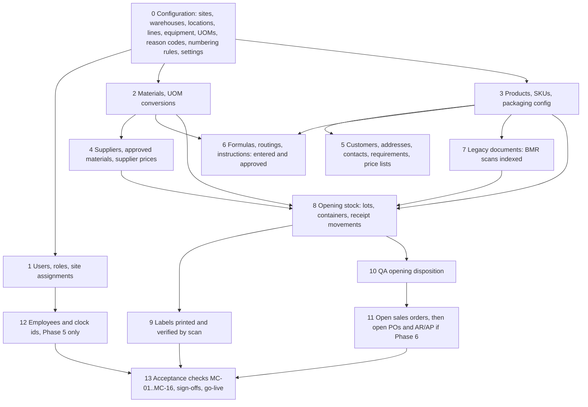
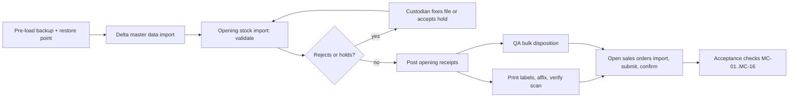

# Data migration plan

Owner: product-manager (business sections: scope, sources, rules, sign-off, cutover).
Co-owners: database-architect and backend-engineer (import tooling, identifiers, validation),
warehouse-procurement-specialist (count-and-tag, labels), quality-regulatory-specialist
(opening quality statuses, legacy BMRs), devops-engineer (backups, restore, environments).
Status: Phase 0 draft for Gate 0; executed in Phase 9, or earlier if the owner chooses an
early go-live after G4 (R-08). Related: `docs/PRD.md` (A-PRD-04, A-PRD-30, Q-A-08, Q-C-02),
`docs/process-maps.md` (§2 as-is, W01, W03, A-PROC-02), `docs/data-model.md` (§1.10, §3.3,
§3.10, §5), `docs/permissions-matrix.md` §2.12, `docs/security.md` §2.6 and §4.7,
`docs/risk-register.md` (R-12, R-16, R-17, R-18, R-51), `docs/deployment-railway.md`,
`docs/operations-runbook.md`.

Plain-language summary for owners: today stock, customers, suppliers and formulas live in
spreadsheets and on paper, and nothing on the floor carries an internal lot number or a
location code. Going live means counting and labelling every container once, loading clean
master lists, attaching scans of old batch records, and starting the ledger from that count.
We rehearse the whole thing twice on a copy before doing it for real, each business owner
signs for their own data, and there is a way back if the checks fail.

## 1. Purpose, scope and principles

Scope: everything needed for the first production go-live of the MVP (Phases 1 to 4) plus the
later increments (Phase 5 employees and attendance, Phase 6 open purchase orders and open
receivables/payables) when those phases go live. Out of scope: re-keying historical
transactions, importing historical attendance punches, migrating anything into a general
ledger (ADR-020).

| # | Principle | What it means in practice |
|---|---|---|
| P1 | The physical count is the truth for opening stock | Spreadsheet balances are a cross-check, never the load source (R-12) |
| P2 | History is attached, not re-keyed | Paper BMRs, delivery receipts and test records are scanned and indexed by a few header fields (A-PRD-30) |
| P3 | Every migrated row is traceable to its source row | `import_jobs` and `import_job_rows` keep the file, checksum, mapping version, raw row and created entity (`docs/data-model.md` §3.10) |
| P4 | New identifiers are generated; legacy identifiers are kept | Numbering rules (ADR-009) issue system numbers; the paper or spreadsheet number goes to `legacy_number` (§6) |
| P5 | No silent fixes | Cleansing happens in the source files by the custodian with a change log, or in the wizard with a recorded decision; the loader never guesses |
| P6 | Quality values come from qualified people | Expiry, retest, tolerances, specifications and release decisions are entered or approved by Production and QA; the team never derives them |
| P7 | Opening postings are ledger postings | Opening stock enters through posted goods receipts and stock movements, immutable and reversible (ADR-006); no balance is typed into a table |
| P8 | Rehearse until boring | Two rehearsals on staging with acceptance checks before the real cutover (§11) |
| P9 | Go-live is a decision with a way back | Go/no-go checklist, pre-load backup, rollback criteria (§12.1, §13) |

## 2. Roles and sign-off responsibilities

| Data or step | Prepares and cleanses | Verifies | Signs off (business) | Team support |
|---|---|---|---|---|
| Sites, warehouses, locations, special locations | Site managers | warehouse-procurement-specialist | Site manager per site | database-architect (seed scripts) |
| Materials, UOMs, conversions, intermediates | Production process owner, Procurement | QA process owner (INCI names, storage, hazard notes) | Production process owner | manufacturing-process-engineer |
| Products, SKUs, packaging configuration, shelf life | Production process owner, Sales lead | QA process owner (shelf life, storage) | Owner/Director | product-manager |
| Suppliers and approved-material list | Procurement | Accountant (terms) | Procurement | warehouse-procurement-specialist |
| Customers, addresses, contacts, requirements, price lists | Sales lead | Accountant (terms, credit) | Owner/Director | product-manager |
| Formulas, routings, work instructions | Production process owner | QA process owner approves revisions (A-PROC-41) | QA process owner | manufacturing-process-engineer |
| Legacy BMR scans and other historical documents | Production clerk | QA process owner (index fields) | QA process owner | quality-regulatory-specialist |
| Opening stock count, containers, labels | Count teams (counter + checker) | Site manager (variance review) | Site manager per site; Accountant for valuation if Phase 6 is live | warehouse-procurement-specialist |
| Opening quality statuses of lots | QA process owner | – | QA process owner (bulk disposition) | quality-regulatory-specialist |
| Open sales orders | Sales lead | Site manager (shippable stock) | Sales lead | product-manager |
| Open purchase orders (Phase 6) | Procurement | Accountant | Procurement | finance-specialist |
| Employees and time-clock identifiers (Phase 5) | HR | HR second reviewer | HR | hr-payroll-specialist |
| Users, roles, site assignments | IT/operations contact | Owner/Director | Owner/Director | security-engineer |
| Pre-load backup, restore rehearsal, cutover infrastructure | devops-engineer | principal-architect | IT/operations contact | devops-engineer |
| Go-live declaration | – | principal-architect (acceptance checks) | Owner/Director | product-manager |

Sign-off is a dated, named statement kept as a `FileAttachment` on the corresponding
`ImportJob` (or on the cutover record for physical steps). No sign-off, no go-live.

## 3. Source inventory

Formats, custodians and volumes below are assumptions from `docs/process-maps.md` §2.2 and
A-PRD-12; they are confirmed in the discovery interview (Q-MIG-01). "Target" uses entity names
from `docs/data-model.md`.

| # | Source | Custodian (assumed) | Format today (assumed) | Target entities | Est. volume | Known or expected quality issues | Policy |
|---|---|---|---|---|---|---|---|
| S-01 | Stock-on-hand spreadsheets per site or area | Site managers, Warehouse lead | XLSX, one sheet per area, quantities in mixed units | cross-check only (variance report) | ≤ 1,500 rows | Overwritten history, no lots, mixed units, stale rows | Archive; used for MC-05 |
| S-02 | Physical stock: drums, sacks, bottles, boxes with handwritten supplier lot and expiry | Warehouse lead | Physical | InventoryLot, Container, StockMovement (receipt), LabelJob | ≤ 1,000 lots, ≤ 3,000 containers | Missing expiry, illegible supplier lot, partial containers, unlabelled items | Count and tag (§10), load as opening receipts |
| S-03 | Material list (names, suppliers, units) | Production process owner, Procurement | XLSX or purchase records | Material, Uom, UomConversion, SupplierMaterial | ≤ 500 | Common vs INCI names mixed, duplicate spellings, no codes | Migrate |
| S-04 | Product and SKU list, packaging formats, units per box | Sales lead, Production | XLSX, price list | Product, Sku | ≤ 300 SKUs | Variants as free text, no shelf life recorded | Migrate |
| S-05 | Formulas (printed BMR templates such as Acapulco Soap, batch sheets) | Production process owner | Paper and Word/Excel templates | Formula, FormulaRevision, BomLine | ≤ 50 | No tolerances, no revision numbers, rounded totals (F-06) | Enter through the UI, approve (R-04); not bulk-imported |
| S-06 | Procedures, checklists, SOPs | Production, QA | Paper, PDF | Routing, RoutingRevision, RoutingStep, WorkInstructionRevision | ≤ 50 | Procedure lines free text per batch (Q-PR-09) | Enter through the UI, attach PDFs |
| S-07 | Completed paper BMRs (historical batches) | Production clerk, QA | Paper binders | LegacyDocument (§14) + FileAttachment | ≤ 1,200 pages per year of history | Blank header fields on some forms | Scan and index; horizon per A-MIG-05 |
| S-08 | Customer list, addresses, contacts, terms | Sales lead | XLSX, messaging history | Customer, CustomerAddress, CustomerContact | ≤ 200 | Same customer under several names, missing ship-to | Migrate |
| S-09 | Customer requirements (artwork, carton counts, certificates, lead times) | Sales lead | Emails, PDFs, memory | CustomerRequirement + FileAttachment | ≤ 100 | Undocumented (R-52) | Migrate what is written; interview for the rest |
| S-10 | Price lists: customer prices, supplier prices | Sales lead, Procurement, Accountant | XLSX | sales price lists (Phase 4), SupplierMaterial prices (Phase 6) | ≤ 1,000 lines | Effective dates unknown, currency implicit | Migrate current prices only, with effective date = cutover |
| S-11 | Supplier list and approved materials | Procurement | XLSX, contacts in phones | Supplier, SupplierMaterial | ≤ 100 | Duplicates, no quality status | Migrate |
| S-12 | Open (unshipped or partially shipped) sales orders | Sales lead | XLSX, messages | SalesOrder, SalesOrderLine | ≤ 50 open | Partial shipments not tracked per line | Migrate open quantity only |
| S-13 | Open purchase orders and expected deliveries | Procurement | XLSX, messages | PurchaseOrder, PurchaseOrderLine (Phase 6) | ≤ 30 open | Informal (A-PROC-01) | Migrate only if Phase 6 is live; otherwise archive list, receipts are unplanned with the PO number as reference |
| S-14 | Time-clock exports | HR | CSV or XLSX from the device (format unknown, R-05) | AttendanceImport (operational, not migration) | – | Unknown layout, missing punches | Archive history; first live import covers the current payroll period |
| S-15 | Employee list | HR | XLSX | Employee (Phase 5) | ≤ 150 | Personal data, no clock id mapping | Migrate when Phase 5 goes live, restricted (`docs/permissions-matrix.md` §6) |
| S-16 | Storage areas (no codes today) | Site managers | Physical, sketches | Warehouse, Location | ≤ 300 locations | None exist (A-PROC-02) | Create, code and label (§10) |
| S-17 | Equipment: scales, mixers, moulds; calibration records | Production | Paper | Equipment | ≤ 50 | Calibration dates may be missing (Q-PR-08) | Migrate register; missing calibration → warning rule per config |
| S-18 | Delivery receipts, invoices, statements history | Sales lead, Accountant | Paper, XLSX | archive; open receivables/payables as Invoice/SupplierBill only if Phase 6 is live | – | – | Archive; accountant's system remains the ledger (ADR-020) |
| S-19 | Quality records: deviations, complaints, test results history | QA | Paper, XLSX | archive; open complaints entered manually as Complaint | – | – | Archive scans; open items entered |
| S-20 | People who need access | Owner/Director, IT contact | List | User, UserSiteAssignment | ≤ 60 | – | Created through the admin UI with invitations, not imported |

## 4. What is migrated and what is archived

| Record class | Policy | Detail |
|---|---|---|
| Master data (materials, products, SKUs, suppliers, customers, requirements, prices, locations, equipment) | Migrate current state | Active records only; discontinued items only when referenced by opening stock or open orders (status `discontinued`) |
| Formulas, routings, instructions | Enter and approve, never bulk-load into approved state | Draft revisions may be created by import; approval runs through `masterdata.formula.approve` and `masterdata.routing.approve` by the named approvers (R-04, R-13) |
| Opening stock (active lots with expiry or retest, containers) | Migrate from the physical count as opening receipts | One `GoodsReceipt` of kind `opening_balance` per site and warehouse; lot and container per §7; quality status per §7.9 |
| Stock history (past receipts, issues, counts) | Archive | Spreadsheets frozen read-only in the bucket as `FileAttachment` of kind `archive`; not loaded into the ledger |
| Historical BMRs and batch records | Archive with index | Scanned PDF per batch attached to a `LegacyDocument` row with header fields: legacy batch number, product, formula number, batch size, start/end dates, disposition, QA name, expiry; finished-goods opening lots link to it by `legacy_number` |
| Open sales orders | Migrate open quantity | Created as `draft` with `legacy_number`, then submitted and confirmed by `sales_cs` through the normal state machine (approval rules apply); shipped portions stay in the archive with the DR scan attached |
| Open purchase orders | Migrate open quantity only when Phase 6 is live | Created as `draft`, then submitted, approved and sent through the normal flow (A-PROC-13) |
| Open receivables and payables | Migrate only when Phase 6 is live | Posted `Invoice` and `SupplierBill` with legacy numbers and current open amounts, signed by the Accountant; history stays in the accountant's system |
| Attendance history, payroll history | Archive | Never imported; the first live attendance import starts at the current payroll period (ADR-021) |
| Employees | Migrate when Phase 5 is live | Directory fields and `time_clock_identifier`; sensitive fields entered by HR with re-authentication, not bulk-loaded unless the file is handled as `restricted` |
| Users and permissions | Create, not import | Admin UI invitations (`docs/ux-system.md` §9.10) |
| Quality history (deviations, complaints, tests) | Archive scans; open items entered | Open complaints and holds entered manually before go-live by QA |

History horizon (A-MIG-05): legacy BMRs for batches whose finished goods are still within
expiry plus one year, minimum the last two years; QA may extend (Q-QA-09).

## 5. Target load order and dependencies

| Step | Window | Tool | Permission of the poster |
|---|---|---|---|
| 0, 1 | T-30 to T-14, repeated as deltas | Admin UI and reviewed seed scripts (fictional data removed; `FR-platform-15` seed guard) | `masterdata.*.admin`, `identity.*.admin` |
| 2 to 5 | T-14 pre-load, delta at T-1 | Import wizard or loader (§9) | `platform.import_job.post` plus the entity `create` permission |
| 6 | T-30 to T-7 | UI with approval workflow | `masterdata.formula.approve`, `masterdata.routing.approve` |
| 7 | T-30 to T-2 | Import wizard (`legacy_documents` kind) plus upload of scans | `platform.import_job.post`, `documents.attachment.create` |
| 8 | T0 | Import wizard or loader, opening stock kind | `platform.import_job.post`, `procurement.goods_receipt.post`, `inventory.stock_movement.post` |
| 9 | T0 | Label batch print and verification scan screen | `inventory.label_job.create` |
| 10 | T0 | Bulk disposition screen (§14) | `quality.disposition.approve` (qa_qc only) |
| 11 | T0 after 10 | Import wizard then normal state machine | `platform.import_job.post`, `sales.sales_order.{create,submit,approve}` |
| 12 | Phase 5 go-live | Import wizard, `employees` kind, restricted | `platform.import_job.post`, `hr.employee.create` |

## 6. Identifier generation and `legacy_number` mapping

| Entity | System identifier | Rule (default; configurable in `numbering_rules`, A-PRD-04) | Legacy value kept in | Notes |
|---|---|---|---|---|
| Material | `materials.code` | Preserve the existing code when present, unique and matching the scan grammar; otherwise `MAT-{SEQ4}` | `legacy_number` (old code or spreadsheet name key) | Code is encoded as `BC:MAT:<code>`, so it must match `^[A-Z0-9][A-Z0-9._-]{0,63}$` (`docs/security.md` §4.9) |
| Product, SKU | `products.code`, `skus.code` | Preserve or `PRD-{SEQ4}`, `SKU-{SEQ4}` | `legacy_number` | `BC:SKU:<code>` grammar applies |
| Supplier, Customer | `code` | Preserve or `SUP-{SEQ4}`, `CUS-{SEQ4}` | `legacy_number` | |
| Location | `locations.code` | `{WH}-{ZONE}-{RACK}-{BIN}` assigned during set-up (§10) | – | `BC:LOC:<code>` grammar applies; special locations designated per warehouse |
| Opening material lot | `inventory_lots.lot_number` | `LOT` rule (`L-{YYMM}-{SEQ5}`) at posting; `supplier_lot_number` holds the supplier's lot as written on the container | `legacy_number` = count-sheet reference | One lot per material × supplier lot × expiry (§8) |
| Opening finished-goods lot | `inventory_lots.lot_number` | `LOT` rule at posting | `legacy_number` = paper batch number | Links to the `LegacyDocument` with the same legacy number |
| Container | `containers.container_number` | `BOX` rule (`BX-{SEQ8}`) | – | One per physical box, drum, sack or pallet counted |
| Opening goods receipt | `goods_receipts.receipt_number` | `GR` rule | – | `receipt_kind = opening_balance`, reason code `opening_balance`, no supplier |
| Legacy document | `legacy_documents.document_number` | `LDOC-{SEQ6}` | `legacy_number` = paper batch or document number | |
| Open sales order | `sales_orders.order_number` | `SO` rule | `legacy_number` = spreadsheet or message reference | Printed documents show both numbers during hypercare |
| Employee | `employees.employee_number` | Preserve the HR number | `time_clock_identifier` from the device's enrolment list | Unique per organization; mismatch blocks the attendance import |

Rules: (1) legacy identifiers are never used as foreign keys (`docs/data-model.md` §1.2);
(2) a numbering rule may be set to "preserve legacy" for a document type only when Q-A-08
confirms that the legacy numbers are unique and the owner accepts that the pattern is kept
(A-MIG-03); (3) `legacy_number` is indexed and searchable from global search so staff can find
records by the number they know (R-17); (4) the crosswalk file row → entity is
`import_job_rows.created_entity_type/id`, exported as the migration crosswalk report after
each load.

## 7. Cleansing and validation rules per entity

General rules for every file: UTF-8; header row matching the template of the import kind;
values trimmed and internal whitespace collapsed; codes upper-cased; dates parsed with the
source format declared in the mapping and stored as ISO dates; decimal separator and
thousands separators declared in the mapping (A-MIG-04); quantities parsed as decimal
strings (never floats, ADR-010); formulas and macros ignored (`docs/security.md` §2.6);
values starting with `=`, `+`, `-`, `@` stored verbatim and neutralised on export (§4.7). A
row with any **reject** outcome is written to the error file with the reason; **hold** means
the entity is created but blocked until a person acts; **warn** is listed in the review step.

| § | Entity | Required | Format and reference rules | Business rules | Outcome on failure |
|---|---|---|---|---|---|
| 7.1 | Material | code or name, material_class, uom_base | class in (`raw`,`packaging`,`intermediate`,`consumable`); uom exists; code matches the scan grammar | `inci_name` recommended for ingredients (warn if missing); shelf life and retest only if supplied by QA, never derived | reject (missing class/uom); warn (no INCI) |
| 7.2 | UOM conversion | from, to, factor | both uoms exist; same dimension unless a material density is given | factor > 0; density conversions are per material and versioned (FR-masterdata-03) | reject (cross-dimension without density, R-16) |
| 7.3 | Product and SKU | product code or name, family, sku code or name, uom_base | family in the configured list; `units_per_box` integer > 0 when present | `shelf_life_days` only from QA; `allocation_rule` defaults `fefo` | reject (missing uom); warn (no shelf life) |
| 7.4 | Supplier, SupplierMaterial | supplier code or name; for approved list: supplier and material exist | email and phone syntactically valid (warn only) | `quality_status` defaults `new` unless Procurement marks `approved` in the file | reject (unknown material); warn (invalid contact) |
| 7.5 | Customer, addresses, contacts | customer code or name; at least one address with line1, city, country | country code ISO 3166-1 alpha-2; one default ship-to and bill-to | credit limit and terms only from the Accountant's column set (sensitive) | reject (no address); hold `on_hold` status (no terms when credit check is enabled, A-PROC-14) |
| 7.6 | Customer requirement | customer, requirement_kind, one value | kind in the catalogue; SKU exists when given | artwork and documents attached as files | reject (unknown kind) |
| 7.7 | Price list line | customer or supplier, SKU or material, price, currency | currency ISO 4217; price ≥ 0; effective_from = cutover unless given | one active price per key and date range | reject (duplicate active price) |
| 7.8 | Location | warehouse, code, kind | code grammar; kind in (zone, rack, bin, receiving, quarantine, hold, rejected, recall) | every warehouse has all special locations before opening stock loads | reject (duplicate code) |
| 7.9 | Opening stock lot | site, warehouse, location, item_kind, item code, qty, uom, counted_by, checked_by, count_sheet_ref | item and location exist; uom convertible to the item's base; qty > 0; dates valid, `expiry >= manufacture`; counted_by ≠ checked_by | expiry or retest missing for an item whose material requires it → lot created with status `on_hold`, reason `expiry_unknown`; expiry already passed → status `expired`; location in quarantine class → `quarantine`; everything else loads as `quarantine` and waits for the QA bulk disposition (§5 step 10, A-MIG-06); supplier lot missing on a raw material → `on_hold` | reject (unknown item/location, bad qty); hold as stated |
| 7.10 | Container | lot row, container_kind, qty_per_container or container_count | kind in (box, carton, pallet, drum, tote); sum of container quantities = lot quantity | finished goods: containers created with `units_per_box` from the SKU; remainder in one `loose` container (A-MIG-07); raw materials: one container per physical unit | reject (sum mismatch) |
| 7.11 | Legacy document | kind, legacy_number, product, file | PDF or image accepted per `docs/security.md` §4.6; checksum recorded | header index fields entered as on the paper; disposition in (approved, disapproved, unknown) | reject (no file); warn (header field blank, as on the sample photo F-04) |
| 7.12 | Open sales order | customer, legacy_number, line SKU, open qty, uom, requested date | customer and SKU exist; qty > 0 | price from the loaded price list unless the file gives an agreed price (sensitive column); created as `draft` | reject (unknown SKU); warn (price differs from list) |
| 7.13 | Open purchase order (Phase 6) | supplier, legacy_number, line material, open qty, uom, expected date | supplier approved for the material (V-ASL) | created as `draft`; approval per A-PROC-13 | reject (supplier not approved) |
| 7.14 | Employee (Phase 5) | employee_number, names, hire_date, site, employment_status | `time_clock_identifier` unique; status in the configured list | sensitive columns only in a `restricted` file handled by HR with re-authentication | reject (duplicate clock id) |
| 7.15 | Equipment | code, kind, site | kind in the catalogue; calibration dates valid | missing calibration due → warning rule per configuration (FR-masterdata-14) | warn |

## 8. Duplicate reconciliation rules

| Entity | Tier 1 exact key (same record) | Tier 2 normalised match (needs a decision) | Tier 3 fuzzy (listed as warning) | Survivor and alias rule |
|---|---|---|---|---|
| Material | code | `lower(name)` after removing punctuation and units; same `inci_name` | trigram similarity ≥ 0.85 on name | Keep the row with the most complete fields; the other names become `material_aliases` (§14) so old spreadsheet names still resolve in search |
| Product, SKU | code | normalised name + pack format | similarity ≥ 0.85 | As materials |
| Supplier, Customer | code | normalised name + city; same tax identifier or email domain | similarity ≥ 0.85 | One record; additional addresses become `customer_addresses`; contacts merged |
| Opening lot | material + supplier lot + expiry + location | material + supplier lot (expiry differs) | – | Same material, supplier lot and expiry in several places: one lot, several containers at their locations; expiry differs: separate lots, flagged for QA |
| Legacy document | kind + legacy_number | – | – | Second file for the same batch is attached as an additional page set, not a new document |
| Open sales order | legacy_number | customer + requested date + identical lines | – | Blocked until Sales decides |
| Employee | employee_number; `time_clock_identifier` | names + birth date (restricted) | – | Blocked until HR decides |

Procedure: Tier 1 duplicates within a file or against existing records are skipped with
result `duplicate` (imports are create-only and therefore idempotent; re-running a corrected
file never creates a second copy). Tier 2 and 3 candidates stop the job in `under_review`;
the reviewer (the custodian in §2) chooses "same as existing" (alias recorded), "new record"
or "reject", and the choice is stored on the row and audited (`platform.import_posted`).
Nothing is merged automatically (R-12).

## 9. Import tooling

### 9.1 The import wizard (brief Module 15, FR-platform-10)

Steps follow `docs/ux-system.md` §9.9: 1 Upload (file name, size, SHA-256, uploader,
import kind, target site) → 2 Mapping (choose a saved `import_mappings` version or map
columns; declare date and number formats; preview 20 rows) → 3 Validation (counts per
outcome: accepted, duplicate, possible duplicate, hold, rejected; each count opens the rows
with raw values and reasons) → 4 Review and post (summary; duplicates and rejects excluded
and listed; post runs in the worker; error file generated). States:
`uploaded → validated → under_review → posted | rejected | failed`
(`docs/data-model.md` §3.10). Permissions: `platform.import_job.{view,create,submit}` to
prepare, `platform.import_job.approve` and `platform.import_job.post` to post (approver ≠
uploader when the approval rule says so), `platform.import_job.void` to reverse
(`docs/permissions-matrix.md` §2.12). The poster must also hold the `create` or `post`
permission of every entity the import creates; the job rebuilds the poster's AuthContext at
run time (`docs/security.md` §2.8).

### 9.2 Import kinds and file templates

| Import kind (`import_mappings.import_kind`) | Template columns (header names) | Creates |
|---|---|---|
| `materials` | code, name, inci_name, common_name, material_class, uom_base, shelf_life_days, retest_days, storage_conditions, allergen_notes, hazard_notes, requires_coa, legacy_number | Material |
| `skus` | product_code, product_name, product_family, sku_code, sku_name, variant_label, pack_format, uom_base, units_per_box, shelf_life_days, allocation_rule, legacy_number | Product, Sku |
| `suppliers` | code, name, contact_name, email, phone, address_line1, city, country, payment_terms_days, lead_time_days, quality_status, legacy_number; second sheet: supplier_code, material_code, supplier_part_number, is_approved, lead_time_days, moq_qty, moq_uom | Supplier, SupplierMaterial |
| `customers` | code, name, status, payment_terms_days, credit_limit_amount, currency, tax_identifier, legacy_number; sheets: addresses, contacts, requirements | Customer, CustomerAddress, CustomerContact, CustomerRequirement |
| `price_lists` (new) | party_kind, party_code, item_code, price, currency, effective_from, moq | price list lines |
| `locations` (new) | warehouse_code, code, kind, parent_code, label | Location |
| `legacy_documents` (new) | kind, legacy_number, product_code, formula_number, batch_size, batch_size_uom, start_date, end_date, expiry_date, disposition, qa_name, remarks, file_name | LegacyDocument + FileAttachment |
| `opening_stock` | site_code, warehouse_code, location_code, item_kind, item_code, legacy_number, supplier_code, supplier_lot_number, manufacture_date, expiry_date, retest_date, qty, uom, container_kind, container_count, qty_per_container, quality_status_claimed, counted_by, checked_by, count_sheet_ref, unit_cost, currency, notes | GoodsReceipt (opening), GoodsReceiptLine, InventoryLot, Container, ContainerContent, StockMovement (receipt), LabelJob |
| `open_sales_orders` (new) | customer_code, legacy_number, order_date, requested_date, ship_to_label, line_no, sku_code, open_qty, uom, agreed_price, notes | SalesOrder (draft), SalesOrderLine |
| `open_purchase_orders` (new, Phase 6) | supplier_code, legacy_number, order_date, expected_date, line_no, material_code, open_qty, uom, unit_price, currency | PurchaseOrder (draft), PurchaseOrderLine |
| `employees` (new, Phase 5) | employee_number, given_name, family_name, job_title, department_code, site_code, supervisor_number, employment_status, employment_kind, hire_date, time_clock_identifier | Employee |
| `equipment` (new) | code, name, equipment_kind, site_code, line_code, calibration_due_date, cleaning_status | Equipment |

Templates are downloadable from the wizard with an example row of fictional data. Kinds
marked (new) extend the current `import_kind` check constraint (§14).

### 9.3 Guarantees

| Requirement (brief Module 15) | How |
|---|---|
| Preview and mapping | steps 2 and 3; mapping versions saved and reused (`import_mappings` + `ver`) |
| Validation | §7 rules run in the worker with the module's Zod schemas (ADR-008) and services, never raw SQL |
| Duplicate detection | §8 tiers; results per row |
| Error file | CSV with the raw row plus `result` and `error_message`, stored as `error_file_attachment_id` |
| Resumable processing | rows processed in chunks of 500 inside transactions; a restart skips rows with `created_entity_id`; the job-level `idempotency_key` and the file checksum reject an accidental re-upload of the same file for the same kind and site unless a reason is given |
| Audit trail | `platform.import_posted` / `platform.import_reversed` with job id and counts (`docs/security.md` §5); every created posting carries `source_document_type = goods_receipt` and the import's receipt id |
| Reversal | `platform.import_job.void` posts a `reversal` movement for every opening receipt line of the job (reason `import_voided`) and sets created lots to `rejected`; master data created by a voided job is soft-deleted only if unreferenced, otherwise listed for manual review |
| Size and safety | 20 MB and 100,000 rows per file (A-SEC-15, A-SEC-18); XLSX parsed values-only; `.xlsm` rejected |

### 9.4 Command-line loader for a go-live before Phase 5

The wizard UI ships in Phase 5. If the owner goes live after G4 (R-08), the same worker code
runs from a command: `pnpm migrate:load --kind <kind> --file <path> --site <code>
--mapping <code> [--dry-run] [--post]`. It creates the same `import_jobs` and
`import_job_rows`, applies the same §7 and §8 rules, writes the same error file and audit
events, and requires a named user with the posting permissions (`--as <email>` with an
interactive re-authentication). `--dry-run` is the default; `--post` requires the job to
have been reviewed (`under_review → approved` recorded by a second person via
`pnpm migrate:approve <job>`). The loader refuses to run against a database whose
`organizations.environment` is `production` unless `MIGRATION_WINDOW_OPEN=true` is set by the
devops-engineer for the cutover window (A-MIG-08). Backlog story in `docs/backlog.md`
(platform epic, Phase 2 Should).

## 10. Physical preparation: locations, labels, count-and-tag

1. **Location design (T-30 to T-14).** Each site manager walks the warehouse with the
   warehouse-procurement-specialist, names zones, racks and bins, and designates the special
   locations (receiving/staging, quarantine, hold, rejected, recall) per warehouse
   (`masterdata.location.admin`). Codes follow §6; location labels (`BC:LOC`) are printed and
   affixed at T-7 and verified by a scan walk.
2. **Pilot zone (rehearsal 2, T-14).** One zone per site is counted and tagged end to end
   with the real hardware (R-39): count sheet → opening-stock file → load on staging → labels
   → verification scan. Timing per container is measured to size the T0 teams (R-51).
3. **Count sheets.** Pre-numbered sheets (`count_sheet_ref`) with one row per physical
   container or per group of identical containers (same material, supplier lot, expiry):
   location code, item, supplier lot as written, dates as written, quantity and unit,
   container kind and count, counter, checker. Counter ≠ checker, as on the paper BMR (F-10).
   Where readable, a photo of the supplier label is taken and attached to the lot.
4. **Encoding.** A clerk types the sheets into the `opening_stock` template; a second person
   checks 100 % of rows against the sheets before upload (P5).
5. **Load and label.** After posting, the label batch prints one label per container
   (`LabelJob`); the tagging team affixes labels and scans each one on the verification
   screen, which marks the container `verified` and lists the rest. Target: 100 % of lots
   labelled, ≥ 99 % of containers verified before go-live (MC-06).
6. **Found and unknown items.** Items that cannot be identified are counted into the hold
   location with item `UNKNOWN-nn`, photographed, and resolved by the site manager and QA
   after go-live (W03 exception path "item found with no label").

## 11. Dry-run rehearsals and acceptance checks

| Rehearsal | When | Environment | Scope | Pass to proceed |
|---|---|---|---|---|
| R1 Structural | end of Phase 2 (or 6 weeks before an early go-live) | staging | All master-data files in current state; mappings saved; §7 and §8 results reviewed with custodians; cleansing backlog sized | Reject rate < 10 %; every rejection has an owner and a date |
| R2 Dress rehearsal | T-14 | staging restored from a production backup of the configured system | Full sequence §5 steps 2 to 11 with the latest files, the pilot zone count (§10.2), timing of every step, rollback drill (MC-14) | All MC checks pass or have an approved fix; total load and verify time ≤ cutover window (MC-13) |
| R3 Cutover | T0 | production | §12 | All MC checks pass; sign-offs collected |

Acceptance checks (run by the principal-architect and the qa-test-engineer; evidence attached
to the cutover record):

| ID | Check | Pass criterion |
|---|---|---|
| MC-01 | Row completeness | Every source row has a result in `import_job_rows`; zero unresolved `error` rows |
| MC-02 | Entity counts | Created entities per kind = accepted rows per kind |
| MC-03 | Quantity reconciliation | Per material and SKU, Σ `on_hand_base` of opening lots = Σ count-sheet quantities converted to base unit, exact to 6 decimals |
| MC-04 | Ledger and projection | `inventory.reconcile` job reports zero differences after load (`docs/data-model.md` §5.6) |
| MC-05 | Cross-check to spreadsheets | Variance report per item vs the frozen S-01 sheets; every variance above the site threshold has a reason code and the site manager's sign-off |
| MC-06 | Labels | 100 % of opening lots have a `LabelJob`; ≥ 99 % of containers verified by scan; the remainder listed with location |
| MC-07 | Quality status | No opening lot without a `Disposition` row from the QA bulk disposition; lots past expiry are `expired`; `on_hold` lots carry a reason |
| MC-08 | FEFO | For 10 sampled materials with several lots, the allocation recommendation returns the earliest-expiry released lot (A-PRD-16) |
| MC-09 | Uniqueness | No duplicate codes, lot numbers, container numbers or legacy numbers within an entity |
| MC-10 | Master data spot check | 10 % random sample of customers, suppliers and materials verified by the custodian against source; error rate ≤ 1 % |
| MC-11 | Open orders | Count and open quantity (and value if pricing is live) of migrated sales orders equal the frozen S-12 extract; every order reached `confirmed` |
| MC-12 | Traceability | For 3 finished-goods lots the legacy BMR scan opens from the lot page; for 3 material lots the label and lot page show supplier lot and expiry |
| MC-13 | Timing | Load, label and verify complete within the planned cutover window (A-MIG-09) |
| MC-14 | Rollback | Restore of the pre-load backup rehearsed on staging within RTO (A-PRD-33, 4 h) and the restored ledger reconciles |
| MC-15 | Site isolation | Cross-site negative tests pass against the migrated data shape (`docs/permissions-matrix.md` §8) |
| MC-16 | Audit | `platform.import_posted` exists per job with counts; every opening movement has `source_document_type = goods_receipt` and the opening receipt id |

## 12. Cutover plan

### 12.1 Preconditions and go/no-go (T-7)

| # | Condition | Evidence |
|---|---|---|
| 1 | R2 passed; open MC items have approved fixes | R2 report |
| 2 | Approved FormulaRevision and RoutingRevision for every product that will be made in the first month (R-04) | approval audit events |
| 3 | QA has confirmed the opening-status rules (§7.9) and is available on T0 for the bulk disposition | QA sign-off |
| 4 | All location labels affixed and scan-verified | verification report |
| 5 | Hardware tested at each site: scanners, label printers, A4 printer, devices signed in (R-39) | device checklist |
| 6 | Users invited and signed in once; MFA enrolled for privileged roles | identity report |
| 7 | Pre-load backup procedure and restore point agreed (`docs/deployment-railway.md`) | devops sign-off |
| 8 | Hypercare roster and support contact named (R-47) | roster |
| 9 | Cutover log forms printed; freeze communicated to customers and suppliers where deliveries are affected | communication record |
| 10 | Owner go decision | signed checklist |

### 12.2 Freeze

| What | From | Rule |
|---|---|---|
| Master data (customers, suppliers, materials, SKUs, prices) | T-14 | Changes only through the custodian's change log; applied as a delta import at T-1 and then directly in the system |
| Spreadsheets S-01, S-12, S-13 | end of shift T-1 | Final version saved, checksummed and uploaded to the bucket as archive; files set read-only; no further editing (R-18) |
| Receipts, issues, shipments, production movements | end of shift T-1 until go-live | None posted anywhere except through the paper cutover log (emergency only, site manager approval); each log line is entered into the system after go-live as a dated movement with the log reference in the note; the ledger is never back-dated |
| Production | T0 | No batch in process during the count (A-MIG-10); batches finishing before T-1 are moved to quarantine and counted as finished goods |

### 12.3 Physical count (T0, morning)

Teams of two (counter + checker) per zone, following §10.3; the site manager controls the
sheets and signs each zone complete; the clerk encodes and the second checker verifies the
file (§10.4). Unknown items go to the hold location (§10.6).

### 12.4 Load (T0, afternoon)

Loads run by the import wizard or the §9.4 loader with `MIGRATION_WINDOW_OPEN=true`; the
devops-engineer closes the window immediately after MC-16 passes.

### 12.5 Verify and go-live (T0, evening)

1. Acceptance checks §11 run; failures are fixed forward (corrected file, re-run; create-only
   imports make re-runs safe) or trigger §13.
2. Sign-offs collected per §2; the Owner/Director declares go-live; the declaration, check
   evidence and sign-offs are attached to the cutover record.
3. Spreadsheets remain read-only; the first live transactions are the cutover-log entries.

### 12.6 Hypercare (T+1 to T+14, A-MIG-11)

| Activity | Cadence | Owner |
|---|---|---|
| Daily stand-up (15 minutes): issues, blocked operators, open conflicts | daily | product-manager with site managers |
| Reconciliation report: ledger vs projection, availability vs on-hand, labels unverified, lots still `quarantine` from opening | daily | devops-engineer, qa_qc |
| Spot counts: 10 locations per site per day, blind, through W03 | daily | site managers |
| Adoption metrics: % movements by scan, manual-entry rate, sign-in time, sessions per device (R-26, R-27) | daily | ux-ui-designer |
| Issue log with severity, owner, fix-forward decision; reversals used for corrections, never edits | continuous | product-manager |
| Floor presence of a team member at each site for the first 3 working days | T+1 to T+3 | warehouse-procurement-specialist, manufacturing-process-engineer |
| Hypercare exit review: open issues ≤ 5 minor, reconciliation clean for 5 consecutive days, support handover complete (`docs/operations-runbook.md`) | T+14 | Owner/Director, principal-architect |

## 13. Rollback plan

| Decision point | Trigger | Action | Data handling |
|---|---|---|---|
| Before posting opening stock | Delta master-data import fails MC-01/02/09/10 and cannot be fixed within 2 hours | Stop; keep the system in configured state; re-plan T0 | Nothing to reverse; master data already loaded stays (it was signed at T-14) |
| After posting, before go-live declaration | Any MC check failing without an approved fix inside the window (MC-13) | Declare rollback; restore the pre-load backup (database and bucket prefix) on production; verify MC-14-style reconciliation; reopen spreadsheets for editing (version noted); re-plan within 7 days | Restore is the clean path because no live transactions exist yet; the voided attempt's files and error reports are kept for the re-plan |
| After go-live, first 24 hours | A defect that blocks posting at a site, or opening quantities wrong for a whole zone | `system_admin` switches maintenance mode (read-only, `platform.settings.admin`); fix forward: `platform.import_job.void` reverses the affected opening receipts and a corrected file is loaded; live movements since go-live are kept | No restore (would lose live postings); reversals keep the trail |
| After 24 hours | Any data issue | Normal corrections: reversal plus replacement with reason (ADR-006), re-count through W03, master data edits with audit | No rollback |

Communication: the Owner/Director is told of a rollback decision within 30 minutes; sites
return to the frozen spreadsheets and paper cutover log until the new T0. A rollback is not a
failure of go-live readiness if the trigger is met early; a go-live with failing checks is.

## 14. Dependencies on other documents and teams

| Needed | Where | Owner | Status |
|---|---|---|---|
| `legacy_number text` (nullable, indexed, unique per organization and entity where the source guarantees uniqueness) on materials, products, skus, suppliers, customers, inventory_lots, sales_orders, purchase_orders, employees | `docs/data-model.md` §3 | database-architect | Requested (A-PRD-04 names the field; the model does not yet define it) |
| `legacy_documents` table: `document_number`, `legacy_number`, `legacy_kind` (bmr, dr, invoice, test_record, other), `product_id`, `formula_number`, `batch_size` qty set, `start_date`, `end_date`, `expiry_date`, `disposition`, `qa_name`, `remarks`, `file_attachment_id`, `std +site?` | `docs/data-model.md` §3.10 | database-architect | Requested (keeps history out of the batch state machine and ledger) |
| `material_aliases(material_id, alias, source)` for merged duplicate names (§8) | `docs/data-model.md` §3.2 | database-architect | Requested |
| `goods_receipts.receipt_kind` with value `opening_balance` allowing a null supplier; reason codes `opening_balance`, `expiry_unknown`, `import_voided`, `legacy_release`; `reason_codes.applies_to` extended with `receipt` and `disposition` | `docs/data-model.md` §3.3, §3.4 | database-architect | Requested |
| `import_mappings.import_kind` extended with `price_lists`, `locations`, `legacy_documents`, `open_sales_orders`, `open_purchase_orders`, `employees`, `equipment` | `docs/data-model.md` §3.10 | database-architect | Requested |
| Bulk disposition screen for `qa_qc` (select lots by filter, one disposition with reason, re-authentication) | `docs/backlog.md` quality epic, Phase 2 | product-manager, quality-regulatory-specialist | Story to add |
| Label verification scan screen (container `verified` flag, remaining list) | `docs/backlog.md` inventory epic, Phase 2 | product-manager, frontend-engineer | Story to add |
| Command-line loader and `MIGRATION_WINDOW_OPEN` guard (§9.4) | `docs/backlog.md` platform epic, Phase 2 Should | backend-engineer, devops-engineer | Story to add |
| Pre-load backup and restore point procedure; cutover maintenance mode | `docs/deployment-railway.md`, `docs/operations-runbook.md` | devops-engineer | To be written |
| Rehearsal and acceptance checks as test procedures | `docs/testing.md` | qa-test-engineer | To be written |
| Opening-balance goods receipt and legacy document on the stock card and lot page | `docs/reports-and-templates.md` | warehouse-procurement-specialist | To be written |

## 15. Assumptions (A-MIG-nn)

All defaults need owner confirmation; behaviour-affecting ones are configuration.

| ID | Assumption | Default chosen | Configurable | Confirm with |
|---|---|---|---|---|
| A-MIG-01 | Volumes and formats in §3 | As listed; sizing for the loader and the count teams | n/a | Owner/Director, Site managers |
| A-MIG-02 | Spreadsheets are a cross-check, the physical count is the load source (P1) | Variance report against S-01 with site threshold (A-PROC-12) | threshold per site | Site managers, Accountant |
| A-MIG-03 | Legacy numbers are not reused as system numbers | New numbers generated; legacy kept in `legacy_number`; "preserve legacy" mode per document type only after Q-A-08 | per numbering rule | Production, QA |
| A-MIG-04 | Source number and date formats | Thousands separator `,`, decimal `.`, dates `DD/MM/YYYY` unless the mapping says otherwise | per mapping version | Custodians |
| A-MIG-05 | Legacy BMR horizon | Batches whose finished goods are within expiry plus one year, minimum two years | per decision | QA (Q-QA-09) |
| A-MIG-06 | Opening quality status | Load everything as `quarantine` except expired (`expired`), missing mandatory expiry or supplier lot (`on_hold`), then QA bulk-dispositions with reason `legacy_release`; no auto-release | per material class (A-PRD-15) | QA process owner |
| A-MIG-07 | Finished-goods containers at opening | One container per full box using the SKU `units_per_box`; remainder in one `loose` container; boxes of one SKU and one lot (A-PROC-22) | per SKU | Site managers |
| A-MIG-08 | Production loader guard | Loader runs on production only inside a window opened by the devops-engineer with `MIGRATION_WINDOW_OPEN=true` | env setting | IT/operations contact |
| A-MIG-09 | Cutover window | One non-production day per site: count in the morning, load and label in the afternoon, verify and declare in the evening; load plus verify ≤ 8 h | n/a | Owner/Director |
| A-MIG-10 | No batch in process during the count | Production pauses from end of shift T-1 to go-live | n/a | Production process owner |
| A-MIG-11 | Hypercare length | 14 calendar days with the exit criteria in §12.6 | n/a | Owner/Director |
| A-MIG-12 | Opening unit cost | Loaded only when the Accountant supplies it; absent costs are null and costing runs (Phase 6) flag them as estimates | per lot | Accountant |
| A-MIG-13 | Site sequencing | All sites cut over on the same T0; a site-by-site sequence is possible because scope is per site, but cross-site transfers would then straddle systems | n/a | Owner/Director |
| A-MIG-14 | Users are created by invitation, not imported | ≤ 60 users (A-PRD-12) | n/a | IT/operations contact |
| A-MIG-15 | Open sales orders are confirmed by Sales after import, not auto-confirmed | State machine respected; approval rules apply | n/a | Sales lead |
| A-MIG-16 | Imports are create-only | Updates to existing records go through the UI (or a Phase 5 "update" mode with before/after audit) | n/a | principal-architect |

## 16. Owner questions (Q-MIG-nn)

| ID | Question | Why it matters | Blocks |
|---|---|---|---|
| Q-MIG-01 | Which files exist today (names, custodians, where kept) for each source in §3, and may the team receive copies with real values masked where personal or price data is involved? | Confirms volumes and formats; starts R1 | R1 |
| Q-MIG-02 | Do materials, products, customers and suppliers already have codes that staff know by heart? Should they be preserved? | §6 identifier rule | Mapping versions |
| Q-MIG-03 | Must paper batch numbers remain the system lot numbers for finished goods (A-MIG-03, Q-A-08)? | Numbering rule mode | §6 |
| Q-MIG-04 | How far back must legacy BMRs be scanned and indexed (A-MIG-05)? Who will scan them? | Effort and horizon | Step 7 |
| Q-MIG-05 | May all opening stock in general storage be released by QA on the basis of its history (A-MIG-06), or must some classes be re-tested before release? | Opening status rules; first-week production | §7.9 |
| Q-MIG-06 | Can each site stop production and deliveries for one day for the count (A-MIG-09/10)? Which day? | Cutover window | T0 date |
| Q-MIG-07 | Should all sites cut over on the same day or in sequence (A-MIG-13)? | Transfers between sites during cutover | Plan |
| Q-MIG-08 | Who are the counters and checkers per site, and are enough phones and label printers available to tag every container on T0 (R-39, R-51)? | Team sizing from the pilot zone | §10 |
| Q-MIG-09 | Which open sales orders and partial shipments exist, and does any customer require delivery documents to carry the old order number during hypercare? | §4 open orders; printed documents | Step 11 |
| Q-MIG-10 | Will the Accountant supply opening unit costs per lot or per material (A-MIG-12)? | Costing estimates vs actuals (Phase 6) | Optional |
| Q-MIG-11 | Are there customer-specific requirements written anywhere (S-09), or must they be collected by interview before the first orders (R-52)? | Packing blocks | Step 5 |
| Q-MIG-12 | Who is the second checker for the encoded count file (§10.4) and who signs each site's opening stock? | Sign-off table §2 | T0 |
| Q-MIG-13 | Is a go-live after G4 wanted (R-08)? If yes, the loader (§9.4), the bulk disposition and the verification screen move into Phase 2 scope. | Backlog phasing | G0 |
| Q-MIG-14 | What is the acceptable variance threshold per site between the count and the frozen spreadsheet before the Accountant must be informed (A-MIG-02)? | MC-05 | R2 |
