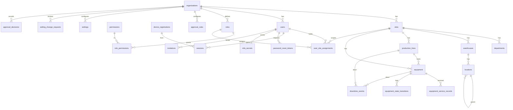
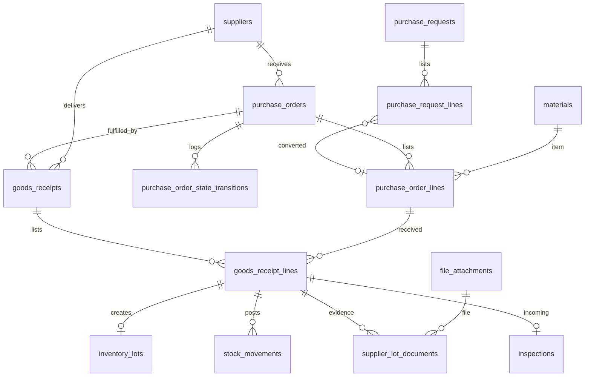
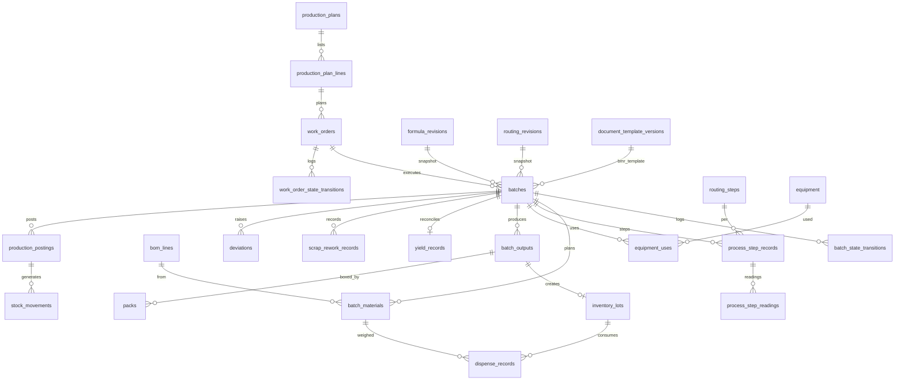
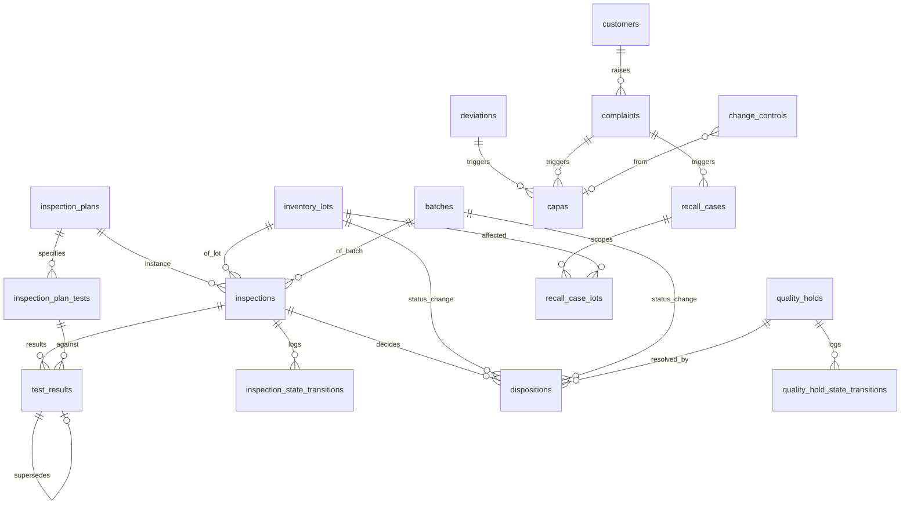
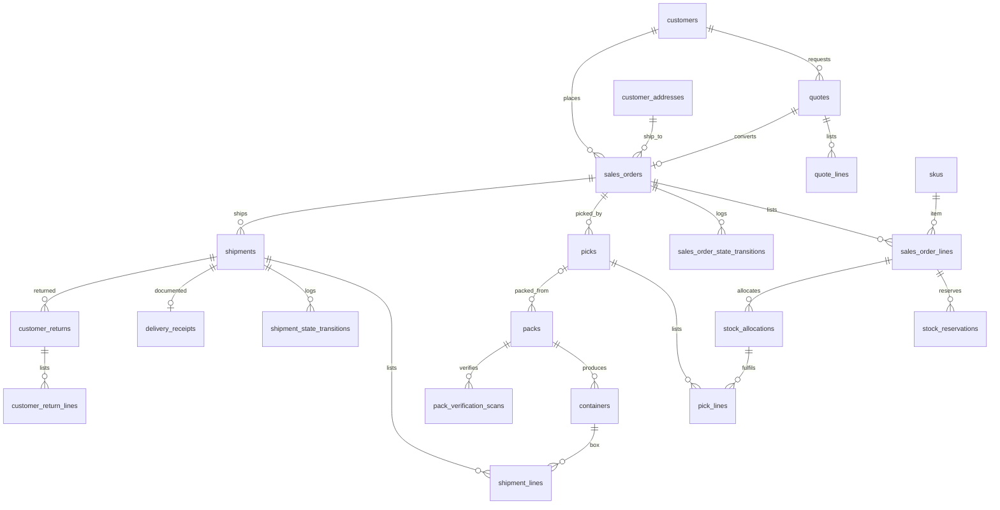
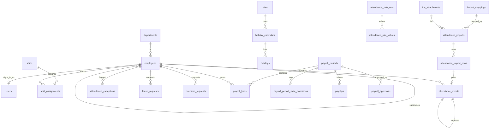
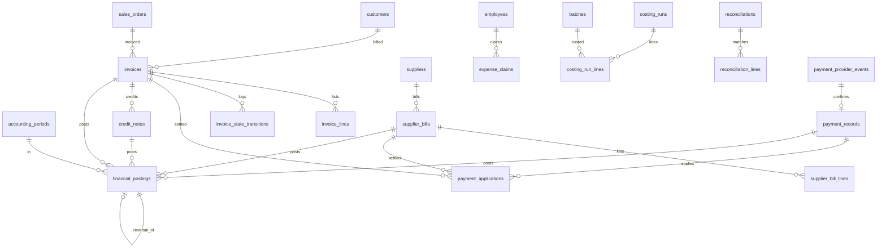
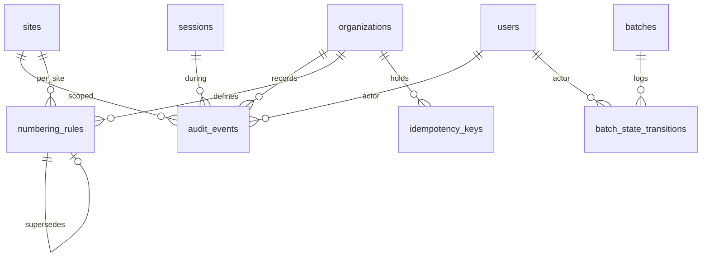

# Data model

The PostgreSQL 16 schema for the Bryel's Care ERP/CRM. It is the single source of truth for
entity names, columns, keys, constraints, ledger rules and migration discipline, and it is
what the backend engineer turns into `src/db/schema/*` with Drizzle (ADR-003).

Binding decisions: ADR-002 (PostgreSQL 16), ADR-003 (Drizzle + SQL migrations), ADR-006
(append-only ledgers, balances are projections), ADR-009 (UUIDv7 + numbering rules),
ADR-010 (`numeric`, dual unit storage), ADR-011 (one organization, many sites). Roles and
permission strings come from `docs/permissions-matrix.md`; workflows from
`docs/process-maps.md`; module scope from `docs/PRD.md` and `docs/modules/*.md`.

How to read this document:

| Reader | Start with |
|---|---|
| Owners / process owners | §1.3 (what every record carries), §4 (how approved formulas are frozen into a batch), §5.1 (why stock is never edited), §12 (how long data is kept), §14 (what we need you to confirm) |
| Engineers | Everything; §3 is the column-level contract, §5, §6 and §9 contain the SQL the services must follow |

Facts come from `docs/source/master-brief.md` and the ADRs. Choices the business must confirm
are labelled `A-DM-nn` and collected in §14.

## 1. Conventions

### 1.1 Naming

| Object | Rule | Example |
|---|---|---|
| Tables | `snake_case`, plural | `inventory_lots`, `batch_materials` |
| Columns | `snake_case`, singular | `lot_number`, `qty_base` |
| Primary key | always `id` | `batches.id` |
| Foreign key | `<entity>_id`; role-named when several point to one table | `from_location_id`, `to_location_id`, `checked_by` |
| Booleans | `is_`, `has_`, `requires_`, `allow_` prefix | `is_organization_wide` |
| Timestamps / dates / actors | `_at` (timestamptz), `_date` (date), `_by` (FK `users.id`) | `posted_at`, `expiry_date`, `posted_by` |
| Quantities | `qty_entered`, `uom_entered_id`, `qty_base`, `uom_base_id` (the "qty group", ADR-010) | `stock_movements.qty_base` |
| Money | `<name>_amount` + `currency` (ISO 4217, `char(3)`) | `total_amount`, `currency` |
| Constraint names | `pk_`, `fk_<table>_<col>`, `uq_<table>_<cols>`, `ck_<table>_<rule>`, `ix_<table>_<cols>`, `tg_<table>_<purpose>` | `uq_inventory_lots_org_lot_number` |
| Enum values | lower `snake_case` text, identical to the shared vocabulary | `materials_staged`, `partially_shipped` |
| Drizzle | one file per domain in `src/db/schema/<domain>.ts`, exported through `src/db/schema/index.ts`; constraint names are set explicitly so generated SQL matches this document | `src/db/schema/inventory.ts` |

### 1.2 Keys

- Primary keys are UUIDv7, generated in the application (`uuidv7` package) so that offline
  clients can create ids without a round trip (ADR-009, ADR-018). Column type `uuid`, `NOT NULL`,
  no database default on business tables.
- The foundation migration `0000_extensions_and_functions` (§13.6) creates `uuid_generate_v7()`
  (pure SQL, RFC 9562 version/variant bits) for SQL-only paths: seeds, backfills, partition
  maintenance. Tests assert the version nibble is 7.
- Natural keys are unique per organization (and per site where the numbering rule is per
  site): codes, document numbers, lot numbers, box ids. They are never used as foreign keys.
- No `serial`/`identity` columns on business tables. `bigint` sequences exist only inside
  `numbering_rules.next_value` and partition bookkeeping.

### 1.3 Standard column sets

Every catalogue entry in §3 names the sets it includes instead of repeating them.

| Set | Columns | Used by |
|---|---|---|
| `std` | `id uuid PK`; `organization_id uuid NOT NULL FK organizations`; `created_at timestamptz NOT NULL DEFAULT now()`; `created_by uuid NOT NULL FK users`; `updated_at timestamptz NOT NULL DEFAULT now()` (set by Drizzle `$onUpdate`); `updated_by uuid NOT NULL FK users` | all mutable tables |
| `+site` | `site_id uuid NOT NULL FK sites` plus composite `FOREIGN KEY (organization_id, site_id) REFERENCES sites (organization_id, id)` so a row can never point at a site of another organization | operational records |
| `+site?` | as `+site` but `site_id NULL` = valid for all sites | master data with optional site restriction |
| `+soft` | `deleted_at timestamptz NULL`, `deleted_by uuid NULL FK users`; unique indexes become partial `WHERE deleted_at IS NULL` | master data only; never ledgers or posted documents |
| `+status` | `status_changed_at timestamptz NOT NULL DEFAULT now()`, `status_changed_by uuid NOT NULL FK users`; kept in step with `status` by `src/lib/state-machine.ts` (§6.1) | every table whose `status` is governed by a state machine in §6 (`batches`, `work_orders`, `purchase_orders`, `sales_orders`, `inspections`, `quality_holds`, `shipments`, `payroll_periods`, `invoices`, `equipment`); the §3 rows do not repeat them |
| `ledger` | `id`, `organization_id`, `site_id` (+ composite FK), `posted_at timestamptz NOT NULL DEFAULT now()`, `posted_by uuid NOT NULL FK users`, `correlation_id uuid NOT NULL`, `idempotency_key text NULL`, `reversal_of_id uuid NULL FK self`; no `updated_*`, no `deleted_*`; `BEFORE UPDATE OR DELETE` trigger `forbid_mutation()` raises `integrity_constraint_violation` | append-only tables |
| `ver` | `version_no int NOT NULL`, `status text NOT NULL` (`draft`, `pending_approval`, `approved`, `rejected`, `retired`), `effective_from date NOT NULL`, `effective_to date NULL`, `supersedes_id uuid NULL FK self`, `change_summary text NULL` + `approval` set; `UNIQUE (<parent>_id, version_no)`; GiST exclusion so approved ranges of one parent never overlap (§4.3) | versioned master records |
| `approval` | `submitted_by uuid NULL FK users`, `submitted_at timestamptz NULL`, `approved_by uuid NULL FK users`, `approved_at timestamptz NULL`, `approval_note text NULL`; `CHECK (approved_by IS NULL OR approved_by IS DISTINCT FROM submitted_by)` (separation of duties, ADR-005). Multi-step approvals (`approval_rules.step > 1`, `required_count > 1`) record every decision in `approval_decisions` (§3.1, §7 item 10); the record's own columns hold the final step | approvable records whose SoD is mandatory in `docs/permissions-matrix.md` §5.1 |
| `approval?` | the same five columns **without** the CHECK; separation of duties is enforced by the service against setting `approvals.sod.<record_type>` (default `true`) so the owner can switch it off per record type without a migration (A-PM-14, `A-DM-31`) | `work_orders`, `production_plans`, `sales_orders`, `quotes`, `customer_returns`, `forecast_overrides` |
| `qty` | `qty_entered numeric(18,6) NOT NULL`, `uom_entered_id uuid NOT NULL FK uoms`, `qty_base numeric(18,6) NOT NULL`, `uom_base_id uuid NOT NULL FK uoms`; `CHECK (qty_entered > 0 AND qty_base > 0)` unless noted | quantity-bearing rows |
| `money` | `<name>_amount numeric(18,4) NOT NULL`, `currency char(3) NOT NULL DEFAULT 'PHP'` | money-bearing rows |

The system actor: the reference seed (§13.5) inserts one `users` row per organization with
`kind = 'system'` (fixed, documented id; cannot sign in). Jobs, reconciliation and sync replay
use it for `created_by`/`posted_by`, so actor columns are never null.

### 1.4 Tenancy

- `organization_id` is on every table except the global `permissions` catalogue (ADR-011).
  Today there is one organization; the column keeps the future portal tenant boundary cheap.
- Operational records carry `site_id` (`+site`). Master data carries `site_id NULL` (`+site?`).
- Composite indexes on operational tables start with `site_id`, because every scoped query
  filters on the caller's allowed site set first (ADR-005; scoped repositories in
  `docs/architecture.md`). Row-level security is deferred (ADR-022); the schema keeps
  `site_id` denormalised on child rows (lines, records, transitions) so an RLS policy can be
  added later without joins.

### 1.5 Enum strategy: `text` + named `CHECK`

Chosen: state and kind columns are `text NOT NULL` with a named `CHECK (col IN (...))`, typed
in Drizzle with `text({ enum: [...] })`. Not native `CREATE TYPE ... AS ENUM`.

Why: a value can be added, renamed or removed in one transactional migration
(`ALTER TABLE ... DROP CONSTRAINT, ADD CONSTRAINT`), while native enums cannot drop values,
cannot be renamed safely across Drizzle generations, and `ALTER TYPE ... ADD VALUE` cannot be
used in the same transaction that adds it. State legality is enforced by the application state
machine and recorded in `*_state_transitions` (§6); the CHECK only guarantees the stored value
is spelled correctly. Engineering choice, no business impact.

### 1.6 Numbers, dates and text

| Need | Type | Why |
|---|---|---|
| Quantities, weights, volumes | `numeric(18,6)` | 6 decimals cover g on a kg scale, mL on L and mg actives; 12 integer digits exceed any plausible count |
| Money | `numeric(18,4)` | sub-centavo unit prices and allocations; presentation rounds to 2 decimals per currency setting |
| Percentages (tolerance, yield, tax rate) | `numeric(9,4)` | 0.0001 % resolution |
| Conversion factors, densities | `numeric(24,12)` | exact factors such as 1/16 |
| Calendar dates (expiry, retest, manufacture, payroll period, effective dates) | `date` | no time of day exists for them; interpreted in `sites.timezone` |
| Instants | `timestamptz` everywhere; never `timestamp` | one meaning across sites and devices |
| Strings | `text` + `CHECK (length(col) <= n)` where a limit matters; no `varchar(n)` | avoids migration churn |
| Email | `text` with unique index on `lower(email)` | no `citext` extension dependency |
| Extensions | `pgcrypto` (random bytes), `btree_gist` (effective-date exclusion) only | Railway managed Postgres supports both |

`A-DM-01` Precision defaults above; display rounding for PHP is 2 decimals. Needs owner
confirmation only if a product is priced or weighed at finer resolution.

### 1.7 JSONB policy

JSONB is allowed only where the shape is a document the application owns end to end and
nothing is ever joined or aggregated on its inside. Each use is validated by a Zod schema in
the owning module and carries a `schema_version` key inside the document.

| Column | Content |
|---|---|
| `document_template_versions.definition` | renderer id + JSON configuration (section selection, labels, options, page settings; schema `document_template/v1`, ADR-016); never HTML |
| `import_mappings.definition` | column mapping, parsing rules |
| `audit_events.before`, `audit_events.after` | redacted entity snapshots |
| `settings.value` | typed setting value |
| `batches.bom_snapshot` | frozen BOM lines with tolerances (§4.4) |
| `sync_commands.payload`, `sync_commands.server_result`, `sync_conflicts.server_state`, `sync_conflicts.client_state` | replayed command and its outcome |
| `idempotency_keys.response` | stored command result for replays |
| `background_jobs.payload`, `background_jobs.result` | job input/output summary |
| `scheduled_reports.parameters`, `generated_documents.parameters` | report filters as entered |
| `packs.config_snapshot` | packaging configuration resolved at boxing: units per box, carton, label template version, shipping marks, customer requirement id (§3.7) |
| `setting_change_requests.old_value`, `setting_change_requests.new_value` | proposed setting values awaiting approval (§3.1) |
| `metrics_samples.labels` | metric dimensions written by the `platform.metrics_sample` job and the `web` replicas (`replica`, route class; §3.10) |
| `help_guides.body` | help guide content blocks (text, image attachment ids, step lists; schema `help_guide/v1`, §3.10) |
| `label_templates.fields` | which optional fields a label prints (schema `label_fields/v1`, §3.2) |
| `import_job_rows.raw`, `attendance_import_rows.raw` | the original row, untouched |
| `user_site_assignments.scope` | optional sub-scope of an assignment (warehouse, department, line ids; schema `assignment_scope/v1`; P2, `docs/permissions-matrix.md` §4.4) |
| `backup_runs.row_counts` | exact row counts of the reference tables at dump time, compared at restore drills (§3.10) |
| `purchase_order_amendments.before`, `purchase_order_amendments.after` | header and line values before and after an amendment (schema `po_amendment/v1`, §3.4) |

Everything else is columns. Addresses, contacts, tolerances, test specifications, rule values
and parameters are tables because they are queried, validated and reported on.

### 1.8 Index policy

1. Every foreign key column has a b-tree index unless it is the leading column of another index.
2. Composite indexes on operational tables start with `site_id`, then the most selective
   filter (`status`, `lot_id`, `occurred_at`).
3. Natural keys get unique indexes scoped by `organization_id` (and partial
   `WHERE deleted_at IS NULL` on soft-deletable master data).
4. Idempotency keys get a partial unique index `WHERE idempotency_key IS NOT NULL`.
5. Append-only tables are indexed for their read paths only (`(site_id, lot_id, posted_at)`,
   `(source_document_type, source_document_id)`); no index for admin convenience.
6. No GIN indexes on JSONB until a measured need appears.
7. The composite indexes requested by `docs/analytics-kpis.md` §4.4 (17 read-path indexes on
   `stock_movements`, `production_postings`, `batches`, `batch_state_transitions`,
   `process_step_records`, `dispense_records`, `inspections`, `quality_holds`, `deviations`,
   `shipments`, `sales_orders`, `sales_order_state_transitions`, `goods_receipts`,
   `dispositions`, `attendance_events`, `invoices`, `notifications`) are accepted as written
   there; they follow rule 2 and are created by the Phase 5 migration `analytics_indexes`
   (§13.7) rather than being repeated row by row in §3.

### 1.9 Foreign keys, checks and immutability

- Every relationship is a real `FOREIGN KEY`, `ON DELETE RESTRICT`, `ON UPDATE RESTRICT`.
  No cascades: services delete draft children explicitly inside a transaction, and posted
  records are never deleted.
- `CHECK` constraints enforce non-negative quantities, exactly-one-of polymorphic references
  (`CHECK (num_nonnulls(material_id, sku_id) = 1)`), operator ≠ checker, from/to location
  rules per movement type, and enum spellings.
- Ledger tables carry the `forbid_mutation()` trigger (§1.3) and the application role has no
  `UPDATE`/`DELETE` grant on them (§13.4).

### 1.10 Idempotency

Two layers: (1) `idempotency_keys` stores every command's key, request hash and result so a
replay returns the original response (ADR-006, ADR-018); (2) ledger rows and posted documents
also carry `idempotency_key` with a partial unique index, so even a bug in layer 1 cannot post
twice. Keys are client-generated UUIDv7 strings, unique per `(organization_id, key)` (§11.4,
`A-DM-26`); `scope` is stored for diagnostics and request-hash comparison and is not part of
the uniqueness key.

## 2. Domain ERDs

One diagram per domain, entities only (columns are in §3). Cross-domain references are shown
once, on the side that owns the relationship.

### 2.1 Identity and organization



### 2.2 Master data, product and formula

```mermaid
erDiagram
  products ||--o{ skus : has
  uoms ||--o{ uom_conversions : from
  uoms ||--o{ uom_conversions : to
  materials ||--o{ uom_conversions : density
  suppliers ||--o{ supplier_materials : supplies
  materials ||--o{ supplier_materials : sourced
  customers ||--o{ customer_addresses : ships_to
  customers ||--o{ customer_contacts : has
  customers ||--o{ customer_requirements : agrees
  skus ||--o{ customer_requirements : for
  products ||--o{ formulas : has
  formulas ||--o{ formula_revisions : versions
  formula_revisions ||--o{ bom_lines : lists
  materials ||--o{ bom_lines : uses
  products ||--o{ routings : has
  routings ||--o{ routing_revisions : versions
  routing_revisions ||--o{ routing_steps : orders
  routing_steps ||--o{ routing_step_parameters : limits
  work_instructions ||--o{ work_instruction_revisions : versions
  routing_steps }o--o| work_instruction_revisions : follows
  skus }o--o| label_templates : prints
  formula_revisions }o--o| inspection_plans : tested_by
```

### 2.3 Inventory and containers

```mermaid
erDiagram
  materials ||--o{ inventory_lots : of
  skus ||--o{ inventory_lots : of
  inventory_lots ||--o{ inventory_balances : projected
  locations ||--o{ inventory_balances : at
  containers ||--o{ inventory_balances : in
  inventory_lots ||--o{ stock_movements : moves
  locations ||--o{ stock_movements : from
  locations ||--o{ stock_movements : to
  containers ||--o{ stock_movements : carries
  reason_codes ||--o{ stock_movements : explains
  stock_movements ||--o| stock_movements : reversal_of
  inventory_lots ||--o{ stock_reservations : reserves
  inventory_lots ||--o{ stock_allocations : allocates
  stock_reservations ||--o{ stock_allocations : converts
  containers ||--o{ container_contents : holds
  inventory_lots ||--o{ container_contents : lot
  containers ||--o{ container_lineage : parent
  containers ||--o{ container_lineage : child
  containers ||--o| containers : on_pallet
  stock_counts ||--o{ stock_count_lines : counts
  label_templates ||--o{ label_jobs : prints
  stock_adjustments ||--o{ stock_adjustment_lines : lists
  stock_adjustment_lines ||--o| stock_movements : posts
  transfer_requests ||--o{ transfer_request_lines : lists
  transfer_request_lines ||--o{ stock_movements : posts
  inventory_lots ||--o{ inventory_lots : origin_lot
```

### 2.4 Procurement



### 2.5 Production and BMR



### 2.6 Quality



### 2.7 Sales and logistics



### 2.8 HR and payroll



### 2.9 Finance



`journal_entries` / `journal_lines` exist only if a general ledger is approved (ADR-020) and
are therefore described but not created (§3.9).

### 2.10 Documents, jobs and sync

```mermaid
erDiagram
  document_templates ||--o{ document_template_versions : versions
  document_template_versions ||--o{ generated_documents : rendered
  file_attachments ||--o| generated_documents : pdf
  generated_documents ||--o| generated_documents : reprint_of
  label_templates }o--|| document_templates : layout
  label_jobs ||--o| generated_documents : output
  import_mappings ||--o{ import_jobs : mapped_by
  file_attachments ||--o{ import_jobs : file
  import_jobs ||--o{ import_job_rows : rows
  background_jobs ||--o{ generated_documents : produces
  users ||--o{ notifications : receives
  scheduled_reports ||--o{ scheduled_report_recipients : to
  scheduled_reports ||--o{ background_jobs : runs
  device_registrations ||--o{ sync_commands : sends
  users ||--o{ sync_commands : as
  sync_commands ||--o| sync_conflicts : conflicts
  device_registrations ||--o{ sync_conflicts : raised_on
  organizations ||--o{ retention_policies : configures
  organizations ||--o{ legal_holds : places
  skus ||--o{ forecast_overrides : overrides
  backup_runs ||--o{ restore_drills : restored_from
  customer_portal_tenants ||--o{ portal_users : has
```

### 2.11 Audit and numbering



The ten `*_state_transitions` tables share one shape (§6.1); `batch_state_transitions` stands
for all of them here.

## 3. Entity catalogue

Legend. Phase `P1`–`P9` = phase whose migrations first create the table (`P1b` = Phase 1
hardening). Class: **M** master data, **V** versioned master, **T** transactional, **L**
ledger (append-only), **P** projection, **C** configuration. Sets (`std`, `+site`, `+site?`,
`+soft`, `ledger`, `ver`, `approval`, `qty`, `money`) are defined in §1.3 and not repeated.
Types: `num6` = `numeric(18,6)`, `money` = `numeric(18,4)`, `pct` = `numeric(9,4)`,
`ts` = `timestamptz`, `→ t` = foreign key to `t`. The state value sets are in §6.

### 3.1 Identity, organization and platform

| Table → column | Type | Null | Constraint / default | Notes |
|---|---|---|---|---|
| **`organizations`** · P1 · M · `std` (self-referencing `organization_id`) | | | | one row for Bryel's Care (ADR-011) |
| `code`, `name`, `legal_name` | text | no | `uq (code)` | |
| `timezone`, `currency`, `locale` | text / char(3) / text | no | defaults `Asia/Manila`, `PHP`, `en-PH` (ADR-019) | configurable |
| `status` | text | no | ck in (`active`,`suspended`) | |
| `permissions_version` | int | no | default 0 | bumped in the same transaction as any change to `roles`, `role_permissions` or `user_site_assignments`; compared with `sessions.permissions_version` (§7 item 3, A-PM-01) |
| **`sites`** · P1 · M · `std +soft` | | | | `uq (organization_id, id)` backs composite site FKs |
| `code`, `name` | text | no | `uq (organization_id, code)` partial | code appears in numbering patterns |
| `timezone` | text | no | default organization timezone | dates interpreted here |
| `address_line1`, `address_line2`, `city`, `province`, `postal_code`, `country` | text | yes | country `char(2)` default `PH` | |
| `status` | text | no | ck in (`active`,`inactive`) | |
| **`departments`** · P1 · M · `std +site +soft` | | | | e.g. Production, Warehouse, QA |
| `code`, `name` | text | no | `uq (site_id, code)` partial | |
| **`warehouses`** · P1 · M · `std +site +soft` | | | | |
| `code`, `name` | text | no | `uq (site_id, code)` partial | |
| `warehouse_kind` | text | no | ck in (`raw_materials`,`packaging`,`finished_goods`,`general`) | |
| **`locations`** · P1 · M · `std +site +soft` | | | | zones, racks, bins and special areas |
| `warehouse_id` | uuid | no | → warehouses | |
| `parent_location_id` | uuid | yes | → locations | zone → rack → bin |
| `code` | text | no | `uq (organization_id, code)` partial | scan payload `BC:LOC:<code>` must be unique org-wide |
| `name` | text | no | | |
| `location_kind` | text | no | ck in (`zone`,`rack`,`bin`,`receiving`,`staging`,`quarantine`,`hold`,`rejected`,`recall`,`production_staging`,`wip`,`shipping`) | special kinds drive defaults |
| `is_pickable`, `allows_mixed_lots` | bool | no | default true / true | |
| `status` | text | no | ck in (`active`,`blocked`,`inactive`) | `blocked` = no movements in or out |
| **`production_lines`** · P1 · M · `std +site +soft` | | | | |
| `code`, `name` | text | no | `uq (site_id, code)` partial | |
| `department_id` | uuid | yes | → departments | default "Department" printed on the BMR header (`docs/reports-and-templates.md` §2.1); `work_orders.department_id` overrides |
| `status` | text | no | ck in (`active`,`down`,`inactive`) | |
| **`equipment`** · P1 · M · `std +site +soft` | | | | scales, mixers, cutters; register in P1, service records, downtime and blocking in P3; preventive-maintenance plans, maintenance work orders and spare parts are deferred (`A-DM-30`, §13.7) |
| `production_line_id` | uuid | yes | → production_lines | |
| `code`, `name` | text | no | `uq (organization_id, code)` partial; ck code `~ '^[A-Z0-9][A-Z0-9._-]{0,63}$'` | organization-wide so the scan payload `BC:EQP:<code>` resolves without a site (§9.5) |
| `equipment_kind` | text | no | ck in (`scale`,`mixer`,`heater`,`kettle`,`homogenizer`,`mould`,`cutter`,`filler`,`labeller`,`other`) | extendable by migration |
| `status` | text | no | ck in (`in_service`,`maintenance`,`out_of_service`) | administrative state (§6.11); availability for a step is derived, see the paragraph after this table |
| `calibration_interval_days`, `last_calibrated_date`, `calibration_due_date` | int / date / date | yes | | set by calibration service records |
| `maintenance_interval_days`, `last_maintained_date`, `maintenance_due_date` | int / date / date | yes | | set by preventive-maintenance service records |
| `cleaning_status`, `last_cleaned_at`, `cleaning_rule` | text / ts / text | no / yes / no | ck status in (`clean`,`dirty`,`in_progress`) default `clean`; ck rule in (`per_batch`,`per_changeover`,`none`) default `per_batch` | line clearance and cleaning records update it |
| `qualification_status` | text | no | ck in (`not_required`,`qualified`,`pending`,`failed`) default `not_required` | qualification rules are QA configuration |
| `blocking_rule` | text | no | ck in (`block`,`warn`,`none`) default `block` | what an overdue calibration, maintenance or cleaning does to step selection (PRD FR-production-07; `A-DM-28`) |
| `capacity_min`, `capacity_max`, `capacity_uom_id` | num6 / num6 / uuid | yes | ck `min <= max`; → uoms | weighing range of a scale; dispensing warns outside it |
| `responsible_user_id` | uuid | yes | → users | technician |
| **`equipment_service_records`** · P3 · T · `std +site` | | | | cleaning, calibration, maintenance, repair and qualification events (process-maps W13-05); corrections append |
| `equipment_id`, `service_kind` | uuid / text | no | → equipment; ck kind in (`cleaning`,`calibration`,`preventive_maintenance`,`repair`,`qualification`,`inspection`) | |
| `performed_at`, `performed_by`, `performed_by_external` | ts / uuid / text | no / yes / yes | ck `num_nonnulls(performed_by, performed_by_external) >= 1` | external calibration vendors are recorded by name |
| `result` | text | no | ck in (`pass`,`fail`,`completed`) | `fail` keeps the equipment blocked |
| `next_due_date`, `reference_number`, `certificate_attachment_id`, `notes` | date / text / uuid / text | yes | → file_attachments | calibration certificate |
| `reviewed_by`, `reviewed_at` | uuid / ts | yes | ck `reviewed_by <> performed_by` | `qa_qc` review returns equipment to service after a failed calibration (G-W13-B) |
| `supersedes_id`, `correction_reason` | uuid / text | yes | → self; reason required with supersedes (ck) | never overwrite |
| | | | ix `(site_id, equipment_id, performed_at)` | posting updates `equipment.last_*`, `*_due_date`, `cleaning_status` and `status` in the same transaction and writes `equipment_state_transitions` when the status changes |
| **`equipment_state_transitions`** · P3 · L | | | | shape §6.1 |
| **`downtime_events`** · P3 · T · `std +site` | | | | downtime of a production line or a piece of equipment with a reason (brief module 14; KPI-OPS-09 in `docs/analytics-kpis.md`): `production_line_id`, `equipment_id` (ck at least one), `started_at`, `ended_at` (null while open), `reason_code_id`, `note`, `logged_by`; a transition to `maintenance`/`out_of_service` opens one, return to `in_service` closes it; ix `(site_id, started_at)` |
| **`users`** · P1 · M · `std` | | | | one row per person or system actor |
| `email` | text | no | unique index `(organization_id, lower(email))` | |
| `password_hash` | text | yes | argon2id (ADR-004) | null for `system` and invited users |
| `display_name`, `given_name`, `family_name` | text | no / yes / yes | | |
| `kind` | text | no | ck in (`person`,`system`) | `system` cannot sign in |
| `status` | text | no | ck in (`invited`,`active`,`locked`,`deactivated`,`system`) | lifecycle (ADR-004); `system` = the organization's one system actor (ADR-029): never signs in, no assignments, hidden from user administration, attributes scheduled work in FK columns |
| `locale`, `timezone` | text | yes | | overrides organization defaults |
| `failed_login_count`, `locked_until` | int / ts | no / yes | default 0 | lockout policy in `docs/security.md` |
| `password_changed_at`, `last_login_at`, `deactivated_at`, `anonymised_at` | ts | yes | | rows are never deleted (FK targets); `anonymised_at` marks a retention anonymisation (§12.4) |
| `mfa_required` | bool | no | default false | set by role policy (P1b) |
| **`roles`** · P1 · C · `std +soft` | | | | seeded with the 13 roles of the shared vocabulary |
| `code`, `name` | text | no | `uq (organization_id, code)` | `owner_director` … `customer_portal_user` |
| `is_system` | bool | no | default false | system roles cannot be deleted |
| `is_organization_wide_allowed` | bool | no | default false | true only for `owner_director`, `system_admin`, `auditor` |
| **`permissions`** · P1 · C · `id`, `created_at` only | | | | global catalogue, seeded from code |
| `code` | text | no | `uq (code)`; ck matches `^[a-z_]+\.[a-z_]+\.(view\|create\|edit\|submit\|approve\|post\|export\|void\|admin)$` | `module.entity.action` |
| `module`, `entity`, `action`, `description` | text | no | | |
| **`role_permissions`** · P1 · C · `id`, `organization_id`, `created_at`, `created_by` | | | | |
| `role_id`, `permission_id` | uuid | no | → roles, → permissions; `uq (role_id, permission_id)` | |
| **`user_site_assignments`** · P1 · C · `std` | | | | the scope model of ADR-005 |
| `user_id`, `role_id` | uuid | no | → users, → roles | |
| `site_id` | uuid | yes | → sites (+ composite FK) | null only when organization-wide |
| `is_organization_wide` | bool | no | ck `(is_organization_wide AND site_id IS NULL) OR (NOT is_organization_wide AND site_id IS NOT NULL)` | service also checks `roles.is_organization_wide_allowed` |
| `valid_from`, `valid_to` | date | no / yes | | temporary cover |
| `scope` | jsonb | yes | schema `assignment_scope/v1` (§1.7); column added in P2 | optional warehouse / department / production-line sub-scope inside the site (`docs/permissions-matrix.md` §4.4); null = the whole site |
| | | | `uq (user_id, role_id, site_id) NULLS NOT DISTINCT` | |
| **`sessions`** · P1 · T · `id`, `organization_id`, `created_at` | | | | opaque cookie value is the token; only its hash is stored |
| `user_id` | uuid | no | → users | |
| `token_hash` | text | no | `uq (token_hash)` | sha256 of the cookie value |
| `device_registration_id` | uuid | yes | → device_registrations | column added in P7 (§11.1) |
| `ip`, `user_agent`, `device_label` | inet / text / text | yes | | |
| `active_site_id` | uuid | yes | → sites | last site context |
| `last_seen_at`, `idle_expires_at`, `absolute_expires_at` | ts | no | | values from settings (`docs/security.md`) |
| `mfa_verified_at`, `reauthenticated_at` | ts | yes | | privileged actions check recency |
| `permissions_version` | int | no | default 0 | the `organizations.permissions_version` the cached `AuthContext` was built from; a mismatch forces a rebuild on the next request (cache ≤ 60 s, A-PM-01; `docs/security.md` §3.4) |
| `revoked_at`, `revoked_by`, `revoked_reason` | ts / uuid / text | yes | | revocation is an update, never a delete |
| **`password_reset_tokens`** · P1 · T · `id`, `organization_id`, `created_at` | | | | |
| `user_id` | uuid | no | → users | |
| `token_hash` | text | no | `uq` | |
| `expires_at`, `used_at` | ts | no / yes | | single use |
| `requested_ip` | inet | yes | | |
| **`password_history`** · P1 · T · `id`, `organization_id`, `created_at` | | | | the last 5 password hashes per user so a new password cannot repeat one (`docs/security.md` §3.2, A-SEC-05) |
| `user_id`, `password_hash` | uuid / text | no | → users; ix `(user_id, created_at)` | the sweep deletes rows beyond the newest 5 per user |
| **`rate_limit_buckets`** · P1 · T · `id`, `created_at` only (no `organization_id`: buckets exist before authentication) | | | | Postgres token buckets behind the limits in `docs/security.md` §4.5 |
| `scope`, `key` | text | no | `uq (scope, key)` | scope = limit name (`login_ip`, `login_account`, `password_reset`, `api_user`, …); key = ip, `lower(email)` or user id |
| `tokens`, `refilled_at` | numeric(9,2) / ts | no | | `INSERT ... ON CONFLICT (scope, key) DO UPDATE`; rows idle for 24 h are deleted by the sweep (§12.2 `security`) |
| **`mfa_secrets`** · P1b · T · `std` | | | | TOTP (ADR-004) |
| `user_id` | uuid | no | → users, `uq` | |
| `secret_enc` | bytea | no | | AES-GCM with env key; never logged |
| `recovery_code_hashes` | text[] | no | | argon2id hashes |
| `confirmed_at`, `last_used_at` | ts | yes | | |
| **`invitations`** · P1 · T · `std` | | | | one rule (§7 item 5): `identity.user.create` inserts the `users` row with `status = 'invited'` and this row in one transaction; acceptance sets `password_hash`, `status = 'active'` and inserts the `user_site_assignments` row from `role_id`/`site_id` |
| `user_id`, `email` | uuid / text | no | → users (the invited row) | `email` is a copy for the message; the user row is the link |
| `role_id`, `site_id` | uuid | no / yes | → roles, → sites | null site = organization-wide |
| `token_hash` | text | no | `uq` | |
| `expires_at`, `accepted_at`, `revoked_at` | ts | no / yes / yes | | a resend revokes this row and inserts a new one |
| **`approval_rules`** · P1 · C · `std +site? +soft` | | | | thresholds are data (ADR-005); evaluation and default rules in `docs/permissions-matrix.md` §5.2 (defaults are `A-PM-15`) |
| `document_type` | text | no | ck in (`purchase_request`,`purchase_order`,`sales_order`,`quote`,`stock_adjustment`,`stock_count_variance`,`expense_claim`,`invoice`,`supplier_bill`,`credit_note`,`payment_record`,`dispense_exception`,`over_shipment`,`formula_revision`,`routing_revision`,`disposition_conditional_release`,`recall_case`,`batch_reopen`,`work_order_release`,`leave_request`,`overtime_request`,`payroll_period`,`period_lock_unlock`,`setting_change_request`,`retention_action`,`supplier_return`,`equipment_override`,`payroll_period_reopen`) | one value per approvable record type; the same list bounds `approval_decisions.record_type` |
| `threshold_basis` | text | no | ck in (`always`,`amount`,`qty_base`,`variance_pct`,`discount_pct`,`credit_check_failed`) | |
| `min_value`, `max_value`, `currency`, `threshold_uom_id` | numeric(18,6) / numeric(18,6) / char(3) / uuid | yes | ck `min <= max`; currency for `amount`, → uoms for `qty_base` | null = unbounded |
| `step`, `required_count` | int / int | no | default 1 / 1 | sequential steps; distinct approvers per step |
| `required_role_id`, `required_permission_code` | uuid / text | yes | → roles; ck exactly one | |
| `poster_may_equal_approver` | bool | no | default false | A-PM-10 |
| `escalation_role_id`, `escalation_after_hours` | uuid / int | yes | → roles; both or neither (ck) | |
| `effective_from`, `effective_to` | date | no / yes | | |
| `reviewed_by`, `reviewed_at` | uuid / ts | yes | | qualified reviewer sign-off where the rule encodes a company policy |
| **`settings`** · P1 · C · `std` | | | | typed key registry lives in `src/lib/settings.ts` |
| `scope` | text | no | ck in (`organization`,`site`,`user`) | |
| `site_id`, `user_id` | uuid | yes | → sites, → users; ck matches scope | |
| `key`, `value` | text / jsonb | no | `uq (organization_id, scope, site_id, user_id, key) NULLS NOT DISTINCT` | e.g. `inventory.reservation_ttl_days`; `inventory.role_movement_types` (organization or site scope; value = map of role code → allowed `stock_movements.movement_type` values, A-PM-06) is a setting, not a table |
| **`setting_change_requests`** · P1 · T · `std +site?` + `approval` | | | | a change to a setting whose registry entry (`src/lib/settings.ts`) has `requires_approval = true` is proposed here and written to `settings` only on approval (S1-03); every applied change keeps proposer, approver and reason (`docs/security.md` §2.11 "settings are versioned") |
| `scope`, `site_id`, `user_id`, `key` | text / uuid / uuid / text | no / yes / yes / no | same ck as `settings` | |
| `old_value`, `new_value`, `reason` | jsonb / jsonb / text | yes / no / no | | |
| `status` | text | no | ck in (`submitted`,`approved`,`rejected`,`applied`,`cancelled`) | `applied` is set in the same transaction as the `settings` upsert |
| `applied_at` | ts | yes | | |
| **`approval_decisions`** · P1 · L · `id`, `organization_id`, `site_id` NULL, `created_at` | | | | one row per approval-step decision on any approvable record (§7 item 10); `forbid_mutation()`; the record's `approved_by/approved_at` hold the final step |
| `record_type`, `record_id` | text / uuid | no | ck type in the `approval_rules.document_type` list | polymorphic by design (§1.9); integrity checked by the service |
| `approval_rule_id`, `step` | uuid / int | yes / no | → approval_rules; default 1 | null rule = base `.approve` permission |
| `decision` | text | no | ck in (`approved`,`rejected`,`returned`) | |
| `decided_by`, `decided_at`, `note`, `reauthenticated_at` | uuid / ts / text / ts | no / no / yes / yes | → users; `uq (record_type, record_id, step, decided_by)` | a user decides a step once; restricted actions carry the re-authentication time |
| **`numbering_rules`** · P1 · C · `std +site?` + `ver` | | | | §9 |
| **`idempotency_keys`** · P1 · T | | | | §1.10, §5.4, §11.4 |
| **`audit_events`** · P1 · L (partitioned) | | | | §8 |
| **`device_registrations`** · P7 · M · `std +site?` | | | | §11.1; designed now so ids are stable |
| **`backup_runs`**, **`worker_heartbeats`** · P1 · T; **`metrics_samples`** · P1 · L | | | | operations tables used by `docs/deployment-railway.md` from the first staging deploy; §3.10 |

**Settings keys catalogued by this model.** The typed registry in `src/lib/settings.ts` is the
single source for every key (type, scope, default, `requires_approval`); the keys below are the
ones other documents depend on and must exist in the registry with these defaults. Defaults
are assumptions owned by the cited document and need owner confirmation there.

| Key | Scope | Type and default | `requires_approval` | Phase | Source |
|---|---|---|---|---|---|
| `platform.maintenance.read_only` | organization | object `{enabled: bool, allowed_role_codes: text[]}`; default `{enabled: false, allowed_role_codes: []}` | false (changed by `system_admin` under `platform.settings.admin` with re-authentication; audit `platform.setting.changed`) | P2 | read-only maintenance mode for the cutover load window: while enabled, sign-in and reads keep working, screens show a read-only banner and the server refuses every command from users holding no allowed role; restores use `MAINTENANCE_MODE=1` instead (A-DEP-21, ruling 91, `docs/operations-runbook.md` §17a.2) |
| `settings.offline.retry_schedule` | organization or site | interval list; default `[5 s, 30 s, 2 min, 10 min, 30 min]`, then every 30 min, each wait jittered ±20 % | false | P7 | `docs/offline-sync.md` A-OFF-08 |
| `settings.offline.max_attempts` | organization or site | int; default 20 | false | P7 | `docs/offline-sync.md` A-OFF-08 |
| `settings.offline.max_queue_age_hours` | organization or site | int; default 72; must be ≥ `settings.offline.auth_snapshot_max_age` (validated on save) | false | P7 | `docs/offline-sync.md` A-OFF-09 |
| `settings.ux.undo_window_seconds` | organization | int; default 60 | false | P2 | toast undo window for an operator's own stock move (`docs/ux-system.md` §5.17, A-UX-15; `docs/architecture.md` §6) |

### 3.1.1 Wave 2 W2F implementation notes (US-1-14, US-1-19, US-1-25, US-1-26, US-2-30)

Schema file `src/db/schema/governance.ts`; services in `src/modules/governance`.

| Table / item | As built | Difference from the design above |
|---|---|---|
| `approval_rules` | Columns as §3.1 plus `label`, `source` (assumption or policy reference), `version` (optimistic concurrency), `created_by`/`updated_by`, `deleted_at`/`deleted_by` (soft delete). Threshold match: `min_value` exclusive, `max_value` inclusive. Several rows with the same `step` merge (any listed role; the larger `required_count`). An organization with no rows at all for a type is evaluated against the built-in defaults (`src/modules/governance/default-rules.ts`, also the seed); the first edit of a type saves those defaults as rows | `required_role_codes jsonb` (list of role codes, empty = any role holding the permission) instead of `required_role_id`, and `escalation_role_codes jsonb` instead of `escalation_role_id`, because the §5.2 defaults name alternatives within one step. `document_type` list adds `routing_revision_sequencing`, `work_instruction_revision`, `inspection_plan` (W1D record types). `approval_decisions.approval_rule_id` is not added (the evaluation audit row carries the rule ids) |
| `setting_change_requests` | §3.1 columns plus `requires_approval`, `rejected_by/at`, `rejection_reason`, `cancelled_at`. CHECKs: SoD for approver and rejecter, `applied` ⇔ `applied_at`, an `applied` row of a requires-approval key has an approver. Direct changes (keys without `requires_approval`) are recorded as `applied` rows with no approver, so the table is the version history of every setting. `new_value` null = remove the stored row | `new_value` nullable (reset to default) |
| `settings` registry | `src/lib/settings.ts` entries now carry `group`, `label`, `description`, `requiresApproval`, `restricted`. New keys: `platform.maintenance.read_only`, `platform.rate_limits`, `approvals.sod.{sales_order,quote,work_order_release,production_plan,customer_return}`, `alerts.{worker_heartbeat_max_seconds,backup_max_age_hours,failed_jobs_window_minutes,dedupe_minutes}`, `platform.metrics.retention_days`. Removed: `inventory.count.second_step_variance_pct`, `inventory.count.second_step_role`, `inventory.adjustment.second_step_value`, `inventory.adjustment.second_step_role` (now `approval_rules`) | user-scope settings are not editable in the admin screen |
| `numbering_rules` + `numbering_rule_versions` | The counters stay in `numbering_rules` (one row per document type and period key, the last lock of a command). The `ver` part of §9.1 is the new table `numbering_rule_versions` (`prefix`, `pattern`, `reset_period`, `sequence_width`, `is_gapless`, `effective_from/to`, `version_no`, `status` submitted/approved/rejected/cancelled, `supersedes_id`, `change_summary`, approval columns with SoD CHECK). The §9.4 pattern trigger is expressed as CHECK constraints. Overlap is prevented by the approval service (closes the previous version on the new effective date) plus a partial unique index (one open-ended approved version per type), not a GiST exclusion. Counter keys per reset period are `YY`, `YYMM`, `YYMMDD` or empty, so a new version continues the running sequence of the period | Organization scope only (`{SITE}` and site-scoped rules wait until `nextNumber` callers pass the site); `NUMBER_OVERFLOW` and `NUMBERING_RULE_MISSING` are domain errors |
| `rate_limit_buckets` | §3.1 plus `last_allowed` (decision of the single-statement upsert). Semantics: fixed window starting at the first request (`refilled_at` = window start, `tokens` = remaining); refused requests do not consume. Swept after 24 h idle by `platform.metrics_sample` | fixed window instead of a continuous token refill |
| `metrics_samples` | As §3.10; written by `platform.metrics_sample` only (web replica counters not yet); pruned after `platform.metrics.retention_days` | not partitioned (A-W2F-07) |
| `backup_runs` | As §3.10 (no `pg_version` writer yet); rows written by `pnpm backup:record`; read when `BACKUP_STATUS_SOURCE=table`. `restore_drills` not built (Phase 9) | |
| `worker_heartbeats.env_presence` | jsonb: allow-listed variable name → present (boolean); never values (Variables card) | new column |
| `help_guides` | Not built: guides are versioned markdown files in `docs/help/` reviewed like code (A-W2F-06) | the table and its draft/publish editor are deferred |

 A piece of equipment can be selected
for a dispense or a process step (`equipment_uses`) when `status = 'in_service'`,
`qualification_status IN ('not_required','qualified')`, `cleaning_status = 'clean'` where
`cleaning_rule <> 'none'`, and neither `calibration_due_date` nor `maintenance_due_date` is
earlier than the business date. When any condition fails and `blocking_rule = 'block'` the
selection is refused with the reasons (`calibration_due`, `maintenance_due`,
`cleaning_required`, `qualification_pending`, `out_of_service`); `warn` records the reasons
on the `equipment_uses` row and alerts the site manager; the controlled exception
`production.equipment_override.approve` (CX-CAL) sets `equipment_uses.exception_approved_by`
and opens a deviation. The reasons `docs/process-maps.md` W13 lists as states are therefore
derived labels, not stored states (§14.3).

### 3.1.1 Wave 2 W2E implementation notes (identity administration)

As built in `src/db/schema/identity.ts` (minimal changes) and `src/db/schema/identity-admin.ts` (new):

| Table | As built | Differs from §3.1 |
|---|---|---|
| `users` | + `password_changed_at`, `deactivated_at`; invited users carry `password_hash = '!'` (matches nothing) | `password_hash` stays not null; no `kind`, `locked_until`, `mfa_required` columns yet (MFA requirement is derived from the role bundle) |
| `roles` | + `description`, `cloned_from_role_id` (→ roles), `status` (`active`/`inactive`), `created_by`, `updated_at`; ck custom roles must be clones | column name `allows_organization_wide` (MVP) |
| `role_permissions` | unchanged: `permission_code` text validated against the code catalogue | no `permissions` table; the catalogue is `src/lib/permissions.ts` + `src/lib/auth/sensitivity.ts` |
| `user_site_assignments` | + `valid_from`, `valid_to` (**timestamptz**, organization-local midnight computed by the service, so every query compares with `now()`), `scope` jsonb (`{"warehouseIds": [...]}`), `created_by`, `revoked_at/by/reason`; ck org-wide ⇔ `site_id is null`; partial unique `(user_id, role_id, coalesce(site_id))` where `revoked_at is null`. Active = `revoked_at is null and valid_from <= now() < coalesce(valid_to, ∞)` (`activeAssignment()` in `src/lib/auth/assignments.ts`; every "who holds role X" query uses it) | dates are timestamptz, not date |
| `sessions` | + `idle_expires_at`, `ip`, `device_label`, `device_class` (`standard`/`shared`), `privileged`, `stage` (`mfa_pending`/`active`), `active_site_id`, `mfa_verified_at`, `reauthenticated_at`, `revoked_by`, `revoked_reason`; `expires_at` is the absolute expiry | no `permissions_version` (no context cache) |
| `invitations` | as §3.1 plus `kind` (`standard`/`bootstrap`), `revoked_reason`; assignments are created at invitation, not at acceptance (A-W2E-06) | `role_id` nullable (primary grant shown in the email) |
| `password_reset_tokens` | as §3.1 plus `voided_at` (newest token wins, deactivation), `requested_by` (`self`/`admin`) | — |
| `password_history` | as §3.1; trimmed to the newest `identity.password.history_count` rows on each change | — |
| `mfa_secrets` | `secret_enc` (base64url of iv, tag, ciphertext; AES-256-GCM), `key_id`, `confirmed_at`, `last_used_step` (replay guard), `last_used_at` | recovery codes in a separate table |
| `mfa_recovery_codes` (new) | `user_id`, `code_hash` (argon2id), `used_at` | replaces `mfa_secrets.recovery_code_hashes` so each code is marked used individually |
| `email_outbox` (new) | delivery log: to, subject, template, provider, status (`captured`/`sent`/`failed`/`not_configured`), `body_text` only for the dev/test `outbox` adapter | — |
| `rate_limit_buckets` | one table for every limit since the Wave 2 integration: W2F's definition (`src/db/schema/governance.ts`, fixed window, see the W2F row) serves W2E's reset, invitation and TOTP limits through `limitAuth` (ADR-038) | W2E's own token-bucket table was dropped at integration |

### 3.2 Master data: product, formula, routing, partners

| Table → column | Type | Null | Constraint / default | Notes |
|---|---|---|---|---|
| **`uoms`** · P1 · M · `std +soft` | | | | seeded: g, kg, mL, L, pcs |
| `code`, `name` | text | no | `uq (organization_id, code)` | |
| `dimension` | text | no | ck in (`mass`,`volume`,`count`,`length`) | |
| `is_base` | bool | no | one base per dimension (partial unique) | base: g, mL, pcs |
| **`uom_conversions`** · P1 · V · `std` + `ver` | | | | dimensionally valid (ADR-010) |
| `from_uom_id`, `to_uom_id` | uuid | no | → uoms | |
| `factor` | numeric(24,12) | no | ck `> 0` | `qty_to = qty_from × factor` |
| `material_id` | uuid | yes | → materials | required when dimensions differ (density); ck enforced by trigger `tg_uom_conversions_dimension` |
| **`products`** · P1 · M · `std +soft` | | | | a product family member, e.g. Acapulco Soap |
| `code`, `name` | text | no | `uq (organization_id, code)` partial | |
| `legacy_number` | text | yes | partial `uq (organization_id, legacy_number)` | old spreadsheet code when it differs from `code` (§9.6) |
| `product_family` | text | no | ck in (`soap`,`lotion`,`cream`,`oil`,`other`) | extendable |
| `status` | text | no | ck in (`draft`,`active`,`discontinued`) | |
| `default_formula_id`, `default_routing_id` | uuid | yes | → formulas, → routings | columns added in P3 (§13.7) |
| `primary_image_attachment_id` | uuid | yes | → file_attachments (kind `product_image`) | column added in P2; images are re-encoded and metadata-stripped (`docs/security.md` §4.6) and served through signed URLs only; portal exposure (P8) is limited to approved catalogue items |
| **`skus`** · P1 · M · `std +soft` | | | | sellable / stockable variant |
| `product_id` | uuid | no | → products | |
| `code`, `name` | text | no | `uq (organization_id, code)` partial | scan `BC:SKU:<code>` |
| `legacy_number` | text | yes | partial `uq (organization_id, legacy_number)` | §9.6 |
| `variant_label`, `pack_format` | text | yes | | e.g. "100 g bar", "250 mL bottle" |
| `net_content_qty`, `net_content_uom_id` | num6 / uuid | yes | → uoms | |
| `uom_base_id` | uuid | no | → uoms | usually `pcs` |
| `units_per_box`, `boxes_per_pallet` | int | yes | ck `> 0` | packaging configuration |
| `gtin` | text | yes | | optional retail barcode |
| `primary_image_attachment_id` | uuid | yes | → file_attachments (kind `product_image`) | column added in P2; same rules as `products` |
| `shelf_life_days`, `retest_days` | int | yes | | drives lot expiry at output |
| `storage_conditions` | text | yes | | |
| `allocation_rule` | text | no | ck in (`fefo`,`fifo`) default `fefo` | configurable per SKU |
| `label_template_id`, `bmr_template_id` | uuid | yes | → label_templates, → document_templates | columns added in P2 when the target tables exist (§13.7) |
| `status` | text | no | ck in (`draft`,`active`,`discontinued`) | |
| **`materials`** · P1 · M · `std +soft` | | | | raw, packaging, intermediate, consumable |
| `code`, `name` | text | no | `uq (organization_id, code)` partial | scan `BC:MAT:<code>` |
| `legacy_number` | text | yes | partial `uq (organization_id, legacy_number)` | §9.6; alternate spreadsheet names and codes are `material_aliases` |
| `inci_name`, `common_name` | text | yes | | printed on BMR |
| `material_class` | text | no | ck in (`raw`,`packaging`,`intermediate`,`consumable`) | `A-DM-04` |
| `uom_base_id` | uuid | no | → uoms | |
| `specification` | text | yes | | reference to spec document |
| `storage_conditions`, `allergen_notes`, `hazard_notes` | text | yes | | content validated by QA |
| `shelf_life_days`, `retest_days` | int | yes | | |
| `requires_coa`, `requires_incoming_inspection` | bool | no | default true / true | |
| `default_inspection_plan_id` | uuid | yes | → inspection_plans | column added in P3 (§13.7) |
| `allocation_rule` | text | no | ck in (`fefo`,`fifo`) default `fefo` | |
| `status` | text | no | ck in (`draft`,`active`,`blocked`,`discontinued`) | |
| **`material_aliases`** · P2 · M · `std +soft` | | | | alternate names and codes that resolve to one material in search, scanning fallback and imports (`docs/data-migration-plan.md` §6, de-duplication) |
| `material_id`, `alias`, `alias_kind`, `source` | uuid / text / text / text | no / no / no / yes | → materials; ck kind in (`name`,`code`,`supplier_part_number`,`legacy`); `uq (organization_id, lower(alias))` partial | `source` = which spreadsheet, supplier or person supplied the alias |
| **`suppliers`** · P2 · M · `std +soft` | | | | |
| `code`, `name` | text | no | `uq (organization_id, code)` partial | |
| `legacy_number` | text | yes | partial `uq (organization_id, legacy_number)` | §9.6 |
| `contact_name`, `email`, `phone`, `address_line1`, `city`, `country` | text | yes | | |
| `payment_terms_days`, `default_lead_time_days` | int | yes | | |
| `tax_identifier` | text | yes | | configuration reference, sensitive (`docs/modules/finance.md` §5; masking per `docs/permissions-matrix.md` §6) |
| `quality_status` | text | no | ck in (`approved`,`conditional`,`suspended`,`new`) default `new` | receiving from `suspended` needs exception |
| **`supplier_materials`** · P2 · M · `std +soft` | | | | approved-supplier list |
| `supplier_id`, `material_id` | uuid | no | `uq (supplier_id, material_id)` partial | |
| `supplier_part_number` | text | yes | | |
| `requested_by`, `requested_at` | uuid / ts | yes | → users; both or neither (ck) | proposer of the current ASL change (`procurement`, `masterdata.supplier.edit`, W04-11); set on every proposal to approve or suspend |
| `is_approved`, `approved_by`, `approved_at` | bool / uuid / ts | no / yes / yes | default false; → users; ck `approved_by <> requested_by` | ASL decision under `masterdata.supplier.approve` (S, P6, `qa_qc`; ruling 87, W04-11): the person who proposed the entry cannot approve it; audit `masterdata.supplier.asl_changed` |
| `audit_date`, `evidence_attachment_id`, `suspended_reason` | date / uuid / text | yes | → file_attachments | supplier audit evidence; reason required when `is_approved` is switched off (service) |
| `lead_time_days`, `moq_qty`, `moq_uom_id` | int / num6 / uuid | yes | | |
| `unit_price`, `currency`, `price_effective_from` | money / char(3) / date | yes | | |
| **`customers`** · P4 · M · `std +soft` | | | | |
| `code`, `name` | text | no | `uq (organization_id, code)` partial | |
| `legacy_number` | text | yes | partial `uq (organization_id, legacy_number)` | §9.6 |
| `status` | text | no | ck in (`prospect`,`active`,`on_hold`,`inactive`) | |
| `payment_terms_days`, `credit_limit_amount`, `currency` | int / money / char(3) | yes | | sensitive (finance roles) |
| `default_lead_time_days`, `tax_identifier` | int / text | yes | | tax id is configuration, sensitive |
| `portal_tenant_id` | uuid | yes | → customer_portal_tenants | column added in P8 |
| `anonymised_at` | ts | yes | | §12.4 |
| **`customer_addresses`** · P4 · M · `std +soft` | | | | |
| `customer_id` | uuid | no | → customers | |
| `label`, `line1`, `line2`, `city`, `province`, `postal_code`, `country`, `contact_name`, `phone` | text | label/line1/city/country no; rest yes | | |
| `is_default_ship_to`, `is_default_bill_to` | bool | no | default false | |
| **`customer_contacts`** · P4 · M · `std +soft` | | | | |
| `customer_id`, `name`, `email`, `phone`, `role_label`, `is_primary`, `anonymised_at` | uuid / text… / bool / ts | mixed | → customers | personal data (§12.3) |
| **`customer_requirements`** · P4 · V · `std` + `ver` | | | | agreed specifications |
| `customer_id` | uuid | no | → customers | |
| `sku_id` | uuid | yes | → skus | null = all SKUs |
| `requirement_kind` | text | no | ck in (`label_artwork`,`carton_count`,`coa_required`,`moq`,`lead_time`,`packaging`,`document`,`lot_age_max_days`,`min_remaining_shelf_life_days`,`full_shipment_required`,`shipping_marks`,`other`) | `min_remaining_shelf_life_days` (`value_numeric`) filters allocation (W09-05); `full_shipment_required` (`value_text` `true`/`false`) drives CX-SHIP (A-PROC-15); `shipping_marks` (`value_text`) prints on the boxing note and box label |
| `value_numeric`, `value_uom_id`, `value_text` | num6 / uuid / text | yes | | one of them per kind |
| `label_template_id`, `document_template_version_id` | uuid | yes | | artwork / required document |
| **`reason_codes`** · P1 · M · `std +soft` | | | | Slice 1 master data (`docs/PRD.md` §11.1) |
| `code`, `name` | text | no | `uq (organization_id, code)` partial | |
| `applies_to` | text[] | no | values in (`adjustment`,`transfer`,`receipt`,`disposition`,`sample`,`scrap`,`rework`,`return`,`count_variance`,`hold`,`reprint`,`deviation`,`reversal`,`exception`,`cancel`,`downtime`,`audit`) | `audit` = reasons offered on audited actions (sync conflict resolution, reopen, anonymisation); migration seeds `opening_balance`, `expiry_unknown`, `import_voided`, `legacy_release`; the reference seed adds `undo_by_actor` (`reversal`) (§13.5) |
| `requires_note`, `requires_approval` | bool | no | default false | |
| **`formulas`** · P3 · M · `std +soft` | | | | header; content lives in revisions |
| `product_id` | uuid | no | → products | |
| `code`, `name` | text | no | `uq (organization_id, code)` partial | "Batch Formula No." on the BMR |
| **`formula_revisions`** · P3 · V · `std` + `ver` | | | | §4 |
| `formula_id` | uuid | no | → formulas | |
| `batch_size_base`, `uom_base_id` | num6 / uuid | no | ck `> 0`; → uoms | reference batch, e.g. 17,600 g |
| `expected_yield_pct` | pct | yes | | theoretical yield |
| `shelf_life_days`, `retest_days` | int | yes | | override SKU defaults |
| `inspection_plan_id` | uuid | yes | → inspection_plans | finished-product tests |
| `notes` | text | yes | | "verify with authorized personnel" banner is UI, not data |
| **`bom_lines`** · P3 · V (child) · `std` | | | | per revision |
| `formula_revision_id` | uuid | no | → formula_revisions | |
| `line_no` | int | no | `uq (formula_revision_id, line_no)` | |
| `line_kind` | text | no | ck in (`ingredient`,`intermediate`,`packaging`) | packaging BOM shares the table |
| `material_id` | uuid | no | → materials | |
| `phase_code` | text | yes | | e.g. `oils`, `lye`, `additives` |
| `qty_base`, `uom_base_id` | num6 / uuid | no | ck `> 0`; → uoms | per `batch_size_base` |
| `scaling` | text | no | ck in (`proportional`,`fixed`) default `proportional` | |
| `tolerance_pct`, `tolerance_abs_base` | pct / num6 | yes | ck `num_nonnulls(...) = 1` | `A-DM-17` |
| `is_critical`, `requires_checker` | bool | no | default true / true | |
| `sequence` | int | no | | dispensing order |
| **`routings`** · P3 · M · `std +soft` | | | | |
| `product_id`, `code`, `name` | uuid / text / text | no | → products; `uq (organization_id, code)` partial | |
| **`routing_revisions`** · P3 · V · `std` + `ver` | | | | |
| `routing_id` | uuid | no | → routings | |
| `formula_revision_id` | uuid | yes | → formula_revisions | optional binding |
| `default_production_line_id` | uuid | yes | → production_lines | |
| **`routing_steps`** · P3 · V (child) · `std` | | | | |
| `routing_revision_id` | uuid | no | → routing_revisions | |
| `step_no`, `code`, `name` | int / text / text | no | `uq (routing_revision_id, step_no)` | the 7 BMR checklist rows are steps |
| `step_kind` | text | no | ck in (`line_clearance`,`dispensing`,`process`,`in_process_qc`,`filling`,`cutting`,`curing`,`hold`,`packaging`,`reconciliation`,`transfer`,`checklist`) | `hold` = curing/bulk hold with a minimum duration (A-PROC-05) |
| `area` | text | yes | ck in (`weighing`,`production`,`packaging`,`filling`,`other`); required when `step_kind = 'line_clearance'` (ck) | distinguishes the two production-area clearances on the paper BMR (A-PROC-32) |
| `record_mode` | text | no | ck in (`electronic`,`paper_then_transcribe`,`paper_only`) default `electronic` | how the step is recorded (`docs/reports-and-templates.md` §2.5); versioned with the routing revision; a `paper_then_transcribe` step needs a reviewed `batch_paper_records` row before the batch leaves `awaiting_qc` (§6.2) |
| `min_duration_minutes` | int | yes | ck `> 0` | `hold` steps cannot complete earlier without CX-TOL |
| `requires_checker`, `blocks_until_complete`, `requires_equipment` | bool | no | default true / true / false | |
| `equipment_kind`, `equipment_id` | text / uuid | yes | → equipment | class or specific unit |
| `work_instruction_revision_id` | uuid | yes | → work_instruction_revisions | |
| `inspection_plan_id` | uuid | yes | → inspection_plans | in-process QC |
| `expected_duration_minutes` | int | yes | | planning |
| **`routing_step_parameters`** · P3 · V (child) · `std` | | | | process readings definition |
| `routing_step_id`, `code`, `name` | uuid / text / text | no | `uq (routing_step_id, code)` | e.g. `temp_oil` |
| `uom_id` | uuid | yes | → uoms | |
| `min_value`, `max_value`, `target_value` | num6 | yes | ck `min <= max` | |
| `value_kind` | text | no | ck in (`numeric`,`text`,`boolean`) | |
| `is_required` | bool | no | default true | |
| **`routing_step_checklist_items`** · P3 · V (child) · `std` | | | | line-clearance and checklist content per step (A-PROC-07); editable only while the routing revision is `draft` |
| `routing_step_id`, `item_no`, `text` | uuid / int / text | no | `uq (routing_step_id, item_no)` | e.g. "previous batch materials and labels removed" |
| `requires_photo`, `is_blocking` | bool | no | default false / true | a `no` answer on a blocking item stops the step until resolved or a deviation is raised |
| **`work_instructions`** · P3 · M · `std +soft` | | | | header |
| `code`, `name` | text | no | `uq (organization_id, code)` partial | |
| **`work_instruction_revisions`** · P3 · V · `std` + `ver` | | | | |
| `work_instruction_id` | uuid | no | → work_instructions | |
| `body_markdown` | text | no | | rendered on traveler/BMR |
| `file_attachment_id` | uuid | yes | → file_attachments | PDF/images |
| **`label_templates`** · P2 · M · `std +site? +soft` | | | | physical label configuration; layout is a `document_templates` row of kind `label` |
| `code`, `name` | text | no | `uq (organization_id, code)` partial | |
| `document_template_id` | uuid | no | → document_templates | |
| `applies_to` | text | no | ck in (`material`,`wip`,`finished_good`,`carton`,`pallet`,`location`,`equipment`,`sample`) | `equipment` labels carry `BC:EQP` (§9.5) |
| `symbology` | text | no | ck in (`qr`,`code128`,`ean13`) default `qr` | ADR-017; `ean13` reserved for retail barcodes in a later phase (ADR-017 amendment, §14.3) |
| `copies_default`, `fields` | int / jsonb | no / yes | default 1 | `fields` = which optional fields print (§1.7; catalogue in `docs/reports-and-templates.md` §8.3) |
| `media_width_mm`, `media_height_mm`, `dpi` | numeric(6,1) / numeric(6,1) / int | no | | thermal printer |

### 3.3 Inventory and containers

| Table → column | Type | Null | Constraint / default | Notes |
|---|---|---|---|---|
| **`inventory_lots`** · P2 · T · `std +site` | | | | a lot is not a product, not a box |
| `lot_number` | text | no | `uq (organization_id, lot_number)` | from rule `LOT`; scan `BC:LOT:<lot_number>` |
| `item_kind` | text | no | ck in (`material`,`sku`) | |
| `material_id`, `sku_id` | uuid | yes | ck `num_nonnulls = 1` | |
| `uom_base_id` | uuid | no | → uoms | |
| `supplier_id`, `supplier_lot_number` | uuid / text | yes | → suppliers | received lots |
| `goods_receipt_line_id`, `batch_output_id` | uuid | yes | ck at most one | origin: receipt or batch |
| `origin_lot_id` | uuid | yes | → inventory_lots | set when a lot is re-lotted at another site (inter-site transfer, §5.1) or created from a customer return; genealogy edge (§10.1) |
| `legacy_number` | text | yes | partial `uq (organization_id, legacy_number)` | paper or spreadsheet lot number carried over at the opening-stock load (§9.6; `docs/data-migration-plan.md` §6); never in scan payloads |
| `manufacture_date`, `expiry_date`, `retest_date` | date | yes | ck `expiry >= manufacture` | |
| `quality_status` | text | no | ck in (`quarantine`,`released`,`on_hold`,`rejected`,`expired`,`recalled`) default `quarantine` | changed only by `dispositions` |
| `quality_status_changed_at` | ts | no | | |
| `unit_cost_amount`, `currency` | money / char(3) | yes | | landed cost for costing runs |
| `notes` | text | yes | | |
| | | | ix `(site_id, item_kind, material_id, expiry_date)`, `(site_id, quality_status)` | FEFO scan |
| **`inventory_balances`** · P2 · P · `id`, `organization_id`, `site_id`, `updated_at` | | | | projection, rebuilt from the ledger (§5.2) |
| `location_id`, `lot_id`, `container_id` | uuid / uuid / uuid | no / no / yes | → locations, → inventory_lots, → containers | |
| `quality_status` | text | no | same ck as lots | copy of the lot status at last update |
| `on_hand_base`, `reserved_base`, `allocated_base` | num6 | no | default 0; ck `on_hand >= 0`, `reserved >= 0`, `allocated >= 0`, `reserved + allocated <= on_hand` | `A-DM-02` |
| `uom_base_id` | uuid | no | → uoms | |
| `last_movement_id` | uuid | yes | → stock_movements | |
| `version` | int | no | default 0 | optimistic check in tests |
| | | | `uq (site_id, location_id, lot_id, container_id, quality_status) NULLS NOT DISTINCT` | the balance key |
| **`stock_movements`** · P2 · L · `ledger` | | | | §5.1 |
| `movement_number` | text | no | `uq (organization_id, movement_number)` | rule `MOV` |
| `movement_type` | text | no | ck in (`receipt`,`issue`,`transfer`,`consumption`,`output`,`adjustment`,`return`,`shipment`,`reversal`) | |
| `lot_id` | uuid | no | → inventory_lots | |
| `from_location_id`, `to_location_id` | uuid | yes | → locations; ck per type (§5.1) | |
| `container_id` | uuid | yes | → containers | the box the quantity sits in |
| `qty` set | | | ck `qty_base > 0` | direction comes from from/to |
| `quality_status_at_posting` | text | no | | evidence for exceptions |
| `unit_cost_amount`, `currency` | money / char(3) | yes | | the lot's unit cost at posting, copied from `inventory_lots.unit_cost_amount`, so period valuation and count-variance value tie to the ledger (`docs/analytics-kpis.md` §8.3; `A-DM-34`); null until a cost is known |
| `reason_code_id`, `reason_note` | uuid / text | yes | → reason_codes; required for `adjustment`, `return`, `reversal` (ck) | |
| `source_document_type`, `source_document_id`, `source_line_id` | text / uuid / uuid | no / no / yes | ck type in (`goods_receipt`,`production_posting`,`shipment`,`stock_count`,`customer_return`,`stock_adjustment`,`container_operation`,`transfer_request`,`supplier_return`) | polymorphic by design; integrity checked by the service |
| `exception_approved_by` | uuid | yes | → users | set when blocked stock was moved by controlled exception |
| `device_registration_id`, `client_sequence` | uuid / bigint | yes | | offline provenance |
| | | | partial `uq (organization_id, idempotency_key)`; ix `(site_id, lot_id, posted_at)`, `(site_id, from_location_id)`, `(site_id, to_location_id)`, `(source_document_type, source_document_id)`, `(reversal_of_id)` | |
| **`stock_reservations`** · P2 · T · `std +site` | | | | soft hold on specific stock |
| `lot_id`, `location_id`, `container_id` | uuid | no / no / yes | | `A-DM-22` |
| `qty_base`, `uom_base_id` | num6 / uuid | no | ck `> 0` | |
| `demand_type`, `demand_id` | text / uuid | no | ck type in (`sales_order_line`,`work_order`,`batch_material`,`transfer_request`) | |
| `status` | text | no | ck in (`active`,`converted`,`released`,`expired`,`cancelled`) | |
| `expires_at`, `released_at`, `released_reason` | ts / ts / text | yes | | TTL from settings |
| **`stock_allocations`** · P2 · T · `std +site` | | | | hard assignment for picking / dispensing |
| `reservation_id` | uuid | yes | → stock_reservations | |
| `lot_id`, `location_id`, `container_id` | uuid | no / no / yes | | |
| `qty_base`, `uom_base_id`, `qty_fulfilled_base` | num6 / uuid / num6 | no | default 0 | |
| `demand_type`, `demand_id` | text / uuid | no | as reservations | |
| `status` | text | no | ck in (`active`,`fulfilled`,`released`,`cancelled`) | |
| **`stock_counts`** · P2 · T · `std +site` | | | | |
| `count_number` | text | no | `uq (organization_id, count_number)` | rule `CNT` |
| `warehouse_id`, `location_id` | uuid | no / yes | | whole warehouse or one location; finer scopes (several locations, zone, material class, ABC class) are `stock_count_scopes` rows (W03-01) |
| `count_kind` | text | no | ck in (`cycle`,`full`,`spot`) | |
| `is_blind` | bool | no | default true | counters do not see expected qty |
| `status` | text | no | ck in (`planned`,`in_progress`,`counted`,`recount`,`pending_approval`,`posted`,`cancelled`) | |
| `scheduled_for`, `frozen_at`, `posted_at` | date / ts / ts | yes | | expected quantities snapshotted at `frozen_at` |
| `approval` set | | | | variance approval |
| `cancel_reason_code_id`, `cancel_note` | uuid / text | yes | → reason_codes; reason required when `status = 'cancelled'` (ck) | W03-09 |
| **`stock_count_scopes`** · P2 · T · `std +site` | | | | one row per scope element of a count; frozen with the count (W03-01) |
| `stock_count_id`, `location_id`, `material_class`, `abc_class` | uuid / uuid / text / text | no / yes / yes / yes | → stock_counts, → locations; ck `num_nonnulls(location_id, material_class, abc_class) >= 1`; ck class in the `materials.material_class` list; ck abc in (`A`,`B`,`C`) | a location row includes its child locations |
| **`stock_count_counters`** · P2 · T · `std +site` | | | | assigned counters (W03-01) |
| `stock_count_id`, `user_id` | uuid | no | → stock_counts, → users; `uq (stock_count_id, user_id)` | only assigned counters may enter lines; the variance approver is never a counter (§7 item 10) |
| **`stock_count_lines`** · P2 · T · `std +site` | | | | original count never erased |
| `stock_count_id`, `location_id`, `lot_id`, `container_id` | uuid | no / no / no / yes | | |
| `expected_qty_base` | num6 | no | | snapshot |
| `counted_qty_base`, `counted_by`, `counted_at` | num6 / uuid / ts | yes | | first count |
| `recount_qty_base`, `recounted_by`, `recounted_at` | num6 / uuid / ts | yes | ck `recounted_by <> counted_by` | |
| `variance_qty_base` | num6 | yes | | final − expected |
| `variance_reason_code_id`, `variance_note` | uuid / text | yes | | |
| `adjustment_movement_id` | uuid | yes | → stock_movements | posted adjustment |
| `is_unexpected` | bool | no | default false | "found" item outside the frozen expectation (W03-03); `expected_qty_base = 0` |
| `device_registration_id`, `client_sequence`, `idempotency_key` | uuid / bigint / text | yes | partial `uq` on key | offline capture (A-PROC-28) |
| **`containers`** · P2 · T · `std +site` | | | | box / carton / pallet |
| `container_number` | text | no | `uq (organization_id, container_number)` | rule `BOX`; scan `BC:BOX:<container_number>` |
| `container_kind` | text | no | ck in (`box`,`carton`,`pallet`,`drum`,`tote`,`sack`,`bag`,`bottle`,`loose`) | `loose` = an unpackaged counted unit at the opening-stock load (`docs/data-migration-plan.md` S-02, A-MIG-07) |
| `status` | text | no | ck in (`open`,`sealed`,`in_transit`,`shipped`,`empty`,`void`) | |
| `current_location_id` | uuid | yes | → locations | null once shipped |
| `parent_container_id` | uuid | yes | → containers | box on pallet |
| `pack_id`, `sales_order_id`, `shipment_id` | uuid | yes | → packs (column added in P3), → sales_orders, → shipments (P4) | set during pack/dispatch |
| `packed_at`, `packed_by`, `checked_by` | ts / uuid / uuid | yes | ck `checked_by <> packed_by` | |
| `gross_weight`, `net_weight`, `weight_uom_id` | num6 / num6 / uuid | yes | | |
| `label_template_id` | uuid | yes | → label_templates | |
| `is_partial` | bool | no | default false | partial last box (W08-03); printed as `PARTIAL` on the box label and the boxing note |
| `verified_at`, `verified_by`, `verification_scan_payload` | ts / uuid / text | yes | → users; all three or none (ck) | label verification scan (US-2-24; `docs/data-migration-plan.md` §10 step 5, MC-06): the printed label was scanned back against this row; audit `inventory.container.verified` |
| **`container_contents`** · P2 · P · `id`, `organization_id`, `site_id`, `updated_at` | | | | current contents; history is in `stock_movements.container_id` |
| `container_id`, `lot_id` | uuid | no | `uq (container_id, lot_id)` | |
| `qty_base`, `uom_base_id` | num6 / uuid | no | ck `>= 0` | |
| **`container_lineage`** · P2 · L · `ledger` | | | | split / merge / repack |
| `operation` | text | no | ck in (`split`,`merge`,`repack`) | |
| `parent_container_id`, `child_container_id` | uuid | no | → containers; ck `parent <> child` | one row per parent→child edge |
| `qty_base`, `lot_id` | num6 / uuid | no | | what moved along the edge |
| **`label_jobs`** · P2 · T · `std +site` | | | | printing is a job, reprints are audited |
| `label_template_id` | uuid | no | → label_templates | |
| `entity_type`, `entity_id` | text / uuid | no | ck type in (`inventory_lot`,`container`,`location`,`batch`,`inspection_sample`,`equipment`) | sample labels reference `inspection_samples.id` (W06-02); equipment labels carry `BC:EQP` (W13-01) |
| `copies` | int | no | ck `> 0` | |
| `status` | text | no | ck in (`queued`,`rendering`,`ready`,`printed`,`failed`,`cancelled`) | |
| `printer_name`, `error_message` | text | yes | | |
| `reprint_of_id`, `reprint_reason_code_id`, `reprint_note` | uuid / uuid / text | yes | reason required when `reprint_of_id` set (ck) | |
| `generated_document_id`, `document_template_version_id`, `idempotency_key` | uuid / uuid / text | yes | → generated_documents, → document_template_versions; partial `uq` on key | the template version is explicit even before the PDF exists |
| `printed_by`, `printed_at`, `station_device_registration_id` | uuid / ts / uuid | yes | → users, → device_registrations (FK added in P7) | who confirmed the print and from which station (`docs/reports-and-templates.md` §8.5) |
| `voided_at`, `voided_by`, `void_reason` | ts / uuid / text | yes | all three or none (ck) | a label that no longer matches its box is voided, never deleted (`documents.label_job.voided`) |
| **`stock_adjustments`** · P2 · T · `std +site` + `approval` | | | | the approvable document behind `source_document_type = 'stock_adjustment'` (`inventory.adjustment.{create,submit,approve,post}`); posts one `adjustment` movement per line (`A-DM-32`) |
| `adjustment_number`, `status` | text | no | `uq (organization_id, adjustment_number)`; ck in (`draft`,`submitted`,`approved`,`rejected`,`posted`,`cancelled`) | rule `ADJ` |
| `warehouse_id`, `reason_code_id`, `reason_note` | uuid / uuid / text | no / no / yes | → warehouses, → reason_codes | reason required at header |
| `total_value_amount`, `currency` | money / char(3) | yes | | basis for `approval_rules` (`stock_adjustment`), from lot cost when known |
| `posted_at`, `posted_by`, `idempotency_key`, `correlation_id` | ts / uuid / text / uuid | yes | partial `uq` on key | poster may equal approver below the rule threshold (A-PM-10) |
| **`stock_adjustment_lines`** · P2 · T · `std +site` | | | | |
| `stock_adjustment_id`, `line_no`, `lot_id`, `location_id`, `container_id` | uuid / int / uuid / uuid / uuid | no / no / no / no / yes | `uq (stock_adjustment_id, line_no)` | |
| `direction`, `qty` set | text | no | ck direction in (`increase`,`decrease`) | |
| `reason_code_id`, `note`, `stock_movement_id` | uuid / text / uuid | yes | → stock_movements | movement set at posting |
| **`transfer_requests`** · P2 · T · `std +site` | | | | the source document behind `source_document_type = 'transfer_request'`: a scan-to-move creates one with one line and posts it in the same transaction; staging picks and inter-site transfers create it first and post later |
| `transfer_number`, `status`, `transfer_kind` | text | no | `uq`; ck status in (`draft`,`in_progress`,`completed`,`cancelled`); ck kind in (`scan_move`,`planned`,`inter_site`,`put_away`,`status_location`) | rule `TR` |
| `from_warehouse_id`, `to_warehouse_id`, `to_site_id` | uuid | no / no / yes | → warehouses; `to_site_id` only for `inter_site` (`inventory.intersite_transfer.post`) | |
| `requested_by`, `completed_at`, `reason_code_id`, `notes` | uuid / ts / uuid / text | no / yes / yes / yes | | |
| **`transfer_request_lines`** · P2 · T · `std +site` | | | | `transfer_request_id`, `line_no`, `lot_id`, `container_id`, `from_location_id`, `to_location_id`, `qty` set, `issue_movement_id`, `receipt_movement_id` (inter-site: issue at A, receipt at B creating a lot with `origin_lot_id`), `status` (`pending`,`posted`,`cancelled`) |

**Scan lookups are not persisted.** A lookup scan (`docs/process-maps.md` W02-01) is a read:
it is written to the structured log with the request's correlation id and device id, never as
a table row. Only outcomes that matter become audit events: a payload that resolves to a
record outside the caller's sites writes `identity.authorization.denied` (`outcome =
'denied'`); an unparseable or unknown payload writes `inventory.scan.unrecognised` (payload
stored reduced to its type prefix and length). Scans that act (move, count, dispense, pick,
verify) are stored on their own records with `device_registration_id`, `client_sequence` and
`scan_payload` where listed.

#### 3.3.1 Implemented in Wave 1 W1C (E-2-04, E-2-05): differences from the target above

Engineers: the tables below exist in `src/db/schema/{containers,transfers,counts,reservations}.ts`.
Business owners: boxes, counts, adjustments and reservations now work as described in
`docs/process-maps.md` W02 and W03, with the interim simplifications listed here.

| Item | As built | Why / follow-up |
|---|---|---|
| `inventory_balances` key | Still `(lot_id, location_id)`; no `container_id`, `reserved_base`, `allocated_base` | Owned by the ledger stream. Box contents live in `container_contents` and must never exceed the balance of their lot at the box location; the box page flags a mismatch. Reserved and allocated quantities are computed from `stock_reservations` and `stock_allocations`. |
| Movements carry the box | `stock_movements.meta.containerId`; undo and every multi-row command use the real `reversal_of_id` and `correlation_id` columns (Wave 1 integration) | No `container_id` column yet. A supervisor reversal (`inventory.movement.void`) of a movement that carries a box is refused: the box is moved back (or adjusted) through its own flow so box and ledger stay in step. |
| Split / merge / repack | Lineage rows and content changes only; no ledger rows, because stock does not change location and balances are not container-keyed | Becomes `transfer` movements with source `container_operation` once balances carry `container_id`. |
| `inventory_lots.origin_lot_id` | Added (inter-site re-lot) | US-2-14 AC2. |
| Movement type `issue` | Added to `MovementType` (inter-site issue at the source site) | §5.1. |
| `transfer_requests` | Extra columns `container_id`, `from_location_id`, `to_location_id`, `session_id`, `correlation_id`, `undone_at`, `undone_by`; lines carry `issue_movement_id`, `receipt_movement_id`, `destination_lot_id`, `reversal_movement_id` | Undo (US-2-28) is allowed only for the same user and session inside the window; the request stays `completed` and the undo columns are set. |
| `stock_counts.status` | Adds `approved` between variance approval and posting (`planned → in_progress → counted ⇄ recount → [pending_approval →] approved → posted`, any pre-posted → `cancelled`) | `pending_approval` means step 1 approved, waiting for the second approver. |
| `stock_count_entries` | New append-only table: every count and recount with counter and time | "Original counts never erased"; the line keeps the final quantity and variance. Recounter ≠ any earlier counter of the line; approver ≠ any counter of the count. |
| `stock_count_scopes` | Locations only (no material class / ABC scope yet) | W03-01 finer scopes later. |
| Approval decisions | Stored in the shared `approval_decisions` table (record types `stock_adjustment`, `stock_count`), ADR-028; the interim `stock_approval_decisions` table was dropped before any deployment | `cycle` numbers approval rounds: a count sent back to recount starts the next cycle, so the same approver can decide again. Since Wave 2 (W2F, US-1-14) the thresholds and second-step roles are `approval_rules` rows (`stock_adjustment` basis `amount`, `stock_count_variance` basis `variance_pct`), evaluated and audited as `platform.approval_rule.evaluated`; the settings keys `inventory.*.second_step_*` were removed. |
| `stock_adjustments` | `requires_second_approval`, `value_unknown`, cancel and reject columns; lines may carry a found-stock new lot (created at posting on QA hold) | A-DM-32. |
| `stock_reservations` | `reservation_number` (rule `RSV`), `demand_reference`; demand types add `batch` and `manual` | Sales allocation ignores reservations of the order being allocated and converts them. |
| `allocation_rules` | New: FEFO/FIFO per default, material kind, material, product or customer, optional minimum shelf life | Precedence customer > product/material > material kind > default > built-in FEFO. |
| Inventory settings | Keys live in the platform `settings` table and the registry `src/lib/settings.ts` (ADR-028); the interim `inventory_settings` table was dropped before any deployment | Same keys and defaults; `src/modules/inventory/policy.ts` keeps the inventory helpers (`getInventorySetting`, `effectiveInventorySettings`). |
| V-FREEZE | Enforced inside `postMovement` for every movement type and caller (`src/modules/inventory/freeze.ts`), so production, dispatch, receiving and reversals are covered; scan-move, put-away, undo, adjustments and inter-site check it first for a clearer message | Only the freezing count's own posting is exempt (`freezeExemptCountId`). Location holds are enforced by put-away, scan-move, the lot move page and inter-site transfer (`assertHoldAllowsMove`). |

### 3.4 Procurement

| Table → column | Type | Null | Constraint / default | Notes |
|---|---|---|---|---|
| **`goods_receipts`** · P2 · T · `std +site` | | | | PO-based or unplanned receipt; stock posts only on `posted` |
| `receipt_number` | text | no | `uq (organization_id, receipt_number)` | rule `GR` |
| `legacy_number` | text | yes | partial `uq (organization_id, legacy_number)` | §9.6 |
| `receipt_kind` | text | no | ck in (`purchase_order`,`unplanned`,`opening_balance`) default `unplanned` | `opening_balance` = the go-live stock load from the physical count (`docs/data-migration-plan.md` §7): header reason code `opening_balance`, no supplier, one receipt per site and warehouse |
| `warehouse_id`, `supplier_id`, `purchase_order_id` | uuid | no / yes / yes | → warehouses, → suppliers, → purchase_orders; ck `supplier_id IS NOT NULL OR receipt_kind = 'opening_balance'`; ck `(receipt_kind = 'purchase_order') = (purchase_order_id IS NOT NULL)` | |
| `reason_code_id` | uuid | yes | → reason_codes; required for `unplanned` and `opening_balance` (ck) | A-PROC-26 |
| `status` | text | no | ck in (`draft`,`posted`,`cancelled`) | |
| `received_at`, `received_by`, `carrier_reference`, `notes` | ts / uuid / text / text | no / no / yes / yes | | |
| `supplier_document_number` | text | yes | partial `uq (supplier_id, supplier_document_number)` | the supplier's delivery receipt or invoice number (W01-01); the photo of the supplier DR is a `file_attachments` row with `entity_type = 'goods_receipt'`, `attachment_kind = 'photo'` |
| `posted_at`, `posted_by`, `idempotency_key`, `correlation_id` | ts / uuid / text / uuid | yes | partial `uq` on key | |
| **`goods_receipt_lines`** · P2 · T · `std +site` | | | | each posted line creates one lot |
| `goods_receipt_id`, `line_no` | uuid / int | no | `uq (goods_receipt_id, line_no)` | |
| `purchase_order_line_id` | uuid | yes | → purchase_order_lines | |
| `material_id`, `sku_id` | uuid | yes | ck exactly one | |
| `supplier_lot_number`, `manufacture_date`, `expiry_date`, `retest_date` | text / date / date / date | yes | | |
| `qty` set | | | | received quantity |
| `container_count`, `qty_per_container_base` | int / num6 | yes | ck `container_count > 0`; ck `qty_per_container_base > 0` | W01-03; posting creates one `containers` row per container (the last may be `is_partial`) and one label per container (W01-07); null = a single container or loose stock |
| `storage_conditions_confirmed` | bool | no | default false | W01-03; must be true for materials with `storage_conditions` set (service) |
| `counted_by`, `checked_by`, `count_sheet_ref` | uuid / uuid / text | yes | → users; ck `checked_by <> counted_by`; both users required when `goods_receipts.receipt_kind = 'opening_balance'` (ck) | opening-stock load: two people per counted row (`docs/data-migration-plan.md` §7 row 7.9, principle P6) |
| `to_location_id` | uuid | no | → locations | default: receiving/quarantine location |
| `initial_quality_status` | text | no | ck in (`quarantine`,`released`) default `quarantine` | `released` only for materials with `requires_incoming_inspection = false` |
| `lot_id`, `inspection_id`, `stock_movement_id` | uuid | yes | set at posting | |
| `discrepancy_kind`, `discrepancy_note` | text | yes | ck kind in (`short`,`over`,`damaged`,`wrong_item`,`missing_documents`) | |
| `discrepancy_approved_by`, `discrepancy_approved_at` | uuid / ts | yes | → users; ck `discrepancy_approved_by <> created_by` | `procurement.receipt_discrepancy.approve` (CX-QTY); posting with an unapproved `over` or `wrong_item` line is refused |
| `unit_cost_amount`, `currency` | money / char(3) | yes | | |
| **`supplier_lot_documents`** · P2 · T · `std +site` | | | | CoA, SDS, spec, photos linked to the receipt line and lot |
| `goods_receipt_line_id`, `lot_id`, `file_attachment_id` | uuid | no | | |
| `document_kind`, `document_number`, `issued_date`, `expires_date` | text / text / date / date | no / yes / yes / yes | ck kind in (`coa`,`sds`,`specification`,`photo`,`other`) | |
| `verified_by`, `verified_at` | uuid / ts | yes | | QA check |
| **`supplier_returns`** · P6 · T · `std +site` + `approval` | | | | goods sent back to a supplier (W01-11, W04-09): rejected or returned-as-is lots; posts one `issue` movement per line with `source_document_type = 'supplier_return'` (§5.1); `procurement.supplier_return.{view,create,post,approve}` (P6; `.approve` by a second user, approver ≠ creator, ruling 83) |
| `return_number`, `status` | text | no | `uq (organization_id, return_number)`; ck in (`draft`,`submitted`,`approved`,`posted`,`cancelled`) | rule `SRT` (§9.2) |
| `supplier_id`, `goods_receipt_id`, `purchase_order_id` | uuid | no / yes / yes | → suppliers, → goods_receipts, → purchase_orders | |
| `reason_code_id`, `reason_note`, `supplier_rma_reference` | uuid / text / text | no / yes / yes | → reason_codes (`applies_to` `return`) | |
| `posted_at`, `posted_by`, `idempotency_key`, `correlation_id` | ts / uuid / text / uuid | yes | partial `uq` on key | poster ≠ approver (`approval` set) |
| **`supplier_return_lines`** · P6 · T · `std +site` | | | | |
| `supplier_return_id`, `line_no`, `lot_id`, `container_id`, `from_location_id` | uuid / int / uuid / uuid / uuid | no / no / no / yes / no | `uq (supplier_return_id, line_no)` | the lot must be `rejected`; returning a `released` or `quarantine` lot needs a `qa_qc` disposition first (W04-09) |
| `qty` set, `stock_movement_id`, `credit_expected_amount`, `currency` | — / uuid / money / char(3) | no / yes / yes / yes | → stock_movements | movement set at posting; the expected credit feeds the supplier bill dispute (`docs/modules/finance.md`) |
| **`purchase_requests`** · P6 · T · `std +site` + `approval` | | | | |
| `request_number`, `status` | text | no | `uq`; ck in (`draft`,`submitted`,`approved`,`rejected`,`converted`,`cancelled`) | rule `PR` |
| `requested_by`, `needed_by_date`, `justification` | uuid / date / text | no / yes / yes | | |
| **`purchase_request_lines`** · P6 · T · `std +site` | | | | |
| `purchase_request_id`, `line_no`, `material_id` | uuid / int / uuid | no | `uq (purchase_request_id, line_no)` | |
| `qty` set, `estimated_unit_amount`, `currency` | | mixed | | |
| `converted_po_line_id` | uuid | yes | → purchase_order_lines | |
| **`purchase_orders`** · P6 · T · `std +site` + `approval` | | | | state machine §6.4 |
| `po_number`, `status` | text | no | `uq`; ck in (`draft`,`submitted`,`approved`,`sent`,`partially_received`,`received`,`closed`,`cancelled`) | rule `PO` |
| `legacy_number` | text | yes | partial `uq (organization_id, legacy_number)` | §9.6 |
| `supplier_id`, `ship_to_warehouse_id` | uuid | no | | |
| `order_date`, `expected_date`, `payment_terms_days` | date / date / int | no / yes / yes | | |
| `subtotal_amount`, `tax_amount`, `total_amount`, `currency` | money ×3 / char(3) | no | | tax values are configuration (accountant) |
| `sent_at`, `sent_by`, `supplier_reference`, `notes` | ts / uuid / text / text | yes | | |
| `is_urgent`, `urgent_reason` | bool / text | no / yes | default false; reason required when urgent (ck) | W04 exception path; urgent orders are listed in the Action Center |
| **`purchase_order_amendments`** · P6 · T · `std +site` + `approval` | | | | versioned amendment of a PO after `sent` (W04-09, W01-11): quantities, prices, dates; history is never edited |
| `purchase_order_id`, `amendment_no`, `reason`, `before`, `after` | uuid / int / text / jsonb / jsonb | no | → purchase_orders; `uq (purchase_order_id, amendment_no)`; schema `po_amendment/v1` (§1.7) | approved under `procurement.purchase_order.approve` by a user ≠ the amender; applied to the PO rows in the same transaction as the approval |
| **`purchase_order_lines`** · P6 · T · `std +site` | | | | |
| `purchase_order_id`, `line_no`, `material_id` | uuid / int / uuid | no | `uq (purchase_order_id, line_no)` | |
| `qty` set, `unit_amount`, `currency`, `expected_date` | | mixed | | ordered |
| `qty_received_base` | num6 | no | default 0; ck `<= qty_base` unless over-receipt allowed by approval rule | projection from receipt lines |
| `supplier_material_id` | uuid | yes | → supplier_materials | price/lead-time reference |
| **`purchase_order_state_transitions`** · P6 · L | | | | shape §6.1 |
| **`reorder_suggestions`** · P6 · T · `std +site` | | | | persisted output of the `procurement.reorder_suggest` job (W04-01; brief module 4): one row per material, site and run, so review (`procurement.reorder_suggestion.{view,approve}`) and KPI-PRO-07 have rows; `public` schema, file `procurement.ts` (not `analytics`); never creates a PO by itself |
| `material_id`, `run_at`, `suggested_qty_base`, `uom_base_id` | uuid / ts / num6 / uuid | no | → materials, → uoms; ck qty `> 0` | |
| `on_hand_base`, `reserved_base`, `open_po_qty_base`, `forecast_qty_base`, `safety_stock_base`, `expiry_risk_qty_base`, `lead_time_days`, `explanation` | num6 ×6 / int / text | yes | | the drivers shown to procurement |
| `status`, `reviewed_by`, `reviewed_at`, `purchase_request_id` | text / uuid / ts / uuid | no / yes / yes / yes | ck status in (`open`,`accepted`,`dismissed`,`superseded`); → purchase_requests | `superseded` when the next run replaces an unreviewed row; `accepted` links the request created from it |

### 3.5 Production and BMR

| Table → column | Type | Null | Constraint / default | Notes |
|---|---|---|---|---|
| **`production_plans`** · P3 · T · `std +site` + `approval?` | | | | `production.production_plan.approve`; optional gate (A-PROC-30) |
| `plan_number`, `status` | text | no | `uq`; ck in (`draft`,`approved`,`closed`) | rule `PP` |
| `period_start`, `period_end` | date | no | ck `start <= end` | |
| **`production_plan_lines`** · P3 · T · `std +site` | | | | |
| `production_plan_id`, `sku_id` | uuid | no | | |
| `qty_base`, `uom_base_id`, `target_date`, `sales_order_line_id` | num6 / uuid / date / uuid | no / no / no / yes | | demand link |
| **`work_orders`** · P3 · T · `std +site` + `approval?` | | | | planning record; §6.3; release (`production.work_order.approve`, `planned → released`) is the approval and fills the `approval` columns (`docs/permissions-matrix.md` §5.1) |
| `work_order_number`, `status` | text | no | `uq`; ck in (`draft`,`planned`,`released`,`in_progress`,`completed`,`closed`,`cancelled`) | rule `WO` |
| `product_id`, `sku_id`, `formula_id`, `formula_revision_id`, `routing_revision_id` | uuid | no / yes / no / yes / yes | revision ids resolved at `planned` | |
| `production_line_id`, `production_plan_line_id`, `sales_order_id` | uuid | yes | | |
| `department_id` | uuid | yes | → departments | overrides `production_lines.department_id` on the BMR header |
| `qty_planned_base`, `uom_base_id` | num6 / uuid | no | ck `> 0` | |
| `batch_count`, `batch_size_base` | int / num6 | yes | ck `batch_count > 0`; ck `batch_size_base > 0` | W05-02; batch size defaults from `formula_revisions.batch_size_base`; `batch_count × batch_size_base` is expected to equal `qty_planned_base` (warning, not a CHECK) |
| `planned_start`, `planned_end`, `priority` | ts / ts / int | yes / yes / no | default 5 | |
| `assigned_planner_id`, `assigned_supervisor_id` | uuid | yes | → users | |
| **`batches`** · P3 · T · `std +site` | | | | execution record with a BMR; §4.4, §6.2 |
| `batch_number`, `status` | text | no | `uq (organization_id, batch_number)`; ck in (`draft`,`planned`,`materials_staged`,`in_process`,`awaiting_qc`,`quarantined`,`released`,`rejected`,`rework_approved`,`closed`) | rule `BATCH` |
| `legacy_number` | text | yes | partial `uq (organization_id, legacy_number)` | paper batch number of a batch that started on paper and is finished in the system (hypercare); historical paper BMRs are `legacy_documents`, never batches (§9.6, `A-DM-09`) |
| `work_order_id`, `production_line_id` | uuid | no / yes | | |
| `formula_revision_id`, `routing_revision_id`, `bmr_template_version_id`, `inspection_plan_id` | uuid | no / no / no / yes | → each revision table | frozen at creation; never updated after `planned` (trigger `tg_batches_freeze_revisions`) |
| `label_template_id`, `label_template_version_id` | uuid | yes | → label_templates, → document_template_versions | finished-goods label template snapshot (W05-03; printed on the BMR header, `docs/reports-and-templates.md` §2.2 A); frozen by `tg_batches_freeze_revisions` with the revision columns (§4.4) |
| `batch_size_base`, `uom_base_id` | num6 / uuid | no | ck `> 0` | e.g. 17,600 g |
| `bom_snapshot` | jsonb | no | | frozen scaled BOM with tolerances (§4.4) |
| `started_at`, `ended_at` | ts | yes | | BMR start/end date |
| `theoretical_yield_base`, `actual_yield_base`, `yield_variance_pct` | num6 / num6 / pct | no / yes / yes | | actual set by `yield_records` |
| `expiry_date`, `retest_date` | date | yes | | computed from shelf life at output; QA may override with reason |
| `disposition_id` | uuid | yes | → dispositions | final QA decision |
| `closed_at`, `closed_by`, `reopen_count` | ts / uuid / int | yes / yes / no | default 0 | reopen = transition with reason |
| `rework_batch_id`, `rework_of_batch_id` | uuid | yes | → batches | a `rework_approved` batch closes once its linked rework batch exists (`rework_batch_id` set, §6.2); the rework batch points back with `rework_of_batch_id` so both BMRs cross-reference |
| `remarks` | text | yes | | BMR remarks |
| **`batch_materials`** · P3 · T · `std +site` | | | | ingredient table rows of the BMR |
| `batch_id`, `line_no`, `bom_line_id`, `material_id` | uuid / int / uuid / uuid | no | `uq (batch_id, line_no)` | |
| `target_qty_base`, `tolerance_low_base`, `tolerance_high_base`, `uom_base_id` | num6 ×3 / uuid | no | ck `low <= target <= high` | scaled from snapshot |
| `dispensed_qty_base` | num6 | no | default 0 | projection from dispense records |
| `status` | text | no | ck in (`pending`,`partial`,`complete`,`exception`) | |
| `allocation_id` | uuid | yes | → stock_allocations | staged lot |
| **`dispense_records`** · P3 · T · `std +site` | | | | one weighing; corrections append, never overwrite |
| `batch_id`, `batch_material_id`, `lot_id`, `container_id` | uuid | no / no / no / yes | | lot must be `released` unless `exception_approved_by` |
| `sequence` | int | no | `uq (batch_material_id, sequence)` | |
| `tare_qty`, `gross_qty`, `net_qty`, `qty_uom_id`, `net_qty_base` | num6 ×3 / uuid / num6 | yes / yes / no / no / no | ck `net_qty_base > 0` | |
| `is_within_tolerance` | bool | no | | evaluated at save |
| `equipment_id` | uuid | yes | → equipment | the scale |
| `dispensed_by`, `dispensed_at`, `checked_by`, `checked_at` | uuid / ts / uuid / ts | no / no / yes / yes | ck `checked_by <> dispensed_by` | `A-DM-06` |
| `exception_approved_by`, `deviation_id` | uuid | yes | | out-of-tolerance path |
| `supersedes_id`, `correction_reason` | uuid / text | yes | → dispense_records; reason required with supersedes (ck) | |
| `voided_at`, `voided_by`, `void_reason` | ts / uuid / text | yes | | void instead of delete |
| `production_posting_id` | uuid | yes | → production_postings | consumption posted |
| `device_registration_id`, `client_sequence`, `idempotency_key` | uuid / bigint / text | yes | partial `uq` | offline capture |
| **`process_step_records`** · P3 · T · `std +site` | | | | one per routing step per batch |
| `batch_id`, `routing_step_id`, `step_no` | uuid / uuid / int | no | `uq (batch_id, step_no)` | |
| `status` | text | no | ck in (`pending`,`in_progress`,`completed`,`skipped`) | `skipped` requires `exception_approved_by` |
| `started_at`, `completed_at`, `performed_by`, `checked_by`, `checked_at` | ts / ts / uuid / uuid / ts | yes | ck `checked_by <> performed_by` | |
| `equipment_id`, `exception_approved_by`, `deviation_id`, `notes` | uuid / uuid / uuid / text | yes | | |
| **`process_step_readings`** · P3 · T · `std +site` | | | | actual process parameters |
| `process_step_record_id`, `routing_step_parameter_id` | uuid | no | | |
| `value_numeric`, `value_text`, `value_boolean`, `uom_id` | num6 / text / bool / uuid | yes | | one of them |
| `is_within_limits`, `recorded_at`, `recorded_by`, `equipment_id` | bool / ts / uuid / uuid | no / no / no / yes | | |
| `supersedes_id`, `correction_reason` | uuid / text | yes | | append-only corrections |
| **`process_step_checklist_results`** · P3 · T · `std +site` | | | | one answer per checklist item of a step record (W05-06, W05-10, W05-14) |
| `process_step_record_id`, `routing_step_checklist_item_id` | uuid | no | `uq (process_step_record_id, routing_step_checklist_item_id)` | item from the frozen routing revision |
| `answer`, `note`, `photo_attachment_id` | text / text / uuid | no / yes / yes | ck answer in (`yes`,`no`,`na`); photo required when the item `requires_photo` (service) | |
| `answered_by`, `answered_at` | uuid / ts | no | | the step's `checked_by` verifies the whole list |
| **`batch_paper_records`** · P3 · T · `std +site` | | | | scanned paper pages for steps the company's SOPs require on paper (hybrid record, A-PROC-37; `docs/reports-and-templates.md` §2.5) |
| `batch_id`, `process_step_record_id`, `file_attachment_id`, `page_no` | uuid / uuid / uuid / int | no / yes / no / no | `uq (batch_id, file_attachment_id, page_no)` | attachment kind `paper_record_page` |
| `transcribed_by`, `transcribed_at`, `reviewed_by`, `reviewed_at` | uuid / ts / uuid / ts | yes | ck `reviewed_by <> transcribed_by` | reviewer confirms the transcription; both paper and digital are retained |
| *As built (Wave 2 W2D, `src/db/schema/bmr.ts`)* | | | | A row exists from the moment a blank page is **issued**, before any scan: `routing_step_id`, `step_no`, `step_name`, `record_mode` (at issue), `page_no` (`uq (batch_id, page_no)`), `paper_reference` (`<batch>-P<nn>`, printed on the page), `generated_document_id` (the blank page, kind `bmr_paper_page`), `file_attachment_id` (nullable until attached), `transcription_note`, `review_note`, `void*`, `issued_by/at`, `idempotency_key`. `status` ck in (`issued`,`attached`,`returned`,`reviewed`,`void`): issued → attached → reviewed \| returned → attached; issued \| returned → void. Reviewed and void rows never change and no row is deleted (trigger, `src/db/sql/w2d.sql`). Linking to `process_step_records` is by `step_no` (the MVP step record has one row per step) |
| **`batch_closures`** · P3 · T · append-only (W2D) | | | | one row per closure of a batch; `closed_at` / `reopen_count` of §4.4 are derived from here and from `batch_reopen_requests` instead of columns on `batches` |
| `batch_id`, `closure_no`, `from_state`, `batch_state_transition_id`, `generated_document_id` | uuid / int / text / uuid / uuid | no / no / no / yes / no | `uq (batch_id, closure_no)`; ck from in (`released`,`rejected`) | the final BMR generated by the closure (CONTROLLED COPY, or AMENDED rev n) |
| `checks`, `reservations_released`, `note`, `closed_by`, `closed_at` | jsonb / int / text / uuid / ts | no / no / yes / no / no | | evidence of the completeness checks that passed; no UPDATE or DELETE (trigger) |
| **`batch_reopen_requests`** · P3 · T · `approval` (W2D) | | | | CX-REOPEN request; approvals in `approval_decisions` (`record_type = 'batch_reopen'`, `record_id` = this row) |
| `batch_id`, `closure_no`, `status`, `target_state` | uuid / int / text / text | no | partial `uq (batch_id) where status = 'pending'`; status ck in (`pending`,`reopened`,`rejected`,`withdrawn`); target ck in (`released`,`rejected`,`quarantined`) | target = the decided state the batch was closed from (record-only amendment) or `quarantined` (QA decides again) |
| `reason`, `amendment_scope`, `requested_by/at`, `decided_at`, `decision_note`, `reopen_no`, `reopened_at`, `batch_state_transition_id`, `idempotency_key` | | | ck reason ≥ 10 chars; `reopen_no` set iff `reopened` | a decided request never changes (trigger) |
| **`batch_amendments`** · P3 · T · append-only (W2D) | | | | corrections recorded while a batch is reopened |
| `batch_id`, `reopen_request_id`, `amendment_no`, `section`, `reference`, `previous_value`, `corrected_value`, `reason`, `supersedes_id`, `recorded_by/at`, `idempotency_key` | | no except `supersedes_id`, `idempotency_key` | `uq (batch_id, amendment_no)`; section ck (BMR sections); reason ≥ 5 chars | a wrong amendment is corrected by a new row with `supersedes_id`; both print on the BMR |
| **`equipment_uses`** · P3 · T · `std +site` | | | | |
| `batch_id`, `equipment_id`, `process_step_record_id` | uuid | no / no / yes | | |
| `started_at`, `ended_at`, `operator_id` | ts / ts / uuid | no / yes / no | | |
| `cleaning_status_at_start`, `calibration_due_date_at_use`, `availability_reasons` | text / date / text[] | no / yes / yes | | evidence snapshot; reasons present when the equipment was not fully available (§3.1) |
| `exception_approved_by`, `exception_reason`, `deviation_id` | uuid / text / uuid | yes | → users, → deviations; reason and deviation required when set (ck) | CX-CAL: equipment used while not available (`production.equipment_override.approve`; site_manager + qa_qc per A-PROC-23) |
| **`batch_outputs`** · P3 · T · `std +site` | | | | finished, intermediate, by-product, sample |
| `batch_id`, `line_no`, `output_kind` | uuid / int / text | no | ck kind in (`finished`,`intermediate`,`by_product`,`sample`) | |
| `sku_id`, `material_id` | uuid | yes | ck exactly one | |
| `qty` set, `to_location_id`, `container_id` | | no / no / yes | | quarantine location by default |
| `lot_id`, `production_posting_id` | uuid | yes | set at posting | output lot |
| **`yield_records`** · P3 · T · `std +site` | | | | one current record per batch; corrections supersede |
| `batch_id` | uuid | no | | |
| `theoretical_base`, `actual_base`, `variance_base`, `variance_pct` | num6 ×3 / pct | no | | |
| `labels_issued`, `labels_used`, `labels_destroyed`, `packaging_notes` | int / int / int / text | yes | ck `used + destroyed <= issued` | packaging reconciliation |
| `recorded_by`, `checked_by`, `supersedes_id`, `correction_reason` | uuid / uuid / uuid / text | no / yes / yes / yes | ck `checked_by <> recorded_by` | |
| **`scrap_rework_records`** · P3 · T · `std +site` + `approval` | | | | |
| `batch_id`, `record_kind`, `reason_code_id` | uuid / text / uuid | no | ck kind in (`scrap`,`rework`) | |
| `qty` set, `note`, `production_posting_id` | | mixed | | rework requires approval before `rework_approved` |
| **`deviations`** · P3 · T · `std +site` | | | | |
| `deviation_number`, `status` | text | no | `uq`; ck in (`open`,`investigating`,`closed`) | rule `DEV` |
| `batch_id`, `lot_id`, `dispense_record_id`, `process_step_record_id` | uuid | yes | | what it concerns |
| `deviation_kind` | text | no | ck in (`out_of_tolerance`,`equipment_override`,`material_substitution`,`failed_check`,`yield_out_of_range`,`reconciliation_mismatch`,`skipped_step`,`oos`,`operator_report`,`complaint`,`other`) | set by the controlled exception that opened it (CX-TOL, CX-CAL, CX-MAT, …) or by the raiser (W07-01); the BMR exceptions section groups by kind (`docs/reports-and-templates.md` §2.2 I) |
| `severity`, `description`, `root_cause`, `resolution` | text | no / no / yes / yes | ck severity in (`minor`,`major`,`critical`) | |
| `raised_by`, `raised_at`, `closed_by`, `closed_at`, `capa_id` | uuid / ts / uuid / ts / uuid | no / no / yes / yes / yes | ck `closed_by <> raised_by` | closure by `quality.deviation.approve`, never the raiser (`docs/permissions-matrix.md` §5.1) |
| **`production_postings`** · P3 · L · `ledger` | | | | batch-side event that generated stock movements; §5.7 |
| `batch_id`, `posting_type` | uuid / text | no | ck type in (`consumption`,`output`,`scrap`,`rework_return`,`reversal`) | |
| `process_step_record_id`, `batch_material_id`, `batch_output_id` | uuid | yes | | |
| `qty_base`, `uom_base_id`, `lot_id` | num6 / uuid / uuid | no | | |
| `stock_movement_id` | uuid | no | → stock_movements, `uq` | one movement per posting row |
| **`batch_state_transitions`**, **`work_order_state_transitions`** · P3 · L | | | | shape §6.1 |

#### 3.5a As built: batch execution (Wave 2 W2B, US-3-09..13)

New schema file `src/db/schema/execution.ts`; changes to `src/db/schema/production.ts` are additive.

| Table | As built | Differences from the design above |
|---|---|---|
| `process_step_records` | adds `step_kind`, `area`, `status` (`pending`,`in_progress`,`awaiting_check`,`completed`,`skipped`; default `completed` for MVP rows), `checked_at`, `notes`, `blocked_reason`, `started_at`, `earliest_completion_at` (hold/curing), `performed_at`, `exception_approved_by`, `exception_reason`, `deviation_id`; `uq (batch_id, step_no)`; ck `checked_by <> conducted_by` | `conducted_by` is the performer; rows are created when a step starts (no skeleton rows at batch creation); `awaiting_check` added to the vocabulary (glossary) |
| `dispense_records` | adds `sequence` (`uq (batch_material_id, sequence)`), `entered_qty`/`entered_uom`, `tare_qty_g`, `gross_qty_g`, `is_partial`, `equipment_id`, `checked_at`, `exception_approved_by`, `deviation_id`, `supersedes_id` + `correction_reason`, `voided_at`/`voided_by`/`void_reason`, `production_posting_id`; `checker_id` is now nullable (signed later); ck checker ≠ operator, approver ≠ operator | `batch_id` not added (reached through `batch_materials`); quantity columns keep the MVP `_g` names |
| `batch_materials.status` | `pending`, `partial`, `dispensed` (= design `complete`), `exception` | `dispensed` kept for compatibility |
| `process_step_checklist_results` | as designed plus item snapshot (`item_no`, `item_text`, `is_blocking`) and `supersedes_id` (a new answer supersedes, append-only trigger) | uniqueness is "one current answer" (superseded rows stay) |
| `process_step_readings` | as designed plus parameter snapshot (code, name, kind, unit, min/target/max); append-only trigger | — |
| `equipment_uses` | as designed plus `status_at_start`, `maintenance_due_date_at_use`, `override_request_id` (→ `equipment_override_requests`) | — |
| `packaging_reconciliations` | new: one row per packaging/label lot issued to a step: issued, used, damaged, returned, variance, tolerance (snapshot), within flag; a recount supersedes | design kept these as `yield_records.labels_*` only |
| `yield_records` | theoretical/actual (g), actual units, variance, yield %, configured min/max snapshot, approval (`approved_by` ≠ `recorded_by`) with `deviation_id`; one current row per batch (`is_current`, partial unique) | — |
| `scrap_rework_records` | kind, reason code (setting), qty, status `recorded/approved/rejected`, `requires_approval`, decider ≠ recorder | `reason_code_id` is a code string until `reason_codes` exists |
| `batch_outputs` | as designed; `checked_by` added | — |
| `production_postings` | as designed plus `dispense_record_id`, `packaging_reconciliation_id`, `posted_by`; append-only trigger (`src/db/sql/w2b.sql`) | — |

Process-step state machine: `src/modules/production/execution.ts` (`STEP_TRANSITIONS`). Batch transitions
written by W2B: `materials_staged → in_process` on the first signed line clearance and `in_process →
awaiting_qc` at transfer to quarantine (one transaction with every consumption and the output posting).

### 3.5.1 Implementation status (Wave 2 W2A: planning, work orders, staging; E-3-03, E-5-07)

Plain language: a production planner builds a plan from confirmed orders and minimum stock, turns
plan lines into work orders, plans them (the approved formula and routing revisions are frozen),
a second person releases them (released lots are reserved by FEFO), batches are created from the
work order, and the warehouse stages the reserved lots by scan; the batch becomes
`materials_staged` when every ingredient is at the staging location.

| Item | As built (`src/db/schema/planning.ts` unless noted) | Differs from the catalogue above |
|---|---|---|
| `production_lines` | One table, owned by master data (W2G, `src/db/schema/org.ts`: `site_id`, `code` `uq (site_id, code)` with scan grammar CHECK, `name`, `department_id` → `departments`, `status` `active`/`down`/`inactive`); `work_orders.production_line_id` and `equipment.production_line_id` reference it | The W2A copy in `planning.ts` (with a `department_label` text) was dropped at integration; the BMR/traveler department comes from `departments.name` |
| `work_orders` | As §3.5 with `formula_id`, revision ids resolved at `planned` (CHECK: present unless `draft`/`cancelled`), `qty_planned_base` + `base_uom` text (`g`), `batch_count`, `batch_size_base`, `target_units`, `planned_start`/`planned_end` dates, `priority 1..9`, planner/supervisor, `release_shortages jsonb`, `released_with_shortage`, `cancel_reason` (CHECK on `cancelled`), `approval?` set (release fills `approved_*`, CHECK on released and later), `+status` | `sku_id`, `department_id` not added (SKUs are products; no departments table); `uom_base_id` is a text unit until `uoms` exists |
| `work_order_state_transitions` | Shape §6.1 (`correlation_id` uuid; a non-uuid request id is replaced by a new UUIDv7) | — |
| `batches.work_order_id` | Added in `src/db/schema/production.ts` with an index | Nullable: MVP and seed batches predate work orders; new batches get it from `createBatchFromWorkOrder`. Direct creation is governed by setting `production.batch.allow_without_work_order` (A-W2A-01) |
| `production_plans`, `production_plan_lines` | As §3.5; lines also freeze `source` (`sales_order`, `min_stock`, `manual`), `sales_order_id`, `demand_units`, `on_hand_units`, `available_units`, `open_work_order_units`, `min_stock_units`, `qty_units` (pcs), `line_no` | Lines are per SKU in finished units; `qty_base`/`uom_base_id` become `qty_units`; material availability is computed live, not stored |
| `product_min_stock` | New: `site_id`, `product_id` (`uq`), `min_stock_units ≥ 0` | Planning input owned by the owner/planner (A-W2A-06); not yet in §3.1 |
| `batch_material_stagings` | New, append-only: one row per staging scan (batch, batch material, work order, lot, from → to location, qty, ledger `movement_id`, the batch reservation it created, optional substitution) | Replaces the catalogue's `stock_allocations (batch_material)` for staging; no `transfer_requests` row is written (the movement's source document is the batch) |
| `batch_material_substitutions` | New, append-only: CX-MAT record (expected lot, substitute lot of the SAME material, location, qty, reason ≥ 5 chars, approver, new reservation) | Recorded at staging; dispensing (W2B) reads it |
| Reservations | Work-order reservations are `stock_reservations` rows with `demand_type = 'work_order'`, lapsing at planned end + `production.work_order.reservation_grace_days`. Staging converts them (`converted`, partial remainders re-reserved under a new number) and re-reserves the staged quantity at the staging location with `demand_type = 'batch'` for `production.staging.reservation_ttl_hours` | `demand_type` values are the W1C list (`batch`, not `batch_material`) |
| State machines | `src/modules/production/work-orders-state.ts` (§6.3); batch table gains `planned → rejected` (abandonment when the work order is cancelled before staging, §6.2) | `in_progress`/`completed`/`closed` follow the batches through `syncWorkOrderProgress` |
| Numbering | `WO-{YY}-{SEQ5}`, `PP-{YYMM}-{SEQ3}` in `src/lib/numbering.ts` | — |

### 3.6 Quality

| Table → column | Type | Null | Constraint / default | Notes |
|---|---|---|---|---|
| **`inspection_plans`** · P3 · V · `std +site?` + `ver` | | | | sampling plans and specifications are QA-validated configuration |
| `code`, `name`, `plan_kind` | text | no | `uq (organization_id, code, version_no)`; ck kind in (`incoming`,`in_process`,`finished_product`) | |
| `material_id`, `sku_id` | uuid | yes | | applies to |
| `sampling_instructions` | text | yes | | |
| **`inspection_plan_tests`** · P3 · V (child) · `std` | | | | |
| `inspection_plan_id`, `test_code`, `name`, `method` | uuid / text / text / text | no / no / no / yes | `uq (inspection_plan_id, test_code)` | |
| `value_kind`, `uom_id`, `spec_min`, `spec_max`, `spec_text` | text / uuid / num6 / num6 / text | no / yes / yes / yes / yes | ck kind in (`numeric`,`text`,`pass_fail`) | |
| `is_required`, `sequence` | bool / int | no | | |
| **`inspections`** · P3 · T · `std +site` | | | | §6.6 |
| `inspection_number`, `status` | text | no | `uq`; ck in (`pending`,`in_progress`,`awaiting_review`,`approved`,`rejected`,`cancelled`) | rule `INS` |
| `inspection_plan_id`, `inspection_kind` | uuid / text | no | | kind copied from plan |
| `lot_id`, `batch_id`, `goods_receipt_line_id`, `process_step_record_id` | uuid | yes | ck `lot_id` or `batch_id` set | subject |
| `sampled_at`, `sampled_by`, `sample_qty_base`, `sample_uom_id` | ts / uuid / num6 / uuid | yes | | projection of `inspection_samples`: first sample's time and sampler, total sampled quantity |
| `performed_by`, `reviewed_by`, `reviewed_at`, `outcome` | uuid / uuid / ts / text | yes | ck `reviewed_by <> performed_by`; outcome in (`pass`,`fail`,`conditional`) | |
| **`inspection_samples`** · P3 · T · `std +site` | | | | one row per physical sample taken (W06-02); the sample label prints per row |
| `inspection_id`, `sample_no` | uuid / int | no | → inspections; `uq (inspection_id, sample_no)` | |
| `lot_id`, `container_id`, `qty_base`, `uom_base_id` | uuid / uuid / num6 / uuid | no / yes / no / no | → inventory_lots, → containers, → uoms; ck qty `> 0` | the container scanned at sampling |
| `sampled_by`, `sampled_at`, `label_job_id`, `consumption_movement_id` | uuid / ts / uuid / uuid | no / no / yes / yes | → users, → label_jobs, → stock_movements | sample removal posts a `consumption` movement with reason `sample` (A-PROC-34) |
| `device_registration_id`, `client_sequence`, `idempotency_key` | uuid / bigint / text | yes | partial `uq` on key | sample capture is queueable (W06-02) |
| **`test_results`** · P3 · T · `std +site` | | | | evidence; corrections append |
| `inspection_id`, `inspection_plan_test_id` | uuid | no | | |
| `value_numeric`, `value_text`, `value_pass` | num6 / text / bool | yes | | |
| `uom_id`, `is_within_spec`, `tested_at`, `tested_by`, `checked_by` | uuid / bool / ts / uuid / uuid | yes / no / no / no / yes | ck `checked_by <> tested_by` | |
| `instrument_equipment_id`, `method_override` | uuid / text | yes | → equipment | instrument used (W06-03); availability checked as in §3.1 at save (V-CAL); `method_override` when it differs from `inspection_plan_tests.method`; the CoA and the BMR QC section print the instrument code |
| `supersedes_id`, `correction_reason`, `file_attachment_id` | uuid / text / uuid | yes | | |
| **`dispositions`** · P3 · L · `ledger` | | | | every quality-status change of a lot or batch |
| `lot_id`, `batch_id`, `container_id` | uuid | yes | ck at least one | |
| `inspection_id`, `quality_hold_id`, `recall_case_id` | uuid | yes | | basis |
| `from_status`, `to_status` | text | no | same ck as lot status | |
| `qty_base_at_decision`, `uom_base_id` | num6 / uuid | yes | → uoms | on-hand quantity of the lot or batch output at the moment of the decision (rejected quantity per disposition, KPI-QUA-05) |
| `decision` | text | no | ck in (`release`,`reject`,`hold`,`conditional_release`,`rework`,`recall`,`expire`) | `expire` is written by the nightly job (`A-DM-21`) |
| `conditions`, `review_date` | text / date | yes | both required when `decision = 'conditional_release'` (ck) | W06-05; `quality.conditional_release.approve` second approver via `approval_decisions` |
| `requested_by`, `decided_by`, `reason` | uuid / uuid / text | yes / no / no | ck `decided_by <> requested_by` | only roles with `quality.disposition.approve` |
| **`quality_holds`** · P3 · T · `std +site` | | | | §6.7 |
| `hold_number`, `status` | text | no | `uq`; ck in (`open`,`investigating`,`closed`) | rule `QH` |
| `lot_id`, `batch_id`, `container_id`, `location_id` | uuid | yes | ck at least one; → locations | a hold on a location (W06-07) sets `locations.status = 'blocked'` while the hold is open and restores the previous status at closure; the hold notice prints the scope |
| `reason_code_id`, `reason`, `opened_by`, `opened_at` | uuid / text / uuid / ts | no | | |
| `resolution`, `closed_by`, `closed_at`, `closing_disposition_id` | text / uuid / ts / uuid | yes | ck resolution in (`released`,`rejected`,`rework`,`recalled`); ck `closed_by <> opened_by` | lifting a hold (`quality.hold.approve`) is never done by the user who placed it |
| **`capas`** · P6 · T · `std +site` | | | | corrective / preventive action (FR-quality-07, Phase 6; deviations stay P3 and gain the `capa_id` FK in P6) |
| `capa_number`, `status`, `source_kind` | text | no | ck status in (`open`,`in_progress`,`verification`,`closed`); source in (`deviation`,`complaint`,`audit`,`change_control`,`other`) | rule `CAPA` |
| `deviation_id`, `complaint_id`, `owner_id`, `due_date` | uuid / uuid / uuid / date | yes / yes / no / yes | | |
| `root_cause`, `corrective_action`, `preventive_action`, `effectiveness_check`, `closed_by`, `closed_at` | text ×4 / uuid / ts | yes | | |
| **`capa_actions`** · P6 · T · `std +site` | | | | individual actions with owners and due dates (W07-04); the Action Center lists overdue rows; `capas.owner_id` stays the CAPA owner |
| `capa_id`, `action_no`, `action_kind`, `description` | uuid / int / text / text | no | → capas; `uq (capa_id, action_no)`; ck kind in (`corrective`,`preventive`) | |
| `owner_id`, `due_date`, `status` | uuid / date / text | no | → users; ck status in (`open`,`done`,`verified`,`cancelled`) | |
| `completed_at`, `completed_by`, `verification_method`, `verified_by`, `verified_at` | ts / uuid / text / uuid / ts | yes | ck `verified_by <> completed_by` | verification by a second person |
| **`change_controls`** · P6 · T · `std +site?` + `approval` | | | | controlled change to a versioned record (FR-quality-07, Phase 6 with CAPA; Phase 3 formula/routing revision approval uses the version approval states of §4.2, not change-control records) |
| `change_number`, `status`, `title`, `description` | text | no | ck status in (`draft`,`submitted`,`approved`,`rejected`,`implemented`,`closed`) | rule `CC` |
| `entity_type`, `entity_id`, `capa_id` | text / uuid / uuid | no / no / yes | | e.g. `formula_revision` |
| **`complaints`** · P4 · T · `std +site?` | | | | customer complaint |
| `complaint_number`, `status`, `severity`, `description` | text | no | ck status in (`open`,`investigating`,`resolved`,`closed`) | rule `CMP` |
| `customer_id`, `sku_id`, `lot_id`, `sales_order_id`, `shipment_id` | uuid | no / yes / yes / yes / yes | | |
| `received_at`, `received_by`, `resolution`, `closed_at` | ts / uuid / text / ts | no / no / yes / yes | | |
| **`recall_cases`** · P6 · T · `std` + `approval` | | | | organization-wide (FR-quality-08, Phase 6; the Phase 4 recall explorer is the genealogy query of §10, no tables); `qa_qc` submits, `owner_director` approves (`quality.recall_case.approve`, two steps recorded in `approval_decisions`) |
| `recall_number`, `status`, `recall_kind`, `description` | text | no | ck status in (`open`,`notifying`,`recovering`,`closed`); kind in (`recall`,`withdrawal`,`mock`) | rule `RC` |
| `complaint_id`, `opened_by`, `opened_at`, `closed_at` | uuid / uuid / ts / ts | yes / no / no / yes | | |
| **`recall_case_lots`** · P6 · T · `std` | | | | |
| `recall_case_id`, `lot_id`, `disposition_id` | uuid | no / no / yes | `uq (recall_case_id, lot_id)` | disposition to `recalled` |
| **`recall_case_containers`** · P6 · T · `std` | | | | affected boxes when the scope is narrower than a lot (W07-08) |
| `recall_case_id`, `container_id`, `shipment_id` | uuid | no / no / yes | → recall_cases, → containers, → shipments; `uq (recall_case_id, container_id)` | populated from the forward trace (§10.3) at case opening and stored |
| **`recall_case_customers`** · P6 · T · `std` | | | | customer notification list and return reconciliation (W07-08, W07-10) |
| `recall_case_id`, `customer_id`, `shipment_id` | uuid | no / no / yes | → recall_cases, → customers, → shipments; `uq (recall_case_id, customer_id, shipment_id) NULLS NOT DISTINCT` | one row per customer and shipment of an affected lot, from the forward trace, stored at opening |
| `qty_shipped_base`, `qty_returned_base`, `qty_accounted_base`, `uom_base_id` | num6 ×3 / uuid | no | default 0 for returned and accounted; → uoms | reconciliation = shipped − returned − accounted (W07-10) |
| `notified_at`, `notified_by`, `notification_document_id`, `acknowledged_at`, `note` | ts / uuid / uuid / ts / text | yes | → users, → generated_documents (kind `recall_notice`) | `sales_cs` records the notification; the wording of the notice is company configuration |
| **`inspection_state_transitions`**, **`quality_hold_state_transitions`** · P3 · L | | | | shape §6.1 |

### 3.6.1 As built in Wave 2 W2C (US-3-14, US-3-15, US-3-16, US-3-21, US-2-23, US-2-24)

New tables in `src/db/schema/quality-ext.ts`; differences from the target above:

| Table | As built | Difference from §3.6 |
|---|---|---|
| `inspections` | `inspection_number` (rule `INS`), status §6.6, `inspection_kind`, `inspection_plan_id` (the batch's frozen plan or the incoming plan effective today), `lot_id` (incoming lot or the batch output lot), `batch_id`, `process_step_record_id`, sample projection, `performed_by`, `reviewed_by/at`, `outcome`, `review_note`, `cancel_reason`, `due_at`, `status_changed_*`; partial unique "one live inspection per subject and plan"; ck reviewer ≠ performer | `goods_receipt_line_id` and `sample_uom_id` not added (uom is text); `due_at` added for the queue |
| `inspection_samples` | as §3.6 with `from_location_id`, `note`; sample removal posts `consumption` with reason `sample`, source document `inspection` | `uom_base_id` is the text `base_uom`; `label_job_id`, `device_registration_id`, `client_sequence` not added (sample labels and offline capture later) |
| `inspection_state_transitions` | §6.1 shape | — |
| `test_results` (extended, `src/db/schema/production.ts`) | `batch_id` now nullable; added `inspection_id`, `inspection_plan_test_id`, `test_code`, `value_numeric/text/pass`, `uom`, `instrument_equipment_id`, `supersedes_id` (unique), `correction_reason`; `passed` = `is_within_spec`; ck correction ⇔ supersedes | MVP columns kept for legacy free-form batch results; `checked_by`, `method_override`, `file_attachment_id` not added |
| `dispositions` (extended) | added `requested_by`, `conditions`, `review_date`, `inspection_id`; ck requester ≠ decider; ck conditional needs conditions, review date, requester | still `subject_type/subject_id` (MVP shape) |
| `deviations` | `deviation_number` (rule `DEV`), status open → investigating → closed, `source` (manual, cx_tol, cx_cal, in_process_check, yield, reconciliation, oos, other), `severity` (setting), `description`, `step_ref`, `batch_id`, `lot_id`, `process_step_record_id`, `dispense_record_id`, `inspection_id`, `test_result_id`, raise/classify/close actors, `investigation`, `impact_assessment`, `root_cause`, `resolution`, `release_permitted`, `effectiveness_check_on`, idempotency key; ck closed ⇔ all closure fields; ck closer ≠ raiser | new in this change (Phase 3 entity; `capa_id` arrives in Phase 6) |
| `deviation_state_transitions`, `deviation_holds` | §6.1 shape; link to the W1B `quality_holds` used for containment | — |
| `disposition_requests` | conditional-release request: pending → approved / rejected / cancelled, conditions, review date, requester, decider (≠ requester), resulting disposition | the target records the second approval only in `approval_decisions`; both steps are also written there (`record_type = conditional_release`) |
| `label_verifications` | first verified scan of a box (`container_id`) or a loose lot label (`lot_id` + `location_id`), payload, verifier, time | replaces `containers.verified_at/verified_by/verification_scan_payload` of §3.3 so the container row stays owned by its state machine and lot labels can be verified |

Custom SQL `src/db/sql/w2c.sql` (migration `0004_w2c_custom_sql`): `test_results`, `dispositions`,
`inspection_samples`, `inspection_state_transitions`, `deviation_state_transitions`, `deviation_holds` and
`label_verifications` are append-only (UPDATE/DELETE raise); a closed deviation can no longer change.

Genealogy (§10): the explorer still walks the ledger in the application (stock movements of type
consumption/output/shipment, reversed rows excluded) rather than the `lot_genealogy_edges` view; it adds the
supplier-lot start node, the goods receipt of each material lot, an "as of" time, the depth limit
(setting `quality.genealogy.max_depth`, default 20, A-DM-10) with a "limit reached" flag, and the export
(`quality.genealogy.export`, audited `quality.genealogy.exported` + `platform.export.created`).


#### 3.6.2 Wave 2 integration changes (2026-10-24)

| Item | As integrated | Why |
|---|---|---|
| In-process inspections | `inspections` rows with `inspection_kind = 'in_process'` and `process_step_record_id` set, plan = the routing step's `inspection_plan_id`; started by QA (`quality.inspection.approve`) from Inspections; unique live inspection per (step record, plan) (`uq_inspections_step_plan_live`); the finished-product unique index excludes them | W05-12; the execution hook `inProcessQcStatus` reads them |
| Failed in-process inspection | the step stays blocked (hook answers `failed`) and an `in_process_check` deviation is opened at review, linked to the step record and the inspection | WIP has no lot to hold before posting, so the blocked step is the WIP hold |
| Execution exceptions | CX-TOL, CX-CAL, yield and reconciliation exceptions open deviations through `openDeviation` in the same transaction (`src/modules/wiring.ts`), source `cx_tol`/`cx_cal`/`yield`/`reconciliation`, without a lot reference | a raw-material lot used by many batches must not be blocked by one batch's deviation |
| Finished-product inspection | created by `postBatchToQuarantine` (hook) in the posting transaction | W06-01 system trigger |
| Leaving awaiting QC | inspection review leaves the batch in `awaiting_qc` while a paper page is unreviewed; release facts list the pages; release counts only completed or skipped steps | data-model §6.2, US-3-20 |
| Genealogy | voided weighings (`dispense_records.voided_at`) are not inputs | US-3-16 |
| Reason codes | services validate against `reason_codes` (categories reprint, hold, receipt, adjustment, count_variance, scrap, rework); `ck_stock_adjustments_reason` dropped | US-1-24, ADR-040 |

### 3.7 Sales and logistics

| Table → column | Type | Null | Constraint / default | Notes |
|---|---|---|---|---|
| **`quotes`** · P4 · T · `std +site` + `approval?` | | | | `sales.quote.approve` when an `approval_rules` row matches (discount threshold, A-PM-15) |
| `quote_number`, `status` | text | no | `uq`; ck in (`draft`,`sent`,`accepted`,`rejected`,`expired`,`converted`) | rule `QT` |
| `customer_id`, `valid_until`, `currency`, `subtotal_amount`, `tax_amount`, `total_amount` | uuid / date / char(3) / money ×3 | no / yes / no / no / no / no | | |
| `converted_sales_order_id` | uuid | yes | → sales_orders | |
| **`quote_lines`** · P4 · T · `std +site` | | | | `quote_id`, `line_no`, `sku_id`, `qty` set, `unit_amount`, `currency`, `customer_requirement_id` |
| **`price_lists`** · P4 · V · `std` + `ver` | | | | customer price lists (W09-01; `docs/data-migration-plan.md` S-10, import kind `price_lists`); `sales.price_list.{view,edit,approve}` (approver ≠ editor, `ver`); supplier prices stay on `supplier_materials` |
| `code`, `name`, `party_kind`, `customer_id`, `currency` | text / text / text / uuid / char(3) | no / no / no / yes / no | `uq (organization_id, code, version_no)`; ck kind in (`customer`,`general`); `customer_id` required when kind = `customer` (ck); → customers | `general` = default list for customers without their own |
| **`price_list_lines`** · P4 · V (child) · `std` | | | | |
| `price_list_id`, `sku_id`, `min_qty_base`, `uom_base_id` | uuid / uuid / num6 / uuid | no | → price_lists, → skus, → uoms; `uq (price_list_id, sku_id, min_qty_base)`; `min_qty_base` default 0 | quantity breaks |
| `unit_amount`, `currency` | money / char(3) | no | | copied to `quote_lines.unit_amount` / `sales_order_lines.unit_amount` at entry; an edited line price beyond the discount threshold triggers `approval_rules` (`quote`, `sales_order`) |
| **`sales_orders`** · P4 · T · `std +site` + `approval?` | | | | §6.5; internal notes never reach the portal |
| `order_number`, `status` | text | no | `uq`; ck in (`draft`,`submitted`,`pending_approval`,`confirmed`,`allocated`,`picking`,`packed`,`partially_shipped`,`shipped`,`invoiced`,`closed`,`cancelled`) | rule `SO` |
| `legacy_number` | text | yes | partial `uq (organization_id, legacy_number)` | open orders imported as drafts keep the old order number (§9.6; `docs/data-migration-plan.md` §4) |
| `customer_id`, `ship_to_address_id`, `bill_to_address_id`, `quote_id` | uuid | no / no / yes / yes | | |
| `order_date`, `requested_delivery_date`, `customer_po_number` | date / date / text | no / yes / yes | | |
| `currency`, `subtotal_amount`, `tax_amount`, `total_amount` | char(3) / money ×3 | no | | sensitive to roles without `sales.price_list.view` |
| `credit_check_status` | text | no | ck in (`not_required`,`pending`,`passed`,`failed`,`overridden`) | approval rule `sales_order` |
| `source`, `portal_user_id` | text / uuid | no / yes | ck source in (`internal`,`portal`) | P8 |
| `notes_internal`, `notes_customer`, `cancel_reason_code_id` | text / text / uuid | yes | | |
| **`sales_order_lines`** · P4 · T · `std +site` | | | | |
| `sales_order_id`, `line_no`, `sku_id` | uuid / int / uuid | no | `uq (sales_order_id, line_no)` | |
| `qty` set, `unit_amount`, `currency`, `customer_requirement_id` | | mixed | | ordered |
| `qty_reserved_base`, `qty_allocated_base`, `qty_picked_base`, `qty_shipped_base`, `qty_invoiced_base` | num6 | no | default 0; ck each `<= qty_base` unless over-shipment approved | projections |
| `requested_lot_id`, `max_lot_age_days`, `min_remaining_shelf_life_days` | uuid / int / int | yes | | customer requirements applied at allocation (`lot_age_max_days`, `min_remaining_shelf_life_days`; W09-05) |
| `is_backordered` | bool | no | default false | set when the reservation falls short (W09-04), cleared when fully reserved; planners see backordered demand in W05-01 |
| **`picks`** · P4 · T · `std +site` | | | | |
| `pick_number`, `status` | text | no | `uq`; ck in (`draft`,`in_progress`,`completed`,`cancelled`) | rule `PK` |
| `sales_order_id`, `assigned_to`, `started_at`, `completed_at` | uuid / uuid / ts / ts | no / yes / yes / yes | | |
| **`pick_lines`** · P4 · T · `std +site` | | | | each scan is a line |
| `pick_id`, `sales_order_line_id`, `allocation_id`, `lot_id`, `container_id`, `from_location_id` | uuid | no / no / no / no / yes / no | | |
| `qty_base`, `uom_base_id`, `scanned_at`, `picked_by`, `scan_payload` | num6 / uuid / ts / uuid / text | no / no / no / no / yes | ck `scan_payload IS NOT NULL OR entry_mode = 'manual'` | payload kept as evidence |
| `entry_mode`, `manual_entry_reason` | text / text | no / yes | ck mode in (`scan`,`manual`) default `scan`; reason required when manual (ck) | manual box id entry when a label is unreadable (W09 exception path); audit `sales.pick_line.manual_entry`; the label is reprinted after verification |
| **`packs`** · P3 · T · `std +site` | | | | the Pack entity (`A-DM-29`): one boxing/verification session that produces containers, from a batch output (`docs/process-maps.md` W05-15, W08) or for a sales order (W09-07); the boxing note / packing list is generated from it; schema file `inventory.ts`; permission strings `inventory.pack.{view,create,submit,approve}` (decided 2026-10-16, architect item 25) |
| `pack_number`, `status` | text | no | `uq (organization_id, pack_number)`; ck status in (`open`,`verified`,`closed`,`cancelled`) | rule `PA`; `verified` requires every verification scan `ok` and box count × units = packed quantity |
| `source_kind` | text | no | ck in (`batch_output`,`sales_order`,`repack`) | |
| `batch_id`, `batch_output_id`, `sales_order_id`, `pick_id` | uuid | yes | ck: `batch_output` ⇒ `batch_output_id` set; `sales_order` ⇒ `sales_order_id` set (`pick_id` optional); `repack` ⇒ neither required | |
| `sku_id`, `lot_id` | uuid / uuid | no / yes | → skus, → inventory_lots | lot null only for a `repack` of several lots |
| `customer_requirement_id`, `label_template_id`, `label_template_version_id` | uuid | yes | → customer_requirements (approved version used), → label_templates, → document_template_versions | customer override wins over the SKU default (A-PROC-22) |
| `units_per_box`, `expected_units_base`, `packed_units_base`, `box_count` | int / num6 / num6 / int | no / yes / no / no | default 0 for the two projections | projections from `containers`/`container_contents` with this `pack_id` |
| `config_snapshot` | jsonb | no | schema `pack_config/v1` | packaging configuration frozen at start (§1.7) |
| `used_default_config` | bool | no | default false | flagged for `sales_cs` review before shipment when a customer configuration was missing (W08 exception path) |
| `verification_mode`, `verification_sample_size`, `verification_failure_count` | text / int / int | no / yes / no | ck mode in (`all`,`sample`); default 0 | A-PROC-38; failures are a projection of `pack_verification_scans` (KPI "pack verification failures") |
| `packed_by`, `checked_by`, `verified_at`, `closed_at` | uuid / uuid / ts / ts | no / yes / yes / yes | ck `checked_by <> packed_by` | checker holds `inventory.pack.approve`; `closed_at` is set when every box of the pack is put away (W08-06) or at dispatch of its shipment (W09-08), whichever comes first |
| `boxing_note_document_id`, `idempotency_key` | uuid / text | yes | → generated_documents; partial `uq` | |
| **`pack_verification_scans`** · P3 · T · `std +site` | | | | each checker scan during verification (W08-04); evidence, never edited |
| `pack_id`, `container_id` | uuid / uuid | no / yes | → packs, → containers | null container when the scanned box is unknown |
| `scan_payload`, `scanned_by`, `scanned_at`, `device_registration_id` | text / uuid / ts / uuid | no / no / no / yes | | |
| `result`, `note` | text / text | no / yes | ck result in (`ok`,`not_in_pack`,`unknown_box`,`label_mismatch`,`duplicate`) | `duplicate` = same box scanned twice (counted once) |
| | | | ix `(pack_id, scanned_at)` | |
| **`shipments`** · P4 · T · `std +site` | | | | stock is issued at `dispatched` (§6.8) |
| `shipment_number`, `status` | text | no | `uq`; ck in (`draft`,`picked`,`packed`,`dispatched`,`delivered`,`returned`) | rule `SH` |
| `sales_order_id`, `ship_to_address_id` | uuid | no | | |
| `carrier_name`, `tracking_number`, `driver_name`, `vehicle_plate` | text | yes | | |
| `package_count`, `gross_weight`, `weight_uom_id` | int / num6 / uuid | yes | ck `package_count > 0`; ck `gross_weight > 0`; → uoms | captured at W09-07; defaults proposed from the containers with this `shipment_id` (count, Σ `gross_weight`) and editable; printed on the DR header (`docs/reports-and-templates.md` §7) |
| `dispatched_at`, `dispatched_by`, `delivered_at`, `received_by_name`, `signature_attachment_id` | ts / uuid / ts / text / uuid | yes | | signature image only; see e-record caution in `docs/reports-and-templates.md` |
| `over_shipment_approved_by`, `idempotency_key`, `correlation_id` | uuid / text / uuid | yes | partial `uq` | |
| **`shipment_lines`** · P4 · T · `std +site` | | | | |
| `shipment_id`, `sales_order_line_id`, `container_id`, `lot_id` | uuid | no / no / yes / no | | |
| `qty_base`, `uom_base_id`, `stock_movement_id` | num6 / uuid / uuid | no / no / yes | movement set at dispatch | |
| **`delivery_receipts`** · P4 · T · `std +site` | | | | printed DR; acknowledgment captured on delivery |
| `dr_number`, `status`, `shipment_id` | text / text / uuid | no | `uq`; ck status in (`draft`,`issued`,`acknowledged`,`voided`) | rule `DR` |
| `legacy_number` | text | yes | partial `uq (organization_id, legacy_number)` | §9.6 |
| `issued_at`, `acknowledged_at`, `received_by_name`, `remarks`, `generated_document_id` | ts / ts / text / text / uuid | yes | | |
| `acknowledgment_kind`, `signature_attachment_id`, `acknowledged_by_user_id`, `received_by_position`, `copies_printed` | text / uuid / uuid / text / int | yes / yes / yes / yes / no | ck kind in (`drawn`,`photo`,`name_only`); default 0 | the internal user who captured the acknowledgment; evidence, not an e-signature (`docs/reports-and-templates.md` §7, §11.2) |
| **`customer_returns`** · P4 · T · `std +site` + `approval?` | | | | `sales.customer_return.approve` |
| `return_number`, `status` | text | no | `uq`; ck in (`draft`,`received`,`inspected`,`closed`,`cancelled`) | rule `RT` |
| `customer_id`, `sales_order_id`, `shipment_id`, `complaint_id` | uuid | no / yes / yes / yes | | |
| `received_at`, `received_by`, `reason_code_id`, `reason_note` | ts / uuid / uuid / text | no / no / no / yes | | |
| **`customer_return_lines`** · P4 · T · `std +site` | | | | `customer_return_id`, `sku_id`, `lot_id`, `container_id`, `qty` set, `condition` (`sellable`,`damaged`,`expired`,`unknown`), `to_location_id`, `stock_movement_id`, `disposition_id` |
| **`sales_order_state_transitions`**, **`shipment_state_transitions`** · P4 · L | | | | shape §6.1 |

### 3.8 HR and payroll

Employee personal data and payroll rows are readable only by `hr_payroll`, `finance`,
`owner_director` and the employee's own record; see `docs/permissions-matrix.md`.
Columns marked **S** are sensitive: encrypted at the application layer, excluded from audit
snapshots and exports unless explicitly permitted (`A-DM-15`).

| Table → column | Type | Null | Constraint / default | Notes |
|---|---|---|---|---|
| **`employees`** · P5 · M · `std +site +soft` | | | | |
| `employee_number` | text | no | `uq (organization_id, employee_number)` partial | |
| `legacy_number` | text | yes | partial `uq (organization_id, legacy_number)` | previous payroll or time-clock identifier when it differs (§9.6) |
| `user_id`, `department_id`, `supervisor_id` | uuid | yes | → users (`uq`), → departments, → employees | |
| `given_name`, `family_name`, `preferred_name`, `job_title` | text | no / no / yes / yes | | |
| `employment_status`, `employment_kind` | text | no | ck status in (`active`,`on_leave`,`suspended`,`separated`); kind in (`regular`,`probationary`,`contractual`,`casual`) | kinds are company configuration |
| `hire_date`, `separation_date`, `anonymised_at` | date / date / ts | no / yes / yes | | `anonymised_at` set by the retention job (§12.4): personal columns nulled, `employee_number` and employment dates kept |
| `time_clock_identifier` | text | yes | `uq (organization_id, time_clock_identifier)` partial | key used by attendance import |
| `birth_date` **S**, `personal_email` **S**, `mobile_phone` **S**, `address_line1` **S**, `city` **S** | date / text… | yes | | |
| `government_ids_enc` **S**, `bank_account_enc` **S** | bytea | yes | | AES-GCM; the set of id types is configuration |
| **`shifts`** · P6 · M · `std +site +soft` | | | | |
| `code`, `name`, `start_time`, `end_time`, `break_minutes`, `crosses_midnight` | text / text / time / time / int / bool | no | `uq (site_id, code)` partial | |
| **`shift_assignments`** · P6 · T · `std +site` | | | | `employee_id`, `shift_id`, `production_line_id` NULL (labour coverage per line, KPI-OPS-11), `effective_from`, `effective_to`; GiST exclusion: no overlapping assignments per employee |
| **`holiday_calendars`** · P6 · C · `std +site? +soft` | | | | `code`, `name`, `year` |
| **`holidays`** · P6 · C · `std` | | | | `holiday_calendar_id`, `holiday_date`, `name`, `holiday_kind` (text, values are company/legal configuration), `uq (holiday_calendar_id, holiday_date)` |
| **`attendance_rule_sets`** · P6 · V · `std +site?` + `ver` | | | | effective-dated rule bundle, validated by HR and the company's reviewer |
| `code`, `name`, `timezone` | text | no | | |
| **`attendance_rule_values`** · P6 · V (child) · `std` | | | | |
| `attendance_rule_set_id`, `rule_key` | uuid / text | no | `uq (rule_set_id, rule_key)` | keys from the catalogue in `docs/modules/hr-attendance-payroll.md` (`grace_minutes_in`, `rounding_minutes`, `overtime_threshold_minutes`, `night_diff_start`, …) |
| `value_numeric`, `value_text`, `value_time`, `value_boolean` | num6 / text / time / bool | yes | one of them | |
| **`attendance_imports`** · P5 · T · `std +site` | | | | original file retained |
| `import_number`, `status` | text | no | `uq`; ck in (`uploaded`,`parsed`,`previewed`,`under_review`,`approved`,`posted`,`rejected`,`failed`,`reversed`) | rule `ATT`; states per `docs/modules/hr-attendance-payroll.md` §4 |
| `file_attachment_id`, `checksum_sha256`, `import_mapping_id`, `uploaded_by`, `uploaded_at` | uuid / text / uuid / uuid / ts | no | | |
| `rows_total`, `rows_accepted`, `rows_duplicate`, `rows_unknown_employee`, `rows_inactive_employee`, `rows_missing_punch`, `rows_out_of_sequence`, `rows_site_mismatch`, `rows_error` | int | no | default 0 | one counter per `attendance_import_rows.result` |
| `is_historical`, `rerun_of_import_id` | bool / uuid | no / yes | default false; → attendance_imports | history-only import (no exceptions raised, never used for pay) at readiness; a re-run after a partial failure points at the original (`docs/modules/hr-attendance-payroll.md` §4, §9) |
| `reviewed_by`, `reviewed_at`, `posted_by`, `posted_at` | uuid / ts / uuid / ts | yes | ck `posted_by <> uploaded_by` when rule requires | |
| **`attendance_import_rows`** · P5 · T · `std +site` | | | | |
| `attendance_import_id`, `row_no`, `raw` | uuid / int / jsonb | no | `uq (import_id, row_no)` | untouched row |
| `parsed_identifier`, `parsed_at`, `parsed_kind`, `direction_inferred`, `matched_by` | text / ts / text / bool / text | yes / yes / yes / no / yes | default false; ck matched_by in (`time_clock_identifier`,`alias`,`employee_number`,`manual`) | `direction_inferred` = in/out derived from shift proximity, flagged for review; `matched_by` = which key matched the employee (hr module §4) |
| `employee_id`, `result`, `error_message`, `attendance_event_id` | uuid / text / text / uuid | yes / no / yes / yes | ck result in (`accepted`,`duplicate`,`unknown_employee`,`inactive_employee`,`missing_punch`,`out_of_sequence`,`out_of_range`,`site_mismatch`,`error`,`corrected`) | |
| `corrected_by`, `corrected_at`, `correction_note` | uuid / ts / text | yes | | never silently discarded |
| **`attendance_events`** · P5 · T · `std +site` | | | | |
| `employee_id`, `event_kind`, `occurred_at` | uuid / text / ts | no | ck kind in (`in`,`out`,`break_start`,`break_end`); `uq (employee_id, occurred_at, event_kind)` | duplicate detection |
| `source`, `attendance_import_row_id` | text / uuid | no / yes | ck source in (`import`,`manual`,`correction`) | |
| `corrects_event_id`, `correction_reason`, `approved_by`, `approved_at` | uuid / text / uuid / ts | yes | ck approved for `manual`/`correction`; ck `approved_by <> created_by` | `hr.attendance_event.approve`; the service also refuses an approver whose own `employees.user_id` is the event's employee (`docs/permissions-matrix.md` §5.1) |
| `voided_by`, `voided_at`, `void_reason` | uuid / ts / text | yes | all three or none (ck) | import rollback (W10-08) voids, never deletes |
| `status` | text | no | ck in (`active`,`superseded`,`voided`) | |
| **`attendance_exceptions`** · P5 · T · `std +site` | | | | |
| `employee_id`, `work_date`, `exception_kind` | uuid / date / text | no | ck kind in (`missing_in`,`missing_out`,`late`,`undertime`,`absent`,`unscheduled`,`overtime_unapproved`,`duplicate`,`out_of_sequence`,`outside_shift_window`,`site_mismatch`) | |
| `status`, `resolution_note`, `resolved_by`, `resolved_at`, `attendance_event_id` | text / text / uuid / ts / uuid | no / yes / yes / yes / yes | ck status in (`open`,`requested`,`resolved`,`approved`,`dismissed`) | `requested` = correction proposed, awaiting `hr.attendance_event.approve` |
| `proposed_occurred_at`, `proposed_event_kind`, `requested_by`, `request_reason`, `evidence_attachment_id` | ts / text / uuid / text / uuid | yes | ck kind in the `attendance_events.event_kind` list; the first four required when `status = 'requested'` (ck); → users, → file_attachments | the proposed correction awaiting approval; on approval the service inserts the `attendance_events` correction row |
| **`leave_requests`** · P6 · T · `std +site` + `approval` | | | | |
| `employee_id`, `leave_type_code`, `from_date`, `to_date`, `days`, `reason`, `status` | uuid / text / date / date / numeric(5,2) / text / text | no / no / no / no / no / yes / no | ck status in (`draft`,`submitted`,`approved`,`rejected`,`cancelled`) | leave types are configuration |
| **`overtime_requests`** · P6 · T · `std +site` + `approval` | | | | overtime needs approval (`hr.overtime.approve`, thresholds in `approval_rules`); the employee never approves their own (`docs/permissions-matrix.md` §5.1) |
| `employee_id`, `work_date`, `requested_minutes`, `actual_minutes`, `reason`, `status` | uuid / date / int / int / text / text | no / no / no / yes / yes / no | ck minutes `> 0`; ck status in (`draft`,`submitted`,`approved`,`rejected`,`cancelled`) | actual minutes come from the attendance summaries (W10-06) |
| `attendance_exception_id` | uuid | yes | → attendance_exceptions | links the `overtime_unapproved` exception |
| **`payroll_periods`** · P6 · T · `std +site?` + `approval` | | | | §6.9; `hr_payroll` submits, every configured step is a `payroll_approvals` row, the final approver lands in `approved_by` |
| `period_code`, `status` | text | no | `uq (organization_id, period_code)`; ck in (`open`,`locked`,`computed`,`pending_approval`,`approved`,`exported`,`closed`) | |
| `period_start`, `period_end`, `pay_date` | date | no | GiST exclusion: no overlap per site | |
| `attendance_rule_set_id`, `locked_at`, `locked_by`, `exported_at`, `export_file_attachment_id` | uuid / ts / uuid / ts / uuid | yes | | |
| `computed_by`, `computed_at`, `period_kind`, `payment_confirmed_at`, `payment_reference` | uuid / ts / text / ts / text | yes / yes / no / yes / yes | ck `approved_by <> computed_by`; ck kind in (`regular`,`supplementary`) default `regular` | `docs/modules/hr-attendance-payroll.md` §8 |
| **`payroll_lines`** · P6 · T · `std +site` | | | | computed only after ADR-021 sign-off |
| `payroll_period_id`, `employee_id`, `line_kind`, `code` | uuid / uuid / text / text | no | ck kind in (`earning`,`overtime`,`differential`,`allowance`,`deduction`,`contribution`,`tax`,`adjustment`) | codes and rates are configuration |
| `qty`, `rate_amount`, `amount`, `currency` | num6 / money / money / char(3) | yes / yes / no / no | | |
| `rule_reference`, `is_manual_override`, `override_reason`, `override_by` | text / bool / text / uuid | yes / no / yes / yes | reason required when override (ck) | `rule_reference` = component code @ rule-set version @ table version |
| `corrects_payroll_line_id`, `superseded_at` | uuid / ts | yes | → payroll_lines | corrections append, never overwrite (ADR-021) |
| **`payslips`** · P6 · T · `std +site` | | | | `payroll_period_id`, `employee_id`, `gross_amount`, `deductions_amount`, `net_amount`, `currency`, `generated_document_id`, `issued_at`; `uq (period, employee)` |
| **`payroll_approvals`** · P6 · T · `std +site?` | | | | `payroll_period_id`, `step`, `approver_id`, `decision` (`approved`,`rejected`), `decided_at`, `note`; ck approver ≠ the user who computed |
| **`payroll_period_state_transitions`** · P6 · L | | | | shape §6.1 |

### 3.9 Finance (operational finance support, ADR-020)

| Table → column | Type | Null | Constraint / default | Notes |
|---|---|---|---|---|
| **`accounting_periods`** · P6 · C · `std` | | | | period locks |
| `period_code`, `period_start`, `period_end`, `status` | text / date / date / text | no | ck status in (`open`,`locked`); GiST no overlap | |
| `locked_by`, `locked_at` | uuid / ts | yes | | postings into a locked period are refused |
| **`invoices`** · P6 · T · `std +site` + `approval` | | | | §6.10 |
| `invoice_number`, `status` | text | no | `uq`; ck in (`draft`,`submitted`,`approved`,`issued`,`partially_paid`,`paid`,`closed`,`voided`,`cancelled`) | rule `INV`; gapless (`A-DM-05`, §9.1); `submitted`/`approved` are explicit transitions (`docs/modules/finance.md` §2.10) |
| `legacy_number` | text | yes | partial `uq (organization_id, legacy_number)` | §9.6 |
| `customer_id`, `sales_order_id`, `shipment_id`, `bill_to_address_id` | uuid | no / yes / yes / yes | | |
| `issue_date`, `due_date`, `currency`, `subtotal_amount`, `tax_amount`, `total_amount`, `paid_amount` | date / date / char(3) / money ×4 | no | `paid_amount` default 0 | tax lines come from configuration |
| `tax_configuration_ref`, `posted_at`, `posted_by`, `voided_by_credit_note_id`, `idempotency_key` | text / ts / uuid / uuid / text | yes | | |
| **`invoice_lines`** · P6 · T · `std +site` | | | | `invoice_id`, `line_no`, `sku_id`, `sales_order_line_id`, `description`, `qty` set, `unit_amount`, `tax_rate_pct`, `line_amount`, `currency` |
| **`supplier_bills`** · P6 · T · `std +site` + `approval` | | | | mirror of invoices for payables: `bill_number` (internal, rule `BILL`), `supplier_reference`, `legacy_number` (partial `uq`; open payables at cutover, §9.6), `supplier_id`, `purchase_order_id`, `goods_receipt_id`, dates, amounts, `bill_kind` (`bill`,`credit`,`charge`), `replaces_document_id`, `status` (`draft`,`submitted`,`approved`,`posted`,`partially_paid`,`paid`,`closed`,`disputed`,`voided`,`cancelled`); approve ≠ post for SoD (`docs/modules/finance.md` §2.10) |
| **`supplier_bill_lines`** · P6 · T · `std +site` | | | | `supplier_bill_id`, `line_no`, `material_id`, `purchase_order_line_id`, `goods_receipt_line_id`, `qty` set, `unit_amount`, `tax_rate_pct`, `line_amount`, `currency`, `charge_kind` (`goods`,`freight`,`duties`,`brokerage`,`other`; landed-cost charges, finance P-01), `match_result` (`matched`,`qty_variance`,`price_variance`,`no_po`; three-way match, finance P-01/P-02) |
| **`payment_records`** · P6 · T · `std +site?` + `approval` | | | | money received or paid; provider events are separate (P8); `approval_rules` for `payment_record` (`docs/permissions-matrix.md` §5.1), poster ≠ approver above threshold |
| `payment_number`, `direction`, `status` | text | no | ck direction in (`inbound`,`outbound`); status in (`draft`,`recorded`,`reconciled`,`voided`,`cancelled`) | rule `PAY`; `recorded` is the "pending reconciliation" state a webhook-created payment starts in |
| `customer_id`, `supplier_id`, `employee_id` | uuid | yes | ck exactly one | counterparty |
| `method`, `reference`, `bank_reference`, `paid_at`, `amount`, `currency` | text / text / text / ts / money / char(3) | no / yes / yes / no / no / no | ck method in (`cash`,`bank_transfer`,`cheque`,`gcash`,`provider`,`other`) | |
| `posted_by`, `posted_at`, `voided_by`, `voided_at`, `void_reason`, `idempotency_key` | uuid / ts / uuid / ts / text / text | yes | | |
| `withheld_amount`, `provider_payment_id`, `provider_event_id` | money / text / uuid | yes | → payment_provider_events (FK added in P8) | withholding snapshot (certificates stay with the accountant, Q-FIN-10); provider ids for `method = 'provider'` (`docs/modules/finance.md` §5, §7) |
| **`payment_applications`** · P6 · T · `std +site?` | | | | `payment_record_id`, `invoice_id` or `supplier_bill_id` (ck one), `applied_amount`, `currency`, `applied_at`; sum per payment ≤ payment amount (service + reconciliation check) |
| **`credit_notes`** · P6 · T · `std +site` + `approval` | | | | `credit_note_number` (rule `CN`), `invoice_id`, `customer_return_id`, `reason_code_id`, `reason`, `amount`, `currency`, `status` (`draft`,`submitted`,`approved`,`issued`,`applied`,`voided`,`cancelled`), `is_refund` bool default false (paid out through a `payment_records` row instead of being applied to an invoice; `finance.refund.create`, P8), `posted_at`, `posted_by` |
| **`expense_claims`** · P6 · T · `std +site` + `approval` | | | | `claim_number` (rule `EXP`), `employee_id`, `claim_kind` (`claim`,`request`), `category_code` (configuration), `description`, `amount`, `currency`, `receipt_attachment_id`, `status` (`draft`,`submitted`,`approved`,`rejected`,`posted`,`paid`,`cancelled`), `approval_rule_id`, `payment_record_id` |
| **`costing_runs`** · P6 · T · `std +site` | | | | `run_number`, `period_start`, `period_end`, `method` (`standard`,`actual`,`moving_average`), `overhead_allocation_basis` (`labour_hours`,`batch_count`,`output_qty`), `status` (`draft`,`final`), `run_by`, `finalised_at`; method choices are finance configuration |
| **`costing_run_lines`** · P6 · T · `std +site` | | | | `costing_run_id`, `batch_id` or `sku_id`, `material_amount`, `packaging_amount`, `labour_amount`, `overhead_amount`, `scrap_amount`, `yield_variance_amount`, `landed_amount`, `unit_cost_amount`, `currency`, `basis` (`estimate`,`actual`) |
| **`financial_postings`** · P6 · L · `ledger` | | | | §5.7 |
| `posting_type` | text | no | ck in (`invoice_issue`,`bill_post`,`payment`,`credit_note`,`expense`,`reversal`) | `bill_post` fires at `supplier_bills.posted`, not at approval |
| `document_type`, `document_id` | text / uuid | no | | |
| `accounting_period_id`, `amount`, `currency`, `direction` | uuid / money / char(3) / text | no | ck direction in (`debit`,`credit`) | direction is informational until a GL exists |
| **`reconciliations`** · P6 · T · `std +site?` | | | | `reconciliation_number`, `kind` (`bank`,`payment_provider`,`cash`), `period_start`, `period_end`, `statement_attachment_id`, `status` (`open`,`in_progress`,`completed`), `completed_by`, `completed_at` |
| **`reconciliation_lines`** · P6 · T · `std +site?` | | | | `reconciliation_id`, `statement_line_ref`, `statement_amount`, `statement_date`, `payment_record_id`, `match_status` (`matched`,`unmatched`,`manual`), `matched_by`, `note` |
| **`payment_provider_events`** · P8 · L · `ledger` | | | | `provider` (`paymongo`), `event_id` (`uq (provider, event_id)`), `event_type`, `signature_verified` bool, `payload` jsonb, `payment_record_id`, `processed_at`, `processing_result`; never raw card data |
| **`journal_entries`**, **`journal_lines`** · Deferred | | | | only if a GL is approved: `journal_entries(entry_number, accounting_period_id, status posted/reversed, reversal_of_id)`, `journal_lines(account_code, debit_amount, credit_amount)` with ck balanced per entry |
| **`invoice_state_transitions`** · P6 · L | | | | shape §6.1 |

### 3.10 Documents, jobs, imports and sync

| Table → column | Type | Null | Constraint / default | Notes |
|---|---|---|---|---|
| **`document_templates`** · P2 · M · `std +site? +soft` | | | | BMR, dispensing sheet, traveler, boxing note, DR, pick list, label, stock card, PO, invoice, report |
| `code`, `name`, `template_kind` | text | no | `uq (organization_id, code)` partial; ck kind in (`bmr`,`dispensing_sheet`,`traveler`,`boxing_note`,`delivery_receipt`,`pick_list`,`label`,`stock_card`,`goods_receipt`,`count_sheet`,`variance_report`,`hold_notice`,`coa`,`deviation_report`,`traceability_report`,`supplier_return`,`purchase_order`,`quotation`,`order_confirmation`,`invoice`,`statement`,`payslip`,`attendance_exception_report`,`recall_notice`,`return_receipt`,`report`,`test_page`,`other`) | catalogue in `docs/reports-and-templates.md` §9 |
| `page_size`, `orientation` | text | no | default `A4` / `portrait` | labels use media from `label_templates` |
| **`document_template_versions`** · P2 · V · `std` + `ver` | | | | §4 |
| `document_template_id`, `definition` | uuid / jsonb | no | | renderer id + JSON configuration (schema `document_template/v1`): section selection, labels, options, page settings; never HTML (ADR-016, `docs/reports-and-templates.md` A-RPT-01) |
| `definition_checksum` | text | no | | printed on the document footer with `version_no` |
| **`generated_documents`** · P2 · T · `std +site?` | | | | every render; reprints link back |
| `document_template_version_id`, `document_kind` | uuid / text | no | | |
| `source_entity_type`, `source_entity_id`, `source_revision_at` | text / uuid / ts | no | | `source_revision_at` = source row `updated_at` when rendered |
| `document_number`, `file_attachment_id`, `checksum_sha256`, `page_count` | text / uuid / text / int | yes | ck `status <> 'ready' OR (file_attachment_id IS NOT NULL AND checksum_sha256 IS NOT NULL)` | `document_number` from rule `DOC` (§9.2), printed with the QR `BC:DOC:<number>` |
| `status`, `superseded_by_id` | text / uuid | no / yes | ck status in (`rendering`,`ready`,`failed`,`superseded`,`void`); → generated_documents | lifecycle of a render (`docs/reports-and-templates.md` §1.4, §11.1) |
| `record_revision_no`, `source_state`, `watermark` | int / text / text | no / yes / yes | `uq (source_entity_type, source_entity_id, document_kind, record_revision_no)` | `record_revision_no` counts renders per source record and kind; `source_state` = the source's status at render (§2.6 there); `watermark` holds one of the A-RPT-04 words (`DRAFT`, `IN PROGRESS`, `UNDER QA REVIEW`, `FINAL – PENDING CLOSURE`, `CONTROLLED COPY`, `REPRINT n`, `AMENDED rev n`, `SUPERSEDED`, `VOID`; `docs/reports-and-templates.md` §1.5) |
| `generated_by`, `generated_at`, `background_job_id` | uuid / ts / uuid | no / no / yes | | |
| `reprint_of_id`, `reprint_reason_code_id`, `reprint_note` | uuid / uuid / text | yes | reason required with reprint (ck) | controlled reprint history |
| `parameters` | jsonb | yes | | report filters |
| **`legacy_documents`** · P2 · T · `std +site?` | | | | scanned historical records (paper BMRs, DRs, invoices, test records) indexed for search and genealogy context; kept out of the batch state machine and the ledger (`docs/data-migration-plan.md` §14, `A-DM-09`) |
| `document_number`, `legacy_number`, `legacy_kind` | text / text / text | no / yes / no | `uq (organization_id, document_number)`; partial `uq (organization_id, legacy_kind, legacy_number)`; ck kind in (`bmr`,`dr`,`invoice`,`test_record`,`other`) | rule `LDOC` (§9.2); `legacy_number` = the paper batch or document number |
| `product_id`, `sku_id`, `customer_id`, `formula_number` | uuid / uuid / uuid / text | yes | → products, → skus, → customers | indexed fields as printed on the paper |
| `batch_size_qty`, `batch_size_uom_id` | num6 / uuid | yes | ck `qty > 0`; → uoms | |
| `start_date`, `end_date`, `expiry_date` | date | yes | ck `end >= start` | |
| `disposition`, `qa_name`, `remarks` | text | yes | ck disposition in (`approved`,`disapproved`,`unknown`) | `qa_name` is personal data (§12.3) |
| `file_attachment_id` | uuid | no | → file_attachments (kind `legacy_document`) | |
| `indexed_by`, `indexed_at`, `verified_by`, `verified_at` | uuid / ts / uuid / ts | no / no / yes / yes | ck `verified_by <> indexed_by` | second-person check of the index against the scan |
| | | | ix `(product_id, start_date)`, `(legacy_kind, legacy_number)` | |
| **`file_attachments`** · P2 · T · `std +site?` | | | | objects live in the bucket (ADR-014) |
| `bucket_key`, `file_name`, `content_type`, `size_bytes`, `checksum_sha256` | text / text / text / bigint / text | no | `uq (bucket_key)` | |
| `entity_type`, `entity_id`, `attachment_kind` | text / uuid / text | yes | `entity_type` = singular table name of the owning record (any catalogued entity, e.g. `goods_receipt`, `batch`, `product`, `employee`, and `user` for files owned by a user account), validated by the service against the entity registry in `src/lib/audit.ts`; null for organization-level files (e.g. `backup_manifest`, `export`); ck kind in (`coa`,`sds`,`specification`,`certificate`,`photo`,`signature`,`paper_record_page`,`legacy_document`,`template_test_page`,`import`,`export`,`report`,`backup_manifest`,`archive`,`product_image`,`artwork`,`employee_photo`,`contract`,`government_id_scan`,`medical`,`training_certificate`,`other`) | `archive` (P2) = frozen legacy spreadsheets (`docs/data-migration-plan.md` §4); `product_image`/`artwork` (P2) attach to `product`, `sku`, `customer_requirement`; the five employee kinds (P5) are `is_sensitive` by default (`docs/modules/hr-attendance-payroll.md` §2.1) |
| `is_sensitive`, `virus_scan_status` | bool / text | no | default false / `pending`; ck status in (`pending`,`clean`,`blocked`,`failed`) | sensitive files require re-auth to download; `blocked` refuses every download (quarantined file, `docs/security.md` §8.3 incident hooks); while antivirus scanning is deferred (A-SEC-17) files stay `pending` and remain downloadable |
| **`print_stations`** · P2 · M · `std +site` | | | | added in Wave 1 (E-2-03): the PC or tablet next to a label printer (`docs/reports-and-templates.md` §8.5, A-RPT-09); no active station at a site = "Label printing isn't set up" |
| `code`, `name`, `printer_name`, `notes`, `is_active` | text / text / text / text / bool | no / no / no / yes / no | `uq (site_id, code)`; ck code grammar | `printer_name` = the printer as named on the station's OS; `label_jobs.print_station_id` → this table |
| **`import_mappings`** · P5 · V · `std +site?` + `ver` | | | | `code`, `name`, `import_kind` (`attendance`,`materials`,`skus`,`suppliers`,`customers`,`price_lists`,`locations`,`legacy_documents`,`opening_stock`,`open_sales_orders`,`open_purchase_orders`,`employees`,`equipment`,`other`; `docs/data-migration-plan.md` §9.2), `definition` jsonb; created in P2 instead of P5 if the go-live loader moves forward (Q-MIG-13) |
| **`import_jobs`** · P5 · T · `std +site?` | | | | `import_number`, `import_kind`, `file_attachment_id`, `checksum_sha256`, `import_mapping_id`, `status` (`uploaded`,`validated`,`under_review`,`posted`,`rejected`,`failed`), row counters, `error_file_attachment_id`, `uploaded_by`, `posted_by`, `posted_at`, `idempotency_key` |
| **`import_job_rows`** · P5 · T · `std +site?` | | | | `import_job_id`, `row_no`, `raw` jsonb, `result`, `error_message`, `created_entity_type`, `created_entity_id` |
| **`background_jobs`** · P2 · T · `std +site?` | | | | our registry over pg-boss (ADR-015); pg-boss keeps its own `pgboss` schema |
| `job_kind`, `pgboss_job_id`, `status` | text / uuid / text | no / yes / no | ck status in (`queued`,`running`,`succeeded`,`failed`,`cancelled`) | `job_kind` values are the job codes of the registry in `docs/architecture.md` §8 |
| `payload`, `result`, `error_message`, `attempts`, `started_at`, `finished_at`, `idempotency_key` | jsonb / jsonb / text / int / ts / ts / text | mixed | partial `uq` | |
| **`notifications`** · P2 · T · `std +site?` | | | | action center |
| `recipient_user_id`, `kind`, `severity`, `title`, `body` | uuid / text / text / text / text | no | ck severity in (`info`,`warning`,`critical`) | kinds: approval_pending, low_stock, expiring_lot, failed_import, sync_conflict, quality_hold, late_work_order, … |
| `entity_type`, `entity_id`, `channel`, `delivered_at`, `read_at`, `acknowledged_at`, `resolved_at`, `dedupe_key` | text / uuid / text / ts / ts / ts / ts / text | mixed | ck channel in (`in_app`,`email`); partial `uq (recipient, dedupe_key)` | `resolved_at` is set when the underlying item clears (FR-platform-07) |
| **`scheduled_reports`** · P5 · C · `std +site?` | | | | `code`, `report_code`, `owner_user_id` (notified when a recipient is skipped, matrix §6 rule 3), `cron_expression`, `timezone`, `format` (`pdf`,`csv`,`xlsx`), `parameters` jsonb, `is_active`, `last_run_at`, `next_run_at` |
| **`scheduled_report_recipients`** · P5 · C · `std` | | | | `scheduled_report_id`, `user_id`; recipients must hold the report's permission at send time |
| **`help_guides`** · P2 · C · `std` + `ver` | | | | in-app help and quick guides (FR-platform-16, ruling 73): organization-wide (no `site_id`), versioned content records; authored under `platform.help_guide.admin`, read without a permission; cached for offline reading (`docs/offline-sync.md`); every edit creates a new draft version (audit `platform.help_guide.updated`); approval by a second holder of the permission publishes it (`platform.help_guide.published`, §4.2) |
| `guide_key`, `title`, `body` | text / text / jsonb | no | `uq (organization_id, guide_key, version_no)`; key format `<screen or workflow code>` (e.g. `inventory.receive`, `W02`) | `body` = structured text and image blocks (§1.7; images are `file_attachments` rows with `entity_type = 'help_guide'`); one `approved` (published) version per key at a time (§4.2) |
| `work_instruction_revision_id` | uuid | yes | → work_instruction_revisions (column added by the P3 migration that creates that table) | optional link shown on a batch step so the guide points at the frozen work-instruction revision |
| **`sync_commands`**, **`sync_conflicts`**, **`device_registrations`** · P7 (`device_registrations` ids designed in P1) | | | | §11 |
| **`retention_policies`**, **`legal_holds`** · P2 · C / T | | | | §12.1 |
| **`forecast_overrides`** · P6 · T · `std +site?` + `approval?` | | | | manual forecast override (`analytics.forecast.edit` / `.approve`): `sku_id`, `period_start`, `period_end`, `baseline_qty_base`, `override_qty_base`, `uom_base_id`, `reason`, `status` (`draft`,`submitted`,`approved`,`rejected`,`retired`), `forecast_id` NULL (becomes a FK → `analytics.forecasts` when that table is catalogued; table stays in `public`, ruling 62); partial `uq (sku_id, site_id, period_start) NULLS NOT DISTINCT WHERE status = 'approved'`; the other `analytics.*` tables requested by `docs/analytics-kpis.md` §8.3 are listed in §13.7 |
| **`backup_runs`** · P1 · T · `id`, `organization_id`, `created_at` | | | | one row per logical dump (`docs/deployment-railway.md` §9): `kind` (`scheduled`,`manual`), `label`, `started_at`, `finished_at`, `status` (`running`,`succeeded`,`failed`), `bucket_key`, `offsite_bucket_key`, `size_bytes`, `checksum_sha256`, `pg_version`, `release_tag`, `error_message`, `triggered_by` NULL, `row_counts` jsonb (§1.7; exact counts of `stock_movements`, `audit_events`, `batches`, `users` at dump time), `hold` bool default false (a held run is never pruned); the `backup` service dumps as `bc_backup` (`DATABASE_BACKUP_URL`, §13.4) and writes this row as `bc_app`; retained per §12.2 |
| **`restore_drills`** · P2 · T · `std` | | | | `backup_run_id`, `performed_at`, `performed_by`, `witness_user_id`, `target_environment`, `duration_seconds`, `measured_rto_seconds`, `dump_age_seconds` (measured RPO), `checksum_verified` bool, `decrypt_succeeded` bool, `result` (`passed`,`failed`), `reconciliation_rows`, `notes`, `report_attachment_id`, `signed_off_by`, `signed_off_at` (owner sign-off, ck `signed_off_by <> performed_by`); evidence for Gate 9 (`docs/deployment-railway.md` §10) |
| **`worker_heartbeats`** · P1 · T · `id`, `organization_id` | | | | `worker_id` (`uq`), `hostname`, `release_tag`, `started_at`, `last_heartbeat_at`, `queue_depth`, `migrations_current` bool; one row per worker instance, updated every 30 s, read by `/api/ready` |
| **`metrics_samples`** · P1 · L · `id`, `organization_id`, `sampled_at` | | | | `metric` (text), `value` numeric(18,6), `labels` jsonb (§1.7); used from the first staging deploy and written by exactly two writers: the `platform.metrics_sample` job every 5 minutes (queue depth, failed jobs, sync backlog, reconciliation differences, backup age) and each `web` replica every 60 s (request, 5xx and latency counters, `labels.replica`; `docs/deployment-railway.md` §8.2); monthly partitions like `audit_events`; no FK from other tables |
| **`reconciliation_runs`** · P2 · T · `std` | | | | result of each `inventory.reconcile` run and of each `inventory.rebuild_balances` run (§5.6): `run_at`, `kind` (`inventory_balances`,`container_contents`,`reservations`,`quality_status`,`rebuild`), `differences_count`, `report_attachment_id`, `status` (`clean`,`differences`,`rebuilt`,`failed`), `notified_user_ids`; the differences are in the report (jsonb `report` until file storage exists, §13.8), never auto-fixed |
| **`customer_portal_tenants`** · P8 · M · `std +soft` | | | | `code`, `name`, `status`; separate auth boundary (ADR-011) |
| **`portal_users`** · P8 · M · `std` | | | | `customer_portal_tenant_id`, `email` (unique per tenant), `password_hash`, `status`, `mfa_required`; never joined to internal `users` |
| **`portal_sessions`**, **`portal_invitations`** · P8 · T | | | | same shape as `sessions` and `invitations` with `portal_user_id` / `customer_portal_tenant_id` instead of `user_id` / `role_id`; separate cookie and lockout counters (`docs/permissions-matrix.md` §7) |

### 3.10.1 Phase 2 implementation notes (Wave 1, E-2-03)

What `src/db/schema/documents.ts` adds or narrows relative to the catalogue above (keep in sync):

| Table | Difference | Why |
|---|---|---|
| `document_templates` | `is_active` instead of `+soft`; ck `code` grammar | soft delete not needed yet; codes print in footers |
| `document_template_versions` | `change_note`; `retired_by/at`, `retire_reason`; partial `uq (document_template_id) WHERE status = 'approved'` (one effective version; approving the next retires the previous); ck approver ≠ submitter | §4.2 `ver` + `approval` in its simplest form |
| `label_templates` | `status` (`draft`,`approved`,`retired`), `updated_by`, `approved_by/at`; ck approver ≠ last editor; any edit returns it to `draft`; ck media 20–220 × 15–300 mm, dpi 203/300/600 | `masterdata.label_template.approve` needs its own state |
| `generated_documents` | `output_format` (`html`,`pdf`; Phase 2 writes `html` = browser print), `dataset` jsonb (frozen render input `{meta, data}`), `rendered_at`, `error_message`, `reprint_no`, `reprint_reason_code` **text** (code from the seeded list in `src/modules/documents/reasons.ts` until the shared `reason_codes` table exists), `idempotency_key` (partial uq), `voided_by/at`, `void_reason`; `file_attachment_id` has no FK yet; `uq (source_entity_type, source_entity_id, document_kind, record_revision_no)` is partial `WHERE reprint_of_id IS NULL` (reprints inherit the revision) | renderers read only the frozen dataset; the checksum is sha256 of the rendered HTML in `html` mode |
| `label_jobs` | `print_station_id` (→ `print_stations`, required), `entity_number` (encoded value at request), `attempts`, `reprint_no`, `reprint_reason_code` text, `cancelled_by/at`; ck reprint reason, void triple, printed → `printed_by/at`; entity types used now: `inventory_lot`, `location` | containers, equipment and samples arrive with their modules |

Audit events written: `documents.template.created`, `documents.template_version.{created,updated,submitted,approved,returned,retired}`, `documents.generated_document.{generated,reprinted,superseded}`, `documents.label_job.{created,printed,failed,retried,cancelled,reprinted,voided}`, `masterdata.label_template.{created,updated,approved,retired}`, `documents.print_station.{created,updated}`. Numbering rule `DOC` (`DOC-{YY}-{SEQ7}`) is in `src/lib/numbering.ts`.

## 4. Versioned and effective-dated records

Plain language: an approved formula, routing, work instruction, document template, customer
requirement, unit conversion, numbering rule or attendance rule is never edited in place. A
new version is drafted, approved by a different person, and becomes effective on a date. A
batch remembers exactly which versions it used, so a later change can never alter an old BMR.

### 4.1 What is versioned

| Parent (header) | Revision table | Version scope | Approver permission | Snapshotted by |
|---|---|---|---|---|
| `formulas` | `formula_revisions` + `bom_lines` | whole BOM and batch size | `masterdata.formula.approve` (qa_qc + site_manager/owner, A-PM-05) | `batches.formula_revision_id` + `bom_snapshot` |
| `routings` | `routing_revisions` + `routing_steps` + `routing_step_parameters` | whole step list | `masterdata.routing.approve` | `batches.routing_revision_id`; `process_step_records.routing_step_id` |
| `work_instructions` | `work_instruction_revisions` | one instruction | `masterdata.work_instruction.approve` | via `routing_steps.work_instruction_revision_id` of the frozen routing revision |
| `document_templates` | `document_template_versions` | one template | `documents.template.approve` | `batches.bmr_template_version_id`; `generated_documents.document_template_version_id` |
| `customers` (+ `skus`) | `customer_requirements` | one requirement kind | `masterdata.customer_requirement.approve` | `sales_order_lines.customer_requirement_id`, `quote_lines.customer_requirement_id` |
| `uoms` | `uom_conversions` | one from/to pair (per material if density) | `masterdata.uom_conversion.admin` (second user approves) | movement rows store both `qty_entered` and `qty_base`, so the factor used is implied and reproducible |
| `numbering_rules` | self (`version_no`, effective dates) | one document type per organization or per site (§9) | `platform.numbering_rule.admin` (second user approves, `A-DM-25`) | the allocated number itself |
| `attendance_rule_sets` | `attendance_rule_values` | whole rule bundle per site | `hr.payroll_rule.admin` (second user) + qualified reviewer sign-off | `payroll_periods.attendance_rule_set_id` |
| `inspection_plans` | self + `inspection_plan_tests` | whole plan | `quality.inspection_plan.approve` | `inspections.inspection_plan_id`, `batches.inspection_plan_id` |
| `import_mappings` | self | one mapping | `platform.import_job.approve` | `attendance_imports.import_mapping_id`, `import_jobs.import_mapping_id` |
| `help_guides` | self (`guide_key` + `version_no`) | one guide | `platform.help_guide.admin` (a second holder approves = publishes, §4.2) | not snapshotted; a batch step links the frozen work-instruction revision instead (§3.10) |

### 4.2 Approval states of a version

`draft → pending_approval → approved`; `pending_approval → rejected` (a new draft is created
from it); `approved → retired` (explicit withdrawal; cannot be selected for new batches, but
history keeps pointing at it). Transitions are audit events (`action = '<module>.<entity>.approved'`, e.g. `masterdata.formula_revision.approved`, §8.1)
with `before`/`after` = `{status, version_no}`. `submitted_by` and `approved_by` must differ
(`approval` set). Child rows (`bom_lines`, `routing_steps`, …) are editable only while the
parent version is `draft`; a trigger `tg_<child>_parent_draft` enforces it.

### 4.3 Effective-date rule and query

- `effective_from` is inclusive, `effective_to` exclusive, `NULL` = open-ended.
- Approved versions of one parent cannot overlap:
  `EXCLUDE USING gist (formula_id WITH =, daterange(effective_from, effective_to, '[)') WITH &&) WHERE (status = 'approved')` (extension `btree_gist`).
- The current version on a date:

```sql
SELECT * FROM formula_revisions
WHERE formula_id = $1 AND status = 'approved'
  AND effective_from <= $2 AND (effective_to IS NULL OR effective_to > $2)
ORDER BY effective_from DESC, version_no DESC
LIMIT 1;
```

The service resolves revision ids once, when a work order moves to `planned`, using the
planned start date; the batch copies them at creation and never re-resolves.

### 4.4 Batch snapshot

At `batches` creation (status `draft`) the service, in one transaction:

1. Copies `formula_revision_id`, `routing_revision_id`, `bmr_template_version_id` and
   `inspection_plan_id` from the work order (resolved as in §4.3) and resolves
   `label_template_id` / `label_template_version_id` from the SKU, or from the customer
   requirement when the work order serves one order (A-PROC-22).
2. Scales every `bom_lines` row to `batch_size_base` (`proportional` lines scale by
   `batch_size_base / formula_revisions.batch_size_base`; `fixed` lines copy as is), computes
   `tolerance_low_base`/`tolerance_high_base`, and inserts `batch_materials`.
3. Writes the same lines into `batches.bom_snapshot` (schema `bom_snapshot/v1`): formula
   code, version, batch size, and per line `line_no`, `bom_line_id`, `material_id`,
   `material_code`, `inci_name`, `phase_code`, `target_qty_base`, `uom_base`,
   `tolerance_pct`, `tolerance_low_base`, `tolerance_high_base`, `is_critical`,
   `requires_checker`. Example line from the reference BMR (illustrative, not an approved
   formula): `{"line_no":1,"material_code":"RM-COCONUT-OIL","inci_name":"Cocos Nucifera (Coconut) Oil","target_qty_base":"3723.2","uom_base":"g","tolerance_pct":"1.0","tolerance_low_base":"3685.97","tolerance_high_base":"3760.43"}`.
4. Creates one `process_step_records` row per `routing_steps` row of the frozen routing revision.

Trigger `tg_batches_freeze_revisions` rejects any later change to the four revision columns,
the two label-template columns, `batch_size_base` or `bom_snapshot` once `status <> 'draft'`. The BMR renderer reads only the
snapshot and the batch's own records, never the live formula.

### 4.5 Implementation status (Wave 1 W1D, US-3-01..04)

Plain language: formulas, routings, work instructions and inspection plans are now versioned in
the database exactly as §4.1 to §4.4 describe; a batch can only be created from a formula
revision that is approved and effective on its planned start date, and it freezes that revision,
the effective routing revision and the finished-product inspection plan.

| Item | As built | Differs from the catalogue above |
|---|---|---|
| Schema files | `src/db/schema/masterdata.ts` (`formulas`, `formula_revisions`, `bom_lines`), `src/db/schema/engineering.ts` (all other W1D tables), `src/db/schema/production.ts` (`batches.routing_revision_id`, `batches.inspection_plan_id`, `batch_materials.tolerance_abs_g`) | One schema file per stream for parallel delivery; `routing_steps` moved from `masterdata.ts` to `engineering.ts` (no SQL change) |
| `formula_revisions` | MVP table extended with `effective_from`, `effective_to`, `supersedes_id`, `change_summary`, `created_by`, `submitted_at`, `approved_at`, `approval_note`; status CHECK `draft, pending_approval, approved, rejected, retired`; CHECKs for SoD, effective dates on approved rows, range order, size > 0, 0 < yield ≤ 100; partial unique index "one open revision per formula" | Quantities stay in grams (`reference_batch_size_g`, `quantity_g`) because `uoms` does not exist yet; `revision_no` instead of `version_no`; `inspection_plan_id` not added (the plan is resolved from `inspection_plans.product_id`, see below) |
| `bom_lines` | `tolerance_pct` / `tolerance_abs_g` with `num_nonnulls(...) = 1`, `phase_code`, `scaling` (`proportional`, `fixed`), `is_critical`, `requires_checker`, `uq (formula_revision_id, line_no)` | `line_kind`, `sequence` not added (line order is dispensing order) |
| `routings`, `routing_revisions`, `routing_steps`, `routing_step_parameters`, `routing_step_checklist_items` | As §3.2, plus `routing_revisions.change_scope` (`sequencing_only` / `quality_relevant`, computed at submit, drives the approval policy, A-PROC-41) and `routing_step_parameters.sequence`; units are text | `routing_steps.formula_revision_id` (MVP binding) kept nullable and no longer written; `equipment_id` per step not added (equipment class only); `default_production_line_id` not added |
| `work_instructions`, `work_instruction_revisions` | As §3.2 with the `ver` + `approval` sets | `file_attachment_id` not added (no file storage yet) |
| `inspection_plans`, `inspection_plan_tests` | As §3.6 with `is_placeholder` (fictional content pending QA review) and CHECKs: incoming → material, other kinds → product; numeric test needs unit and min or max | `sku_id` is `product_id` (SKUs are products in the MVP) |
| `equipment`, `equipment_service_records`, `equipment_state_transitions`, `downtime_events` | As §3.1 and §6.11; `line_label` text until `production_lines` exist | `capacity_uom` text; `certificate_attachment_id` not added |
| `equipment_override_requests` | New: the CX-CAL request (reason, availability reasons at request, time box, status `pending_approval, approved, rejected, cancelled`), two decisions in `approval_decisions` (`equipment_override`) | `equipment_uses` (Wave 2) will reference the approved request; the deviation is opened by Wave 2 |
| `approval_decisions` | As §3.1 without `approval_rule_id` (no `approval_rules` table yet) plus `cycle int NOT NULL DEFAULT 1` (approval round); `uq (record_type, record_id, cycle, step, decided_by)`; append-only by trigger; shared with inventory documents (ADR-028) | Policy steps are `approval_rules` rows since Wave 2 (W2F); `src/modules/masterdata/approval-policy.ts` reads them through the governance evaluation, the former typed policies are the seeded defaults (A-PRD-37). A sequencing-only routing change uses document type `routing_revision_sequencing` (A-PROC-41) |
| Custom SQL | `src/db/sql/w1d.sql` (canonical), applied as the Drizzle custom migration `0002_w1d_custom_sql` (`drizzle-kit generate --custom`, verbatim copy, drift-tested): GiST exclusion of overlapping approved ranges (formula, routing, work instruction, inspection plan code), `tg_*_parent_draft` triggers on child rows, immutability of approved/retired/rejected revisions, append-only `approval_decisions` and `equipment_state_transitions`, `tg_batches_freeze_revisions` | Hand-written custom migration in the normal `pnpm db:migrate` path |
| Batch snapshot | `batches.formula_snapshot` keeps its name and gains `schemaVersion: "bom_snapshot/v2"`, `routing`, `inspectionPlan`, per line `targetQtyG`, `toleranceAbsG`, `scaling`, `phaseCode`, per step `area`, `workInstruction` (text frozen), `parameters`, `checklistItems` | The column is not renamed to `bom_snapshot` to keep the MVP readers working |

Service entry points for Wave 2 (all take `AuthContext` first and accept `{ tx }`):
`getEffectiveFormulaRevision(ctx, productId, date)`, `getEffectiveRouting(ctx, productId, date)`,
`getInspectionPlan(ctx, { planKind, productId | materialId, date })`,
`equipmentAvailability(ctx, equipmentId, at)` (returns `usable`, `blockingReasons`, `warnings`
and the approved, unexpired override).

Migration note: the generated migration adds `routing_steps.routing_revision_id` and
`batches.routing_revision_id` as `NOT NULL`; a database that already holds MVP batches or routing
steps must be reset (`pnpm db:reset`) or backfilled before it applies.

### 4.6 Implementation status (Wave 2 W2G, master data administration, US-1-20..US-1-24)

Plain language: the company can now set up its own sites, warehouses, locations, lines, units,
products, SKUs, materials and reason codes on screen. Nothing is deleted; records are deactivated
or discontinued, and codes stop changing once anything uses them.

| Item | As built | Differs from the catalogue above |
|---|---|---|
| Schema files | New `src/db/schema/org.ts` (`departments`, `production_lines`, `warehouse_special_locations`, `uoms`, `uom_conversions`, `skus`, `reason_codes`); column additions in `identity.ts` (`sites`), `masterdata.ts` (`warehouses`, `locations`, `materials`, `products`) and `engineering.ts` (`equipment.production_line_id`) | One schema file per stream |
| `sites` | `+ timezone` (default `Asia/Manila`, service default = organization time zone), `address_line1`, `city`, `province`, `country` (default `PH`); code `^[A-Z0-9]{1,6}$` checked in the service | `is_active` instead of `status`; no code CHECK in the database (fixtures) |
| `departments`, `production_lines` | As §3.1 plus `organization_id`, `created_by`, `updated_by`; line `status` `active, down, inactive` (state machine `LINE_TRANSITIONS`) | `departments.is_active` instead of the soft-delete set |
| `warehouses` | `+ warehouse_kind` (CHECK `raw_materials, packaging, finished_goods, general`, default `general`), `is_active` | — |
| `warehouse_special_locations` | New: one location per (warehouse, role) for `receiving, staging, quarantine, hold, rejected, recall`; the location's class must equal the role (service); `missingSpecialLocations()` lists the gaps (US-1-20 AC1) | Not in §3.1: the designation is a row, not a location flag |
| `locations` | `kind` keeps the MVP class values and adds `staging`, `recall` (CHECK `receiving, staging, storage, quarantine, hold, rejected, recall, production, shipping`); `+ parent_location_id` (zone → rack → bin tree; same warehouse, no cycles), `status` (`active, blocked, inactive`; CHECK `is_active = (status <> 'inactive')`), `is_pickable` | Zone/rack/bin are tree levels of class `storage`, not kinds; organization-unique codes are enforced by the service for new and renamed codes only, because the demo seed and fixtures reuse codes per site (`RCV`, `FG-01`); the database keeps `uq (site_id, code)` |
| `uoms` | As §3.2 plus `is_active`; seeded g, kg, mg, mL, L, pcs (`installReferenceData`) | Codes are case-sensitive text (`mL`) because lots and movements store the code as text |
| `uom_conversions` | `factor numeric(24,12)`, `material_id` (density / pack units), `revision_no`, status `pending_approval → approved | rejected; approved → retired`, `submitted_by ≠ approved_by` (CHECK), `is_system` for installed SI rows, `effective_from/to`; partial unique indexes: one approved and one pending per (from, to[, material]) | A row is used in both directions; the reverse direction is used only when exact |
| `skus` | As §3.2 (basic fields) with `uom_base_id → uoms` (must be a base unit), GTIN check digit validated in the service; status `draft, active, discontinued` | `label_template_id`, `bmr_template_id`, `legacy_number`, image not added; an SKU code may equal only its own product's code (BC:SKU scans still resolve `products.sku_code`) |
| `products` | `+ status` (default `active` for existing rows; new products start `draft`), `storage_conditions`; `family` validated against setting `masterdata.product_families` | `sku_code` is the product code (column name kept); `product_family` is the configured label, not a CHECK |
| `materials` | `+ common_name`, `retest_days`, `allergen_notes`, `hazard_notes`, `allocation_rule` (default `fefo`), `status` (`draft, active, blocked, discontinued`); CHECK `material_kind in (raw_material, intermediate, packaging, consumable)` | `material_kind` = `material_class` (`raw_material` = raw); `base_uom` text code validated against `uoms` (base units only) instead of `uom_base_id`; the DB default of `requires_coa` stays `false` (W1B), the W2G service defaults new materials to `true` |
| `reason_codes` | As §3.2 plus `description`, `sort_order`, `is_active`, `is_system`; CHECK code `^[a-z][a-z0-9_]{0,39}$`, `applies_to` non-empty subset of the category list; GIN index on `applies_to` | Seeded with the W1E reprint, W1B receipt and hold, W1C adjustment and count-variance codes, merged by code, plus the migration and undo codes |
| Custom SQL | `src/db/sql/w2g.sql`, applied as custom migration `0004_w2g_custom_sql` (verbatim copy, drift-tested): `tg_uom_conversions_dimension` (UOM_DIMENSION_MISMATCH), `tg_uom_conversions_immutable`, `tg_uoms_code_immutable` and `tg_reason_codes_code_immutable` | — |
| Ledger | `postMovement` checks entered quantities against approved `uom_conversions` (material-specific first) instead of fixed factors, and refuses movements into or out of a `blocked`/`inactive` location | — |

Codes become immutable once any other table references the row (`isReferenced()` reads the
foreign keys from the catalogue, so later tables count automatically; audit rows do not count).

## 5. Ledger design (ADR-006)

Plain language: stock is a diary, not a spreadsheet cell. Every receipt, move, consumption,
output, adjustment, return and shipment is a new line that nobody can edit or delete. Balances
are totals computed from the diary and kept in a fast table that is rebuilt and checked.

### 5.1 `stock_movements` rules

| Movement type | `from_location_id` | `to_location_id` | Source document | Notes |
|---|---|---|---|---|
| `receipt` | null | required | `goods_receipt` | creates lot via receipt line |
| `issue` | required | null | `stock_adjustment`, `transfer_request`, `supplier_return` | non-production issue (samples, destruction, supplier return) |
| `transfer` | required | required (≠ from) | `transfer_request`, `container_operation` | within or across warehouses of one site; cross-site transfer is an `issue` at A plus `receipt` at B linked by `correlation_id` |
| `consumption` | required | null | `production_posting` | |
| `output` | null | required | `production_posting` | creates output lot |
| `adjustment` | one of them | the other | `stock_count`, `stock_adjustment` | reason code required; `stock_adjustment` rows need an approved `stock_adjustments` document (§3.3) |
| `return` | null | required | `customer_return` | |
| `shipment` | required | null | `shipment` | posted at `dispatched` |
| `reversal` | original `to` | original `from` | same as original | `reversal_of_id` required, reason required; a reversed row cannot be reversed again (partial unique on `reversal_of_id`) |

Check constraint `ck_stock_movements_locations` encodes the first three columns. Quantities are
always positive; direction is the location pair.

### 5.2 `inventory_balances` projection

Keyed by `(site_id, location_id, lot_id, container_id NULLS NOT DISTINCT, quality_status)`.
Updated in the same transaction as the movement: `to` side `+qty_base`, `from` side
`-qty_base`. Dispositions re-key the lot's balance rows to the new `quality_status` inside the
disposition transaction (status is per lot, `A-DM-03`). `container_contents` is updated the
same way for movements carrying `container_id`.

### 5.3 Availability (SQL)

```sql
SELECT l.item_kind, l.material_id, l.sku_id,
  SUM(b.on_hand_base)                                                  AS on_hand,
  SUM(b.reserved_base)                                                 AS reserved,
  SUM(b.allocated_base)                                                AS allocated,
  SUM(b.on_hand_base) FILTER (WHERE b.quality_status = 'quarantine')   AS quarantined,
  SUM(b.on_hand_base) FILTER (WHERE b.quality_status = 'on_hold')      AS on_hold,
  SUM(b.on_hand_base) FILTER (WHERE b.quality_status = 'expired'
        OR (l.expiry_date IS NOT NULL AND l.expiry_date <= $as_of)) AS expired,
  SUM(b.on_hand_base) FILTER (WHERE b.quality_status = 'recalled')     AS recalled,
  SUM(b.on_hand_base) FILTER (WHERE b.quality_status = 'rejected')     AS rejected,
  SUM(b.on_hand_base - b.reserved_base - b.allocated_base)
      FILTER (WHERE b.quality_status = 'released'
              AND (l.expiry_date IS NULL OR l.expiry_date > $as_of)) AS available
FROM inventory_balances b
JOIN inventory_lots l ON l.id = b.lot_id
WHERE b.site_id = ANY($allowed_site_ids) AND b.site_id = $site_id
  AND ($location_id IS NULL OR b.location_id = $location_id)
  AND ($material_id IS NULL OR l.material_id = $material_id)
GROUP BY 1, 2, 3;
```

`available` equals on_hand − reserved − allocated − quarantined − on_hold − expired − recalled
(the vocabulary formula) minus rejected, because rejected stock is physically on hand but never
promisable (`A-DM-23`). `$as_of` is the business date in the site's timezone supplied by the
service clock; no availability, expiry or effective-date SQL uses `CURRENT_DATE`, so tests can
pin the date (`docs/testing.md` Q-TST-05).

As built (US-2-05, `src/modules/inventory/availability.ts`): the balance key is still
lot × location with the quality status on the lot (the MVP), so each quantity is placed in
exactly one bucket by precedence recalled → rejected → expired (status or date) → on_hold →
quarantine → released; reserved/allocated count only against usable stock and allocations on
blocked stock are reported as `allocatedBlocked`, which makes the identity hold by
construction. A lot is usable through the end of its expiry day, so "expired by date" is
`expires_on < $as_of` (A-W1A-04; the SQL above shows `<=`). A pure function
(`computeAvailability`) and the SQL are tested to agree (`availability.formula`).

### 5.4 Locking order (deadlock-free posting)

Every posting command follows this order inside one `db.transaction`:

1. `INSERT INTO idempotency_keys ... ON CONFLICT DO NOTHING RETURNING id`; no row returned →
   load the stored response and return it (end).
2. Authorization: `ctx.require('inventory.movement.post')`, `ctx.requireSite(site_id)`.
3. Ensure balance rows exist: `INSERT INTO inventory_balances ... ON CONFLICT DO NOTHING`.
4. Lock lots: `SELECT id FROM inventory_lots WHERE id = ANY($lot_ids) ORDER BY id FOR UPDATE`.
5. Lock balances: `SELECT id FROM inventory_balances WHERE id = ANY($balance_ids) ORDER BY id FOR UPDATE`.
6. Validate: lot status allows the movement (or an exception approver is present), location
   not blocked, `on_hand − reserved − allocated ≥ qty` on the `from` row, expiry, scope.
7. Allocate the document number (§9) — the `numbering_rules` row is always the last lock.
8. Insert `stock_movements` (and `production_postings` / document rows), update balances and
   `container_contents`, update source document projections (`qty_received_base`, …).
9. Insert `audit_events`, then `UPDATE idempotency_keys SET status='completed', response=...`.

Deadlocks are impossible because all commands lock the same resource classes in the same
order (keys → lots → balances → numbering rule) and sort ids within a class. A
`serialization_failure`/`deadlock_detected` is retried up to 3 times by `src/lib/db.ts`.

### 5.5 Negative stock, reversal and replacement

- Negative balances are rejected by `CHECK (on_hand_base >= 0)` and by step 6 (`A-DM-02`);
  there is no policy switch in Phases 1–9 (ADR-006 as amended 2026-10-16; process-maps V-NEG
  is a hard block: the operator posts the missing receipt or adjustment first).
  Blocked stock (`quarantine`, `on_hold`, `rejected`, `expired`, `recalled`) can move only to
  `quarantine`/`hold`/`rejected`/`recall` locations, or (for `quarantine`/`on_hold` only) with
  `exception_approved_by` holding `inventory.held_stock_issue.approve` on that site; `expired`,
  `recalled` and `rejected` stock never leaves status locations (`docs/permissions-matrix.md`
  §5.3); the exception is an audit event.
- Correction = reversal + replacement: insert a `reversal` row (`reversal_of_id`, reason,
  actor), then the corrected row with `correlation_id` equal to the reversal's. The original
  row is untouched. The UI shows the three rows together ("corrected on …").
- A reversal must pass the same validation as a posting (it may fail if the stock has since
  moved; the operator then reverses the later movements first or posts an adjustment).

### 5.6 Reconciliation job (nightly, pg-boss `inventory.reconcile`)

```sql
WITH ledger AS (
  SELECT site_id, lot_id, location_id, container_id, SUM(delta) AS qty FROM (
    SELECT site_id, lot_id, to_location_id   AS location_id, container_id,  qty_base AS delta
      FROM stock_movements WHERE to_location_id IS NOT NULL
    UNION ALL
    SELECT site_id, lot_id, from_location_id, container_id, -qty_base
      FROM stock_movements WHERE from_location_id IS NOT NULL
  ) m GROUP BY 1, 2, 3, 4
), projection AS (
  SELECT site_id, lot_id, location_id, container_id, SUM(on_hand_base) AS qty
  FROM inventory_balances GROUP BY 1, 2, 3, 4
)
SELECT COALESCE(l.site_id, p.site_id) AS site_id, COALESCE(l.lot_id, p.lot_id) AS lot_id,
       COALESCE(l.location_id, p.location_id) AS location_id,
       COALESCE(l.container_id, p.container_id) AS container_id,
       COALESCE(l.qty, 0) AS ledger_qty, COALESCE(p.qty, 0) AS projected_qty
FROM ledger l
FULL OUTER JOIN projection p
  ON p.site_id = l.site_id AND p.lot_id = l.lot_id AND p.location_id = l.location_id
 AND p.container_id IS NOT DISTINCT FROM l.container_id
WHERE COALESCE(l.qty, 0) <> COALESCE(p.qty, 0);
```

Any row is a `critical` notification to `system_admin` and `site_manager`; the job never
"fixes" balances silently. A second query checks `inventory_balances.quality_status =
inventory_lots.quality_status` and `reserved_base`/`allocated_base` against active
reservations/allocations. The same job reconciles `container_contents` against movements with
`container_id`.

**Rebuild (`inventory.rebuild_balances`, on demand).** When a difference is confirmed to be a
projection fault (`docs/operations-runbook.md` §9), a user holding `inventory.balance.admin`
enqueues a keyed rebuild (site, optional lot or location set). The job locks the affected
`inventory_balances` rows in §5.4 order, recomputes `on_hand_base` from `stock_movements`,
`reserved_base`/`allocated_base` from active reservations and allocations and `quality_status`
from `inventory_lots`, writes a `reconciliation_runs` row with `kind = 'rebuild'` and the
before/after counts, and audits `inventory.inventory_balance.rebuilt`. It never touches the
ledger.

### 5.7 Production and financial postings

| Ledger | Row = | Projection updated in the same transaction | Reversal |
|---|---|---|---|
| `production_postings` | one consumption/output/scrap event of a batch, 1:1 with a `stock_movements` row | `batch_materials.dispensed_qty_base`, `batch_materials.status`, `batch_outputs.lot_id`, `batches.actual_yield_base` | `posting_type = 'reversal'` + `reversal_of_id`; the linked movement is reversed in the same transaction |
| `financial_postings` | one posted financial event (invoice issue, bill posting (`bill_post`, at `supplier_bills.posted`), payment, credit note, expense) | `invoices.paid_amount`, `invoices.status`, `supplier_bills.*`, period totals | `posting_type = 'reversal'`; refused when `accounting_periods.status = 'locked'` |
| `dispositions` | one quality-status change | `inventory_lots.quality_status`, `inventory_balances.quality_status`, `batches.disposition_id` | no reversal; a new disposition with the opposite decision and a reason |
| `container_lineage` | one split/merge/repack edge | `container_contents`, `containers.status` | via the stock movement reversal that moved the quantity back |

Locking for production: lot and balance rows as §5.4, plus the `batches` row
(`FOR UPDATE`) so two operators cannot post the same step twice. For finance: the `invoices`
or `supplier_bills` row and the `accounting_periods` row (`FOR SHARE`).

## 6. State machines in the database

### 6.1 Shape of `*_state_transitions`

Ten ledger tables with identical columns: `id`, `organization_id`, `site_id` (nullable for
`payroll_period_state_transitions` and `invoice_state_transitions` when organization-wide),
`<entity>_id` (FK), `from_state text NULL` (null for creation), `to_state text NOT NULL`,
`actor_id uuid NOT NULL → users`, `reason text NULL` (required for backward, cancel, reopen and
exception transitions, enforced by the state machine), `occurred_at timestamptz NOT NULL`,
`correlation_id uuid NOT NULL`, `device_registration_id uuid NULL`. Index
`(<entity>_id, occurred_at)`. The entity row keeps `status`, `status_changed_at`,
`status_changed_by` (the `+status` set, §1.3); the transition row is written in the same transaction by
`src/lib/state-machine.ts`, which holds the transition table below as typed data.

### 6.2 Batch

| From | To | Guard |
|---|---|---|
| draft | planned | revisions frozen, batch number allocated |
| planned | materials_staged | every `batch_materials` line staged: allocation exists and the lot is in the staging location (W05-05) |
| materials_staged | in_process | weighing-area line clearance step (`step_kind = 'line_clearance'`, `area = 'weighing'`) completed and checked; equipment `in_service` (W05-06); dispensing (W05-07) happens in `in_process` |
| | *as built (Wave 2 integration)* | one lifecycle for every batch: `planned → materials_staged` by staging every ingredient by scan for a work-order batch (`stageMaterial`, W2A) or, for a batch without a work order (only while `production.batch.allow_without_work_order` is on), by "Confirm materials at the line" (`startBatch`); `materials_staged → in_process` only by the first signed line clearance (W2B `submitChecklist`). `startBatch` never moves a batch to `in_process`, and the board refuses that drag. Each batch transition calls `syncWorkOrderProgress` in the same transaction (in_process: released → in_progress; awaiting_qc: last batch → completed; closure: → closed); posting to quarantine ends the batch's staging reservations |
| in_process | awaiting_qc | every `requires_checker` dispense checked; all `blocks_until_complete` steps complete; consumption and output posted, output lots in a quarantine location (W05-17) |
| awaiting_qc | quarantined | finished-product inspection results entered and BMR review complete (A-PROC-29, W05-18); every `paper_then_transcribe` step (`routing_steps.record_mode`) has a reviewed `batch_paper_records` row |
| quarantined | released / rejected / rework_approved | `dispositions` row by `quality.disposition.approve`, decider ≠ requester |
| released / rejected | closed | yield record checked; reconciliation complete |
| rework_approved | closed | the approved rework runs as a separate batch: `batches.rework_batch_id` set (`scrap_rework_records` approved, rework batch created); the original closes with the link (W05-20, W06) |
| rework_approved | in_process | in-place rework: rework plan recorded (`scrap_rework_records` approved) |
| closed | in_process / quarantined (reopen) | `production.batch.admin` permission, site_manager + qa_qc approval (A-PM-07, `approval_rules` type `batch_reopen`), reason, audit; `reopen_count + 1` |
| | *as built (W2D)* | the reopen targets are the state the batch was closed from (`released` / `rejected`: record-only amendment, the QA decision stands) or `quarantined` (QA decides again); `in_process` is not offered because output was already posted (A-W2D-04). These transitions live in `REOPEN_TRANSITIONS` of `src/modules/production/closure.ts`, not in `BATCH_TRANSITIONS`, so only the reopen service can use them. Closure (`released/rejected → closed`, `production.batch.approve`) also requires: every ingredient weighed and every step recorded (released), output posted, no open deviation, no unreviewed paper page, a checked yield record when `yield_records` exists, and an approved BMR template; it generates the final BMR and releases reservations still held for the batch. Leaving `awaiting_qc` (today `decideBatch`) requires every paper page reviewed (`assertPaperRecordsReviewed`) |
| draft | (deleted) | a batch may be deleted only while `draft` and nothing references it; there is no `cancelled` batch state in the vocabulary (`A-DM-24`) |
| planned / materials_staged / in_process | rejected | abandonment after planning goes `rejected → closed` with a reason; consumed materials stay consumed, staged lots are returned by transfer (`A-DM-24`) |

### 6.3 Work order

`draft → planned → released → in_progress → completed → closed`; `draft|planned|released →
cancelled` (reason); `in_progress` requires at least one batch `in_process` (W05-06); `completed`
when every batch has reached `awaiting_qc` or beyond (W05-17); `closed` when every batch is
`closed` (W05-20).

### 6.4 Purchase order

`draft → submitted → approved → sent → partially_received → received → closed`;
`submitted → draft` (returned), `draft|submitted|approved|sent → cancelled`;
`approved` requires `approval_rules` for `purchase_order` satisfied by a user ≠ submitter;
`partially_received`/`received` are set by goods receipt posting; `closed` by procurement
after all lines received or short-closed with reason.

### 6.5 Sales order

`draft → submitted → pending_approval → confirmed → allocated → picking → packed →
partially_shipped → shipped → invoiced → closed`; `submitted → confirmed` when no approval
rule matches; `draft|submitted|pending_approval|confirmed|allocated|picking|packed → cancelled` (reason;
reservations and allocations released; for `packed` the pack is cancelled and its boxes return
to pickable stock or are re-allocated; W09-03, W09-12; nothing from `partially_shipped` on is
cancelled, only returned and credited);
`partially_shipped → picking` for the remainder; `shipped → invoiced` by invoice posting;
`invoiced → closed` when paid or by finance with reason.

### 6.6 Inspection

`pending → in_progress → awaiting_review → approved | rejected`; `pending|in_progress →
cancelled` (reason). `approved`/`rejected` create a `dispositions` row when the subject is a
lot or batch; reviewer ≠ performer.

### 6.7 Quality hold

`open → investigating → closed`; `open → closed` allowed; `closed` requires `resolution` and a
`dispositions` row (`closing_disposition_id`). While a hold is open, every lot/batch/container
it names is `on_hold` and blocked for allocation, issue and shipment.

### 6.8 Shipment

`draft → picked → packed → dispatched → delivered`; `dispatched|delivered → returned`
(creates a `customer_returns` draft). Stock movements (`shipment`) post exactly at
`dispatched`; a `draft` or `packed` shipment never changes stock. Over-shipment beyond
`sales_order_lines.qty_base` requires `over_shipment_approved_by`.

### 6.9 Payroll period

`open → locked → computed → pending_approval → approved → exported → closed`;
`computed|pending_approval → locked` (recompute), `approved|exported → computed` (reopen with
reason and `hr.payroll_period.void`); `locked` freezes attendance events in range; `approved`
needs `payroll_approvals` for every configured step by users who did not compute.

### 6.10 Invoice

`draft → submitted → approved → issued → partially_paid → paid → closed`; `submitted → draft`
(returned); `draft|submitted → cancelled`; `issued|partially_paid → voided` only through a
credit note or reversal posting; `issued` is the financial posting (`finance.invoice.post`,
poster ≠ approver above threshold) and allocates the gapless number (§9.3); period must be
`open`. Supplier bills, credit notes and payments follow the same shape with their own state
lists (§3.9; `docs/modules/finance.md` §2).

### 6.11 Equipment

`in_service → maintenance → in_service`; `in_service | maintenance → out_of_service →
maintenance | in_service`. Transitions are written by the posting of
`equipment_service_records` (return to `in_service` after `result IN ('pass','completed')`
and, after a failed calibration, a `qa_qc` review), by `masterdata.equipment.edit` with a
reason, and by the nightly `production.equipment_status` job when a due date passes on
equipment whose `blocking_rule = 'block'` (to `maintenance`, reason `calibration_due` or
`maintenance_due`). Every transition opens or closes a `downtime_events` row. Availability for
a step is derived (§3.1) and never stored as a state.

## 7. Identity and authorization tables

Column detail is in §3.1; this section states the rules the schema enforces.

1. **Users** have one row per person; `status` follows ADR-004 (`invited → active ⇄ locked →
   deactivated`). Deactivation revokes all sessions (`sessions.revoked_at`) and ends
   assignments (`valid_to = today`) in one transaction; rows are never deleted.
2. **Roles and permissions**: `permissions` is seeded from the code catalogue; `roles` are
   seeded with the 13 vocabulary roles and may be cloned; `role_permissions` is the only grant
   path. `auditor` roles are given `*.view` and `platform.audit.view` only.
3. **Site scope**: `user_site_assignments` with `is_organization_wide` only for roles whose
   `is_organization_wide_allowed` is true (`owner_director`, `system_admin`, `auditor`); the
   service builds `AuthContext` from this table and may cache it per session for at most 60 s,
   keyed by `organizations.permissions_version` (copied to `sessions.permissions_version`);
   any change to roles, permissions or assignments bumps the version so the next request
   rebuilds (A-PM-01, `docs/security.md` §3.4). Session revocation is checked on every request
   regardless of the cache.
4. **Sessions**: opaque token hashed; `idle_expires_at` and `absolute_expires_at` are both
   checked; `revoked_at` is set on logout, password change, deactivation and admin revocation;
   `mfa_verified_at` and `reauthenticated_at` gate privileged actions. Expired sessions are
   purged by a job after the retention in §12.
5. **Password reset tokens** and **invitations** are single use, hashed, expiring.
   `identity.user.create` inserts the `users` row (`status = 'invited'`, no password) and the
   `invitations` row (`user_id`, `role_id`, `site_id`) in one transaction; acceptance sets
   `password_hash`, `status = 'active'` and inserts the `user_site_assignments` row in one
   transaction (`docs/security.md` §3.9).
6. **MFA secrets** (P1b): encrypted secret, hashed recovery codes; `users.mfa_required` is set
   by role policy; enrolment and recovery-code use are audit events.
7. **Separation of duties** is in the schema: `approval` set CHECKs on every approvable
   record whose SoD is mandatory (`purchase_requests`, `purchase_orders`,
   `purchase_order_amendments`, `supplier_returns`, `stock_adjustments`, `stock_counts`, `scrap_rework_records`, `leave_requests`, `overtime_requests`,
   `payroll_periods`, `invoices`, `supplier_bills`, `credit_notes`, `payment_records`,
   `expense_claims`, `change_controls`, `recall_cases`, `setting_change_requests`, every
   `ver` table); `approval?` columns with a service check on the configurable ones
   (`work_orders`, `production_plans`, `sales_orders`, `quotes`, `customer_returns`,
   `forecast_overrides`; A-PM-14); operator ≠ checker CHECKs on `dispense_records`,
   `process_step_records`, `test_results`, `inspections`, `yield_records`,
   `stock_count_lines` (recount), `containers`, `packs`, `equipment_service_records`
   (reviewer); raiser ≠ closer on `deviations` and `quality_holds`; approver ≠ proposer on
   `attendance_events` and `goods_receipt_lines` (discrepancy); and decider ≠ requester on
   `dispositions`. The service additionally checks `submitted_by <> ctx.userId` before
   accepting an approval, so the CHECK is the backstop, not the control. Item 10 is the
   coverage table.
8. **Approval rules**: `approval_rules` rows are matched by `document_type`, site (specific
   first, then organization-wide), effective date and threshold basis; all matching rows must
   be satisfied in `step` order, each by `required_count` distinct users holding the role or
   permission at the record's site; every decision is an `approval_decisions` row. Matching is
   deterministic and logged as audit event `platform.approval_rule.evaluated` with the rule
   ids.
9. **Portal** (P8): `portal_users` and `customer_portal_tenants` never reference `users`;
   portal sessions live in a separate `portal_sessions` table with the same shape as
   `sessions`, created in Phase 8.
10. **Approval column coverage.** Every record type in `docs/permissions-matrix.md` §5.1 has
    submitter and approver columns; where the matrix names an operator/checker or
    requester/decider pair the columns are named for the role and carry the same `<>` CHECK.

| Matrix §5.1 record type | Table | Submitter column | Approver column(s) | SoD rule |
|---|---|---|---|---|
| PurchaseRequest, PurchaseOrder | `purchase_requests`, `purchase_orders` | `submitted_by` | `approved_by` (+ `approval_decisions` per step) | CHECK |
| ExpenseClaim | `expense_claims` | `submitted_by` | `approved_by`; `payment_records.posted_by` | CHECK; poster rule by `approval_rules` |
| Stock adjustment | `stock_adjustments` | `submitted_by` | `approved_by`, `posted_by` | CHECK; poster may equal approver below threshold |
| StockCount variance | `stock_counts` | `submitted_by` | `approved_by` | CHECK; approver ≠ any `stock_count_lines.counted_by` (service) |
| FormulaRevision, RoutingRevision (and every `ver` table) | `formula_revisions`, `routing_revisions`, … | `submitted_by` | `approved_by` (+ `approval_decisions` for the second approver) | CHECK |
| Disposition | `dispositions` | `requested_by` | `decided_by` | CHECK; the service also excludes the `test_results.tested_by` users of the inspection |
| QualityHold lift | `quality_holds` | `opened_by` | `closed_by` | CHECK |
| DispenseRecord / ProcessStepRecord / line clearance | `dispense_records`, `process_step_records` | `dispensed_by` / `performed_by` | `checked_by` | CHECK |
| Invoice, SupplierBill, CreditNote, PaymentRecord | `invoices`, `supplier_bills`, `credit_notes`, `payment_records` | `submitted_by` | `approved_by`, `posted_by` | CHECK; poster rule by `approval_rules` |
| PayrollPeriod | `payroll_periods` | `submitted_by` (`computed_by` recorded) | `payroll_approvals.approver_id` per step; `approved_by` final | CHECK `approved_by <> computed_by`; approver role by rule |
| Attendance correction | `attendance_events` (`source = 'correction'`) | `created_by` | `approved_by` | CHECK; employee-self rule in service |
| LeaveRequest, overtime | `leave_requests`, `overtime_requests` | `submitted_by` | `approved_by` | CHECK; self excluded |
| WorkOrder release, ProductionPlan, SalesOrder confirmation, Quote | `work_orders`, `production_plans`, `sales_orders`, `quotes` | `submitted_by` | `approved_by` | service (`approval?`, A-PM-14) |
| CustomerReturn, CustomerRequirement, forecast override | `customer_returns`, `customer_requirements` (`ver`), `forecast_overrides` | `submitted_by` | `approved_by` | service / CHECK (`ver`) |
| Recall case (§5.2 rule) | `recall_cases` | `submitted_by` | `approved_by` + `approval_decisions` | CHECK |
| Setting change (S1-03) | `setting_change_requests` | `submitted_by` | `approved_by` | CHECK |
| Receipt discrepancy (§5.3 CX-QTY) | `goods_receipt_lines` | `created_by` | `discrepancy_approved_by` | CHECK |
| Equipment override, over-tolerance, substitution, held-stock issue, over-shipment (§5.3) | `equipment_uses`, `dispense_records`, `stock_movements`, `shipments` | the acting operator (`created_by`/`posted_by`) | `exception_approved_by` / `over_shipment_approved_by` | service (`<> actor`); restricted permission |
| Batch reopen (§5.3) | `batches` + `batch_state_transitions` | `actor_id` of the reopen request | `approval_decisions` (`batch_reopen`, two steps) | service |

## 8. Audit events

```sql
CREATE TABLE audit_events (
  id                     uuid        NOT NULL,
  organization_id        uuid        NOT NULL REFERENCES organizations (id),
  site_id                uuid        NULL REFERENCES sites (id),
  occurred_at            timestamptz NOT NULL DEFAULT now(),
  actor_id               uuid        NOT NULL REFERENCES users (id),
  actor_kind             text        NOT NULL CHECK (actor_kind IN ('user','system','portal_user','job')),
  on_behalf_of_user_id   uuid        NULL REFERENCES users (id),   -- job acting for a user
  session_id             uuid        NULL,
  action                 text        NOT NULL CHECK (action ~ '^[a-z]+\.[a-z_]+\.[a-z_]+$'),
                                                 -- 'inventory.stock_movement.posted' (§8.1)
  permission_code        text        NULL,       -- permission string that authorized the action
  entity_type            text        NOT NULL,   -- table name
  entity_id              uuid        NOT NULL,
  entity_number          text        NULL,       -- human number when one exists
  outcome                text        NOT NULL DEFAULT 'success' CHECK (outcome IN ('success','denied','failed')),
  data_class             text        NOT NULL DEFAULT 'normal' CHECK (data_class IN ('normal','sensitive','restricted')),
  correlation_id         uuid        NOT NULL,
  request_id             uuid        NULL,
  reason_code_id         uuid        NULL REFERENCES reason_codes (id),
  reason                 text        NULL,
  before                 jsonb       NULL,
  after                  jsonb       NULL,
  ip                     inet        NULL,
  user_agent             text        NULL CHECK (length(user_agent) <= 256),
  device_registration_id uuid        NULL,
  PRIMARY KEY (id, occurred_at)
) PARTITION BY RANGE (occurred_at);
```

Column names map to the base fields in `docs/security.md` §5 as follows: `actor_user_id` →
`actor_id`, `actor_session_id` → `session_id`, `reason_code` → `reason_code_id`,
`reason_text` → `reason`; all other names are identical. `data_class` drives payload
redaction for viewers (`docs/permissions-matrix.md` §6); `outcome = 'denied'` rows are the
`authz` events the negative tests assert on.

### 8.1 Event naming: `module.entity.event`

Decision (reconciling `docs/process-maps.md` §1.1, `docs/security.md` §5 and the earlier
drafts of this document): `action` always has three dot-separated lower `snake_case`
segments, enforced by the CHECK above.

| Segment | Rule | Examples |
|---|---|---|
| `module` | one of the twelve permission modules: `identity`, `masterdata`, `inventory`, `procurement`, `production`, `quality`, `documents`, `sales`, `hr`, `finance`, `analytics`, `platform` | |
| `entity` | the singular entity (table) name of the record acted on (`stock_movement`, `batch`, `session`, `sync_command`); it equals the permission-string entity except for the shorthand permissions listed below the mapping table; for cross-entity events the entity that was acted on | |
| `event` | past-tense verb or short noun phrase describing what happened, never the permission action | `created`, `posted`, `reversed`, `approved`, `rejected`, `denied`, `login_failed`, `over_tolerance_approved`, `replay_conflicted` |

The permission that authorized the action is stored separately in `permission_code`, so
`action` never doubles as a permission string. Two-segment names used by earlier drafts of the
security catalogue and other documents were re-keyed by inserting the entity segment; the
module prefixes `auth`, `authz`, `offline`, `portal` and `payments` map as shown. The left
column is historical (superseded names, kept only for traceability); `docs/security.md` §5
now uses the right-hand names:

| Earlier draft name (superseded) | `audit_events.action` |
|---|---|
| `auth.login_succeeded`, `auth.login_failed`, `auth.locked`, `auth.logout`, `auth.session_revoked` | `identity.session.login_succeeded`, `identity.session.login_failed`, `identity.user.locked`, `identity.session.logged_out`, `identity.session.revoked` |
| `auth.password_changed`, `auth.password_reset_completed`, `auth.reauthenticated` | `identity.user.password_changed`, `identity.user.password_reset_completed`, `identity.session.reauthenticated` |
| `auth.mfa_enrolled`, `auth.mfa_failed` | `identity.mfa.enrolled`, `identity.mfa.failed` |
| `authz.denied` | `identity.authorization.denied` (`outcome = 'denied'`) |
| `identity.role_updated`, `identity.assignment_granted`, assignment removal | `identity.role.updated`, `identity.site_assignment.granted`, `identity.site_assignment.revoked` (both carry the role before and after the change in `before`/`after`: `{user_id, site_id, role_id}` or null; asserted by testing S1-04) |
| `masterdata.formula_approved` | `masterdata.formula_revision.approved` |
| `inventory.movement_posted`, `inventory.movement_reversed`, `inventory.held_stock_issued` | `inventory.stock_movement.posted`, `inventory.stock_movement.reversed`, `inventory.stock_movement.held_stock_issued` |
| `inventory.adjustment_submitted/approved/posted` | `inventory.stock_adjustment.submitted` / `.approved` / `.posted` |
| `production.dispense_recorded`, `production.over_tolerance_approved`, `production.equipment_override` | `production.dispense_record.recorded`, `production.dispense_record.over_tolerance_approved`, `production.equipment_use.override_approved` |
| `production.batch_reopened` | `production.batch.reopened` |
| `quality.disposition_approved`, `quality.hold_lifted`, `quality.recall_initiated` | `quality.disposition.approved`, `quality.hold.lifted`, `quality.recall_case.initiated` |
| `sales.shipment_dispatched`, `sales.over_shipment_approved` | `sales.shipment.dispatched`, `sales.shipment.over_shipment_approved` |
| `hr.employee_personal_data_viewed`, `hr.payroll_period_approved` | `hr.employee.personal_data_viewed`, `hr.payroll_period.approved` |
| `finance.invoice_posted`, `finance.period_unlocked` | `finance.invoice.posted`, `finance.accounting_period.unlocked` |
| `documents.generated`, `documents.reprinted`; process-maps `platform.document.generated`, `platform.label.printed`; reports-and-templates `platform.label.voided` | `documents.generated_document.generated`, `documents.generated_document.reprinted`, `documents.label_job.printed`, `documents.label_job.voided` |
| `platform.export_created`, `platform.numbering_rule_changed`, `platform.settings_changed` | `platform.export.created`, `platform.numbering_rule.changed`, `platform.setting.changed` |
| `offline.replay_accepted/rejected/conflicted`, `offline.conflict_resolved` | `platform.sync_command.replay_accepted` / `.replay_rejected` / `.replay_conflicted`, `platform.sync_conflict.resolved` |
| `portal.user_invited`, `portal.order_submitted` | `sales.portal_user.invited`, `sales.sales_order.submitted` (with `actor_kind = 'portal_user'`) |
| `payments.webhook_received`, `payments.payment_recorded` | `finance.payment_provider_event.received`, `finance.payment_record.recorded` |
| process-maps `platform.exception.approved` | the owning record's event, e.g. `production.dispense_record.over_tolerance_approved`, `inventory.stock_movement.held_stock_issued` |
| `version.approve`, `approval.evaluated` (earlier drafts of this document) | `<module>.<entity>.approved`, `platform.approval_rule.evaluated` |
| process-maps W04-11, W12-03 | `masterdata.supplier.asl_changed` (approve or suspend a `supplier_materials` entry; permission entity `supplier`), `masterdata.formula_revision.reviewed` (reviewer's checklist decision recorded with the `approval_decisions` row) |
| — (setting approval, S1-03, ruling 81) | `platform.setting_change_request.approved` (the applied value then writes `platform.setting.changed`) |
| — (HR module, ruling 72; `docs/modules/hr-attendance-payroll.md`) | `hr.attendance_import.uploaded`, `hr.attendance_event.corrected`, `hr.attendance_event.correction_approved`, `hr.attendance_event.exported`, `hr.overtime_request.approved`, `hr.attendance_rule_set.changed` / `.approved`, `hr.payroll_rule_set.changed` / `.approved` |
| — (downloads, ruling 72) | `documents.generated_document.downloaded`, `documents.file_attachment.downloaded` |
| — (offline logout discard, ruling 74; backlog US-7-06 uses this name) | `platform.sync_command.discarded` (one event per discarded pending outbox command at logout, `docs/offline-sync.md`) |
| — (goods receipt reversal, ruling 74) | `procurement.goods_receipt.reversed` |
| — (scan and pick exceptions, ruling 80) | `inventory.scan.unrecognised` (unparseable or unknown payload, §3.3), `sales.pick_line.manual_entry` (box id typed instead of scanned, §3.7) |
| — (help guides, ruling 73) | `platform.help_guide.updated` (draft version saved by the author) and `platform.help_guide.published` (a second holder of `platform.help_guide.admin` approves and publishes), both catalogued in `docs/security.md` §5 |

**Permission-shorthand exceptions.** Two permission families use a shorter entity than the
audit segment; the audit name keeps the table entity: `inventory.movement.*` (permission) →
`inventory.stock_movement.*` (audit, table `stock_movements`) and `hr.overtime.*`
(permission) → `hr.overtime_request.*` (audit, table `overtime_requests`). Where a
permission entity exists, every other audit name uses it unchanged (e.g. `quality.hold.*`).

The catalogue in `docs/security.md` §5 and the audit column of `docs/process-maps.md` are
re-keyed to this form by their owners (§14.3). The typed list of event names lives in
`src/lib/audit.ts` and is the only place new names are added; a test asserts every name
matches the CHECK and every module segment is a known module.

### 8.2 Storage rules

- Monthly partitions `audit_events_YYYY_MM`, created three months ahead by the
  `platform.partition_maintenance` job (and by migration for the first 12 months); a
  `DEFAULT` partition catches clock skew and is alerted on if non-empty.
- Indexes per partition: `(entity_type, entity_id, occurred_at)`, `(actor_id, occurred_at)`,
  `(site_id, occurred_at)`, `(correlation_id)`, `(action, occurred_at)`.
- Append-only: `forbid_mutation()` trigger; application role has `INSERT`/`SELECT` only
  (§13.4).
- Written in the same transaction as the change by `src/lib/audit.ts`; `before`/`after` are
  produced by per-entity redaction serializers, not by dumping rows.
- Mandatory actions (brief §1): sign-in/out and failures, password and MFA changes, role and
  assignment changes, version submit/approve/reject/retire, stock adjustments and reversals,
  every approval decision, payroll edits/approvals/exports, financial postings and reversals,
  document generation and reprints, exports of sensitive data, sync conflict resolutions,
  controlled exceptions (blocked stock, out-of-tolerance, skipped steps).
- Never logged: password hashes, session tokens, reset/invitation tokens, MFA secrets and
  recovery codes, encrypted sensitive employee fields, bank details, raw payment-provider
  payloads, file contents. Serializers replace those fields with `"[redacted]"`.
- Retention: kept indefinitely by default (`A-DM-14`); old partitions can be detached and
  archived to the bucket as compressed JSON, never dropped without owner approval (§12.5).

## 9. Numbering rules

Plain language: every batch, lot, box, receipt, order and invoice gets a short number people
can read on paper and labels. The pattern (prefix, date part, running number, when the
running number restarts) is configuration per document type and, where wanted, per site. The
number is handed out inside the same database transaction that saves the record, so two
people posting at the same moment can never get the same number, and a failed posting never
burns a number for invoices.

### 9.1 `numbering_rules` (P1 · C · `std +site?` + `ver`)

| Column | Type | Null | Constraint / default | Notes |
|---|---|---|---|---|
| `document_type` | text | no | ck in the catalogue of §9.2 | e.g. `GR` |
| `scope` | text | no | ck in (`organization`,`site`); ck `(scope = 'site') = (site_id IS NOT NULL)` | one sequence company-wide, or one per site |
| `prefix` | text | no | ck `prefix ~ '^[A-Z0-9]{1,8}$'` | replaces `{PREFIX}` in the pattern |
| `pattern` | text | no | ck contains exactly one `{SEQ}`; trigger `tg_numbering_rules_pattern` (§9.4) | tokens: `{PREFIX}`, `{SITE}` (= `sites.code`), `{YYYY}`, `{YY}`, `{YYMM}`, `{YYMMDD}`, `{SEQ}`; literal `-`, `.`, `_` allowed |
| `reset_period` | text | no | ck in (`never`,`yearly`,`monthly`,`daily`) | when `{SEQ}` restarts |
| `sequence_width` | int | no | ck between 1 and 12, default 5 | zero-padding of `{SEQ}` |
| `next_value` | bigint | no | default 1, ck `>= 1` | the next number to hand out |
| `current_period_key` | text | yes | | `2026`, `2026-10` or `2026-10-12`; a different computed key resets `next_value` to 1 |
| `is_gapless` | bool | no | default false | `true` for `INV` (`A-DM-05`): never previewed, allocated only inside the posting transaction |
| `continue_sequence_on_version` | bool | no | default true | a new approved version starts from the superseded version's `next_value` and `current_period_key` (copied in the activation transaction); `false` restarts at 1 |
| `migration_note` | text | yes | | why `next_value` was seeded above 1 at go-live (§9.6) |
| | | | `EXCLUDE USING gist (organization_id WITH =, document_type WITH =, COALESCE(site_id, '00000000-0000-0000-0000-000000000000'::uuid) WITH =, daterange(effective_from, effective_to, '[)') WITH &&) WHERE (status = 'approved')` | one effective rule per document type and scope |
| | | | ix `(organization_id, document_type, site_id)` | lookup |

The `ver` set gives `version_no`, `status`, `effective_from`/`effective_to`, `supersedes_id`,
`change_summary` and the `approval` columns: a pattern change is a new version submitted and
approved by different users holding `platform.numbering_rule.admin` (restricted) and is
audited as `platform.numbering_rule.changed`. A change is never retroactive
(`docs/security.md` §2.11): numbers already issued keep the pattern that produced them, which
remains readable in the superseded version.

### 9.2 Document-type catalogue and defaults

Defaults are `A-PRD-04` (needs owner confirmation; current paper conventions are unknown,
Q-A-08). Every default is `scope = organization` so that a pattern without `{SITE}` cannot
collide across sites; the owner may add a site-specific rule for any type provided its
pattern contains `{SITE}` (`A-DM-07`).

| `document_type` | Table.column | Default pattern (width) | Reset | Phase |
|---|---|---|---|---|
| `BATCH` | `batches.batch_number` | `B-{SITE}-{YYMMDD}-{SEQ}` (3), scope `site` | daily | P3 |
| `LOT` | `inventory_lots.lot_number` | `L-{YYMM}-{SEQ}` (5) | monthly | P2 |
| `BOX` | `containers.container_number` | `BX-{SEQ}` (8) | never | P2 |
| `MOV` | `stock_movements.movement_number` | `MOV-{YY}-{SEQ}` (7) | yearly | P2 |
| `CNT` | `stock_counts.count_number` | `CNT-{YY}-{SEQ}` (4) | yearly | P2 |
| `ADJ` | `stock_adjustments.adjustment_number` | `ADJ-{YY}-{SEQ}` (5) | yearly | P2 |
| `TR` | `transfer_requests.transfer_number` | `TR-{YY}-{SEQ}` (6) | yearly | P2 |
| `RSV` | `stock_reservations.reservation_number` | `RSV-{YY}-{SEQ}` (6) | yearly | P2 |
| `GR` | `goods_receipts.receipt_number` | `GR-{YY}-{SEQ}` (5) | yearly | P2 |
| `SRT` | `supplier_returns.return_number` | `SRT-{YY}-{SEQ}` (4) | yearly | P6 |
| `PR` | `purchase_requests.request_number` | `PR-{YY}-{SEQ}` (5) | yearly | P6 |
| `PO` | `purchase_orders.po_number` | `PO-{YY}-{SEQ}` (5) | yearly | P6 |
| `PP` | `production_plans.plan_number` | `PP-{YYMM}-{SEQ}` (3) | monthly | P3 |
| `WO` | `work_orders.work_order_number` | `WO-{YY}-{SEQ}` (5) | yearly | P3 |
| `DEV` | `deviations.deviation_number` | `DEV-{YY}-{SEQ}` (4) | yearly | P3 |
| `INS` | `inspections.inspection_number` | `INS-{YY}-{SEQ}` (5) | yearly | P3 |
| `QH` | `quality_holds.hold_number` | `QH-{YY}-{SEQ}` (4) | yearly | P3 |
| `CAPA` | `capas.capa_number` | `CAPA-{YY}-{SEQ}` (3) | yearly | P6 |
| `CC` | `change_controls.change_number` | `CC-{YY}-{SEQ}` (3) | yearly | P6 |
| `CMP` | `complaints.complaint_number` | `CMP-{YY}-{SEQ}` (4) | yearly | P4 |
| `RC` | `recall_cases.recall_number` | `RC-{YYYY}-{SEQ}` (2) | yearly | P6 |
| `QT` | `quotes.quote_number` | `QT-{YY}-{SEQ}` (5) | yearly | P4 |
| `SO` | `sales_orders.order_number` | `SO-{YY}-{SEQ}` (5) | yearly | P4 |
| `PK` | `picks.pick_number` | `PK-{YY}-{SEQ}` (6) | yearly | P4 |
| `PA` | `packs.pack_number` | `PA-{YY}-{SEQ}` (6) | yearly | P3 |
| `SH` | `shipments.shipment_number` | `SH-{YY}-{SEQ}` (5) | yearly | P4 |
| `DR` | `delivery_receipts.dr_number` | `DR-{YY}-{SEQ}` (5) | yearly | P4 |
| `RT` | `customer_returns.return_number` | `RT-{YY}-{SEQ}` (4) | yearly | P4 |
| `ATT` | `attendance_imports.import_number` | `ATT-{YYMM}-{SEQ}` (3) | monthly | P5 |
| `IMP` | `import_jobs.import_number` | `IMP-{YYMM}-{SEQ}` (3) | monthly | P5 |
| `DOC` | `generated_documents.document_number` | `DOC-{YY}-{SEQ}` (7) | yearly | P2 |
| `LDOC` | `legacy_documents.document_number` | `LDOC-{SEQ}` (6) | never | P2 |
| `INV` | `invoices.invoice_number` | `INV-{YYYY}-{SEQ}` (6), `is_gapless` | yearly | P6 |
| `BILL` | `supplier_bills.bill_number` | `BILL-{YY}-{SEQ}` (5) | yearly | P6 |
| `PAY` | `payment_records.payment_number` | `PAY-{YY}-{SEQ}` (6) | yearly | P6 |
| `CN` | `credit_notes.credit_note_number` | `CN-{YYYY}-{SEQ}` (5) | yearly | P6 |
| `EXP` | `expense_claims.claim_number` | `EXP-{YY}-{SEQ}` (5) | yearly | P6 |
| `COST` | `costing_runs.run_number` | `COST-{YYMM}-{SEQ}` (2) | monthly | P6 |
| `RCN` | `reconciliations.reconciliation_number` | `RCN-{YYMM}-{SEQ}` (2) | monthly | P6 |

`{SITE}` requires `sites.code ~ '^[A-Z0-9]{1,6}$'` (CHECK on `sites`). Example outputs with
site `NFD` on 12 October 2026: `B-NFD-261012-001`, `L-2610-00001`, `BX-00000001`,
`GR-26-00001`.

### 9.3 Allocation inside the posting transaction

`allocateNumber(tx, { documentType, siteId, onDate })` in `src/lib/numbering.ts` runs as
step 7 of the locking order (§5.4): after lots and balances, before the insert that uses the
number. The `numbering_rules` row is always the last lock a command takes.

```sql
-- 1. resolve and lock the effective rule (site-specific beats organization-wide)
SELECT id, prefix, pattern, reset_period, sequence_width, next_value, current_period_key,
       is_gapless
FROM numbering_rules
WHERE organization_id = $org
  AND document_type   = $type
  AND (site_id = $site OR site_id IS NULL)
  AND status = 'approved'
  AND effective_from <= $on_date
  AND (effective_to IS NULL OR effective_to > $on_date)
ORDER BY site_id NULLS LAST, effective_from DESC
LIMIT 1
FOR UPDATE;

-- 2. compute the period key from $on_date in the site timezone (service code), then
UPDATE numbering_rules
SET next_value         = CASE WHEN current_period_key IS DISTINCT FROM $period_key THEN 2
                              ELSE next_value + 1 END,
    current_period_key = $period_key,
    updated_at = now(), updated_by = $actor
WHERE id = $rule_id
RETURNING CASE WHEN current_period_key IS DISTINCT FROM $period_key THEN 1
               ELSE next_value - 1 END AS seq;   -- evaluated against the pre-update row
```

Rules:

1. `onDate` is the posting date in the site's timezone (`sites.timezone`), never the client
   clock; replayed offline commands therefore receive numbers in server order, and the
   client-recorded time is kept on the command (§11.2).
2. `format(pattern, { prefix, siteCode, onDate, seq, width })` is pure and shared with the
   SQL function `format_document_number()` used by seeds and backfills; both are tested
   against the same fixture table.
3. If `seq` would exceed `10^sequence_width − 1` the command fails with `NUMBER_OVERFLOW`;
   numbers never wrap and widths are widened only by a new rule version.
4. `peekNextNumber()` reads the rule without a lock and labels the value "expected"; it is
   refused for `is_gapless` types. Drafts are shown with their UUID until posting.
5. A rolled-back transaction rolls back the counter, so gapless types stay gapless; the cost
   is serialization on the rule row, which is acceptable at the sizing in `A-PRD-12`.
6. No effective rule for the type and site → `NUMBERING_RULE_MISSING`; the posting fails
   closed rather than inventing a number.
7. Acceptance: S1-13 (20 concurrent requests for `GR` yield 20 distinct consecutive
   numbers); `numbering.rollback_no_consume_gapless` in `docs/testing.md` (a failed invoice
   posting does not consume an `INV` number; a failed receipt may leave a `LOT` gap, by
   design, because only `is_gapless` types promise no gaps).

### 9.4 Uniqueness and validation

- Every numbered table has `uq (organization_id, <number>)` (§3). Because a site-scoped
  pattern must contain `{SITE}` and organization-scoped types have one counter, two
  different rules cannot produce the same string; the unique index is the backstop.
- Trigger `tg_numbering_rules_pattern` rejects, at insert/update: a pattern without exactly
  one `{SEQ}`; `scope = 'site'` without `{SITE}`; `reset_period = 'daily'` without
  `{YYMMDD}`; `monthly` without `{YYMM}` or `{YYMMDD}`; `yearly` without any year token;
  unknown tokens; characters outside `[A-Z0-9{}._-]`.
- Codes that end up in scan payloads (`lot_number`, `container_number`, `locations.code`,
  `materials.code`, `skus.code`, `equipment.code`) carry
  `CHECK (col ~ '^[A-Z0-9][A-Z0-9._-]{0,63}$')`, matching the payload grammar in
  `docs/security.md` §4.9; generated numbers satisfy it by construction, admin-entered codes
  are validated.
- `legacy_number` columns have a partial unique index per table and are never used in
  payloads or as foreign keys (§9.6).

### 9.5 Scan payload resolution

| Payload | Resolves to | Lookup (organization-scoped, then site-filtered by `AuthContext`) |
|---|---|---|
| `BC:LOT:<lot_number>` | `inventory_lots` | `uq (organization_id, lot_number)` |
| `BC:BOX:<container_number>` | `containers` | `uq (organization_id, container_number)` |
| `BC:LOC:<code>` | `locations` | `uq (organization_id, code)` |
| `BC:MAT:<code>` | `materials` | `uq (organization_id, code)` |
| `BC:SKU:<code>` | `skus` | `uq (organization_id, code)` |
| `BC:EQP:<code>` | `equipment` | `uq (organization_id, code)` (changed from per-site in §3.1 for this reason) |
| `BC:DOC:<number>` | `generated_documents.document_number` | after authentication only |

Decision on `BC:EQP` (proposed in `docs/process-maps.md` A-PROC-42): **accepted**. Scales
and mixers are selected at dispensing and process steps (W05-07, W05-11, W13-03) and a scan
is faster and less error-prone than a pick list on a phone; the payload is a short typed code
with no internal data, consistent with ADR-017. Consequences: ADR-017 and
`docs/security.md` §4.9 must add `EQP` to the type set (§14.3); `equipment.code` becomes
organization-unique; equipment labels use the `location`-style label template
(`label_templates.applies_to` gains `equipment`). A payload whose record is outside the
caller's sites returns "not found in your sites", never the record's site.

### 9.6 Legacy numbers and historical records (A-PRD-04, `docs/data-migration-plan.md`)

- Tables that may carry a paper or spreadsheet identifier from before go-live have
  `legacy_number text NULL` with partial `uq (organization_id, legacy_number) WHERE
  legacy_number IS NOT NULL`: master data `materials`, `products`, `skus`, `suppliers`,
  `customers`, `employees`; open documents `inventory_lots`, `goods_receipts`,
  `purchase_orders`, `sales_orders`, `delivery_receipts`, `invoices`, `batches`; and
  `legacy_documents`. Sources whose numbers are not unique are de-duplicated before the load
  (`docs/data-migration-plan.md` §6); alternate material names and codes become
  `material_aliases` so old spreadsheet wording still resolves in search and imports.
- The migration import (A-PRD-30) sets `legacy_number` row by row; global search and the
  scan screen's manual entry match both the system number, the legacy number and material
  aliases; labels and payloads always carry the system number.
- If the owner keeps an existing convention as the pattern, the go-live migration sets
  `next_value` above the highest legacy number of that type and records why in
  `migration_note`; the change is approved like any rule version (`A-DM-08`).
- Historical paper records (BMRs, DRs, invoices, test records) are **not** batches, orders
  or ledger rows: they are `legacy_documents` (§3.10) with the scan as a `file_attachments`
  row of kind `legacy_document`, indexed by product, legacy batch number, dates, disposition
  and QA name, and numbered by rule `LDOC`. Opening stock is a real `goods_receipts` row with
  `receipt_kind = 'opening_balance'` and real `receipt` movements, so the ledger starts at
  go-live with evidence; open sales and purchase orders are imported as `draft` documents
  with their `legacy_number` and then follow the normal state machines (`A-DM-09`,
  A-MIG-03, A-MIG-06, A-MIG-15).

## 10. Genealogy queries

Plain language: from any supplier delivery we can list every batch that used it, every
finished lot and box those batches produced, and every customer that received them; and from
any complaint we can walk back to the supplier deliveries and sideways to every other batch
that shares them. The queries below run over the ledger tables, never over a separate copy.

### 10.1 Edges

| Edge | From | To | Source rows (reversed rows excluded) |
|---|---|---|---|
| received | supplier lot (`suppliers.id` + `supplier_lot_number`) | `inventory_lots` | `inventory_lots.supplier_id`, `supplier_lot_number`, `goods_receipt_line_id` |
| re-lotted | `inventory_lots` | `inventory_lots` | `inventory_lots.origin_lot_id` (inter-site transfer, return re-lot) |
| consumed | `inventory_lots` | `batches` | `production_postings` with `posting_type = 'consumption'` (dispense evidence in `dispense_records`) |
| produced | `batches` | `inventory_lots` | `production_postings` with `posting_type = 'output'` and `batch_outputs.lot_id` |
| reworked | `inventory_lots` (held/rejected) | `batches` (rework) | `production_postings` consumption rows of the rework batch; `scrap_rework_records` |
| boxed | `inventory_lots` | `containers` | `stock_movements.container_id` with `to_location_id` (current contents in `container_contents`) |
| split / merged / repacked | `containers` | `containers` | `container_lineage` |
| shipped | `containers` / `inventory_lots` | `shipments` → `sales_orders` → `customers` | `shipment_lines` (`container_id`, `lot_id`) of shipments in `dispatched`/`delivered`/`returned` |
| returned | `customers` | `inventory_lots` | `customer_return_lines.lot_id` (and the re-lot edge when a new lot is created) |

All edges are append-only ledgers or immutable links, so a trace is reproducible at any
later date. A posting that was reversed is excluded by
`NOT EXISTS (SELECT 1 FROM production_postings r WHERE r.reversal_of_id = p.id)`.

### 10.2 View `lot_genealogy_edges`

```sql
CREATE VIEW lot_genealogy_edges AS
WITH live AS (
  SELECT p.*
  FROM production_postings p
  WHERE p.posting_type IN ('consumption', 'output')
    AND NOT EXISTS (SELECT 1 FROM production_postings r WHERE r.reversal_of_id = p.id)
)
SELECT c.organization_id, c.site_id,
       c.lot_id   AS input_lot_id,
       c.batch_id,
       o.lot_id   AS output_lot_id,
       'batch'::text AS edge_kind
FROM live c
JOIN live o ON o.batch_id = c.batch_id AND o.posting_type = 'output'
WHERE c.posting_type = 'consumption'
UNION ALL
SELECT l.organization_id, l.site_id, l.origin_lot_id, NULL, l.id, 'relot'
FROM inventory_lots l
WHERE l.origin_lot_id IS NOT NULL;
```

### 10.3 Forward trace (supplier lot → customers)

```sql
WITH RECURSIVE
start_lots AS (
  SELECT l.id AS lot_id
  FROM inventory_lots l
  WHERE l.organization_id = $org
    AND l.supplier_id = $supplier_id
    AND l.supplier_lot_number = $supplier_lot_number
    AND l.site_id = ANY($allowed_site_ids)
),
forward AS (
  SELECT lot_id, NULL::uuid AS via_batch_id, 0 AS depth, ARRAY[lot_id] AS path
  FROM start_lots
  UNION ALL
  SELECT e.output_lot_id, e.batch_id, f.depth + 1, f.path || e.output_lot_id
  FROM forward f
  JOIN lot_genealogy_edges e ON e.input_lot_id = f.lot_id
  WHERE NOT (e.output_lot_id = ANY(f.path))      -- cycle guard
    AND f.depth < $max_depth                       -- A-DM-10, default 20
    AND e.site_id = ANY($allowed_site_ids)
),
boxes AS (
  SELECT DISTINCT m.container_id, m.lot_id
  FROM stock_movements m
  JOIN forward f ON f.lot_id = m.lot_id
  WHERE m.container_id IS NOT NULL
    AND m.site_id = ANY($allowed_site_ids)
),
box_tree AS (                                        -- follow split/merge/repack
  SELECT container_id FROM boxes
  UNION
  SELECT cl.child_container_id
  FROM container_lineage cl
  JOIN box_tree bt ON bt.container_id = cl.parent_container_id
),
shipped AS (
  SELECT sl.shipment_id, sl.container_id, sl.lot_id, sl.qty_base
  FROM shipment_lines sl
  JOIN shipments s ON s.id = sl.shipment_id
  WHERE s.status IN ('dispatched', 'delivered', 'returned')
    AND s.site_id = ANY($allowed_site_ids)
    AND (sl.lot_id IN (SELECT lot_id FROM forward)
         OR sl.container_id IN (SELECT container_id FROM box_tree))
)
SELECT f.depth, f.lot_id, l.lot_number, l.item_kind, l.quality_status,
       f.via_batch_id, b.batch_number,
       sh.container_id, c.container_number,
       sh.shipment_id, s.shipment_number, s.dispatched_at,
       so.order_number, cu.id AS customer_id, cu.name AS customer_name,
       sh.qty_base
FROM forward f
JOIN inventory_lots l ON l.id = f.lot_id
LEFT JOIN batches b     ON b.id = f.via_batch_id
LEFT JOIN shipped sh    ON sh.lot_id = f.lot_id
LEFT JOIN containers c  ON c.id = sh.container_id
LEFT JOIN shipments s   ON s.id = sh.shipment_id
LEFT JOIN sales_orders so ON so.id = s.sales_order_id
LEFT JOIN customers cu  ON cu.id = so.customer_id
ORDER BY f.depth, l.lot_number, s.dispatched_at;
```

### 10.4 Reverse trace (lot, box or complaint → suppliers, sibling batches, customers)

Step 1 resolves the starting lot set from what the complaint names (`complaints.lot_id`, or
the lot(s) inside `complaints`' box via `container_contents` and historical
`stock_movements.container_id`). Step 2 walks upstream; step 3 walks forward again from every
upstream lot to find the blast radius.

```sql
WITH RECURSIVE
start_lots AS (
  SELECT $lot_id::uuid AS lot_id
  UNION
  SELECT cc.lot_id FROM container_contents cc WHERE cc.container_id = $container_id
  UNION
  SELECT m.lot_id FROM stock_movements m WHERE m.container_id = $container_id
),
upstream AS (                                        -- step 2: to supplier lots
  SELECT lot_id, NULL::uuid AS via_batch_id, 0 AS depth, ARRAY[lot_id] AS path
  FROM start_lots
  UNION ALL
  SELECT e.input_lot_id, e.batch_id, u.depth + 1, u.path || e.input_lot_id
  FROM upstream u
  JOIN lot_genealogy_edges e ON e.output_lot_id = u.lot_id
  WHERE NOT (e.input_lot_id = ANY(u.path)) AND u.depth < $max_depth
),
affected AS (                                        -- step 3: every lot downstream of any upstream lot
  SELECT lot_id, 0 AS depth, ARRAY[lot_id] AS path FROM upstream
  UNION ALL
  SELECT e.output_lot_id, a.depth + 1, a.path || e.output_lot_id
  FROM affected a
  JOIN lot_genealogy_edges e ON e.input_lot_id = a.lot_id
  WHERE NOT (e.output_lot_id = ANY(a.path)) AND a.depth < $max_depth
)
SELECT 'supplier_lot' AS node_kind, l.id, l.lot_number, l.supplier_id, l.supplier_lot_number,
       NULL::uuid AS batch_id, NULL::uuid AS customer_id
FROM upstream u JOIN inventory_lots l ON l.id = u.lot_id
WHERE l.goods_receipt_line_id IS NOT NULL
UNION ALL
SELECT 'batch', b.id, b.batch_number, NULL, NULL, b.id, NULL
FROM affected a
JOIN lot_genealogy_edges e ON e.output_lot_id = a.lot_id
JOIN batches b ON b.id = e.batch_id
UNION ALL
SELECT 'lot', l.id, l.lot_number, NULL, NULL, NULL, NULL
FROM affected a JOIN inventory_lots l ON l.id = a.lot_id
UNION ALL
SELECT 'customer', cu.id, cu.name, NULL, NULL, NULL, cu.id
FROM affected a
JOIN shipment_lines sl ON sl.lot_id = a.lot_id
JOIN shipments s  ON s.id = sl.shipment_id AND s.status IN ('dispatched','delivered','returned')
JOIN sales_orders so ON so.id = s.sales_order_id
JOIN customers cu ON cu.id = so.customer_id;
```

The same `affected` set, joined to `inventory_balances`, gives the stock to hold
(`quality_holds` rows) and, joined to `containers` through `stock_movements.container_id`
and `container_lineage`, the boxes to recall (`recall_case_lots`). The recall workflow
(W07-08) stores the resulting lot ids, so the scope of a recall is a stored list, not a query
re-run later.

### 10.5 Scoping, audit and output

- Every CTE member filters `site_id = ANY($allowed_site_ids)`; `owner_director`, `qa_qc`
  (organization-wide for the quality system, matrix §4.1) and `auditor` pass the full site
  list. A trace never reveals rows at a site the viewer cannot see; the report states which
  sites were included.
- Running a trace is an audit event `quality.genealogy.viewed` with the start node and
  depth; exporting it (`quality.genealogy.export`) writes `quality.genealogy.exported` and a
  `generated_documents` row with `parameters` = the start node and date basis, because the
  export contains supplier and customer identities.
- Shipment quantities per customer are summed from `shipment_lines.qty_base` and reconciled
  against `customer_return_lines` for recall reconciliation (W07-10).

### 10.6 Indexes and limits

| Index | Serves |
|---|---|
| `production_postings (lot_id, posting_type)` and `(batch_id, posting_type)` | both edge directions |
| `production_postings (reversal_of_id)` | reversal exclusion |
| `inventory_lots (supplier_id, supplier_lot_number)` and `(origin_lot_id)` | start of forward trace; re-lot edge |
| `stock_movements (lot_id, container_id) WHERE container_id IS NOT NULL` | lot → box |
| `container_lineage (parent_container_id)`, `(child_container_id)` | box tree |
| `shipment_lines (lot_id)`, `(container_id)` | box/lot → shipment |
| `customer_return_lines (lot_id)` | returns |

`$max_depth` defaults to 20 (`A-DM-10`); a soap or lotion genealogy is 2 to 4 levels deep
(raw → intermediate → bulk → finished), so the limit is a safety net, not a constraint. A
trace that hits the limit says so in the report rather than truncating silently. Expected
cost at `A-PRD-12` volumes is milliseconds; if it is not, the view becomes a materialized
view refreshed by the reconciliation job, without changing the queries.

## 11. Offline and sync tables

Plain language: a phone that loses signal can keep scanning and weighing; what it recorded is
sent later as a list of commands. The server treats each command exactly as if it had been
typed online, remembers the answer so a resend changes nothing, and puts anything it could not
accept in a review list for a supervisor. These tables are that memory. They are designed now
(ids and columns stable) and created in the Phase 7 migration, except where noted.
Behaviour is specified in `docs/offline-sync.md` §2, §4, §5 and §6 (ADR-018).

### 11.1 `device_registrations` (P7 · M · `std +site?`)

| Column | Type | Null | Constraint / default | Notes |
|---|---|---|---|---|
| `device_key_hash` | text | no | `uq (organization_id, device_key_hash)` | sha256 of a random device key held in the PWA; identifies, never authenticates (the session cookie does) |
| `label`, `platform`, `browser` | text | no / no / yes | ck platform in (`android`,`ios`,`windows`,`macos`,`other`) | |
| `device_class` | text | no | ck in (`floor_shared`,`personal`,`managed_tablet`) | selects idle-timeout policy (A-PRD-26) and offline eligibility |
| `is_managed` | bool | no | default false | MDM-managed (Q-OFF-03) |
| `status` | text | no | ck in (`pending`,`active`,`suspended`,`removed`) | `removed` triggers local-store clearing on next open |
| `allowed_offline_workflows` | text[] | no | default `{}`; values in (`movement_request`,`dispensing`,`process_steps`,`stock_count`,`receiving`,`pick_pack`) | per-device grant within the site policy `settings.offline.*` (A-OFF-03, A-OFF-04); anonymous browsers get cached reads and `movement_request` only |
| `registered_by`, `registered_at` | uuid / ts | no | | `platform.settings.admin` or `masterdata.site.admin` |
| `last_seen_at`, `last_sync_at`, `last_reference_refresh_at`, `reference_cursor` | ts / ts / ts / text | yes | | sync panel data; `reference_cursor` = last `(updated_at, id)` served by `/api/v1/sync/reference` |
| `max_clock_skew_seen_seconds` | int | no | default 0 | diagnostics |
| `removed_at`, `removed_by`, `removed_reason` | ts / uuid / text | yes | reason required with removal (ck) | |

### 11.2 `sync_commands` (P7 · T, no updates after a terminal status, never deleted before retention)

| Column | Type | Null | Constraint / default | Notes |
|---|---|---|---|---|
| `id` | uuid | no | PK; the **client-generated** UUIDv7 of the outbox entry | a second arrival of the same id is answered with the stored result |
| `organization_id`, `site_id` | uuid | no | `+site` composite FK | site named by the command, validated against the user's scope on replay |
| `device_registration_id` | uuid | yes | → device_registrations | null for anonymous browsers |
| `user_id`, `session_id` | uuid | no / yes | → users, → sessions | the session that replayed it |
| `command_type` | text | no | ck `~ '^[a-z]+\.[a-z_]+\.[a-z_]+$'` | the command name, e.g. `inventory.movement.post` |
| `payload` | jsonb | no | | the command input as sent, validated by the command's Zod schema on replay (§1.7) |
| `idempotency_key` | text | no | `uq (organization_id, idempotency_key)` | same key as the `idempotency_keys` row (§11.4) |
| `client_created_at`, `client_sequence` | ts / bigint | no | `uq (device_registration_id, client_sequence)` partial | device order; `client_sequence` is also copied onto the posted row (`stock_movements.client_sequence`, `dispense_records.client_sequence`) |
| `auth_snapshot_issued_at` | ts | no | | snapshot older than `settings.offline.auth_snapshot_max_age` (A-OFF-02, 12 h) → `rejected` with `auth_snapshot_expired` |
| `received_at`, `sync_batch_id`, `position_in_batch` | ts / uuid / int | no | | one `POST /api/v1/sync/commands` = one batch |
| `replayed_at` | ts | yes | | when the server finished processing the command, whatever the outcome (KPI-INV-15 in `docs/analytics-kpis.md`) |
| `clock_skew_seconds`, `is_clock_skew_flagged` | int / bool | no | default 0 / false | `received_at − client_created_at` beyond A-OFF-05 (10 min) is flagged, not fatal |
| `depends_on_command_id` | uuid | yes | → sync_commands | set by the client for chained commands; a rejected dependency yields `conflict` with reason `dependency_failed` |
| `status` | text | no | ck in (`received`,`applied`,`rejected`,`conflict`,`superseded`) | terminal: `applied`, `rejected`, `conflict`, `superseded` (replaced by a resolution command) |
| `server_result`, `error_code`, `error_message` | jsonb / text / text | yes | | result envelope returned to the client |
| `applied_at`, `applied_entity_type`, `applied_entity_id`, `applied_entity_number` | ts / text / uuid / text | yes | | what the command created or changed |
| `correlation_id` | uuid | no | | shared with the ledger rows and audit events it produced |
| | | | ix `(site_id, status, received_at)`, `(user_id, received_at)`, `(device_registration_id, received_at)` | queue views and the sync panel |

### 11.3 `sync_conflicts` (P7 · T · `std +site`)

| Column | Type | Null | Constraint / default | Notes |
|---|---|---|---|---|
| `sync_command_id` | uuid | no | → sync_commands, `uq` | one conflict row per rejected or conflicted command |
| `device_registration_id`, `user_id`, `command_type` | uuid / uuid / text | yes / no / no | | denormalised for the queue |
| `reason_code` | text | no | ck in (`validation_failed`,`permission_denied`,`site_not_allowed`,`state_changed`,`stock_not_eligible`,`insufficient_stock`,`out_of_tolerance`,`wrong_lot`,`duplicate_key_mismatch`,`dependency_failed`,`auth_snapshot_expired`,`session_revoked`,`count_closed`,`other`) | `duplicate_key_mismatch` = same idempotency key, different request hash |
| `reason_message` | text | no | | human-readable server reason |
| `client_state`, `server_state` | jsonb | no / yes | | the payload as sent; the current server snapshot of the related record (redacted by the entity serializer) |
| `related_entity_type`, `related_entity_id`, `related_entity_number` | text / uuid / text | yes | | lot, box, batch, count the command concerned |
| `status` | text | no | ck in (`open`,`resolved_applied`,`resolved_discarded`,`resolved_amended`,`escalated`) | `escalated` = handed to a deviation (production) or a stock adjustment with approval (inventory) |
| `resolved_by`, `resolved_at`, `resolution_note` | uuid / ts / text | yes | note required on resolution (ck) | `platform.sync_conflict.approve`; the service refuses the originating user unless `settings.offline.allow_self_resolve_discard` is on and the resolution is `resolved_discarded` (`A-DM-11`) |
| `resolution_command_id` | uuid | yes | → sync_commands | the **new** command created for `resolved_applied`/`resolved_amended`; the original is never re-run silently |
| `escalated_entity_type`, `escalated_entity_id` | text / uuid | yes | ck both or neither | `deviation` or `stock_adjustment` |
| | | | ix `(site_id, status, created_at)`, `(user_id, status)` | supervisor queue; "my conflicts" on the device |

Every resolution writes `platform.sync_conflict.resolved` with the choice, the note and the
ids of both commands (`docs/security.md` §5 `offline.conflict_resolved`).

### 11.4 `idempotency_keys` (P1 · T)

```sql
CREATE TABLE idempotency_keys (
  id              uuid        NOT NULL PRIMARY KEY,
  organization_id uuid        NOT NULL REFERENCES organizations (id),
  key             text        NOT NULL,
  scope           text        NOT NULL,            -- command type or endpoint, e.g. 'inventory.movement.post'
  user_id         uuid        NOT NULL REFERENCES users (id),
  request_hash    text        NOT NULL,            -- sha256 of the canonical JSON input
  status          text        NOT NULL CHECK (status IN ('in_progress','completed','failed')),
  response_code   int         NULL,
  response        jsonb       NULL,                -- stored result envelope, replayed verbatim
  created_at      timestamptz NOT NULL DEFAULT now(),
  completed_at    timestamptz NULL,
  expires_at      timestamptz NOT NULL,            -- created_at + 7 days (A-SEC-21)
  UNIQUE (organization_id, key)
);
CREATE INDEX ix_idempotency_keys_expires_at ON idempotency_keys (expires_at);
```

- The key is unique per organization (stricter than the `(user_id, key)` in
  `docs/security.md` §4.10, which the security engineer is asked to align, §14.3); a replay
  with the same key by a different `user_id` or a different `request_hash` is answered
  `422 IDEMPOTENCY_KEY_REUSED`.
- Reservation is the first statement of the command transaction (§5.4 step 1):
  `INSERT ... ON CONFLICT (organization_id, key) DO NOTHING RETURNING id`. No row returned →
  `SELECT ... FOR UPDATE` on the existing row: `completed` → return `response`;
  `in_progress` → the concurrent duplicate waits on the row lock and then returns the
  stored response; `failed` → the original error is returned (a client retries with a new
  key after fixing the input).
- Ledger and posted-document tables keep their own `idempotency_key` with a partial unique
  index (§1.8 rule 4) so a bug in this table still cannot post twice.
- Rows are deleted by the retention sweep 7 days after `expires_at` passes (§12.2); the
  longer-lived `sync_commands` row remains the human-readable history of offline work.

### 11.5 Replay transaction

For each command in a batch, in `client_sequence` order (`docs/offline-sync.md` §4):

1. `INSERT INTO sync_commands` with `status = 'received'` (own short transaction, so the
   receipt is recorded even if replay fails); a conflict on `id` means the batch was resent
   after a lost response → return the stored rows for the whole batch.
2. Session and `AuthContext` check; `auth_snapshot_issued_at` age; `session_revoked` →
   `rejected`.
3. Run the ordinary command pipeline (`docs/architecture.md` §5) inside one transaction:
   idempotency reservation (§11.4), authorize, validate against **current** server state
   (lot status, balances, batch state, tolerance, count open, scope), lock in the §5.4 order,
   post, audit. `posted_at` is server time; `client_created_at` and `client_sequence` are
   written on the posted row for review.
4. Outcome written to the `sync_commands` row (`replayed_at = now()`): `applied` with
   `applied_entity_*` and `server_result`; `rejected` or `conflict` plus a `sync_conflicts` row (`conflict` when the
   record changed meanwhile or a dependency failed; `rejected` for validation, scope and
   authorization failures). Out-of-tolerance or wrong-lot dispensing captures are stored as
   `dispense_records` with `is_within_tolerance = false`, no consumption posted, and a
   `deviations` stub, exactly as online (`docs/offline-sync.md` §3).
5. A command whose `depends_on_command_id` is not `applied` is not attempted: `conflict`,
   reason `dependency_failed`.

Reference data for the device cache (`GET /api/v1/sync/reference?since=`) is served from the
master tables by `(updated_at, id) > cursor` including rows with `deleted_at` set, so
soft-deletes propagate; `inventory_balances` and `inventory_lots` for the device's sites are
included under the retention in `docs/offline-sync.md` §7. No personal, payroll, price or
cost columns are ever included in the reference payload (DTO allow-list, tested).

### 11.6 Retention

`sync_commands` and `sync_conflicts` are kept 180 days after their terminal status
(`A-DM-12`), long enough for a monthly review and a Gate 7 retrospective, then deleted by the
retention sweep; the audit events and ledger rows they produced are unaffected.
`device_registrations` rows are never deleted (`status = 'removed'`), because posted rows
reference them (`A-DM-13`).

## 12. Retention and privacy

Plain language: records that prove what was made, from what, and who approved it are kept for
years; personal details of people are kept only as long as needed and then blanked out while
the numbers that reference them stay intact. The exact periods are placeholders until the
company's legal, accounting and HR advisers confirm them (`docs/security.md` §7, A-SEC-24).
Nothing in this section is legal advice; the Philippine Data Privacy Act and cosmetics
record-keeping expectations must be validated by qualified reviewers.

### 12.1 `retention_policies` (P2 · C · `std`) and `legal_holds` (P2 · T · `std`)

| Table → column | Type | Null | Constraint / default | Notes |
|---|---|---|---|---|
| **`retention_policies`** | | | | one row per data class; seeded with the defaults of §12.2, flagged unconfirmed |
| `data_class` | text | no | `uq (organization_id, data_class)`; ck in the class list of §12.2 | |
| `retention_months` | int | no | ck `> 0` | |
| `basis` | text | no | ck in (`record_date`,`expiry_date`,`last_activity`,`employment_end`,`period_end`,`parent_record`) | which date the period counts from |
| `minimum_months` | int | yes | | e.g. quality: "5 years after expiry, minimum 7 years" |
| `action` | text | no | ck in (`archive`,`anonymise`,`delete`,`keep`) | what happens when the period ends |
| `is_confirmed`, `confirmed_by`, `confirmed_at`, `confirmation_note` | bool / uuid / ts / text | no / yes / yes / yes | default false | the qualified reviewer's sign-off; the sweep job only **reports** for unconfirmed classes and never acts |
| `effective_from` | date | no | | |
| **`legal_holds`** | | | | blocks every retention action on what it references |
| `hold_kind`, `entity_type`, `entity_id` | text / text / uuid | no | ck kind in (`litigation`,`complaint`,`recall`,`audit`,`regulatory`,`other`) | e.g. a customer, a lot, a batch, an employee, a recall case |
| `reason`, `placed_by`, `placed_at` | text / uuid / ts | no | | `owner_director` or `qa_qc` |
| `released_by`, `released_at`, `release_note` | uuid / ts / text | yes | ck `released_by <> placed_by` | |
| | | | ix `(entity_type, entity_id) WHERE released_at IS NULL` | |

Open complaints, open recall cases and open deviations act as implicit holds on everything
the genealogy of their lots touches (§10.4 `affected` set).

### 12.2 Retention per entity class

Periods restate `docs/security.md` §7 (ids `A-SEC-25` to `A-SEC-31`); the data-model
mechanics and the classes that document does not cover are new (`A-DM-16`, `A-DM-18`,
`A-DM-19`, `A-DM-20`). "Immutable" means the rows are never updated or deleted, only archived.

| `data_class` | Tables | Default period | Basis | Action at end | Mechanics | Id |
|---|---|---|---|---|---|---|
| `quality_batch` | `batches` and children, `dispense_records`, `process_step_records`, `process_step_readings`, `process_step_checklist_results`, `batch_paper_records`, `legacy_documents`, `equipment_uses`, `equipment_service_records`, `downtime_events`, `batch_outputs`, `yield_records`, `scrap_rework_records`, `deviations`, `inspections`, `inspection_samples`, `test_results`, `dispositions`, `quality_holds`, `capas`, `capa_actions`, `change_controls`, BMR `generated_documents` and attachments | 5 years after batch/lot expiry, minimum 7 years | `expiry_date` | archive | rows stay in Postgres until QA signs the archive manifest; archived as JSON + PDFs to the bucket; immutable | A-SEC-25 |
| `stock_ledger` | `stock_movements`, `production_postings`, `container_lineage`, `inventory_lots`, `containers`, `container_contents`, `stock_counts`, `stock_count_scopes`, `stock_count_counters`, `stock_count_lines`, `stock_adjustments`, `transfer_requests`, `stock_reservations`, `stock_allocations`, `goods_receipts`, `supplier_lot_documents`, `supplier_returns`, `supplier_return_lines` | 7 years | `record_date` (posted_at) | archive | a lot is archivable only when every movement of it is older than the period and no genealogy of it is under hold; immutable | §7 (security) |
| `financial` | `invoices`, `supplier_bills`, `payment_records`, `payment_applications`, `credit_notes`, `expense_claims`, `costing_runs`, `financial_postings`, `accounting_periods`, `reconciliations`, accountant exports | 10 years | `period_end` | archive | immutable | A-SEC-26 |
| `sales_customer` | `customers`, `customer_addresses`, `customer_contacts`, `customer_requirements`, `price_lists`, `quotes`, `sales_orders`, `picks`, `packs`, `shipments`, `delivery_receipts`, `customer_returns`, `complaints`, `recall_cases`, `recall_case_customers`, `recall_case_containers` | 7 years after last activity | `last_activity` | anonymise contact persons; keep documents | `customer_contacts.*` and `customer_addresses.contact_name/phone` blanked, `anonymised_at` set; `customers.name` kept (a business, not a person) | §7 (security) |
| `procurement` | `purchase_requests`, `purchase_orders`, `purchase_order_amendments`, `reorder_suggestions`, `supplier_materials`, `suppliers` | 7 years after last activity | `last_activity` | anonymise supplier contact persons | as above | §7 (security) |
| `employee_personal` | `employees` **S** columns, personal attachments | employment + 5 years | `employment_end` | anonymise | personal columns nulled, `anonymised_at` set, `employee_number`, name initials and employment dates kept for ledgers and payroll history; `employees.user_id` user anonymised too | A-SEC-27 |
| `attendance` | `attendance_imports` (original files), `attendance_import_rows`, `attendance_events`, `attendance_exceptions`, `overtime_requests` | 3 years | `record_date` | delete original files, keep summaries | `file_attachments` of kind `import` deleted from the bucket, row kept with `deleted_at`; events kept until the `payroll` period of the same dates expires | A-SEC-28 |
| `payroll` | `payroll_periods`, `payroll_lines`, `payslips`, `payroll_approvals`, payment exports, `attendance_rule_sets` | 10 years | `period_end` | archive | immutable once `closed` | A-SEC-29 |
| `audit` | `audit_events`, `approval_decisions`, all `*_state_transitions` | longest retention of referenced records; minimum 7 years; default indefinite | `record_date` | archive partitions | partitions detached and compressed to the bucket; never dropped without owner approval | A-DM-14 |
| `identity` | `users`, `roles`, `role_permissions`, `user_site_assignments`, `invitations` | indefinite (rows are FK targets) | – | anonymise users 2 years after deactivation | `display_name` → `Former user <n>`, email → `anonymised+<id>@invalid`, `anonymised_at` set | A-DM-16 |
| `security` | `sessions`, `password_reset_tokens`, `mfa_secrets` (on deactivation), `rate_limit_buckets`, `password_history` (rows beyond the newest 5 per user) | sessions 30 days after expiry; tokens 7 days after expiry/use; buckets idle 24 h; history beyond 5 at once | `record_date` | delete | sweep job with `DELETE` grant limited to these tables (§13.4) | A-SEC-11 |
| `idempotency` | `idempotency_keys` | 7 days | `record_date` | delete | §11.4 | A-SEC-21 |
| `sync` | `sync_commands`, `sync_conflicts` | 180 days after terminal status | `record_date` | delete | §11.6 | A-DM-12 |
| `jobs_notifications` | `background_jobs` (succeeded/cancelled), `notifications` (read or older) | jobs 90 days; notifications 180 days | `record_date` | delete | failed jobs kept until retried or cancelled | A-DM-18 |
| `documents_generated` | `generated_documents` + files | follow the parent record (`parent_record`) | `parent_record` | with parent | a reprint lineage is archived together | §7 (security) |
| `labels_generated` | `generated_documents` of kind `label` + files | files 90 days; the row and the `label_jobs` row follow the labelled lot or box | `record_date` | delete file, keep row | bucket object deleted, row kept with checksum; a reprint renders anew from the current data | A-RPT-20 |
| `exports` | `file_attachments` of kind `export`, scheduled report outputs | 30 days | `record_date` | delete | bucket object deleted, row kept with `deleted_at` and checksum for the audit trail | A-SEC-30 |
| `attachments_other` | photos, scans, certificates | follow the parent record | `parent_record` | with parent | | §7 (security) |
| `backups` | logical dumps in the bucket | 35 daily + 12 monthly | – | delete | `docs/deployment-railway.md` | A-SEC-31 |
| `portal` | `portal_users`, `portal_sessions`, `customer_portal_tenants` | account lifetime + 2 years | `last_activity` | delete users; keep tenant | P8 | §7 (security) |
| `master_data` | products, SKUs, materials, UOMs, formulas, routings, instructions, templates, inspection plans, equipment, locations, numbering rules, approval rules, settings | indefinite; versions `retired`, never deleted | – | keep | soft delete only (`+soft`); a retired version stays readable from the batches that used it | A-DM-19 |
| `master_data_shadow` | `setting_change_requests`, `import_mappings` versions, `import_jobs` / `import_job_rows` (non-attendance) | 3 years | `record_date` | delete rows; keep audit | | A-DM-20 |
| `platform_ops` | `metrics_samples`, `worker_heartbeats`, `reconciliation_runs`, `backup_runs`, `restore_drills` | metrics 90 days; heartbeats 7 days; reconciliation runs, backup runs and drills 2 years (Gate 9 evidence) | `record_date` | delete (metrics, heartbeats); archive (others) | partition drop for `metrics_samples` | A-DM-33 |

### 12.3 Personal-data inventory

Columns that hold personal data, so that masking (`docs/permissions-matrix.md` §6),
anonymisation and the "contains personal data" export marker are driven by one list
(`src/lib/privacy.ts` mirrors this table and a test fails when a new column matches
`*_name`, `email`, `phone`, `birth_date`, `address*` without being listed).

| Table | Columns | Class | Encrypted (`DATA_ENCRYPTION_KEY`) |
|---|---|---|---|
| `users` | `email`, `display_name`, `given_name`, `family_name`, `password_hash` (never readable) | identity | hash only |
| `sessions`, `audit_events`, `password_reset_tokens` | `ip`, `user_agent`, `device_label`, `requested_ip` | security | no |
| `invitations` | `email` | identity | no |
| `employees` | `given_name`, `family_name`, `preferred_name`, `birth_date` **S**, `personal_email` **S**, `mobile_phone` **S**, `address_line1` **S**, `city` **S**, `government_ids_enc` **S**, `bank_account_enc` **S**, `time_clock_identifier` | employee_personal | the two `_enc` columns (AES-GCM, key id stored with the ciphertext) |
| `attendance_events`, `attendance_import_rows.raw`, `attendance_exceptions`, `overtime_requests`, `leave_requests` | punches and absences per person | attendance | no |
| `payroll_lines`, `payslips`, `expense_claims` | amounts per person | payroll / financial | no (restricted permissions) |
| `customer_contacts`, `customer_addresses` | `name`, `email`, `phone`, `contact_name` | sales_customer | no |
| `suppliers` | `contact_name`, `email`, `phone` | procurement | no |
| `shipments`, `delivery_receipts` | `driver_name`, `received_by_name`, `received_by_position`, `signature_attachment_id`, `acknowledged_by_user_id` | sales_customer | no |
| `batch_paper_records`, `legacy_documents` (scanned pages; `legacy_documents.qa_name`) | handwritten names and signatures on paper pages; indexed QA name | quality_batch | no (bucket objects, signed URLs) |
| `complaints` | free-text `description` may name people | sales_customer | no |
| `mfa_secrets` | `secret_enc`, `recovery_code_hashes` | security | yes / hashes |
| `portal_users` | `email`, `password_hash` | portal | hash only |
| `device_registrations` | `label` (may name a person on personal devices) | security | no |

Free-text `notes`/`remarks` columns are not personal data by design; the UI tells users not
to put personal details in them, and exports of those columns are class S.

### 12.4 Anonymisation mechanics

1. Deletion requests and end-of-retention anonymisation run through the job
   `platform.retention_sweep` (weekly) with a system `AuthContext`; manual requests follow
   `docs/operations-runbook.md` and are executed by the same job on a named entity after
   `owner_director` approval (`approval_decisions`, record type `retention_action`).
2. The job never deletes a row that is a foreign-key target. It **updates** the personal
   columns to `NULL` or a fixed placeholder, sets `anonymised_at`, and writes one audit event
   per row with `data_class = 'restricted'` and no `before` snapshot.
3. Ledgers, audit events, approvals and documents are untouched; a BMR that names an
   operator keeps the operator's `users.id`, which now resolves to `Former user <n>`. Printed
   PDFs already in the bucket are not rewritten (`A-DM-19`); the owner decides whether
   regulated records may be anonymised at all, which is why the default action for
   `quality_batch` and `payroll` is `archive`, not `anonymise`.
4. `anonymised_at` rows are excluded from reference-data sync payloads and from global
   search.
5. Legal holds (§12.1) and open complaints/recalls stop the job for the affected entities;
   the job reports what it skipped and why.

### 12.5 Archive mechanics

- `audit_events`: `ALTER TABLE ... DETACH PARTITION` of months older than the policy,
  `COPY` to gzip JSON in the bucket under `archive/audit/YYYY_MM.json.gz` with a sha256
  manifest, then `DROP` of the detached partition only after the manifest is verified and
  signed by `owner_director` (`platform.audit_partition.archived`).
- Business tables are archived by **export, not deletion**: a manifest per data class and
  period lists row counts and checksums; rows stay in the primary database until the owner
  approves a purge, which is a Phase 9+ decision with its own ADR. The schema therefore needs
  no "archived" flag today.
- Bucket objects follow the same policies through lifecycle rules configured by devops
  (`docs/deployment-railway.md`); `file_attachments.deleted_at` mirrors the deletion.

## 13. Migration strategy

Plain language: every change to the database structure is a reviewed text file that is
applied in order, once, in every environment, and never edited afterwards. If something has
to be removed, it is first made unused, then the data is copied, then it is removed in a
later step, so a deployment can always be rolled back to the previous version of the code.

### 13.1 Toolchain and flow (ADR-003)

```
edit src/db/schema/<domain>.ts
  → pnpm db:generate --name <description>        (drizzle-kit generate → src/db/migrations/NNNN_<description>.sql + meta/)
  → hand-edit only to append SQL drizzle cannot express (functions, triggers, partitions, EXCLUDE, GRANT, backfills)
  → pnpm db:check                                 (drizzle-kit check: schema ↔ migrations drift)
  → pnpm db:migrate on a fresh local database     (tests/integration run from zero)
  → pull request: migration + schema + docs/data-model.md change in the same commit
  → review by database-architect (checklist §13.3); security-engineer when grants, auth or sensitive columns change
  → merge → CI applies all migrations from zero and runs integration tests
  → Railway pre-deploy command `pnpm db:migrate` (ADR-014) using the migration role
```

- `pnpm db:migrate` runs `dist/migrate.js` (`docs/deployment-railway.md` §4): it takes
  `pg_advisory_lock(hashtext('bc_migrate'))`, applies the pending files from
  `src/db/migrations` in filename order with the `DATABASE_MIGRATION_URL` role, records each
  file and its hash in `drizzle.__drizzle_migrations`, and is idempotent (S1-09); a changed
  hash of an already-applied file aborts the deploy. `--check` reports whether every bundled
  migration is applied (used by `/api/ready`).
- Each file runs in one transaction. A file that must run outside a transaction (e.g.
  `CREATE INDEX CONCURRENTLY` on a large table) carries the header `-- transactional: false`
  and must be idempotent (`IF NOT EXISTS`); not needed before Phase 5. A file that drops or
  narrows anything carries `-- destructive: true` and is refused unless
  `MIGRATION_ALLOW_DESTRUCTIVE=1` and a fresh backup exist (`docs/deployment-railway.md`
  §5.3).
- `pnpm db:reset` (development only, refuses when `APP_ENV` is not `development`) drops the
  schema and re-applies everything; staging and production are never reset.
- The CI job `migrations-from-zero` is required; a second job `migrations-from-previous`
  applies the previous release's migrations, loads the demo seed, then applies the new
  migrations, to prove upgrades work on populated data.

### 13.2 Naming and layout

| Rule | Detail |
|---|---|
| File name | `NNNN_<description>.sql`, `NNNN` zero-padded 4 digits as generated by drizzle-kit (first file `0000`), `<description>` lower `snake_case`, imperative, one concern (`0003_master_data_basics`, `0012_add_pack_tables`, `0020_backfill_lot_origin`) |
| Schema source | one file per domain in `src/db/schema/<domain>.ts` (`identity.ts`, `platform.ts`, `masterdata.ts`, `inventory.ts`, `procurement.ts`, `production.ts`, `quality.ts`, `sales.ts`, `hr.ts`, `finance.ts`, `documents.ts`, `analytics.ts`), exported from `index.ts`; constraint and index names set explicitly (§1.1) so generated SQL matches this document |
| Raw SQL | kept in `src/db/sql/*.sql` and inlined into the migration that introduces it (functions `uuid_generate_v7`, `forbid_mutation`, `format_document_number`; triggers `tg_*`; `EXCLUDE` constraints; partition DDL; grants) |
| Header comment | every migration starts with `-- Phase Pn, slice <name>; data-model.md §x; reviewed-by: <persona>`, then `-- transactional: true\|false` and `-- destructive: true\|false` (read by the migrator) |
| One migration per PR by default | a slice may ship several files; they are never squashed after merge |

### 13.3 Rules and review checklist

1. **Forward-only.** No down migrations. A mistake is corrected by a new migration; a bad
   deploy is rolled back by redeploying the previous image, which works because every
   migration is backward-compatible with the previous release (expand/contract below).
2. **Never edit a merged migration.** The hash check enforces it.
3. **Expand → migrate → contract** for every destructive change (drop column/table, rename,
   type narrowing, NOT NULL on an existing column, CHECK tightening):
   - *Expand* (release N): add the new column/table nullable or with a default; add the
     trigger that keeps old and new in step if both are written.
   - *Backfill* (release N, after deploy, or a dedicated migration): `UPDATE ... WHERE id IN
     (SELECT id ... LIMIT 5000)` loops keyed by `id`, idempotent, logged with row counts in
     `background_jobs` (`job_kind = 'db.backfill'`), resumable; never a single statement over
     a large table in the deploy transaction.
   - *Switch* (release N+1): code reads the new shape; verification query compares old vs new
     and is recorded in the PR.
   - *Contract* (release N+2 or later): drop the old column/table; the migration header
     carries the backfill verification reference and the rollback plan ("restore from backup
     taken at <time>; data entered after that is re-entered from <source>").
4. **Ledgers and audit are never destructively altered.** Allowed: add nullable columns,
   widen numeric precision, add indexes, add CHECK values. Any other change needs an ADR.
5. **Enum values** (`text` + CHECK, §1.5): add/rename/remove by `DROP CONSTRAINT` +
   `ADD CONSTRAINT` in one migration, preceded by an `UPDATE` mapping old to new values and a
   `*_state_transitions` note where states are renamed.
6. **Review checklist** (the reviewer ticks each in the PR): names match §1.1; every FK has
   an index (§1.8); every operational table has `organization_id`, `site_id` and the
   composite site FK; `std` columns present; CHECKs for non-negative quantities and
   exactly-one-of; `forbid_mutation` trigger and grants on new ledger tables; partial unique
   index on idempotency keys; no `serial`; no `timestamp without time zone`; no `varchar(n)`;
   no cascades; migration is backward compatible with the running release; docs updated.
7. **Data migrations of business content** (opening balances, legacy numbers, master data
   from spreadsheets) are not schema migrations: they run through the import wizard
   (`import_jobs`) with review and posting, per `docs/data-migration-plan.md`.

### 13.4 Migration role versus runtime role

| Role | Used by | Rights | Notes |
|---|---|---|---|
| `bc_migrate` | `pnpm db:migrate` (pre-deploy), `pnpm db:seed:reference` | owner of schema `public` and `drizzle`; all DDL; `ALTER DEFAULT PRIVILEGES` grants below to `bc_app`/`bc_readonly` | `DATABASE_MIGRATION_URL` (`docs/architecture.md` §12; `docs/security.md` §6) |
| `bc_app` | web and worker | `SELECT, INSERT, UPDATE` on application tables; `SELECT, INSERT` only on ledger and audit tables (`stock_movements`, `production_postings`, `financial_postings`, `dispositions`, `container_lineage`, `approval_decisions`, `payment_provider_events`, every `*_state_transitions`, `audit_events` and partitions); `DELETE` only on the retention-sweep list (`sessions`, `password_reset_tokens`, `idempotency_keys`, `sync_commands`, `sync_conflicts`, `background_jobs`, `notifications`, `import_job_rows`, draft children listed per module); `EXECUTE` on application functions; no DDL, no `TRUNCATE`, no `pgboss` schema ownership (pg-boss uses its own role or `bc_app` with ownership of only the `pgboss` schema) | `DATABASE_URL`; the `forbid_mutation()` trigger is the second line of defence behind the missing grants |
| `bc_readonly` | analytics views, owner ad-hoc queries | `SELECT` on reporting views and, explicitly listed, on non-sensitive tables; no `SELECT` on `employees` **S** columns (column-level `GRANT SELECT (col, ...)`), `payroll_*`, `mfa_secrets`, `sessions`, `idempotency_keys` | `DATABASE_READONLY_URL`; RLS evaluation (ADR-022) may add `bc_rls` later |
| `bc_backup` | `pg_dump` in the `backup` service (`platform.backup_dump`) | `SELECT` on all tables and sequences of `public` (sensitive columns included: the dump is encrypted at rest, `docs/deployment-railway.md` §9); nothing on the `pgboss` schema; no other right | `DATABASE_BACKUP_URL` (A-DEP-20); the `backup_runs` row is written as `bc_app` (§3.10) |

Roles are created once per environment by `scripts/db/bootstrap-roles.sql`, run by devops
with the Railway owner credentials (passwords from environment, never in the repository);
migrations only `GRANT`/`REVOKE`. The last migration of every slice is `NNNN_grants` so that
new tables are never left with default privileges; a CI test connects as `bc_app` and asserts
`UPDATE`/`DELETE` on each ledger table fail with `insufficient_privilege` and `DDL` fails.

### 13.5 Seed policy

| Seed | Command | Environments | Content | Idempotency |
|---|---|---|---|---|
| Reference | `pnpm db:seed:reference` | all, run after migrate at every deploy | the organization row, the system user (fixed id), the permission catalogue from `src/lib/permissions.ts`, the 13 vocabulary roles and their permission bundles from `docs/permissions-matrix.md` §3, base UOMs (g, kg, mL, L, pcs) and exact conversions, default `numbering_rules` (§9.2), default `approval_rules` (matrix §5.2, flagged `A-PM-15`), default `retention_policies` (unconfirmed), reprint reason codes (`lost_copy`, `damaged_label`, `status_change`, `repack`, `customer_copy`, `other` with `requires_note`), migration reason codes (`opening_balance` for receipts, `expiry_unknown` and `legacy_release` for dispositions, `import_voided` for reversals; `docs/data-migration-plan.md` §14), the undo reason code `undo_by_actor` (`applies_to` `reversal`; written on the reversal of an actor's own movement inside `settings.ux.undo_window_seconds`, backlog US-2-28), setting registry defaults including the document and label keys of `docs/reports-and-templates.md` §13.3 (`documents.logo_attachment_id`, `documents.legal_address_lines`, `documents.uncontrolled_copy_text`, `documents.controlled_record`, `documents.print_internal_names`, `documents.dr_copies`, `documents.dr_show_prices`, `documents.dr_box_detail`, `labels.reprint_on_status_change`) | upsert by natural key (`ON CONFLICT (organization_id, code) DO UPDATE` for catalogues; `DO NOTHING` for rules an admin may have edited); a diff of what it would change is printed first in staging/production |
| Demo | `pnpm db:seed:demo` | development, staging, CI | two fictional sites (`NFD` "Northfield Plant", `RVS` "Riverside Depot"), one warehouse each with special locations, one line and three equipment items each, one user per role (`<role>@bryels-care.test`, password from `SEED_PASSWORD`), fictional products ("Acapulco Soap" from the brief, "Calm Lotion"), fictional materials with placeholder tolerances, no customers or suppliers before P2/P4 | deterministic UUIDv7 ids derived from a fixed namespace so re-running updates instead of duplicating; `settings.key = 'platform.seed.fingerprint'` marks a seeded database |
| Guard | both | – | refuses when `APP_ENV = 'production'` (demo) or when the target database has an organization row without the seed fingerprint and `--allow-real-data` is absent (demo); reference seed never deletes; both log a `platform.seed.applied` audit event with counts | S1-10 |

Names, addresses, emails and phone numbers in the demo seed come from a fictional list in
`src/db/seed/fixtures/`; no real person, customer or supplier appears; no real credentials.
Formula quantities in the demo (17,600 g Acapulco Soap lines from the brief) are reference
examples with fictional tolerances, labelled "verify with authorized personnel before
production use" in `formula_revisions.notes`.

### 13.6 Slice 1 migrations and the tables they create

Derived from `docs/PRD.md` §11.1 (sign-in and sessions, sites and role/permission
administration, site-scoped authorization with approval thresholds, audit log, master data
basics including reason codes, numbering rules and settings, migrations and seed, health).
Everything in §11.2 of the PRD is excluded (no lots, movements, formulas, customers, jobs,
sync, MFA).

| File | Creates | Notes |
|---|---|---|
| `0000_extensions_and_functions` | extensions `pgcrypto`, `btree_gist`; functions `uuid_generate_v7()`, `forbid_mutation()`, `format_document_number()`; schema `drizzle` | pure SQL |
| `0001_identity_core` | `organizations`, `sites`, `departments`, `warehouses`, `locations`, `production_lines`, `equipment`, `users`, `roles`, `permissions`, `role_permissions`, `user_site_assignments`, `sessions`, `password_reset_tokens`, `password_history`, `rate_limit_buckets`, `invitations` | §3.1; `sessions.device_registration_id` and `user_site_assignments.scope` omitted until P7 / P2; `production_lines` and `equipment` are created here (tables and register screens only) because PRD FR-masterdata-07 places the production-line and equipment register in Phase 1 although PRD §11.1 does not list them (§14.3) |
| `0002_platform_core` | `settings`, `setting_change_requests`, `approval_rules`, `approval_decisions`, `numbering_rules`, `idempotency_keys`, `audit_events` + 12 monthly partitions + `audit_events_default`, `backup_runs`, `worker_heartbeats`, `metrics_samples` + 12 monthly partitions + `metrics_samples_default` | §3.1, §3.10, §8, §9, §11.4; `forbid_mutation` on `audit_events` and `approval_decisions`; the three operations tables back the Slice 1 backup job, readiness checks and metrics (written by the `platform.metrics_sample` job and the `web` replicas) in `docs/deployment-railway.md` |
| `0003_master_data_basics` | `uoms`, `uom_conversions`, `products`, `skus`, `materials`, `reason_codes` | §3.2; `skus.label_template_id`, `skus.bmr_template_id`, `products.default_formula_id`, `products.default_routing_id`, `materials.default_inspection_plan_id` omitted until their target tables exist (P2/P3, §13.7); `uom_conversions` carries the `ver` set and the dimension trigger |
| `0004_grants` | `GRANT`/`REVOKE` for `bc_app`, `bc_readonly` and `bc_backup` on everything above | §13.4 |

Slice 1 therefore creates exactly 33 application tables: `organizations`, `sites`,
`departments`, `warehouses`, `locations`, `production_lines`, `equipment`, `users`, `roles`,
`permissions`, `role_permissions`, `user_site_assignments`, `sessions`,
`password_reset_tokens`, `password_history`, `rate_limit_buckets`, `invitations`, `settings`, `setting_change_requests`,
`approval_rules`, `approval_decisions`, `numbering_rules`, `idempotency_keys`, `audit_events`
(partitioned), `backup_runs`, `worker_heartbeats`, `metrics_samples` (partitioned), `uoms`, `uom_conversions`, `products`,
`skus`, `materials`, `reason_codes`, plus `drizzle.__drizzle_migrations`. Phase 1b adds
`mfa_secrets` (`0005_mfa`).

Acceptance mapping: S1-09 (migrate from zero, re-run is a no-op), S1-10 (seed guard), S1-12
(dimension trigger on `uom_conversions`), S1-13 (numbering concurrency), S1-03
(`setting_change_requests` separation of duties), S1-04 (`audit_events` before/after on
`role_permissions`).

### 13.7 Migration map for later phases

| Phase | Adds (tables) | Adds (columns on earlier tables) |
|---|---|---|
| P2 | `suppliers`, `supplier_materials`, `label_templates`, `document_templates`, `document_template_versions`, `generated_documents`, `file_attachments`, `inventory_lots`, `inventory_balances`, `stock_movements`, `stock_reservations`, `stock_allocations`, `stock_counts`, `stock_count_lines`, `stock_adjustments`, `stock_adjustment_lines`, `transfer_requests`, `transfer_request_lines`, `containers`, `container_contents`, `container_lineage`, `label_jobs`, `goods_receipts`, `goods_receipt_lines`, `supplier_lot_documents`, `background_jobs`, `notifications`, `retention_policies`, `legal_holds`, `help_guides`, `reconciliation_runs`, `restore_drills`, `material_aliases`, `legacy_documents`, `stock_count_scopes`, `stock_count_counters`, `lot_genealogy_edges` (view) | `skus.label_template_id`, `skus.bmr_template_id`, `products.primary_image_attachment_id`, `skus.primary_image_attachment_id`, `user_site_assignments.scope`, `materials.requires_coa` defaults reviewed |
| P3 | `formulas`, `formula_revisions`, `bom_lines`, `routings`, `routing_revisions`, `routing_steps`, `routing_step_parameters`, `routing_step_checklist_items`, `work_instructions`, `work_instruction_revisions`, `production_plans`, `production_plan_lines` (created here because `work_orders.production_plan_line_id` references them; demand-to-plan use starts in P5, FR-production-13), `work_orders`, `batches`, `batch_materials`, `dispense_records`, `process_step_records`, `process_step_readings`, `process_step_checklist_results`, `batch_paper_records`, `equipment_uses`, `equipment_service_records`, `equipment_state_transitions`, `downtime_events`, `batch_outputs`, `yield_records`, `scrap_rework_records`, `deviations`, `production_postings`, `batch_state_transitions`, `work_order_state_transitions`, `inspection_plans`, `inspection_plan_tests`, `inspections`, `test_results`, `dispositions`, `quality_holds`, `inspection_state_transitions`, `quality_hold_state_transitions`, `inspection_samples`, `packs`, `pack_verification_scans` | `products.default_formula_id`, `products.default_routing_id`, `materials.default_inspection_plan_id`, `help_guides.work_instruction_revision_id` FK, `containers.pack_id`, `inventory_lots.batch_output_id` FK |
| P4 | `customers`, `customer_addresses`, `customer_contacts`, `customer_requirements`, `quotes`, `quote_lines`, `sales_orders`, `sales_order_lines`, `picks`, `pick_lines`, `shipments`, `shipment_lines`, `delivery_receipts`, `customer_returns`, `customer_return_lines`, `complaints`, `price_lists`, `price_list_lines`, `sales_order_state_transitions`, `shipment_state_transitions` | `containers.sales_order_id`, `containers.shipment_id` FKs |
| P5 | `employees`, `import_mappings`, `import_jobs`, `import_job_rows`, `attendance_imports`, `attendance_import_rows`, `attendance_events`, `attendance_exceptions`, `scheduled_reports`, `scheduled_report_recipients`, reporting views | `file_attachments.attachment_kind` CHECK gains the employee kinds (§3.10); composite read-path indexes of §1.8 rule 7 (`analytics_indexes`) |
| P6 | `capas`, `capa_actions`, `change_controls`, `recall_cases`, `recall_case_lots`, `recall_case_containers`, `recall_case_customers`, `supplier_returns`, `supplier_return_lines`, `purchase_requests`, `purchase_request_lines`, `purchase_orders`, `purchase_order_lines`, `purchase_order_amendments`, `purchase_order_state_transitions`, `reorder_suggestions`, `shifts`, `shift_assignments`, `holiday_calendars`, `holidays`, `attendance_rule_sets`, `attendance_rule_values`, `leave_requests`, `overtime_requests`, `payroll_periods`, `payroll_lines`, `payslips`, `payroll_approvals`, `payroll_period_state_transitions`, `accounting_periods`, `invoices`, `invoice_lines`, `supplier_bills`, `supplier_bill_lines`, `payment_records`, `payment_applications`, `credit_notes`, `expense_claims`, `costing_runs`, `costing_run_lines`, `financial_postings`, `reconciliations`, `reconciliation_lines`, `invoice_state_transitions`, `forecast_overrides` (FR-analytics-08, with the `analytics.forecast.*` permissions) | `goods_receipt_lines.purchase_order_line_id` FK; `deviations.capa_id` and `dispositions.recall_case_id` FKs (columns exist from P3, constraints added with their targets; `change_controls.capa_id` is created with its table); HR columns on P5/P6 tables requested by `docs/modules/hr-attendance-payroll.md` §11.3: `shifts.window_before_minutes`, `shifts.window_after_minutes`, `shifts.is_default_for_site`, `shifts.status`, `shift_assignments.status`, `shift_assignments.rest_weekdays`, `shift_assignments.pattern_code`, `attendance_rule_sets.validated_by/validated_at/validation_note`, `payroll_periods.payroll_rule_set_id` (with `payroll_rule_sets`), `payroll_lines.superseded_by_run_id` (with `payroll_runs`), `employees.cost_centre_code`, `overtime_requests.approved_minutes_cap` |
| P7 | `device_registrations`, `sync_commands`, `sync_conflicts` | `sessions.device_registration_id` FK; the nullable `device_registration_id` columns on ledgers gain their FK |
| P8 | `customer_portal_tenants`, `portal_users`, `portal_sessions`, `portal_invitations`, `payment_provider_events` | `customers.portal_tenant_id`, `sales_orders.portal_user_id`, `payment_records.provider_event_id` FKs |
| P5/P6, requested by module documents, **not yet catalogued in §3** | analytics (`docs/analytics-kpis.md` §8.3): schema `analytics` with `kpi_definitions` (`ver`), `kpi_snapshots` (append-only), `kpi_reconciliation_results`, `refresh_log`, `forecasts`, `report_runs`, `demand_events`, `production_line_calendars` (`reorder_suggestions` is catalogued in §3.4 under procurement, not analytics); HR (`docs/modules/hr-attendance-payroll.md` §11.3): `employee_contacts`, `employee_time_clock_aliases`, `skills`, `employee_skills`, `shift_patterns`, `shift_break_windows`, `leave_types`, `leave_balances`, `attendance_day_summaries`, `pay_components`, `payroll_rule_sets` + `payroll_rule_values`, `statutory_tables` + `statutory_table_brackets`, `employee_compensation`, `employee_pay_component_assignments`, `payroll_runs`, `export_layouts`, `attendance_import_state_transitions`; finance (`docs/modules/finance.md` §2.10): `tax_configurations`, `lot_cost_history` (ledger), `overhead_pools`, `labour_rates`, `standard_costs`, `accountant_export_profiles`, `export_account_mappings`, `accountant_export_runs`, `refund_requests` (P8) | these are accepted in principle; the database architect catalogues them in §3 in the Phase 5 and Phase 6 revisions of this document, following the conventions of §1, before their migrations are generated (§14.3) |
| Deferred | `journal_entries`, `journal_lines` (ADR-020), `equipment_maintenance_plans`, `maintenance_work_orders`, `spare_parts` (PRD FR-production-15) | need an approved scope and an ADR |

### 13.8 As built: Wave 1 receiving, files and holds (US-2-06 to US-2-10)

What the code implements today (`src/db/schema/receiving.ts`, `files.ts`, `holds.ts`) and where it
still differs from §3. Differences are deliberate MVP simplifications, listed so the next slice closes them.

| Table | As built | Differs from §3 |
|---|---|---|
| `suppliers` | `code`, `name` (unique per organization, name case-insensitive), contact fields, `payment_terms_days`, `default_lead_time_days`, `quality_status` (`new`,`approved`,`conditional`,`suspended`) + `quality_status_reason`, `is_active`, `notes`, created/updated by | `is_active` instead of `+soft`; `tax_identifier` not stored yet (needs masking, §6 of the permissions matrix) |
| `supplier_materials` | table only (`supplier_id`, `material_id`, `supplier_part_number`, `is_approved`, `lead_time_days`); approval flow Phase 6 | proposer/approver columns arrive with W04-11 |
| `goods_receipts` | adds `receipt_kind`, `status` (`draft`,`posted`,`cancelled`,`reversed`), nullable `receipt_number` (allocated at posting, §9.3), `supplier_id` (nullable: an unregistered supplier name posts but blocks release until procurement links it), `unplanned_reason_code` (code list, A-W1B-01), `idempotency_key` (unique), `correlation_id`, posted/cancelled/reversed actor, time and reason with checks | status `reversed` added (receipt void, US-2-07 AC3); no `warehouse_id` (one warehouse per site in the MVP) |
| `goods_receipt_lines` | `line_no`, nullable `lot_id` (set at posting), `qty_entered`/`uom_entered` + `qty_base`, supplier lot and dates incl. `retest_on`, `container_count`, `storage_conditions_confirmed`, `initial_quality_status`, discrepancy kind/note/recorded/approved (check approver ≠ recorder), `document_missing`, `stock_movement_id` | units are text (`g`,`kg`,`mg`,`mL`,`L`,`pcs`) until the UOM tables exist |
| `supplier_lot_documents` | per line, `lot_id` filled at posting, kind `coa`,`sds`,`specification`,`photo`,`other`, document number/dates, `verified_by/at` | — |
| `file_attachments` | §3.10 columns plus `storage_driver` (`local`,`s3`), `idempotency_key`, `delete_reason`; key `org/<org>/<attachment>` | `is_sensitive` re-auth download not enforced yet (no re-auth in the MVP) |
| `quality_holds` | §3.6 columns for lot or location scope (no batch/container yet), `status` `open`,`investigating`,`closed`, resolution, closer ≠ opener check, `idempotency_key` | the location is blocked by the open hold itself, not by `locations.status` (no such column yet) |
| `quality_hold_lots` | new: each lot a hold put on hold, its status before the hold, the `hold` and closing dispositions | not in §3 |
| `quality_hold_state_transitions` | §6.1 shape | — |
| `materials` | adds `requires_coa` (default false, A-W1B-03) and `requires_incoming_inspection` (default true, A-W1B-07) | — |
| `inventory_lots` | adds `retest_on` | — |

Disposition values written by these flows: `hold` (hold placed, retest due), `hold_lifted` (hold lifted,
lot back to its pre-hold status, A-W1B-05), `reject` (hold lifted as rejected), `expire` (nightly job
`inventory.expiry_check`, the organization's system actor `system@bryels-care.invalid` with users.status `system`, ADR-029), `release`
(release on receipt). Audit events: `procurement.goods_receipt.created/updated/posted/cancelled/reversed/
discrepancy_recorded/supplier_linked`, `procurement.goods_receipt_line.discrepancy_approved`,
`inventory.inventory_lot.created`, `inventory.stock_movement.posted` (one per movement, written by `postMovement`),
`inventory.stock_movement.held_stock_issued`, `quality.hold.placed/state_changed/lifted`,
`quality.disposition.expired/held` (job), `documents.file_attachment.uploaded/downloaded/removed`,
`masterdata.supplier.created/updated`, `platform.export.created`.

### 13.9 As built in Wave 1 stream W1A (ledger core, jobs, exports, command API)

Migration `0001_w1a_ledger_jobs_exports.sql` (the integrator regenerates one combined migration).
New schema file `src/db/schema/platform.ts`:

| Table | Columns (as built) | Constraints / notes |
|---|---|---|
| `settings` | `id`, `organization_id`, `scope`, `site_id`, `user_id`, `key`, `value` jsonb, `updated_by`, `created_at`, `updated_at` | `uq (organization_id, scope, site_id, user_id, key) NULLS NOT DISTINCT`; ck scope and scope/target match; registry and defaults in `src/lib/settings.ts` (keys so far: `inventory.role_movement_types`, `platform.export.max_rows`, `platform.jobs.max_attempts`) |
| `background_jobs` | `id`, `organization_id`, `site_id`, `job_kind`, `status`, `payload`, `result`, `error_message`, `attempts`, `max_attempts`, `idempotency_key` (not null), `pgboss_job_id`, `correlation_id`, `requested_by` (= on behalf of), `run_after`, `started_at`, `finished_at`, `dead_lettered_at`, `retried_count`, `cancelled_by`, `created_at`, `updated_at` | `uq (organization_id, idempotency_key)`; ck status in (`queued`,`running`,`succeeded`,`failed`,`cancelled`); dead-lettered = `failed` with `dead_lettered_at` set; the row is the outbox the worker relays to pg-boss |
| `notifications` | as §3.10 plus `link` (in-app route, never a file URL) | partial `uq (recipient_user_id, dedupe_key) WHERE dedupe_key IS NOT NULL`; ck severity, channel |
| `reconciliation_runs` | `id`, `organization_id`, `site_id` (null = all sites), `kind`, `status`, `as_of`, `differences_count`, `report` jsonb (the differences or the rebuilt keys with before/after), `report_attachment_id` (null until file storage exists), `notified_user_ids` jsonb, `background_job_id`, `source_run_id`, `triggered_by`, `error_message`, `created_at` | ck status in (`clean`,`differences`,`rebuilt`,`failed`) |
| `worker_heartbeats` | as §3.10 without `organization_id` (one worker serves the organization) | `uq (worker_id)` |

Changed tables:

| Table | Change | Why |
|---|---|---|
| `stock_movements` | + `qty_entered`, `entered_uom` (ADR-010), `quality_status_at_posting`, `correlation_id`; FK `reversal_of_id → stock_movements`; partial `uq (reversal_of_id)`; ix `(correlation_id)`; ck `qty_base > 0`, ck movement type list, `ck_stock_movements_locations` (§5.1 table, `reversal` needs a link and at least one side), ck `(movement_type = 'reversal') = (reversal_of_id IS NOT NULL)` | US-2-01 AC2, US-2-02; `movement_number` is not added yet: the stock card shows the source document number (A-RPT-16 gap noted for the integrator) |
| `audit_events` | + `actor_label` (`system:<job code>`), `on_behalf_of` → users | architecture §8 rule 4 (`audit.job_actor`) |
| `idempotency_keys` | + `user_id`, `request_hash`, `response_code`, `client_command_id`, `device_id`, `client_created_at`, `completed_at`, `expires_at` (created + 7 days, A-SEC-21) | §11.4 for `/api/v1` commands; the production module's form-level use of the table is unchanged |

## 14. Open questions and assumptions

### 14.1 Assumptions register (`A-DM-nn`)

Every row is a default the schema implements unless the owner says otherwise. "Configurable"
means it is data or a setting; "migration" means changing it later is a schema change with
the discipline of §13.

| Id | Assumption (default chosen) | Where | Configurable? | Needs confirmation from |
|---|---|---|---|---|
| A-DM-01 | Precision: quantities `numeric(18,6)`, money `numeric(18,4)`, percentages `numeric(9,4)`; PHP displayed to 2 decimals | §1.6 | display per UOM/currency; storage by migration | owner (only if finer resolution is priced or weighed) |
| A-DM-02 | Negative stock is impossible in Phases 1–9: `CHECK (on_hand_base >= 0)` plus the posting validation, with no policy switch (ADR-006 amended 2026-10-16, architect ruling 42); there is no negative-balance permission in `docs/permissions-matrix.md` (removed per ruling 42; ruling 82) and process-maps V-NEG is a hard block; allowing negative WIP balances for a site would need a new ADR replacing the constraint with a policy-aware trigger | §3.3, §5.5 | new ADR + migration only | owner (informed) |
| A-DM-03 | Quality status is a property of the lot, not of a box or location; dispositions re-key all balance rows of the lot | §5.2 | migration | QA lead |
| A-DM-04 | Material classes are `raw`, `packaging`, `intermediate`, `consumable`; intermediates (lye solution, colourant in oil) are materials with their own lots (A-PRD-27) | §3.2 | migration (CHECK) | production process owner |
| A-DM-05 | Invoice numbers are gapless (`is_gapless`), all other document types may have gaps after a failed posting | §9.1, §9.3 | per rule | accountant |
| A-DM-06 | A dispense record requires a checker who is a different authenticated user (`checked_by <> dispensed_by`); `requires_checker` per BOM line can switch the requirement off per line, not the identity rule | §3.5 | per BOM line | production process owner, QA |
| A-DM-07 | Numbering defaults are organization-wide sequences; a site-specific rule must contain `{SITE}` in its pattern | §9.2, §9.4 | per rule | owner |
| A-DM-08 | At go-live, counters for types whose legacy pattern is kept start above the highest legacy number, approved as a rule version | §9.6 | per rule | owner, production |
| A-DM-09 | Historical paper records are `legacy_documents` (scan + indexed fields), never batches or ledger rows; opening stock is a real `opening_balance` goods receipt; open orders are imported as drafts with `legacy_number` | §3.10, §9.6 | n/a | owner, QA (Q-QA-09, Q-MIG-03) |
| A-DM-10 | Genealogy traces stop at depth 20 and report that they did | §10.3, §10.6 | setting | QA lead |
| A-DM-11 | A sync conflict is resolved by someone other than the user who queued the command; self-discard can be enabled per site | §11.3 | setting `settings.offline.allow_self_resolve_discard` | site managers |
| A-DM-12 | Sync command and conflict rows are kept 180 days after they reach a terminal status | §11.6, §12.2 | `retention_policies` | IT |
| A-DM-13 | Device registrations are never deleted, only `removed` | §11.1, §11.6 | n/a | IT |
| A-DM-14 | Audit events are kept indefinitely; partitions are archived to the bucket, never dropped without owner approval | §8.2, §12.5 | `retention_policies` | owner, advisers |
| A-DM-15 | Employee government ids and bank details are encrypted at the application layer and excluded from audit snapshots and exports unless explicitly permitted and re-authenticated | §3.8, §12.3 | n/a | HR, legal |
| A-DM-16 | Deactivated users are anonymised 2 years after deactivation; the row stays for foreign keys | §12.2 | `retention_policies` | owner, legal |
| A-DM-17 | Every BOM line carries exactly one tolerance (percent or absolute); there is no system default (A-PRD-18) | §3.2 | per line | production process owner, QA |
| A-DM-18 | Succeeded background jobs are deleted after 90 days and notifications after 180 days | §12.2 | `retention_policies` | IT |
| A-DM-19 | Master data and retired versions are kept indefinitely; printed PDFs already in the bucket are not rewritten when a person is anonymised | §12.2, §12.4 | `retention_policies` | owner, QA, legal |
| A-DM-20 | Setting change requests, import mapping versions and non-attendance import rows are deleted after 3 years | §12.2 | `retention_policies` | owner |
| A-DM-21 | The nightly expiry job writes `expire` dispositions as the system actor; retest-due lots go `on_hold` (A-PROC-36) | §3.6 | setting | QA lead |
| A-DM-22 | Reservations are lot- and location-specific (`lot_id NOT NULL`), selected by FEFO/FIFO at reservation time; SKU-level demand from confirmed orders is a projection on `sales_order_lines.qty_reserved_base` and the production plan, not a `stock_reservations` row (`docs/process-maps.md` W09-04 says "SKU-level, no lot yet" and must be reconciled, §14.3) | §3.3 | migration | principal-architect, warehouse lead |
| A-DM-23 | Availability excludes `rejected` stock in addition to the vocabulary's list | §5.3 | n/a | owner (informed) |
| A-DM-24 | There is no `cancelled` batch state: a `draft` batch may be deleted; from `planned` onwards a batch is abandoned as `rejected → closed` with a reason | §6.2 | migration | production process owner, QA |
| A-DM-25 | Numbering rule changes need a second person's approval (`ver` set with `approval`), even though the matrix grants `platform.numbering_rule.admin` to a single restricted role | §9.1 | n/a | owner, system_admin |
| A-DM-26 | The idempotency key is unique per organization, not per user; reuse by another user is rejected | §11.4 | n/a | security-engineer |
| A-DM-27 | Database roles are created by a bootstrap script outside migrations; migrations only grant | §13.4 | n/a | devops-engineer |
| A-DM-28 | An overdue calibration/maintenance/cleaning **blocks** equipment selection by default (`blocking_rule = 'block'`); `warn` and `none` are per equipment | §3.1 | per equipment | production process owner, QA (Q-PR-12) |
| A-DM-29 | A Pack is one boxing/verification session from a batch output, a sales order or a repack; boxes belong to exactly one pack; the pack is owned by the inventory schema and the checker is a different user | §3.7 | n/a | warehouse lead, production |
| A-DM-30 | Equipment service history starts in P3 with `equipment_service_records` and `equipment_state_transitions`; preventive-maintenance plans, maintenance work orders and spare parts are deferred until the owner approves that scope (PRD FR-production-15) | §3.1, §13.7 | n/a | owner |
| A-DM-31 | Separation of duties is a database CHECK where the matrix says "mandatory" and a service rule where the matrix says the owner may disable it (`approval?`) | §1.3, §7 | setting `approvals.sod.<record_type>` | owner |
| A-DM-32 | A manual stock adjustment is a document (`stock_adjustments`) with draft/submit/approve/post states, never a bare movement | §3.3 | n/a | warehouse lead (informed) |
| A-DM-33 | Operations tables: metrics 90 days, worker heartbeats 7 days, reconciliation runs, backup runs and restore drills 2 years | §12.2 | `retention_policies` | devops-engineer, owner |
| A-DM-34 | `stock_movements.unit_cost_amount` is a snapshot of the lot's unit cost at posting and is null until a cost is known; output lots get a cost only from a final costing run (ADR-020), so stock-value KPIs are labelled Estimate below full coverage | §3.3 | n/a | accountant, finance-specialist |
| A-DM-35 | Every generated document (including each BMR render) carries its own `DOC` number and `record_revision_no`; the source record's number is printed alongside | §3.10, §9.2 | per rule | QA lead, production |

### 14.2 Open questions for the owner and process owners

1. Current lot, batch, PO, SO and DR numbering conventions, and whether they must continue
   unchanged after go-live (Q-A-08; decides the defaults in §9.2 and A-DM-08).
2. How far back must genealogy reach for migrated history, and are paper BMRs to be scanned
   and indexed only (`legacy_documents`) or re-keyed as batches with materials (Q-QA-09,
   Q-MIG-04; A-DM-09 assumes scan and index only)?
3. Confirm the retention periods and actions in §12.2 with legal, accounting and HR advisers
   (A-SEC-24 to A-SEC-31, A-DM-14, A-DM-16, A-DM-18 to A-DM-20), and name the person who
   signs `retention_policies.confirmed_by`.
4. May a batch be abandoned mid-process without a QA rejection (A-DM-24)? If yes, a
   `cancelled` state and a corresponding stock treatment are needed.
5. Should an overdue scale calibration block weighing outright or allow a documented
   exception (Q-PR-12, A-DM-28)?
6. Are devices shared per area (Q-OFF-02)? This fixes `device_class` defaults and whether
   `movement_request` is allowed on anonymous browsers.
7. Who resolves sync conflicts at each site, and may the originating user discard their own
   failed scans (A-DM-11)?
8. Is a Pack checker always available at boxing, or should `packs.checked_by` be optional
   for intermediate (WIP) boxing with verification deferred to shipment (A-DM-29)?

### 14.3 Items for other document owners (cross-document reconciliation)

| Item | Decision taken here | Document and owner to update |
|---|---|---|
| `BC:EQP:<code>` scan payload | accepted (§9.5); `equipment.code` now organization-unique | ADR-017 and the vocabulary in the team brief (principal-architect); `docs/security.md` §4.9 type set (security-engineer); `docs/process-maps.md` A-PROC-42 closes |
| Audit event naming | one convention: `module.entity.event`, three segments, CHECK-enforced (§8.1) | applied (round 2): `docs/security.md` §5 is re-keyed and uses `actor_id`/`reason` as in §8; `docs/process-maps.md` and `docs/reports-and-templates.md` no longer use `platform.exception.approved`, `platform.label.*`, `platform.document.generated`, `platform.sync_command.replayed` or `documents.generated` |
| Pack entity | single `packs` table + `pack_verification_scans`, source batch output / sales order / repack, P3, schema file `inventory.ts` (§3.7, A-DM-29); permission strings `inventory.pack.{view,create,submit,approve}` from P3 (decided 2026-10-16, architect item 25) | applied in `docs/permissions-matrix.md` (round 2): `inventory.pack.*` in §2.3; `docs/process-maps.md` uses the same strings; backlog marks `sales.pack.*` superseded |
| Equipment service records | `equipment_service_records`, `equipment_state_transitions`, derived availability, `blocking_rule` (§3.1, §6.11) | `docs/process-maps.md` W13 status names `available/calibration_due/maintenance_due/cleaning_required` are derived reasons, not stored states (manufacturing-process-engineer); PRD FR-production-15 stays "later" |
| Reservations | lot-level (A-DM-22) | `docs/process-maps.md` W09-04 wording (warehouse-procurement-specialist, principal-architect) |
| Permission strings used in this document | aligned to the matrix: `inventory.movement.post/void`, `masterdata.formula.approve`, `masterdata.routing.approve`, `masterdata.work_instruction.approve`, `masterdata.customer_requirement.approve`, `masterdata.uom_conversion.admin`, `platform.numbering_rule.admin`, `hr.payroll_rule.admin`, `platform.import_job.approve`, `quality.hold.approve`, `production.batch.admin` (reopen) | applied: process-maps uses catalogue strings only (`inventory.movement.post`, `masterdata.formula.approve`, `quality.hold.*`, `masterdata.equipment.{view,edit,admin}`, `quality.change_control.create`, `production.batch.post`); the remaining `inventory.stock_movement.*` and `masterdata.formula_revision.*` names there are audit events (§8.1) |
| Approval rules shape | typed columns in `approval_rules` (§3.1) instead of the `condition jsonb` sketch; multi-step decisions in `approval_decisions` | `docs/permissions-matrix.md` §5.2 sketch (security-engineer) |
| Idempotency key uniqueness | `(organization_id, key)` (§11.4, A-DM-26) | applied: `docs/security.md` §4.10 and `docs/testing.md` §4.11 (`idempotency.scoped_per_organization`) use `(organization_id, key)` |
| Migration URL variable | `DATABASE_MIGRATION_URL` (§13.4) | applied: `docs/security.md` §6 uses `DATABASE_MIGRATION_URL` |
| Device table name | `device_registrations` (§11.1) | applied: `docs/offline-sync.md` §6 uses `device_registrations` |
| Settings approval | `setting_change_requests` for keys flagged `requires_approval` (§3.1) | applied in `docs/permissions-matrix.md` (round 2): `platform.settings.approve` in §2.12; approver is an owner_director or a second system_admin (ruling 81) |
| Attendance rule versions | approved under `hr.payroll_rule.admin` + reviewer sign-off (§4.1) | applied in `docs/permissions-matrix.md` (round 2): the `hr.attendance_rule.*` → `hr.payroll_rule.admin` + second user mapping is documented under §2.9 |
| Overtime | `overtime_requests` table added (§3.8) | PRD glossary/entity list (product-manager) |
| `docs/reports-and-templates.md` §13.3 | all items applied: `production_lines.department_id` and `work_orders.department_id`; `routing_steps.area`, `routing_step_checklist_items`, `process_step_checklist_results`; `generated_documents.status/superseded_by_id/record_revision_no/source_state/watermark`; `document_templates.template_kind` values; numbering type `DOC`; `label_jobs` void/printed/station columns and `document_template_version_id`; `label_templates.applies_to` `equipment`, `symbology` `ean13` (later), `copies_default`, `fields`; `batch_paper_records`; `file_attachments.attachment_kind` values; `delivery_receipts` acknowledgment columns; `dispositions.conditions/review_date`; settings keys and reprint reason codes in the reference seed (§13.5) | ADR-017 gains `ean13` when retail barcodes are scheduled (principal-architect) |
| `docs/analytics-kpis.md` §8.3 | applied: `stock_movements.unit_cost_amount`, `sync_commands.replayed_at`, `equipment_uses.exception_approved_by/deviation_id`, `dispositions.qty_base_at_decision`, `downtime_events`, `shift_assignments.production_line_id`, `scheduled_reports.owner_user_id`, `notifications.resolved_at`, `packs.verification_failure_count` + `pack_verification_scans`, `forecast_overrides` (public schema, not `analytics`); `reorder_suggestions` catalogued in §3.4 (P6, procurement, `public`, job-written rows); pending catalogue entries for the `analytics.*` tables, `demand_events`, `production_line_calendars` (§13.7) | applied (ruling 62): `analytics` schema confirmed, `forecast_overrides` stays in `public` with nullable `forecast_id` (FK once `analytics.forecasts` is catalogued, §3.10); KPI-PRO-07 reads `reorder_suggestions` |
| `docs/modules/finance.md` §2.10 | applied: invoice/credit-note `submitted`/`approved`, supplier-bill states and `bill_kind`/`replaces_document_id`, payment `draft`/`cancelled`, expense `posted`/`claim_kind`, `financial_postings.bill_post`, `A-DM-05` defined (§9.1, §14.1); pending catalogue entries for the new finance tables (§13.7) | finance-specialist (costing-run columns `supersedes_run_id`, `overhead_pool_id`, `labour_rate_set_id`, `good_output_qty_base`, `labour_hours`, `allocation_fallback`, estimate/actual unit costs arrive with those tables) |
| `docs/modules/hr-attendance-payroll.md` §11.3 | applied: `hr.attendance_rule.approve` reference replaced by `hr.payroll_rule.admin` + second user; `overtime_requests`; attendance import/row/exception enum additions; `attendance_events.voided_*`; `payroll_periods.period_kind/payment_confirmed_at/payment_reference/computed_by`; `payroll_lines.corrects_payroll_line_id`; pending catalogue entries for the new HR entities and remaining columns (§13.7) | hr-payroll-specialist; `payroll_periods.payroll_rule_set_id` is added with `payroll_rule_sets` |
| `docs/deployment-railway.md` open items 6 and 7 | applied: `backup_runs`, `worker_heartbeats`, `metrics_samples` (P1, ruling 65), `restore_drills`, `reconciliation_runs` (P2) in §3.10; §9 and §11 now exist | jobs are in the `docs/architecture.md` §8 registry (done); `docs/deployment-railway.md` §17 items 6 and 10 can close (`metrics_samples` has two writers; `platform.maintenance.read_only` is catalogued in §3.1) (devops-engineer) |
| `docs/testing.md` Q-TST-05 | applied: §5.3 and every date-dependent query take `$as_of`; no `CURRENT_DATE` | qa-test-engineer (informed) |
| `docs/data-migration-plan.md` §14 | applied: `legacy_number` on materials, products, skus, suppliers, customers, employees, inventory_lots, sales_orders, purchase_orders (and goods_receipts, delivery_receipts, invoices, batches); `material_aliases`; `legacy_documents` with rule `LDOC`; `goods_receipts.receipt_kind` with `opening_balance` and nullable supplier; reason codes and `applies_to` `receipt`/`disposition`; `import_mappings.import_kind` extended | product-manager: `LegacyDocument`, `MaterialAlias` in the PRD entity list and glossary; devops-engineer: `MIGRATION_WINDOW_OPEN` guard lives with the loader, not in the schema |
| New glossary terms | Pack verification scan, legacy number, legal hold, retention policy, setting change request, transfer request, stock adjustment (document), paper record page, checklist item, downtime event, approval decision | `docs/PRD.md` §12 (product-manager) |
| Round-2 additions 2026-10-23: `+status` set | `status_changed_at`/`status_changed_by` defined once in §1.3 for every state-machine table (§6.1) | none; engineers (informed) |
| Round-2: analytics indexes | `docs/analytics-kpis.md` §4.4 indexes accepted as §1.8 rule 7, created by the P5 `analytics_indexes` migration | analytics-specialist (informed) |
| Round-2: permissions version | `organizations.permissions_version` + `sessions.permissions_version`, AuthContext cache ≤ 60 s (§3.1, §7 item 3) | `docs/security.md` §2.2/§3.4, `docs/operations-runbook.md` §2.2 and matrix A-PM-01 already assume this; no change needed (security-engineer, devops-engineer informed) |
| Round-2: assignment sub-scope | `user_site_assignments.scope` jsonb, P2 (§3.1, §1.7) | `docs/permissions-matrix.md` §4.4 cites the column (security-engineer) |
| Round-2: role movement types | setting key `inventory.role_movement_types`, not a table (§3.1) | `docs/permissions-matrix.md` A-PM-06 and the settings registry name the key (security-engineer, backend-engineer) |
| Round-2: invitations | `invitations.user_id` replaces `accepted_user_id`; the `users` row is created at invitation with `status = 'invited'` (§3.1, §7 item 5) | `docs/security.md` §3.9 table name `user_invitations` → `invitations` (security-engineer) |
| Round-2: `password_history`, `rate_limit_buckets` | P1 tables in `0001_identity_core` (§3.1, §13.6), `security` retention class | `docs/security.md` §3.2 and §4.5 cite the table names (security-engineer) |
| Round-2: product images | `products.primary_image_attachment_id`, `skus.primary_image_attachment_id`; attachment kinds `product_image`, `artwork` (P2) | `docs/PRD.md` portal catalogue (P8) and `docs/ux-system.md` reference imagery (product-manager, frontend-engineer) |
| Round-2: `routing_steps.record_mode` | `electronic` / `paper_then_transcribe` / `paper_only` per step, guard in §6.2 | `docs/reports-and-templates.md` §2.5 cites the column (manufacturing-process-engineer) |
| Round-2: supplier evidence | `suppliers.tax_identifier`; `supplier_materials.approved_by/approved_at/audit_date/evidence_attachment_id/suspended_reason` (§3.2) | `docs/modules/finance.md` §5; `docs/process-maps.md` W04-11 (finance-specialist, warehouse-procurement-specialist) |
| Round-2: customer requirements | `requirement_kind` gains `min_remaining_shelf_life_days`, `full_shipment_required`, `shipping_marks`; `sales_order_lines.min_remaining_shelf_life_days`, `is_backordered` (§3.2, §3.7) | `docs/process-maps.md` W09-04/05; boxing-note dataset in `docs/reports-and-templates.md` §5 (process owners) |
| Round-2: stock counts | `stock_count_scopes`, `stock_count_counters`, `stock_counts.cancel_reason_code_id/cancel_note`, `stock_count_lines.is_unexpected` + offline columns (§3.3) | `docs/process-maps.md` W03 adopts states `planned/in_progress/counted/recount/pending_approval/posted/cancelled` (`counting` → `in_progress`; no `draft`) per ruling 40 (warehouse-procurement-specialist) |
| Round-2: containers | `container_kind` + `sack`,`bag`,`bottle`,`loose`; `is_partial`; `verified_at/verified_by/verification_scan_payload` (§3.3) | `docs/data-migration-plan.md` §10 step 5 and backlog US-2-24 cite the columns; `docs/reports-and-templates.md` §8.3 `PARTIAL` reads `is_partial` (product-manager, manufacturing-process-engineer) |
| Round-2: `label_jobs.entity_type` | `inspection_sample` (replaces `sample`) and `equipment` added (§3.3) | `docs/reports-and-templates.md` §8.3 and `docs/process-maps.md` W06-02/W13-01 (manufacturing-process-engineer) |
| Round-2: scan lookups | not persisted; audit `inventory.scan.unrecognised` for unknown payloads (§3.3) | `docs/process-maps.md` W02-01 "Scan event" row becomes "structured log + audit on failure"; `docs/security.md` §5 adds the event (process owners, security-engineer) |
| Round-2: goods receipts | `goods_receipts.supplier_document_number`; supplier DR photo = attachment kind `photo`; `goods_receipt_lines.container_count/qty_per_container_base/storage_conditions_confirmed/counted_by/checked_by/count_sheet_ref` (§3.4) | `docs/data-migration-plan.md` §9.2 opening-stock template maps to these columns (product-manager) |
| Round-2: supplier returns | `supplier_returns`, `supplier_return_lines`, rule `SRT`, P6, movement `issue` + source `supplier_return` (§3.4, §5.1, §9.2) | applied: `docs/permissions-matrix.md` has `procurement.supplier_return.{view,approve}` (ruling 83); `docs/process-maps.md` W01-11/W04-09 post movement type `issue`; `docs/reports-and-templates.md` §9 supplier return note dataset (manufacturing-process-engineer, still to confirm) |
| Round-2: purchase orders | `purchase_orders.is_urgent/urgent_reason`; `purchase_order_amendments` (P6) (§3.4) | `docs/process-maps.md` W04 exception path and W04-09 cite them (warehouse-procurement-specialist) |
| Round-2: reorder suggestions | `reorder_suggestions` persisted (P6, procurement, `public`), written by job `procurement.reorder_suggest` (§3.4) | `docs/process-maps.md` W04-01 "derived view" → job-written rows; `docs/analytics-kpis.md` KPI-PRO-07 source confirmed; `docs/architecture.md` §8 job registry adds `procurement.reorder_suggest` (process owners, analytics-specialist, principal-architect) |
| Round-2: work orders | `work_orders.batch_count`, `batch_size_base` (§3.5) | none (process-maps W05-02 already captures them) |
| Round-2: batches | `label_template_id/label_template_version_id` snapshot (§4.4), `rework_batch_id/rework_of_batch_id` (§3.5, §6.2) | `docs/reports-and-templates.md` §2.2 A reads the snapshot; `docs/process-maps.md` W05-03 (manufacturing-process-engineer) |
| Round-2: `deviations.deviation_kind` | eleven kinds (§3.5) | `docs/process-maps.md` W07-01 and `docs/reports-and-templates.md` §2.2 I use the list (process owners) |
| Round-2: `inspection_samples` | one row per sample, label and consumption movement per row (§3.6) | `docs/process-maps.md` W06-02 `Inspection.samples[]` → `InspectionSample`; `docs/PRD.md` glossary/entity list adds InspectionSample (quality-regulatory-specialist, product-manager) |
| Round-2: test instruments | `test_results.instrument_equipment_id`, `method_override` (§3.6) | `docs/process-maps.md` W06-03; CoA dataset in `docs/reports-and-templates.md` (quality-regulatory-specialist) |
| Round-2: `quality_holds.location_id` | location holds block the location while open (§3.6) | `docs/process-maps.md` W06-07; hold notice dataset (quality-regulatory-specialist) |
| Round-2: `capa_actions` | per-action owner, due date, verification (§3.6) | `docs/process-maps.md` W07-04; `docs/PRD.md` glossary adds "CAPA action" (quality-regulatory-specialist, product-manager) |
| Round-2: recall lists | `recall_case_containers`, `recall_case_customers` with shipped/returned/accounted quantities and notification evidence (§3.6) | `docs/process-maps.md` W07-08/W07-10; recall notice dataset (quality-regulatory-specialist) |
| Round-2: price lists | `price_lists`, `price_list_lines` (P4, `ver`) under `sales.price_list.{view,edit,approve}` (§3.7) | `docs/data-migration-plan.md` §9.2 `price_lists` template maps to the columns; `docs/PRD.md` entity list adds PriceList (product-manager) |
| Round-2: picks | `pick_lines.entry_mode/manual_entry_reason`, `scan_payload` nullable for manual entry; audit `sales.pick_line.manual_entry` (§3.7) | `docs/security.md` §5 adds the event; `docs/process-maps.md` W09 exception path (security-engineer, process owners) |
| Round-2: shipments | `shipments.package_count/gross_weight/weight_uom_id` (§3.7) | `docs/reports-and-templates.md` §7 DR header reads them (manufacturing-process-engineer) |
| Round-2: HR columns | P5 columns on `attendance_imports`, `attendance_import_rows`, `attendance_exceptions` catalogued (§3.8); P6 columns listed in §13.7 | `docs/modules/hr-attendance-payroll.md` §11.3 pending list closes (hr-payroll-specialist) |
| Round-2: finance columns | `invoices`/`supplier_bills` `closed`; `credit_notes` `cancelled`, `is_refund`; `supplier_bills.legacy_number`; `supplier_bill_lines.goods_receipt_line_id/charge_kind/match_result`; `payment_records.withheld_amount/provider_payment_id/provider_event_id` (§3.9) | `docs/modules/finance.md` §2.3/§5/§7 cite the names (finance-specialist) |
| Round-2: templates | `document_template_versions.definition` = renderer id + JSON (`document_template/v1`); watermark vocabulary = A-RPT-04 (§3.10, §1.7) | none (aligned to ADR-016 and `docs/reports-and-templates.md`) |
| Round-2: attachment kinds | `archive`, `product_image`, `artwork`, `employee_photo`, `contract`, `government_id_scan`, `medical`, `training_certificate` (§3.10) | none (aligned to `docs/data-migration-plan.md` §4 and HR §2.1) |
| Round-2: backups | `backup_runs.hold/row_counts`; `restore_drills` evidence columns; role `bc_backup` in §13.4 and `0004_grants` (§3.10, §13.4, §13.6) | `docs/security.md` §6 variable groups list `DATABASE_BACKUP_URL` (security-engineer); deployment and runbook already match (devops-engineer informed) |
| Round-2: balance rebuild | job `inventory.rebuild_balances` described in §5.6; `reconciliation_runs.kind` += `rebuild`; audit `inventory.inventory_balance.rebuilt` | `docs/operations-runbook.md` §9 note to the architect closes; `docs/architecture.md` §8 job registry and `docs/permissions-matrix.md` `inventory.balance.admin` already exist (devops-engineer informed) |
| Round-2: batch guards | §6.2 rewritten per ruling 34 (dispensing in `in_process`; `awaiting_qc → quarantined` = results + BMR review); `rework_approved → closed` added; §6.3 `completed` at `awaiting_qc`, `closed` at batch closure | `docs/process-maps.md` W05 already states this; `docs/PRD.md` and `docs/testing.md` state-machine tests follow §6.2 (qa-test-engineer informed) |
| Round-2: sales order cancellation | §6.5 allows `cancelled` from `draft`, `submitted`, `pending_approval` and `packed` as well | `docs/process-maps.md` W09-12 "* → cancelled (pre-dispatch)" now reads "any state up to `packed`" (warehouse-procurement-specialist) |
| Round-2: idempotency wording | §1.10 now says `(organization_id, key)`; §5.7 says `bill_post` at `supplier_bills.posted` | `docs/testing.md` §4.11 and `docs/security.md` §4.10 per ruling 35 (qa-test-engineer, security-engineer) |
| Round-2: negative stock | A-DM-02 and §5.5 reworded per ruling 42 (hard CHECK, no policy) | applied: `docs/decision-log.md` ADR-006 sentence rewritten, `docs/process-maps.md` V-NEG is a hard block, `docs/permissions-matrix.md` has no negative-balance permission (rulings 42, 82) |
| Round-2: label retention | class `labels_generated` (files 90 days, rows with the lot) in §12.2 | `docs/security.md` §7 adds the class with basis A-RPT-20 (security-engineer) |
| Round-2: Slice 1 scope | `production_lines` and `equipment` stay in `0001_identity_core` (PRD FR-masterdata-07, Phase 1); Slice 1 now creates 33 tables (`metrics_samples` added to `0002_platform_core`, ruling 65) | `docs/PRD.md` §11.1 master-data row lists "production lines and equipment register (tables only)" (product-manager) |
| Round-2: payload grammar | kept at 64 characters with `_` allowed (§9.4, ruling 37) | `docs/reports-and-templates.md` §8.1 adopts it (manufacturing-process-engineer) |
| Round-2 (2026-10-23): settings keys | `platform.maintenance.read_only` (P2, ruling 91), `settings.offline.retry_schedule` / `max_attempts` / `max_queue_age_hours` (P7, A-OFF-08/09), `settings.ux.undo_window_seconds` (P2, default 60) catalogued in §3.1 | `docs/PRD.md` §12 glossary adds "Read-only maintenance mode" (product-manager); `docs/operations-runbook.md` §17a.2 and `docs/deployment-railway.md` §17 cite §3.1 (devops-engineer) |
| Round-2: `help_guides` | P2 · C · `std + ver`, organization-wide, `guide_key`, optional `work_instruction_revision_id` (FK added in P3); audit `platform.help_guide.published` (§3.10, §4.1, §8.1, ruling 73) | backlog Phase 2 story; `docs/offline-sync.md` cached-read set (product-manager, principal-architect) |
| Round-2: `metrics_samples` | P1 in `0002_platform_core`, two writers (job every 5 min, `web` replicas every 60 s) (§3.10, §13.6, ruling 65) | none; `docs/deployment-railway.md` §8.2 already matches |
| Round-2: `file_attachments` | `virus_scan_status` CHECK (`pending`,`clean`,`blocked`,`failed`); `entity_type` documented, allows `user` (§3.10, rulings 75, 77) | `docs/security.md` §8.3 already sets `blocked` (security-engineer informed) |
| Round-2: audit names | §8.1 adds the HR events of ruling 72, `documents.*.downloaded`, `platform.sync_command.discarded`, `procurement.goods_receipt.reversed`, `inventory.scan.unrecognised`, `sales.pick_line.manual_entry`, `platform.setting_change_request.approved`, `platform.help_guide.published`, `masterdata.supplier.asl_changed`, `masterdata.formula_revision.reviewed`; permission-shorthand exceptions (`inventory.movement.*`, `hr.overtime.*`); `identity.site_assignment.*` carry role before/after | backlog US-7-06 `platform.sync_command.outbox_discarded` → `platform.sync_command.discarded` (product-manager); `docs/security.md` §5 lists the same names (security-engineer) |
| Round-2: ASL proposer | `supplier_materials.requested_by/requested_at`, ck `approved_by <> requested_by`, approval under `masterdata.supplier.approve` (§3.2, ruling 87) | `docs/process-maps.md` W04-11 V-SOD cites `requested_by` (warehouse-procurement-specialist) |
| Round-2: approval record types | `approval_rules.document_type` / `approval_decisions.record_type` gain `supplier_return`, `equipment_override`, `payroll_period_reopen` (§3.1) | `docs/permissions-matrix.md` §5 rows use these codes (security-engineer informed) |
| Round-2: production plans | `production_plans` / `production_plan_lines` stay in the P3 migration (FK target of `work_orders`); demand-to-plan use starts in P5 (FR-production-13) (§13.7) | none |
| Round-2: CAPA and recall phase | `capas`, `capa_actions`, `recall_cases`, `recall_case_lots`, `recall_case_containers`, `recall_case_customers`, `change_controls` and rules `CAPA`/`RC`/`CC` move to P6 (PRD FR-quality-07/08; architect ruling 97); deviations stay P3; `deviations.capa_id` and `dispositions.recall_case_id` FKs added in P6 (§3.6, §9.2, §13.7) | applied: `docs/PRD.md`, `docs/backlog.md`, `docs/testing.md`, `docs/permissions-matrix.md` and `docs/ux-system.md` tag CAPA, recall cases and change control Phase 6; Phase 3 formula/routing revision approval uses revision approval states, not change-control records |
