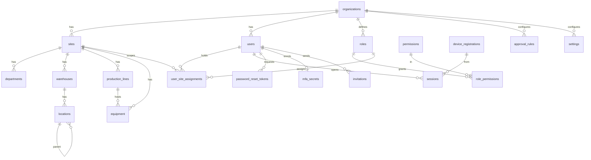
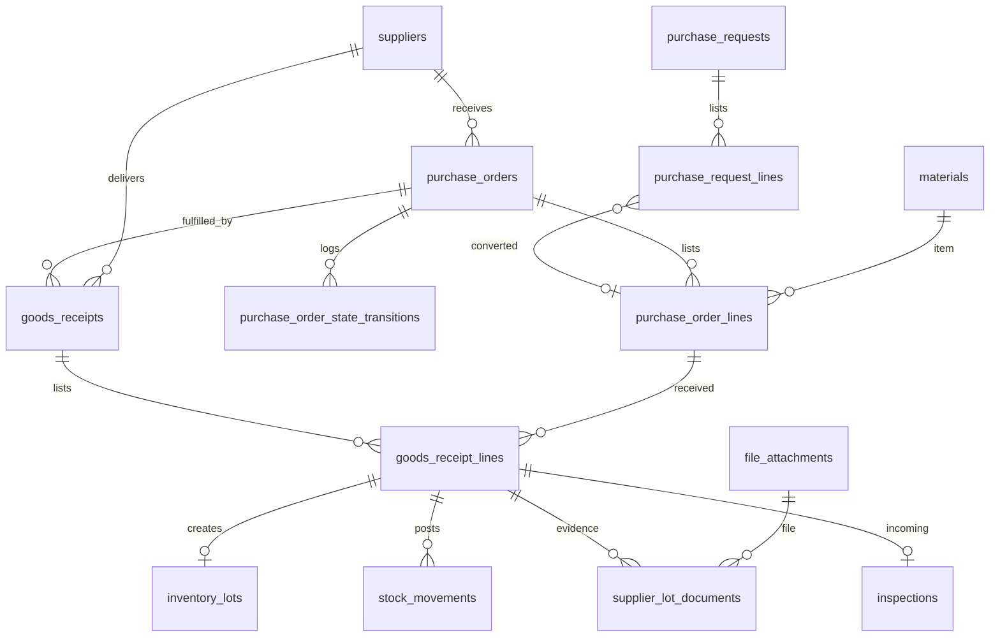
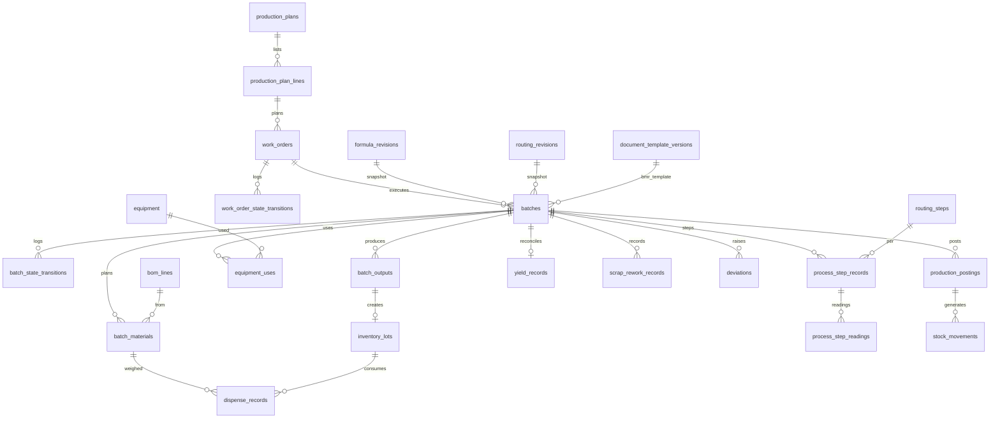
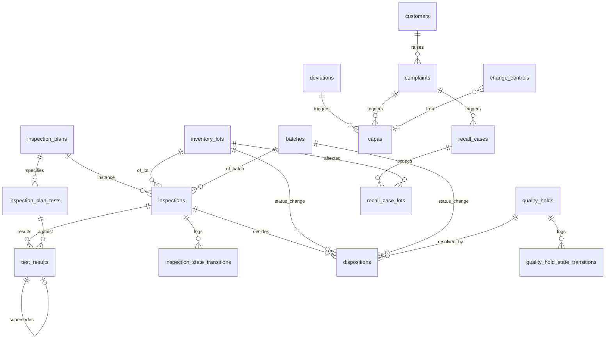
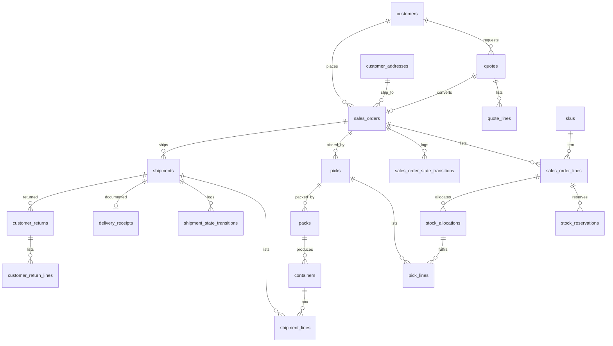
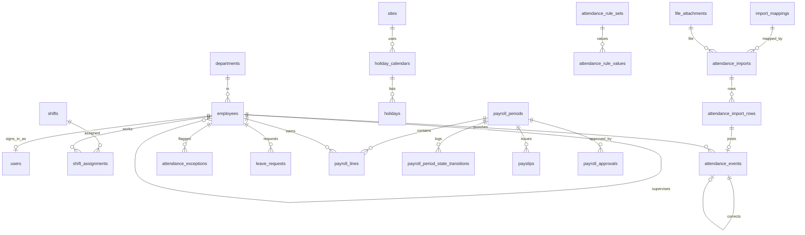
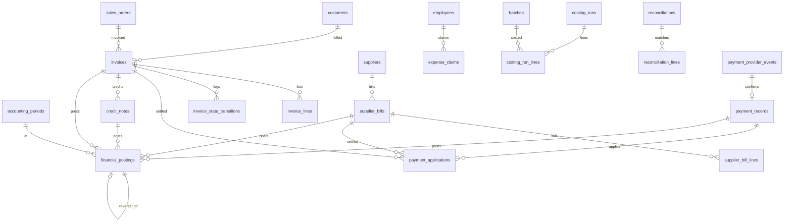
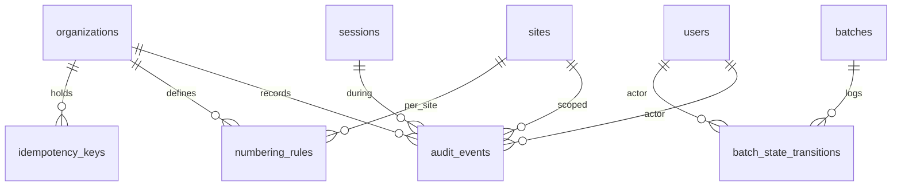

# Data model

The PostgreSQL 16 schema for the Bryel's Care ERP/CRM. It is the single source of truth for
entity names, columns, keys, constraints, ledger rules and migration discipline, and it is
what the backend engineer turns into `src/db/schema/*` with Drizzle (ADR-003).

Binding decisions: ADR-002 (PostgreSQL 16), ADR-003 (Drizzle + SQL migrations), ADR-006
(append-only ledgers, balances are projections), ADR-009 (UUIDv7 + numbering rules),
ADR-010 (`numeric`, dual unit storage), ADR-011 (one organization, many sites). Roles and
permission strings come from `docs/permissions-matrix.md`; workflows from
`docs/process-maps.md`; module scope from `docs/PRD.md` and `docs/modules/*.md`.

How to read this document:

| Reader | Start with |
|---|---|
| Owners / process owners | §1.3 (what every record carries), §4 (how approved formulas are frozen into a batch), §5.1 (why stock is never edited), §12 (how long data is kept), §14 (what we need you to confirm) |
| Engineers | Everything; §3 is the column-level contract, §5, §6 and §9 contain the SQL the services must follow |

Facts come from `docs/source/master-brief.md` and the ADRs. Choices the business must confirm
are labelled `A-DM-nn` and collected in §14.

## 1. Conventions

### 1.1 Naming

| Object | Rule | Example |
|---|---|---|
| Tables | `snake_case`, plural | `inventory_lots`, `batch_materials` |
| Columns | `snake_case`, singular | `lot_number`, `qty_base` |
| Primary key | always `id` | `batches.id` |
| Foreign key | `<entity>_id`; role-named when several point to one table | `from_location_id`, `to_location_id`, `checked_by` |
| Booleans | `is_`, `has_`, `requires_`, `allow_` prefix | `is_organization_wide` |
| Timestamps / dates / actors | `_at` (timestamptz), `_date` (date), `_by` (FK `users.id`) | `posted_at`, `expiry_date`, `posted_by` |
| Quantities | `qty_entered`, `uom_entered_id`, `qty_base`, `uom_base_id` (the "qty group", ADR-010) | `stock_movements.qty_base` |
| Money | `<name>_amount` + `currency` (ISO 4217, `char(3)`) | `total_amount`, `currency` |
| Constraint names | `pk_`, `fk_<table>_<col>`, `uq_<table>_<cols>`, `ck_<table>_<rule>`, `ix_<table>_<cols>`, `tg_<table>_<purpose>` | `uq_inventory_lots_org_lot_number` |
| Enum values | lower `snake_case` text, identical to the shared vocabulary | `materials_staged`, `partially_shipped` |
| Drizzle | one file per domain in `src/db/schema/<domain>.ts`, exported through `src/db/schema/index.ts`; constraint names are set explicitly so generated SQL matches this document | |

### 1.2 Keys

- Primary keys are UUIDv7, generated in the application (`uuidv7` package) so that offline
  clients can create ids without a round trip (ADR-009, ADR-018). Column type `uuid`, `NOT NULL`,
  no database default on business tables.
- Migration `0001` creates `uuid_generate_v7()` (pure SQL, RFC 9562 version/variant bits) for
  SQL-only paths: seeds, backfills, partition maintenance. Tests assert the version nibble is 7.
- Natural keys are unique per organization (and per site where the numbering rule is per
  site): codes, document numbers, lot numbers, box ids. They are never used as foreign keys.
- No `serial`/`identity` columns on business tables. `bigint` sequences exist only inside
  `numbering_rules.next_value` and partition bookkeeping.

### 1.3 Standard column sets

Every catalogue entry in §3 names the sets it includes instead of repeating them.

| Set | Columns | Used by |
|---|---|---|
| `std` | `id uuid PK`; `organization_id uuid NOT NULL FK organizations`; `created_at timestamptz NOT NULL DEFAULT now()`; `created_by uuid NOT NULL FK users`; `updated_at timestamptz NOT NULL DEFAULT now()` (set by Drizzle `$onUpdate`); `updated_by uuid NOT NULL FK users` | all mutable tables |
| `+site` | `site_id uuid NOT NULL FK sites` plus composite `FOREIGN KEY (organization_id, site_id) REFERENCES sites (organization_id, id)` so a row can never point at a site of another organization | operational records |
| `+site?` | as `+site` but `site_id NULL` = valid for all sites | master data with optional site restriction |
| `+soft` | `deleted_at timestamptz NULL`, `deleted_by uuid NULL FK users`; unique indexes become partial `WHERE deleted_at IS NULL` | master data only; never ledgers or posted documents |
| `ledger` | `id`, `organization_id`, `site_id` (+ composite FK), `posted_at timestamptz NOT NULL DEFAULT now()`, `posted_by uuid NOT NULL FK users`, `correlation_id uuid NOT NULL`, `idempotency_key text NULL`, `reversal_of_id uuid NULL FK self`; no `updated_*`, no `deleted_*`; `BEFORE UPDATE OR DELETE` trigger `forbid_mutation()` raises `integrity_constraint_violation` | append-only tables |
| `ver` | `version_no int NOT NULL`, `status text NOT NULL` (`draft`, `pending_approval`, `approved`, `rejected`, `retired`), `effective_from date NOT NULL`, `effective_to date NULL`, `supersedes_id uuid NULL FK self`, `change_summary text NULL` + `approval` set; `UNIQUE (<parent>_id, version_no)`; GiST exclusion so approved ranges of one parent never overlap (§4.3) | versioned master records |
| `approval` | `submitted_by uuid NULL FK users`, `submitted_at timestamptz NULL`, `approved_by uuid NULL FK users`, `approved_at timestamptz NULL`, `approval_note text NULL`; `CHECK (approved_by IS NULL OR approved_by IS DISTINCT FROM submitted_by)` (separation of duties, ADR-005) | approvable records |
| `qty` | `qty_entered numeric(18,6) NOT NULL`, `uom_entered_id uuid NOT NULL FK uoms`, `qty_base numeric(18,6) NOT NULL`, `uom_base_id uuid NOT NULL FK uoms`; `CHECK (qty_entered > 0 AND qty_base > 0)` unless noted | quantity-bearing rows |
| `money` | `<name>_amount numeric(18,4) NOT NULL`, `currency char(3) NOT NULL DEFAULT 'PHP'` | money-bearing rows |

The system actor: migration `0001` inserts one `users` row per organization with
`kind = 'system'` (fixed id, cannot sign in). Jobs, reconciliation and sync replay use it for
`created_by`/`posted_by`, so actor columns are never null.

### 1.4 Tenancy

- `organization_id` is on every table except the global `permissions` catalogue (ADR-011).
  Today there is one organization; the column keeps the future portal tenant boundary cheap.
- Operational records carry `site_id` (`+site`). Master data carries `site_id NULL` (`+site?`).
- Composite indexes on operational tables start with `site_id`, because every scoped query
  filters on the caller's allowed site set first (ADR-005; scoped repositories in
  `docs/architecture.md`). Row-level security is deferred (ADR-022); the schema keeps
  `site_id` denormalised on child rows (lines, records, transitions) so an RLS policy can be
  added later without joins.

### 1.5 Enum strategy: `text` + named `CHECK`

Chosen: state and kind columns are `text NOT NULL` with a named `CHECK (col IN (...))`, typed
in Drizzle with `text({ enum: [...] })`. Not native `CREATE TYPE ... AS ENUM`.

Why: a value can be added, renamed or removed in one transactional migration
(`ALTER TABLE ... DROP CONSTRAINT, ADD CONSTRAINT`), while native enums cannot drop values,
cannot be renamed safely across Drizzle generations, and `ALTER TYPE ... ADD VALUE` cannot be
used in the same transaction that adds it. State legality is enforced by the application state
machine and recorded in `*_state_transitions` (§6); the CHECK only guarantees the stored value
is spelled correctly. Engineering choice, no business impact.

### 1.6 Numbers, dates and text

| Need | Type | Why |
|---|---|---|
| Quantities, weights, volumes | `numeric(18,6)` | 6 decimals cover g on a kg scale, mL on L and mg actives; 12 integer digits exceed any plausible count |
| Money | `numeric(18,4)` | sub-centavo unit prices and allocations; presentation rounds to 2 decimals per currency setting |
| Percentages (tolerance, yield, tax rate) | `numeric(9,4)` | 0.0001 % resolution |
| Conversion factors, densities | `numeric(24,12)` | exact factors such as 1/16 |
| Calendar dates (expiry, retest, manufacture, payroll period, effective dates) | `date` | no time of day exists for them; interpreted in `sites.timezone` |
| Instants | `timestamptz` everywhere; never `timestamp` | one meaning across sites and devices |
| Strings | `text` + `CHECK (length(col) <= n)` where a limit matters; no `varchar(n)` | avoids migration churn |
| Email | `text` with unique index on `lower(email)` | no `citext` extension dependency |
| Extensions | `pgcrypto` (random bytes), `btree_gist` (effective-date exclusion) only | Railway managed Postgres supports both |

`A-DM-01` Precision defaults above; display rounding for PHP is 2 decimals. Needs owner
confirmation only if a product is priced or weighed at finer resolution.

### 1.7 JSONB policy

JSONB is allowed only where the shape is a document the application owns end to end and
nothing is ever joined or aggregated on its inside. Each use is validated by a Zod schema in
the owning module and carries a `schema_version` key inside the document.

| Column | Content |
|---|---|
| `document_template_versions.definition` | template layout, field bindings, page settings |
| `import_mappings.definition` | column mapping, parsing rules |
| `audit_events.before`, `audit_events.after` | redacted entity snapshots |
| `settings.value` | typed setting value |
| `batches.bom_snapshot` | frozen BOM lines with tolerances (§4.4) |
| `sync_commands.payload`, `sync_commands.server_result`, `sync_conflicts.server_state`, `sync_conflicts.client_state` | replayed command and its outcome |
| `idempotency_keys.response` | stored command result for replays |
| `background_jobs.payload`, `background_jobs.result` | job input/output summary |
| `scheduled_reports.parameters`, `generated_documents.parameters` | report filters as entered |
| `import_job_rows.raw`, `attendance_import_rows.raw` | the original row, untouched |

Everything else is columns. Addresses, contacts, tolerances, test specifications, rule values
and parameters are tables because they are queried, validated and reported on.

### 1.8 Index policy

1. Every foreign key column has a b-tree index unless it is the leading column of another index.
2. Composite indexes on operational tables start with `site_id`, then the most selective
   filter (`status`, `lot_id`, `occurred_at`).
3. Natural keys get unique indexes scoped by `organization_id` (and partial
   `WHERE deleted_at IS NULL` on soft-deletable master data).
4. Idempotency keys get a partial unique index `WHERE idempotency_key IS NOT NULL`.
5. Append-only tables are indexed for their read paths only (`(site_id, lot_id, posted_at)`,
   `(source_document_type, source_document_id)`); no index for admin convenience.
6. No GIN indexes on JSONB until a measured need appears.

### 1.9 Foreign keys, checks and immutability

- Every relationship is a real `FOREIGN KEY`, `ON DELETE RESTRICT`, `ON UPDATE RESTRICT`.
  No cascades: services delete draft children explicitly inside a transaction, and posted
  records are never deleted.
- `CHECK` constraints enforce non-negative quantities, exactly-one-of polymorphic references
  (`CHECK (num_nonnulls(material_id, sku_id) = 1)`), operator ≠ checker, from/to location
  rules per movement type, and enum spellings.
- Ledger tables carry the `forbid_mutation()` trigger (§1.3) and the application role has no
  `UPDATE`/`DELETE` grant on them (§13.4).

### 1.10 Idempotency

Two layers: (1) `idempotency_keys` stores every command's key, request hash and result so a
replay returns the original response (ADR-006, ADR-018); (2) ledger rows and posted documents
also carry `idempotency_key` with a partial unique index, so even a bug in layer 1 cannot post
twice. Keys are client-generated UUIDv7 strings scoped by `(organization_id, scope, key)`.

## 2. Domain ERDs

One diagram per domain, entities only (columns are in §3). Cross-domain references are shown
once, on the side that owns the relationship.

### 2.1 Identity and organization



### 2.2 Master data, product and formula

```mermaid
erDiagram
  products ||--o{ skus : has
  uoms ||--o{ uom_conversions : from
  uoms ||--o{ uom_conversions : to
  materials ||--o{ uom_conversions : density
  suppliers ||--o{ supplier_materials : supplies
  materials ||--o{ supplier_materials : sourced
  customers ||--o{ customer_addresses : ships_to
  customers ||--o{ customer_contacts : has
  customers ||--o{ customer_requirements : agrees
  skus ||--o{ customer_requirements : for
  products ||--o{ formulas : has
  formulas ||--o{ formula_revisions : versions
  formula_revisions ||--o{ bom_lines : lists
  materials ||--o{ bom_lines : uses
  products ||--o{ routings : has
  routings ||--o{ routing_revisions : versions
  routing_revisions ||--o{ routing_steps : orders
  routing_steps ||--o{ routing_step_parameters : limits
  work_instructions ||--o{ work_instruction_revisions : versions
  routing_steps }o--o| work_instruction_revisions : follows
  skus }o--o| label_templates : prints
  formula_revisions }o--o| inspection_plans : tested_by
```

### 2.3 Inventory and containers

```mermaid
erDiagram
  materials ||--o{ inventory_lots : of
  skus ||--o{ inventory_lots : of
  inventory_lots ||--o{ inventory_balances : projected
  locations ||--o{ inventory_balances : at
  containers ||--o{ inventory_balances : in
  inventory_lots ||--o{ stock_movements : moves
  locations ||--o{ stock_movements : from
  locations ||--o{ stock_movements : to
  containers ||--o{ stock_movements : carries
  reason_codes ||--o{ stock_movements : explains
  stock_movements ||--o| stock_movements : reversal_of
  inventory_lots ||--o{ stock_reservations : reserves
  inventory_lots ||--o{ stock_allocations : allocates
  stock_reservations ||--o{ stock_allocations : converts
  containers ||--o{ container_contents : holds
  inventory_lots ||--o{ container_contents : lot
  containers ||--o{ container_lineage : parent
  containers ||--o{ container_lineage : child
  containers ||--o| containers : on_pallet
  stock_counts ||--o{ stock_count_lines : counts
  label_templates ||--o{ label_jobs : prints
```

### 2.4 Procurement



### 2.5 Production and BMR



### 2.6 Quality



### 2.7 Sales and logistics



### 2.8 HR and payroll



### 2.9 Finance



`journal_entries` / `journal_lines` exist only if a general ledger is approved (ADR-020) and
are therefore described but not created (§3.9).

### 2.10 Documents, jobs and sync

```mermaid
erDiagram
  document_templates ||--o{ document_template_versions : versions
  document_template_versions ||--o{ generated_documents : rendered
  file_attachments ||--o| generated_documents : pdf
  generated_documents ||--o| generated_documents : reprint_of
  label_templates }o--|| document_templates : layout
  label_jobs ||--o| generated_documents : output
  import_mappings ||--o{ import_jobs : mapped_by
  file_attachments ||--o{ import_jobs : file
  import_jobs ||--o{ import_job_rows : rows
  background_jobs ||--o{ generated_documents : produces
  users ||--o{ notifications : receives
  scheduled_reports ||--o{ scheduled_report_recipients : to
  scheduled_reports ||--o{ background_jobs : runs
  device_registrations ||--o{ sync_commands : sends
  users ||--o{ sync_commands : as
  sync_commands ||--o| sync_conflicts : conflicts
  customer_portal_tenants ||--o{ portal_users : has
```

### 2.11 Audit and numbering



The nine `*_state_transitions` tables share one shape (§6.1); `batch_state_transitions` stands
for all of them here.

## 3. Entity catalogue

Legend. Phase `P1`–`P9` = phase whose migrations first create the table (`P1b` = Phase 1
hardening). Class: **M** master data, **V** versioned master, **T** transactional, **L**
ledger (append-only), **P** projection, **C** configuration. Sets (`std`, `+site`, `+site?`,
`+soft`, `ledger`, `ver`, `approval`, `qty`, `money`) are defined in §1.3 and not repeated.
Types: `num6` = `numeric(18,6)`, `money` = `numeric(18,4)`, `pct` = `numeric(9,4)`,
`ts` = `timestamptz`, `→ t` = foreign key to `t`. The state value sets are in §6.

### 3.1 Identity, organization and platform

| Table → column | Type | Null | Constraint / default | Notes |
|---|---|---|---|---|
| **`organizations`** · P1 · M · `std` (self-referencing `organization_id`) | | | | one row for Bryel's Care (ADR-011) |
| `code`, `name`, `legal_name` | text | no | `uq (code)` | |
| `timezone`, `currency`, `locale` | text / char(3) / text | no | defaults `Asia/Manila`, `PHP`, `en-PH` (ADR-019) | configurable |
| `status` | text | no | ck in (`active`,`suspended`) | |
| **`sites`** · P1 · M · `std +soft` | | | | `uq (organization_id, id)` backs composite site FKs |
| `code`, `name` | text | no | `uq (organization_id, code)` partial | code appears in numbering patterns |
| `timezone` | text | no | default organization timezone | dates interpreted here |
| `address_line1`, `address_line2`, `city`, `province`, `postal_code`, `country` | text | yes | country `char(2)` default `PH` | |
| `status` | text | no | ck in (`active`,`inactive`) | |
| **`departments`** · P1 · M · `std +site +soft` | | | | e.g. Production, Warehouse, QA |
| `code`, `name` | text | no | `uq (site_id, code)` partial | |
| **`warehouses`** · P1 · M · `std +site +soft` | | | | |
| `code`, `name` | text | no | `uq (site_id, code)` partial | |
| `warehouse_kind` | text | no | ck in (`raw_materials`,`packaging`,`finished_goods`,`general`) | |
| **`locations`** · P1 · M · `std +site +soft` | | | | zones, racks, bins and special areas |
| `warehouse_id` | uuid | no | → warehouses | |
| `parent_location_id` | uuid | yes | → locations | zone → rack → bin |
| `code` | text | no | `uq (organization_id, code)` partial | scan payload `BC:LOC:<code>` must be unique org-wide |
| `name` | text | no | | |
| `location_kind` | text | no | ck in (`zone`,`rack`,`bin`,`receiving`,`staging`,`quarantine`,`hold`,`rejected`,`recall`,`production_staging`,`wip`,`shipping`) | special kinds drive defaults |
| `is_pickable`, `allows_mixed_lots` | bool | no | default true / true | |
| `status` | text | no | ck in (`active`,`blocked`,`inactive`) | `blocked` = no movements in or out |
| **`production_lines`** · P1 · M · `std +site +soft` | | | | |
| `code`, `name` | text | no | `uq (site_id, code)` partial | |
| `status` | text | no | ck in (`active`,`down`,`inactive`) | |
| **`equipment`** · P1 · M · `std +site +soft` | | | | scales, mixers, cutters; maintenance plans are a later module (§14) |
| `production_line_id` | uuid | yes | → production_lines | |
| `code`, `name` | text | no | `uq (site_id, code)` partial | |
| `equipment_kind` | text | no | ck in (`scale`,`mixer`,`heater`,`mould`,`cutter`,`filler`,`labeller`,`other`) | extendable by migration |
| `status` | text | no | ck in (`in_service`,`maintenance`,`out_of_service`) | blocks `equipment_uses` when not `in_service` |
| `calibration_due_date`, `last_calibrated_date`, `last_cleaned_at` | date / date / ts | yes | | dispensing checks `calibration_due_date >= today` |
| `cleaning_status` | text | no | ck in (`clean`,`dirty`,`in_progress`) default `clean` | line clearance updates it |
| **`users`** · P1 · M · `std` | | | | one row per person or system actor |
| `email` | text | no | unique index `(organization_id, lower(email))` | |
| `password_hash` | text | yes | argon2id (ADR-004) | null for `system` and invited users |
| `display_name`, `given_name`, `family_name` | text | no / yes / yes | | |
| `kind` | text | no | ck in (`person`,`system`) | `system` cannot sign in |
| `status` | text | no | ck in (`invited`,`active`,`locked`,`deactivated`) | lifecycle (ADR-004) |
| `locale`, `timezone` | text | yes | | overrides organization defaults |
| `failed_login_count`, `locked_until` | int / ts | no / yes | default 0 | lockout policy in `docs/security.md` |
| `password_changed_at`, `last_login_at`, `deactivated_at` | ts | yes | | |
| `mfa_required` | bool | no | default false | set by role policy (P1b) |
| **`roles`** · P1 · C · `std +soft` | | | | seeded with the 13 roles of the shared vocabulary |
| `code`, `name` | text | no | `uq (organization_id, code)` | `owner_director` … `customer_portal_user` |
| `is_system` | bool | no | default false | system roles cannot be deleted |
| `is_organization_wide_allowed` | bool | no | default false | true only for `owner_director`, `system_admin`, `auditor` |
| **`permissions`** · P1 · C · `id`, `created_at` only | | | | global catalogue, seeded from code |
| `code` | text | no | `uq (code)`; ck matches `^[a-z_]+\.[a-z_]+\.(view|create|edit|submit|approve|post|export|void|admin)$` | `module.entity.action` |
| `module`, `entity`, `action`, `description` | text | no | | |
| **`role_permissions`** · P1 · C · `id`, `organization_id`, `created_at`, `created_by` | | | | |
| `role_id`, `permission_id` | uuid | no | → roles, → permissions; `uq (role_id, permission_id)` | |
| **`user_site_assignments`** · P1 · C · `std` | | | | the scope model of ADR-005 |
| `user_id`, `role_id` | uuid | no | → users, → roles | |
| `site_id` | uuid | yes | → sites (+ composite FK) | null only when organization-wide |
| `is_organization_wide` | bool | no | ck `(is_organization_wide AND site_id IS NULL) OR (NOT is_organization_wide AND site_id IS NOT NULL)` | service also checks `roles.is_organization_wide_allowed` |
| `valid_from`, `valid_to` | date | no / yes | | temporary cover |
| | | | `uq (user_id, role_id, site_id) NULLS NOT DISTINCT` | |
| **`sessions`** · P1 · T · `id`, `organization_id`, `created_at` | | | | opaque cookie value is the token; only its hash is stored |
| `user_id` | uuid | no | → users | |
| `token_hash` | text | no | `uq (token_hash)` | sha256 of the cookie value |
| `device_registration_id` | uuid | yes | → device_registrations | P7 |
| `ip`, `user_agent`, `device_label` | inet / text / text | yes | | |
| `active_site_id` | uuid | yes | → sites | last site context |
| `last_seen_at`, `idle_expires_at`, `absolute_expires_at` | ts | no | | values from settings (`docs/security.md`) |
| `mfa_verified_at`, `reauthenticated_at` | ts | yes | | privileged actions check recency |
| `revoked_at`, `revoked_by`, `revoked_reason` | ts / uuid / text | yes | | revocation is an update, never a delete |
| **`password_reset_tokens`** · P1 · T · `id`, `organization_id`, `created_at` | | | | |
| `user_id` | uuid | no | → users | |
| `token_hash` | text | no | `uq` | |
| `expires_at`, `used_at` | ts | no / yes | | single use |
| `requested_ip` | inet | yes | | |
| **`mfa_secrets`** · P1b · T · `std` | | | | TOTP (ADR-004) |
| `user_id` | uuid | no | → users, `uq` | |
| `secret_enc` | bytea | no | | AES-GCM with env key; never logged |
| `recovery_code_hashes` | text[] | no | | argon2id hashes |
| `confirmed_at`, `last_used_at` | ts | yes | | |
| **`invitations`** · P1 · T · `std` | | | | |
| `email` | text | no | | |
| `role_id`, `site_id` | uuid | no / yes | → roles, → sites | null site = organization-wide |
| `token_hash` | text | no | `uq` | |
| `expires_at`, `accepted_at`, `revoked_at` | ts | no / yes / yes | | |
| `accepted_user_id` | uuid | yes | → users | |
| **`approval_rules`** · P1 · C · `std +site? +soft` | | | | thresholds are data (ADR-005) |
| `document_type` | text | no | ck in (`purchase_request`,`purchase_order`,`sales_order`,`stock_adjustment`,`stock_count_variance`,`expense_claim`,`credit_note`,`dispense_exception`,`leave_request`,`payroll_period`) | |
| `min_amount`, `max_amount` | money | yes | ck `min <= max` | null = unbounded; quantity thresholds use the same columns with `threshold_basis` |
| `threshold_basis` | text | no | ck in (`amount`,`qty_base`,`variance_pct`,`always`) | |
| `required_role_id` | uuid | no | → roles | |
| `sequence` | int | no | default 1 | multi-level approval |
| `effective_from`, `effective_to` | date | no / yes | | |
| **`settings`** · P1 · C · `std` | | | | typed key registry lives in `src/lib/settings.ts` |
| `scope` | text | no | ck in (`organization`,`site`,`user`) | |
| `site_id`, `user_id` | uuid | yes | → sites, → users; ck matches scope | |
| `key`, `value` | text / jsonb | no | `uq (organization_id, scope, site_id, user_id, key) NULLS NOT DISTINCT` | e.g. `inventory.reservation_ttl_days` |
| **`numbering_rules`** · P1 · C | | | | §9 |
| **`idempotency_keys`** · P1 · T | | | | §1.10, §5.5 |
| **`audit_events`** · P1 · L (partitioned) | | | | §8 |
| **`device_registrations`** · P7 · M · `std +site?` | | | | §11; designed now so ids are stable |

### 3.2 Master data: product, formula, routing, partners

| Table → column | Type | Null | Constraint / default | Notes |
|---|---|---|---|---|
| **`uoms`** · P1 · M · `std +soft` | | | | seeded: g, kg, mL, L, pcs |
| `code`, `name` | text | no | `uq (organization_id, code)` | |
| `dimension` | text | no | ck in (`mass`,`volume`,`count`,`length`) | |
| `is_base` | bool | no | one base per dimension (partial unique) | base: g, mL, pcs |
| **`uom_conversions`** · P1 · V · `std` + `ver` | | | | dimensionally valid (ADR-010) |
| `from_uom_id`, `to_uom_id` | uuid | no | → uoms | |
| `factor` | numeric(24,12) | no | ck `> 0` | `qty_to = qty_from × factor` |
| `material_id` | uuid | yes | → materials | required when dimensions differ (density); ck enforced by trigger `tg_uom_conversions_dimension` |
| **`products`** · P1 · M · `std +soft` | | | | a product family member, e.g. Acapulco Soap |
| `code`, `name` | text | no | `uq (organization_id, code)` partial | |
| `product_family` | text | no | ck in (`soap`,`lotion`,`cream`,`oil`,`other`) | extendable |
| `status` | text | no | ck in (`draft`,`active`,`discontinued`) | |
| `default_formula_id`, `default_routing_id` | uuid | yes | → formulas, → routings | |
| **`skus`** · P1 · M · `std +soft` | | | | sellable / stockable variant |
| `product_id` | uuid | no | → products | |
| `code`, `name` | text | no | `uq (organization_id, code)` partial | scan `BC:SKU:<code>` |
| `variant_label`, `pack_format` | text | yes | | e.g. "100 g bar", "250 mL bottle" |
| `net_content_qty`, `net_content_uom_id` | num6 / uuid | yes | → uoms | |
| `uom_base_id` | uuid | no | → uoms | usually `pcs` |
| `units_per_box`, `boxes_per_pallet` | int | yes | ck `> 0` | packaging configuration |
| `gtin` | text | yes | | optional retail barcode |
| `shelf_life_days`, `retest_days` | int | yes | | drives lot expiry at output |
| `storage_conditions` | text | yes | | |
| `allocation_rule` | text | no | ck in (`fefo`,`fifo`) default `fefo` | configurable per SKU |
| `label_template_id`, `bmr_template_id` | uuid | yes | → label_templates, → document_templates | |
| `status` | text | no | ck in (`draft`,`active`,`discontinued`) | |
| **`materials`** · P1 · M · `std +soft` | | | | raw, packaging, intermediate, consumable |
| `code`, `name` | text | no | `uq (organization_id, code)` partial | scan `BC:MAT:<code>` |
| `inci_name`, `common_name` | text | yes | | printed on BMR |
| `material_class` | text | no | ck in (`raw`,`packaging`,`intermediate`,`consumable`) | `A-DM-04` |
| `uom_base_id` | uuid | no | → uoms | |
| `specification` | text | yes | | reference to spec document |
| `storage_conditions`, `allergen_notes`, `hazard_notes` | text | yes | | content validated by QA |
| `shelf_life_days`, `retest_days` | int | yes | | |
| `requires_coa`, `requires_incoming_inspection` | bool | no | default true / true | |
| `default_inspection_plan_id` | uuid | yes | → inspection_plans | |
| `allocation_rule` | text | no | ck in (`fefo`,`fifo`) default `fefo` | |
| `status` | text | no | ck in (`draft`,`active`,`blocked`,`discontinued`) | |
| **`suppliers`** · P2 · M · `std +soft` | | | | |
| `code`, `name` | text | no | `uq (organization_id, code)` partial | |
| `contact_name`, `email`, `phone`, `address_line1`, `city`, `country` | text | yes | | |
| `payment_terms_days`, `default_lead_time_days` | int | yes | | |
| `quality_status` | text | no | ck in (`approved`,`conditional`,`suspended`,`new`) default `new` | receiving from `suspended` needs exception |
| **`supplier_materials`** · P2 · M · `std +soft` | | | | approved-supplier list |
| `supplier_id`, `material_id` | uuid | no | `uq (supplier_id, material_id)` partial | |
| `supplier_part_number` | text | yes | | |
| `is_approved` | bool | no | default false | |
| `lead_time_days`, `moq_qty`, `moq_uom_id` | int / num6 / uuid | yes | | |
| `unit_price`, `currency`, `price_effective_from` | money / char(3) / date | yes | | |
| **`customers`** · P4 · M · `std +soft` | | | | |
| `code`, `name` | text | no | `uq (organization_id, code)` partial | |
| `status` | text | no | ck in (`prospect`,`active`,`on_hold`,`inactive`) | |
| `payment_terms_days`, `credit_limit_amount`, `currency` | int / money / char(3) | yes | | sensitive (finance roles) |
| `default_lead_time_days`, `tax_identifier` | int / text | yes | | tax id is configuration, sensitive |
| `portal_tenant_id` | uuid | yes | → customer_portal_tenants | P8 |
| **`customer_addresses`** · P4 · M · `std +soft` | | | | |
| `customer_id` | uuid | no | → customers | |
| `label`, `line1`, `line2`, `city`, `province`, `postal_code`, `country`, `contact_name`, `phone` | text | label/line1/city/country no; rest yes | | |
| `is_default_ship_to`, `is_default_bill_to` | bool | no | default false | |
| **`customer_contacts`** · P4 · M · `std +soft` | | | | |
| `customer_id`, `name`, `email`, `phone`, `role_label`, `is_primary` | uuid / text… / bool | mixed | → customers | |
| **`customer_requirements`** · P4 · V · `std` + `ver` | | | | agreed specifications |
| `customer_id` | uuid | no | → customers | |
| `sku_id` | uuid | yes | → skus | null = all SKUs |
| `requirement_kind` | text | no | ck in (`label_artwork`,`carton_count`,`coa_required`,`moq`,`lead_time`,`packaging`,`document`,`lot_age_max_days`,`other`) | |
| `value_numeric`, `value_uom_id`, `value_text` | num6 / uuid / text | yes | | one of them per kind |
| `label_template_id`, `document_template_version_id` | uuid | yes | | artwork / required document |
| **`reason_codes`** · P2 · M · `std +soft` | | | | |
| `code`, `name` | text | no | `uq (organization_id, code)` partial | |
| `applies_to` | text[] | no | values in (`adjustment`,`scrap`,`rework`,`return`,`count_variance`,`hold`,`reprint`,`deviation`,`reversal`,`exception`,`cancel`) | |
| `requires_note`, `requires_approval` | bool | no | default false | |
| **`formulas`** · P3 · M · `std +soft` | | | | header; content lives in revisions |
| `product_id` | uuid | no | → products | |
| `code`, `name` | text | no | `uq (organization_id, code)` partial | "Batch Formula No." on the BMR |
| **`formula_revisions`** · P3 · V · `std` + `ver` | | | | §4 |
| `formula_id` | uuid | no | → formulas | |
| `batch_size_base`, `uom_base_id` | num6 / uuid | no | ck `> 0`; → uoms | reference batch, e.g. 17,600 g |
| `expected_yield_pct` | pct | yes | | theoretical yield |
| `shelf_life_days`, `retest_days` | int | yes | | override SKU defaults |
| `inspection_plan_id` | uuid | yes | → inspection_plans | finished-product tests |
| `notes` | text | yes | | "verify with authorized personnel" banner is UI, not data |
| **`bom_lines`** · P3 · V (child) · `std` | | | | per revision |
| `formula_revision_id` | uuid | no | → formula_revisions | |
| `line_no` | int | no | `uq (formula_revision_id, line_no)` | |
| `line_kind` | text | no | ck in (`ingredient`,`intermediate`,`packaging`) | packaging BOM shares the table |
| `material_id` | uuid | no | → materials | |
| `phase_code` | text | yes | | e.g. `oils`, `lye`, `additives` |
| `qty_base`, `uom_base_id` | num6 / uuid | no | ck `> 0`; → uoms | per `batch_size_base` |
| `scaling` | text | no | ck in (`proportional`,`fixed`) default `proportional` | |
| `tolerance_pct`, `tolerance_abs_base` | pct / num6 | yes | ck `num_nonnulls(...) = 1` | `A-DM-17` |
| `is_critical`, `requires_checker` | bool | no | default true / true | |
| `sequence` | int | no | | dispensing order |
| **`routings`** · P3 · M · `std +soft` | | | | |
| `product_id`, `code`, `name` | uuid / text / text | no | → products; `uq (organization_id, code)` partial | |
| **`routing_revisions`** · P3 · V · `std` + `ver` | | | | |
| `routing_id` | uuid | no | → routings | |
| `formula_revision_id` | uuid | yes | → formula_revisions | optional binding |
| `default_production_line_id` | uuid | yes | → production_lines | |
| **`routing_steps`** · P3 · V (child) · `std` | | | | |
| `routing_revision_id` | uuid | no | → routing_revisions | |
| `step_no`, `code`, `name` | int / text / text | no | `uq (routing_revision_id, step_no)` | the 7 BMR checklist rows are steps |
| `step_kind` | text | no | ck in (`line_clearance`,`dispensing`,`process`,`in_process_qc`,`filling`,`cutting`,`curing`,`packaging`,`reconciliation`,`transfer`,`checklist`) | |
| `requires_checker`, `blocks_until_complete`, `requires_equipment` | bool | no | default true / true / false | |
| `equipment_kind`, `equipment_id` | text / uuid | yes | → equipment | class or specific unit |
| `work_instruction_revision_id` | uuid | yes | → work_instruction_revisions | |
| `inspection_plan_id` | uuid | yes | → inspection_plans | in-process QC |
| `expected_duration_minutes` | int | yes | | planning |
| **`routing_step_parameters`** · P3 · V (child) · `std` | | | | process readings definition |
| `routing_step_id`, `code`, `name` | uuid / text / text | no | `uq (routing_step_id, code)` | e.g. `temp_oil` |
| `uom_id` | uuid | yes | → uoms | |
| `min_value`, `max_value`, `target_value` | num6 | yes | ck `min <= max` | |
| `value_kind` | text | no | ck in (`numeric`,`text`,`boolean`) | |
| `is_required` | bool | no | default true | |
| **`work_instructions`** · P3 · M · `std +soft` | | | | header |
| `code`, `name` | text | no | `uq (organization_id, code)` partial | |
| **`work_instruction_revisions`** · P3 · V · `std` + `ver` | | | | |
| `work_instruction_id` | uuid | no | → work_instructions | |
| `body_markdown` | text | no | | rendered on traveler/BMR |
| `file_attachment_id` | uuid | yes | → file_attachments | PDF/images |
| **`label_templates`** · P2 · M · `std +site? +soft` | | | | physical label configuration; layout is a `document_templates` row of kind `label` |
| `code`, `name` | text | no | `uq (organization_id, code)` partial | |
| `document_template_id` | uuid | no | → document_templates | |
| `applies_to` | text | no | ck in (`material`,`wip`,`finished_good`,`carton`,`pallet`,`location`,`sample`) | |
| `symbology` | text | no | ck in (`qr`,`code128`) default `qr` | ADR-017 |
| `media_width_mm`, `media_height_mm`, `dpi` | numeric(6,1) / numeric(6,1) / int | no | | thermal printer |

### 3.3 Inventory and containers

| Table → column | Type | Null | Constraint / default | Notes |
|---|---|---|---|---|
| **`inventory_lots`** · P2 · T · `std +site` | | | | a lot is not a product, not a box |
| `lot_number` | text | no | `uq (organization_id, lot_number)` | from rule `LOT`; scan `BC:LOT:<lot_number>` |
| `item_kind` | text | no | ck in (`material`,`sku`) | |
| `material_id`, `sku_id` | uuid | yes | ck `num_nonnulls = 1` | |
| `uom_base_id` | uuid | no | → uoms | |
| `supplier_id`, `supplier_lot_number` | uuid / text | yes | → suppliers | received lots |
| `goods_receipt_line_id`, `batch_output_id` | uuid | yes | ck at most one | origin: receipt or batch |
| `manufacture_date`, `expiry_date`, `retest_date` | date | yes | ck `expiry >= manufacture` | |
| `quality_status` | text | no | ck in (`quarantine`,`released`,`on_hold`,`rejected`,`expired`,`recalled`) default `quarantine` | changed only by `dispositions` |
| `quality_status_changed_at` | ts | no | | |
| `unit_cost_amount`, `currency` | money / char(3) | yes | | landed cost for costing runs |
| `notes` | text | yes | | |
| | | | ix `(site_id, item_kind, material_id, expiry_date)`, `(site_id, quality_status)` | FEFO scan |
| **`inventory_balances`** · P2 · P · `id`, `organization_id`, `site_id`, `updated_at` | | | | projection, rebuilt from the ledger (§5.2) |
| `location_id`, `lot_id`, `container_id` | uuid / uuid / uuid | no / no / yes | → locations, → inventory_lots, → containers | |
| `quality_status` | text | no | same ck as lots | copy of the lot status at last update |
| `on_hand_base`, `reserved_base`, `allocated_base` | num6 | no | default 0; ck `on_hand >= 0`, `reserved >= 0`, `allocated >= 0`, `reserved + allocated <= on_hand` | `A-DM-02` |
| `uom_base_id` | uuid | no | → uoms | |
| `last_movement_id` | uuid | yes | → stock_movements | |
| `version` | int | no | default 0 | optimistic check in tests |
| | | | `uq (site_id, location_id, lot_id, container_id, quality_status) NULLS NOT DISTINCT` | the balance key |
| **`stock_movements`** · P2 · L · `ledger` | | | | §5.1 |
| `movement_number` | text | no | `uq (organization_id, movement_number)` | rule `MOV` |
| `movement_type` | text | no | ck in (`receipt`,`issue`,`transfer`,`consumption`,`output`,`adjustment`,`return`,`shipment`,`reversal`) | |
| `lot_id` | uuid | no | → inventory_lots | |
| `from_location_id`, `to_location_id` | uuid | yes | → locations; ck per type (§5.1) | |
| `container_id` | uuid | yes | → containers | the box the quantity sits in |
| `qty` set | | | ck `qty_base > 0` | direction comes from from/to |
| `quality_status_at_posting` | text | no | | evidence for exceptions |
| `reason_code_id`, `reason_note` | uuid / text | yes | → reason_codes; required for `adjustment`, `return`, `reversal` (ck) | |
| `source_document_type`, `source_document_id`, `source_line_id` | text / uuid / uuid | no / no / yes | ck type in (`goods_receipt`,`production_posting`,`shipment`,`stock_count`,`customer_return`,`manual_adjustment`,`container_operation`,`transfer_request`) | polymorphic by design; integrity checked by the service |
| `exception_approved_by` | uuid | yes | → users | set when blocked stock was moved by controlled exception |
| `device_registration_id`, `client_sequence` | uuid / bigint | yes | | offline provenance |
| | | | partial `uq (organization_id, idempotency_key)`; ix `(site_id, lot_id, posted_at)`, `(site_id, from_location_id)`, `(site_id, to_location_id)`, `(source_document_type, source_document_id)`, `(reversal_of_id)` | |
| **`stock_reservations`** · P2 · T · `std +site` | | | | soft hold on specific stock |
| `lot_id`, `location_id`, `container_id` | uuid | no / no / yes | | `A-DM-22` |
| `qty_base`, `uom_base_id` | num6 / uuid | no | ck `> 0` | |
| `demand_type`, `demand_id` | text / uuid | no | ck type in (`sales_order_line`,`work_order`,`batch_material`,`transfer_request`) | |
| `status` | text | no | ck in (`active`,`converted`,`released`,`expired`,`cancelled`) | |
| `expires_at`, `released_at`, `released_reason` | ts / ts / text | yes | | TTL from settings |
| **`stock_allocations`** · P2 · T · `std +site` | | | | hard assignment for picking / dispensing |
| `reservation_id` | uuid | yes | → stock_reservations | |
| `lot_id`, `location_id`, `container_id` | uuid | no / no / yes | | |
| `qty_base`, `uom_base_id`, `qty_fulfilled_base` | num6 / uuid / num6 | no | default 0 | |
| `demand_type`, `demand_id` | text / uuid | no | as reservations | |
| `status` | text | no | ck in (`active`,`fulfilled`,`released`,`cancelled`) | |
| **`stock_counts`** · P2 · T · `std +site` | | | | |
| `count_number` | text | no | `uq (organization_id, count_number)` | rule `CNT` |
| `warehouse_id`, `location_id` | uuid | no / yes | | scope |
| `count_kind` | text | no | ck in (`cycle`,`full`,`spot`) | |
| `is_blind` | bool | no | default true | counters do not see expected qty |
| `status` | text | no | ck in (`planned`,`in_progress`,`counted`,`recount`,`pending_approval`,`posted`,`cancelled`) | |
| `scheduled_for`, `frozen_at`, `posted_at` | date / ts / ts | yes | | expected quantities snapshotted at `frozen_at` |
| `approval` set | | | | variance approval |
| **`stock_count_lines`** · P2 · T · `std +site` | | | | original count never erased |
| `stock_count_id`, `location_id`, `lot_id`, `container_id` | uuid | no / no / no / yes | | |
| `expected_qty_base` | num6 | no | | snapshot |
| `counted_qty_base`, `counted_by`, `counted_at` | num6 / uuid / ts | yes | | first count |
| `recount_qty_base`, `recounted_by`, `recounted_at` | num6 / uuid / ts | yes | ck `recounted_by <> counted_by` | |
| `variance_qty_base` | num6 | yes | | final − expected |
| `variance_reason_code_id`, `variance_note` | uuid / text | yes | | |
| `adjustment_movement_id` | uuid | yes | → stock_movements | posted adjustment |
| **`containers`** · P2 · T · `std +site` | | | | box / carton / pallet |
| `container_number` | text | no | `uq (organization_id, container_number)` | rule `BOX`; scan `BC:BOX:<container_number>` |
| `container_kind` | text | no | ck in (`box`,`carton`,`pallet`,`drum`,`tote`) | |
| `status` | text | no | ck in (`open`,`sealed`,`in_transit`,`shipped`,`empty`,`void`) | |
| `current_location_id` | uuid | yes | → locations | null once shipped |
| `parent_container_id` | uuid | yes | → containers | box on pallet |
| `pack_id`, `sales_order_id`, `shipment_id` | uuid | yes | | set during pack/dispatch |
| `packed_at`, `packed_by`, `checked_by` | ts / uuid / uuid | yes | ck `checked_by <> packed_by` | |
| `gross_weight`, `net_weight`, `weight_uom_id` | num6 / num6 / uuid | yes | | |
| `label_template_id` | uuid | yes | → label_templates | |
| **`container_contents`** · P2 · P · `id`, `organization_id`, `site_id`, `updated_at` | | | | current contents; history is in `stock_movements.container_id` |
| `container_id`, `lot_id` | uuid | no | `uq (container_id, lot_id)` | |
| `qty_base`, `uom_base_id` | num6 / uuid | no | ck `>= 0` | |
| **`container_lineage`** · P2 · L · `ledger` | | | | split / merge / repack |
| `operation` | text | no | ck in (`split`,`merge`,`repack`) | |
| `parent_container_id`, `child_container_id` | uuid | no | → containers; ck `parent <> child` | one row per parent→child edge |
| `qty_base`, `lot_id` | num6 / uuid | no | | what moved along the edge |
| **`label_jobs`** · P2 · T · `std +site` | | | | printing is a job, reprints are audited |
| `label_template_id` | uuid | no | → label_templates | |
| `entity_type`, `entity_id` | text / uuid | no | ck type in (`inventory_lot`,`container`,`location`,`batch`,`sample`) | |
| `copies` | int | no | ck `> 0` | |
| `status` | text | no | ck in (`queued`,`rendering`,`ready`,`printed`,`failed`,`cancelled`) | |
| `printer_name`, `error_message` | text | yes | | |
| `reprint_of_id`, `reprint_reason_code_id`, `reprint_note` | uuid / uuid / text | yes | reason required when `reprint_of_id` set (ck) | |
| `generated_document_id`, `idempotency_key` | uuid / text | yes | partial `uq` | |

### 3.4 Procurement

| Table → column | Type | Null | Constraint / default | Notes |
|---|---|---|---|---|
| **`goods_receipts`** · P2 · T · `std +site` | | | | PO-based or unplanned receipt; stock posts only on `posted` |
| `receipt_number` | text | no | `uq (organization_id, receipt_number)` | rule `GR` |
| `warehouse_id`, `supplier_id`, `purchase_order_id` | uuid | no / no / yes | → warehouses, → suppliers, → purchase_orders | |
| `status` | text | no | ck in (`draft`,`posted`,`cancelled`) | |
| `received_at`, `received_by`, `carrier_reference`, `notes` | ts / uuid / text / text | no / no / yes / yes | | |
| `posted_at`, `posted_by`, `idempotency_key`, `correlation_id` | ts / uuid / text / uuid | yes | partial `uq` on key | |
| **`goods_receipt_lines`** · P2 · T · `std +site` | | | | each posted line creates one lot |
| `goods_receipt_id`, `line_no` | uuid / int | no | `uq (goods_receipt_id, line_no)` | |
| `purchase_order_line_id` | uuid | yes | → purchase_order_lines | |
| `material_id`, `sku_id` | uuid | yes | ck exactly one | |
| `supplier_lot_number`, `manufacture_date`, `expiry_date`, `retest_date` | text / date / date / date | yes | | |
| `qty` set | | | | received quantity |
| `to_location_id` | uuid | no | → locations | default: receiving/quarantine location |
| `initial_quality_status` | text | no | ck in (`quarantine`,`released`) default `quarantine` | `released` only for materials with `requires_incoming_inspection = false` |
| `lot_id`, `inspection_id`, `stock_movement_id` | uuid | yes | set at posting | |
| `discrepancy_kind`, `discrepancy_note` | text | yes | ck kind in (`short`,`over`,`damaged`,`wrong_item`,`missing_documents`) | |
| `unit_cost_amount`, `currency` | money / char(3) | yes | | |
| **`supplier_lot_documents`** · P2 · T · `std +site` | | | | CoA, SDS, spec, photos linked to the receipt line and lot |
| `goods_receipt_line_id`, `lot_id`, `file_attachment_id` | uuid | no | | |
| `document_kind`, `document_number`, `issued_date`, `expires_date` | text / text / date / date | no / yes / yes / yes | ck kind in (`coa`,`sds`,`specification`,`photo`,`other`) | |
| `verified_by`, `verified_at` | uuid / ts | yes | | QA check |
| **`purchase_requests`** · P6 · T · `std +site` + `approval` | | | | |
| `request_number`, `status` | text | no | `uq`; ck in (`draft`,`submitted`,`approved`,`rejected`,`converted`,`cancelled`) | rule `PR` |
| `requested_by`, `needed_by_date`, `justification` | uuid / date / text | no / yes / yes | | |
| **`purchase_request_lines`** · P6 · T · `std +site` | | | | |
| `purchase_request_id`, `line_no`, `material_id` | uuid / int / uuid | no | `uq (purchase_request_id, line_no)` | |
| `qty` set, `estimated_unit_amount`, `currency` | | mixed | | |
| `converted_po_line_id` | uuid | yes | → purchase_order_lines | |
| **`purchase_orders`** · P6 · T · `std +site` + `approval` | | | | state machine §6.4 |
| `po_number`, `status` | text | no | `uq`; ck in (`draft`,`submitted`,`approved`,`sent`,`partially_received`,`received`,`closed`,`cancelled`) | rule `PO` |
| `supplier_id`, `ship_to_warehouse_id` | uuid | no | | |
| `order_date`, `expected_date`, `payment_terms_days` | date / date / int | no / yes / yes | | |
| `subtotal_amount`, `tax_amount`, `total_amount`, `currency` | money ×3 / char(3) | no | | tax values are configuration (accountant) |
| `sent_at`, `sent_by`, `supplier_reference`, `notes` | ts / uuid / text / text | yes | | |
| **`purchase_order_lines`** · P6 · T · `std +site` | | | | |
| `purchase_order_id`, `line_no`, `material_id` | uuid / int / uuid | no | `uq (purchase_order_id, line_no)` | |
| `qty` set, `unit_amount`, `currency`, `expected_date` | | mixed | | ordered |
| `qty_received_base` | num6 | no | default 0; ck `<= qty_base` unless over-receipt allowed by approval rule | projection from receipt lines |
| `supplier_material_id` | uuid | yes | → supplier_materials | price/lead-time reference |
| **`purchase_order_state_transitions`** · P6 · L | | | | shape §6.1 |

### 3.5 Production and BMR

| Table → column | Type | Null | Constraint / default | Notes |
|---|---|---|---|---|
| **`production_plans`** · P3 · T · `std +site` + `approval` | | | | |
| `plan_number`, `status` | text | no | `uq`; ck in (`draft`,`approved`,`closed`) | rule `PP` |
| `period_start`, `period_end` | date | no | ck `start <= end` | |
| **`production_plan_lines`** · P3 · T · `std +site` | | | | |
| `production_plan_id`, `sku_id` | uuid | no | | |
| `qty_base`, `uom_base_id`, `target_date`, `sales_order_line_id` | num6 / uuid / date / uuid | no / no / no / yes | | demand link |
| **`work_orders`** · P3 · T · `std +site` | | | | planning record; §6.3 |
| `work_order_number`, `status` | text | no | `uq`; ck in (`draft`,`planned`,`released`,`in_progress`,`completed`,`closed`,`cancelled`) | rule `WO` |
| `product_id`, `sku_id`, `formula_id`, `formula_revision_id`, `routing_revision_id` | uuid | no / yes / no / yes / yes | revision ids resolved at `planned` | |
| `production_line_id`, `production_plan_line_id`, `sales_order_id` | uuid | yes | | |
| `qty_planned_base`, `uom_base_id` | num6 / uuid | no | ck `> 0` | |
| `planned_start`, `planned_end`, `priority` | ts / ts / int | yes / yes / no | default 5 | |
| `assigned_planner_id`, `assigned_supervisor_id` | uuid | yes | → users | |
| **`batches`** · P3 · T · `std +site` | | | | execution record with a BMR; §4.4, §6.2 |
| `batch_number`, `status` | text | no | `uq (organization_id, batch_number)`; ck in (`draft`,`planned`,`materials_staged`,`in_process`,`awaiting_qc`,`quarantined`,`released`,`rejected`,`rework_approved`,`closed`) | rule `BATCH` |
| `work_order_id`, `production_line_id` | uuid | no / yes | | |
| `formula_revision_id`, `routing_revision_id`, `bmr_template_version_id`, `inspection_plan_id` | uuid | no / no / no / yes | → each revision table | frozen at creation; never updated after `planned` (trigger `tg_batches_freeze_revisions`) |
| `batch_size_base`, `uom_base_id` | num6 / uuid | no | ck `> 0` | e.g. 17,600 g |
| `bom_snapshot` | jsonb | no | | frozen scaled BOM with tolerances (§4.4) |
| `started_at`, `ended_at` | ts | yes | | BMR start/end date |
| `theoretical_yield_base`, `actual_yield_base`, `yield_variance_pct` | num6 / num6 / pct | no / yes / yes | | actual set by `yield_records` |
| `expiry_date`, `retest_date` | date | yes | | computed from shelf life at output; QA may override with reason |
| `disposition_id` | uuid | yes | → dispositions | final QA decision |
| `closed_at`, `closed_by`, `reopen_count` | ts / uuid / int | yes / yes / no | default 0 | reopen = transition with reason |
| `remarks` | text | yes | | BMR remarks |
| **`batch_materials`** · P3 · T · `std +site` | | | | ingredient table rows of the BMR |
| `batch_id`, `line_no`, `bom_line_id`, `material_id` | uuid / int / uuid / uuid | no | `uq (batch_id, line_no)` | |
| `target_qty_base`, `tolerance_low_base`, `tolerance_high_base`, `uom_base_id` | num6 ×3 / uuid | no | ck `low <= target <= high` | scaled from snapshot |
| `dispensed_qty_base` | num6 | no | default 0 | projection from dispense records |
| `status` | text | no | ck in (`pending`,`partial`,`complete`,`exception`) | |
| `allocation_id` | uuid | yes | → stock_allocations | staged lot |
| **`dispense_records`** · P3 · T · `std +site` | | | | one weighing; corrections append, never overwrite |
| `batch_id`, `batch_material_id`, `lot_id`, `container_id` | uuid | no / no / no / yes | | lot must be `released` unless `exception_approved_by` |
| `sequence` | int | no | `uq (batch_material_id, sequence)` | |
| `tare_qty`, `gross_qty`, `net_qty`, `qty_uom_id`, `net_qty_base` | num6 ×3 / uuid / num6 | yes / yes / no / no / no | ck `net_qty_base > 0` | |
| `is_within_tolerance` | bool | no | | evaluated at save |
| `equipment_id` | uuid | yes | → equipment | the scale |
| `dispensed_by`, `dispensed_at`, `checked_by`, `checked_at` | uuid / ts / uuid / ts | no / no / yes / yes | ck `checked_by <> dispensed_by` | `A-DM-06` |
| `exception_approved_by`, `deviation_id` | uuid | yes | | out-of-tolerance path |
| `supersedes_id`, `correction_reason` | uuid / text | yes | → dispense_records; reason required with supersedes (ck) | |
| `voided_at`, `voided_by`, `void_reason` | ts / uuid / text | yes | | void instead of delete |
| `production_posting_id` | uuid | yes | → production_postings | consumption posted |
| `device_registration_id`, `client_sequence`, `idempotency_key` | uuid / bigint / text | yes | partial `uq` | offline capture |
| **`process_step_records`** · P3 · T · `std +site` | | | | one per routing step per batch |
| `batch_id`, `routing_step_id`, `step_no` | uuid / uuid / int | no | `uq (batch_id, step_no)` | |
| `status` | text | no | ck in (`pending`,`in_progress`,`completed`,`skipped`) | `skipped` requires `exception_approved_by` |
| `started_at`, `completed_at`, `performed_by`, `checked_by`, `checked_at` | ts / ts / uuid / uuid / ts | yes | ck `checked_by <> performed_by` | |
| `equipment_id`, `exception_approved_by`, `deviation_id`, `notes` | uuid / uuid / uuid / text | yes | | |
| **`process_step_readings`** · P3 · T · `std +site` | | | | actual process parameters |
| `process_step_record_id`, `routing_step_parameter_id` | uuid | no | | |
| `value_numeric`, `value_text`, `value_boolean`, `uom_id` | num6 / text / bool / uuid | yes | | one of them |
| `is_within_limits`, `recorded_at`, `recorded_by`, `equipment_id` | bool / ts / uuid / uuid | no / no / no / yes | | |
| `supersedes_id`, `correction_reason` | uuid / text | yes | | append-only corrections |
| **`equipment_uses`** · P3 · T · `std +site` | | | | |
| `batch_id`, `equipment_id`, `process_step_record_id` | uuid | no / no / yes | | |
| `started_at`, `ended_at`, `operator_id` | ts / ts / uuid | no / yes / no | | |
| `cleaning_status_at_start`, `calibration_due_date_at_use` | text / date | no / yes | | evidence snapshot |
| **`batch_outputs`** · P3 · T · `std +site` | | | | finished, intermediate, by-product, sample |
| `batch_id`, `line_no`, `output_kind` | uuid / int / text | no | ck kind in (`finished`,`intermediate`,`by_product`,`sample`) | |
| `sku_id`, `material_id` | uuid | yes | ck exactly one | |
| `qty` set, `to_location_id`, `container_id` | | no / no / yes | | quarantine location by default |
| `lot_id`, `production_posting_id` | uuid | yes | set at posting | output lot |
| **`yield_records`** · P3 · T · `std +site` | | | | one current record per batch; corrections supersede |
| `batch_id` | uuid | no | | |
| `theoretical_base`, `actual_base`, `variance_base`, `variance_pct` | num6 ×3 / pct | no | | |
| `labels_issued`, `labels_used`, `labels_destroyed`, `packaging_notes` | int / int / int / text | yes | ck `used + destroyed <= issued` | packaging reconciliation |
| `recorded_by`, `checked_by`, `supersedes_id`, `correction_reason` | uuid / uuid / uuid / text | no / yes / yes / yes | ck `checked_by <> recorded_by` | |
| **`scrap_rework_records`** · P3 · T · `std +site` + `approval` | | | | |
| `batch_id`, `record_kind`, `reason_code_id` | uuid / text / uuid | no | ck kind in (`scrap`,`rework`) | |
| `qty` set, `note`, `production_posting_id` | | mixed | | rework requires approval before `rework_approved` |
| **`deviations`** · P3 · T · `std +site` | | | | |
| `deviation_number`, `status` | text | no | `uq`; ck in (`open`,`investigating`,`closed`) | rule `DEV` |
| `batch_id`, `lot_id`, `dispense_record_id`, `process_step_record_id` | uuid | yes | | what it concerns |
| `severity`, `description`, `root_cause`, `resolution` | text | no / no / yes / yes | ck severity in (`minor`,`major`,`critical`) | |
| `raised_by`, `raised_at`, `closed_by`, `closed_at`, `capa_id` | uuid / ts / uuid / ts / uuid | no / no / yes / yes / yes | | |
| **`production_postings`** · P3 · L · `ledger` | | | | batch-side event that generated stock movements; §5.6 |
| `batch_id`, `posting_type` | uuid / text | no | ck type in (`consumption`,`output`,`scrap`,`rework_return`,`reversal`) | |
| `process_step_record_id`, `batch_material_id`, `batch_output_id` | uuid | yes | | |
| `qty_base`, `uom_base_id`, `lot_id` | num6 / uuid / uuid | no | | |
| `stock_movement_id` | uuid | no | → stock_movements, `uq` | one movement per posting row |
| **`batch_state_transitions`**, **`work_order_state_transitions`** · P3 · L | | | | shape §6.1 |

### 3.6 Quality

| Table → column | Type | Null | Constraint / default | Notes |
|---|---|---|---|---|
| **`inspection_plans`** · P3 · V · `std +site?` + `ver` | | | | sampling plans and specifications are QA-validated configuration |
| `code`, `name`, `plan_kind` | text | no | `uq (organization_id, code, version_no)`; ck kind in (`incoming`,`in_process`,`finished_product`) | |
| `material_id`, `sku_id` | uuid | yes | | applies to |
| `sampling_instructions` | text | yes | | |
| **`inspection_plan_tests`** · P3 · V (child) · `std` | | | | |
| `inspection_plan_id`, `test_code`, `name`, `method` | uuid / text / text / text | no / no / no / yes | `uq (inspection_plan_id, test_code)` | |
| `value_kind`, `uom_id`, `spec_min`, `spec_max`, `spec_text` | text / uuid / num6 / num6 / text | no / yes / yes / yes / yes | ck kind in (`numeric`,`text`,`pass_fail`) | |
| `is_required`, `sequence` | bool / int | no | | |
| **`inspections`** · P3 · T · `std +site` | | | | §6.6 |
| `inspection_number`, `status` | text | no | `uq`; ck in (`pending`,`in_progress`,`awaiting_review`,`approved`,`rejected`,`cancelled`) | rule `INS` |
| `inspection_plan_id`, `inspection_kind` | uuid / text | no | | kind copied from plan |
| `lot_id`, `batch_id`, `goods_receipt_line_id`, `process_step_record_id` | uuid | yes | ck `lot_id` or `batch_id` set | subject |
| `sampled_at`, `sampled_by`, `sample_qty_base`, `sample_uom_id` | ts / uuid / num6 / uuid | yes | | |
| `performed_by`, `reviewed_by`, `reviewed_at`, `outcome` | uuid / uuid / ts / text | yes | ck `reviewed_by <> performed_by`; outcome in (`pass`,`fail`,`conditional`) | |
| **`test_results`** · P3 · T · `std +site` | | | | evidence; corrections append |
| `inspection_id`, `inspection_plan_test_id` | uuid | no | | |
| `value_numeric`, `value_text`, `value_pass` | num6 / text / bool | yes | | |
| `uom_id`, `is_within_spec`, `tested_at`, `tested_by`, `checked_by` | uuid / bool / ts / uuid / uuid | yes / no / no / no / yes | ck `checked_by <> tested_by` | |
| `supersedes_id`, `correction_reason`, `file_attachment_id` | uuid / text / uuid | yes | | |
| **`dispositions`** · P3 · L · `ledger` | | | | every quality-status change of a lot or batch |
| `lot_id`, `batch_id`, `container_id` | uuid | yes | ck at least one | |
| `inspection_id`, `quality_hold_id`, `recall_case_id` | uuid | yes | | basis |
| `from_status`, `to_status` | text | no | same ck as lot status | |
| `decision` | text | no | ck in (`release`,`reject`,`hold`,`conditional_release`,`rework`,`recall`,`expire`) | `expire` is written by the nightly job (`A-DM-21`) |
| `requested_by`, `decided_by`, `reason` | uuid / uuid / text | yes / no / no | ck `decided_by <> requested_by` | only roles with `quality.disposition.approve` |
| **`quality_holds`** · P3 · T · `std +site` | | | | §6.7 |
| `hold_number`, `status` | text | no | `uq`; ck in (`open`,`investigating`,`closed`) | rule `QH` |
| `lot_id`, `batch_id`, `container_id` | uuid | yes | ck at least one | |
| `reason_code_id`, `reason`, `opened_by`, `opened_at` | uuid / text / uuid / ts | no | | |
| `resolution`, `closed_by`, `closed_at`, `closing_disposition_id` | text / uuid / ts / uuid | yes | ck resolution in (`released`,`rejected`,`rework`,`recalled`) | |
| **`capas`** · P3 · T · `std +site` | | | | corrective / preventive action |
| `capa_number`, `status`, `source_kind` | text | no | ck status in (`open`,`in_progress`,`verification`,`closed`); source in (`deviation`,`complaint`,`audit`,`change_control`,`other`) | rule `CAPA` |
| `deviation_id`, `complaint_id`, `owner_id`, `due_date` | uuid / uuid / uuid / date | yes / yes / no / yes | | |
| `root_cause`, `corrective_action`, `preventive_action`, `effectiveness_check`, `closed_by`, `closed_at` | text ×4 / uuid / ts | yes | | |
| **`change_controls`** · P3 · T · `std +site?` + `approval` | | | | controlled change to a versioned record |
| `change_number`, `status`, `title`, `description` | text | no | ck status in (`draft`,`submitted`,`approved`,`rejected`,`implemented`,`closed`) | rule `CC` |
| `entity_type`, `entity_id`, `capa_id` | text / uuid / uuid | no / no / yes | | e.g. `formula_revision` |
| **`complaints`** · P4 · T · `std +site?` | | | | customer complaint |
| `complaint_number`, `status`, `severity`, `description` | text | no | ck status in (`open`,`investigating`,`resolved`,`closed`) | rule `CMP` |
| `customer_id`, `sku_id`, `lot_id`, `sales_order_id`, `shipment_id` | uuid | no / yes / yes / yes / yes | | |
| `received_at`, `received_by`, `resolution`, `closed_at` | ts / uuid / text / ts | no / no / yes / yes | | |
| **`recall_cases`** · P4 · T · `std` | | | | organization-wide |
| `recall_number`, `status`, `recall_kind`, `description` | text | no | ck status in (`open`,`notifying`,`recovering`,`closed`); kind in (`recall`,`withdrawal`,`mock`) | rule `RC` |
| `complaint_id`, `opened_by`, `opened_at`, `closed_at` | uuid / uuid / ts / ts | yes / no / no / yes | | |
| **`recall_case_lots`** · P4 · T · `std` | | | | |
| `recall_case_id`, `lot_id`, `disposition_id` | uuid | no / no / yes | `uq (recall_case_id, lot_id)` | disposition to `recalled` |
| **`inspection_state_transitions`**, **`quality_hold_state_transitions`** · P3 · L | | | | shape §6.1 |

### 3.7 Sales and logistics

| Table → column | Type | Null | Constraint / default | Notes |
|---|---|---|---|---|
| **`quotes`** · P4 · T · `std +site` | | | | |
| `quote_number`, `status` | text | no | `uq`; ck in (`draft`,`sent`,`accepted`,`rejected`,`expired`,`converted`) | rule `QT` |
| `customer_id`, `valid_until`, `currency`, `subtotal_amount`, `tax_amount`, `total_amount` | uuid / date / char(3) / money ×3 | no / yes / no / no / no / no | | |
| `converted_sales_order_id` | uuid | yes | → sales_orders | |
| **`quote_lines`** · P4 · T · `std +site` | | | | `quote_id`, `line_no`, `sku_id`, `qty` set, `unit_amount`, `currency`, `customer_requirement_id` |
| **`sales_orders`** · P4 · T · `std +site` + `approval` | | | | §6.5; internal notes never reach the portal |
| `order_number`, `status` | text | no | `uq`; ck in (`draft`,`submitted`,`pending_approval`,`confirmed`,`allocated`,`picking`,`packed`,`partially_shipped`,`shipped`,`invoiced`,`closed`,`cancelled`) | rule `SO` |
| `customer_id`, `ship_to_address_id`, `bill_to_address_id`, `quote_id` | uuid | no / no / yes / yes | | |
| `order_date`, `requested_delivery_date`, `customer_po_number` | date / date / text | no / yes / yes | | |
| `currency`, `subtotal_amount`, `tax_amount`, `total_amount` | char(3) / money ×3 | no | | sensitive to roles without `sales.pricing.view` |
| `credit_check_status` | text | no | ck in (`not_required`,`pending`,`passed`,`failed`,`overridden`) | approval rule `sales_order` |
| `source`, `portal_user_id` | text / uuid | no / yes | ck source in (`internal`,`portal`) | P8 |
| `notes_internal`, `notes_customer`, `cancel_reason_code_id` | text / text / uuid | yes | | |
| **`sales_order_lines`** · P4 · T · `std +site` | | | | |
| `sales_order_id`, `line_no`, `sku_id` | uuid / int / uuid | no | `uq (sales_order_id, line_no)` | |
| `qty` set, `unit_amount`, `currency`, `customer_requirement_id` | | mixed | | ordered |
| `qty_reserved_base`, `qty_allocated_base`, `qty_picked_base`, `qty_shipped_base`, `qty_invoiced_base` | num6 | no | default 0; ck each `<= qty_base` unless over-shipment approved | projections |
| `requested_lot_id`, `max_lot_age_days` | uuid / int | yes | | customer requirements applied |
| **`picks`** · P4 · T · `std +site` | | | | |
| `pick_number`, `status` | text | no | `uq`; ck in (`draft`,`in_progress`,`completed`,`cancelled`) | rule `PK` |
| `sales_order_id`, `assigned_to`, `started_at`, `completed_at` | uuid / uuid / ts / ts | no / yes / yes / yes | | |
| **`pick_lines`** · P4 · T · `std +site` | | | | each scan is a line |
| `pick_id`, `sales_order_line_id`, `allocation_id`, `lot_id`, `container_id`, `from_location_id` | uuid | no / no / no / no / yes / no | | |
| `qty_base`, `uom_base_id`, `scanned_at`, `picked_by`, `scan_payload` | num6 / uuid / ts / uuid / text | no | | payload kept as evidence |
| **`packs`** · P4 · T · `std +site` | | | | packing session that produces containers |
| `pack_number`, `status`, `pick_id`, `sales_order_id` | text / text / uuid / uuid | no | ck status in (`open`,`verified`,`closed`,`cancelled`) | rule `PA` |
| `packed_by`, `checked_by`, `verified_at` | uuid / uuid / ts | no / yes / yes | ck `checked_by <> packed_by` | |
| **`shipments`** · P4 · T · `std +site` | | | | stock is issued at `dispatched` (§6.8) |
| `shipment_number`, `status` | text | no | `uq`; ck in (`draft`,`picked`,`packed`,`dispatched`,`delivered`,`returned`) | rule `SH` |
| `sales_order_id`, `ship_to_address_id` | uuid | no | | |
| `carrier_name`, `tracking_number`, `driver_name`, `vehicle_plate` | text | yes | | |
| `dispatched_at`, `dispatched_by`, `delivered_at`, `received_by_name`, `signature_attachment_id` | ts / uuid / ts / text / uuid | yes | | signature image only; see e-record caution in `docs/reports-and-templates.md` |
| `over_shipment_approved_by`, `idempotency_key`, `correlation_id` | uuid / text / uuid | yes | partial `uq` | |
| **`shipment_lines`** · P4 · T · `std +site` | | | | |
| `shipment_id`, `sales_order_line_id`, `container_id`, `lot_id` | uuid | no / no / yes / no | | |
| `qty_base`, `uom_base_id`, `stock_movement_id` | num6 / uuid / uuid | no / no / yes | movement set at dispatch | |
| **`delivery_receipts`** · P4 · T · `std +site` | | | | printed DR; acknowledgment captured on delivery |
| `dr_number`, `status`, `shipment_id` | text / text / uuid | no | `uq`; ck status in (`draft`,`issued`,`acknowledged`,`voided`) | rule `DR` |
| `issued_at`, `acknowledged_at`, `received_by_name`, `remarks`, `generated_document_id` | ts / ts / text / text / uuid | yes | | |
| **`customer_returns`** · P4 · T · `std +site` + `approval` | | | | |
| `return_number`, `status` | text | no | `uq`; ck in (`draft`,`received`,`inspected`,`closed`,`cancelled`) | rule `RT` |
| `customer_id`, `sales_order_id`, `shipment_id`, `complaint_id` | uuid | no / yes / yes / yes | | |
| `received_at`, `received_by`, `reason_code_id`, `reason_note` | ts / uuid / uuid / text | no / no / no / yes | | |
| **`customer_return_lines`** · P4 · T · `std +site` | | | | `customer_return_id`, `sku_id`, `lot_id`, `container_id`, `qty` set, `condition` (`sellable`,`damaged`,`expired`,`unknown`), `to_location_id`, `stock_movement_id`, `disposition_id` |
| **`sales_order_state_transitions`**, **`shipment_state_transitions`** · P4 · L | | | | shape §6.1 |

### 3.8 HR and payroll

Employee personal data and payroll rows are readable only by `hr_payroll`, `finance`,
`owner_director` and the employee's own record; see `docs/permissions-matrix.md`.
Columns marked **S** are sensitive: encrypted at the application layer, excluded from audit
snapshots and exports unless explicitly permitted (`A-DM-15`).

| Table → column | Type | Null | Constraint / default | Notes |
|---|---|---|---|---|
| **`employees`** · P5 · M · `std +site +soft` | | | | |
| `employee_number` | text | no | `uq (organization_id, employee_number)` partial | |
| `user_id`, `department_id`, `supervisor_id` | uuid | yes | → users (`uq`), → departments, → employees | |
| `given_name`, `family_name`, `preferred_name`, `job_title` | text | no / no / yes / yes | | |
| `employment_status`, `employment_kind` | text | no | ck status in (`active`,`on_leave`,`suspended`,`separated`); kind in (`regular`,`probationary`,`contractual`,`casual`) | kinds are company configuration |
| `hire_date`, `separation_date` | date | no / yes | | |
| `time_clock_identifier` | text | yes | `uq (organization_id, time_clock_identifier)` partial | key used by attendance import |
| `birth_date` **S**, `personal_email` **S**, `mobile_phone` **S**, `address_line1` **S**, `city` **S** | date / text… | yes | | |
| `government_ids_enc` **S**, `bank_account_enc` **S** | bytea | yes | | AES-GCM; the set of id types is configuration |
| **`shifts`** · P6 · M · `std +site +soft` | | | | |
| `code`, `name`, `start_time`, `end_time`, `break_minutes`, `crosses_midnight` | text / text / time / time / int / bool | no | `uq (site_id, code)` partial | |
| **`shift_assignments`** · P6 · T · `std +site` | | | | `employee_id`, `shift_id`, `effective_from`, `effective_to`; GiST exclusion: no overlapping assignments per employee |
| **`holiday_calendars`** · P6 · C · `std +site? +soft` | | | | `code`, `name`, `year` |
| **`holidays`** · P6 · C · `std` | | | | `holiday_calendar_id`, `holiday_date`, `name`, `holiday_kind` (text, values are company/legal configuration), `uq (holiday_calendar_id, holiday_date)` |
| **`attendance_rule_sets`** · P6 · V · `std +site?` + `ver` | | | | effective-dated rule bundle, validated by HR and the company's reviewer |
| `code`, `name`, `timezone` | text | no | | |
| **`attendance_rule_values`** · P6 · V (child) · `std` | | | | |
| `attendance_rule_set_id`, `rule_key` | uuid / text | no | `uq (rule_set_id, rule_key)` | keys from the catalogue in `docs/modules/hr-attendance-payroll.md` (`grace_minutes_in`, `rounding_minutes`, `overtime_threshold_minutes`, `night_diff_start`, …) |
| `value_numeric`, `value_text`, `value_time`, `value_boolean` | num6 / text / time / bool | yes | one of them | |
| **`attendance_imports`** · P5 · T · `std +site` | | | | original file retained |
| `import_number`, `status` | text | no | `uq`; ck in (`uploaded`,`parsed`,`previewed`,`under_review`,`posted`,`rejected`) | rule `ATT` |
| `file_attachment_id`, `checksum_sha256`, `import_mapping_id`, `uploaded_by`, `uploaded_at` | uuid / text / uuid / uuid / ts | no | | |
| `rows_total`, `rows_accepted`, `rows_duplicate`, `rows_unknown_employee`, `rows_missing_punch`, `rows_error` | int | no | default 0 | |
| `reviewed_by`, `reviewed_at`, `posted_by`, `posted_at` | uuid / ts / uuid / ts | yes | ck `posted_by <> uploaded_by` when rule requires | |
| **`attendance_import_rows`** · P5 · T · `std +site` | | | | |
| `attendance_import_id`, `row_no`, `raw` | uuid / int / jsonb | no | `uq (import_id, row_no)` | untouched row |
| `parsed_identifier`, `parsed_at`, `parsed_kind` | text / ts / text | yes | | |
| `employee_id`, `result`, `error_message`, `attendance_event_id` | uuid / text / text / uuid | yes / no / yes / yes | ck result in (`accepted`,`duplicate`,`unknown_employee`,`missing_punch`,`out_of_range`,`error`,`corrected`) | |
| `corrected_by`, `corrected_at`, `correction_note` | uuid / ts / text | yes | | never silently discarded |
| **`attendance_events`** · P5 · T · `std +site` | | | | |
| `employee_id`, `event_kind`, `occurred_at` | uuid / text / ts | no | ck kind in (`in`,`out`,`break_start`,`break_end`); `uq (employee_id, occurred_at, event_kind)` | duplicate detection |
| `source`, `attendance_import_row_id` | text / uuid | no / yes | ck source in (`import`,`manual`,`correction`) | |
| `corrects_event_id`, `correction_reason`, `approved_by` | uuid / text / uuid | yes | ck approved for `manual`/`correction` | manager approval |
| `status` | text | no | ck in (`active`,`superseded`,`voided`) | |
| **`attendance_exceptions`** · P5 · T · `std +site` | | | | |
| `employee_id`, `work_date`, `exception_kind` | uuid / date / text | no | ck kind in (`missing_in`,`missing_out`,`late`,`undertime`,`absent`,`unscheduled`,`overtime_unapproved`,`duplicate`) | |
| `status`, `resolution_note`, `resolved_by`, `resolved_at`, `attendance_event_id` | text / text / uuid / ts / uuid | no / yes / yes / yes / yes | ck status in (`open`,`resolved`,`approved`,`dismissed`) | |
| **`leave_requests`** · P6 · T · `std +site` + `approval` | | | | |
| `employee_id`, `leave_type_code`, `from_date`, `to_date`, `days`, `reason`, `status` | uuid / text / date / date / numeric(5,2) / text / text | no / no / no / no / no / yes / no | ck status in (`draft`,`submitted`,`approved`,`rejected`,`cancelled`) | leave types are configuration |
| **`payroll_periods`** · P6 · T · `std +site?` | | | | §6.9 |
| `period_code`, `status` | text | no | `uq (organization_id, period_code)`; ck in (`open`,`locked`,`computed`,`pending_approval`,`approved`,`exported`,`closed`) | |
| `period_start`, `period_end`, `pay_date` | date | no | GiST exclusion: no overlap per site | |
| `attendance_rule_set_id`, `locked_at`, `locked_by`, `exported_at`, `export_file_attachment_id` | uuid / ts / uuid / ts / uuid | yes | | |
| **`payroll_lines`** · P6 · T · `std +site` | | | | computed only after ADR-021 sign-off |
| `payroll_period_id`, `employee_id`, `line_kind`, `code` | uuid / uuid / text / text | no | ck kind in (`earning`,`overtime`,`differential`,`allowance`,`deduction`,`contribution`,`tax`,`adjustment`) | codes and rates are configuration |
| `qty`, `rate_amount`, `amount`, `currency` | num6 / money / money / char(3) | yes / yes / no / no | | |
| `rule_reference`, `is_manual_override`, `override_reason`, `override_by` | text / bool / text / uuid | yes / no / yes / yes | reason required when override (ck) | |
| **`payslips`** · P6 · T · `std +site` | | | | `payroll_period_id`, `employee_id`, `gross_amount`, `deductions_amount`, `net_amount`, `currency`, `generated_document_id`, `issued_at`; `uq (period, employee)` |
| **`payroll_approvals`** · P6 · T · `std +site?` | | | | `payroll_period_id`, `step`, `approver_id`, `decision` (`approved`,`rejected`), `decided_at`, `note`; ck approver ≠ the user who computed |
| **`payroll_period_state_transitions`** · P6 · L | | | | shape §6.1 |

### 3.9 Finance (operational finance support, ADR-020)

| Table → column | Type | Null | Constraint / default | Notes |
|---|---|---|---|---|
| **`accounting_periods`** · P6 · C · `std` | | | | period locks |
| `period_code`, `period_start`, `period_end`, `status` | text / date / date / text | no | ck status in (`open`,`locked`); GiST no overlap | |
| `locked_by`, `locked_at` | uuid / ts | yes | | postings into a locked period are refused |
| **`invoices`** · P6 · T · `std +site` + `approval` | | | | §6.10 |
| `invoice_number`, `status` | text | no | `uq`; ck in (`draft`,`issued`,`partially_paid`,`paid`,`voided`,`cancelled`) | rule `INV`; gapless (`A-DM-05`) |
| `customer_id`, `sales_order_id`, `shipment_id`, `bill_to_address_id` | uuid | no / yes / yes / yes | | |
| `issue_date`, `due_date`, `currency`, `subtotal_amount`, `tax_amount`, `total_amount`, `paid_amount` | date / date / char(3) / money ×4 | no | `paid_amount` default 0 | tax lines come from configuration |
| `tax_configuration_ref`, `posted_at`, `posted_by`, `voided_by_credit_note_id`, `idempotency_key` | text / ts / uuid / uuid / text | yes | | |
| **`invoice_lines`** · P6 · T · `std +site` | | | | `invoice_id`, `line_no`, `sku_id`, `sales_order_line_id`, `description`, `qty` set, `unit_amount`, `tax_rate_pct`, `line_amount`, `currency` |
| **`supplier_bills`** · P6 · T · `std +site` + `approval` | | | | mirror of invoices for payables: `bill_number` (internal), `supplier_reference`, `supplier_id`, `purchase_order_id`, `goods_receipt_id`, dates, amounts, `status` (`draft`,`approved`,`partially_paid`,`paid`,`voided`,`cancelled`) |
| **`supplier_bill_lines`** · P6 · T · `std +site` | | | | `supplier_bill_id`, `line_no`, `material_id`, `purchase_order_line_id`, `qty` set, `unit_amount`, `tax_rate_pct`, `line_amount`, `currency` |
| **`payment_records`** · P6 · T · `std +site?` | | | | money received or paid; provider events are separate (P8) |
| `payment_number`, `direction`, `status` | text | no | ck direction in (`inbound`,`outbound`); status in (`recorded`,`reconciled`,`voided`) | rule `PAY` |
| `customer_id`, `supplier_id`, `employee_id` | uuid | yes | ck exactly one | counterparty |
| `method`, `reference`, `bank_reference`, `paid_at`, `amount`, `currency` | text / text / text / ts / money / char(3) | no / yes / yes / no / no / no | ck method in (`cash`,`bank_transfer`,`cheque`,`gcash`,`provider`,`other`) | |
| `posted_by`, `posted_at`, `voided_by`, `voided_at`, `void_reason`, `idempotency_key` | uuid / ts / uuid / ts / text / text | yes | | |
| **`payment_applications`** · P6 · T · `std +site?` | | | | `payment_record_id`, `invoice_id` or `supplier_bill_id` (ck one), `applied_amount`, `currency`, `applied_at`; sum per payment ≤ payment amount (service + reconciliation check) |
| **`credit_notes`** · P6 · T · `std +site` + `approval` | | | | `credit_note_number`, `invoice_id`, `customer_return_id`, `reason_code_id`, `reason`, `amount`, `currency`, `status` (`draft`,`issued`,`applied`,`voided`), `posted_at`, `posted_by` |
| **`expense_claims`** · P6 · T · `std +site` + `approval` | | | | `claim_number`, `employee_id`, `category_code` (configuration), `description`, `amount`, `currency`, `receipt_attachment_id`, `status` (`draft`,`submitted`,`approved`,`rejected`,`paid`,`cancelled`), `approval_rule_id`, `payment_record_id` |
| **`costing_runs`** · P6 · T · `std +site` | | | | `run_number`, `period_start`, `period_end`, `method` (`standard`,`actual`,`moving_average`), `overhead_allocation_basis` (`labour_hours`,`batch_count`,`output_qty`), `status` (`draft`,`final`), `run_by`, `finalised_at`; method choices are finance configuration |
| **`costing_run_lines`** · P6 · T · `std +site` | | | | `costing_run_id`, `batch_id` or `sku_id`, `material_amount`, `packaging_amount`, `labour_amount`, `overhead_amount`, `scrap_amount`, `yield_variance_amount`, `landed_amount`, `unit_cost_amount`, `currency`, `basis` (`estimate`,`actual`) |
| **`financial_postings`** · P6 · L · `ledger` | | | | §5.6 |
| `posting_type` | text | no | ck in (`invoice_issue`,`bill_approve`,`payment`,`credit_note`,`expense`,`reversal`) | |
| `document_type`, `document_id` | text / uuid | no | | |
| `accounting_period_id`, `amount`, `currency`, `direction` | uuid / money / char(3) / text | no | ck direction in (`debit`,`credit`) | direction is informational until a GL exists |
| **`reconciliations`** · P6 · T · `std +site?` | | | | `reconciliation_number`, `kind` (`bank`,`payment_provider`,`cash`), `period_start`, `period_end`, `statement_attachment_id`, `status` (`open`,`in_progress`,`completed`), `completed_by`, `completed_at` |
| **`reconciliation_lines`** · P6 · T · `std +site?` | | | | `reconciliation_id`, `statement_line_ref`, `statement_amount`, `statement_date`, `payment_record_id`, `match_status` (`matched`,`unmatched`,`manual`), `matched_by`, `note` |
| **`payment_provider_events`** · P8 · L · `ledger` | | | | `provider` (`paymongo`), `event_id` (`uq (provider, event_id)`), `event_type`, `signature_verified` bool, `payload` jsonb, `payment_record_id`, `processed_at`, `processing_result`; never raw card data |
| **`journal_entries`**, **`journal_lines`** · Deferred | | | | only if a GL is approved: `journal_entries(entry_number, accounting_period_id, status posted/reversed, reversal_of_id)`, `journal_lines(account_code, debit_amount, credit_amount)` with ck balanced per entry |
| **`invoice_state_transitions`** · P6 · L | | | | shape §6.1 |

### 3.10 Documents, jobs, imports and sync

| Table → column | Type | Null | Constraint / default | Notes |
|---|---|---|---|---|
| **`document_templates`** · P2 · M · `std +site? +soft` | | | | BMR, dispensing sheet, traveler, boxing note, DR, pick list, label, stock card, PO, invoice, report |
| `code`, `name`, `template_kind` | text | no | `uq (organization_id, code)` partial; ck kind in (`bmr`,`dispensing_sheet`,`traveler`,`boxing_note`,`delivery_receipt`,`pick_list`,`label`,`stock_card`,`purchase_order`,`invoice`,`payslip`,`report`,`other`) | |
| `page_size`, `orientation` | text | no | default `A4` / `portrait` | labels use media from `label_templates` |
| **`document_template_versions`** · P2 · V · `std` + `ver` | | | | §4 |
| `document_template_id`, `definition` | uuid / jsonb | no | | HTML/CSS layout + field bindings (ADR-016) |
| `definition_checksum` | text | no | | printed on the document footer with `version_no` |
| **`generated_documents`** · P2 · T · `std +site?` | | | | every render; reprints link back |
| `document_template_version_id`, `document_kind` | uuid / text | no | | |
| `source_entity_type`, `source_entity_id`, `source_revision_at` | text / uuid / ts | no | | `source_revision_at` = source row `updated_at` when rendered |
| `document_number`, `file_attachment_id`, `checksum_sha256`, `page_count` | text / uuid / text / int | yes / no / no / yes | | |
| `generated_by`, `generated_at`, `background_job_id` | uuid / ts / uuid | no / no / yes | | |
| `reprint_of_id`, `reprint_reason_code_id`, `reprint_note` | uuid / uuid / text | yes | reason required with reprint (ck) | controlled reprint history |
| `parameters` | jsonb | yes | | report filters |
| **`file_attachments`** · P2 · T · `std +site?` | | | | objects live in the bucket (ADR-014) |
| `bucket_key`, `file_name`, `content_type`, `size_bytes`, `checksum_sha256` | text / text / text / bigint / text | no | `uq (bucket_key)` | |
| `entity_type`, `entity_id`, `attachment_kind` | text / uuid / text | yes | | e.g. `coa`, `photo`, `signature`, `import`, `export` |
| `is_sensitive`, `virus_scan_status` | bool / text | no | default false / `pending` | sensitive files require re-auth to download |
| **`import_mappings`** · P5 · V · `std +site?` + `ver` | | | | `code`, `name`, `import_kind` (`attendance`,`materials`,`customers`,`skus`,`suppliers`,`opening_stock`,`other`), `definition` jsonb |
| **`import_jobs`** · P5 · T · `std +site?` | | | | `import_number`, `import_kind`, `file_attachment_id`, `checksum_sha256`, `import_mapping_id`, `status` (`uploaded`,`validated`,`under_review`,`posted`,`rejected`,`failed`), row counters, `error_file_attachment_id`, `uploaded_by`, `posted_by`, `posted_at`, `idempotency_key` |
| **`import_job_rows`** · P5 · T · `std +site?` | | | | `import_job_id`, `row_no`, `raw` jsonb, `result`, `error_message`, `created_entity_type`, `created_entity_id` |
| **`background_jobs`** · P2 · T · `std +site?` | | | | our registry over pg-boss (ADR-015); pg-boss keeps its own `pgboss` schema |
| `job_kind`, `pgboss_job_id`, `status` | text / uuid / text | no / yes / no | ck status in (`queued`,`running`,`succeeded`,`failed`,`cancelled`) | |
| `payload`, `result`, `error_message`, `attempts`, `started_at`, `finished_at`, `idempotency_key` | jsonb / jsonb / text / int / ts / ts / text | mixed | partial `uq` | |
| **`notifications`** · P2 · T · `std +site?` | | | | action center |
| `recipient_user_id`, `kind`, `severity`, `title`, `body` | uuid / text / text / text / text | no | ck severity in (`info`,`warning`,`critical`) | kinds: approval_pending, low_stock, expiring_lot, failed_import, sync_conflict, quality_hold, late_work_order, … |
| `entity_type`, `entity_id`, `channel`, `delivered_at`, `read_at`, `acknowledged_at`, `dedupe_key` | text / uuid / text / ts / ts / ts / text | mixed | ck channel in (`in_app`,`email`); partial `uq (recipient, dedupe_key)` | |
| **`scheduled_reports`** · P5 · C · `std +site?` | | | | `code`, `report_code`, `cron_expression`, `timezone`, `format` (`pdf`,`csv`,`xlsx`), `parameters` jsonb, `is_active`, `last_run_at`, `next_run_at` |
| **`scheduled_report_recipients`** · P5 · C · `std` | | | | `scheduled_report_id`, `user_id`; recipients must hold the report's permission at send time |
| **`sync_commands`**, **`sync_conflicts`**, **`device_registrations`** · P7 | | | | §11 |
| **`customer_portal_tenants`** · P8 · M · `std +soft` | | | | `code`, `name`, `status`; separate auth boundary (ADR-011) |
| **`portal_users`** · P8 · M · `std` | | | | `customer_portal_tenant_id`, `email` (unique per tenant), `password_hash`, `status`, `mfa_required`; never joined to internal `users` |

## 4. Versioned and effective-dated records

Plain language: an approved formula, routing, work instruction, document template, customer
requirement, unit conversion, numbering rule or attendance rule is never edited in place. A
new version is drafted, approved by a different person, and becomes effective on a date. A
batch remembers exactly which versions it used, so a later change can never alter an old BMR.

### 4.1 What is versioned

| Parent (header) | Revision table | Version scope | Approver permission | Snapshotted by |
|---|---|---|---|---|
| `formulas` | `formula_revisions` + `bom_lines` | whole BOM and batch size | `production.formula.approve` (process owner) | `batches.formula_revision_id` + `bom_snapshot` |
| `routings` | `routing_revisions` + `routing_steps` + `routing_step_parameters` | whole step list | `production.routing.approve` | `batches.routing_revision_id`; `process_step_records.routing_step_id` |
| `work_instructions` | `work_instruction_revisions` | one instruction | `production.work_instruction.approve` | via `routing_steps.work_instruction_revision_id` of the frozen routing revision |
| `document_templates` | `document_template_versions` | one template | `documents.template.approve` | `batches.bmr_template_version_id`; `generated_documents.document_template_version_id` |
| `customers` (+ `skus`) | `customer_requirements` | one requirement kind | `sales.customer_requirement.approve` | `sales_order_lines.customer_requirement_id`, `quote_lines.customer_requirement_id` |
| `uoms` | `uom_conversions` | one from/to pair (per material if density) | `masterdata.uom.approve` | movement rows store both `qty_entered` and `qty_base`, so the factor used is implied and reproducible |
| `numbering_rules` | self (`version_no`, effective dates) | one document type per site | `platform.numbering.admin` | the allocated number itself |
| `attendance_rule_sets` | `attendance_rule_values` | whole rule bundle per site | `hr.attendance_rule.approve` + qualified reviewer | `payroll_periods.attendance_rule_set_id` |
| `inspection_plans` | self + `inspection_plan_tests` | whole plan | `quality.inspection_plan.approve` | `inspections.inspection_plan_id`, `batches.inspection_plan_id` |
| `import_mappings` | self | one mapping | `platform.imports.admin` | `attendance_imports.import_mapping_id`, `import_jobs.import_mapping_id` |

### 4.2 Approval states of a version

`draft → pending_approval → approved`; `pending_approval → rejected` (a new draft is created
from it); `approved → retired` (explicit withdrawal; cannot be selected for new batches, but
history keeps pointing at it). Transitions are audit events (`action = 'version.approve'`)
with `before`/`after` = `{status, version_no}`. `submitted_by` and `approved_by` must differ
(`approval` set). Child rows (`bom_lines`, `routing_steps`, …) are editable only while the
parent version is `draft`; a trigger `tg_<child>_parent_draft` enforces it.

### 4.3 Effective-date rule and query

- `effective_from` is inclusive, `effective_to` exclusive, `NULL` = open-ended.
- Approved versions of one parent cannot overlap:
  `EXCLUDE USING gist (formula_id WITH =, daterange(effective_from, effective_to, '[)') WITH &&) WHERE (status = 'approved')` (extension `btree_gist`).
- The current version on a date:

```sql
SELECT * FROM formula_revisions
WHERE formula_id = $1 AND status = 'approved'
  AND effective_from <= $2 AND (effective_to IS NULL OR effective_to > $2)
ORDER BY effective_from DESC, version_no DESC
LIMIT 1;
```

The service resolves revision ids once, when a work order moves to `planned`, using the
planned start date; the batch copies them at creation and never re-resolves.

### 4.4 Batch snapshot

At `batches` creation (status `draft`) the service, in one transaction:

1. Copies `formula_revision_id`, `routing_revision_id`, `bmr_template_version_id` and
   `inspection_plan_id` from the work order (resolved as in §4.3).
2. Scales every `bom_lines` row to `batch_size_base` (`proportional` lines scale by
   `batch_size_base / formula_revisions.batch_size_base`; `fixed` lines copy as is), computes
   `tolerance_low_base`/`tolerance_high_base`, and inserts `batch_materials`.
3. Writes the same lines into `batches.bom_snapshot` (schema `bom_snapshot/v1`): formula
   code, version, batch size, and per line `line_no`, `bom_line_id`, `material_id`,
   `material_code`, `inci_name`, `phase_code`, `target_qty_base`, `uom_base`,
   `tolerance_pct`, `tolerance_low_base`, `tolerance_high_base`, `is_critical`,
   `requires_checker`. Example line from the reference BMR (illustrative, not an approved
   formula): `{"line_no":1,"material_code":"RM-COCONUT-OIL","inci_name":"Cocos Nucifera (Coconut) Oil","target_qty_base":"3723.2","uom_base":"g","tolerance_pct":"1.0","tolerance_low_base":"3685.97","tolerance_high_base":"3760.43"}`.
4. Creates one `process_step_records` row per `routing_steps` row of the frozen routing revision.

Trigger `tg_batches_freeze_revisions` rejects any later change to the four revision columns,
`batch_size_base` or `bom_snapshot` once `status <> 'draft'`. The BMR renderer reads only the
snapshot and the batch's own records, never the live formula.

## 5. Ledger design (ADR-006)

Plain language: stock is a diary, not a spreadsheet cell. Every receipt, move, consumption,
output, adjustment, return and shipment is a new line that nobody can edit or delete. Balances
are totals computed from the diary and kept in a fast table that is rebuilt and checked.

### 5.1 `stock_movements` rules

| Movement type | `from_location_id` | `to_location_id` | Source document | Notes |
|---|---|---|---|---|
| `receipt` | null | required | `goods_receipt` | creates lot via receipt line |
| `issue` | required | null | `manual_adjustment`, `transfer_request` | non-production issue (samples, destruction) |
| `transfer` | required | required (≠ from) | `transfer_request`, `container_operation` | within or across warehouses of one site; cross-site transfer is an `issue` at A plus `receipt` at B linked by `correlation_id` |
| `consumption` | required | null | `production_posting` | |
| `output` | null | required | `production_posting` | creates output lot |
| `adjustment` | one of them | the other | `stock_count`, `manual_adjustment` | reason code required |
| `return` | null | required | `customer_return` | |
| `shipment` | required | null | `shipment` | posted at `dispatched` |
| `reversal` | original `to` | original `from` | same as original | `reversal_of_id` required, reason required; a reversed row cannot be reversed again (partial unique on `reversal_of_id`) |

Check constraint `ck_stock_movements_locations` encodes the first three columns. Quantities are
always positive; direction is the location pair.

### 5.2 `inventory_balances` projection

Keyed by `(site_id, location_id, lot_id, container_id NULLS NOT DISTINCT, quality_status)`.
Updated in the same transaction as the movement: `to` side `+qty_base`, `from` side
`-qty_base`. Dispositions re-key the lot's balance rows to the new `quality_status` inside the
disposition transaction (status is per lot, `A-DM-03`). `container_contents` is updated the
same way for movements carrying `container_id`.

### 5.3 Availability (SQL)

```sql
SELECT l.item_kind, l.material_id, l.sku_id,
  SUM(b.on_hand_base)                                                  AS on_hand,
  SUM(b.reserved_base)                                                 AS reserved,
  SUM(b.allocated_base)                                                AS allocated,
  SUM(b.on_hand_base) FILTER (WHERE b.quality_status = 'quarantine')   AS quarantined,
  SUM(b.on_hand_base) FILTER (WHERE b.quality_status = 'on_hold')      AS on_hold,
  SUM(b.on_hand_base) FILTER (WHERE b.quality_status = 'expired'
        OR (l.expiry_date IS NOT NULL AND l.expiry_date <= CURRENT_DATE)) AS expired,
  SUM(b.on_hand_base) FILTER (WHERE b.quality_status = 'recalled')     AS recalled,
  SUM(b.on_hand_base) FILTER (WHERE b.quality_status = 'rejected')     AS rejected,
  SUM(b.on_hand_base - b.reserved_base - b.allocated_base)
      FILTER (WHERE b.quality_status = 'released'
              AND (l.expiry_date IS NULL OR l.expiry_date > CURRENT_DATE)) AS available
FROM inventory_balances b
JOIN inventory_lots l ON l.id = b.lot_id
WHERE b.site_id = ANY($allowed_site_ids) AND b.site_id = $site_id
  AND ($location_id IS NULL OR b.location_id = $location_id)
  AND ($material_id IS NULL OR l.material_id = $material_id)
GROUP BY 1, 2, 3;
```

`available` equals on_hand − reserved − allocated − quarantined − on_hold − expired − recalled
(the vocabulary formula) minus rejected, because rejected stock is physically on hand but never
promisable (`A-DM-23`). `CURRENT_DATE` is evaluated in the site timezone by the service
(`SET LOCAL timezone`).

### 5.4 Locking order (deadlock-free posting)

Every posting command follows this order inside one `db.transaction`:

1. `INSERT INTO idempotency_keys ... ON CONFLICT DO NOTHING RETURNING id`; no row returned →
   load the stored response and return it (end).
2. Authorization: `ctx.require('inventory.stock_movement.post')`, `ctx.requireSite(site_id)`.
3. Ensure balance rows exist: `INSERT INTO inventory_balances ... ON CONFLICT DO NOTHING`.
4. Lock lots: `SELECT id FROM inventory_lots WHERE id = ANY($lot_ids) ORDER BY id FOR UPDATE`.
5. Lock balances: `SELECT id FROM inventory_balances WHERE id = ANY($balance_ids) ORDER BY id FOR UPDATE`.
6. Validate: lot status allows the movement (or an exception approver is present), location
   not blocked, `on_hand − reserved − allocated ≥ qty` on the `from` row, expiry, scope.
7. Allocate the document number (§9) — the `numbering_rules` row is always the last lock.
8. Insert `stock_movements` (and `production_postings` / document rows), update balances and
   `container_contents`, update source document projections (`qty_received_base`, …).
9. Insert `audit_events`, then `UPDATE idempotency_keys SET status='completed', response=...`.

Deadlocks are impossible because all commands lock the same resource classes in the same
order (keys → lots → balances → numbering rule) and sort ids within a class. A
`serialization_failure`/`deadlock_detected` is retried up to 3 times by `src/lib/db.ts`.

### 5.5 Negative stock, reversal and replacement

- Negative balances are rejected by `CHECK (on_hand_base >= 0)` and by step 6 (`A-DM-02`).
  Blocked stock (`quarantine`, `on_hold`, `rejected`, `expired`, `recalled`) can move only to
  `quarantine`/`hold`/`rejected`/`recall` locations, or with `exception_approved_by` holding
  `inventory.stock_movement.void` scope on that site; the exception is an audit event.
- Correction = reversal + replacement: insert a `reversal` row (`reversal_of_id`, reason,
  actor), then the corrected row with `correlation_id` equal to the reversal's. The original
  row is untouched. The UI shows the three rows together ("corrected on …").
- A reversal must pass the same validation as a posting (it may fail if the stock has since
  moved; the operator then reverses the later movements first or posts an adjustment).

### 5.6 Reconciliation job (nightly, pg-boss `inventory.reconcile`)

```sql
WITH ledger AS (
  SELECT site_id, lot_id, location_id, container_id, SUM(delta) AS qty FROM (
    SELECT site_id, lot_id, to_location_id   AS location_id, container_id,  qty_base AS delta
      FROM stock_movements WHERE to_location_id IS NOT NULL
    UNION ALL
    SELECT site_id, lot_id, from_location_id, container_id, -qty_base
      FROM stock_movements WHERE from_location_id IS NOT NULL
  ) m GROUP BY 1, 2, 3, 4
), projection AS (
  SELECT site_id, lot_id, location_id, container_id, SUM(on_hand_base) AS qty
  FROM inventory_balances GROUP BY 1, 2, 3, 4
)
SELECT COALESCE(l.site_id, p.site_id) AS site_id, COALESCE(l.lot_id, p.lot_id) AS lot_id,
       COALESCE(l.location_id, p.location_id) AS location_id,
       COALESCE(l.container_id, p.container_id) AS container_id,
       COALESCE(l.qty, 0) AS ledger_qty, COALESCE(p.qty, 0) AS projected_qty
FROM ledger l
FULL OUTER JOIN projection p
  ON p.site_id = l.site_id AND p.lot_id = l.lot_id AND p.location_id = l.location_id
 AND p.container_id IS NOT DISTINCT FROM l.container_id
WHERE COALESCE(l.qty, 0) <> COALESCE(p.qty, 0);
```

Any row is a `critical` notification to `system_admin` and `site_manager`; the job never
"fixes" balances silently. A second query checks `inventory_balances.quality_status =
inventory_lots.quality_status` and `reserved_base`/`allocated_base` against active
reservations/allocations. The same job reconciles `container_contents` against movements with
`container_id`.

### 5.7 Production and financial postings

| Ledger | Row = | Projection updated in the same transaction | Reversal |
|---|---|---|---|
| `production_postings` | one consumption/output/scrap event of a batch, 1:1 with a `stock_movements` row | `batch_materials.dispensed_qty_base`, `batch_materials.status`, `batch_outputs.lot_id`, `batches.actual_yield_base` | `posting_type = 'reversal'` + `reversal_of_id`; the linked movement is reversed in the same transaction |
| `financial_postings` | one posted financial event (invoice issue, bill approval, payment, credit note, expense) | `invoices.paid_amount`, `invoices.status`, `supplier_bills.*`, period totals | `posting_type = 'reversal'`; refused when `accounting_periods.status = 'locked'` |
| `dispositions` | one quality-status change | `inventory_lots.quality_status`, `inventory_balances.quality_status`, `batches.disposition_id` | no reversal; a new disposition with the opposite decision and a reason |
| `container_lineage` | one split/merge/repack edge | `container_contents`, `containers.status` | via the stock movement reversal that moved the quantity back |

Locking for production: lot and balance rows as §5.4, plus the `batches` row
(`FOR UPDATE`) so two operators cannot post the same step twice. For finance: the `invoices`
or `supplier_bills` row and the `accounting_periods` row (`FOR SHARE`).

## 6. State machines in the database

### 6.1 Shape of `*_state_transitions`

Nine ledger tables with identical columns: `id`, `organization_id`, `site_id` (nullable for
`payroll_period_state_transitions` and `invoice_state_transitions` when organization-wide),
`<entity>_id` (FK), `from_state text NULL` (null for creation), `to_state text NOT NULL`,
`actor_id uuid NOT NULL → users`, `reason text NULL` (required for backward, cancel, reopen and
exception transitions, enforced by the state machine), `occurred_at timestamptz NOT NULL`,
`correlation_id uuid NOT NULL`, `device_registration_id uuid NULL`. Index
`(<entity>_id, occurred_at)`. The entity row keeps `status`, `status_changed_at`,
`status_changed_by`; the transition row is written in the same transaction by
`src/lib/state-machine.ts`, which holds the transition table below as typed data.

### 6.2 Batch

| From | To | Guard |
|---|---|---|
| draft | planned | revisions frozen, batch number allocated |
| planned | materials_staged | all `batch_materials` have an allocation; line clearance step complete |
| materials_staged | in_process | every `requires_checker` dispense checked; equipment `in_service` |
| in_process | awaiting_qc | all `blocks_until_complete` steps complete; outputs posted |
| awaiting_qc | quarantined | output lots exist in a quarantine location |
| quarantined | released / rejected / rework_approved | `dispositions` row by `quality.disposition.approve`, decider ≠ requester |
| released / rejected | closed | yield record checked; reconciliation complete |
| rework_approved | in_process | rework plan recorded (`scrap_rework_records` approved) |
| closed | in_process / quarantined (reopen) | `production.batch.void` permission, reason, audit; `reopen_count + 1` |
| draft / planned | cancelled | not part of the vocabulary list; modelled as `closed` with `disposition = reject`? No: a cancelled batch is deleted only while `draft`; from `planned` it goes `rejected → closed` with reason (`A-DM-24`) |

### 6.3 Work order

`draft → planned → released → in_progress → completed → closed`; `draft|planned|released →
cancelled` (reason); `in_progress` requires at least one batch past `planned`; `completed`
requires every batch `closed`.

### 6.4 Purchase order

`draft → submitted → approved → sent → partially_received → received → closed`;
`submitted → draft` (returned), `draft|submitted|approved|sent → cancelled`;
`approved` requires `approval_rules` for `purchase_order` satisfied by a user ≠ submitter;
`partially_received`/`received` are set by goods receipt posting; `closed` by procurement
after all lines received or short-closed with reason.

### 6.5 Sales order

`draft → submitted → pending_approval → confirmed → allocated → picking → packed →
partially_shipped → shipped → invoiced → closed`; `submitted → confirmed` when no approval
rule matches; `confirmed|allocated|picking → cancelled` (reason, reservations released);
`partially_shipped → picking` for the remainder; `shipped → invoiced` by invoice posting;
`invoiced → closed` when paid or by finance with reason.

### 6.6 Inspection

`pending → in_progress → awaiting_review → approved | rejected`; `pending|in_progress →
cancelled` (reason). `approved`/`rejected` create a `dispositions` row when the subject is a
lot or batch; reviewer ≠ performer.

### 6.7 Quality hold

`open → investigating → closed`; `open → closed` allowed; `closed` requires `resolution` and a
`dispositions` row (`closing_disposition_id`). While a hold is open, every lot/batch/container
it names is `on_hold` and blocked for allocation, issue and shipment.

### 6.8 Shipment

`draft → picked → packed → dispatched → delivered`; `dispatched|delivered → returned`
(creates a `customer_returns` draft). Stock movements (`shipment`) post exactly at
`dispatched`; a `draft` or `packed` shipment never changes stock. Over-shipment beyond
`sales_order_lines.qty_base` requires `over_shipment_approved_by`.

### 6.9 Payroll period

`open → locked → computed → pending_approval → approved → exported → closed`;
`computed|pending_approval → locked` (recompute), `approved|exported → computed` (reopen with
reason and `hr.payroll_period.void`); `locked` freezes attendance events in range; `approved`
needs `payroll_approvals` for every configured step by users who did not compute.

### 6.10 Invoice

`draft → issued → partially_paid → paid → closed`; `draft → cancelled`; `issued|partially_paid
→ voided` only through a credit note or reversal posting; `issued` is the financial posting
and allocates the gapless number; period must be `open`.

## 7. Identity and authorization tables

Column detail is in §3.1; this section states the rules the schema enforces.

1. **Users** have one row per person; `status` follows ADR-004 (`invited → active ⇄ locked →
   deactivated`). Deactivation revokes all sessions (`sessions.revoked_at`) and ends
   assignments (`valid_to = today`) in one transaction; rows are never deleted.
2. **Roles and permissions**: `permissions` is seeded from the code catalogue; `roles` are
   seeded with the 13 vocabulary roles and may be cloned; `role_permissions` is the only grant
   path. `auditor` roles are given `*.view` and `platform.audit.view` only.
3. **Site scope**: `user_site_assignments` with `is_organization_wide` only for roles whose
   `is_organization_wide_allowed` is true (`owner_director`, `system_admin`, `auditor`); the
   service recomputes `AuthContext.allowedSiteIds` on every request from this table (no
   caching beyond the request) so revocation is immediate.
4. **Sessions**: opaque token hashed; `idle_expires_at` and `absolute_expires_at` are both
   checked; `revoked_at` is set on logout, password change, deactivation and admin revocation;
   `mfa_verified_at` and `reauthenticated_at` gate privileged actions. Expired sessions are
   purged by a job after the retention in §12.
5. **Password reset tokens** and **invitations** are single use, hashed, expiring; acceptance
   creates the user and assignments in one transaction.
6. **MFA secrets** (P1b): encrypted secret, hashed recovery codes; `users.mfa_required` is set
   by role policy; enrolment and recovery-code use are audit events.
7. **Separation of duties** is in the schema: `approval` set checks on every approvable
   record (`purchase_requests`, `purchase_orders`, `sales_orders`, `production_plans`,
   `scrap_rework_records`, `leave_requests`, `invoices`, `supplier_bills`, `credit_notes`,
   `expense_claims`, `customer_returns`, `change_controls`, every `ver` table), plus
   operator ≠ checker checks on `dispense_records`, `process_step_records`, `test_results`,
   `stock_count_lines` (recount), `containers`, `packs`, and decider ≠ requester on
   `dispositions`. The service additionally checks `submitted_by <> ctx.userId` before accepting
   an approval, so the CHECK is the backstop, not the control.
8. **Approval rules**: `approval_rules` rows are matched by `document_type`, site (specific
   first, then organization-wide), effective date and threshold basis; all matching rows must
   be satisfied in `sequence` order. Matching is deterministic and logged as audit event
   `approval.evaluated` with the rule ids.
9. **Portal** (P8): `portal_users` and `customer_portal_tenants` never reference `users`;
   portal sessions live in a separate `portal_sessions` table with the same shape as
   `sessions`, created in Phase 8.

## 8. Audit events

```sql
CREATE TABLE audit_events (
  id              uuid        NOT NULL,
  organization_id uuid        NOT NULL REFERENCES organizations (id),
  site_id         uuid        NULL REFERENCES sites (id),
  occurred_at     timestamptz NOT NULL DEFAULT now(),
  actor_id        uuid        NOT NULL REFERENCES users (id),
  actor_kind      text        NOT NULL CHECK (actor_kind IN ('user','system','portal_user','job')),
  session_id      uuid        NULL,
  action          text        NOT NULL,            -- 'inventory.stock_movement.post', 'identity.role.edit', ...
  entity_type     text        NOT NULL,            -- table name
  entity_id       uuid        NOT NULL,
  correlation_id  uuid        NOT NULL,
  request_id      uuid        NULL,
  reason          text        NULL,
  before          jsonb       NULL,
  after           jsonb       NULL,
  ip              inet        NULL,
  user_agent      text        NULL,
  device_registration_id uuid NULL,
  PRIMARY KEY (id, occurred_at)
) PARTITION BY RANGE (occurred_at);
```

- Monthly partitions `audit_events_YYYY_MM`, created three months ahead by the
  `platform.partition_maintenance` job (and by migration for the first 12 months); a
  `DEFAULT` partition catches clock skew and is alerted on if non-empty.
- Indexes per partition: `(entity_type, entity_id, occurred_at)`, `(actor_id, occurred_at)`,
  `(site_id, occurred_at)`, `(correlation_id)`, `(action, occurred_at)`.
- Append-only: `forbid_mutation()` trigger; application role has `INSERT`/`SELECT` only.
- Written in the same transaction as the change by `src/lib/audit.ts`; `before`/`after` are
  produced by per-entity redaction serializers, not by dumping rows.
- Mandatory actions (brief §1): sign-in/out and failures, password and MFA changes, role and
  assignment changes, version submit/approve/reject/retire, stock adjustments and reversals,
  every approval decision, payroll edits/approvals/exports, financial postings and reversals,
  document generation and reprints, exports of sensitive data, sync conflict resolutions,
  controlled exceptions (blocked stock, out-of-tolerance, skipped steps).
- Never logged: password hashes, session tokens, reset/invitation tokens, MFA secrets and
  recovery codes, encrypted sensitive employee fields, bank details, raw payment-provider
  payloads, file contents. Serializers replace those fields with `"[redacted]"`.
- Retention: kept indefinitely by default (`A-DM-14`); old partitions can be detached and
  archived to the bucket as compressed JSON, never dropped without owner approval.
