# Client demo script (presenter's guide)

A 15 to 20 minute walk-through of the Bryel's Care ERP MVP. It follows one bar of soap from the
coconut oil delivery to the customer's delivery receipt, then traces it back again. Every click
below was rehearsed end to end against a production build on a freshly reset database
(QA rehearsal, 23 Oct 2026; script in "For engineers" at the end).

**The story in one sentence:** a supplier delivers coconut oil, QA releases it, the plant makes a
batch of Acapulco Soap with it, QA releases the soap, sales sells 60 bars to Mabuhay Pharmacy
Group, the warehouse ships them, and in one search QA can show exactly which supplier lot ended
up at which customer.

**The four messages to land:**

| Message | Where the audience sees it |
|---|---|
| **Traceability**: every gram is linked from supplier lot to customer | Scenes 2, 6, 11 |
| **Quality control**: nothing moves until QA says so; expired stock cannot be released | Scenes 2 to 4, 7 |
| **Operator-first**: big buttons, scanning, guided weighing, works on a phone | Scenes 3, 6, 13 |
| **Multi-site security**: people only see their own site and their own job | Scenes 1, 3, 13 |

---

## 1. Before the demo (10 minutes, the day before and again 30 minutes before)

### 1.1 Address and accounts

- Open the app in Google Chrome: **http://localhost:3000** (or the hosted address your engineer
  gives you). Check that **http://localhost:3000/api/ready** shows `"ok":true`.
- Every demo account uses the password **demo1234**. All emails end in `@bryels-care.test`.

| Sign in as | Person (fictional) | Role in the story |
|---|---|---|
| `owner@bryels-care.test` | Ana Villanueva | Owner/Director: sees every site and the overview |
| `warehouse.nfd@bryels-care.test` | Lito Pascual | Warehouse operator at the North Fields plant (NFD) |
| `qa.nfd@bryels-care.test` | Nina Quiambao | QA/QC officer |
| `manager.nfd@bryels-care.test` | Dino Reyes | Site manager at NFD: plans batches |
| `operator.nfd@bryels-care.test` | Rhea Mendoza | Production operator |
| `checker.nfd@bryels-care.test` | Jun Dela Cruz | Second operator who checks weighings (chosen from a list; you never sign in as him) |
| `sales@bryels-care.test` | Mara Santos | Sales and customer service |
| `warehouse.rvs@bryels-care.test` | Carlo Bautista | Warehouse at the second site, Riverside (RVS): used to show site security |

**Switching people:** use **Sign out** at the bottom of the left menu, then sign in as the next
person (about 10 seconds). If you prefer, prepare one Chrome profile per person beforehand.
Private windows share one session, so they do not help here.

### 1.2 Reset the demo data (always do this before presenting)

The database must be fresh. Otherwise the numbers in this script will not match, and the
receipt from the last rehearsal will already be there. Ask your engineer, or run this from the
project folder:

```
pnpm db:reset
```

(On the rehearsal machine, with the production server running, the equivalent is
`pnpm -s tsx src/db/reset.ts && pnpm -s db:migrate && pnpm -s db:seed`. The server does not need a
restart.) A reset signs everyone out. Then sign in again as the owner and check that the overview
shows **2 orders this week** and **367 units** of production output.

### 1.3 Things that change from day to day

- Document numbers include the year and month (for example lot **L-2610-00019** in October 2026).
  On a fresh reset the new records in this demo will be: receipt **GR-26-00005**, coconut oil lot
  **L-2610-00019**, batch **B-26-0006**, finished soap lot **L-2610-00020**, order **SO-26-00004**,
  delivery receipt **DR-26-00002**. In another month the middle part changes (for example L-2611-…).
- Dates on screen are Philippine time.

---

## 2. The demo, scene by scene

Times are a guide; the whole run takes about 17 minutes without questions.

### Scene 1: The owner's morning view (2 min). Sign in as `owner@`

1. Sign in. You land on **Owner overview**.

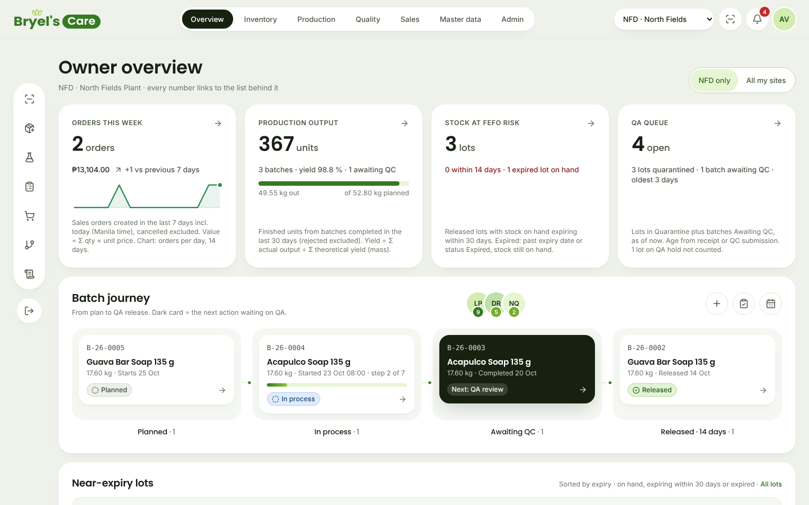

**Say:** "This is what the owner sees first thing in the morning. Every number comes from real
posted transactions, and every card is a link to the list behind it."

**Point at:**
- **Orders this week** (2 orders, ₱13,104.00) and **Production output** (367 units, yield 98.8 %).
- **Batch journey**: one batch planned, one in process, one waiting for QC, one released.
- **Near-expiry lots**: an Acapulco Extract lot is already **Expired** (red). Remember it for
  scene 4.
- Scroll down to **Order fulfilment** (the donut) and **Recent activity**.
- Top right: **NFD only / All my sites**. The owner can see both plants; most staff see only their
  own site.

**Audience should notice:** one screen, no spreadsheets, and the numbers will change by the end
of the demo.

### Scene 2: A delivery arrives (2 min). Sign in as `warehouse.nfd@`

1. Left menu: **Inventory → Receive materials**.
2. Fill in:
   - Supplier name: `Laguna Oleo Supply`
   - Supplier delivery document no.: `DR-88213`
   - Notes (optional): `Seals intact, drums clean and dry.`
   - Material: **MAT-0012 · Coconut Oil**
   - Quantity (g): `25000` (25 kg; the form says so under the box)
   - Supplier lot no.: `LOS-25190`
   - **Expiry date: type a date about one year from today** (as if read from the supplier's label).
     *Important:* do not leave the 2-year default. With a one-year expiry this new drum expires
     before the older coconut oil in stock, so in scene 6 the system recommends it (FEFO, first
     expired first out) and the trace in scene 11 leads back to it.
   - Receiving location: leave **QUA-01 · Quarantine cage**.
3. Click **Post receipt**.

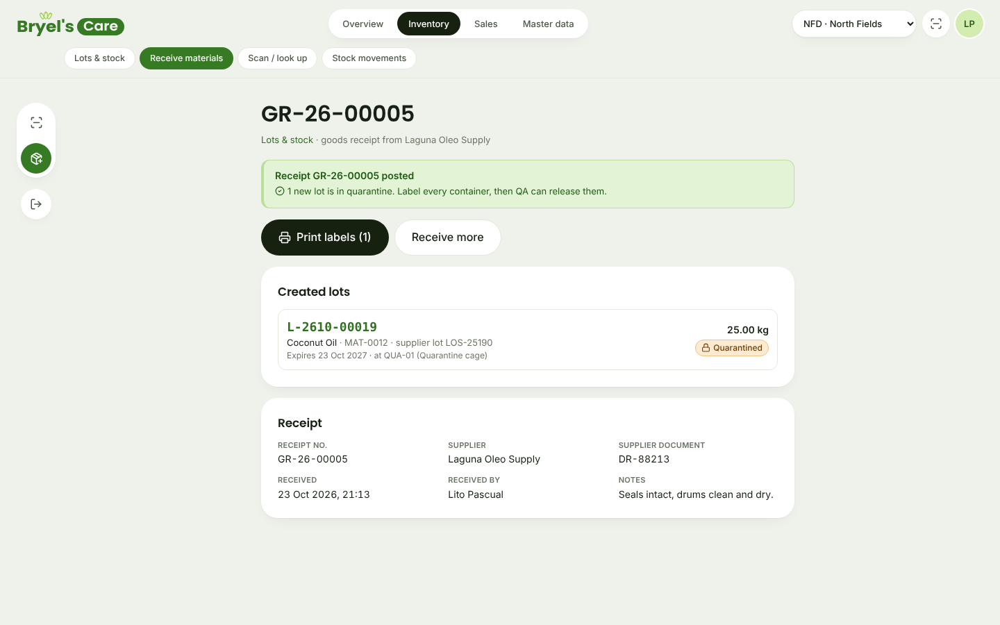

**Say:** "The new lot gets its own number and goes straight into **Quarantined**. Nobody can use
it until QA releases it."

4. Click **Print labels (1)**. A new tab opens the receipt's label request: keep the approved
   raw-material template and the NFD print station and click **Send 1 label job to the station**.
5. Click **Print station**. The lot is in **To print**; click **Print**. A new tab shows the
   100 × 50 mm label with a QR code and "STATUS AT PRINT: QUARANTINE". (Use the browser's print
   dialog at 100 % on a real label printer.) Click **Printed OK**: the job is recorded as printed
   by Lito, with the time.

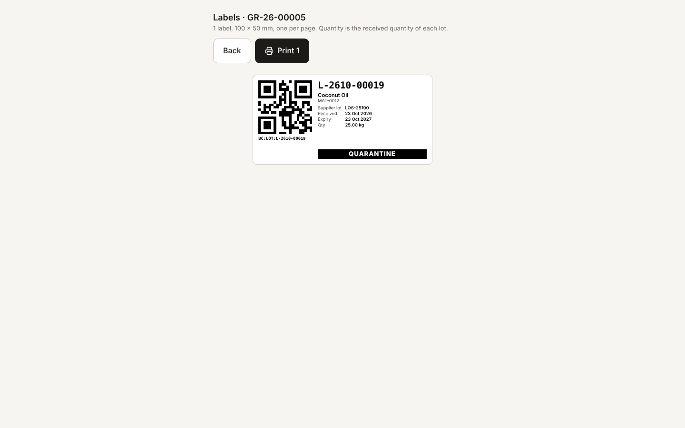

**Say:** "One label per container. The QR code is what the operators scan. Every label print is
recorded, and a reprint needs a reason."
Close the label tabs.

### Scene 3: Scanning (1 min). Still `warehouse.nfd@`

1. Menu: **Warehouse → Scan / look up** (or the scan icon in the top bar).
2. Type `BC:LOT:` followed by the new lot number (for example `BC:LOT:L-2610-00019`) and press
   Enter. A handheld scanner types exactly this, followed by Enter.
3. The scan card shows the lot with the orange banner **Quarantined: not usable yet**. Point at
   the greyed action: *Issue to production: blocked while the lot is quarantined.* **Open lot**
   opens the full lot page. Box labels (`BC:BOX:…`), location labels (`BC:LOC:…`) and equipment
   labels (`BC:EQP:…`) answer the same way.

**Say:** "A scanner or a phone camera opens the right record in one step. The system tells the
operator what is not allowed, and why."

**Optional security moment (30 s):** sign in as `warehouse.rvs@` (Riverside) and scan the same
code. The answer is *Nothing found for "L-2610-00019" in your sites.* The other site's stock is
invisible, and the server enforces this, not just the screen.

### Scene 4: QA decides (2 min). Sign in as `qa.nfd@`

1. Left menu: **Quality → QA queue**. The new coconut oil lot is in the list with the other
   quarantined lots and one batch awaiting QC.
2. Click the new lot number. Choose **Release**, type a reason such as
   `CoA LOS-25190 reviewed; appearance, colour and odour conform.`, and click **Release**.
3. The banner turns green (**Released**) and the decision appears in **Decision history** with
   Nina's name, the time and the reason.

**Say:** "Every QA decision needs a reason and is recorded permanently with who and when. It can
never be edited afterwards."

4. Now the expired lot. Left menu: **Inventory → Lots & stock**, search `LB-6620`, and open the lot
   (**L-2610-00008**, Acapulco Extract). The banner says it is expired. Click **Open QA decision**.

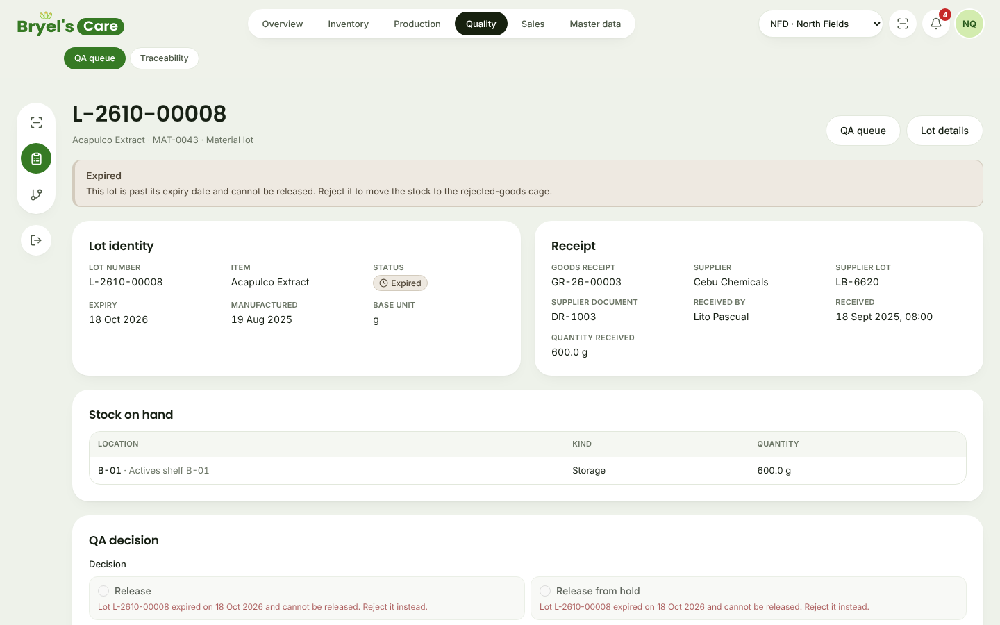

**Say:** "Release is greyed out with the reason. An expired lot can only be rejected. The rule is
in the system, not in someone's memory."

(Do not reject it. Leave it for the next demo.)

**Optional (1 min), sign in as `warehouse.nfd@`:** open the coconut oil lot again, click
**Move stock** (scan-to-move), scan or type `BC:LOC:A-01` as the destination, reason
`Put-away after QA release`, and click **Confirm move**. The confirmation names the transfer
number and offers **Undo** for a short time. This shows the released drum leaving the quarantine
cage; the movement ledger on the lot page records it. It was done in the rehearsal, and scene 6 then shows the
lot at **A-01**. If you skip it, scene 6 shows **QUA-01** instead.

### Scene 5: Plan a batch (1 min). Sign in as `manager.nfd@`

1. Left menu: **Production → New batch**.
2. Product: **Acapulco Soap 135 g (ACS-135)**. Formula revision **F-ACS-01 · revision 1** is
   already chosen. Planned batch size: `17.6` (kg). The form shows *Theoretical yield 16.72 kg*.
3. Click **Create batch**. The batch page opens with status **Planned**.

**Say:** "The batch takes a frozen copy of the approved formula. If R&D changes the formula
tomorrow, this batch record does not change."

### Scene 6: The operator makes the soap (4 min). Sign in as `operator.nfd@`

1. Left menu: **Production → Batches**, open the new batch (**B-26-0006**), and click
   **Start batch**. The status becomes **In process**.
2. For each of the five ingredients, click **Weigh …**:
   - The **Material lot** is already set to the **recommended** lot (earliest expiry first). For
     Coconut Oil this is the lot received in scene 2.
   - **Actual weight (g)**: type the number shown in grey in the box (3723.2, 8687.4, 4964.2, 190.9,
     34.4). A green **Within tolerance** chip appears.
   - **Checker**: choose **Jun Dela Cruz**. Then click **Confirm weight**.

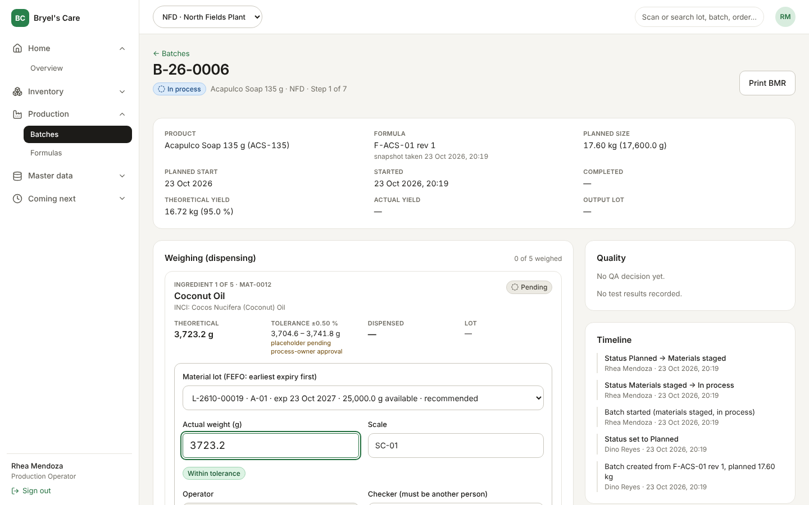

**Say, on the first ingredient:** "The operator does not choose a lot from memory: the system
recommends the one that expires first. The weight is checked against the formula tolerance live.
A second person must confirm; you cannot check your own weighing."

**Optional teaching moment:** before typing the right number, type `3800`. The chip turns amber
(*Outside tolerance … exception reason required*). Then correct it to the grey number.

3. **Checklist**: complete steps 1 to 7 in order. For each, choose checker **Jun Dela Cruz** and
   click **Complete step N**. For step 4 (Mixing and cutting) type readings such as
   `Mix temp 48 °C, trace at 22 min`. Step 2 (Weighing) only unlocks once all five ingredients
   are weighed.
4. **Complete batch**: Finished units `124`. The preview shows *Yield: 100.12 %*. Click
   **Complete batch and send to QA**. The status becomes **Awaiting QC** and the finished lot
   (**L-2610-00020**) goes to quarantine.

**Say:** "This replaces the paper Batch Manufacturing Record: same steps, same signatures, but
nothing can be skipped, and the stock of every ingredient was deducted the moment it was weighed."

### Scene 7: QA tests and releases the batch (2 min). Sign in as `qa.nfd@`

1. **Quality → QA queue**, then under *Batches awaiting QC* click **B-26-0006**.
2. Record three results with **Record test result** (Outcome: *Pass*):

| Test name | Specification | Result |
|---|---|---|
| `pH (10% solution)` | `9.0 – 10.5` | `9.7` |
| `Appearance` | `Smooth green bar, no cracks` | `Conforms` |
| `Net weight (n=10)` | `≥ 135 g each` | `136.0 g avg` |

3. Under **Batch decision** choose **Release batch**, type a reason
   (`All three tests within specification; BMR reviewed, no exceptions.`), and click
   **Release batch**.

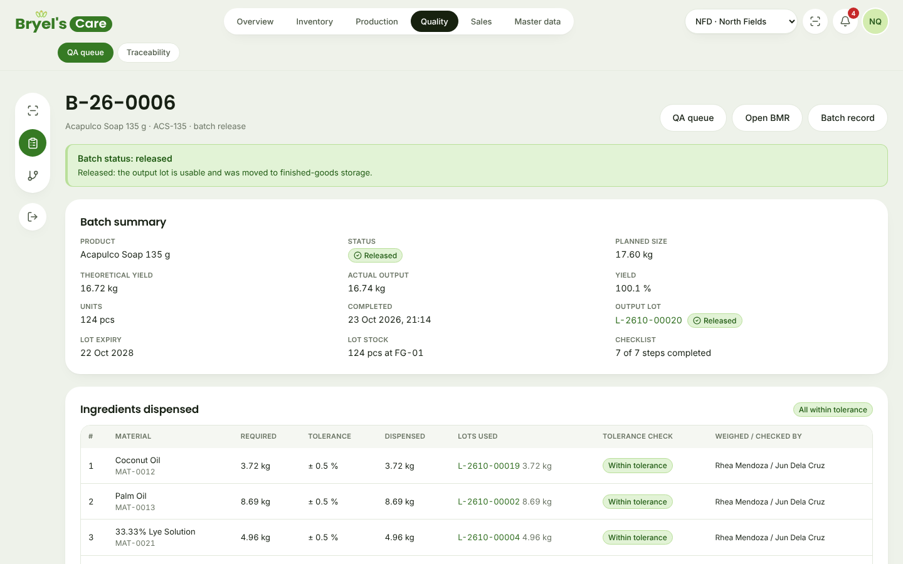

**Say:** "The finished soap is now released and was moved automatically from quarantine to the
finished goods bay **FG-01**. Only now can sales ship it."

### Scene 8: The batch record on paper (1 min). Still `qa.nfd@`

1. At the top of the batch page click **Open BMR**. A print-ready Batch Manufacturing Record
   opens in a new tab, in the layout of the current paper form.

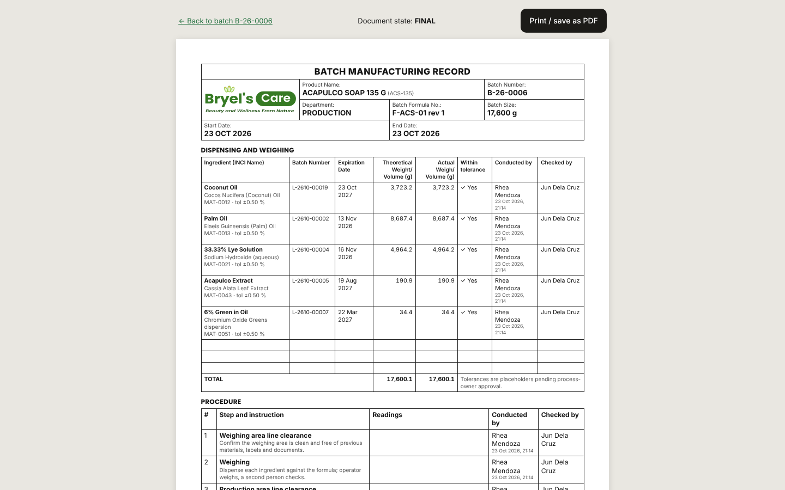

**Say:** "It is built from the electronic record: every lot, weight, person and time, the test
results and the QA decision. **Print / save as PDF** gives a two-page A4 document with a QR code
that opens this batch."

### Scene 9: A customer order (1 min). Sign in as `sales@`

1. **Sales & dispatch → New order**.
2. Customer: **Mabuhay Pharmacy Group (CUS-003)**. The ship-to address and *Min shelf life at
   dispatch: 270 days* appear. Customer PO: `MPG-PO-7781`. Requested delivery date: any date in
   the next few days.
3. Line 1: **ACS-135 · Acapulco Soap 135 g** (it shows *200 pcs available*), Qty `60`, Unit price
   `72.50`. The order value shows **₱4,350.00**.
4. Click **Create draft order**, then **Confirm order**. The status becomes **Confirmed**.

**Say:** "Sales sees only released, unexpired stock as available. The customer's minimum shelf
life is applied automatically when the warehouse allocates."

### Scene 10: Pick, pack and ship (2 min). Sign in as `warehouse.nfd@`

1. **Sales & dispatch → Sales orders**. Two orders are confirmed: yesterday's Isla Spa Supplies
   order (**SO-26-00002**) and the new Mabuhay order.
2. Work the queue in order: open **SO-26-00002** (Isla Spa) and click **Allocate stock (FEFO)**.
3. Open the Mabuhay order (**SO-26-00004**) and click **Allocate stock (FEFO)**.

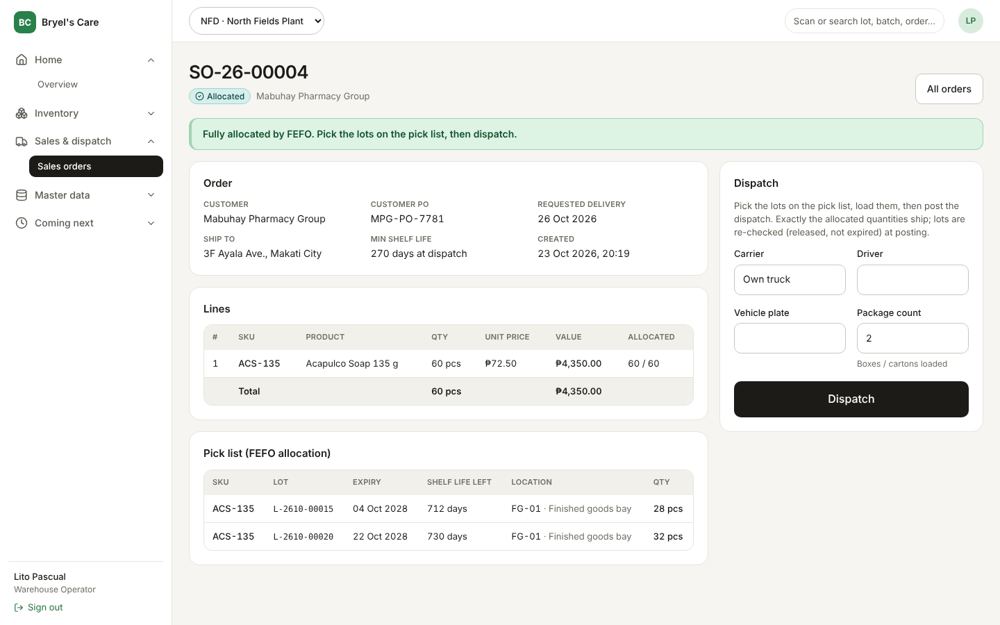

**Say:** "FEFO again: the system first takes the remaining 28 bars of the older lot, then 32
bars of today's batch. The pick list tells the warehouse exactly which lot to take from which
location."

> Why allocate Isla Spa first? Without it, the older lot alone could cover all 60 bars, so none of
> today's soap would go to Mabuhay, and the trace in scene 11 would show the batch "not shipped
> yet". That would be correct behaviour, but not the story we want to tell.

4. In **Dispatch**: Carrier `Own truck`, Driver `Ramon Aquino`, Vehicle plate `NBC 1234`,
   Package count `2`. Click **Dispatch** and confirm the browser question with **OK**. The status
   becomes **Shipped**.
5. Click **Print delivery receipt**.

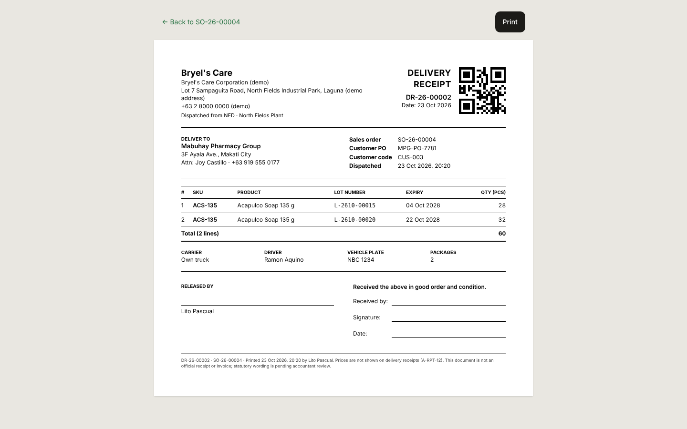

**Say:** "The delivery receipt lists every lot and expiry the customer receives. Prices are left
off on purpose; it is a delivery document, not an invoice."

### Scene 11: Traceability, the recall question (2 min). Sign in as `qa.nfd@`

1. **Quality → Traceability**. Type the finished soap lot (**L-2610-00020**) and click **Trace**.

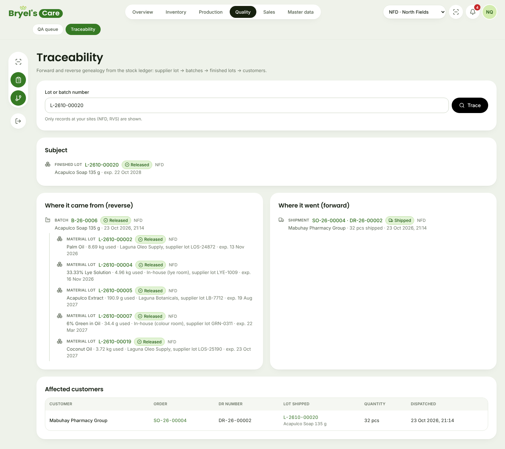

**Say:** "Suppose a customer complains about this soap. On the left: which batch made it and
every ingredient lot with its supplier, including the coconut oil we received in scene 2. On the
right and at the bottom: which customer received how many bars, on which delivery receipt."

2. Now trace the other way: type the coconut oil lot (**L-2610-00019**) and click **Trace**.
   It shows the batch, the soap lot and **Mabuhay Pharmacy Group**.

**Say:** "And if the supplier calls to recall this drum of coconut oil, we know in seconds which
customers to call. On paper this takes days."

### Scene 12: The owner sees what happened (1 min). Sign in as `owner@`

1. The **Owner overview** now shows **3 orders** (₱17,454.00) and **491 units** of output; the new
   batch sits in the *Released* column of the production board.

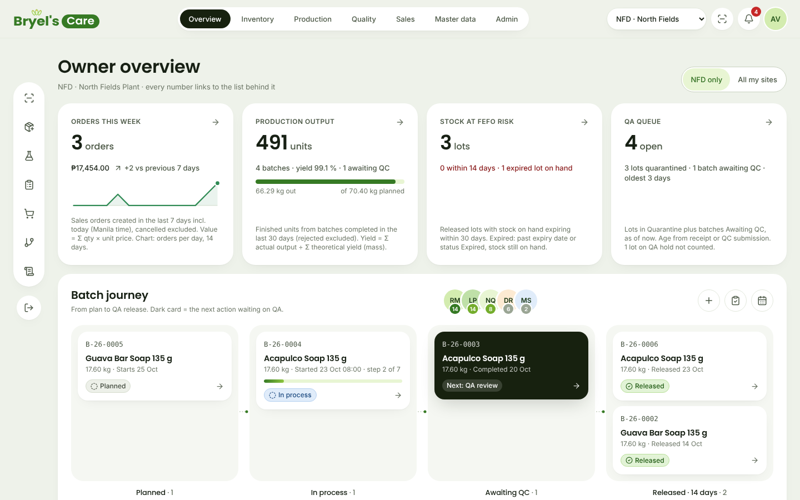

2. Left menu: **Administration → Audit log**. Every step of the demo is listed: who, what, when,
   and on which site, with the before and after values.

**Say:** "Nothing can be changed silently. Stock, batches and shipments are never edited; mistakes
are corrected with a reversal that is itself recorded."

### Scene 13: On the shop floor (1 min). Phone or narrow window, `operator.nfd@`

1. Sign in as `operator.nfd@` on a phone (or press F12 in Chrome and choose a phone size such as
   390 × 844).
2. The operator home shows only two big tiles: **Scan / look up** and **Weigh batch**. There is no
   sales or finance menu, because her role does not need one.
3. Open the in-process batch **B-26-0004** and tap **Weigh Coconut Oil**: the same guided weighing
   form, with no sideways scrolling. Tap **Cancel** (do not post it).

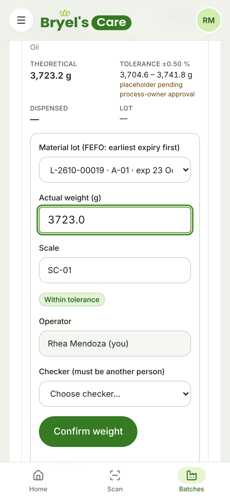

**Say:** "Operators get a task screen, not an ERP. Each role sees only what it needs, for its own
site only."

---

## 3. If something goes wrong

| What you see | What to do |
|---|---|
| "Email or password is incorrect." | Check the spelling of the email (`@bryels-care.test`) and the password `demo1234`. |
| "This account is locked" | Five wrong passwords lock an account. Sign in as `admin@bryels-care.test`, open **Administration → Users & roles**, open the person and click **Unlock account**. Or reset the demo data (1.2). |
| You are suddenly on the sign-in page | The session expired or the data was reset. Sign in again; nothing is lost. |
| In scene 6, the recommended Coconut Oil lot is not the one from scene 2 | The expiry date in scene 2 was left at the 2-year default. Carry on: the demo still works, but in scene 11 trace the older lot shown on the weighing record instead. Next time, enter a one-year expiry. |
| Scene 11 shows "Not used in any batch and not shipped yet" for the soap lot | Scene 10, step 2 (allocate Isla Spa first) was skipped, so all 60 bars came from the older lot. Trace the older lot listed on the delivery receipt instead; it shows Mabuhay. |
| A button shows a red message instead of moving on | Read it aloud. It is the system enforcing a rule (for example "Choose checker", or a lot that is not released yet). Fix the field and click again. This is a good moment to show that rules are enforced. |
| A number in this script does not match the screen | The data was not reset, or the demo was partly run before. Say "this is live data", or reset (1.2) during a break. |
| The page is blank or shows an error | Reload the page (F5). If it persists, check http://localhost:3000/api/ready and call your engineer. |
| Printing opens no preview | Use the **Print** (labels, delivery receipt) or **Print / save as PDF** (BMR) button on the print page itself, or Ctrl+P. The pages are laid out for A4 (labels: 100 × 50 mm). |

---

## 4. What is real and what is not yet built

**Real today (working against a real database, not mock-ups):** receiving with quarantine and
labels; scanning; QA release, hold and reject with reasons; expiry blocking; batch planning from
approved formulas; guided weighing with tolerance checks and a second-person check; the 7-step
checklist; finished goods output and yield; QC test results and batch release; the printable BMR;
sales orders, FEFO allocation with customer minimum shelf life, dispatch and delivery receipts;
forward and backward traceability; the owner dashboard; the audit log; per-site and per-role
security.

**Be clear with the client about these points:**

- **Planned, not built yet** (shown greyed under *Coming next* in the menu): procurement and
  purchase orders (Phase 6), HR, attendance and payroll (Phases 5 to 6), finance and accounting
  export (Phase 6), offline mode for the shop floor (Phase 7), and the customer portal (Phase 8).
- **All data is fictional.** Company address, people, suppliers, customers, prices and lots are
  demo values.
- **Signatures are attestations, not validated e-signatures.** The system records who did what and
  when, but electronic signatures are not yet validated for regulated use; the paper record stays
  the official one until QA approves the validation.
- **Formula quantities, tolerances (±0.5 %) and checklist steps are placeholders** shaped after the
  current paper BMR. They are pending approval by the process owner and QA; the screen says so
  next to each tolerance.
- **Test names and specifications** (pH, appearance, net weight) are typed by QA in the demo. The
  company's QA team defines the real specifications; the system does not invent them.
- **Camera scanning** works in Chrome on Android phones. On desktop browsers, use a handheld
  scanner or type the code.

---

## 5. For engineers

- The rehearsal is an automated Playwright run of this exact storyline (desktop 1440 × 900 and a
  390 × 844 phone), with assertions on status chips, numbers and texts. It fails on any error page,
  console error or failed request. The script used for the 23 Oct 2026 rehearsal lives outside the
  repository (QA scratchpad `demo/rehearsal.cjs`); moving it under `tests/e2e/` is a follow-up recorded in
  `docs/testing.md` 9.18.
- Screenshots in `docs/demo/` come from that run on a fresh seed.
- The demo depends on the seed in `src/db/seed.ts` (`ALLOW_DEMO_SEED=true`). If the seed's stock
  quantities change (in particular the 76 released bars left in the oldest Acapulco Soap lot and
  the coconut oil lot expiring in about 600 days), re-check scenes 2, 6 and 10.
