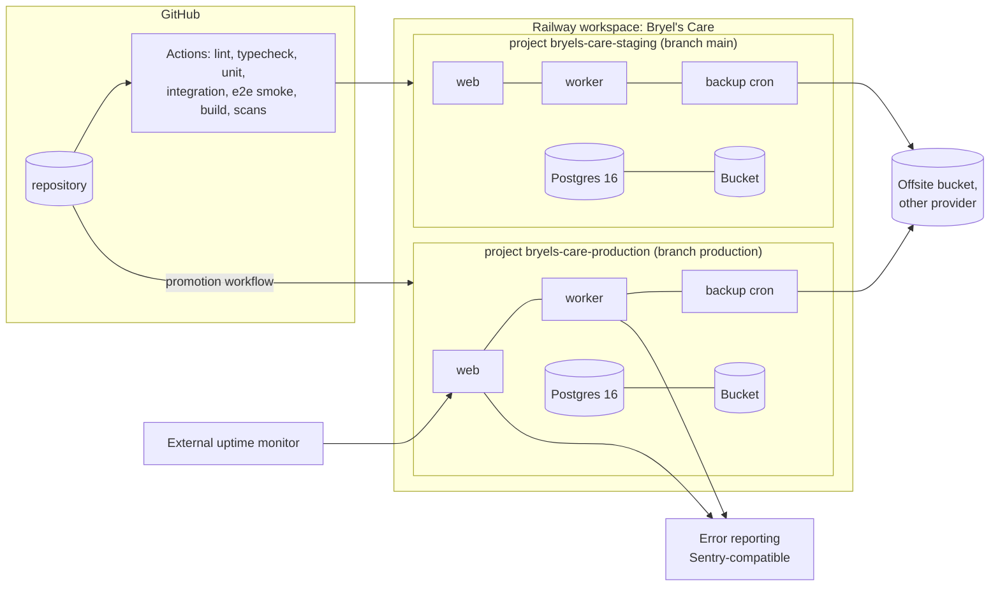

# Deployment on Railway

Owner: `devops-engineer` (with `principal-architect`; security review by `security-engineer`).
Status: Proposed for Gate 0; executed in Phase 1 Slice 1 (staging) and Phase 9 (production).
Binding decisions: ADR-002 (PostgreSQL 16 on Railway), ADR-013 (tooling and CI), ADR-014
(topology), ADR-015 (pg-boss), ADR-016 (PDF rendering, proposed). Related documents:
`docs/architecture.md` (sections 8, 11, 12), `docs/security.md` (sections 4.4, 4.12, 6, 7,
8), `docs/operations-runbook.md` (day-to-day procedures), `docs/testing.md` (CI gates),
`docs/PRD.md` section 11 (Slice 1).

For owners: this document says where the system runs, what it costs, how we keep copies of
the data, how we put a new version live without breaking the old one, and how we undo a bad
change. For engineers: it is the exact configuration to reproduce, and the list of platform
facts we must verify rather than assume.

Facts marked **(verified 2026-10-16)** were read from Railway's documentation on that date.
Everything marked `A-DEP-nn` is an assumption that needs owner confirmation; section 16
lists them. Platform behaviour we have not yet exercised is in section 15 as checks with
pass criteria; nothing in section 15 is relied on until its check passes.

## 1. Topology (ADR-014)



| Environment | Where | Database | Bucket | Secrets | Who deploys | Data |
|---|---|---|---|---|---|---|
| development | developer machine: `pnpm dev`, Postgres 16 in Docker (`docker compose up db`), MinIO or local-disk storage adapter | local | local | `.env.local` (never committed; `.env.example` lists names only) | developer | fictional seed only |
| staging | Railway project `bryels-care-staging` (A-DEP-01), region Southeast Asia / Singapore (A-DEP-02) | Railway Postgres 16 service | Railway Bucket | Railway variables of that project | automatic on push to `main` | fictional seed; restore drills use production dumps only with owner approval (`docs/security.md` section 6) |
| production | Railway project `bryels-care-production` | Railway Postgres 16 service | Railway Bucket | Railway variables; access limited to the owner and the operations contact | promotion workflow (section 4.3) | real company data; seed refuses to run (`APP_ENV=production`, PRD S1-10) |

Services in each Railway project (one Docker image, three start commands):

| Service | Role | Process | Public | Scales |
|---|---|---|---|---|
| `web` | Next.js server: pages, server actions, `/api/v1`, `/api/health`, `/api/ready` | `node server.js` (Next standalone) | yes, custom domain | 1 replica; 2 from Phase 9 if load test requires (sessions and rate limits are in Postgres, so replicas are stateless) |
| `worker` | pg-boss consumers (ADR-015): PDFs/labels, imports, scheduled reports, notifications, reconciliation, expiry scan, metrics sampling, alert evaluation, partition maintenance | `node dist/worker.js` | no (private network only) | exactly 1 replica until Chromium memory is measured (ADR-016) |
| `backup` | Railway cron service: nightly logical dump, encrypt, upload, prune, record | `node dist/backup.js` (exits when done) | no | 1, scheduled |
| `Postgres` | Railway-managed PostgreSQL 16 with volume | managed | private network; TCP proxy disabled except during restores | single node (HA evaluated at Phase 9) |
| `Bucket` | Railway Bucket (S3-compatible, private, presigned URLs) **(verified 2026-10-16: GA since 2025-11-28; no public buckets; no versioning, lifecycle or platform backups)** | managed | presigned URLs only | n/a |

Why two projects rather than two environments of one project (A-DEP-01): Railway membership
and variable visibility are managed per project; `docs/security.md` section 6 requires that
developers never see production variables. If check V-05 shows environment-level access
control, the two projects can be collapsed into one project with two environments.

## 2. Build: one image for every process

### 2.1 Dockerfile outline

```dockerfile
# syntax=docker/dockerfile:1.7
ARG NODE_VERSION=22.12.0          # pinned LTS; bumped by Renovate with CI proof
ARG WITH_CHROMIUM=0               # ADR-016 gate: 1 adds headless Chromium (Phase 3+, A-DEP-19)

FROM node:${NODE_VERSION}-bookworm-slim AS base
ENV PNPM_HOME=/pnpm PATH=/pnpm:$PATH COREPACK_ENABLE_DOWNLOAD_PROMPT=0 NEXT_TELEMETRY_DISABLED=1
RUN corepack enable && apt-get update \
 && apt-get install -y --no-install-recommends ca-certificates tini \
 && rm -rf /var/lib/apt/lists/*
WORKDIR /app

FROM base AS deps                 # dependency layer, cached by lockfile
COPY package.json pnpm-lock.yaml .npmrc ./
RUN --mount=type=cache,id=pnpm,target=/pnpm/store pnpm fetch --frozen-lockfile
COPY . .
RUN --mount=type=cache,id=pnpm,target=/pnpm/store pnpm install --frozen-lockfile --offline

FROM deps AS build                # next build (output: "standalone") + worker/migrate/backup bundles
RUN pnpm build                    # produces .next/standalone, .next/static, dist/{worker,migrate,backup}.js

FROM base AS runtime
ARG WITH_CHROMIUM
# PostgreSQL 16 client (pg_dump/pg_restore must be >= server major) from the PGDG apt repo, and age for dump encryption
RUN apt-get update && apt-get install -y --no-install-recommends curl gnupg \
 && curl -fsSL https://www.postgresql.org/media/keys/ACCC4CF8.asc | gpg --dearmor -o /usr/share/keyrings/pgdg.gpg \
 && echo "deb [signed-by=/usr/share/keyrings/pgdg.gpg] https://apt.postgresql.org/pub/repos/apt bookworm-pgdg main" > /etc/apt/sources.list.d/pgdg.list \
 && apt-get update && apt-get install -y --no-install-recommends postgresql-client-16 age \
 && if [ "$WITH_CHROMIUM" = "1" ]; then apt-get install -y --no-install-recommends chromium fonts-liberation; fi \
 && apt-get purge -y curl gnupg && rm -rf /var/lib/apt/lists/*
ENV NODE_ENV=production HOSTNAME=:: PORT=3000 PUPPETEER_EXECUTABLE_PATH=/usr/bin/chromium
RUN groupadd -r app && useradd -r -g app -d /app app
COPY --from=build --chown=app:app /app/.next/standalone ./
COPY --from=build --chown=app:app /app/.next/static ./.next/static
COPY --from=build --chown=app:app /app/public ./public
COPY --from=build --chown=app:app /app/dist ./dist
COPY --from=build --chown=app:app /app/src/db/migrations ./src/db/migrations
USER app
EXPOSE 3000
ENTRYPOINT ["tini", "--"]
CMD ["node", "server.js"]        # web default; worker and backup override the start command
```

Rules: non-root user; the application writes only under `/tmp` (`docs/security.md` section
4.12); `HOSTNAME=::` binds dual-stack so Railway's private network (IPv6 in older
environments, IPv4+IPv6 in environments created after 2025-10-16, **verified 2026-10-16**)
and the edge healthcheck both reach the process; Trivy scans the image in CI (warn in Phase
1, fail from Phase 9); the Chromium layer is absent unless `WITH_CHROMIUM=1`, so Phase 1 and
2 images stay small and `PDF_RENDERER=disabled` renders a "setup required" state instead of a
fake PDF.

### 2.2 Entry points shipped in the image

| Entry | Command | Behaviour |
|---|---|---|
| web | `node server.js` | Next.js standalone server on `PORT`; exempts `/api/health` and `/api/ready` from authentication, Origin and Host checks (Railway probes with host `healthcheck.railway.app`, **verified 2026-10-16**) |
| migrate | `node dist/migrate.js [--check] [--dry-run]` | Takes `pg_advisory_lock(hashtext('bc_migrate'))`, applies pending SQL files from `src/db/migrations` in filename order using `DATABASE_MIGRATION_URL`, one transaction per file unless the file header says `-- transactional: false` (for `CREATE INDEX CONCURRENTLY`), refuses files headed `-- destructive: true` unless section 5.3 conditions hold, prints the applied list as JSON, exits non-zero on any failure. `--check` exits 0 only when every bundled migration is applied (used by readiness and by the worker). |
| worker | `node dist/worker.js` | Starts a minimal HTTP server on `PORT` serving `/api/health` and `/api/ready`; waits until `migrate --check` passes (poll 10 s, give up after 15 min → exit 1); starts pg-boss with `WORKER_CONCURRENCY`; writes a `worker_heartbeats` row every 30 s; on `SIGTERM` stops fetching, finishes in-flight jobs within the draining window, exits 0 |
| backup | `node dist/backup.js` | Section 9; exits 0 on success, 1 on failure (Railway cron services must exit, **verified 2026-10-16**) |
| seed | `node dist/seed.js` | Fictional data; refuses when `APP_ENV=production` (PRD S1-10); run manually on staging after the first migration |

## 3. Railway service configuration

Railway's `railway.json`/`railway.toml` "config as code" is deprecated in favour of
Infrastructure as Code in `.railway/railway.ts` (TypeScript GA; applied with
`railway config plan` / `railway config apply`; legacy files stop being read on 2026-12-01;
a service cannot be managed by both) **(verified 2026-10-16)**. The IaC reference we read
shows `build`, `start` and `healthcheck` on services but did not yet document pre-deploy
commands or cron schedules; check V-03 decides whether those two settings live in IaC or in
the dashboard. Either way the table below is the source of truth and the dashboard is
checked against it at every gate.

| Setting | `web` | `worker` | `backup` |
|---|---|---|---|
| Source | GitHub repo, branch `main` (staging) / `production` (production) | same | same |
| Builder | Dockerfile at repo root | same | same |
| Build arg `WITH_CHROMIUM` | `0` (`1` from Phase 3 if ADR-016 is accepted) | same | same |
| Start command | `node server.js` | `node dist/worker.js` | `node dist/backup.js` |
| Pre-deploy command | `node dist/migrate.js` | none (worker waits for the schema, section 2.2) | none |
| Pre-deploy timeout | 900 s (Railway allows 1–3600 s, **verified 2026-10-16**) | – | – |
| Healthcheck path / timeout | `/api/ready` / 300 s | `/api/ready` / 300 s | none |
| Restart policy | `ON_FAILURE`, max 10 | `ON_FAILURE`, max 10 | `NEVER` (cron) |
| Replicas | 1 (2 from Phase 9 if needed) | 1 | 1 |
| Cron schedule | – | – | `17 18 * * *` (UTC = 02:17 Asia/Manila, A-DEP-07) |
| Public networking | custom domain + Railway domain | none | none |
| Resources (A-DEP-04) | 1 vCPU / 1 GB | 1 vCPU / 2 GB (Chromium) | 0.5 vCPU / 1 GB |
| Draining (SIGTERM → SIGKILL) | 30 s | 60 s | – |
| Variable groups (section 4) | db-app, db-migrate, auth, storage, mail, observability | db-app, auth, storage, mail, observability | db-backup, backup, storage, observability |
| Deploy trigger | push to branch; watch paths exclude `docs/**` | same | same |

Illustrative `.railway/railway.ts` (helper names to be confirmed against the IaC reference at
implementation; check V-03):

```ts
import { service, postgres, bucket } from "@railway/config"; // name per Railway IaC docs
const db = postgres("Postgres");
const files = bucket("Bucket", { region: "asia-southeast1" });
const web = service("web", { build: { dockerfile: "Dockerfile", args: { WITH_CHROMIUM: "0" } },
  start: "node server.js", preDeploy: "node dist/migrate.js", healthcheck: "/api/ready",
  domains: ["app.example.com"] });
const worker = service("worker", { start: "node dist/worker.js", healthcheck: "/api/ready" });
const backup = service("backup", { start: "node dist/backup.js", cron: "17 18 * * *" });
```

Deployment order matters once a migration is involved: `web`'s pre-deploy applies the
migration; `worker` built from the same commit starts, finds the schema behind, and waits
(section 2.2). If `web`'s pre-deploy fails, the new `web` never goes live and the new
`worker` fails its healthcheck after 15 minutes, so the previous versions of both keep
running.

### 3.1 CI and promotion (ADR-013)

| Stage | Job | Required on PR | Notes |
|---|---|---|---|
| 1 | `lint` (ESLint incl. boundaries), `typecheck`, `prettier --check` | yes | |
| 2 | `unit` (Vitest) | yes | |
| 3 | `integration` (Vitest against `postgres:16` service container; `pnpm db:migrate` from zero, then again as a no-op: PRD S1-09) | yes | includes `authz.*` negative tests and `authz-coverage` (`docs/security.md` section 8.1) |
| 4 | `e2e-smoke` (Playwright, 360 px and desktop, against the built image) | yes | |
| 5 | `build` (Docker image; `gitleaks`; Trivy; client-bundle grep for secret names; `pnpm audit --prod`) | yes | image is discarded in Phase 1 (A-DEP-05); from Phase 9 it may be pushed to GHCR and promoted |
| 6 | `migration-review` label check: any PR touching `src/db/migrations` needs database-architect review and a "destructive: yes/no" statement in the PR body | yes | |
| 7 | `deploy-staging` | n/a | Railway's GitHub integration deploys `main` automatically; CI does not hold a Railway token for production |
| 8 | `promote-production` (manual `workflow_dispatch`; GitHub environment `production` with a required reviewer = owner or operations contact) | n/a | fast-forwards `production` to a `main` commit that passed stages 1–5 and ran on staging for at least one business day (A-DEP-06); Railway deploys it |

## 4. Environment variables and secrets

Naming follows `docs/architecture.md` section 12 and `docs/security.md` section 6
(architecture names win where the two differ; see the note on `DATABASE_MIGRATION_URL`
in section 17). Secrets are generated with `openssl rand -base64 32` unless stated. "Plain"
values may be seen by every project member; "secret" values are entered once and never
displayed again outside Railway's variable editor. Business configuration (timezone,
currency, numbering, approval rules, FEFO, attendance rules) is never an environment
variable (`docs/architecture.md` section 12).

| Variable | Kind | Group | web | worker | backup | development | staging | production | Notes |
|---|---|---|---|---|---|---|---|---|---|
| `NODE_ENV` | plain | base | x | x | x | `development` | `production` | `production` | set in the image |
| `APP_ENV` | plain | base | x | x | x | `development` | `staging` | `production` | authoritative environment flag (seed guard, log tag, UI badge); never trust `RAILWAY_ENVIRONMENT` for this because both projects may name their environment `production` |
| `PORT`, `HOSTNAME` | plain | base | x | x | – | `3000`, `localhost` | injected / `::` | injected / `::` | Railway injects `PORT` **(verified 2026-10-16)** |
| `APP_ORIGIN` | plain | base | x | x | – | `http://localhost:3000` | `https://staging.<domain>` | `https://<domain>` | Origin checks, cookie `Secure`, absolute links in email |
| `TRUSTED_PROXY_HEADER` | plain | base | x | – | – | unset | `x-forwarded-for` | `x-forwarded-for` | client IP for rate limits (`docs/security.md` 3.3); becomes `cf-connecting-ip` only if a Cloudflare proxy is placed in front (A-DEP-15) |
| `LOG_LEVEL`, `LOG_FORMAT` | plain | observability | x | x | x | `debug`, `pretty` | `info`, `json` | `info`, `json` | |
| `ERROR_REPORTING_DSN` | secret | observability | x | x | x | unset (disabled) | staging DSN | production DSN | Sentry-compatible (A-DEP-12) |
| `RELEASE` | plain | observability | x | x | x | `dev` | `${{RAILWAY_GIT_COMMIT_SHA}}` | same | release tag for errors and logs; check V-14 |
| `DATABASE_URL` | secret | db-app | x | x | – | local URL | `bc_app` role on the private host | same | runtime role (`docs/security.md` section 6); private `*.railway.internal` host, never the TCP proxy |
| `DATABASE_MIGRATION_URL` | secret | db-migrate | x (pre-deploy only) | – | – | local URL | `bc_migrate` | same | schema owner; present only on `web` |
| `DATABASE_BACKUP_URL` | secret | db-backup | – | – | x | local URL | `bc_backup` | same | read-only role for `pg_dump` (A-DEP-20) |
| `DATABASE_POOL_MAX` | plain | db-app | x | x | – | `5` | `10` / `5` | `10` / `5` | web / worker (A-DEP-17) |
| `MIGRATION_ALLOW_DESTRUCTIVE`, `MIGRATION_MAX_BACKUP_AGE_HOURS` | plain | db-migrate | x | – | – | `1`, `0` | unset, `2` | unset, `2` | section 5.3; set to `1` for one deploy, then removed |
| `SESSION_SECRET`, `SESSION_SECRET_PREVIOUS` | secret | auth | x | x | – | fixed dev value | generated | generated | `_PREVIOUS` holds the old key during the 24 h rotation window |
| `CSRF_SECRET`, `CSRF_SECRET_PREVIOUS` | secret | auth | x | – | – | " | " | " | |
| `FILE_URL_SECRET` | secret | auth | x | x | – | " | " | " | signed application download URLs (`docs/security.md` 4.8) |
| `DATA_ENCRYPTION_KEY`, `DATA_ENCRYPTION_KEY_PREVIOUS` | secret | auth | x | x | – | `k1:<base64>` | `k1:<base64>` | `k1:<base64>` | `keyid:base64(32 bytes)`; ciphertexts store the key id so rotation is a re-encrypt job |
| `AUTH_PEPPER` | secret | auth | x | – | – | unset | unset | unset | off by default (A-SEC-02) |
| `AUTH_BREACH_CHECK` | plain | auth | x | – | – | `offline` | `offline` | `offline` | `hibp` enables the online check (A-SEC-04) |
| `S3_ENDPOINT`, `S3_BUCKET`, `S3_REGION`, `S3_FORCE_PATH_STYLE` | plain | storage | x | x | x | MinIO values | `${{Bucket.ENDPOINT}}`, `${{Bucket.BUCKET}}`, `${{Bucket.REGION}}`, `false` | same | Railway Buckets expose `ENDPOINT`, `BUCKET`, `REGION`, `ACCESS_KEY_ID`, `SECRET_ACCESS_KEY` and use virtual-hosted URLs **(verified 2026-10-16)** |
| `S3_ACCESS_KEY_ID`, `S3_SECRET_ACCESS_KEY` | secret | storage | x | x | x | MinIO values | `${{Bucket.ACCESS_KEY_ID}}`, `${{Bucket.SECRET_ACCESS_KEY}}` | same | |
| `BACKUP_ENCRYPTION_PUBLIC_KEY` | plain | backup | – | – | x | test key | staging `age1…` | production `age1…` | public half only; private key offline with the owner and the operations contact (`docs/security.md` section 6) |
| `BACKUP_PREFIX`, `BACKUP_RETENTION_DAILY`, `BACKUP_RETENTION_MONTHLY` | plain | backup | – | – | x | – | `backups/staging`, `7`, `0` | `backups/production`, `35`, `12` | A-SEC-31 |
| `BACKUP_OFFSITE_ENDPOINT`, `BACKUP_OFFSITE_BUCKET`, `BACKUP_OFFSITE_REGION` | plain | backup | – | – | x | unset | offsite values | offsite values | second provider (A-DEP-08) |
| `BACKUP_OFFSITE_ACCESS_KEY_ID`, `BACKUP_OFFSITE_SECRET_ACCESS_KEY` | secret | backup | – | – | x | unset | " | " | write-only credentials for the offsite bucket |
| `EMAIL_PROVIDER`, `EMAIL_FROM` | plain | mail | x | x | – | `none` | `smtp`, `noreply@<domain>` | same | adapter; `none` renders "setup required" |
| `SMTP_URL` | secret | mail | x | x | – | unset | staging credentials | production credentials | Phase 5 |
| `WORKER_CONCURRENCY` | plain | worker | – | x | – | `2` | `4` | `4` | per queue class |
| `PDF_RENDERER`, `PUPPETEER_EXECUTABLE_PATH` | plain | worker | – | x | – | `disabled` | `disabled` → `chromium` (Phase 3) | same | ADR-016 |
| `ALERT_WEBHOOK_URL` | secret | observability | – | x | – | unset | optional | optional | chat-tool webhook for alerts (A-DEP-10) |
| `MAINTENANCE_MODE` | plain | base | x | – | – | unset | unset | unset | `1` makes `web` answer 503 with a maintenance page for everything except `/api/health`; used during restores |
| `PAYMONGO_SECRET_KEY`, `PAYMONGO_WEBHOOK_SECRET` | secret | payments | x | x | – | unset | sandbox | live | Phase 8; sandbox and live never coexist (`docs/security.md` 4.11) |
| `NEXT_PUBLIC_APP_ENV` | plain | base | x | – | – | `development` | `staging` | `production` | only `NEXT_PUBLIC_*` reaches the browser; CI greps the bundle for secret names |
| `RAILWAY_ENVIRONMENT`, `RAILWAY_SERVICE_NAME`, `RAILWAY_REPLICA_ID`, `RAILWAY_GIT_COMMIT_SHA` | platform | – | x | x | x | – | injected | injected | read-only; added to every log line |

Database roles are created once per environment by the operations contact with the Railway
`postgres` superuser (`pnpm db:bootstrap-roles`, idempotent script printing the generated
passwords once): `bc_migrate` (schema owner), `bc_app` (DML; INSERT/SELECT only on ledger
and audit tables), `bc_readonly` (SELECT for analytics views and ad-hoc owner queries),
`bc_backup` (SELECT on all tables and sequences, A-DEP-20). Grants are verified at Gate 9
(`docs/security.md` 8.2).

## 5. Migrations at deploy

### 5.1 Procedure (every deploy)

1. A migration is generated with `pnpm db:generate` (Drizzle, ADR-003), reviewed as plain
   SQL, and committed with the schema change in the same PR. The PR body states whether it
   is destructive (section 5.3) and how it is forward-fixed if it misbehaves.
2. CI applies all migrations from zero and re-runs the migrator to prove idempotence (PRD
   S1-09), then runs integration tests against the migrated schema.
3. Merge to `main` deploys staging: Railway builds the image, runs `node dist/migrate.js` as
   `web`'s pre-deploy command (separate container, same image and variables, private
   network, **verified 2026-10-16**), then starts the new `web` and switches traffic after
   `/api/ready` returns 200.
4. The promotion workflow (section 3.1) repeats step 3 on production after the staging soak.
5. Every deploy is recorded in the deployment log (`docs/operations-runbook.md` appendix):
   commit, migrations applied (from the migrator's JSON output in the deploy log), who
   promoted, start and end time, result.

### 5.2 Rules

| Rule | Reason |
|---|---|
| Forward-only; no down migrations; an applied migration file is never edited | the applied list in `drizzle.__drizzle_migrations` is the record of truth; editing breaks every other environment |
| Expand → migrate data → contract, across at least two releases, for renames, type changes and column removals | the previous `web`/`worker` keep running (and may be rolled back to) during and after the deploy, so the old code must work on the new schema |
| Data backfills run as worker jobs or as `-- transactional: false` migrations in batches, never as one giant `UPDATE` in the pre-deploy | pre-deploy has a timeout and locks tables |
| `CREATE INDEX CONCURRENTLY` lives in its own `-- transactional: false` file with `IF NOT EXISTS` | cannot run inside a transaction; must be safely re-runnable |
| The migrator holds an advisory lock | two containers (manual run plus pre-deploy) can never apply concurrently |
| `bc_app` has no DDL; only the pre-deploy container holds `DATABASE_MIGRATION_URL` | least privilege (`docs/security.md` section 6) |
| Readiness checks that every bundled migration is applied (not that the applied set equals the bundle) | a rolled-back image must still be "ready" on a newer, backward-compatible schema |

### 5.3 Destructive migrations

A migration is destructive when it drops or truncates a table or column, narrows a type,
rewrites ledger or audit rows, or changes a `CHECK`/unique constraint in a way that can
reject existing rows. Such files start with `-- destructive: true` and the migrator refuses
them unless all of the following hold:

1. `MIGRATION_ALLOW_DESTRUCTIVE=1` is set on `web` for this deploy only (removed afterwards;
   the variable change is logged in the runbook change log).
2. A `backup_runs` row with `status = 'succeeded'` and `kind = 'manual'` exists for this
   environment within `MIGRATION_MAX_BACKUP_AGE_HOURS` (default 2): the operations contact
   runs `node dist/backup.js --manual --label pre-<migration-name>` (section 9) and verifies
   it.
3. Production only: a manual Railway volume backup was also taken from the Backups tab
   (**verified 2026-10-16**: manual backups capped at 50 % of volume size; grow the volume
   first if needed), and the deploy happens in the agreed maintenance window (A-DEP-14).
4. The forward-fix plan is written in the PR (how to restore the dropped data from the dump
   into a side table and re-link it).

### 5.4 Failure handling

| Failure | What Railway does (**verified 2026-10-16**) | What we do |
|---|---|---|
| Pre-deploy exits non-zero or times out | deployment does not proceed; no retry; previous deployment keeps serving | read the migrator output in the deploy log; fix forward with a new migration or a code fix; never edit the failed file if it partially applied |
| Partial application | not possible for transactional files (the whole file rolled back); possible for `-- transactional: false` files | those files are written re-runnable (`IF NOT EXISTS`, batches keyed by id); re-deploy |
| Advisory lock held by a dead container | n/a | `SELECT pg_terminate_backend(pid) FROM pg_stat_activity WHERE application_name = 'bc-migrate' AND state = 'idle'`, then re-deploy (`docs/operations-runbook.md` section 14) |
| Migration applied but new `web` fails healthcheck | new deployment marked failed; previous stays active | previous code runs on the new schema (allowed by the expand rule); fix forward; if the schema change itself is the problem, section 11 |
| Migration succeeded on staging but data on production differs | – | production-shaped tests: before Gate 9 and quarterly, restore the latest production dump into a staging scratch database and run the pending migrations against it (section 10) |

## 6. Health and readiness

| Endpoint | Checks | 200 body | Failure |
|---|---|---|---|
| `GET /api/health` (web, worker) | process is up; no I/O | `{ "ok": true, "service": "web", "release": "<sha>", "uptimeSeconds": n }` | only when the process is down |
| `GET /api/ready` (web) | database `SELECT 1` within 2 s on the runtime pool; `migrate --check` result cached 60 s; `pgboss` schema reachable (`SELECT 1 FROM pgboss.version`); worker heartbeat age reported but **not** a failure condition | `{ "ok": true, "checks": { "database": "ok", "migrations": "ok", "queue": "ok", "workerHeartbeatSeconds": 12 } }` | 503 with the failing check named; no stack traces, no connection strings |
| `GET /api/ready` (worker) | database reachable; migrations current; pg-boss started; last heartbeat written < 90 s ago | same shape, `"service": "worker"` | 503 |
| `GET /api/health/worker` (web) | heartbeat age < 300 s | `{ "ok": true, "heartbeatSeconds": n }` | 503, so an external monitor can detect a dead worker through the public domain |

Both endpoints are unauthenticated, exempt from Origin/Host checks, rate-limited per IP,
answer with `Cache-Control: no-store`, and never include environment values. Railway uses
`/api/ready` as the deploy gate (healthchecks run only at deploy time, any 2xx passes, default
timeout 300 s, **verified 2026-10-16**); the external monitor (A-DEP-10) polls `/api/ready`
and `/api/health/worker` every minute for continuous coverage. The bucket is deliberately not
in readiness (slow, and a storage outage should degrade uploads, not take the site down); it
is a diagnostics check instead. PRD S1-08 is the acceptance test.

## 7. Structured logging and correlation ids

- Logger: pino, JSON lines to stdout; Railway collects stdout/stderr. Fields on every line:
  `time`, `level`, `msg`, `service`, `release`, `appEnv`, `replica`, `requestId`,
  `correlationId`, `userId`, `siteId`, `module`, `command`, `durationMs`, `outcome`,
  `httpStatus`, `jobId`, `jobKind`.
- Correlation: `X-Request-Id` is accepted from the client if it is a UUID, otherwise
  generated; echoed in the response; stored as `audit_events.request_id`; copied into job
  payloads as `correlationId` so a PDF job's log lines join the request that enqueued it;
  sync replay batches carry one correlation id per batch plus the client command id.
- Redaction: the logger's redact list covers `password`, `token`, `code`, `secret`,
  `authorization`, `cookie`, `set-cookie`, bucket credentials, and 20+ character base64url
  values in URLs; request bodies of auth endpoints are never logged (`docs/security.md`
  section 3.8). Personal data is logged as ids, never names or emails.
- Retention: Railway keeps 30 days of logs on the Pro plan and 7 days on Hobby
  (**verified 2026-10-16**); A-SEC-23 requires 30 days, hence A-DEP-03 (Pro). Check V-11
  confirms retention and whether a log drain exists; if not, A-DEP-13 applies.
- Access: Railway log viewer (project members) and the admin diagnostics page (counts and
  recent error summaries only, `platform.diagnostics.view`).

## 8. Error reporting, metrics and alerts

### 8.1 Error reporting

Sentry-compatible SDK behind the `platform` error-reporting adapter (A-DEP-12):
`ERROR_REPORTING_DSN` per environment, `release = RELEASE`, `environment = APP_ENV`,
`serverName = RAILWAY_SERVICE_NAME`; `beforeSend` strips cookies, headers, request bodies and
query strings, and tags `requestId`, `module`, `command`, `jobKind`; 100 % of errors, 10 % of
performance traces; unhandled rejections and uncaught exceptions in the worker are reported
then the process exits 1 (restart policy restarts it). Expected failures (`err('validation')`,
`err('forbidden')`, `err('conflict')`) are never reported as errors.

### 8.2 Metrics

Railway's dashboard shows CPU, memory, network and volume usage per service; it does not
scrape application metrics (check V-12). Application metrics therefore live in Postgres:

| Metric | Source | Sampling |
|---|---|---|
| requests, 5xx count, latency histogram per route class (`page`, `query`, `command`, `scan`, `export`) | in-process counters in `web`, flushed every 60 s per replica to `metrics_samples` | 60 s |
| queue depth, oldest queued job age, failed jobs, dead-lettered jobs per kind | pg-boss tables, sampled by the worker job `platform.metrics_sample` | 5 min |
| sync backlog (pending `sync_commands`, oldest age, open `sync_conflicts`) | same job (Phase 7) | 5 min |
| database size (`pg_database_size`), largest tables, connections used vs `max_connections`, replication/PITR archive lag where exposed | same job | 5 min |
| backup age (newest `backup_runs.finished_at` with `status = 'succeeded'`), last restore drill date | `backup_runs`, `restore_drills` | 5 min |
| worker heartbeat age | `worker_heartbeats` | 60 s |
| audit `DEFAULT` partition row count (must be 0) | same job | hourly |
| reconciliation differences (`inventory.reconcile` result) | `reconciliation_runs` | nightly |

Samples are kept 90 days (A-DEP-11) and feed the diagnostics page and the alert evaluator.

### 8.3 Alerts (defaults in `settings` keys `alerts.*`, A-DEP-11)

| Alert | Condition (default) | Severity | Route | Runbook |
|---|---|---|---|---|
| Web down | external monitor: `/api/ready` not 2xx for 2 consecutive minutes | S1 | monitor → owner + operations contact (SMS/email), chat webhook | `docs/operations-runbook.md` 12 |
| Worker down | `/api/health/worker` 503 for 5 min, or heartbeat age > 300 s | S1 | same | 12 |
| Failed jobs | any dead-lettered job in the last 15 min, or failed jobs > 5 in 1 h | S2 | in-app critical to `system_admin`, chat webhook | 6 |
| Sync backlog (Phase 7) | pending commands > 200 or oldest pending > 30 min or open conflicts > 20 | S2 / S3 | in-app to `system_admin` and site managers | 8 |
| Error rate | 5xx > 2 % of requests over 5 min (min 50 requests) | S2 | chat webhook, error reporter | 12 |
| p95 latency | command routes p95 > 1500 ms over 10 min (PRD target is 500 ms server time; alert at 3×) | S3 | chat webhook | 12 |
| Database capacity | database size > 70 % of volume, or connections > 80 % of `max_connections` | S2 (90 %: S1) | chat webhook, in-app | 12 |
| Backup age | no successful logical dump in 26 h, or offsite copy missing for the newest dump | S2 | in-app, chat webhook, email to operations contact | 9, 13 |
| Restore drill overdue | last drill > 100 days ago | S4 | in-app to owner | 18 |
| Audit default partition non-empty | count > 0 | S2 | in-app to `system_admin` | 6 |
| Reconciliation difference | any row from `inventory.reconcile` | S2 | in-app critical to `system_admin`, `site_manager` | 9 (runbook) |
| Deploy failed | Railway deployment webhook event `FAILED`/`CRASHED` | S2 | chat webhook (Railway → webhook, check V-13) | 14 |
| Security signals | failed-login spike, lockouts, `authz.denied` rate, restricted-permission use, dead letters (`docs/security.md` 8.2) | S2 | weekly report + in-app | `docs/security.md` 8.3 |

Alert delivery is the worker job `platform.alerts_evaluate` (every 5 min, deduplicated per
alert for 1 h, resolved notice when the condition clears). Because the worker cannot alert
about itself being down, the external monitor is mandatory from the first staging deploy.

## 9. Backups

Three layers, all required for production (**verified 2026-10-16** against Railway's backup
guide):

| Layer | What | Schedule / retention | Restores to | Protects against |
|---|---|---|---|---|
| Railway volume backups | copy-on-write snapshots of the Postgres volume | daily (kept 6 days) + weekly (kept 1 month) + monthly (kept 3 months), set in the Backups tab; manual snapshot before destructive migrations | same service and environment only | bad migration, accidental mass update, whole-database rollback |
| Railway PITR | continuous WAL archiving (pgBackRest) to a Railway-managed bucket | weekly base + daily incremental; about a 4-week window; enable before go-live because the window starts at the first base backup | a new sibling Postgres service at a chosen timestamp; source untouched | recent row-level damage, exact-time recovery |
| Logical dump (`backup` service) | `pg_dump --format=custom --no-owner --exclude-schema=pgboss`, encrypted client-side with `age` to `BACKUP_ENCRYPTION_PUBLIC_KEY`, SHA-256 recorded, uploaded to the project Bucket under `BACKUP_PREFIX/<yyyy>/<mm>/db-<timestamp>.dump.age` and copied to the offsite bucket (A-DEP-08) | daily 18:17 UTC (A-DEP-07); retention 35 daily + 12 monthly (A-SEC-31), pruned by the script because Buckets have no lifecycle rules; manual runs for destructive migrations | anywhere (`pg_restore`) | project or volume deletion, loss of Railway access, need for a copy outside the platform, restore drills |

`backup.js` flow: (1) insert `backup_runs` row `running` with kind `scheduled|manual`,
label, release; (2) `pg_dump` via `DATABASE_BACKUP_URL` over the private network (TCP proxy
traffic is billed as egress and is disabled anyway); (3) pipe through `age -r <pubkey>`;
(4) multipart upload to the bucket with `sha256` and size in object metadata; (5) copy to
the offsite bucket; (6) `pg_restore --list` on the uploaded object to prove it is a valid
archive; (7) record row counts of ledger and audit tables (`pg_class.reltuples` plus exact
counts for `stock_movements`, `audit_events`, `batches`, `users`) in `backup_runs.row_counts`
for the drill comparison; (8) prune objects beyond retention (never prune an object whose
`backup_runs` row has `hold = true`); (9) update the row to `succeeded` or `failed` with the
error; (10) exit. Failure of any step raises the backup-age alert the next morning at the
latest and the job's own failure notification immediately.

Bucket objects (attachments, generated PDFs, import files) are not backed up by Railway; the
`backup` service also runs a weekly `--files` mode (Sundays 19:17 UTC, second cron service or
a schedule flag, check V-04) that copies new or changed objects to the offsite bucket.

Objectives (A-PRD-33, A-DEP-09): RPO 24 h and RTO 4 h are the commitments; measured values
from the drill (section 10) replace them. PITR is expected to give an RPO of minutes within
its window; the dump is the floor.

## 10. Restore drill (rehearsed before Gate 9, then quarterly)

The drill proves the backup, the key and the people. It restores into a scratch database on
**staging**, never into production. Full production restore steps are in
`docs/operations-runbook.md` section 13.

1. Pick the newest production dump listed in `backup_runs`; note object key, size, SHA-256,
   `finished_at` (dump age at drill start is the measured RPO).
2. Download from the offsite bucket (not the Railway bucket, to prove the offsite copy) and
   verify `sha256sum`.
3. Decrypt with the offline private key held by the owner or the operations contact:
   `age -d -i backup-key.txt db.dump.age > db.dump`. If the key does not decrypt, stop: the
   drill has failed and the key custody procedure is the finding.
4. Create a scratch database on the staging Postgres through the Railway tunnel
   (`railway connect Postgres`, then `psql -c 'CREATE DATABASE restore_drill;'`), and
   `pg_restore --no-owner --exit-on-error --dbname=.../restore_drill db.dump`.
5. `DATABASE_MIGRATION_URL=<restore_drill> node dist/migrate.js --check` must report
   current for the release that produced the dump; then apply any newer migrations to
   rehearse the upgrade path.
6. Compare exact row counts with `backup_runs.row_counts`; run the reconciliation query
   (`docs/data-model.md` 5.6) and expect zero rows; `SELECT count(*) FROM audit_events`
   must match.
7. Point a staging `web` deployment (or a temporary service) at `restore_drill` with
   `MAINTENANCE_MODE` unset, sign in as a seeded admin, open the audit log, a lot, a batch
   and a generated document; download one PDF (proves bucket objects are reachable).
8. Record the evidence row and drop the scratch database.

Evidence recorded in `restore_drills` and in the runbook appendix: date, operator, witness,
backup object key, SHA-256 verified (y/n), dump age, decrypt succeeded (y/n), restore
duration, migrate check result, row-count comparison, reconciliation result, smoke result,
measured RTO (start of step 1 to end of step 7), findings, owner sign-off. Drill findings
that touch procedure change this document in the same PR.

## 11. Rollback

Decide with this table; details in `docs/operations-runbook.md` sections 13 and 14.

| Situation | Action | Data impact | Time |
|---|---|---|---|
| New release misbehaves, no migration in the release | Railway "Rollback" to the previous deployment for `web` and `worker` (previous image is retained, check V-15); confirm `/api/ready` | none | minutes |
| New release misbehaves, migration was additive (expand) | same rollback; old code runs on the new schema by the expand rule | none | minutes |
| Migration itself is wrong but data intact | forward-fix: new migration that corrects it, normal deploy; rollback of code only if needed meanwhile | none | hours |
| Migration damaged or dropped data | restore the pre-migration manual dump into a side database, copy the affected rows back with an audited script, or PITR to just before the migration and cut over | data after the restore point is replayed from audit/ledger where possible, else re-entered | 1–4 h |
| Database corrupted or lost | PITR (new service) → cut over variables → else volume backup → else offsite dump | RPO per layer | ≤ RTO 4 h |
| Bucket deleted by mistake | Railway keeps a deleted bucket restorable for 52 hours from the Activity feed (**verified 2026-10-16**); else restore objects from the offsite copy | none within 52 h | hours |

Rules: never roll back by editing the database by hand; `MAINTENANCE_MODE=1` on `web` while
cutting over a restored database; both `web` and `worker` are always on the same commit after
a rollback; every rollback is an incident record (runbook section 12) even when brief.

## 12. Custom domain and TLS

| Item | Value |
|---|---|
| Production domain | `app.<company-domain>` (A-DEP-15; owner provides the domain and DNS access); staging `staging-app.<company-domain>` with `X-Robots-Tag: noindex` |
| DNS | CNAME to the Railway-provided target shown when the domain is added to `web`; TLS certificates are issued and renewed by Railway (check V-16) |
| Application | `APP_ORIGIN` equals the domain; cookie name `__Host-bc_session` requires HTTPS and no `Domain` attribute (`docs/security.md` 3.4); HSTS `max-age=31536000; includeSubDomains` from day one, `preload` only after the owner confirms the domain is permanent (`docs/security.md` 4.4) |
| Railway domain | the `*.up.railway.app` domain stays attached for healthcheck and emergency access but `web` redirects it to `APP_ORIGIN` for all non-health paths |
| Proxy in front | none by default; if the owner's DNS provider proxies traffic (Cloudflare "orange cloud"), set TLS mode to full/strict, change `TRUSTED_PROXY_HEADER`, and re-test rate limiting and client IP in audit events before go-live |
| Worker and backup | no public domain, no TCP proxy |
| Email domain | SPF/DKIM/DMARC for `EMAIL_FROM` set up with the email provider in Phase 5 (security open question 5) |

## 13. Cost estimate (assumptions to verify, A-DEP-16)

Rates read from Railway's pricing page on 2026-10-16: Pro plan $20 per workspace per month
including $20 of usage (seats unlimited, 30-day logs, volumes up to 1 TB); memory about
$10 per GB-month; vCPU about $20 per vCPU-month; volumes $0.15 per GB-month; service
egress $0.05 per GB; bucket storage $0.015 per GB-month with free bucket egress and API calls.
Billing is per second, so staging that is idle costs less than the table; if Railway offers
sleeping for inactive services (check V-17) staging drops further.

| Item | Production (monthly) | Staging (monthly) | Basis |
|---|---|---|---|
| `web` 1 vCPU / 1 GB | ~$30 | ~$15 (lighter, often idle) | A-DEP-04 |
| `worker` 1 vCPU / 2 GB | ~$40 | ~$15 | Chromium from Phase 3; ~$30 without |
| Postgres 1 vCPU / 2 GB + 20 GB volume | ~$43 | ~$20 | A-PRD-12 volumes; ledger and audit growth measured monthly |
| `backup` cron (a few minutes per day) | < $1 | < $1 | |
| Bucket 30 GB (documents, attachments, dumps) | ~$0.50 | ~$0.10 | |
| PITR archive (bucket storage for WAL) | ~$1 | – | check V-09 |
| Offsite bucket at another provider | ~$1–3 | – | A-DEP-08 |
| Egress 20 GB | ~$1 | < $1 | |
| Volume backups (unique data only) | ~$1–3 | – | |
| Error reporting, uptime monitor | $0–30 | shared | A-DEP-10, A-DEP-12 |
| **Platform total** | **~$120–150 + $20 plan** | **~$50–70** | re-estimated from real usage after one month on staging and again after the load test (Phase 9) |

## 14. First staging deployment checklist (Phase 1 Slice 1)

Each line has a pass criterion; the completed list, with the deploy log, is Gate 1 evidence.

1. Railway workspace on the Pro plan (A-DEP-03); members: owner, operations contact, the
   engineers for staging only. Pass: membership list reviewed by the owner.
2. Project `bryels-care-staging`, region Singapore (A-DEP-02, check V-01). Pass: project
   exists; region recorded.
3. Postgres 16 service created; TCP proxy disabled; `pnpm db:bootstrap-roles` run through
   `railway connect`; passwords stored only in Railway variables. Pass: `\du` shows
   `bc_migrate`, `bc_app`, `bc_readonly`, `bc_backup`; `bc_app` cannot `CREATE TABLE`.
4. Bucket created in the same region; credentials referenced as variables, not copied.
   Pass: a presigned upload and download from a developer machine succeed; public access
   is refused.
5. Variables entered per section 4 for `web`, `worker`, `backup`; `.env.example` matches.
   Pass: `node dist/migrate.js --dry-run` in a one-off container prints the pending list.
6. Services `web`, `worker`, `backup` created from the GitHub repo, branch `main`, with the
   section 3 settings (pre-deploy only on `web`). Pass: dashboard matches the table; the
   first deploy shows the migrator output and `/api/ready` 200 on both `web` and `worker`.
7. Seed run once: `railway run --service web node dist/seed.js` with `APP_ENV=staging`.
   Pass: sign-in works for every seeded role; PRD S1-10 proves it refuses on production.
8. Acceptance tests S1-08 (health/ready, including 503 when the database is paused) and
   S1-09 (migrate from zero, re-run no-op) executed against staging and recorded.
9. Custom staging domain attached, TLS valid, `APP_ORIGIN` updated, `noindex` header
   present. Pass: `curl -I` shows the security headers of `docs/security.md` 4.4.
10. Volume backups scheduled (daily + weekly), PITR enabled, first `backup` cron run
    completed (`backup_runs.status = 'succeeded'`), object visible in both buckets, and a
    `pg_restore --list` of the downloaded object succeeds. Pass: evidence row recorded.
11. Error reporting receives a deliberate test event from `web` and `worker` tagged with
    the release. Pass: event visible with `requestId`.
12. External uptime monitor polls `/api/ready` and `/api/health/worker`; a forced worker
    stop raises the alert within 5 minutes. Pass: alert received by the operations contact.
13. Railway deployment webhook delivers to the chat webhook (check V-13). Pass: a failed
    test deploy is announced.
14. Promotion workflow created with the `production` GitHub environment and required
    reviewer, but production project not yet created (Phase 9). Pass: workflow dry-run.
15. Section 15 checks V-01 to V-10 executed; results written into section 15.
16. Deployment log entry written; this document updated with every deviation found.

## 15. Railway capabilities to verify (do not assume)

Each check is run on staging during Slice 1 unless marked Phase 9; the result column is
filled in by the engineer who ran it (pass/fail, date, note) and failures become
assumptions or risk-register items.

| Id | Check | How | Pass criterion | Result |
|---|---|---|---|---|
| V-01 | Singapore region available for services, Postgres and Buckets; latency from Metro Manila | create the project; `curl -w` from a phone network in Manila | region selectable for all three; p50 TLS+TTFB to `/api/health` < 150 ms | |
| V-02 | Dockerfile build with BuildKit cache mounts works on Railway's builder; build time | first deploy | build < 10 min; cache reused on the second build | |
| V-03 | IaC (`.railway/railway.ts`) can express pre-deploy command, healthcheck, cron schedule, build args and restart policy; `railway config plan` is clean after dashboard matches | author the file; run plan | plan shows no drift; otherwise the unsupported settings are documented as dashboard-only in section 3 | |
| V-04 | One repo-backed service can run as a cron service while others run continuously from the same Dockerfile; a second schedule (weekly files copy) | create `backup` | cron runs at 18:17 UTC within a few minutes; process exits; next run is not blocked | |
| V-05 | Access control: can variable visibility be limited per environment inside one project? | read workspace/project member settings | if yes, A-DEP-01 may collapse to one project; if no, two projects stand | |
| V-06 | Healthcheck works on a service without a public domain (`worker`) | configure `/api/ready` on `worker` | deploy gated by the check; failure keeps the previous worker | |
| V-07 | Pre-deploy runs exactly once per deployment (not per replica) and can reach `postgres.railway.internal` | set replicas to 2 on staging briefly; read logs | one migrator run; advisory lock never contended | |
| V-08 | Postgres version is 16.x; `max_connections` default; whether `pg_stat_statements` and `uuid`-related extensions are enabled | `SELECT version(); SHOW max_connections;` | 16.x; pools in A-DEP-17 fit under 80 % of `max_connections` | |
| V-09 | PITR: enable, measure archive bucket growth per day and the restore-to-new-service time | enable on staging; restore to a timestamp | restored service has the expected rows; time and cost recorded | |
| V-10 | Volume backup schedules and manual snapshot before a destructive migration; restore staging from one | Backups tab | restore completes; newer backups are removed as documented | |
| V-11 | Log retention per plan and whether a log drain / export exists | plan settings; docs | 30 days on Pro confirmed, or A-DEP-13 activated | |
| V-12 | Metrics: what the Railway dashboard exposes (CPU, memory, disk, network) and whether a metrics API or alerting exists | dashboard | documented; application metrics remain in Postgres (section 8.2) | |
| V-13 | Deployment webhooks (deploy failed/crashed) deliverable to the chat webhook or email | project settings | test event received | |
| V-14 | `RAILWAY_GIT_COMMIT_SHA`, `RAILWAY_SERVICE_NAME`, `RAILWAY_REPLICA_ID` present at runtime and in pre-deploy | log them at boot | present in both; `RELEASE` resolves | |
| V-15 | Rollback: previous deployment can be re-activated without rebuilding; how many are retained | dashboard | rollback < 2 min; at least the last 5 deployments retained | |
| V-16 | Custom domain + automatic TLS renewal; HSTS preload compatibility; Railway domain redirect | attach staging domain | certificate valid; renewal date visible | |
| V-17 | Service sleeping / scale-to-zero for staging and its effect on the healthcheck and cron | settings | documented; cost impact recorded in section 13 | |
| V-18 | Draining: `SIGTERM` delivered and the configured draining seconds honoured for the worker | deploy during a long job | in-flight job completes or is retried idempotently; no duplicate posting | |
| V-19 | Bucket: multipart upload, presigned URL TTL of 5 minutes, object metadata, `HEAD` for existence checks; object count/size limits | SDK tests | all operations succeed; limits recorded | |
| V-20 | Bucket deletion restore window (52 h) and staged deletion behaviour | delete a test bucket on staging, restore from Activity | restored with objects intact | |
| V-21 | Chromium memory in the worker when rendering a 20-page BMR (Phase 3) | load test | peak RSS < 75 % of the worker's memory; else ADR-016 fallback | |
| V-22 | Private networking: both `web` and `worker` resolve `postgres.railway.internal`; `::` binding reachable; no egress billing for private traffic | connection logs; billing page after a week | zero public egress from database traffic | |

## 16. Assumptions (need owner confirmation)

| Id | Assumption (default chosen) | Configurable | Confirm with |
|---|---|---|---|
| A-DEP-01 | Two Railway projects (staging, production) in one workspace for secret separation; collapse to one project only if V-05 passes | project layout | owner, operations contact |
| A-DEP-02 | Region Southeast Asia (Singapore) for everything | per project | IT contact |
| A-DEP-03 | Railway Pro plan (30-day logs, unlimited members, larger volumes) | plan | owner (budget) |
| A-DEP-04 | Sizing: web 1 vCPU/1 GB, worker 1 vCPU/2 GB, Postgres 1 vCPU/2 GB with 20 GB volume; staging smaller | per service | devops after load test |
| A-DEP-05 | Phase 1 builds the image per service from the repo (identical builds); single CI-built image promoted via a registry evaluated before Gate 9 | build source | principal-architect |
| A-DEP-06 | `main` → staging automatically; `production` branch → production through a reviewed promotion workflow after at least one business day on staging | workflow | owner |
| A-DEP-07 | Logical dump daily at 18:17 UTC (02:17 Manila); weekly files copy Sunday 19:17 UTC | cron | IT contact |
| A-DEP-08 | Offsite copies in an S3-compatible bucket at a second provider chosen by the owner (for example Cloudflare R2 or Backblaze B2) | variables | owner |
| A-DEP-09 | RPO 24 h / RTO 4 h as commitments (A-PRD-33); measured values from drills published in the runbook | settings | owner |
| A-DEP-10 | External uptime monitor (Uptime Kuma on Railway or a hosted free tier) plus a chat webhook for alerts; recipients: owner and operations contact | variables, notification rules | owner |
| A-DEP-11 | Alert thresholds of section 8.3; metrics samples kept 90 days | `settings.alerts.*` | owner, IT contact |
| A-DEP-12 | Sentry-compatible error reporting (hosted Sentry or self-hosted GlitchTip) | adapter | owner (budget) |
| A-DEP-13 | If logs are not retained 30 days by the plan, ship logs from pino to an external store | transport | devops |
| A-DEP-14 | Maintenance window for destructive migrations: Sunday 00:00–04:00 Asia/Manila, announced two working days ahead | calendar | owner, site managers |
| A-DEP-15 | Domain `app.<company-domain>` and `staging-app.<company-domain>`; no proxy in front of Railway | DNS | owner |
| A-DEP-16 | Cost figures in section 13 | – | owner (verify monthly) |
| A-DEP-17 | Connection pools: web 10, worker 5 plus 2 for pg-boss; no PgBouncer until V-08 shows pressure | variables | database-architect |
| A-DEP-18 | CI holds a Railway token for staging only; production is deployed solely by Railway's GitHub integration on the `production` branch | workflow | security-engineer |
| A-DEP-19 | `WITH_CHROMIUM=0` until ADR-016 is accepted at the start of Phase 3 | build arg | principal-architect |
| A-DEP-20 | Dumps use a dedicated `bc_backup` role and exclude the `pgboss` schema (queue state is transient; jobs in flight at restore time are re-enqueued by their owners) | role, script | database-architect |

## 17. Open questions and items for other documents

1. Owner: company domain, DNS provider, and whether a proxy/CDN sits in front (A-DEP-15).
2. Owner: who is the operations contact who holds production variables and the backup
   private key with the owner (`docs/security.md` open question 1)?
3. Owner: budget approval for the Pro plan, error reporting and the offsite bucket.
4. IT contact: confirm the maintenance window and the uptime-monitor recipients.
5. Architect: `docs/security.md` section 6 names the migration variable
   `MIGRATION_DATABASE_URL`; `docs/architecture.md` section 12 and this document use
   `DATABASE_MIGRATION_URL`. One name must be chosen and the other document corrected.
6. Architect/data model: this document introduces operational tables `backup_runs`,
   `restore_drills`, `metrics_samples`, `worker_heartbeats`, `reconciliation_runs` and jobs
   `platform.metrics_sample`, `platform.alerts_evaluate`, `platform.backup_dump`; they need
   entries in `docs/data-model.md` section 3.10 and `docs/architecture.md` section 8.
7. Architect: `docs/data-model.md` references sections "§9" (numbering rules) and "§11"
   (sync and devices) that do not exist yet; the runbook links to them by name.
8. Security: the `TRUSTED_PROXY_HEADER` and `MAINTENANCE_MODE` variables are new and should
   be added to the variable groups table in `docs/security.md` section 6.
