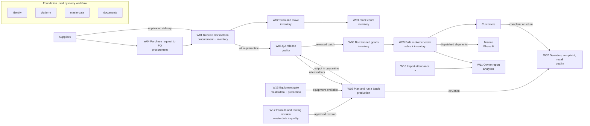
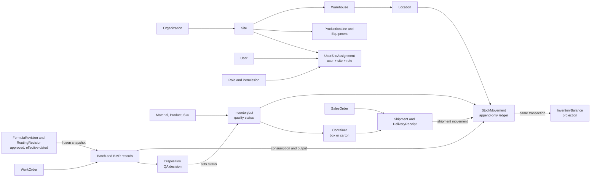

# Gate 0 report: Phase 0 discovery and architecture

| Field | Value |
|---|---|
| Prepared by | `principal-architect` for the Owner/Director of Bryel's Care Corporation |
| Date | 2026-10-23 |
| Status | Ready for owner review; nothing in this report is approved yet |
| Decision requested | Approve Gate 0 (G0) so Phase 1, Slice 1 can be planned and built (section 10) |
| Source of truth | `docs/source/master-brief.md` (the brief), `docs/decision-log.md` (ADRs) |

## 0. How to use this report

Sections 1 to 8 are the eight items the brief's "Final instruction" asks for before any code
(understanding, assumptions, workflow map, MVP and roadmap, stack, data and permission model,
risks, first slice). Each is a summary with pointers; the detailed documents are the reference.

| Gate 0 approves | Gate 0 does not approve |
|---|---|
| The direction: scope, MVP boundary, phase order, architecture and the ADRs listed in section 5 | Any code: **no product code exists yet**, by design |
| The brief's Phase 0 exit items: glossary (`docs/PRD.md` §12), workflows (`docs/process-maps.md`), roles/sites matrix (`docs/permissions-matrix.md`), MVP scope (`docs/PRD.md` §5), assumptions and risk register (`docs/PRD.md` §2.2, `docs/risk-register.md`), data migration plan (`docs/data-migration-plan.md`) | Formulas, tolerances, QA specifications, tax, payroll or regulatory rules: these stay configuration that Bryel's qualified reviewers enter and validate |
| The Slice 1 definition (section 8) | Later-gate ADRs (ADR-015 to 018) and the deferred ADR-022 |
| The visual direction (style tile, section 10) | Go-live: production deployment happens only after G9 (or after G4 if the early go-live option is chosen) |

How to answer: tick the checklist in section 10; for any question left unanswered the stated
default applies and becomes binding until changed (`docs/PRD.md` §13). Next steps: section 11.

## 1. Our understanding of Bryel's Care and what the system will do

Bryel's Care Corporation makes soap, lotions and other personal-care products ("Beauty and
Wellness From Nature") at more than one site. Today work runs on paper and spreadsheets: the
Batch Manufacturing Record (BMR) for Acapulco Soap is a printed form filled in by hand, with
an ingredient table (INCI name, lot, expiry, theoretical and actual weight, conducted by,
checked by), a seven-step checklist from weighing-area line clearance to transfer to
quarantine, and a QA disposition at the end (`docs/PRD.md` §2.1, facts F-01 to F-23).

The system is **one internal web application** used on the phones and tablets people already
carry on the floor and on office desktops. It replaces paper BMRs, stock cards, packing notes
and delivery receipts with records created by scanning and tapping, checked as they are
entered, and printed only where paper is still needed (`docs/PRD.md` §1).

| For | It means |
|---|---|
| Operators | Scan a lot, see whether it may be used, do one task in the fewest safe steps; mistakes caught at the scale, not at QA review |
| Supervisors and QA | Live boards, an approval queue, one recorded decision to release or hold, traceability from supplier lot to customer in seconds |
| Owners | One dashboard whose numbers reconcile to the transactions, with a definition behind every number; approvals from a phone |

What it is **not**: not a general ledger (ADR-020), not a validated regulated e-signature
system (sign-offs are attestations, A-PRD-14), not a payroll engine before qualified sign-off
(ADR-021), and not a source of legal, tax or cosmetics-regulatory rules (`docs/PRD.md` §5.3, §5.4).

## 2. Assumptions and unknowns

The team has not yet interviewed Bryel's staff: everything beyond the brief and the BMR photo
is an assumed default, configurable where it changes behaviour. Full registers: `docs/PRD.md`
§2.2, `docs/process-maps.md` §7.1, `docs/data-model.md` §14.1, `docs/permissions-matrix.md` §9,
`docs/data-migration-plan.md` §15 and the other documents' assumption sections.

### 2.1 Top assumptions needing confirmation

| Group | Default we will build | Ids | Who confirms |
|---|---|---|---|
| Locale | Philippines, Asia/Manila (per site), PHP, metric units g/kg/mL/L/pcs, dates `DD MMM YYYY`, English UI; quantities `numeric(18,6)` and money `numeric(18,4)`, weights shown to 0.1 g, printed totals rounded per template | ADR-019, A-PRD-01, A-PRD-22, A-PRD-29, A-DM-01 | Owner, QA |
| Sites, hardware, connectivity | 2 to 3 sites with at least one warehouse and line each (any number supported); sizing ≤60 users, ≤25 concurrent, ≤2,000 stock movements a day | A-PRD-02, A-PRD-12 | Owner |
| Sites, hardware, connectivity | Phone camera plus keyboard-wedge scanners; A4 and thermal label printers via browser print (50×30, 100×50 mm); scales read and typed; mostly Android, shared floor devices; Wi-Fi intermittent on the floor, MVP online-first, offline tasks in Phase 7 | A-PRD-05 to A-PRD-09, A-PROC-27 | IT, Production |
| Sites, hardware, connectivity | Role-based idle timeouts (12 h; 1 h for restricted permissions); TOTP for privileged roles from Phase 1b; Railway Pro plan in Singapore with separate staging and production projects | A-PRD-26, A-PRD-34, A-DEP-01 to A-DEP-03 | Owner, IT |
| Production and QA | Every received lot starts in quarantine until QA releases it (auto-release configurable per material class); FEFO when a lot has expiry, FIFO otherwise; finished-goods expiry = completion date + shelf life | A-PRD-15, A-PROC-10, A-PRD-16, A-PRD-28 | QA |
| Production and QA | No system default tolerance (each formula line carries one from the process owner); batch size = total theoretical input mass (17,600 g on the sample); conductor ≠ checker | A-PRD-18, A-DM-17, A-PROC-03, A-PRD-19, A-PRD-20, A-DM-06 | Production, QA |
| Production and QA | Lye solution and colourant-in-oil are intermediates with their own lots; example soap and lotion routes are fictional; optional curing hold; one output lot per batch; no `cancelled` batch state; overdue calibration blocks equipment | A-PRD-27, A-PRD-03, A-PROC-05, A-PROC-21, A-DM-24, A-DM-28 | Production, QA |
| Finance and payroll | The accountant's system stays the book of record; payroll is import-first and reporting-first; time-clock export is CSV or XLSX with employee id, timestamp, in/out | A-PRD-10, A-PRD-11, A-PRD-32, ADR-020, ADR-021 | Accountant, HR, IT |
| Finance and payroll | Placeholder approval limits (PHP 50,000 PO; 5,000 expense; 20,000 adjustment; 100,000 finance documents) are data; retention defaults per record class await advisers | A-PRD-21, A-PM-15, A-PRD-13 | Owner, Accountant |
| Data migration | Opening stock from a physical count, posted as opening receipts in quarantine and bulk-released by QA; paper BMRs scanned and indexed, not re-keyed; new numbers generated, legacy numbers kept | A-PRD-30, A-MIG-02, A-MIG-06, A-DM-09, A-PRD-04, A-MIG-03 | Owner, QA, Production |
| Data migration | One non-production day per site; all sites cut over the same day; backups RPO 24 h, RTO 4 h | A-MIG-09, A-MIG-10, A-MIG-13, A-PRD-33 | Owner, IT |

### 2.2 The ten blocking discovery questions (`docs/PRD.md` §9.1)

If unanswered, the default is used and becomes binding until changed.

| # | Ref | Question | Default if unanswered | Who answers |
|---|---|---|---|---|
| 1 | Q-A-01 | How many sites, warehouses, lines and storage locations; which roles need cross-site visibility? | A-PRD-02; cross-site only owner_director, system_admin, auditor | Owner |
| 2 | Q-A-02 | What connectivity exists on the floor, and which exact tasks must work offline? | A-PRD-09; offline candidates per `docs/offline-sync.md` §3 | IT, Production |
| 3 | Q-A-03 | Which phones, tablets, scanners, printers and scales; shared or assigned? | A-PRD-05 to A-PRD-08 | IT |
| 4 | Q-A-04 | Which accounting software and accountant workflow; is a general ledger wanted here? | Operational finance only, exports | Accountant, Owner |
| 5 | Q-A-05 | Should the system compute payroll or only import attendance and report? Who validates? | Import and report first | HR, Accountant, Owner |
| 6 | Q-A-06 | Can representative anonymised time-clock files be supplied now? | A-PRD-32 | HR, IT |
| 7 | Q-A-07 | Do customers or regulators require validated electronic signatures on batch records? | A-PRD-14 attestation plus paper hybrid | QA, Owner |
| 8 | Q-A-08 | Current lot and batch numbering rules; must existing numbers continue? | A-PRD-04 | Production, QA |
| 9 | Q-A-09 | Confirm country, timezone(s), currency, UI language | A-PRD-01 | Owner |
| 10 | Q-A-10 | Minimum viable go-live date, launch sequence, and the process causing the greatest loss today | Phases 1 to 4 in order; production/BMR is the biggest pain | Owner |

Configurable questions (Q-B-01 to Q-B-20) and questions that can wait (Q-C-01 to Q-C-10) are
in `docs/PRD.md` §9.2 and §9.3; workshop questions for production, warehouse, QA, HR and the
owner are in `docs/process-maps.md` §7.2.

### 2.3 Inputs the team cannot invent

| Input | Needed by | Why |
|---|---|---|
| Approved formula and tolerance sheets, routings, curing and yield basis (Q-PR-01 to Q-PR-12) | Phase 3 (workshop during Phase 2) | Batches cannot be released on fictional values (R-04) |
| QC test methods, specifications and shelf lives (Q-QA-01, Q-QA-04) | Phase 3 | Inspection plans and expiry are QA configuration |
| Site, warehouse, line and storage-area list (Q-A-01, Q-WH-05) | Slice 1 seed shape, Phase 2 locations | Site scope and location set-up |
| Current numbering conventions (Q-A-08) | Slice 1 numbering rules | Batch, lot, box and document numbers |
| Label and printer specifications, scanner and device models (Q-A-03, Q-B-10) | Phase 2 | Label templates and G2 acceptance on company hardware |
| Representative anonymised time-clock export files (Q-A-06) | Phase 5 | Attendance import mapping |
| Customer requirement documents: labels, carton counts, certificates, shelf life (Q-B-14, Q-MIG-11) | Phase 4 | Pack and ship rules per customer |
| Brand assets: logo files, official colours, typeface (A-UX-03) | Slice 1 design tokens | The green in the style tile is derived from the BMR logo |
| Tax configuration, accountant export layout, attendance and payroll policy | Phase 6 | Validated by the accountant and payroll reviewer, never invented |

## 3. Domain and workflow map

### 3.1 The twelve code modules (`docs/PRD.md` §4, `docs/architecture.md` §4)

| Module | What it holds | First phase |
|---|---|---|
| identity | Users, roles, permissions, sessions, site assignments | 1 |
| platform | Audit events, approvals, settings, numbering, jobs, notifications, files, imports | 1 |
| masterdata | Sites, warehouses, locations, lines, equipment, UOM, products, SKUs, materials, suppliers, customers, formulas, routings | 1 (basics), 3 (formulas, routings), 4 (customers) |
| inventory | Lots, ledger, balances, reservations, allocations, containers, counts, pack, label jobs | 2 |
| procurement | Goods receipts (Phase 2), purchase requests and orders, supplier returns (Phase 6) | 2, 6 |
| production | Work orders, batches, dispensing, process steps, equipment use, yield, deviations | 3 |
| quality | Inspections, results, holds, dispositions, complaints, genealogy; CAPA, recall cases, change control later | 2, 3, 4, 6 |
| documents | Templates, versions, generated PDFs and labels, reprints | 2, 3 |
| sales | Customers' orders, picks, shipments, delivery receipts, returns; portal later | 4, 8 |
| hr | Employees, attendance import and exceptions; shifts, leave, payroll support later | 5, 6 |
| finance | Invoices, bills, payments, credit notes, expenses, costing, accountant export | 6 |
| analytics | KPI definitions, dashboards, scheduled reports, forecasting governance | 5 |

### 3.2 The thirteen workflows (`docs/process-maps.md` §3)

| Workflow | What happens | Main roles | First phase |
|---|---|---|---|
| W01 Receiving a raw material | Receive, record supplier lot and expiry, label, quarantine | warehouse_operator, procurement | 2 (PO-linked from 6) |
| W02 Scanning and moving a lot or box | Scan, see status, move with FEFO hints | warehouse_operator | 2 |
| W03 Stock count | Blind or cycle count, approved variance posting | warehouse_operator, site_manager | 2 |
| W04 Purchase request to PO | Request, approve, order, expected receipt | procurement, site_manager, owner_director | 6 |
| W05 Planning and executing a batch | Work order, line clearance, weigh, process, yield, BMR | production_planner, production_operator | 3 |
| W06 QA release | Incoming, in-process and finished inspections; disposition | qa_qc | 2 (lots), 3 (batches) |
| W07 Deviation, complaint, recall | Deviations (3); complaints and recall explorer (4); CAPA and recall cases (6) | qa_qc, sales_cs | 3, 4, 6 |
| W08 Boxing finished goods | Box IDs, pack verification by a second person | warehouse_operator, production_operator | 3, 4 |
| W09 Fulfilling a customer order | Order, allocate, pick, pack, ship, delivery receipt | sales_cs, warehouse_operator, site_manager | 4 |
| W10 Importing attendance | Upload time-clock file, review exceptions | hr_payroll, site_manager | 5 |
| W11 Producing an owner report | Reconciled KPIs with drill-down | owner_director | 5 |
| W12 Formula or routing revision | Draft, two approvals, effective date | qa_qc, site_manager | 3 |
| W13 Equipment and calibration gate | Block overdue equipment, controlled override | production_operator, site_manager, qa_qc | 1 (register), 3 (gate) |

### 3.3 Overview

## 4. Proposed MVP and phased roadmap

### 4.1 Phases and gates (brief roadmap; `docs/PRD.md` §10, `docs/team-charter.md` Gates)

| Phase | In plain words | Gate | What the owner sees at the gate |
|---|---|---|---|
| 0 Discovery and process mapping | This document set | G0 | This report |
| 1 Foundation | Sign-in, sites, roles, audit log, master data basics, staging on Railway | G1 | Staging deployment, sign-in, site switching, role admin, audit log, shell on phone and desktop |
| 2 Inventory MVP | Receive, label, move, count; lot holds and release | G2 | Receive → label → move → count on a phone with the company's hardware |
| 3 Production + BMR | Formulas, routings, batches, weighing, QA release, BMR PDF | G3 | A representative soap batch in staging with a printed BMR reviewed by production and QA |
| 4 Packaging + fulfilment + CRM | Customers, orders, pick, pack, ship, delivery receipts | G4 | Order → pick → pack → ship with every box traceable |
| 5 Reporting + imports | Owner dashboards, scheduled reports, attendance import | G5 | KPIs reconcile; attendance file imports |
| 6 Procurement + HR/finance scope | Purchase orders, shifts and attendance rules, payroll support and/or accounting exports, CAPA, recall cases, change control | G6 | Qualified reviewers validate calculations and approvals |
| 7 Offline/PWA hardening | Installable app, approved offline tasks, sync conflicts | G7 | Offline acceptance on the company's phones and tablets |
| 8 Customer portal + payment | External ordering, payment provider, webhooks | G8 | Security review, sandbox payment tests |
| 9 Production readiness | Load and security tests, restore drill, training, migration rehearsal | G9 | Go-live checklist signed |

**MVP for go-live = Phases 1 to 4** (`docs/PRD.md` §5.1). It proves four flows: foundation;
receive → label → move → count; plan → weigh → produce → QA release → BMR; order → pick →
pack → ship. Phases 5 to 9 follow; Phase 9 always precedes the standard go-live.

### 4.2 Option: go live after G4

A production go-live straight after G4, before Phases 5 to 8, is possible (`docs/PRD.md` §10
item 7; Q-MIG-13; risk R-08, score 12). What it costs:

| Cost | Detail |
|---|---|
| Extra build in Phase 2 | Epic E-2-07 becomes Must: QA bulk disposition (M), label verification scan (S), command-line migration loader (L), opening-balance receipts and legacy document index (S); plus read-only maintenance mode US-2-30 (S) |
| Phase 9 work pulled before go-live | Penetration test and fixes US-9-02 (M, plus an external test budget, Q-RISK-02), restore drill US-9-03 (M), migration rehearsals US-9-06 (L), count-and-tag pilot and cutover US-9-07 (L) |
| Size | By the backlog's size bands (`docs/backlog.md` §1.3) roughly 30 to 50 working days of one backend plus one frontend engineer, moved earlier in the plan |
| Business workaround | Reporting, purchasing, attendance and payroll stay in spreadsheets until Phases 5 and 6 arrive |
| Unchanged | One non-production day per site for the count and load (A-MIG-09); QA must still release opening stock |

Default if you do not decide: no early go-live.

### 4.3 Deliberately later

| Item | When | Why it is not in the MVP |
|---|---|---|
| CAPA, recall cases, change control | Phase 6 | Go-live quality runs on deviations, holds, dispositions, complaints capture and the read-only recall explorer (forward and reverse trace); formula changes use revision approval in Phase 3 |
| Forecasting | Phase 6 or later, only if wanted (Q-C-05) | The brief requires descriptive analytics first; forecasts are labelled, never shown as actuals (`docs/analytics-kpis.md` §6) |
| Customer portal and online payments | Phase 8 | Outside the initial critical path (F-17); needs its own security review |
| Payroll computation | Phase 6+, after qualified sign-off | ADR-021 |
| General ledger | Not planned | ADR-020; would need a superseding ADR |
| Scale or instrument integration, ZPL printing, SMS | Not planned | `docs/PRD.md` §5.3 |

## 5. Recommended stack and architecture

### 5.1 Options weighed (`docs/architecture.md` §2)

| Option | Running cost | Complexity | Verdict |
|---|---|---|---|
| A. Modular monolith: one Next.js codebase as `web` + `worker`, one PostgreSQL, one file bucket | 2 compute services + database + bucket | Low: one repo, one schema, one deploy | **Recommended** (ADR-001) |
| B. Separate API server + single-page app + worker | 3 compute services + database + bucket | Medium; duplicated validation | Deferred; modules can move behind a standalone API later without schema change |
| C. Separate services per domain with a message broker | 6+ services | High: distributed stock and production postings, cross-service traceability | Rejected (brief: avoid premature microservices) |

In plain words: one application with strict internal walls between modules, one database that
holds the truth, one background worker for slow jobs, one private file store. The component map
is `docs/architecture.md` §3; the request and authorization pipeline is §5.

### 5.2 The stack

| Layer | Choice | ADR |
|---|---|---|
| Application | Next.js 15 App Router, React 19, TypeScript strict, pnpm | ADR-001, ADR-013 |
| Database | PostgreSQL 16 on Railway, the only transactional store | ADR-002 |
| Data access and migrations | Drizzle ORM, reviewed SQL migration files | ADR-003 |
| Sign-in | Self-hosted database sessions, argon2id, TOTP for privileged roles (Phase 1b) | ADR-004 |
| Authorization | `module.entity.action` permissions, site-scoped assignments, enforced in the service layer | ADR-005, ADR-011 |
| Records | Append-only ledgers, balances as projections; UUIDv7 keys plus readable numbers; `numeric` quantities and money | ADR-006, ADR-009, ADR-010 |
| UI | Tailwind CSS v4, in-repo components on Radix, Lucide icons, Recharts, Inter | ADR-007 |
| Validation | Zod schemas shared by API, forms and offline replay | ADR-008 |
| Tests and CI | Vitest on real PostgreSQL, Playwright (desktop and 360 px phone), GitHub Actions, lint-enforced module boundaries | ADR-012, ADR-013 |
| Hosting | Railway: `web`, `worker`, `backup` cron from one image; private S3-compatible bucket; staging and production | ADR-014 |
| Jobs | pg-boss (PostgreSQL-backed queue) | ADR-015 (G1) |
| PDFs | Code-defined renderers with versioned JSON templates, headless Chromium in the worker | ADR-016 (G2) |
| Barcodes | QR default, Code 128 configurable, camera and keyboard-wedge scanning | ADR-017 (G1) |
| Offline | PWA (Serwist) with an IndexedDB outbox of idempotent commands | ADR-018 (G6) |

Estimated Railway platform cost (to verify, `docs/deployment-railway.md` §13): staging about
USD 50 to 70 a month; production about USD 120 to 150 a month plus the USD 20 plan.

### 5.3 ADRs and when they are approved (`docs/decision-log.md`)

| Approve at | ADRs | Note |
|---|---|---|
| **G0 (now)** | ADR-001 to ADR-014, ADR-019, ADR-020, ADR-021, ADR-023 (18 records) | ADR-019 is a locale assumption; ADR-023 records the Phase 0 reconciliation rulings (Pack in inventory, audit naming, idempotency scope, device table, finance postings without a ledger, negative stock always blocked) |
| G1, before Phase 2 | ADR-015 jobs, ADR-017 barcodes | First used by Phase 2 stories |
| G2, before Phase 3 | ADR-016 PDF rendering | Renderer memory measured on Railway first |
| G6, before Phase 7 | ADR-018 offline | Idempotent API groundwork is built from Phase 2 regardless |
| Deferred | ADR-022 database row-level security | Evaluated at the end of Phase 2 |

## 6. Initial data model and permission model

### 6.1 Key entities (`docs/data-model.md` §2 ERDs, §3 catalogue)

| Area | Key entities |
|---|---|
| Organization and identity | Organization, Site, Department, Warehouse, Location, ProductionLine, Equipment, User, Role, Permission, UserSiteAssignment, Session, AuditEvent |
| Master data | Product, Sku, Uom, UomConversion, Material, Supplier, Customer, CustomerRequirement, Formula, FormulaRevision, BomLine, Routing, RoutingRevision, RoutingStep |
| Inventory | InventoryLot, StockMovement, InventoryBalance (projection), StockReservation, StockAllocation, StockCount, Container, ContainerContent, Pack, LabelJob |
| Production | WorkOrder, Batch, BatchMaterial, DispenseRecord, ProcessStepRecord, EquipmentUse, BatchOutput, YieldRecord, Deviation |
| Quality | InspectionPlan, Inspection, TestResult, QualityHold, Disposition, Complaint; later Capa, ChangeControl, RecallCase |
| Sales | Quote, SalesOrder, Pick, Shipment, DeliveryReceipt, CustomerReturn |

### 6.2 Ledger and traceability rules

| Rule | What it means (`docs/data-model.md`) |
|---|---|
| Stock is a diary, not a spreadsheet cell | Every receipt, move, consumption, output, adjustment, return and shipment is a new `stock_movements` row nobody edits or deletes (ADR-006, §5.1) |
| Corrections | A linked reversal plus a replacement, each with reason, actor and time |
| Balances | A projection updated in the same transaction, checked nightly against the ledger; posting locks affected rows in a fixed order (§5.2, §5.4, §5.6) |
| Negative stock | Impossible: a database constraint blocks it in every phase (ADR-023 item 6) |
| Retries | Every retryable command carries an idempotency key, unique per organization; a repeat returns the original result and posts nothing (§11.4) |
| Quality status | Belongs to the lot: quarantine, released, on_hold, rejected, expired, recalled. Available = on hand − reserved − allocated − quarantined − on_hold − expired − recalled; rejected stock is never promisable (§5.3, A-DM-23) |
| Batch snapshot | A batch freezes the approved formula and routing revisions it was created with; later revisions never change a historical BMR (§4.4, AC-13) |
| Traceability | Forward (supplier lot → batches → boxes → customers) and backward (box or complaint → batches → supplier lots) through one genealogy view (§10) |
| State machines | Every status change is an explicit transition (§6), e.g. batch draft → planned → materials_staged → in_process → awaiting_qc → quarantined → released, rejected or rework_approved → closed |

### 6.3 Roles and site scope (`docs/permissions-matrix.md` §1 to §5)

| Scope | Roles (code "display name") |
|---|---|
| Organization-wide (all sites) | owner_director "Owner/Director"; system_admin "System Administrator"; auditor "Auditor (read-only)" |
| Assigned sites | site_manager "Site Manager"; production_planner "Production Planner"; production_operator "Production Operator"; warehouse_operator "Warehouse Operator"; qa_qc "QA/QC" (quality cases organization-wide); procurement "Procurement"; sales_cs "Sales/Customer Service" (customers organization-wide); finance "Finance/Accounting"; hr_payroll "HR/Payroll" (`docs/permissions-matrix.md` §4.1 reads their records organization-wide; whether that means an assignment at every site is open for the security engineer to confirm in Slice 1) |
| Separate portal boundary (Phase 8) | customer_portal_user "Customer Portal User (future)": own customer's data only, no internal permission |

| Rule | In plain words |
|---|---|
| Site scope | A person holds a role **at a site**. Only owner_director, system_admin and auditor may be assigned to all sites. A record at a site you are not assigned to does not exist for you (404), in screens, the API and exports alike |
| Server enforcement | The server checks permission and site on every request; a hidden button is never the control |
| System administrator limits | system_admin cannot release quality, post money, approve payroll or see payroll data, so an administrator error cannot be confused with an operational decision |
| Separation of duties | Nobody approves what they submitted: dispense checker ≠ operator, disposition approver ≠ test-result enterer, pack checker ≠ packer, invoice poster ≠ approver above threshold (§5.1) |
| Thresholds are data | `approval_rules` decide who approves what above which amount; the defaults in §5.2 (A-PM-15) are placeholders for the owner to set |
| Controlled exceptions | Out-of-tolerance dispense, lot substitution, equipment override, over-shipment and batch reopen each need a named permission, a reason, a second person and an audit event; expired, recalled or rejected stock can never be issued through any flow (§5.3) |

## 7. Top risks (`docs/risk-register.md` §2)

52 risks are registered. These ten are in the Critical band (score 15 or more); the owner is
asked to acknowledge each mitigation and residual score at every gate.

| Rank | Risk | Score | Mitigation (where) | Early warning |
|---|---|---|---|---|
| 1 | R-12 Data migration quality: opening balances, missing expiry, duplicates, unlabelled stock | 16 | Count-and-tag, cleansing, two rehearsals with checks MC-01 to MC-16 (`docs/data-migration-plan.md` §7 to §13) | Rehearsal error rate above 2 % |
| 2 | R-40 Floor connectivity gaps while the MVP is online-first | 16 | Idempotent API from Phase 2, offline list, Wi-Fi survey before G2 (`docs/offline-sync.md` §3) | Network-failed postings above 2 % a day |
| 3 | R-39 Scanner, printer, scale or phone incompatibility | 16 | Camera plus keyboard-wedge scanning, G2 on company hardware, print tests (`docs/testing.md` §7, `docs/reports-and-templates.md` §12) | Hardware list missing at Phase 2 start |
| 4 | R-27 Shared-device sign-in friction leading to shared accounts | 16 | MFA only for privileged roles, role-based timeouts, quick-switch evaluation in Phase 1b (US-1-30) | A request for a generic "warehouse" login |
| 5 | R-04 Formula, tolerance and routing data not supplied | 16 | Tolerance mandatory per line with no default; go-live blocked without approved revisions (Q-PR-01 to Q-PR-12) | No approved revision 4 weeks before G3 |
| 6 | R-02 Scope creep after G0 | 16 | Out-of-scope list (`docs/PRD.md` §5.3), changes re-phased at gates | Over 10 % new stories inside a phase |
| 7 | R-03 Decision-gate delays | 16 | Defaults bind when unanswered; asynchronous gate packs | A blocking question open 2 weeks after G0 |
| 8 | R-11 Incorrect stock from concurrent scans, retries or replay | 15 | Append-only ledger, row locks, idempotency, concurrency tests (`docs/data-model.md` §5) | Any non-zero nightly reconciliation difference |
| 9 | R-26 Poor operator adoption | 15 | Operator mode, quick guides, G2 on real devices, training (`docs/ux-system.md` §7) | Under 80 % of movements by scan in week 2 |
| 10 | R-31 Regulatory validation not done before reliance | 15 | Configuration flagged for qualified review; reviewers named at G0; G9 checklist item | No named QA reviewer by G3 |

## 8. First implementation slice: Phase 1 Foundation, Slice 1

### 8.1 Scope and exclusions (`docs/PRD.md` §11.1, §11.2)

| In Slice 1 | Not in Slice 1 |
|---|---|
| Repository, tooling, CI that blocks merges on failure | Stock, lots, labels, scanning, printing (Phase 2) |
| Local and Railway staging environments, migrations at deploy | Formulas, routings, work orders, batches (Phase 3) |
| Design tokens, components, responsive shell, every page state, operator-mode entry | Customers, orders, shipments (Phase 4) |
| Sign-in, invitations, password reset, lockout, session list and revocation, idle and absolute expiry | Background jobs, email, import wizard, dashboards, offline (Phases 2, 5, 7) |
| Sites, roles seeded from the matrix, user admin, site assignments, site switcher | Warehouse, department or line sub-scopes (Phase 2) |
| AuthContext, scoped repositories, separation of duties, approval rules, setting change requests | MFA (Phase 1b), SSO or password-less sign-in |
| Append-only audit log with viewer | Real company data (seed is fictional and refuses production) |
| Master data basics: org structure, locations, lines and equipment register, UOM, products, SKUs, materials, reason codes, numbering rules, settings | Production deployment (project created in Phase 9) |
| Health and readiness endpoints, structured logs, diagnostics cards (Health, Backups, Variables) | |

### 8.2 The 33 Slice 1 tables (`docs/data-model.md` §13.6)

| Migration | Tables |
|---|---|
| `0000_extensions_and_functions` | none (extensions and helper functions) |
| `0001_identity_core` (17) | `organizations`, `sites`, `departments`, `warehouses`, `locations`, `production_lines`, `equipment`, `users`, `roles`, `permissions`, `role_permissions`, `user_site_assignments`, `sessions`, `password_reset_tokens`, `password_history`, `rate_limit_buckets`, `invitations` |
| `0002_platform_core` (10) | `settings`, `setting_change_requests`, `approval_rules`, `approval_decisions`, `numbering_rules`, `idempotency_keys`, `audit_events` (partitioned), `backup_runs`, `worker_heartbeats`, `metrics_samples` (partitioned) |
| `0003_master_data_basics` (6) | `uoms`, `uom_conversions`, `products`, `skus`, `materials`, `reason_codes` |
| `0004_grants` | none (database role grants) |
| `0005_mfa` (Phase 1b, after Slice 1) | `mfa_secrets` |

### 8.3 Acceptance tests S1-01 to S1-15 (`docs/PRD.md` §11.3; procedures `docs/testing.md` §9.15)

| Test | What must be true |
|---|---|
| S1-01 | A Site A warehouse operator asking for Site B locations by URL or API gets a denial, no Site B rows, and the denial is audited |
| S1-02 | The same user cannot create a location at Site B by changing the request body; nothing is written |
| S1-03 | The submitter of a setting change cannot approve it (separation of duties, audited); the owner or a second administrator can; a site manager can do neither |
| S1-04 | Seeded roles cannot be edited; a role assignment change is audited with before and after and takes effect on the next request |
| S1-05 | Revoking all of a user's sessions signs them out on every device and records who revoked |
| S1-06 | A deactivated user cannot sign in; the message is generic; the attempt is audited |
| S1-07 | On a 360 × 640 phone: no sideways scrolling, every control at least 44 px, primary action reachable |
| S1-08 | Health and readiness answer 200; with the database down, readiness answers 503 and health stays 200 |
| S1-09 | Migrations apply from an empty database in order; running again changes nothing |
| S1-10 | The seed refuses to run in production; elsewhere every name is fictional |
| S1-11 | The owner's site switcher lists every site; a single-site operator sees only Site A, or no switcher |
| S1-12 | A gram-to-millilitre conversion without a density is rejected; gram-to-kilogram saves |
| S1-13 | 20 concurrent receipt numbers are distinct and consecutive; a site-scoped rule must contain `{SITE}` |
| S1-14 | A session idle beyond its role's timeout must sign in again; an active session continues |
| S1-15 | Any failing CI check blocks the pull request; S1-01 to S1-03 are in the required set |

### 8.4 Slice 1 stories and estimates (`docs/backlog.md` §3)

Sizes: S = 1 to 2 days, M = 3 to 5 days, L = 6 to 10 days, for one backend plus one frontend
engineer including the whole definition of done (`docs/backlog.md` §1.3).

| Epic (`docs/backlog.md` §2) | Stories and sizes |
|---|---|
| E-1-01 Repository, tooling, CI | US-1-01 Repository skeleton and tooling (M); US-1-02 Test kit and CI pipeline (M) |
| E-1-03 Data foundation | US-1-03 Database connection, migration runner and Slice 1 migrations (L); US-1-04 Fictional seed data with production guard (M) |
| E-1-02 Environments and deployment | US-1-05 Dockerfile, entry points, health and readiness (M); US-1-06 First staging deployment on Railway (M) |
| E-1-07 Design system and shell | US-1-07 Design tokens and component primitives (L); US-1-08 Application shell, navigation and page states (L); US-1-09 Role-based home and operator mode entry (S) |
| E-1-04 Identity and sessions | US-1-10 Sign in, sign out, lockout and rate limiting (M); US-1-11 Invitation acceptance and password reset (M); US-1-12 Session listing, revocation, idle and absolute expiry (M) |
| E-1-05 Authorization framework and audit | US-1-13 AuthContext, authorize, scoped repositories and the command pipeline (L); US-1-14 Separation of duties, approval rules and setting change requests (M); US-1-15 Audit event writer and audit log viewer (M) |
| E-1-06 Administration | US-1-16 User administration (M); US-1-17 Roles and permission catalogue administration (M); US-1-18 Site assignments and site switcher (M); US-1-19 Settings registry and numbering rules (M) |
| E-1-08 Master data basics | US-1-20 Organization structure, locations, lines, equipment register (L); US-1-21 Units of measure and conversions (S); US-1-22 Products and SKUs (M); US-1-23 Materials (M); US-1-24 Reason codes (S) |
| E-1-09 Observability and diagnostics | US-1-25 Structured logging, correlation ids, error reporting, rate-limit store (S); US-1-26 Admin diagnostics: Health, Backups, Variables cards (S) |
| Gate 1 evidence | US-1-27 Gate 1 evidence pack, documentation sync and README (S) |
| E-1-10 Phase 1b hardening (Should) | US-1-28 TOTP for privileged roles (M); US-1-29 Custom roles by cloning (S); US-1-30 Shared-device quick-switch PIN evaluation, spike (S) |

Totals: Slice 1 (US-1-01 to US-1-27: 5 L, 16 M, 6 S) adds up to roughly 84 to 142 working
days of one engineer pair; Phase 1b adds 5 to 9. These are rough orders of magnitude; calendar
time depends on how many stories run in parallel and is set in the Slice 1 implementation plan.

### 8.5 Environment it needs (`docs/deployment-railway.md` §1, §4, §14)

| Item | Requirement |
|---|---|
| Railway | Pro plan workspace; project `bryels-care-staging` in Singapore; PostgreSQL 16; private bucket; services `web`, `worker`, `backup` from the GitHub repository |
| Database roles | `bc_migrate` (migrations), `bc_app` (runtime), `bc_readonly`, `bc_backup` |
| Variables | `DATABASE_URL`, `DATABASE_MIGRATION_URL`, `DATABASE_BACKUP_URL`, `SESSION_SECRET`, `CSRF_SECRET`, `FILE_URL_SECRET`, `DATA_ENCRYPTION_KEY`, `APP_ORIGIN`, `TRUSTED_PROXY_HEADER`, `S3_*`, `BACKUP_*`, `APP_ENV`, `LOG_LEVEL`, `MAINTENANCE_MODE` (full table `docs/deployment-railway.md` §4) |
| Also | Staging domain with TLS, error reporting, external uptime monitor, an operations contact and a backup key holder |
| Not yet | Production project (Phase 9; promotion workflow is a dry run only) |

### 8.6 Inputs needed from the company before Slice 1 starts (`docs/backlog.md` §7.1)

| Input | Default if not supplied |
|---|---|
| G0 approval of the ADRs in section 5.3 | None: Phase 1 cannot start |
| Site, warehouse and line list; cross-site roles (Q-A-01); locale (Q-A-09) | A-PRD-02, A-PRD-01 |
| Numbering conventions and whether legacy numbers continue (Q-A-08) | A-PRD-04 defaults, legacy kept in `legacy_number` |
| Devices and whether floor devices are shared (Q-A-03, Q-OFF-02) | Shared devices |
| Session timeouts and MFA roles (Q-B-16) | 12 h / 1 h idle; TOTP for restricted-permission holders |
| Railway plan, region, domain, operations contact, backup key holder | Pro plan, Singapore, two projects |
| Brand assets: logo, colours, typeface (A-UX-03) | Derived botanical green, Inter |

## 9. How Phase 0 was produced and checked

### 9.1 Team and reviews

| Step | What happened |
|---|---|
| Authoring | Fifteen specialised personas (`docs/team-charter.md`): architecture, product, manufacturing process, quality and regulatory, warehouse and procurement, database, backend, frontend, UX, QA testing, security, DevOps, analytics, HR/payroll, finance; each owns named documents, the principal architect is accountable for consistency |
| Review round one | Every document reviewed through four lenses: vocabulary and entities, coverage of the brief, data model versus processes and documents, hygiene and contradictions (268 distinct findings) |
| Review round two | Three further lenses on the reconciled set: roles and permissions, phases and scope, a recheck of round-one follow-ups plus hygiene (159 distinct findings) |
| Resolution | 427 findings resolved, followed by a final cleanup pass; where documents disagreed the principal architect ruled, with rulings that amend ADRs recorded in ADR-023 and the rest in the documents (for example `docs/data-model.md` §14.3) |

### 9.2 Mechanical checks (run 2026-10-23 on README and every `docs/*.md` and `docs/modules/*.md` file, this report included)

| Check | Result |
|---|---|
| Every Markdown table row has its header's cell count | Pass: no malformed rows |
| Assumption and question ids (`A-*-nn`, `Q-*-nn`) defined in exactly one place | Pass: 500 ids, no duplicate definitions |
| Names withdrawn by ADR-023 and the round-two rulings (old Pack, hold and stock-movement permission spellings, old invitation table name, two-segment audit names) | Pass: they appear only in the mapping tables that record their replacement |
| Mermaid labels quoted in this report | Pass |

### 9.3 What has not been done (do not overstate)

| Item | Status |
|---|---|
| Product code, migrations, tests | None exist; no command beyond the document checks above has been run |
| Interviews with Bryel's staff | Not yet held; as-is processes are inferred from the brief and the BMR photo (`docs/process-maps.md` §1.2) |
| Validation by Bryel's qualified reviewers | None: no formula, tolerance, QA, tax, payroll, retention or regulatory value has been confirmed |
| Railway capabilities and prices | Read from public pages, still to verify on the account (`docs/deployment-railway.md` §15) |
| Hardware | Unknown; nothing tested on company devices |

## 10. Decisions requested at Gate 0

Tick each item, or write the change next to it.

- [ ] Approve ADR-001 to ADR-014, ADR-019, ADR-020, ADR-021 and ADR-023 (`docs/decision-log.md`), noting ADR-015 and 017 come back at G1, ADR-016 at G2, ADR-018 at G6, and ADR-022 stays deferred.
- [ ] Confirm or amend the key assumptions in section 2.1, in particular locale (A-PRD-01), quarantine on receipt (A-PRD-15), mandatory tolerances (A-PRD-18), batch size basis (A-PRD-19), two-person verification (A-PRD-20), intermediates (A-PRD-27) and attestation rather than validated e-signature (A-PRD-14).
- [ ] Answer the ten blocking questions Q-A-01 to Q-A-10 (section 2.2), or accept the defaults.
- [ ] Accept the MVP boundary (Phases 1 to 4), including that go-live quality runs on deviations, holds, dispositions and the read-only recall explorer, while CAPA, recall cases and change control arrive in Phase 6.
- [ ] Decide whether forecasting is wanted at all (Q-C-05); if yes it is Phase 6 or later and always labelled as a forecast.
- [ ] Decide on early go-live after G4 (Q-MIG-13), accepting the costs in section 4.2; default is no.
- [ ] Acknowledge the ten Critical risks and their mitigations (section 7), and say whether any risk is formally accepted (Q-RISK-03).
- [ ] Name the qualified reviewers: production (formulas, routings), QA (quality rules, release), accountant (finance and tax), payroll (attendance and pay rules), IT (devices, printers, connectivity, time-clock exports).
- [ ] Supply the inputs: time-clock export sample, numbering conventions, label and printer specifications, site and line list, approved formula and tolerance sheets, customer requirement documents (and brand assets, section 2.3).
- [ ] Approve the visual direction: style tile `docs/design/style-tile.html`, published for review at https://claude.ai/artifact/CqnKbJhr9Z3X4yD4XjWJVd (tokens, shell, owner dashboard, operator scan screen).
- [ ] Decide finance scope (ADR-020) and payroll scope (ADR-021) no later than G5 (not blocking now).

## 11. What happens after approval

| Step | What happens |
|---|---|
| 1 Record the decisions | ADR statuses in `docs/decision-log.md` move to Accepted or are amended; answered questions and confirmed assumptions are marked in their registers |
| 2 Write the Slice 1 implementation plan | Story order, parallel tracks, dependencies and calendar for US-1-01 to US-1-27, reviewed by the architect, QA and security engineers |
| 3 Build test-first | The failing test comes first; a story is done only with data model, permissions, validation, page states, audit, tests, documentation, deployment notes and green CI (`docs/backlog.md` §1.5) |
| 4 Hold process-owner workshops in parallel | Production, warehouse, QA and HR questions (`docs/process-maps.md` §7.2) are answered during Phase 1 so Phases 2 and 3 do not wait |
| 5 Deliver the G1 evidence pack | Staging deployed from the checklist; S1-01 to S1-15 results with verbatim test output; permission tests in CI; the shell on a phone and a desktop; the quick-switch option paper (US-1-30); the standard report: completed, tested, not completed, known risks, commands run, migrations, environment variables, exact next steps |
