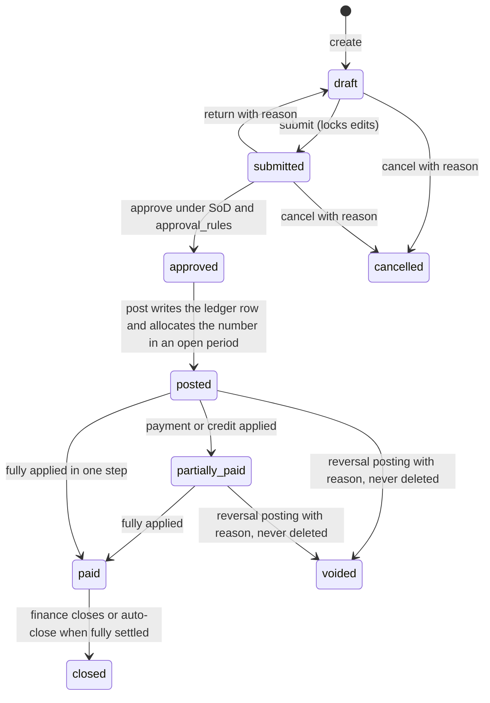
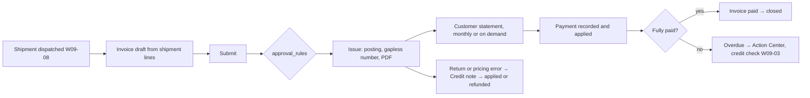
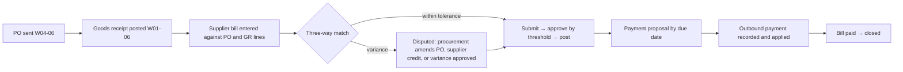
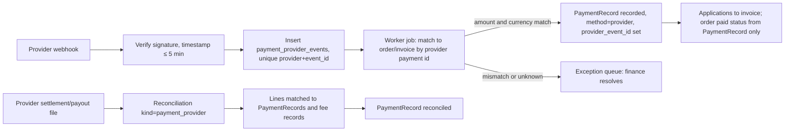

# Finance module: operational finance support (ADR-020)

Owner: finance-specialist. Reviewers: product-manager (accountable), analytics-specialist,
security-engineer, database-architect. Status: Phase 0 draft for Gate 0; build in Phase 6
(payment-provider reconciliation in Phase 8). Binding: ADR-006 (append-only postings),
ADR-009 (numbering), ADR-010 (`numeric`, `decimal.js`), ADR-019 (locale assumption),
ADR-020 (scope). Related: `docs/data-model.md` §2.9, §3.9, §5.7, §6.10, §9.2;
`docs/permissions-matrix.md` §2.10, §3.10, §5, §6; `docs/process-maps.md` W04, W09;
`docs/security.md` §2.10, §4.10, §4.11, §5, §7; `docs/PRD.md` FR-finance-01..09, A-PRD-10.

Plain-language summary for owners: this module bills customers, records what suppliers are
owed, tracks money in and out, approves staff expenses, works out what a batch really cost,
and hands clean, reconciled figures to your accountant. It is **not** an accounting system
and does not produce statutory financial statements; your accountant's system stays the
book of record unless you approve that larger scope later. Every posted figure is frozen;
mistakes are corrected by a linked reversal, never by editing.

## 1. Scope decision and phasing

### 1.1 Decision (ADR-020, FR-finance-01)

| Item | Decision |
|---|---|
| Scope | Operational finance support: receivables, payables, payments, credit notes, expense claims, costing, period locks, reconciliation imports, accountant export. |
| General ledger | Not built. `JournalEntry`/`JournalLine` are described (§2.9) but no migration creates them until the owners approve GL scope by a superseding ADR. `financial_postings.direction` is informational only. |
| Book of record | The accountant's external system (A-PRD-10, assumption). This module produces reconciled registers for it. |
| Non-negotiables regardless of scope | Posted/unposted states, immutable postings with linked reversals, period locks, separation of duties, audit history, idempotent commands, online-only posting (`docs/offline-sync.md`). |

Triggers that would reopen the GL decision (owners decide; new ADR required): the accountant
wants to retire the external system; owners want trial balance or statements from this
product; a bank or investor requires ledger-level audit inside the ERP.

### 1.2 Current accounting process (as-is)

Confirmed facts are few; the rest is assumption to be validated in the Phase 0 finance
interview (questions in §10.2).

| # | As-is statement | Status | Source |
|---|---|---|---|
| FF-01 | Processes are fragmented and largely manual; spreadsheets and paper hold operational data. | Fact | Brief; `docs/process-maps.md` F-01 |
| FF-02 | Delivery receipts are prepared by hand or spreadsheet; orders arrive by message or call. | Assumption | `docs/process-maps.md` A-PROC-02 |
| FF-03 | An external accountant keeps the books in their own software and receives figures by re-keying from spreadsheets and paper. | Assumption | A-PRD-10; PRD persona `finance` pain point |
| FF-04 | Invoicing is done after delivery from the DR; collections are tracked in a spreadsheet; supplier bills are paid from the owner's decisions. | Assumption | A-FIN-A1 (§10.1) |
| FF-05 | Batch cost is unknown today; prices are set from experience. | Assumption | PRD persona `finance` |
| FF-06 | Tax obligations (VAT, withholding, official receipt/invoice series) are handled by the accountant; the company does not know which document the system must produce to be "official". | Assumption | ADR-019, Q-A-04 |

### 1.3 Phasing

| Phase | Slice | Content | Priority (PRD) |
|---|---|---|---|
| 4 (interim) | Shipment export | Dispatched shipments exported to the accountant (A-PROC-24) until invoices exist. | Must (W09-10) |
| 6a | Receivables | Invoice from shipment, approval, posting, customer statement, payment recording and application, credit notes, period locks, accountant export of sales/receipts registers. | Must: FR-finance-02, 06, 07, 08 |
| 6b | Payables and expenses | Supplier bill with three-way match, approval thresholds, posting, payment proposal and recording, supplier credits, expense claims with approval limits, purchases/disbursements registers. | Must (bills), Should (expenses): FR-finance-02, 03 |
| 6c | Reconciliation and costing | Bank/cash statement import and matching, reconciliation report; costing runs (estimate vs actual), costing reports, cost KPIs. | Should: FR-finance-04, 05 |
| 8 | Provider reconciliation | `payment_provider_events`, webhook processing, explicit link to PaymentRecord, refunds. | Later: FR-finance-09 |
| Not scheduled | General ledger | Chart of accounts, balanced journals, trial balance. Only with a superseding ADR. | Out of scope (PRD §5.3) |

Gate G6 evidence for this module: accountant validates one full month of exported registers
against posted records; SoD, period-lock and cross-site negative tests pass in CI.

## 2. Entities and lifecycle

Tables are in `docs/data-model.md` §3.9; this section states the rules. Every state change
goes through `src/lib/state-machine.ts` and writes a `*_state_transitions` row. "Post" means
writing a `financial_postings` ledger row (append-only, `forbid_mutation()` trigger) inside
the same transaction as the document state change, with `Idempotency-Key`, `correlation_id`,
`accounting_period_id` resolved from the posting date, and an audit event.

### 2.1 Entity summary

| Entity (table) | Purpose | Number (rule code) | Posting type | Site scope |
|---|---|---|---|---|
| Invoice (`invoices`, `invoice_lines`) | What a customer owes for a dispatched shipment | `INV`, gapless | `invoice_issue` | fulfilment site |
| SupplierBill (`supplier_bills`, `supplier_bill_lines`) | What we owe a supplier for received goods, services or landed-cost charges | `BILL` (internal; supplier reference kept separately) | `bill_post` (fires at `posted`, not at approval) | receiving site |
| PaymentRecord (`payment_records`, `payment_applications`) | Money received (inbound) or paid (outbound), applied to one or more open documents | `PAY` | `payment` | site of first applied document; org-wide allowed |
| CreditNote (`credit_notes`) | Reduces a customer's receivable (return, pricing error, void of an invoice) | `CN` | `credit_note` | invoice's site |
| ExpenseClaim (`expense_claims`) | Employee spend to reimburse, with approval limits | `EXP` | `expense` | employee's site |
| CostingRun (`costing_runs`, `costing_run_lines`) | Estimate and actual cost per batch and SKU for a period | `COST` | none (no money moves) | site |
| Reconciliation (`reconciliations`, `reconciliation_lines`) | Matches a bank, cash or provider statement to payment records | `RCN` | none | site or org-wide |
| AccountingPeriod (`accounting_periods`) | Period lock control | period code `YYYY-MM` | none | org-wide |
| JournalEntry (`journal_entries`, `journal_lines`) | Only if GL approved | `JE` | `journal` | org-wide |

Rule codes, default patterns and sequence widths are defined in `docs/data-model.md` §9.2
(`JE` only if a GL is approved); §2.7 quotes the defaults.

### 2.2 Common lifecycle

Per-entity state names follow the data model (`docs/data-model.md` §3.9, §6.10): `issued`
for invoices, `recorded` for payments, `final` for costing runs; `submitted`/`approved`/
`posted` are explicit transitions, not inferred from the `approval` columns. §2.10 tracks the
remaining alignment items.

### 2.3 Per-entity states and guards

| Entity | States | Guards on `post` | Settlement | Reversal path |
|---|---|---|---|---|
| Invoice | `draft → submitted → approved → issued → partially_paid → paid → closed`; `draft|submitted → cancelled`; `issued|partially_paid → voided` | shipment `dispatched`; every line maps to a shipped `sales_order_line`; customer active; period open; tax configuration resolved; `finance.invoice.post` | `paid_amount` projection from `payment_applications` and applied credit notes | CreditNote for the open amount (full void sets `voided_by_credit_note_id`), or `reversal` posting if nothing applied yet |
| SupplierBill | `draft → submitted → approved → posted → partially_paid → paid → closed`; `draft|submitted → cancelled`; `posted|partially_paid → voided`; `submitted → disputed → submitted` | three-way match within tolerance or variance approved (§3.2); supplier active; period open; `finance.supplier_bill.post` | outbound `payment_applications` | `reversal` posting; a replacement bill references `reversal_of_id`'s document |
| PaymentRecord | `draft → recorded → reconciled`; `draft → cancelled`; `recorded → voided` | amount > 0; counterparty exactly one; applications ≤ amount; period open; above-threshold approval satisfied (§9); `finance.payment_record.post` | `reconciled` only through a Reconciliation line (§6.3, §7) | `reversal` posting; applications reversed in the same transaction; invoice/bill balances recomputed |
| CreditNote | `draft → submitted → approved → issued → applied`; `draft|submitted → cancelled`; `issued → voided` | references an `issued`/`partially_paid` invoice; amount ≤ invoice open amount unless `refund` flag; return-based notes require `customer_returns` approved; period open | `applied` when fully applied to the invoice or refunded by an outbound PaymentRecord | `reversal` posting |
| ExpenseClaim | `draft → submitted → approved → posted → paid`; `submitted → rejected`; `draft|submitted → cancelled` | approval steps satisfied; receipt attached above threshold (A-FIN-21); category active; period open | `paid` when `payment_record_id` is set by a posted outbound PaymentRecord | `reversal` posting before payment; after payment, reverse the payment first |
| CostingRun | `draft → final` | all batches in range are `closed` or explicitly excluded with reason; overhead pool for the period exists or run flagged `overhead_missing` | n/a | `final` is immutable; a correcting run sets `supersedes_run_id` with reason |
| Reconciliation | `open → in_progress → completed` | every statement line `matched`, `manual` or `unmatched` with note; difference explained | n/a | reopen with `finance.reconciliation.post` + reason (audit) |
| AccountingPeriod | `open → locked`; `locked → open` (unlock) | lock: no `submitted`/`approved` documents dated in the period remain, or they are moved with reason | n/a | unlock needs `finance.period_lock.void` with `finance` + `owner_director` (`approval_rules.document_type = period_lock_unlock`) |

### 2.4 Posting rules (all entities)

1. The command carries `Idempotency-Key`; a repeat returns the stored response (`docs/security.md` §4.10). The ledger row also stores the key with a partial unique index.
2. Locking order inside the transaction: the document row (`FOR UPDATE`), then `accounting_periods` (`FOR SHARE`), then `numbering_rules` last (`docs/data-model.md` §5.4).
3. Posting date = document date (issue date, bill date, paid-at date, claim approval date). It must fall in an `open` period; otherwise `409 PERIOD_LOCKED`. Backdating into a locked period is impossible by construction.
4. Gapless numbers are allocated only at posting, never at draft, so cancelled drafts leave no gap (`A-DM-05`, `docs/data-model.md` §9.1 and §14.1).
5. Projections updated in the same transaction: `invoices.paid_amount/status`, `supplier_bills.*`, `sales_orders.status` (`shipped → invoiced`), period totals used by exports.
6. Audit events (`module.entity.event`, `docs/data-model.md` §8.1; catalogue in `docs/security.md` §5): `finance.invoice.posted`, `finance.supplier_bill.posted`, `finance.payment_record.posted`, `finance.credit_note.posted`, `finance.expense_claim.posted`, each entity's `.reversed`, plus `platform.approval_rule.evaluated` with rule ids.
7. Amounts are `numeric(18,4)` in storage, `decimal.js` in code, displayed to 2 decimals (`A-DM-01`); line totals are computed from unrounded unit amounts; document totals are the sum of rounded lines (configurable to document-level rounding if the accountant requires it).

### 2.5 Reversal rules

| Rule | Detail |
|---|---|
| Never edit, never delete | Posted rows and their lines are immutable. UI offers "Reverse" and "Reverse and replace" only. |
| One reversal per posting | `reversal_of_id` has a partial unique index; a reversal cannot be reversed; a replacement is a new document linked by `replaces_document_id`. |
| Reason, actor, time | Reason code plus free text mandatory; `*.void` permission (restricted, re-auth within 10 minutes). |
| Period of the reversal | Same period if still open; otherwise the current open period, with the original period shown on both rows (A-FIN-24). |
| Cascade | Reversing a payment reverses its applications; reversing an invoice with applications is refused until the payments are unapplied or a credit note is used. |
| Downstream | Reversing an invoice moves the sales order from `invoiced` back to `shipped` with a transition row; stock is untouched (returns go through `customer_returns`). |

### 2.6 Period locks

| Rule | Detail |
|---|---|
| Period | Calendar month by default (A-FIN-02); 12 future periods created by the `finance.period_maintenance` job; the accountant can change the fiscal calendar in configuration. |
| Lock | `finance.period_lock.post` after the accountant export for the period is produced and acknowledged; emits `finance.accounting_period.locked`. |
| Effect | No posting, reversal, costing-run finalisation or payment application dated inside the period. Reads and exports still work. |
| Unlock | `finance.period_lock.void`, two approvers (`finance` and `owner_director`), reason, `finance.accounting_period.unlocked`; a re-export is required afterwards and the export run is marked `superseded`. |
| Pre-lock check | Lists documents dated in the period still in `submitted`/`approved`, payments `recorded` but unreconciled, unmatched reconciliation lines, costing runs in `draft`. Lock proceeds only when the list is empty or every item is acknowledged with reason. |

### 2.7 Numbering

| Document | Default pattern (`docs/data-model.md` §9.2; `{SEQ}` width from `sequence_width`; owner-configurable per site) | Gapless (`is_gapless`) |
|---|---|---|
| Invoice | `INV-{YYYY}-{SEQ}`, SEQ width 6, yearly reset; optional series per site/branch if the accountant requires a registered series (§10.2 Q-FIN-03) | yes (A-DM-05) |
| Supplier bill (internal) | `BILL-{YY}-{SEQ}`, SEQ width 5; supplier's own number in `supplier_reference` (unique per supplier to block duplicates) | no |
| Payment | `PAY-{YY}-{SEQ}`, SEQ width 6, with `direction` shown on documents (receipt vs disbursement) | no (A-FIN-05) |
| Credit note | `CN-{YYYY}-{SEQ}`, SEQ width 5 | no (A-FIN-05) |
| Expense claim | `EXP-{YY}-{SEQ}`, SEQ width 5 | no |
| Costing run, reconciliation | `COST-{YYMM}-{SEQ}`, `RCN-{YYMM}-{SEQ}`, SEQ width 2, monthly reset | no |

Only `INV` promises no gaps (A-DM-05): its number is allocated inside the posting transaction
and never previewed. Other types may show a gap after a failed posting, by design. If the
accountant requires gapless payment or credit-note series, `is_gapless` is switched on for
`PAY`/`CN` in `numbering_rules` (A-FIN-05); no code change is involved.

### 2.8 Validation catalogue (blocking)

| Code | Rule | Error |
|---|---|---|
| V-FIN-PERIOD | Posting date in an `open` period | `409 PERIOD_LOCKED` |
| V-FIN-SOD | Approver ≠ submitter; poster ≠ approver when the matched rule has `poster_may_equal_approver = false` | `409 SEPARATION_OF_DUTIES` |
| V-FIN-SRC | Invoice only from a `dispatched` shipment; credit note only from an issued invoice; bill lines with PO reference only against `posted` goods receipt lines | `422 SOURCE_NOT_POSTABLE` |
| V-FIN-MATCH | Three-way match outside tolerance without variance approval | `409 MATCH_VARIANCE` |
| V-FIN-APPLY | Sum of applications ≤ payment amount; application ≤ document open amount | `422 OVER_APPLICATION` |
| V-FIN-TAX | Every taxable line resolves to an effective-dated tax configuration row; no rate in code | `422 TAX_CONFIG_MISSING` |
| V-FIN-DUP | Same `supplier_reference` for one supplier; same shipment invoiced twice | `409 DUPLICATE_DOCUMENT` |
| V-FIN-SCOPE | Site of the document in `ctx.allowedSiteIds` (`finance` is org-wide) | `404 NOT_FOUND` |
| V-FIN-IDEMP | Same key, different body | `422 IDEMPOTENCY_KEY_REUSED` |

### 2.9 JournalEntry (dormant design, only if a GL is approved)

Chart of accounts (`accounts`: code, name, kind asset/liability/equity/income/expense,
active); `journal_entries` (number `JE`, period, status `posted|reversed`, `reversal_of_id`,
source document); `journal_lines` (account, debit, credit, site, counterparty) with
`CHECK (SUM(debit) = SUM(credit))` enforced per entry by a deferred constraint trigger.
Every `financial_postings` row would then generate exactly one journal entry through a
posting-rule table maintained by the accountant (document type × line kind → debit/credit
accounts). Trial balance and period close become reports. None of this is created without
the superseding ADR; `finance.journal_entry.*` permissions stay dormant.

### 2.10 Alignment with `docs/data-model.md`

Status as of `docs/data-model.md` §14.3 (row for this section). Applied items are listed so
the history stays traceable; only the pending rows still require data-model work.

| Table | Change | Why | Status |
|---|---|---|---|
| `invoices`, `credit_notes` | states `submitted`, `approved` | submit/approve are explicit transitions, not inferred from `approval` columns | applied (§3.9, §6.10) |
| `supplier_bills` | states `submitted`, `posted`, `disputed`; `bill_kind in ('bill','credit','charge')`; `replaces_document_id` | SoD needs approve ≠ post; supplier credits (W04-09) and landed-cost charge bills need a kind | applied (§3.9) |
| `payment_records` | states `draft`, `cancelled`; `recorded` is the "pending reconciliation" state | above-threshold payments need a pre-posting state; one name for the webhook-created state | applied (§3.9); `docs/permissions-matrix.md` §7 still says `pending_reconciliation` (§10.3) |
| `expense_claims` | state `posted`; `claim_kind in ('claim','request')` (A-FIN-22) | `finance.expense_claim.post` and posting type `expense` exist | applied (§3.9) |
| `financial_postings` | `bill_post` fires at `posted`, not at approval | posting happens at `posted` | applied (§3.9 `posting_type`) |
| `numbering_rules` | codes `BILL`, `CN`, `EXP`, `COST`, `RCN`; `is_gapless` on `INV` only (A-DM-05) | §2.7 | applied (§9.1, §9.2, §14.1) |
| `costing_runs` | add `supersedes_run_id`, `overhead_pool_id`, `labour_rate_set_id`; add basis `direct_cost_pct` | correcting runs; allocation method traceability | pending (arrives with the costing tables, §14.3) |
| `costing_run_lines` | add `good_output_qty_base`, `labour_hours`, `allocation_fallback bool`, `unit_cost_estimate_amount`, `unit_cost_actual_amount` | estimate and actual side by side | pending (§14.3) |
| new `tax_configurations` | §5 | no tax values in code | pending; listed in §13.7 |
| new `lot_cost_history` (ledger) | §4.3 | lot cost changes must be traceable | pending; listed in §13.7 |
| new `overhead_pools`, `labour_rates`, `standard_costs` (config) | §4 | allocation inputs are data | pending; listed in §13.7 |
| new `accountant_export_profiles`, `export_account_mappings`, `accountant_export_runs` | §6 | export layouts are configuration; runs are audited and reconcilable | pending; listed in §13.7 |
| new `refund_requests` (P8) | §7 | refund approval before provider call | pending; listed in §13.7 |

## 3. Receivables, payables and expense flows

### 3.1 Receivables (shipment → invoice → statement → payment → credit note)

| Step | Role (permission) | System action | Data | Validations | State | Document | Audit |
|---|---|---|---|---|---|---|---|
| R-01 | `sales_cs` or `finance` (`finance.invoice.create`) | Create invoice from a `dispatched` shipment: lines = shipped quantities × price snapshot from the sales order, customer bill-to, terms, tax configuration resolved per line | `Invoice`, `invoice_lines` (`sales_order_line_id`, `qty`, `unit_amount`, `tax_rate_pct`) | V-FIN-SRC, V-FIN-DUP, V-FIN-TAX | — → `draft` | — | — |
| R-02 | same (`finance.invoice.submit`) | Submit; edits locked; approval rule matched by total | `submitted_by/at` | V-FIN-SCOPE | `draft → submitted` | — | `platform.approval_rule.evaluated` |
| R-03 | `finance` ≠ submitter, `owner_director` above threshold (`finance.invoice.approve`) | Approve or return with reason | `approved_by/at` | V-FIN-SOD | `submitted → approved` | — | approval decision |
| R-04 | `finance` (`finance.invoice.post`, restricted) | Issue: ledger row `invoice_issue`, number, due date = issue date + customer terms (A-FIN-04), PDF job, sales order `shipped → invoiced` | `financial_postings`, `generated_documents` | V-FIN-PERIOD, V-FIN-SOD (poster rule), V-FIN-IDEMP | `approved → issued` | Invoice PDF (template `invoice`) | `finance.invoice.posted`, `documents.generated_document.generated` |
| R-05 | job `finance.statements` or `finance` (`finance.invoice.export`) | Statement of account: open items per customer, aging buckets, payments and credits in the period | `generated_documents` | masking: prices visible to statement roles only | — | Statement PDF/XLSX | `documents.generated_document.generated` |
| R-06 | `finance` (`finance.payment_record.create` then `.post`) | Record inbound payment (cash, bank transfer, cheque, e-wallet, provider), apply to invoices oldest-due-first by default (A-FIN-07), remainder stays unapplied on account | `PaymentRecord`, `payment_applications` | V-FIN-APPLY, V-FIN-PERIOD | `draft → recorded`; invoice `issued → partially_paid → paid` | Official receipt only if the accountant confirms the system issues it (Q-FIN-03) | `finance.payment_record.posted` |
| R-07 | `sales_cs` creates, `finance` approves/posts (`finance.credit_note.*`) | Credit note from a `customer_returns` approved record or a pricing reason code; apply to the invoice or mark for refund | `CreditNote` | V-FIN-SRC, amount ≤ open amount unless refund | `draft → … → issued → applied` | Credit note PDF | `finance.credit_note.posted` |
| R-08 | `finance` (`finance.invoice.void`) | Void an issued invoice: full credit note (preferred) or reversal when nothing is applied | `voided_by_credit_note_id` or `reversal` row | §2.5 | `issued → voided`; sales order `invoiced → shipped` | — | `finance.invoice.reversed` |
| R-09 | job `finance.overdue_scan` nightly | Flag overdue invoices, update customer open balance used by W09-03, notify `finance` and `sales_cs` | notifications | — | — | — | — |

Exception paths: partial shipment → one invoice per shipment (A-FIN-03), consolidated monthly
invoice per customer is a configuration option; customer short-pays → remainder stays open
and a reason is recorded on the application; overpayment → unapplied credit on account,
refund via outbound PaymentRecord with `finance.payment_record.post`.

### 3.2 Payables (goods receipt → supplier bill → payment)

| Step | Role (permission) | System action | Validations | State |
|---|---|---|---|---|
| P-01 | `procurement` or `finance` (`finance.supplier_bill.create`) | Enter the supplier's bill: supplier reference, dates, lines linked to PO lines and posted GR lines; attach the scanned bill; landed-cost charge lines (freight, duties, brokerage) flagged `charge_kind` | V-FIN-DUP (supplier reference), V-FIN-SRC | — → `draft` |
| P-02 | system | Three-way match per line: PO qty/price, GR qty, bill qty/price. Tolerances from configuration (A-FIN-08). Match result stored per line (`matched`, `qty_variance`, `price_variance`, `no_po`) | V-FIN-MATCH | — |
| P-03 | `procurement` (`procurement.purchase_order.approve`) or `finance` | Variance handling: PO amendment (W04-09), supplier credit (`bill_kind = credit`), or approve the variance with reason | V-FIN-SOD | `submitted ⇄ disputed` |
| P-04 | `finance` (`.submit`, `.approve` per `approval_rules`: `finance` ≤ 100,000, `owner_director` above, A-PM-15) | Submit and approve | V-FIN-SOD | `draft → submitted → approved` |
| P-05 | `finance` (`finance.supplier_bill.post`) | Post: ledger row, due date = bill date + supplier terms, landed-cost allocation to GR lines and lot cost history (§4.3) | V-FIN-PERIOD, V-FIN-IDEMP | `approved → posted` |
| P-06 | `finance` (`finance.payment_record.create`) | Payment proposal: bills due by date, supplier, discounts, withholding where configured; selected bills become one outbound PaymentRecord per supplier in `draft` | V-FIN-APPLY | PaymentRecord `draft` |
| P-07 | `finance` (`finance.payment_record.post`), `owner_director` approval above threshold | Record the payment after it is made in the bank; bank reference captured; applications posted | V-FIN-PERIOD | `draft → recorded`; bill `posted → partially_paid → paid` |
| P-08 | `finance` (`finance.supplier_bill.export`, `finance.payment_record.export`) | Purchases and disbursements registers to the accountant (§6) | export rules | — |

Bills without a PO (utilities, services, rent) are allowed for configured non-stock
categories and always need `finance` approval regardless of amount (A-FIN-09). The system
never sends money: bank payment happens outside, and the record is the evidence.

### 3.3 Expense claims with approval limits (FR-finance-03)

| Step | Role (permission) | Action | Rule |
|---|---|---|---|
| X-01 | any employee user (`finance.expense_claim.create`, `.submit`) | Create a claim: category (configuration), amount, date, description, receipt photo/PDF (mandatory above A-FIN-21), site; optional pre-spend `request` kind converted to a claim later (A-FIN-22) | self-service, own records only |
| X-02 | system | Match `approval_rules` for `expense_claim`: default `site_manager` ≤ 5,000; `site_manager` then `finance` above 5,000; escalation to `finance` after 72 h, `owner_director` above threshold (A-PM-15, placeholders) | `platform.approval_rule.evaluated` |
| X-03 | approver(s) (`finance.expense_claim.approve`) | Approve, reject with reason, or reduce amount with note | claimant can never approve own claim; direct supervisor may approve within threshold |
| X-04 | `finance` (`finance.expense_claim.post`) | Post: ledger row `expense`, claim becomes payable to the employee | V-FIN-PERIOD |
| X-05 | `finance` (`finance.payment_record.post`) | Outbound PaymentRecord with `employee_id` counterparty; `expense_claims.payment_record_id` set; may be batched per pay cycle and handed to HR as a payroll-adjacent export only if the accountant approves that route | `approved → posted → paid` |

Over-limit claims route to `owner_director` (FR-finance-03 acceptance). Employees see their
own claims and payslip-style history; `finance.expense_claim.view` is needed for others'.

### 3.4 Screens (desktop first; online-only)

| Screen | Primary tasks | Required states |
|---|---|---|
| Invoices list / detail | create from shipment, submit, approve, issue, void, print, statement | loading, empty ("No shipments awaiting invoice"), error, permission-denied, posted badge, voided badge |
| Supplier bills list / detail | enter bill, match panel (PO / GR / bill columns with variance highlighting), dispute, approve, post | same plus `disputed` badge |
| Payments | record receipt or disbursement, apply to open items, payment proposal | unapplied amount indicator, reconciled badge |
| Credit notes, Expense claims | drafting, approval queue, posting | approval-required badge; rejection reason shown |
| Reconciliation workspace | import statement, auto-match, manual match, complete | match counters, unmatched list |
| Costing | run list, run detail (batch lines estimate vs actual), SKU cost card | estimate/actual labels on every number; `allocation_fallback` warning |
| Period locks, tax configuration, export profiles | lock/unlock with pre-lock checklist, effective-dated rates with reviewer sign-off, column mappings | restricted actions need re-authentication (`docs/security.md` §3.6) |

Confirm dialogs for post/void follow component 5.16 in `docs/ux-system.md` §5 (typed confirmation for void).

## 4. Product and batch costing model (FR-finance-05)

Plain language: a batch cost is what the materials and packaging actually consumed cost, plus
the time people spent on it at a standard rate, plus a fair share of running costs, plus
what was wasted. We show the **estimate** (what the formula says it should cost) next to the
**actual** (what the posted records say it did cost) and never mix the two.

### 4.1 Cost elements

| Element | Estimate source (labelled `estimate`) | Actual source (labelled `actual`) | Notes |
|---|---|---|---|
| Materials | `bom_lines` (`ingredient`, `intermediate`) scaled to batch size × standard cost or last landed cost per material (A-FIN-12) | `production_postings` type `consumption` × lot unit cost at posting time (`lot_cost_history`) | intermediates carry the cost of their own batch (recursive, one level per run) |
| Packaging | `bom_lines` (`packaging`) × standard/last cost | packaging consumption posted at W05-15 × lot cost; damaged labels from `scrap_rework_records` | component reconciliation (A-PROC-19) explains differences |
| Direct labour | `routing_steps.expected_duration_minutes` × standard rate per step kind/line (`labour_rates`, A-FIN-14) | `process_step_records.started_at/completed_at` and `equipment_uses` durations × the same rate table | "where available": if no timed records, actual labour shows `not recorded`, never zero |
| Overhead | overhead pool for the period ÷ planned basis | overhead pool ÷ actual basis (§4.2) | pool entered by `finance` from the accountant's figures; flagged `estimate` until the accountant marks it actual |
| Scrap and rework | expected scrap % from formula (optional) | `scrap_rework_records` quantities valued at the batch's unit material cost; rework adds its extra consumption and time | absorbed into good units by default (A-FIN-15); `expense` option shows it separately |
| Yield variance | theoretical output from `formula_revisions.expected_yield_pct` or unit count (A-PROC-33) | `yield_records.variance_base` valued at the estimated unit cost (A-FIN-16) | shown as its own line so good-unit cost is explainable |
| Landed procurement cost | PO unit price + expected charges % (configurable) | supplier bill goods amount + allocated charge bills (freight, duties, brokerage) by line value (A-FIN-10) | updates `lot_cost_history`; prior finalised runs are not restated |

Unit cost (actual) = total actual cost ÷ good output quantity (`batch_outputs` kind
`finished`, less scrapped units). Unit cost (estimate) = total estimate ÷ theoretical output.
Both are stored per `costing_run_lines` row with `basis` and the method used.

### 4.2 Overhead allocation (configurable, default chosen)

| Basis (`overhead_allocation_basis`) | Allocation | When to use |
|---|---|---|
| `labour_hours` (**default**, A-FIN-13) | pool × batch hours ÷ total hours of batches in the period and site | step timing exists (Phase 3 records it) |
| `batch_count` (fallback) | pool ÷ number of batches | no timing for the batch; the line is flagged `allocation_fallback = true` |
| `output_qty` | pool × batch output (base units) ÷ total output | single product family with one base unit |
| `direct_cost_pct` (addition) | overhead = configured % × (materials + packaging + labour) | the accountant's preferred simple method |

The method and the pool used are printed on every costing report; changing the default is
`finance.costing_config.admin` (new permission, §10.3) with reviewer sign-off recorded.

### 4.3 Lot cost history (append-only)

`lot_cost_history(lot_id, basis estimate|actual, unit_cost_amount, currency, source_kind
goods_receipt|supplier_bill|landed_cost_allocation|batch_output|opening_balance|manual,
source_id, effective_at, posted_by, reason)`; `inventory_lots.unit_cost_amount` is the
projection of the latest row. Receipt sets an `estimate` from the PO price; bill posting
sets `actual`; manual rows need `finance.costing_config.admin` and a reason. Costing runs
read the row effective at consumption time, so a finalised run never changes.

### 4.4 Costing run design

| Step | Action |
|---|---|
| 1 | `finance` creates a run (`finance.costing_run.create`): site, period, method (`standard`, `actual`, `moving_average`), overhead basis, overhead pool, labour rate set. |
| 2 | Job `finance.costing.compute` builds one line per `closed` batch (and a per-SKU roll-up weighted by good output), both bases. Batches not closed are listed as excluded. |
| 3 | Finance reviews variances (estimate vs actual per element, per batch); recompute allowed while `draft`. |
| 4 | `finance.costing_run.post` → `final`; audit `finance.costing_run.posted`; `skus.standard_cost` may be updated from the run by a separate confirmed action (reason recorded). |
| 5 | Reports: batch cost sheet (elements, estimate vs actual, variance, method, pool), SKU cost trend, cost of goods shipped per invoice line (for margin KPIs, §8), landed-cost variance per PO line. All exports carry generated-at, method, and an `ESTIMATE`/`ACTUAL` column. |

Costing never posts money and is not in the accountant export unless they ask for a cost of
goods register (export profile option).

## 5. Tax configuration boundaries (FR-finance-06)

No tax rate, threshold, rule or form exists in code or seed data as a real value. Seed data
carries clearly fictional placeholders marked `FICTIONAL`. The accountant enters and signs
off every row; `finance.tax_config.admin` is restricted and records `reviewed_by`.

| Table / field | Content |
|---|---|
| `tax_configurations` | `code`, `kind in (vat_output, vat_input, withholding_receivable, withholding_payable, exempt, zero_rated, other)`, `rate_pct`, `inclusive bool`, `applies_to (sales, purchases, expenses)`, `counterparty_filter` (customer/supplier class), `rounding (line, document)`, `effective_from/to`, `reviewed_by`, `reviewed_at`, `review_note`; versioned (`ver` set) |
| `invoice_lines.tax_rate_pct`, `invoices.tax_configuration_ref` | snapshot of the resolved configuration at posting; later changes never alter posted documents |
| `supplier_bill_lines.tax_rate_pct`, `payment_records.withheld_amount` | input tax and withholding snapshots; withholding certificates handled by the accountant, the system only stores the amount and reference |
| `customers.tax_identifier`, `suppliers.tax_identifier` | sensitive fields (masking per `docs/permissions-matrix.md` §6) |

Boundaries: the system computes line tax from the effective configuration and shows it on
documents; it does not decide which rule applies to which customer, does not file returns,
and does not decide whether its invoice is the legally required document (Q-FIN-03).
Changing a rate emits `finance.tax_configuration.changed` with before/after and the reviewer.

## 6. Accountant export (FR-finance-08)

### 6.1 Canonical registers

| Register | One row per | Columns (canonical names) |
|---|---|---|
| `sales_register` | invoice line (plus a document-level summary file) | invoice_number, invoice_date, due_date, period, customer_code, customer_name, tax_identifier, sales_order_number, shipment_number, sku_code, description, qty, uom, unit_amount, line_amount, tax_code, tax_rate_pct, tax_amount, total_amount, currency, site_code, status, voided_by |
| `credit_note_register` | credit note | credit_note_number, date, period, customer_code, invoice_number, reason_code, amount, tax_amount, currency, status |
| `receipts_register` | payment application (inbound) | payment_number, paid_at, period, customer_code, method, reference, bank_reference, invoice_number, applied_amount, unapplied_amount, withheld_amount, currency, reconciled |
| `purchases_register` | supplier bill line | bill_number, supplier_reference, bill_date, due_date, period, supplier_code, tax_identifier, po_number, gr_number, material_code, description, qty, uom, unit_amount, line_amount, tax_code, tax_rate_pct, tax_amount, charge_kind, currency, site_code, status |
| `disbursements_register` | payment application (outbound) | payment_number, paid_at, period, counterparty_kind, counterparty_code, method, reference, bank_reference, bill_number or claim_number, applied_amount, withheld_amount, currency, reconciled |
| `expense_register` | expense claim | claim_number, employee_code (no personal data), category_code, date, amount, tax_amount, approved_by_role, posted_at, paid_at |
| `aging_receivables`, `aging_payables` | open document | counterparty, document_number, date, due_date, open_amount, bucket (current, 1-30, 31-60, 61-90, over_90) as at the export date |
| `period_summary` | posting type × tax code | period, posting_type, tax_code, document_count, net_amount, tax_amount, gross_amount, reversal_amount |
| `cost_of_goods_register` (optional) | invoice line | invoice_number, sku_code, qty, unit_cost_actual, unit_cost_estimate, cogs_amount, costing_run_number |

Formats: CSV (UTF-8 with BOM option, comma, RFC 4180 quoting, ISO dates, plain decimals, no
thousands separators) and XLSX (one sheet per register, string-typed cells for codes).
Formula-injection neutralisation per `docs/security.md` §4.7. Header block: generated-at,
generated-by role, period, site filter, profile version, record counts, control totals.

### 6.2 Adapter mapping

| Element | Rule |
|---|---|
| `accountant_export_profiles` | name, target system label, format, column mapping (canonical → target column name, order, format), date and number formats, encoding, `account_mapping_set_id`, version, `reviewed_by` (accountant) |
| `export_account_mappings` | target account code per (posting_type, tax_code, sku/material class, site); needed by systems that import journals or require account columns; unmapped combinations block the export with a list |
| Targets | profile templates seeded for a generic journal CSV and for the most common SME packages; the exact target column names are confirmed against the target system's current import template during Phase 6 with the accountant, never assumed |
| Idempotent runs | `accountant_export_runs(run_number, profile_id, period, filters, row_counts, control_totals, file_attachment_id, sha256, status generated|acknowledged|superseded, acknowledged_by)`; re-export of a locked period produces the same file hash unless an unlock happened |
| Permission | `finance.accountant_export.export` (restricted, re-auth); `platform.export.created` and `finance.accountant_export.created` audit events; files deleted after 30 days (A-SEC-30), the run record stays |

### 6.3 Reconciliation report (export ↔ posted records)

Produced with every run: for each register, count and sum of exported rows versus count and
sum of `financial_postings` in the period by posting type; reversals listed with originals;
any difference is a blocking error. Acceptance (FR-finance-08): the accountant can tie every
exported total to this report and to the on-screen register for the same filters.

## 7. Payment-provider reconciliation design (Phase 8, FR-finance-09)

Design rule (brief module 10): provider events are evidence, not postings. A webhook never
marks an order or invoice paid directly; a PaymentRecord is the posting, and the link between
event and posting is explicit.

| Aspect | Design |
|---|---|
| Adapter | `src/modules/finance/providers/<name>.ts` implementing `PaymentProviderAdapter { createCheckout, verifyWebhook, fetchPayment, createRefund, fetchPayout }`; PayMongo first (A-FIN-25); secrets per environment (`PAYMONGO_WEBHOOK_SECRET`, `PAYMONGO_SECRET_KEY`), sandbox and production never in one environment (`docs/security.md` §4.11) |
| Event ledger | `payment_provider_events` (append-only): `provider`, `event_id` (unique), `event_type`, `signature_verified`, `payload` (redacted of card data, never logged), `payment_record_id`, `processed_at`, `processing_result in (matched, created_payment, amount_mismatch, unknown_reference, duplicate, ignored)` |
| Idempotency | Provider event id is the key; duplicates are stored once and acknowledged; replay produces no second PaymentRecord; server-side `fetchPayment` confirms status before posting when the event is older than a configurable window |
| Posting | PaymentRecord `method = provider`, `status = recorded`, `provider_payment_id`, `provider_event_id`; applied to the invoice (or to the order's pro-forma when invoicing happens after payment, configurable); order status derives from the PaymentRecord |
| Mismatch | Amount or currency differs from the order/invoice → event stored, no PaymentRecord, exception queue item for `finance`; partial payments allowed only when the order's terms allow |
| Refunds | `refund_requests(order/invoice, credit_note_id, amount, reason, requested_by, approved_by, provider_refund_id, status requested|approved|sent|confirmed|failed)`; `finance.refund.approve` (restricted, SoD vs requester); the adapter call happens only after approval; the provider's refund event creates the outbound PaymentRecord linked to the credit note |
| Fees and payouts | Provider fees recorded as outbound PaymentRecords with counterparty = provider (supplier record) when the payout file arrives; `reconciliations.kind = payment_provider` matches payouts to the inbound records and fees; differences listed as unmatched |
| Reports | Provider reconciliation report per payout: gross collected, fees, net payout, matched/unmatched counts, events without PaymentRecord, PaymentRecords without events |
| Tests (G8) | `webhook.signature_invalid_rejected`, `webhook.replay_ignored`, `webhook.redirect_not_trusted`, `webhook.amount_mismatch_flagged`, `payments.refund_audit`, `payments.no_card_fields`, plus `finance.provider.event_without_posting` and `finance.provider.payout_reconciles` |

## 8. Finance KPIs (feeding `docs/analytics-kpis.md`)

All require `finance.cost.view` or the finance view permissions; owner overview shows them only
when the finance scope is approved (`docs/ux-system.md` 3.7). Every KPI drills down to the
documents behind it and shows refresh time and filters.

| KPI | Definition / calculation | Time basis | Source tables | Refresh | Labelled |
|---|---|---|---|---|---|
| Receivables outstanding | Σ open amount of `issued`/`partially_paid` invoices − unapplied inbound payments − unapplied credit notes | as at | `invoices`, `payment_applications`, `credit_notes` | on posting | actual |
| Receivables aging | open amount by bucket (current, 1-30, 31-60, 61-90, >90 days past due) | as at | same | nightly + on demand | actual |
| Overdue ratio | overdue open amount ÷ receivables outstanding | as at | same | nightly | actual |
| Days sales outstanding | receivables outstanding ÷ (invoiced amount last 90 days ÷ 90) | trailing 90 days | `invoices` | nightly | actual |
| Collections | Σ inbound applied amounts in period vs Σ invoiced in period | period | `payment_applications`, `invoices` | on posting | actual |
| Payables outstanding and aging | mirror of receivables for `posted`/`partially_paid` bills | as at | `supplier_bills`, `payment_applications` | nightly | actual |
| Days payable outstanding | payables outstanding ÷ (billed amount last 90 days ÷ 90) | trailing 90 days | `supplier_bills` | nightly | actual |
| Cash indicators | inbound − outbound posted payments per period; unreconciled payment count and oldest age; next 30 days due (bills, expenses) vs expected collections (invoices by due date) | period / forward 30 days | `payment_records`, `invoices`, `supplier_bills`, `expense_claims` | nightly | actual (forward view = estimate) |
| Gross margin by SKU / customer / invoice | (invoice line amount − qty × unit cost) ÷ line amount; unit cost from the latest `final` costing run (`actual`), else `estimate` with label | period | `invoice_lines`, `costing_run_lines` | after costing run | actual or estimate, never mixed in one figure |
| Batch cost variance | (actual − estimate) per element and total, per batch and per SKU | costing period | `costing_run_lines` | after costing run | both |
| Landed cost variance | bill actual landed unit cost − PO unit price, per PO line | period | `supplier_bill_lines`, `purchase_order_lines`, `lot_cost_history` | on bill posting | actual |
| Scrap and yield loss value | scrap qty × unit cost; yield variance value | costing period | `scrap_rework_records`, `yield_records`, `costing_run_lines` | after costing run | estimate-valued |
| Invoice cycle time | median hours from `shipments.dispatched_at` to `invoices.posted_at`; count of dispatched shipments not invoiced after N days | period | `shipments`, `invoices` | nightly | actual |
| Expense approvals | claims pending by age; approved amount by category; over-limit escalations | period | `expense_claims` | hourly | actual |
| Period close status | days since period end until lock; open items at lock | per period | `accounting_periods`, pre-lock checklist | on lock | actual |

Reconciliation (brief acceptance 21): each KPI has a SQL definition in `docs/analytics-kpis.md`
and a test that recomputes it from the posted ledger for a fixed fictional period.

## 9. Access restrictions and audit

| Control | Rule (source) |
|---|---|
| Roles | `finance` org-wide for all finance entities; `owner_director` views, approves above thresholds, exports; `sales_cs` drafts invoices and credit notes, views payments; `procurement` drafts bills; `site_manager` sees its site's invoices/bills without cost of goods; `auditor` views and exports; `system_admin` has no finance posting rights (`docs/permissions-matrix.md` §3.10, `docs/security.md` §2.11) |
| Separation of duties | submitter ≠ approver (mandatory); approver ≠ poster above the threshold (`poster_may_equal_approver`, A-PM-10); claimant never approves own claim; refund requester ≠ approver |
| Thresholds | `approval_rules` defaults: finance documents ≤ 100,000 `finance`, above `owner_director`; expense 5,000 split (A-PM-15, placeholders); payment records above threshold need `finance.payment_record.approve` (new permission, §10.3) before posting |
| Restricted actions | `*.post`, `*.void`, `period_lock.*`, `tax_config.admin`, `accountant_export.export`, `refund.approve`: TOTP (A-PRD-34) and re-authentication within 10 minutes (`docs/security.md` §3.6) |
| Sensitive fields | cost and margin (`finance.cost.view`), customer pricing and terms, supplier prices, tax identifiers, bank references: masked in the DTO layer, absent from pick/pack/DR documents, included only in finance exports (`docs/permissions-matrix.md` §6) |
| Site scope | every finance query is scoped by `ctx.allowedSiteIds`; org-wide payments carry `site_id NULL` and are visible to org-wide roles only |
| Offline | all finance commands are online-only; the outbox rejects them (`docs/offline-sync.md`) |
| Audit | every post/reverse/approve/lock/unlock/config change/export writes an audit event in the same transaction (`docs/security.md` §5, restricted class); `before/after` redacted for bank and tax identifiers; `platform.approval_rule.evaluated` records rule ids |
| Retention | finance records 10 years, archive after (A-SEC-26, placeholder until the accountant confirms) |
| Tests (CI, `tests/integration/authz/finance.*`) | cross-site url/body/query/export; role escalation per action; `sod.approve_own`; `sod.poster_equals_approver_above_threshold`; `threshold.rule_evaluation`; `idempotency.duplicate_key`; `period.locked_posting_rejected`; `reversal.immutable_original`; `reversal.cascade_payment_applications`; `invoice.only_from_dispatched_shipment`; `bill.three_way_match_variance`; `export.reconciles_to_ledger`; `costing.estimate_actual_separated`; `sensitive_fields.masked` |

## 10. Assumptions and questions

### 10.1 Assumptions (A-FIN-nn; all need owner or accountant confirmation; all configurable unless noted)

| Id | Assumption (default) | Configurable as | Confirm with |
|---|---|---|---|
| A-FIN-A1 | As-is: invoicing after delivery from the DR; collections and bills tracked in spreadsheets; accountant re-keys | n/a (discovery) | Owner, Accountant |
| A-FIN-01 | Scope is operational finance support; the accountant's system is the book of record (ADR-020, A-PRD-10) | ADR | Owner, Accountant |
| A-FIN-02 | Accounting periods are calendar months; fiscal year = calendar year | fiscal calendar | Accountant |
| A-FIN-03 | One invoice per dispatched shipment; consolidated monthly invoice per customer optional | per customer | Owner, Sales |
| A-FIN-04 | Posting date = document date; due date = date + counterparty terms days | per customer/supplier | Accountant |
| A-FIN-05 | Only invoice numbers are gapless per organization (`is_gapless`, A-DM-05); payment and credit-note numbers may show gaps after a failed posting unless the accountant asks for `is_gapless` on `PAY`/`CN`; optional invoice series per site | `numbering_rules` | Accountant |
| A-FIN-06 | Customer statements are open-item (list of unpaid documents), monthly and on demand | statement template | Accountant |
| A-FIN-07 | Payments apply to the oldest due invoice first; manual override allowed | setting | Finance |
| A-FIN-08 | Three-way match tolerance placeholders: quantity exact; price ±2 % or PHP 100 per line, whichever is larger | `settings` per site | Accountant, Procurement |
| A-FIN-09 | Bills without PO allowed for configured non-stock categories; always `finance` approval | category list | Accountant |
| A-FIN-10 | Landed-cost charges allocated to receipt lines by line value (alternatives: weight, quantity) | per charge bill | Accountant |
| A-FIN-11 | Lot cost = PO price (estimate) at receipt, replaced by actual at bill posting; finalised costing runs are not restated | `lot_cost_history` | Accountant |
| A-FIN-12 | Estimate cost basis = last landed cost per material (standard cost when configured) | `standard_costs` | Accountant |
| A-FIN-13 | Overhead basis default `labour_hours` with `batch_count` fallback; pool entered by finance per site per month, labelled estimate until marked actual | `costing_runs`, `overhead_pools` | Accountant (Q-C-07) |
| A-FIN-14 | Direct labour valued at standard hourly rates per step kind/line; never derived from payroll data | `labour_rates` | Accountant, HR |
| A-FIN-15 | Scrap absorbed into good-unit cost; rework adds its consumption and time | per run | Accountant |
| A-FIN-16 | Yield variance valued at the estimated unit cost | per run | Accountant |
| A-FIN-17 | Costing runs are per site per month; one `final` run per period, corrections supersede | per run | Finance |
| A-FIN-18 | Tax kinds `vat_output`, `vat_input`, `withholding_receivable`, `withholding_payable`, `exempt`, `zero_rated`, `other`; no rates shipped; seed values fictional | `tax_configurations` | Accountant |
| A-FIN-19 | Prices and bill lines stored tax-exclusive; inclusive pricing is a configuration flag | per tax configuration | Accountant |
| A-FIN-20 | Export formats CSV and XLSX; canonical registers in §6.1; target column names confirmed against the accountant's import template in Phase 6 | export profiles | Accountant |
| A-FIN-21 | Expense receipt attachment mandatory above PHP 500 (placeholder) | setting | Owner |
| A-FIN-22 | Expense claims are after-spend by default; pre-spend `request` kind optional | per claim | Owner |
| A-FIN-23 | Bank/cash statement import uses the Phase 5 import wizard (CSV/XLSX mapping, preview, errors); auto-match on amount + reference + date window ±3 days | mapping versions, window | Finance |
| A-FIN-24 | A reversal of a document in a locked period posts in the current open period with both periods shown | n/a | Accountant |
| A-FIN-25 | Payment provider: PayMongo first; PaymentRecord only from a verified webhook or server-side status query; fees recorded at payout | adapter | Owner (Q-C-03) |
| A-FIN-26 | Single currency PHP (ADR-019); `currency` columns exist but multi-currency documents are out of scope | n/a | Owner |
| A-FIN-27 | Credit check (W09-03) open balance = receivables outstanding per customer including unapplied payments and credit notes | n/a | Finance, Sales |
| A-FIN-28 | The system's invoice may not be the legally required tax document; until confirmed it is labelled "Billing invoice" on the template | template | Accountant |

### 10.2 Questions

For the owner:

| Id | Question | Blocks |
|---|---|---|
| Q-FIN-01 | Is operational finance support (no GL) the approved scope for Phase 6? Any wish to retire the accountant's system later? | ADR-020 acceptance |
| Q-FIN-02 | Who is the accountant (external firm or employee), what software do they use, and can they join a Phase 6 review of export layouts and tax configuration? | §5, §6 |
| Q-FIN-04 | Confirm thresholds: finance documents 100,000, expenses 5,000, PO 50,000 (A-PM-15); do they differ per site? | `approval_rules` |
| Q-FIN-05 | Who records supplier payments and customer receipts today, and from which bank accounts or e-wallets? | §3, reconciliation kinds |
| Q-FIN-06 | Do staff need pre-spend expense requests or only after-spend claims? Cash advances? | A-FIN-22 |
| Q-FIN-07 | Should site managers see batch costs and margins (currently yes by default)? | `finance.cost.view` |
| Q-FIN-08 | Is customer online payment (portal) wanted, with which methods? | Phase 8 |

For the accountant:

| Id | Question | Blocks |
|---|---|---|
| Q-FIN-03 | Which document is the official tax invoice/receipt: must the system print it, with a registered series, or does the accountant's system issue it? | invoice template, numbering, A-FIN-28 |
| Q-FIN-09 | Which taxes apply to sales, purchases and expenses (kinds, rates, inclusive/exclusive, rounding), by counterparty type? Who signs off the configuration? | `tax_configurations` |
| Q-FIN-10 | Withholding: is it withheld by customers from our receivables, by us from supplier payments, or both; how are certificates handled? | `withheld_amount`, registers |
| Q-FIN-11 | Fiscal calendar, period-lock timing and how the month-end handoff should work (file formats, cut-off, who acknowledges) | §2.6, §6 |
| Q-FIN-12 | Exact import layout of the accounting software (columns, account codes, date/number formats); may we see a sample import file? | `accountant_export_profiles` |
| Q-FIN-13 | Costing: preferred overhead method, source of the overhead pool, labour rate basis, standard cost or last cost for estimates, scrap treatment | §4 |
| Q-FIN-14 | Retention period for financial records and any legal-hold rules | A-SEC-26 |
| Q-FIN-15 | Will a cost of goods register be needed in the export, and on what basis? | §6.1 |

### 10.3 Permissions, entities and vocabulary that do not exist yet

| Kind | Item | Needed for |
|---|---|---|
| Permission | `finance.payment_record.approve` (S) | above-threshold payment approval before posting (approval rule exists, permission does not) |
| Permission | `finance.costing_config.admin` (R) | standard costs, labour rates, overhead pools, lot cost manual rows |
| Permission | `finance.accountant_export.admin` (R) | export profiles and account mappings |
| Permission | `finance.refund.create` (S, P8) | refund request before `finance.refund.approve` |
| Tables | `tax_configurations`, `lot_cost_history`, `overhead_pools`, `labour_rates`, `standard_costs`, `accountant_export_profiles`, `export_account_mappings`, `accountant_export_runs`, `refund_requests` | §4, §5, §6, §7 |
| Columns | pending rows of §2.10 (`costing_runs`, `costing_run_lines`) | estimate and actual side by side; correcting runs |
| Jobs (pg-boss) | `finance.period_maintenance`, `finance.statements`, `finance.overdue_scan`, `finance.costing.compute`, `finance.accountant_export`, `finance.provider.process_event` (P8) | §3, §4, §6, §7 |
| Glossary (`docs/PRD.md` §12) | Posting date, Period lock, Three-way match, Landed cost, Open item, Statement of account, Payment application, Costing run, Overhead pool, Provider event | shared vocabulary |
| Doc alignment | `docs/permissions-matrix.md` §7 "`pending_reconciliation`" → `recorded` | consistency |
