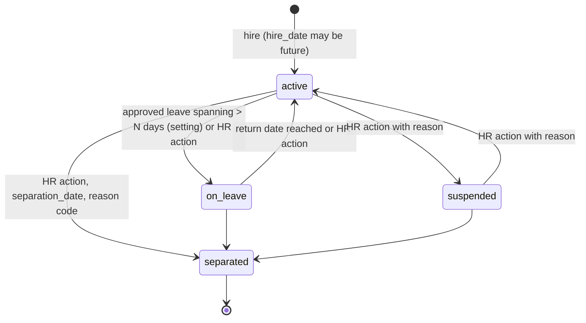
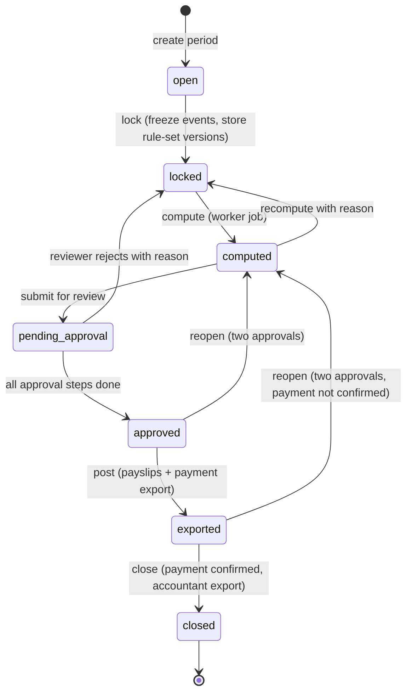

# HR, attendance and payroll module

Owner: hr-payroll-specialist. Accountable: product-manager. Consulted: security-engineer,
finance-specialist, database-architect. Status: Phase 0 draft for Gate 0.
Binding: ADR-005 (RBAC and separation of duties), ADR-006 (append-only postings), ADR-019
(locale defaults), ADR-021 (import-first, reporting-first payroll). Related documents:
`docs/process-maps.md` (W10 attendance import flow, Q-HR-01..06), `docs/data-model.md` §3.8
(HR tables) and §6.9 (payroll period state machine), `docs/permissions-matrix.md` §2.9, §3.9,
§5 and §6 (HR permissions, SoD, sensitive fields), `docs/security.md` §2.6, §5 and §7 (import
threats, audit catalogue, retention), `docs/ux-system.md` §9.9 (import wizard).

Plain-language summary for owners: the time-clock file is uploaded exactly as downloaded and
kept forever with its fingerprint. The system reads it through a saved column map, shows every
row with a verdict, and refuses to post anything it is unsure about until a person decides.
Fixes are added next to the original punch with the name of who asked and who approved; the
original is never edited. Hours are summarised for review under a named, dated rule set that HR
and the company's payroll reviewer have signed. Pay is not computed by the system until that
reviewer has validated the rules and the owner has switched computation on.

Vocabulary: roles, permission strings and entity names are those of `docs/permissions-matrix.md`
and `docs/data-model.md`. Terms, entities and permissions this document needs that do not yet
exist there are collected in §11.3 for the owning personas; they are marked **(new)** inline.

## 1. Scope by phase

| Phase | Delivered (done = data model, permissions, validation, states, audit, tests, docs) | Explicitly not delivered / gated | Gate evidence |
|---|---|---|---|
| 1 Foundation | `departments`, `sites.timezone`, roles `hr_payroll`, `site_manager`, `finance`; `approval_rules` document types `leave_request`, `payroll_period` (seeded inactive) | No HR screens | G1: permission tests include hr negative cases |
| 5 Reporting + imports | Employee directory and personal data (§2); `ImportMapping` profiles for attendance (§4.3); import wizard upload → map → preview → review → post (§4); exception queue and corrections with approval (§4.8–4.10); import rollback (§4.12); attendance import exception report; time summaries visible to `hr_payroll` only, labelled "computed under rule set vX, not for pay" (§7); employee list export | No shifts beyond a default shift per site; rule set is a single `draft` version with engineering-neutral mechanics (§5.2) so pairing and summaries work; no leave, no payroll | G5: attendance import validated against representative time-clock files (Q-HR-01); AC-19 |
| 6 Procurement + HR/finance | Shifts, shift assignments, holiday calendars, rest days (§3); attendance rule sets approved and validated by the company's reviewer (§5); leave and overtime workflows (§6); summaries shown to supervisors (own site/department); payroll configuration structures (§8.3) entered and validated; payroll period lifecycle up to `approved` running in staging with fictional data | Payroll computation stays **off** in production (`hr.payroll.computation_enabled = false`) until the qualified reviewer signs the rule sets and the owner enables it; payment export and payslips only after that | G6: reviewer validates calculations on a parallel run (§8.5); sensitive-access tests pass |
| 6+ (after sign-off) | Computation, payslips, payment export, corrections, accountant export (§8, §10) | Still no hard-coded statutory values; every rate is an effective-dated row with a validator | Parallel run reconciles to the company's current payroll for at least one full period (A-HR-20) |
| 7 Offline | Nothing. All HR screens are online-only; no employee, punch or pay data is cached on devices (`docs/offline-sync.md`) | — | — |
| 9 Readiness | Employee master migrated from spreadsheets (`docs/data-migration-plan.md`); historical attendance files optionally imported as history-only imports (`is_historical = true`, no exceptions raised, never used for pay) | Historical payroll is not migrated; the accountant's records remain the source | Migration rehearsal |

Out of scope for all phases unless the owner approves a new ADR: direct device integration
with the time-clock (the file is the interface, FR-platform-12 adapter only), shift
optimisation/rostering, recruitment, performance management, loans beyond a simple scheduled
deduction, and electronic filing with government agencies (the system produces extracts; the
reviewer files).

## 2. Employee master data

### 2.1 Field groups and sensitivity classes

| Group | Fields (`employees` unless noted) | Class | View | Edit |
|---|---|---|---|---|
| Directory | `employee_number`, `given_name`, `family_name`, `preferred_name`, `job_title`, `department_id`, `site_id`, `supervisor_id`, `employment_status`, photo (`file_attachments`, kind `employee_photo`) | N | `hr.employee.view` (every internal role at its sites) | `hr.employee.create/edit` |
| Employment | `employment_kind`, `hire_date`, `separation_date`, `time_clock_identifier`, time-clock aliases (§4.4), shift assignments, `user_id` link, cost centre code (text, finance configuration) | S | `hr.employee.view` for `hr_payroll`, `site_manager` (own site), `owner_director`, `auditor` | `hr.employee.edit` |
| Personal | `birth_date`, `personal_email`, `mobile_phone`, `address_line1`, `city`, emergency contacts (`employee_contacts` **(new)**: name, relationship, phone), civil/dependant data needed by tax configuration (codes only) | R, encrypted where `docs/data-model.md` §3.8 marks **S** | `hr.employee_personal_data.view`; the employee for own record (masked ids) | `hr.employee_personal_data.edit` |
| Government and bank | `government_ids_enc` (id type codes are configuration; `A-HR-02`), `bank_account_enc` (bank code, account last 4 shown, rest encrypted) | R, encrypted | as Personal, shown masked except last 4 (3 for government ids) | `hr.employee_personal_data.edit` + re-authentication |
| Compensation (Phase 6) | `EmployeeCompensation` **(new)** §8.3: pay basis, base rate, pay frequency, tax status code, effective dates | R | `hr.payroll_line.view` | `hr.payroll_rule.admin` + approval by a second user |
| Documents | `file_attachments` with `attachment_kind` in a configurable list (`contract`, `government_id_scan`, `medical`, `training_certificate`, `other`; `is_sensitive = true` by default) | R | `hr.employee_personal_data.view`; download audited and re-auth gated | `hr.employee_personal_data.edit` |

Validation: `employee_number` unique per organization and immutable after creation;
`time_clock_identifier` unique per organization among non-separated employees (reuse after
separation only through an alias with effective dates, §4.4); `supervisor_id` may not create a
cycle and may not point at the employee; `separation_date >= hire_date`; `department_id` must
belong to `site_id`; personal fields are never required to create the directory record
(operators can be registered for attendance before HR completes the file).

### 2.2 Link to user accounts

1. `employees.user_id` is optional and unique. Floor staff need an `Employee` row for
   attendance but not a `User`; external accountants are users without an employee row.
2. Self-service permissions (`hr.leave_request.create/void`, own payslip, own attendance) are
   resolved through this link: the service looks up the employee whose `user_id = ctx.userId`.
   No link → no self-service screens (empty state explains "ask HR to link your account").
3. Setting `employment_status = separated` in one transaction: sets `separation_date`, writes
   `hr.employee_updated`, and, if a user is linked, creates a notification for `system_admin`
   to deactivate the user; a setting `hr.employee.auto_deactivate_user_on_separation`
   (default **on**, A-HR-03) deactivates the user and revokes sessions in the same transaction.
4. Deactivating a user never changes employment status (the person may still be employed
   without system access).
5. Linking and unlinking is `hr.employee.edit` plus `identity.user.view`, audited with
   before/after user id.

### 2.3 Site, department and supervisor

| Concept | Rule |
|---|---|
| Primary site | `employees.site_id`; drives HR scope for `site_manager`, the default rule set and holiday calendar, and the default timezone of punches. A transfer edits `site_id` with reason; history is the audit trail (`hr.employee_updated` before/after). Payroll lines store the site in force at lock time. |
| Department | `departments(site_id)`; used by the department sub-scope (`docs/permissions-matrix.md` §4.4) so a supervisor approves only their department's leave, overtime and corrections. |
| Supervisor | `supervisor_id` → `employees`. Leave, overtime and correction requests route first to the supervisor's linked user if that user holds the approve permission at the site, else to any `site_manager` of the site, with escalation to `hr_payroll` after the configured delay (`approval_rules`, default 48 h, A-PM-15). |
| Multi-site workers | One primary site; punches from another site's device raise `site_mismatch` (§4.8) and are accepted only by explicit HR resolution. |

### 2.4 Job and skills

`job_title` is free text on the directory record. Skills are `Skill` **(new)** (code, name,
category, `requires_evidence`, `validity_months`) and `EmployeeSkill` **(new)** (employee,
skill, level code, `valid_from`, `valid_until`, evidence attachment, `verified_by`). They are
HR records only; using them to gate production steps (for example "only a qualified checker
may verify weighing") is an extension point for the production module and is **off** until the
process owner asks for it (A-HR-04).

### 2.5 Status lifecycle



| Transition | Permission | Side effects |
|---|---|---|
| any → `separated` | `hr.employee.edit` + re-authentication | user deactivation (§2.2.3); open leave/overtime/correction requests cancelled with reason; `time_clock_identifier` kept (history) but excluded from matching after `separation_date` + grace days (`hr.import.identifier_grace_days`, default 7); final-pay handling is a payroll correction line (§8.8), never automatic |
| `active` ↔ `on_leave` | automatic from approved `LeaveRequest` when `days >= hr.employee.on_leave_threshold_days` (default 5, A-HR-05) or manual | punches during `on_leave` raise `unscheduled` |
| `active` ↔ `suspended` | `hr.employee.edit`, reason mandatory | punches raise `unscheduled`; excluded from payroll computation unless the reviewer configures otherwise |

Employment kinds (`regular`, `probationary`, `contractual`, `casual`) are company
configuration (A-HR-06); the system attaches no legal meaning to them beyond selecting rule
set and pay component eligibility entered by HR.

## 3. Shifts, schedules, holiday calendars, rest days

### 3.1 Shift (`shifts`, master data, site-scoped, soft-deletable)

| Field | Meaning | Validation |
|---|---|---|
| `code`, `name` | e.g. `DAY-A`, "Day shift A" | unique per site |
| `start_time`, `end_time`, `crosses_midnight` | local times in the site timezone | `crosses_midnight` required when `end_time <= start_time` |
| `break_minutes` | unpaid break deducted when `break_mode = fixed_deduction` (§5.2) | ≥ 0 |
| `break_windows` **(new)** child rows | optional paid/unpaid break windows with start/end for `break_mode = punched` | inside the shift span |
| `window_before_minutes`, `window_after_minutes` **(new)** | how early an `in` / how late an `out` is still attributed to this shift | defaults from rule set `shift_window_*` |
| `is_default_for_site` **(new)** | used for employees without an assignment on a date | one per site |
| `status` | `active`, `inactive` | inactive shifts cannot be assigned from today |

Shift definitions are edited in place (not versioned) but assignments are effective-dated, so
a changed start time applies from the date HR says by creating a new shift code and a new
assignment; the rule-set evaluation stores `shift_id` and the start/end used on each daily
summary (§7.1), so later edits do not rewrite history. Editing times of a shift that has
summaries in a locked payroll period is blocked (create a new code instead).

### 3.2 Shift assignment (`shift_assignments`, effective-dated)

- `employee_id`, `shift_id`, `effective_from` (inclusive), `effective_to` (exclusive, null =
  open), `rest_weekdays int[]` **(new)** (0–6; overrides the rule set default),
  `pattern_code` **(new)** (optional rotating pattern, e.g. 4-on-2-off, defined in
  `shift_patterns` **(new)** as an ordered list of shift codes / rest markers with an anchor
  date), `status` **(new)** (`proposed`, `approved`, `retired`).
- GiST exclusion: no overlapping approved assignments per employee.
- `hr.shift_assignment.create` by `hr_payroll`, `site_manager` or `production_planner`
  creates `proposed`; `hr.shift_assignment.approve` (not the proposer when the proposer is not
  `hr_payroll`, A-HR-07) makes it `approved`. Changes that start in the past are allowed only
  up to the last locked payroll period; earlier dates are blocked (`V-STATE`).
- Resolution for a work date: approved assignment covering the date → its shift (or the
  pattern's shift for that day); none → the site default shift; none → "no schedule"
  (punches become `unscheduled`, summaries show scheduled minutes 0).

### 3.3 Holiday calendars

- `holiday_calendars` (site-optional, per `year`) and `holidays` (`holiday_date`, `name`,
  `holiday_kind`). `holiday_kind` values are a configurable list `hr.calendar.holiday_kinds`
  (seed: `kind_a`, `kind_b`, `company`; HR renames and the reviewer validates which kinds
  exist in the company's jurisdiction and policy; the system never ships legal holiday names
  or dates, A-HR-08).
- Resolution order on a work date: site calendar → organization calendar → none. A date may
  carry one holiday per calendar; when both site and organization list it, the site row wins.
- Edits: `hr.calendar.admin`; changing or deleting a holiday that falls inside a locked
  payroll period is blocked. Every change is audited (`hr.calendar_changed` **(new)**).
- Half-day or local (city/province) holidays are modelled as `holiday_kind` values with
  `applies_to_site_ids` on the calendar; the pay treatment is in the payroll rule set, not here.

### 3.4 Rest days

Rest days are resolved per employee and date in this order: approved leave (not a rest day,
it is leave) → shift assignment `rest_weekdays` → pattern rest marker → rule set
`default_rest_weekdays`. A punch on a rest day classifies worked minutes as class `rest_day`
(§5.3) and raises no exception unless `rest_day_work_requires_approval = true`.

### 3.5 Effective-dating rules (all of §3 and §5)

1. `effective_from` inclusive, `effective_to` exclusive, null = open-ended
   (`docs/data-model.md` §4.3).
2. The version in force for a **work date** is resolved in the site timezone and recorded on
   the daily summary; summaries are recomputed only when a new version becomes effective or a
   correction lands, never silently.
3. Nothing effective inside a payroll period in `locked` or later can change; the period stores
   the rule set version ids it used (`payroll_periods.attendance_rule_set_id`,
   `payroll_rule_set_id` **(new)**).

## 4. Attendance import mapping layer

Flow, actors and step table: `docs/process-maps.md` W10. This section specifies the design
behind those steps.

### 4.1 Import state machine (`attendance_imports.status`)

| From | To | Trigger / permission | Conditions |
|---|---|---|---|
| — | `uploaded` | `hr.attendance_import.create` | file type and size per `docs/security.md` §4.6 (csv, xlsx; `.xlsm` rejected; cap 20 MB, 100,000 rows); `checksum_sha256` computed while streaming; same checksum already `posted` → `V-DUP`, continue only as re-run with reason |
| `uploaded` | `parsed` | mapping chosen or created (`hr.attendance_import.create`), worker job `hr.attendance_import.parse` keyed by import id | mapping covers employee identifier and timestamp; sample of 20 rows parses |
| `uploaded` / `parsed` | `failed` **(new)** | parse error, cap exceeded, job timeout | row results so far discarded; nothing posted; the import can be re-parsed with another mapping version |
| `parsed` | `previewed` | worker finishes row evaluation (§4.4–4.8) | counters filled; preview available |
| `previewed` | `under_review` | `hr.attendance_import.submit` | the submitter has looked at the validation step (UI) |
| `under_review` | `approved` **(new)** | `hr.attendance_import.approve` | every row has a result other than `pending`; ambiguous rows are `dismissed`, `requested` or `resolved` (§4.8); `reviewed_by` set; SoD `reviewed_by <> uploaded_by` when `hr.import.require_second_reviewer = true` (default **off**, A-HR-09, because HR may be one person) |
| `approved` | `posted` | `hr.attendance_import.post` | idempotency key = import id; creates `attendance_events` in one transaction; generates the exception report |
| `under_review` / `approved` | `rejected` | `hr.attendance_import.void` with reason | file and rows kept; nothing posted |
| `posted` | `reversed` **(new)** | `hr.attendance_import.void` with reason (§4.12) | no event of the import inside a payroll period in `locked` or later, else blocked until `hr.payroll_period.void` reopens it |

Each transition writes `attendance_import_state_transitions` **(new)** (shape
`docs/data-model.md` §6.1) and the audit events of `docs/security.md` §5
(`hr.attendance_imported/approved/posted/reversed`).

### 4.2 Provenance retained on every import

| Item | Where | Note |
|---|---|---|
| Original file, byte for byte | `file_attachments` (bucket, data class restricted, `is_sensitive = true`) | never re-served inline; download via signed URL, audited `documents.downloaded` |
| Checksum, size, name, content type | `attendance_imports.checksum_sha256`, `file_attachments` | shown on the wizard and the exception report |
| Uploader and time | `uploaded_by`, `uploaded_at` | |
| Mapping version | `import_mapping_id` (a specific `import_mappings` version row) | mapping definitions are immutable once used |
| Every row as read | `attendance_import_rows.raw` (jsonb, untouched, including rows the mapping skips) | row cap A-SEC-18 |
| Parsed values and result | `parsed_identifier`, `parsed_at`, `parsed_kind`, `employee_id`, `result`, `error_message` | |
| Decisions | `corrected_by`, `corrected_at`, `correction_note`, `attendance_exceptions` rows | "never silently discarded" (FR-hr-03) |
| Outcome | `attendance_event_id` per row, counters, `reviewed_by/at`, `posted_by/at` | |

### 4.3 Mapping profiles (`import_mappings`, `import_kind = attendance`, versioned)

A profile describes one file layout (one time-clock model / firmware). Profiles are versioned
(`ver` set): a change creates a new version; imports point at the exact version; versions used
by a posted import cannot be edited or retired. Administered with `platform.imports.admin`
(`system_admin`) and `hr.attendance_import.create` (`hr_payroll` may create and edit drafts
but a profile version must be approved by a second user before use in production, A-HR-10).

`definition` (jsonb, Zod-validated, `schema_version: "attendance-mapping/v1"`):

```json
{
  "schema_version": "attendance-mapping/v1",
  "source": { "format": "csv|xlsx", "delimiter": ",", "encoding": "utf-8", "sheet": 0,
              "header_row": 1, "skip_rows_matching": ["^Total", "^$"] },
  "employee_identifier": { "column": "Emp No", "normalise": ["trim", "strip_leading_zeros", "upper"] },
  "timestamp": { "mode": "single|date_time_columns|excel_serial",
                 "column": "Date/Time", "date_column": null, "time_column": null,
                 "format": "yyyy-MM-dd HH:mm:ss", "timezone": "site|Asia/Manila",
                 "day_first": false },
  "direction": { "strategy": "column|alternate|shift_proximity|device",
                 "column": "Status", "value_map": { "C/In": "in", "C/Out": "out", "0": "in", "1": "out" },
                 "break_value_map": { "Break In": "break_start", "Break Out": "break_end" } },
  "device": { "column": "Device", "site_map": { "TC-01": "<site uuid>" }, "offset_minutes": { "TC-01": 0 } },
  "options": { "duplicate_window_seconds": 60, "pairing_window_minutes": 960 }
}
```

Validation of a profile: the identifier and timestamp blocks are mandatory; `format` must
parse all sample rows; `value_map` values must be `in|out|break_start|break_end`; `site_map`
sites must be in the organization. A profile is tested against a stored sample file (first
20 rows, personal identifiers masked in the preview for non-HR admins).

### 4.4 Employee identifier matching strategies (applied in order, first hit wins)

| # | Strategy | Source | Result |
|---|---|---|---|
| 1 | Exact match after normalisation | `employees.time_clock_identifier` of a non-separated employee (or separated within grace, §2.5) | `employee_id` set |
| 2 | Alias match | `employee_time_clock_aliases` **(new)**: `raw_identifier`, optional `device_code`, `employee_id`, `effective_from/to`, `created_by`, `source_import_id` | set; aliases are created when HR resolves an `unknown_employee` row with "remember for future files" (W10-04) |
| 3 | Employee number match | `employees.employee_number` equals the normalised value | set, result flagged `matched_by = employee_number` for review visibility |
| 4 | Suggestion only | fuzzy name column (if mapped) | **never auto-accepted**; shown as a suggestion in the exception row |
| — | No match | | row result `unknown_employee`; resolution options §4.8 |

A match to a `separated` employee outside grace, or to `suspended`/`on_leave`, yields
`inactive_employee` **(new row result)** rather than `accepted`.

### 4.5 Timestamp parsing and timezone

1. Parse with the profile's explicit `format`; no guessing. Two-digit years and ambiguous
   day/month orders are allowed only when `day_first` is set explicitly; rows that fail parse
   → `error` with the raw value in `error_message`.
2. Excel serial date-times (xlsx) are converted exactly (1900 system, numeric → seconds) and
   the original serial stays in `raw`.
3. The profile's `timezone` (default: the site timezone, ADR-019; `site` resolves through
   `device.site_map` then the employee's primary site) converts local time to `timestamptz`.
   The local wall-clock text is kept in `raw`; `parsed_at` is UTC.
4. Device clock drift: `device.offset_minutes` is applied as a declared transformation,
   visible on every row (`parsed_at` vs raw), never inferred. A change of offset is a new
   mapping version.
5. Timestamps more than `hr.import.max_future_minutes` (default 10) in the future or older
   than `hr.import.max_age_days` (default 400) → `out_of_range`.
6. The **work date** of a punch is derived by the rule set (§5.2 `work_date_rule`), not by the
   calendar date alone, so a night-shift `out` at 02:00 belongs to the previous day's shift.

### 4.6 In/out direction inference

| Strategy | How | Confidence | When low confidence |
|---|---|---|---|
| `column` | `value_map` on the mapped column | high | unmapped value → `error` |
| `device` | device code → direction (entrance/exit terminals) | high | unknown device → `error` |
| `shift_proximity` | punch nearest to the resolved shift start within `window_before` → `in`; nearest to shift end within `window_after` → `out`; punches between → break pairs if `break_mode = punched` | medium | no shift resolved → fall back to `alternate` and flag `direction_inferred` |
| `alternate` | per employee and work date, punches sorted by time alternate in/out starting with `in` (A-PROC-39) | low | odd count → last punch `missing_out`; two punches closer than `min_pair_minutes` (default 1) → `duplicate` |

Inferred direction is stored in `parsed_kind` with `direction_inferred = true` **(new
column)** so the exception report and the summary show it.

### 4.7 Duplicate detection

Within the file and against already-posted `attendance_events` with status `active`:
same employee, same `event_kind`, `occurred_at` within `duplicate_window_seconds` (profile
option, default 60, A-HR-11) → `duplicate`. The unique index `(employee_id, occurred_at,
event_kind)` is the last line of defence at posting. Overlapping downloads (the same punch in
two files) therefore never double-post (W10 exception path). HR may resolve a duplicate as
"legitimate second punch" with a note, which posts it with `source = import` and the note
in `correction_note`.

### 4.8 Exception catalogue

Row-level results live on `attendance_import_rows.result`; employee/day exceptions live in
`attendance_exceptions` (`exception_kind`, `work_date`) and are also raised by the daily
evaluation (§5.3) after posting. Statuses: `open → requested → approved | dismissed` and
`open → resolved` (`requested` is **new**; the other values exist).

| Exception | Detected | Row result | Exception kind | Resolution options (who) | Posts? |
|---|---|---|---|---|---|
| Duplicate punch | §4.7 | `duplicate` | `duplicate` | confirm duplicate (`resolved`, not posted) or "legitimate" with note (`hr_payroll`) | only if legitimate |
| Unknown employee | §4.4 no match | `unknown_employee` | — (no employee) | map to employee ± save alias; or dismiss with reason (`hr_payroll`). Bulk map is allowed only for the **same raw identifier** (A-PROC-17) | after mapping |
| Inactive employee | match to separated/suspended/on_leave | `inactive_employee` **(new)** | `unscheduled` | accept with note (e.g. return from leave not yet recorded) or dismiss | after acceptance |
| Missing punch | unpaired `in` or `out` per pairing | `missing_punch` | `missing_in` / `missing_out` | request correction (supervisor proposes time + reason + optional evidence) → HR approves (§4.10); or dismiss (no hours credited) | the existing punch posts; the missing one only as an approved correction event |
| Out of sequence | `in` after `in`, `out` before any `in`, break punches outside an open pair | `out_of_sequence` **(new)** | `out_of_sequence` **(new)** | HR re-classifies direction with note, or requests correction, or dismisses | after re-classification |
| Outside shift window | punch beyond `window_before/after` of the resolved shift, or on a day with no schedule | `accepted` (the punch is real) | `unscheduled` or `outside_shift_window` **(new)** | supervisor confirms work (becomes rest-day/unscheduled work class) or marks as not worked; HR approves | yes; classification pending |
| Device / site mismatch | device's site ≠ employee primary site | `site_mismatch` **(new)** | `site_mismatch` **(new)** | HR accepts for that date (temporary assignment note) or dismisses | after acceptance |
| Invalid timestamp / value | §4.5 | `error` | — | fix mapping version and re-parse, or dismiss | no |
| Outside period / age | §4.5.5 | `out_of_range` | — | dismiss or accept with reason | after acceptance |
| Late / undertime / absent / unapproved overtime | §5.3 after posting | — | `late`, `undertime`, `absent`, `overtime_unapproved` | supervisor annotates or requests correction / overtime approval (§6.2); HR closes | n/a (summary) |

Rules: no bulk "accept all" exists for `unknown_employee`, `missing_punch`, `out_of_sequence`
and `site_mismatch`; every resolution stores `resolved_by`, `resolved_at`,
`resolution_note`; the resolver cannot be the employee concerned (`V-SOD` by user → employee
link); dismissing a row never deletes it.

### 4.9 Preview, review and posting

1. Preview (`previewed`): the wizard shows counters (`rows_total`, `rows_accepted`,
   `rows_duplicate`, `rows_unknown_employee`, `rows_missing_punch`, `rows_error`, plus
   `rows_out_of_sequence`, `rows_site_mismatch`, `rows_inactive_employee` **(new counters)**)
   and a filterable table with the raw row, parsed values, employee, verdict and reason.
2. Review (`under_review`): HR works the exception list (§4.8). Each change writes
   `hr.attendance_exception_resolved` **(new audit event)**.
3. Approve (`approved`): the approver sees the final totals and a list of rows that will **not**
   post (with reasons). This list is the body of the exception report.
4. Post (`posted`): in one transaction, with idempotency key = import id: insert
   `attendance_events` (`source = import`, `attendance_import_row_id`, `status = active`) for
   rows in `accepted` or resolved-to-post results; set `attendance_event_id` on each row; set
   counters; write `hr.attendance_posted`; enqueue daily evaluation for every affected
   employee/work date (§5.3) and generation of the exception report (`documents.generated`).
5. Rows still `requested` at post time stay open as exceptions; the correction, when approved,
   posts its own event and marks the row `corrected`.

### 4.10 Corrections (appended, never edited)

1. A correction starts from an exception (`missing_in`, `missing_out`, `out_of_sequence`,
   wrong time) or from a supervisor's own request on a day without exception.
2. Requester: `site_manager` (own site, department sub-scope) or `hr_payroll` with
   `hr.attendance_event.edit`. Captured on the exception row: `proposed_occurred_at`,
   `proposed_event_kind`, `requested_by`, `request_reason`, `evidence_attachment_id`
   **(new columns)**. Status `open → requested`. Deadline `correction_deadline_days` (§5.2).
3. Approver: `hr.attendance_event.approve`; must differ from the requester and must not be the
   employee concerned (`V-SOD`, mandatory). Evidence is mandatory when the proposed time
   differs from the shift boundary by more than `max_correction_minutes_without_evidence`.
4. Approval appends one `attendance_events` row: `source = correction` (or `manual` when no
   original exists), `corrects_event_id` (original → `status = superseded`), `approved_by`,
   `correction_reason`; exception → `approved`; audit `hr.attendance_corrected` then
   `hr.correction_approved` with before/after times.
5. Rejection → `dismissed` with reason; the requester is notified; a new request may be filed.
6. Corrections inside a payroll period in `locked` or later are blocked (`V-STATE`) until the
   period is reopened (§8.8) or are routed to the next period as a dated adjustment.

### 4.11 Historical and re-run imports

`is_historical = true` **(new)** imports (migration, Phase 9) post events with
`source = import`, raise no exceptions, and are excluded from summaries shown for pay. A re-run
of the same file (same checksum) requires a reason, links to the earlier import
(`rerun_of_import_id` **(new)**) and relies on duplicate detection to post only what is missing.

### 4.12 Rollback of a posted import

1. `hr.attendance_import.void` on a `posted` import with reason code (`reversal`) and note.
2. Blocked when any event of the import falls in a payroll period `locked` or later (409
   `state`); the message names the period; reopening needs `hr.payroll_period.void` (§8.8).
3. In one transaction: every event created by the import (and any correction event that
   `corrects_event_id` one of them) is set `status = voided` with `voided_by`, `voided_at`,
   `void_reason` **(new columns)**; superseded originals are **not** restored; exceptions of
   those rows go `dismissed` with the rollback reference; import → `reversed`; audit
   `hr.attendance_reversed` listing the event ids; summaries recomputed.
4. The original file, rows, results and the previous exception report stay. Voided events are
   ignored by duplicate detection so a corrected re-import can post them again.

## 5. Attendance rule catalogue (effective-dated configuration)

### 5.1 Rule sets

- `attendance_rule_sets` (`ver` set, site-optional) hold `attendance_rule_values` keyed by the
  catalogue below. One approved version per site per date; an organization-wide version is the
  fallback. Resolution for a work date: site version → organization version → none (summaries
  cannot be computed; the import still posts).
- Lifecycle `draft → pending_approval → approved → retired` (`docs/data-model.md` §4.2).
  Draft by `hr.payroll_rule.admin`; approval by `hr.attendance_rule.approve` (referenced by
  the data model; **missing from the permission catalogue**, §11.3) held by a user other than
  the submitter; in addition `validated_by`, `validated_at`, `validation_note` **(new
  columns)** record the company's qualified reviewer's sign-off. A version without validation
  may be approved for **preview** use (summaries labelled "unvalidated") but a payroll period
  cannot lock against it.
- Keys are typed; a version is complete only when every key marked "required" has a value.
  Values are never defaulted from code at evaluation time: a missing required value fails the
  evaluation with a visible error, never a silent zero.
- Every value change is a new version; `hr.payroll_rule_changed` records the diff.

### 5.2 Catalogue (`rule_key` → type; shipped default; who validates)

"none" means the key must be entered before the version can be approved. Mechanics defaults
are engineering-neutral; policy values are deliberately blank (the system does not know the
company's policy or the law). Validator: HR = company HR; REV = qualified payroll/accounting
reviewer.

| Group | `rule_key` | Type | Meaning | Default | Validator |
|---|---|---|---|---|---|
| Time | `timezone` | text | IANA zone for work dates and shift times | site timezone (ADR-019) | HR |
| Time | `work_date_rule` | text | `shift_start` (punch belongs to the shift it falls in, even past midnight) or `calendar_day` | `shift_start` | HR |
| Time | `day_boundary_time` | time | for `calendar_day`: when a work date starts | 00:00 | HR |
| Pairing | `pairing_window_minutes` | int | max minutes between `in` and `out` of one pair | 960 (A-HR-12) | HR |
| Pairing | `min_pair_minutes` | int | pairs shorter than this are duplicates | 1 | HR |
| Pairing | `shift_window_before_minutes`, `shift_window_after_minutes` | int | default attribution window around shift start/end (shift may override) | 240 / 240 | HR |
| Rounding | `rounding_minutes` | int | round worked minutes to this unit (1 = none) | 1 | HR, REV |
| Rounding | `rounding_mode` | text | `nearest`, `down`, `up`, `in_up_out_down` | `nearest` | HR, REV |
| Rounding | `rounding_applies_to` | text | `pair`, `day_total` | `day_total` | HR, REV |
| Grace | `grace_minutes_in` | int | minutes after shift start not counted as late | none | HR, REV |
| Grace | `grace_minutes_out` | int | minutes before shift end not counted as undertime | none | HR, REV |
| Grace | `late_counts_from` | text | `shift_start` (whole lateness) or `after_grace` | none | HR, REV |
| Grace | `early_in_counts` | bool | minutes before shift start count as worked (else from shift start) | false | HR, REV |
| Breaks | `break_mode` | text | `fixed_deduction` (shift `break_minutes`), `punched` (break events), `none` | `fixed_deduction` | HR |
| Breaks | `break_paid` | bool | whether the break is paid | none | HR, REV |
| Breaks | `break_min_worked_minutes` | int | deduct the fixed break only when worked ≥ this | none | HR |
| Breaks | `break_max_unpaid_minutes` | int | punched break minutes above this count as undertime | none | HR |
| Regular time | `regular_minutes_per_day` | int | scheduled minutes for a full day when no shift gives it | none | HR, REV |
| Regular time | `half_day_threshold_minutes` | int | worked minutes below this on a scheduled day = half-day absence | none | HR, REV |
| Overtime | `overtime_enabled` | bool | classify minutes beyond the shift as overtime candidates | true | HR |
| Overtime | `overtime_threshold_minutes` | int | minutes beyond scheduled end before overtime starts counting | none | HR, REV |
| Overtime | `overtime_min_minutes` | int | overtime blocks shorter than this are dropped | none | HR, REV |
| Overtime | `overtime_rounding_minutes` | int | rounding unit for overtime | 1 | HR, REV |
| Overtime | `overtime_requires_approval` | bool | overtime counts for pay only when approved (§6.2) | true | HR |
| Overtime | `overtime_approval_mode` | text | `pre` (request before), `post` (approve exception), `either` | `either` | HR |
| Overtime | `overtime_class_rule` | text | how the class is chosen: `by_day_type` (regular, rest_day, holiday kinds, combined) | `by_day_type` | REV |
| Night | `night_diff_enabled` | bool | classify minutes inside the night window | none | HR, REV |
| Night | `night_diff_start`, `night_diff_end` | time | night window (may cross midnight) | none | REV |
| Night | `night_diff_min_minutes` | int | ignore night minutes below this | none | REV |
| Night | `night_diff_on_overtime` | bool | night minutes that are also overtime keep both classes | none | REV |
| Rest days | `default_rest_weekdays` | int[] | weekday numbers when no assignment says otherwise | none | HR |
| Rest days | `rest_day_work_requires_approval` | bool | work on a rest day needs supervisor approval to count | true | HR |
| Holidays | `holiday_calendar_code` | text | calendar to use (site override) | none | HR |
| Holidays | `holiday_work_class_by_kind` | text (json map) | holiday kind → worked-minutes class code (`holiday_kind_a`, …) | none | REV |
| Holidays | `holiday_paid_when_not_worked_by_kind` | text (json map) | holiday kind → `true/false/conditional` | none | REV |
| Holidays | `holiday_pay_requires_presence_rule` | text | `none`, `previous_workday_present_or_on_leave`, custom code | none | REV |
| Absence | `absent_when_no_punch_on_scheduled_day` | bool | raise `absent` when a scheduled day has no punch and no leave | true | HR |
| Absence | `absence_grace_days` | int | days after the work date before `absent` is raised (allows late imports) | 3 | HR |
| Absence | `absence_blocks_holiday_pay` | bool | links to the presence rule above | none | REV |
| Incomplete | `incomplete_punch_handling` | text | `exception_only` (0 minutes until corrected), `assume_shift_boundary` (credit to shift start/end, flagged), `credit_zero` | `exception_only` | HR, REV |
| Incomplete | `correction_deadline_days` | int | days after the work date a correction may be requested | 7 | HR |
| Incomplete | `correction_evidence_required` | bool | evidence attachment mandatory on every request | false | HR |
| Incomplete | `max_correction_minutes_without_evidence` | int | beyond this difference evidence is mandatory | 30 | HR |
| Approvals | `correction_approver_scope` | text | `site_manager_then_hr`, `hr_only` | `hr_only` (A-HR-13) | HR |
| Approvals | `correction_after_lock_allowed` | bool | always false; present so the UI can show it | false | — |
| Reporting | `summary_visible_to_supervisors` | bool | supervisors see summaries of their scope (Phase 6) | false | HR |

Overtime and holiday **rates** are not here: attendance rules classify minutes into
classes; the payroll rule set (§8.3) prices classes. This keeps HR's policy (what counts)
separate from the reviewer's domain (what it pays).

### 5.3 Daily evaluation (worker job `hr.attendance.evaluate_day`, idempotent per employee/date/rule-set version)

1. Collect `active` events of the employee whose work date (§5.2 `work_date_rule`) is the
   date; resolve shift (§3.2), holiday (§3.3), rest day (§3.4), approved leave (§6.1).
2. Pair events (§4.6, §4.7); unpaired → `missing_in`/`missing_out` exception, minutes per
   `incomplete_punch_handling`.
3. Compute worked minutes per pair, deduct breaks, apply grace, rounding; split minutes into
   classes: `regular`, `late`, `undertime`, `overtime_<day_type>`, `night_diff`, `rest_day`,
   `holiday_<kind>`, `leave_<type>`, `absent`.
4. Raise/refresh exceptions `late`, `undertime`, `absent`, `overtime_unapproved`,
   `unscheduled`, `outside_shift_window`; close exceptions that no longer apply (status
   `resolved`, note "auto: condition cleared by event <id>").
5. Upsert the `attendance_day_summaries` row (§7.1) with `rule_set_version`, inputs used and
   `computed_at`. Days inside a `locked` or later payroll period are never re-evaluated.

## 6. Leave and overtime request workflows

### 6.1 Leave

- Leave types are configuration: `leave_types` **(new)** (`code`, `name`, `is_paid`,
  `accrual_rule_code`, `requires_attachment_after_days`, `counts_as_present_for_holiday_rule`,
  effective dates). Seed uses fictional codes; HR enters the company's types, the reviewer
  validates paid/unpaid treatment (A-HR-14). Balances (`leave_balances` **(new)**: employee,
  type, year, `entitled_days`, `used_days`, adjustments with reason) are Phase 6 and optional;
  with no balance configured a request is unlimited but flagged "no entitlement configured".
- `LeaveRequest` state machine: `draft → submitted → approved | rejected`; `submitted |
  approved → cancelled` (by the employee before `from_date`, or HR with reason after).

| Step | Role / permission | Action | Validation |
|---|---|---|---|
| 1 | employee (`hr.leave_request.create`, self-service via §2.2) or `hr_payroll` on behalf | create draft: type, dates, `days` (computed from schedule, half days allowed), reason, attachment | dates not inside a locked payroll period; no overlap with another non-rejected request; balance check if configured |
| 2 | same | submit | notification to approver (§2.3) |
| 3 | supervisor / `site_manager` (`hr.leave_request.approve`, department sub-scope) | approve or reject with reason | `V-SOD` self; escalation to `hr_payroll` after 48 h (`approval_rules`) |
| 4 | system | on approval: daily evaluation marks the dates `leave_<type>`; employee status may go `on_leave` (§2.5); audit `hr.leave_approved` | — |
| 5 | employee / `hr.leave_request.void` | cancel | reason when already approved; summaries recomputed |

### 6.2 Overtime

Two paths, selected by `overtime_approval_mode` (§5.2):

| Path | Record | Flow | Permissions |
|---|---|---|---|
| Pre-approval | `OvertimeRequest` **(new)**: employee, work date, planned start/end or minutes, reason, requested_by, status `submitted → approved | rejected | cancelled`, `approved_minutes_cap` | supervisor or employee requests before the day; approval sets the cap; actual overtime minutes up to the cap count, excess raises `overtime_unapproved` | `hr.overtime.create` **(new)**, `hr.overtime.approve` |
| Post-facto | `attendance_exceptions` kind `overtime_unapproved` raised by §5.3 | supervisor approves (`approved`) with note or dismisses (minutes reclassified to `regular`/dropped per `overtime_min_minutes`) | `hr.overtime.approve` (department sub-scope) |

Thresholds (`approval_rules` for record type `overtime`: for example minutes per day or per
week above which `site_manager` or `hr_payroll` must approve rather than the supervisor) are
data; defaults are blank until HR sets them (A-HR-15). Approvals are audited
`hr.overtime_approved` with employee id and minutes; the approver can never be the employee.

## 7. Time summaries and reports

### 7.1 `attendance_day_summaries` **(new projection table)**

Per employee and work date: `attendance_rule_set_id` (version), `shift_id`, `shift_start_at`,
`shift_end_at`, `holiday_id`, `day_type` (`regular`, `rest_day`, `holiday`, `leave`,
`unscheduled`), `scheduled_minutes`, `worked_minutes`, `late_minutes`, `undertime_minutes`,
`break_minutes`, `night_diff_minutes`, `overtime_minutes_by_class` (child rows
`attendance_day_summary_classes` **(new)**: `class_code`, `minutes`, `approved`), `status`
(`complete`, `incomplete`, `absent`, `pending_correction`), `source_event_ids uuid[]`,
`is_validated_rule_set`, `computed_at`, `payroll_period_id` (set at lock). It is a projection:
deleting and recomputing it from events and rule sets must give the same rows (reconciliation
job `hr.attendance.reconcile`, nightly, reports differences, never fixes silently).

### 7.2 Reports (templates in `docs/reports-and-templates.md`; exports audited)

| Report | Content | Audience / permission | Format |
|---|---|---|---|
| Attendance import exception report (brief requirement) | file name, checksum, uploader, upload time, mapping version, counters, every row not posted with raw values and reason, every resolution with resolver, approver and poster | `hr_payroll`, `auditor` (`hr.attendance_import.view`) | PDF, XLSX |
| Time summary by period | per employee: scheduled, worked, late, undertime, night, overtime by class (approved / unapproved), leave days, absences, holidays, incomplete days; rule set version banner | `hr_payroll` (`hr.attendance_event.view`); supervisors own scope when `summary_visible_to_supervisors`; employee own | PDF, XLSX, CSV (§10) |
| Daily attendance register | one line per employee/day with first `in`, last `out`, exceptions | `hr_payroll`, `site_manager` (own site) | PDF, XLSX |
| Exception ageing | open exceptions by kind, age, site, requester | `hr_payroll`, `site_manager` | screen, XLSX |
| Overtime and leave registers | approved vs requested minutes/days by employee and approver | `hr_payroll`, `site_manager` | XLSX |
| Labour coverage (owner dashboard, `docs/analytics-kpis.md`) | headcount present per shift and site, absence rate, overtime hours as **aggregates only, no names** | `analytics.owner_dashboard.view` | dashboard |
| Payroll register (Phase 6+) | per employee and component: qty, rate, amount; totals by component; approvals | `hr.payroll_line.view`/`export` | PDF, XLSX |

### 7.3 Reconciliation rules (tested)

1. Sum of `worked_minutes` over a period = sum over the summaries' source event pairs
   recomputed from `attendance_events` with the same rule-set version.
2. Count of posted events of an import = `rows_accepted` + rows resolved-to-post; count of
   rows = `rows_total`.
3. A payroll line of kind `earning|overtime|differential` traces to summary rows whose
   `payroll_period_id` is the line's period; the exported total equals the sum of lines.

## 8. Payroll period lifecycle (Phase 6, computation gated by ADR-021)

### 8.1 Gate checklist before computation can run (all enforced in the service, not the UI)

| # | Condition | Where checked |
|---|---|---|
| 1 | Setting `hr.payroll.computation_enabled = true`, changeable only by `owner_director` with re-authentication; change audited `hr.payroll_rule_changed` | settings |
| 2 | Attendance rule set version in force for every date of the period is `approved` **and** `validated_by` is set | §5.1 |
| 3 | Payroll rule set version (§8.3) in force is `approved` and validated; every statutory table referenced is validated and effective | §8.3 |
| 4 | `hr.payroll.qualified_reviewer_user_ids` names at least one user holding `hr.payroll_period.approve` who is not the computing user (A-HR-16) | settings |
| 5 | Every active employee in scope has an `EmployeeCompensation` row effective for the period, or an explicit `excluded_reason` on the period's employee list | §8.4 |
| 6 | No open `missing_in/missing_out/out_of_sequence/site_mismatch` exceptions in the period, or each is `dismissed` with reason | §4.8 |

### 8.2 State machine (`payroll_periods.status`, `docs/data-model.md` §6.9)

Mapping of plain words to states: draft = `open`; calculated = `computed`; reviewed =
`pending_approval` with reviewer step recorded; approved = `approved`; paid = `exported` with
`payment_confirmed_at` **(new)**; closed = `closed`.



| From → to | Permission | Who (default, A-PM-09) | Conditions and effects |
|---|---|---|---|
| — → `open` | `hr.payroll_period.create` | `hr_payroll` | `period_code`, `period_start/end`, `pay_date`, site or org-wide; no overlap per site (GiST); employee list snapshot created at lock, not now |
| `open → locked` | `hr.payroll_period.submit` | `hr_payroll` | gate §8.1 items 2, 6; all imports whose files cover the period are `posted` or `rejected`; sets `attendance_rule_set_id`, `payroll_rule_set_id`, `locked_by/at`; summaries in range get `payroll_period_id`; events, corrections, leave and calendar edits in range are blocked |
| `locked → computed` | `hr.payroll_period.submit` | `hr_payroll` | gate §8.1 all items; worker job keyed by (period id, run no.); writes `payroll_lines` with `rule_reference` per line; a `payroll_runs` **(new)** row records inputs hash, rule-set versions, duration, totals |
| `computed → locked` | `hr.payroll_period.submit` | `hr_payroll` | reason; previous lines marked `superseded_by_run_id` **(new)**, never deleted; manual overrides are listed and must be explicitly re-applied |
| `computed → pending_approval` | `hr.payroll_period.submit` | `hr_payroll` ≠ approver | register totals snapshot on the period; reviewer notified; re-authentication |
| `pending_approval → approved` | `hr.payroll_period.approve` | step 1 `finance` user in `qualified_reviewer_user_ids`; step 2 `owner_director` (`approval_rules`) | `payroll_approvals` row per step with `note` containing the reviewer's attestation text (A-HR-17); approver ≠ computing/submitting user (`CHECK` + service); re-authentication; `hr.payroll_period_approved` |
| `pending_approval → locked` | `hr.payroll_period.approve` (reject) | reviewer | reason mandatory; lines kept for comparison |
| `approved → exported` | `hr.payroll_period.post` | `hr_payroll` | generates one `payslips` row + `GeneratedDocument` (template kind `payslip`) per employee, the payment export file (§8.7) and the register; `exported_at`, `export_file_attachment_id`; `hr.payroll_period_posted`, `hr.payslip_generated`, `hr.payment_export_created` |
| `exported → closed` | `hr.payroll_period.post` | `hr_payroll` | `payment_confirmed_at`, `payment_reference` **(new)** entered (bank file accepted / cash released; manual confirmation, A-HR-18); accountant export created (§10); period read-only forever |
| `approved|exported → computed` | `hr.payroll_period.void` | `finance` + `owner_director` (two approvals, `docs/permissions-matrix.md` §5.3) | reason; blocked once `payment_confirmed_at` is set; issued payslips marked `superseded` and reissued after re-approval; `hr.payroll_period_reopened` |

### 8.3 Configuration structure (all effective-dated, all validated by the reviewer)

| Entity **(new unless noted)** | Fields | Notes |
|---|---|---|
| `PayComponent` (`pay_components`) | `code`, `name`, `line_kind` (`earning`, `overtime`, `differential`, `allowance`, `deduction`, `contribution`, `tax`, `adjustment`; same list as `payroll_lines.line_kind`), `calc_method` (`fixed_amount`, `rate_times_qty`, `percent_of_base`, `table_lookup`, `manual`), `base_definition` (which classes/components form the base), `qty_source` (summary class code, days, fixed), `is_taxable`, `included_in_contribution_base`, `employer_share_component_code`, `accountant_export_code`, `print_on_payslip`, `sequence`, `ver` | The set of components (basic pay, overtime classes, night differential, allowances, each statutory contribution, withholding tax, loans, adjustments) is entered by HR/the reviewer; the system ships an **empty** catalogue with fictional seed in dev only |
| `PayrollRuleSet` (`payroll_rule_sets` + `payroll_rule_values`) | same shape as attendance rule sets; keys such as `pay_basis_default` (`monthly`, `daily`, `hourly`), `days_per_year_factor`, `hours_per_day_factor`, `rate_multiplier.<class_code>` (one key per minute class from §5.3, e.g. `rate_multiplier.overtime_regular`, `rate_multiplier.night_diff`, `rate_multiplier.holiday_kind_a`, `rate_multiplier.rest_day`), `holiday_unworked_pay.<kind>`, `absence_deduction_method`, `late_undertime_deduction_method`, `money_rounding` (`0.01`, mode), `proration_method` | multipliers and divisors are **blank until the reviewer enters them**; nothing is computed with a missing key |
| `StatutoryTable` (`statutory_tables` + `statutory_table_brackets`) | `code`, `name`, `kind` (`contribution`, `tax`), `basis` (`monthly_gross`, `basic`, `taxable_income`), `effective_from/to`, `validated_by/at`, `source_reference` (free text: circular/issuance the reviewer used); brackets: `lower`, `upper`, `employee_amount` or `employee_percent`, `employer_amount` or `employer_percent`, `cap_amount` | Used by `table_lookup` components. Which agencies, schedules and rates apply is the reviewer's decision and entry; the system stores and applies, never supplies, them (A-HR-19) |
| `EmployeeCompensation` (`employee_compensation`) | `employee_id`, `effective_from/to`, `pay_basis`, `base_rate_amount` + `currency`, `pay_frequency` (`monthly`, `semi_monthly`, `weekly`, configurable list), `tax_status_code`, `payment_method` (`bank_file`, `cash`, `other`), `approved_by` (≠ creator) | R class; history kept by effective dates, never overwritten |
| `EmployeePayComponentAssignment` (`employee_pay_component_assignments`) | `employee_id`, `pay_component_id`, `amount` or `percent`, `effective_from/to`, `remaining_balance_amount` (loans), `reference`, `approved_by` | recurring allowances and deductions; a loan is a fixed-amount deduction with balance tracking, nothing more |
| `payroll_periods`, `payroll_lines`, `payslips`, `payroll_approvals`, `payroll_period_state_transitions` (exist) | see `docs/data-model.md` §3.8 | `payroll_lines.rule_reference` = `component code @ rule-set version @ table version` so every amount is explainable |

### 8.4 Computation run (worker job, one transaction per employee, idempotent per run)

1. Build the employee list in scope at lock (status `active`/`on_leave`, site in scope) and
   resolve `EmployeeCompensation`; missing → employee listed with `excluded_reason` required
   before the run may proceed.
2. For each employee: read `attendance_day_summaries` of the period (validated rule set),
   sum minutes per class, convert to the component quantities declared by `qty_source`.
3. Evaluate components in `sequence`: earnings → overtime/differential → allowances →
   contributions (employee and employer shares as separate lines) → tax → deductions →
   adjustments. Each line stores `qty`, `rate_amount`, `amount`, `currency`,
   `rule_reference`; money uses `numeric`/`decimal.js` with `money_rounding` applied per line.
4. Manual lines (`is_manual_override = true`, `override_reason`, `override_by`) are entered
   by `hr.payroll_line.edit` after a run, audited `hr.payroll_line_adjusted`; they survive a
   recompute only if re-confirmed.
5. Totals per employee are written to the period's register snapshot; the run row stores the
   hash of inputs so an identical rerun is detected.

### 8.5 Qualified reviewer sign-off gate

- The reviewer is a named person (settings `hr.payroll.qualified_reviewer_user_ids`), not a
  role; expected to be the company's accountant or payroll professional (Q-HR-05).
- The reviewer signs three things, each an audit event with re-authentication: rule-set
  versions (§5.1, §8.3 `validated_by`), the parallel-run reconciliation at G6 (a
  `payroll_runs` row with `is_parallel_run = true` compared against the company's current
  payroll; differences listed and explained before `computation_enabled` is switched on), and
  every period (`payroll_approvals` step 1).
- Payslips, exports and "net pay" figures carry the banner "Computed under payroll rule set
  vN validated by <name> on <date>"; unvalidated runs cannot leave the `computed` state.

### 8.6 Payslips

One `payslips` row per employee and period (unique), rendered from a versioned
`document_templates` kind `payslip` (ADR-016): employer and employee identity (employee
number, masked ids), period, pay date, every line marked `print_on_payslip`, gross,
deductions, net, employer shares in a separate section, rule-set banner, document number and
version. Issued to the employee self-service page (`hr.payslip.view` for others; own payslip
through §2.2). Viewing and downloading are audited (`hr.payslip_viewed` **(new)**,
`documents.downloaded`). Reissue after reopen generates a new document that references the
superseded one; the old file is retained.

### 8.7 Payment export

A bank or payment file per period, produced by `hr.payment_export.export` (R, re-auth):
layout is an `ExportLayout` **(new)** (§10) chosen per `payment_method`; content: employee
number, name, masked account reference resolved to the full account **only inside the export
stream**, net amount, currency, pay date; file stored as a sensitive attachment with checksum;
audit `hr.payment_export_created` with row count and hash; regenerating requires a reason and
supersedes the previous file. No payment provider integration is in scope (A-HR-18).

### 8.8 Corrections

| Situation | Path |
|---|---|
| Before `approved` | recompute (§8.2) or manual line with reason |
| `approved`/`exported`, payment not confirmed | reopen with two approvals (§8.2); lines of the superseded run stay visible |
| After payment confirmed / `closed` | never reopened; a correction is an `adjustment` line in the next or a supplementary period (`period_kind = supplementary` **(new)**, same lifecycle) with `corrects_payroll_line_id` **(new)** and reason; attendance corrections for a closed period are posted as dated events and picked up by the supplementary period |
| Attendance import rollback touching a closed period | blocked (§4.12); documented as an adjustment instead |

## 9. Access restrictions and audit

### 9.1 Who sees what (summary of `docs/permissions-matrix.md` §3.9, §4.1, §6)

| Data | owner_director | hr_payroll | finance | site_manager | supervisor (dept sub-scope) | employee (self) | auditor | system_admin |
|---|---|---|---|---|---|---|---|---|
| Directory | view, export | full | view | view own site | view own dept | view own | view, export | view |
| Personal, government ids, bank | view (masked ids) | view, edit | — | — | — | view own, masked | — (A-PM-04) | — |
| Punches, exceptions, summaries | view | full | — | view/correct own site | view/request own dept | view own | view | — |
| Shifts, calendars, assignments | view | admin | — | admin own site | propose | view own | view | — |
| Leave, overtime | view, approve escalations | full | — | approve own site | approve own dept | request own | view | — |
| Rule sets, pay components, tables | view | draft/admin | view, validate (reviewer) | — | — | — | view | — |
| Payroll periods, lines, register | view, approve step 2, export | create, submit, post, export | view, approve step 1 | — | — | — | view, no export | — |
| Payslips | view | generate, export | view | — | — | own | — | — |
| Payment export | — | export | export | — | — | — | — | — |

`system_admin` configures mapping profiles and settings but never reads punches, personal or
pay data (role philosophy, `docs/permissions-matrix.md` §3). Every HR read goes through scoped
repositories (`site_id = ANY(allowedSiteIds)`, plus department sub-scope for supervisors); a
record outside scope is a 404.

### 9.2 Controls

1. Masking in the service DTO layer (`_masked` hint), identical for API, pages, PDFs, exports.
2. Restricted permissions (`hr.employee_personal_data.*`, `hr.payroll_*`, `hr.payslip.*`,
   `hr.payment_export.export`, `hr.attendance_event.export`, `hr.employee.export`) require
   TOTP (A-PRD-34) and re-authentication within 10 minutes (`docs/security.md` §3.6).
3. Exports: `.export` permission + the same scoped query + `platform.export_created` with
   filters, row count, format, hash; row cap 50,000 (A-PM-17); formula-injection
   neutralisation; a "contains personal data" header; `hr.employee.export` omits government
   ids and bank details unless a separate confirmation is ticked (audited).
4. View audit: `hr.employee_personal_data_viewed` on every detail view of personal fields,
   `hr.payslip_viewed` **(new)** on payslip view; list screens show directory fields only,
   so listing does not spam the audit log (feasibility note for the brief's "audit on view").
5. Employee files and import files are `is_sensitive` attachments: signed URL 5 minutes,
   download audited, never linked from email.
6. No HR data is cached offline; HR routes are excluded from the service-worker cache
   (`docs/offline-sync.md`).
7. Retention per `docs/security.md` §7 (`retention_policies`): employee data employment + 5
   years, attendance files 3 years, payroll 10 years; all placeholders until HR, the
   accountant and counsel confirm (A-SEC-24, 27–29).
8. Separation of duties is by user id, not role: upload vs approve (configurable), request vs
   approve correction (mandatory), submit vs approve payroll (mandatory), employee vs own
   anything (mandatory).

### 9.3 Audit events used (names from `docs/security.md` §5; additions marked)

`hr.employee_created/updated`, `hr.employee_personal_data_viewed/changed`,
`hr.attendance_imported/approved/posted/reversed`, `hr.attendance_corrected`,
`hr.correction_approved`, `hr.leave_approved`, `hr.overtime_approved`,
`hr.payroll_rule_changed`, `hr.payroll_period_submitted/approved/posted/reopened`,
`hr.payroll_line_adjusted`, `hr.payslip_generated`, `hr.payment_export_created`,
`platform.export_created`, `documents.generated/downloaded`, `platform.import_posted`.
Additions **(new)**: `hr.attendance_mapping_saved`, `hr.attendance_exception_resolved`,
`hr.shift_assignment_approved`, `hr.calendar_changed`, `hr.employee_exported`,
`hr.payslip_viewed`, `hr.payroll_run_completed`, `hr.payroll_closed`.

### 9.4 Mandatory negative tests (added to `docs/testing.md` by qa-test-engineer)

| Test | Expectation |
|---|---|
| `hr.scope.site_manager_other_site` | site manager at A cannot list, read or correct employees/punches of B by URL, body or export |
| `hr.scope.supervisor_department` | supervisor with department sub-scope cannot approve leave of another department |
| `hr.sod.correction_self` | an `hr_payroll` user who is also the employee cannot approve their own correction (409 `SEPARATION_OF_DUTIES`) |
| `hr.sod.payroll_submit_approve` | the user who computed/submitted cannot approve; approver without re-auth gets 401 `REAUTH_REQUIRED` |
| `hr.mask.personal_fields` | `hr.employee.view` without personal permission: fields absent, `_masked` present, in API, page and export |
| `hr.import.file_retained` | after post, file bytes and checksum match the upload; rows count = file rows; ambiguous rows not posted (AC-19) |
| `hr.import.duplicate_across_files` | second file with overlapping punches posts none of the overlaps |
| `hr.import.rollback_locked_period` | rollback blocked when any event sits in a locked period |
| `hr.payroll.computation_gate` | compute fails with a named reason when any §8.1 item is false; nothing written |
| `hr.payroll.no_hardcoded_rates` | static check: `src/modules/hr` contains no numeric rate, multiplier or bracket literal outside test fixtures |
| `hr.admin.no_payroll_read` | `system_admin` reading payroll, payslip or personal endpoints gets 404 |

## 10. Exports to HR / finance systems

All exports are layouts, not code: `ExportLayout` **(new)** (`code`, `name`, `export_kind`
in `time_summary`, `payroll_register`, `payment_file`, `accountant_journal`, `employee_list`,
`statutory_extract`; `format` csv/xlsx; `definition` jsonb: column list, source field, format,
header/footer rows, encoding, date pattern; `ver` set). A layout is approved by a second user
and used by name; the generated file records layout version, filters, row count and hash.

| Export | Source | Permission | Purpose |
|---|---|---|---|
| Time summary (period, site) | §7.1 | `hr.attendance_event.export` | feeds the company's existing payroll spreadsheet/provider while computation is off (Phase 5 to G6); layout per provider (Q-HR-05) |
| Payroll register | `payroll_lines` | `hr.payroll_line.export` | reviewer check, archive |
| Payment file | §8.7 | `hr.payment_export.export` | bank upload; layout per bank, provided by the bank, entered by finance |
| Accountant journal summary | approved period totals by `accountant_export_code` (debit/credit mapping is the accountant's, `docs/modules/finance.md`, ADR-020) | `finance.accountant_export.export` (finance module) | hand-off to the accountant's system; no GL inside this product |
| Statutory extracts | contribution and tax lines by table code | `hr.payroll_line.export` | the reviewer files them; the system never submits |
| Employee list | directory (+ personal with confirmation) | `hr.employee.export` | government forms, insurers; audited |

Imports from HR/finance systems other than the time-clock file (for example an opening
employee list) use the generic import wizard (`import_jobs`, FR-platform-10) with the same
provenance rules.

## 11. Assumptions and open questions

### 11.1 Assumptions (`A-HR-nn`; each is configurable and needs owner / HR / reviewer confirmation)

| ID | Assumption (default chosen) | Configurable as | Confirm with |
|---|---|---|---|
| A-HR-01 | Locale per ADR-019: Asia/Manila, PHP, Philippine labour terms (night differential, rest day, holiday kinds) are placeholders without values | site timezone, rule sets | Owner, HR |
| A-HR-02 | Government id types are a configurable list; none seeded with real names in production | `hr.employee.government_id_types` | HR |
| A-HR-03 | Separation deactivates the linked user and revokes sessions in the same transaction | `hr.employee.auto_deactivate_user_on_separation` | Owner, HR |
| A-HR-04 | Skills do not gate production steps until the process owner asks | production extension flag | Production, QA |
| A-HR-05 | Employee goes `on_leave` automatically for approved leave of 5 days or more | `hr.employee.on_leave_threshold_days` | HR |
| A-HR-06 | Employment kinds have no legal meaning in the system | rule-set and component eligibility | HR, reviewer |
| A-HR-07 | Shift assignments proposed by non-HR roles need approval; HR's own are auto-approved | `hr.shift_assignment.require_approval` | HR |
| A-HR-08 | No holiday dates or kinds are seeded in production; HR enters them yearly | calendars | HR, reviewer |
| A-HR-09 | Uploader may also approve and post an import (one-person HR); a second reviewer is optional | `hr.import.require_second_reviewer` | Owner, HR |
| A-HR-10 | Mapping profile versions need a second user's approval before production use | `platform.imports.require_approval` | IT, HR |
| A-HR-11 | Duplicate window 60 s; pair window 16 h; shift attribution window ± 4 h | mapping options, rule keys | HR, IT |
| A-HR-12 | Rounding off (1-minute), grace blank, overtime approval required, `exception_only` for incomplete punches, correction deadline 7 days | rule set | HR, reviewer |
| A-HR-13 | Corrections approved by `hr_payroll` only; site managers request | `correction_approver_scope` | HR |
| A-HR-14 | Leave types and paid/unpaid treatment are entered by HR and validated by the reviewer; no balances until configured | `leave_types`, `leave_balances` | HR, reviewer |
| A-HR-15 | Overtime thresholds requiring higher approval are blank until HR sets them | `approval_rules` (`overtime`) | HR |
| A-HR-16 | The qualified reviewer is a named `finance` user (the accountant); owner is step 2 | `hr.payroll.qualified_reviewer_user_ids`, `approval_rules` | Owner, accountant |
| A-HR-17 | Reviewer approval includes a free-text attestation ("I validated…"); not a regulated e-signature (A-PRD-14) | approval note template | Owner, accountant |
| A-HR-18 | Payment is confirmed manually with a bank reference; no payment provider or bank API | `payment_method`, export layouts | Finance |
| A-HR-19 | Statutory contribution and tax tables are entered by the reviewer with a source reference; the system ships none | `statutory_tables` | Reviewer |
| A-HR-20 | Computation is enabled only after one full period parallel run reconciles to the company's current payroll | `hr.payroll.computation_enabled` | Owner, reviewer |
| A-HR-21 | Historical attendance files are imported as history-only, not used for pay; no payroll history migrated | `is_historical` | Owner, HR |
| A-HR-22 | Supervisors see time summaries only from Phase 6 and only when HR switches it on | `summary_visible_to_supervisors` | HR |

### 11.2 Open questions (continue `docs/process-maps.md` Q-HR-01..06)

| ID | Question | Why it matters | Owner |
|---|---|---|---|
| Q-HR-07 | Does the time-clock file carry break punches, or is the break a fixed deduction? | `break_mode`, direction value map | HR, IT |
| Q-HR-08 | Are there night shifts or shifts crossing midnight, and which work date do they belong to today? | `work_date_rule`, `crosses_midnight` | HR, Production |
| Q-HR-09 | Which holiday kinds and treatments does the company apply, and who maintains the yearly calendar? | §3.3, §5.2 holiday keys | HR, reviewer |
| Q-HR-10 | Is HR one person? If so, should the uploader also post imports (A-HR-09) and who is the second approver for payroll? | SoD configuration | Owner, HR |
| Q-HR-11 | Who is the qualified payroll reviewer (name), and will they validate rule sets and the parallel run (A-HR-16, A-HR-20)? | Gate G6 | Owner, accountant |
| Q-HR-12 | Which pay components, frequencies and pay bases exist today (monthly, daily, hourly; allowances; loans)? | §8.3 catalogue | HR, accountant |
| Q-HR-13 | Which statutory contributions and tax schedules apply, from which source documents, and how often do they change? | `statutory_tables` validation cadence | Reviewer |
| Q-HR-14 | How is pay released today (bank file layout, cash) and what does the bank need? | payment export layout | Finance |
| Q-HR-15 | Should employees have self-service access (own punches, leave, payslips) in Phase 6, or is that later? | user links, self-service screens | Owner, HR |
| Q-HR-16 | Do supervisors exist below the site manager, and should they be a department sub-scope (current design) or a role? | `docs/permissions-matrix.md` open question 7 | Owner |
| Q-HR-17 | Retention: confirm employment + 5 years, attendance files 3 years, payroll 10 years, and whether a data-privacy officer will sign the retention table | `retention_policies` | HR, counsel |
| Q-HR-18 | Do multiple sites share one time-clock, or does each site have its own device and file? | `device.site_map`, `site_mismatch` | IT, HR |

### 11.3 Vocabulary additions requested from the owning personas

| Kind | Item | Owner | Reason |
|---|---|---|---|
| Permission | `hr.attendance_rule.approve` (R, P6) — referenced by `docs/data-model.md` §4.1, absent from `docs/permissions-matrix.md` §2.9; alternatively rename the data-model reference to `hr.payroll_rule.admin` + second user | security-engineer | §5.1 |
| Permission | `hr.overtime.view`, `hr.overtime.create`, `hr.overtime.void` (N/S, P6) | security-engineer | §6.2 pre-approval requests |
| Permission naming | `docs/process-maps.md` W10 uses `hr.attendance_import.edit`, `hr.attendance_correction.create/approve`; the catalogue names are `hr.attendance_exception.edit`, `hr.attendance_event.edit/approve` | hr-payroll-specialist (process-maps edit), security-engineer | consistency |
| Entities | `EmployeeContact`, `EmployeeTimeClockAlias`, `Skill`, `EmployeeSkill`, `ShiftPattern`, `ShiftBreakWindow`, `LeaveType`, `LeaveBalance`, `OvertimeRequest`, `AttendanceDaySummary` (+ classes), `PayComponent`, `PayrollRuleSet`/`PayrollRuleValue`, `StatutoryTable`/`StatutoryTableBracket`, `EmployeeCompensation`, `EmployeePayComponentAssignment`, `PayrollRun`, `ExportLayout`, `attendance_import_state_transitions` | database-architect, product-manager (glossary) | §2–§10 |
| Columns / enum values | `attendance_imports.status` + `failed`, `approved`, `reversed`; `is_historical`, `rerun_of_import_id`; `attendance_import_rows.result` + `inactive_employee`, `out_of_sequence`, `site_mismatch`; `direction_inferred`; `attendance_exceptions.status` + `requested`; `exception_kind` + `out_of_sequence`, `outside_shift_window`, `site_mismatch`; proposal columns on exceptions; `attendance_events.voided_by/at/void_reason`; `shift_assignments.status`, `rest_weekdays`, `pattern_code`; shift windows and default flag; rule-set `validated_by/at/validation_note`; `payroll_periods.payroll_rule_set_id`, `payment_confirmed_at`, `payment_reference`, `period_kind`; `payroll_lines.superseded_by_run_id`, `corrects_payroll_line_id` | database-architect | §3, §4, §5, §8 |
| Audit events | listed in §9.3 as additions | security-engineer | §9.3 |
| Settings keys | `hr.employee.auto_deactivate_user_on_separation`, `hr.employee.on_leave_threshold_days`, `hr.employee.government_id_types`, `hr.import.identifier_grace_days`, `hr.import.max_future_minutes`, `hr.import.max_age_days`, `hr.import.require_second_reviewer`, `hr.calendar.holiday_kinds`, `hr.payroll.computation_enabled`, `hr.payroll.qualified_reviewer_user_ids`, `platform.imports.require_approval` | backend-engineer (`src/lib/settings.ts`) | §2, §4, §8 |
| Glossary terms | mapping profile, punch, pairing, work date, minute class, time summary, rule set version, qualified reviewer, parallel run, supplementary period, payment confirmation | product-manager | `docs/PRD.md` §12 |
