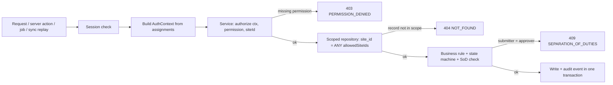

# Permissions matrix

Owner: security-engineer. Reviewers: principal-architect, product-manager, finance-specialist,
hr-payroll-specialist. Status: Phase 0 draft for Gate 0. Binding ADRs: ADR-004, ADR-005,
ADR-011, ADR-022 (deferred). Related: `docs/security.md` (threat model, session policy, audit
catalogue), `docs/data-model.md` (tables named here), `docs/testing.md` (test harness),
`docs/modules/hr-attendance-payroll.md` and `docs/modules/finance.md` (module detail).

Plain-language summary for owners: every person gets one or more **roles** at one or more
**sites**. A role is a bundle of small, named permissions such as "post a stock movement" or
"approve a QA disposition". The server checks the permission and the site on every request;
the screen hiding a button is never the control. Nobody can approve what they themselves
submitted. Approval limits are data the owner can change, not code.

## 1. Authorization model (ADR-005)

| Concept | Definition |
|---|---|
| Permission | String `module.entity.action`. Actions: `view`, `create`, `edit`, `submit`, `approve`, `post`, `export`, `void`, `admin`. The catalogue in section 2 is the complete set; a permission that is not in the catalogue does not exist and cannot be granted. |
| Role | Named bundle of permissions (`roles`, `role_permissions`). The 13 roles below are seeded and `is_system = true`. Custom roles (Phase 1b) are cloned from a seeded role and can only remove permissions or add permissions of sensitivity `normal`; adding `sensitive`/`restricted` permissions requires `identity.role.admin` plus re-authentication and an audit event. |
| Site assignment | `user_site_assignments(user_id, site_id, role_id, is_organization_wide, valid_from, valid_to, created_by)` (`docs/data-model.md` §3.1); the `scope jsonb` sub-scope column is a Phase 2 addition (section 4.4). A user holds a role **at a site**. `site_id = NULL` with `is_organization_wide = true` is an organization-wide assignment and is allowed only for `owner_director`, `system_admin`, `auditor` (database check constraint plus service rule). |
| AuthContext | Built once per request (route handler, server action, job runner, sync replay) and passed to every service call. Never built from client-supplied claims. Shape below. |
| Deny by default | No permission → denied. No assignment at the record's site → the record does not exist for that user (404, not 403, to avoid confirming existence). Missing `site_id` in a command that needs one → 422. |
| Server-side enforcement | Services call `authorize(ctx, permission, { siteId })` before any read or write. Route handlers and UI never decide; they only render what the service returns. ESLint rule: repository methods are not importable outside the module's service layer. |
| Scoped queries | Repositories expose only methods that take `ctx` and append `site_id = ANY(ctx.allowedSiteIds)` (or the organization filter for master data). There is no unscoped `findById`. A query without a scope parameter fails to compile. |
| Exports also scoped | Every CSV/XLSX/PDF export runs through the same scoped repository and the same permission check as the screen, plus the module's `.export` permission, and emits an audit event with row count and filters. |
| Separation of duties | The actor who submitted (or created, where no submit step exists) a record cannot approve it; the approver cannot post the record where posting is a separate control (finance). Enforced in the service by comparing `submitted_by` to `ctx.userId`; cannot be disabled for the mandatory set in section 5. |
| Approval thresholds are data | `approval_rules` (section 5) decide which role must approve a record type at a site above an amount or quantity. Code reads the rules; code never hard-codes a limit. |

### 1.1 AuthContext

```ts
// src/lib/auth/context.ts (Phase 1)
export interface SubScope {               // Phase 2+ refinement, see section 4.4
  warehouseIds?: readonly string[];
  departmentIds?: readonly string[];
  productionLineIds?: readonly string[];
}
export interface RoleAssignment {
  roleCode: string;                       // e.g. "warehouse_operator"
  siteId: string | null;                  // null = organization-wide (3 roles only)
  scope: SubScope | null;                 // null = whole site
}
export interface AuthContext {
  requestId: string;                      // correlation id (logs, audit, idempotency)
  organizationId: string;
  userId: string;                         // UUIDv7; "system:<job-name>" for jobs
  sessionId: string | null;               // null for background jobs
  assignments: readonly RoleAssignment[];
  allSites: boolean;                      // true only if an org-wide assignment exists
  allowedSiteIds: ReadonlySet<string>;    // materialized even when allSites = true
  sitePermissions: ReadonlyMap<string /* siteId */, ReadonlySet<string>>;
  orgPermissions: ReadonlySet<string>;    // from org-wide assignments
  activeSiteId: string | null;            // UI context; filters, never widens
  permissionsVersion: number;             // bumped on any role/assignment change
  mfaVerified: boolean;
  reauthenticatedAt: Date | null;         // for restricted actions (docs/security.md 3.6)
  locale: string; timeZone: string;
}
```

Resolution flow (every request):

1. Adapter reads the session cookie, loads `sessions` row, rejects if revoked/expired (see
   `docs/security.md` section 3).
2. Loads active `user_site_assignments` (`valid_from <= today < valid_to`) and their `role_permissions`.
3. Builds `sitePermissions` (per site) and `orgPermissions` (org-wide roles).
4. `hasPermission(ctx, perm, siteId)` is true when `orgPermissions` has `perm`, or
   `sitePermissions.get(siteId)` has `perm`. `siteId` is required for every operational
   entity; for master data the organization is the scope (section 4).
5. Service calls `authorize(...)`; failure throws `PermissionDenied` → HTTP 403
   `PERMISSION_DENIED` (permission missing) or `NotFound` → 404 (record outside scope).
6. Repository applies `allowedSiteIds` (and sub-scope where enabled) to every statement.
7. Audit event is written in the same transaction for actions listed in
   `docs/security.md` section 5.



Caching: the AuthContext may be cached per session for at most 60 seconds (A-PM-01) keyed by
`permissions_version`; any change to roles, permissions or assignments bumps the version and
invalidates immediately. Online clients refresh their permission set on every sync and at least
every 8 hours (`docs/security.md`); the offline authorization snapshot stays valid for 12 hours
without a server round trip (A-OFF-02 in `docs/offline-sync.md`), after which new offline
commands are blocked until the client reconnects.

## 2. Permission catalogue

Conventions: `view` includes listing and reading a record; `create` includes editing a draft
the actor created; `edit` is needed to change other users' drafts or non-draft fields the state
machine allows; `submit` moves a record to the next state without approval authority;
`approve` grants approval authority (subject to SoD and `approval_rules`); `post` writes a
ledger or irreversible business effect; `export` allows file export; `void` cancels, reverses
or supersedes with mandatory reason; `admin` configures the entity type itself.

Sensitivity: **N** normal; **S** sensitive (money, personal data, overrides, cross-record
exposure; grant and use are audited); **R** restricted (changes the control system, releases
quality, posts money or payroll, or overrides a safety rule; grant requires owner approval,
holders need TOTP from Phase 1b, and use requires re-authentication within 10 minutes,
A-PM-02). Phase = first phase the permission is enforced in code. The whole catalogue is
seeded from Phase 1 so bundles are stable; a permission whose phase has not arrived can be
granted but guards no endpoint until that phase. Several permission strings that share
description, sensitivity and phase are listed on one row.

### 2.1 identity (Phase 1)

| Permission(s) | Description | Sens. | Phase |
|---|---|---|---|
| `identity.user.view` | List users and their roles/sites (no credentials, no MFA secrets) | N | P1 |
| `identity.user.create`, `identity.user.edit` | Create user records, change name/email/status fields | S | P1 |
| `identity.user.admin` | Lock/unlock, deactivate, force password reset, revoke all sessions of a user | R | P1 |
| `identity.user.export` | Export user list | S | P1 |
| `identity.invitation.create` | Send/resend invitation tokens | S | P1 |
| `identity.role.view` | View role bundles and the permission catalogue | N | P1 |
| `identity.role.admin` | P1: view and release-time bundle review, owner break-glass; P1b: create/clone/edit custom roles (seeded roles are read-only templates, ruling 60) | R | P1 |
| `identity.site_assignment.view` | View who holds which role where | N | P1 |
| `identity.site_assignment.export` | Export role assignments for access reviews | S | P1 |
| `identity.site_assignment.admin` | Grant/revoke role assignments and sub-scopes | R | P1 |
| `identity.session.view`, `identity.session.void` | View and revoke other users' sessions (own sessions need no permission) | S | P1 |
| `identity.mfa.admin` | Reset a user's TOTP, enforce enrolment | S | P1b |

### 2.2 masterdata

| Permission(s) | Description | Sens. | Phase |
|---|---|---|---|
| `masterdata.{site,department,warehouse,production_line,uom,uom_conversion,reason_code}.view` | View organization structure and reference lists (all roles need these for the UI) | N | P1 |
| `masterdata.site.admin` | Create/edit sites, time zone, numbering defaults | R | P1 |
| `masterdata.{department,warehouse,production_line,uom,uom_conversion,reason_code}.admin` | Configure structure and reference lists | S | P1 |
| `masterdata.location.view`, `masterdata.location.create`, `masterdata.location.edit` | Zones/bins/racks within a warehouse (needed by Slice 1 site setup, S1-01/S1-02) | N | P1 |
| `masterdata.location.admin` | Designate special locations (receiving/staging, quarantine, hold, rejected, recall); deactivate | S | P1 |
| `masterdata.product.{view,create,edit,export}` | Products, families, shelf life, storage conditions, status | N (export S) | P1 |
| `masterdata.sku.{view,create,edit,export}` | SKUs/variants, packaging configuration, barcode format, customer SKU mapping | N (export S) | P1 |
| `masterdata.material.{view,create,edit,export}` | Raw/packaging materials, INCI, specs, approved suppliers, retest/expiry rules, hazard notes | N (export S) | P1 |
| `masterdata.equipment.view` | Equipment register (canonical family for equipment; `docs/process-maps.md` W13, `docs/data-model.md` §6.11) | N | P1 |
| `masterdata.equipment.edit` | Record cleaning/maintenance/calibration service records and due dates (`equipment_service_records`); return to service | N | P3 |
| `masterdata.equipment.admin` | Create equipment, assign to site/line, define blocking rules | S | P1 |
| `masterdata.equipment.approve` | QA review of a failed calibration or other failed service record before the equipment may return to service (G-W13-B); reviewer ≠ performer and ≠ recorder | S | P3 |
| `masterdata.supplier.{view,create,edit}` | Supplier records, contacts, approved-material list, quality status | N | P2 |
| `masterdata.supplier.export` | Export supplier list | S | P2 |
| `masterdata.supplier.approve` | Approve or suspend an approved-supplier-list entry (`supplier_materials.is_approved`, W04-11); `procurement` proposes with `masterdata.supplier.edit`; approver ≠ proposer | S | P6 |
| `masterdata.supplier_price.view`, `masterdata.supplier_price.edit` | Supplier prices, MOQ, lead time cost fields | S | P6 |
| `masterdata.customer.{view,create,edit}` | Customer profiles, contacts, ship-to addresses, lead times | N | P4 |
| `masterdata.customer.export` | Export customer list | S | P4 |
| `masterdata.customer_requirement.{view,create,edit}` | Customer specifications, artwork/label versions, required documents | N | P4 |
| `masterdata.customer_requirement.approve` | Approve a requirement version as effective | S | P4 |
| `masterdata.formula.{view,create,edit,submit}` | Formulas and FormulaRevisions with BomLines, expected yield, tolerances, effective dates | N | P3 |
| `masterdata.formula.approve` | Approve a FormulaRevision as effective (batch snapshots depend on it) | R | P3 |
| `masterdata.formula.void` | Obsolete a revision (never delete) | S | P3 |
| `masterdata.formula.export` | Export formulas including percentages | S | P3 |
| `masterdata.routing.{view,create,edit,submit}` | Routings, RoutingRevisions, RoutingSteps, QC checkpoints, equipment requirements | N | P3 |
| `masterdata.routing.approve` | Approve a RoutingRevision as effective | R | P3 |
| `masterdata.work_instruction.{view,create,submit}` | WorkInstructionRevisions | N | P3 |
| `masterdata.work_instruction.approve` | Approve an instruction revision | S | P3 |
| `masterdata.label_template.{view,create,edit}` | Label layouts and symbology per template | N | P2 |
| `masterdata.label_template.approve` | Approve a label template version for printing | S | P2 |

### 2.3 inventory (Phase 2)

| Permission(s) | Description | Sens. | Phase |
|---|---|---|---|
| `inventory.lot.view`, `inventory.lot.export` | InventoryLot identity, dates, quality status, genealogy summary | N | P2 |
| `inventory.lot.create` | Create a lot without a goods receipt (opening balance, found stock); always paired with an adjustment | S | P2 |
| `inventory.lot.edit` | Correct lot attributes (dates, supplier lot) with reason; status is never edited here | S | P2 |
| `inventory.balance.view`, `inventory.balance.export` | InventoryBalance projection and availability | N | P2 |
| `inventory.balance.admin` | Enqueue the projection rebuild (`inventory.rebuild_balances` job) and resolve ledger-vs-projection reconciliation differences (`docs/operations-runbook.md` §9, §21); never writes the ledger | S | P2 |
| `inventory.movement.view`, `inventory.movement.export` | StockMovement ledger | N | P2 |
| `inventory.movement.post` | Post issue/transfer/consumption/output/return movements | N | P2 |
| `inventory.movement.void` | Post a reversal of a movement (reason mandatory) | S | P2 |
| `inventory.adjustment.{view,create,submit,export}` | View, draft, submit and export adjustments (found/lost/damaged), including documents not yet posted | N | P2 |
| `inventory.adjustment.approve` | Approve an adjustment (thresholds in `approval_rules`) | S | P2 |
| `inventory.adjustment.post` | Post an approved adjustment to the ledger | S | P2 |
| `inventory.held_stock_issue.approve` | Controlled exception: issue quarantined/on_hold stock (for example sampling, rework); reason mandatory | R | P2 |
| `inventory.reservation.{view,create,void}` | StockReservation for work orders and sales orders | N | P2 |
| `inventory.allocation.{view,create,void}` | StockAllocation of specific lots/containers (FEFO/FIFO) | N | P2 |
| `inventory.intersite_transfer.post` | Transfer between two sites (actor must hold `inventory.movement.post` at both) | S | P2 |
| `inventory.stock_count.{view,create,submit,export}` | StockCount plans, blind counts, recounts | N | P2 |
| `inventory.stock_count.approve` | Approve variances (thresholds in `approval_rules`) | S | P2 |
| `inventory.stock_count.post` | Post reconciliation adjustments from an approved count | S | P2 |
| `inventory.container.{view,create,edit,export}` | Containers (box/carton/pallet), contents, split/merge/repack with lineage | N | P2 |
| `inventory.label_job.{view,create}` | Print labels singly or in batches from approved templates | N | P2 |
| `inventory.pack.{view,create,submit}` | Pack (boxing/verification session from a batch output or for a sales order, `docs/data-model.md` §3.7): start boxing, assign boxes, submit for verification | N | P3 |
| `inventory.pack.approve` | Checker verification of a Pack (scan sample, count, label content); checker ≠ packer | S | P3 |

### 2.4 procurement

| Permission(s) | Description | Sens. | Phase |
|---|---|---|---|
| `procurement.goods_receipt.{view,create,post,export}` | GoodsReceipt and lines; posting creates lots and receipt movements | N | P2 |
| `procurement.goods_receipt.void` | Reverse a posted receipt | S | P2 |
| `procurement.receipt_discrepancy.approve` | Accept quantity/quality discrepancies against the PO or packing list | S | P2 |
| `procurement.supplier_lot_document.{view,create}` | Certificates/specifications attached to a receipt lot | N | P2 |
| `procurement.purchase_request.{view,create,edit,submit,void}` | PurchaseRequest lifecycle | N | P6 |
| `procurement.purchase_request.approve` | Approve a request (thresholds) | S | P6 |
| `procurement.purchase_request.export` | Export purchase requests | S | P6 |
| `procurement.purchase_order.{view,create,edit,submit}` | PurchaseOrder lifecycle to `submitted` | N | P6 |
| `procurement.purchase_order.approve` | Approve a PO (thresholds; SoD) | S | P6 |
| `procurement.purchase_order.post` | Send an approved PO to the supplier (state `sent`) | N | P6 |
| `procurement.purchase_order.void`, `procurement.purchase_order.export` | Cancel; export POs with prices | S | P6 |
| `procurement.supplier_return.{view,create,post}` | View, draft and post a SupplierReturn of rejected material to a supplier (posting writes one `issue` movement per line, source `supplier_return`) | N | P6 |
| `procurement.supplier_return.approve` | Approve a supplier return before posting (thresholds in `approval_rules`); approver ≠ creator/submitter; the lot must be `rejected` or returned-as-is by a `qa_qc` disposition first (W04-09) | S | P6 |
| `procurement.reorder_suggestion.{view,approve}` | Review and accept reorder suggestions into purchase requests | N | P6 |
| `procurement.supplier_performance.view` | Lead-time variance, rejection rate, OTIF | N | P6 |

### 2.5 production (Phase 3)

| Permission(s) | Description | Sens. | Phase |
|---|---|---|---|
| `production.production_plan.{view,create,edit}` | ProductionPlan periods and lines | N | P3 |
| `production.production_plan.approve` | Approve a plan period | S | P3 |
| `production.work_order.{view,create,edit,submit,export}` | WorkOrder draft → planned | N | P3 |
| `production.work_order.approve` | Release a work order to the floor (`released`) | S | P3 |
| `production.work_order.void` | Cancel a work order | S | P3 |
| `production.daily_log.{view,create}` | Production order daily log and defects (ADR-074); create also writes corrections (new entry + reason) | N | P3 |
| `production.batch.{view,create,edit,export}` | Batch records; create snapshots formula/routing revisions | N | P3 |
| `production.batch.submit` | Operator transitions: start, complete steps, submit to `awaiting_qc` | N | P3 |
| `production.batch.approve` | Supervisor transitions: approve start after line clearance, approve closure | S | P3 |
| `production.batch.post` | Post consumption/output/yield to ledgers (normally in the same transaction as `submit` by the same actor) | S | P3 |
| `production.batch.void` | Delete a `draft` batch; abandon a `planned`/`materials_staged` batch as `rejected` with reason (QA disposition follows, `rejected → closed`); there is no `cancelled` batch state (A-DM-24) | S | P3 |
| `production.batch.admin` | Controlled reopen/amend of a closed batch (reason mandatory, full audit) | R | P3 |
| `production.line_clearance.create` | Record a line-clearance check | N | P3 |
| `production.line_clearance.approve` | Checker sign-off of line clearance (not own) | S | P3 |
| `production.dispense_record.{view,create}` | DispenseRecord: target, tolerance, actual, lot scan, scale | N | P3 |
| `production.dispense_record.approve` | Checker sign-off of a dispense (not own) | S | P3 |
| `production.dispense_record.void` | Void a dispense entry with reason (appends, never deletes) | S | P3 |
| `production.over_tolerance_dispense.approve` | Controlled exception: accept an out-of-tolerance weight | R | P3 |
| `production.material_substitution.approve` | Controlled exception: allow a lot other than the staged/recommended lot of the same material | R | P3 |
| `production.process_step_record.{view,create}` | ProcessStepRecord readings and completion | N | P3 |
| `production.process_step_record.approve` | Checker sign-off of a step (not own) | S | P3 |
| `production.equipment_use.create` | Link equipment to a step | N | P3 |
| `production.equipment_override.approve` | Controlled exception: use equipment blocked by maintenance/calibration state | R | P3 |
| `production.batch_output.create` | Record BatchOutput (finished/intermediate lots and containers) | N | P3 |
| `production.yield_record.{view,create}` | YieldRecord and reconciliation | N | P3 |
| `production.yield_record.approve` | Approve yield reconciliation outside configured variance | S | P3 |
| `production.scrap_rework_record.{view,create}` | ScrapReworkRecord | N | P3 |
| `production.scrap_rework_record.approve` | Approve scrap write-off | S | P3 |

### 2.6 quality

| Permission(s) | Description | Sens. | Phase |
|---|---|---|---|
| `quality.inspection_plan.{view,create,edit}` | InspectionPlan, sampling, specs, acceptance criteria | N | P3 |
| `quality.inspection_plan.approve` | Approve a plan version | S | P3 |
| `quality.inspection.{view,create,submit}` | Inspections (incoming, in-process, finished) | N | P3 |
| `quality.inspection.approve` | Review/approve an inspection | S | P3 |
| `quality.test_result.{view,create}` | TestResult entries | N | P3 |
| `quality.test_result.approve` | Reviewer sign-off of results | S | P3 |
| `quality.test_result.void` | Append a correction to a result (original retained) | S | P3 |
| `quality.test_result.export` | Export results | S | P3 |
| `quality.disposition.{view,create}` | View and propose a Disposition (`decision` in `release`, `reject`, `hold`, `conditional_release`, `rework`, `recall`, `expire`; `docs/data-model.md` §3.6) | N | P2 |
| `quality.disposition.approve` | Approve a Disposition: the only way a lot or batch becomes `released`/`rejected`/`rework_approved` | R | P2 |
| `quality.conditional_release.approve` | Second approval required for a conditional release (`approval_rules` default: two `qa_qc` users) | R | P3 |
| `quality.hold.view` | QualityHold records | N | P2 |
| `quality.hold.create` | Place stock/batch `on_hold` | S | P2 |
| `quality.hold.approve` | Lift a hold | R | P2 |
| `quality.deviation.{view,create,submit}` | Deviation / nonconformance | N | P3 |
| `quality.deviation.approve`, `quality.deviation.export` | Close a deviation; export | S | P3 |
| `quality.capa.{view,create,submit}` | Capa | N | P6 |
| `quality.capa.approve` | Close a CAPA | S | P6 |
| `quality.change_control.{view,create,submit}` | ChangeControl (Phase 3 formula/routing revisions use `masterdata.formula.approve` / `masterdata.routing.approve`) | N | P6 |
| `quality.change_control.approve` | Approve a change | S | P6 |
| `quality.complaint.{view,create,submit}` | Complaint | N | P4 |
| `quality.complaint.approve` | Close a complaint | S | P4 |
| `quality.recall_case.{view,create}` | RecallCase (the Phase 4 recall explorer uses `quality.genealogy.view`) | S | P6 |
| `quality.recall_case.approve` | Initiate/close a recall (two approvals by default) | R | P6 |
| `quality.recall_case.admin` | Mark lots/containers `recalled` in bulk from a case | R | P6 |
| `quality.recall_case.edit` | Record customer notifications, acknowledgements and accounted quantities on a case (W4C: `sales_cs` records the notification, data-model §3.6) | S | P6 (W4C) |
| `quality.recall_case.export` | Export a case's customer notification list (names customers) | S | P6 (W4C) |
| `quality.genealogy.view` | Forward/backward trace explorer | N | P3 |
| `quality.genealogy.export` | Export a trace (contains customers and suppliers) | S | P3 |

### 2.6a maintenance (Wave 4 W4C, US-6-19; FR-production-15)

| Permission(s) | Description | Sens. | Phase |
|---|---|---|---|
| `maintenance.plan.{view,create,edit}` | Preventive-maintenance plans (time or usage based) on the equipment register; edit = change, pause, resume, retire | N | P6 (W4C) |
| `maintenance.work_order.{view,create,edit}` | Maintenance work orders: report a problem, start, hold, assign, complete (completing also needs `masterdata.equipment.edit`, it writes the service record) | N | P6 (W4C) |
| `maintenance.work_order.post` | Issue spare parts to a work order (posts an `issue` stock movement) | N | P6 (W4C) |
| `maintenance.work_order.void` | Cancel a maintenance work order | N | P6 (W4C) |
| `maintenance.spare_part.{view,edit}` | Spare-parts list per site (materials kept as spares, minimum stock) | N | P6 (W4C) |

### 2.7 documents (Phase 2; BMR/DR templates Phase 3/4)

| Permission(s) | Description | Sens. | Phase |
|---|---|---|---|
| `documents.template.{view,create,edit,submit}` | DocumentTemplate and versions (BMR, dispensing sheet, labels, DR, pick list, reports) | N | P2 |
| `documents.template.approve` | Approve a template version for use | S | P2 |
| `documents.template.void` | Retire a template version | S | P2 |
| `documents.generated_document.{view,create,export}` | Generate, preview and download GeneratedDocuments; scoped by the source record's permission and site | N | P2 |
| `documents.generated_document.void` | Mark a generated document superseded | S | P2 |
| `documents.reprint.create` | Reprint a controlled document (reason mandatory, audit) | S | P2 |
| `documents.file_attachment.{view,create,export}` | Upload/download FileAttachments on records the actor can view | N | P2 |
| `documents.file_attachment.void` | Soft-delete an attachment (file retained per retention policy) | S | P2 |
| `documents.legacy_document.view` | Read the legacy document index (scanned paper BMRs, DRs, test records) and its scans on the lot page and the legacy documents search; the index carries the QA name (personal data) (W3C, US-2-26) | S | P2 |
| `documents.legacy_document.approve` | Second-person verification of a legacy document's index against its scan; never the person who indexed it (W3C) | S | P2 |
| `documents.print_station.admin` | Add and change print stations (the PC or tablet next to a label printer) at the actor's sites; added in Wave 1 (E-2-03). Granted to `system_admin` and `site_manager`; seeing a station's queue needs `inventory.label_job.view` | N | P2 |

### 2.8 sales (Phase 4; portal Phase 8)

| Permission(s) | Description | Sens. | Phase |
|---|---|---|---|
| `sales.price_list.view` | Customer-specific pricing, MOQ, contract terms | S | P4 |
| `sales.price_list.edit` | Draft price changes | S | P4 |
| `sales.price_list.approve` | Approve price changes | S | P4 |
| `sales.quote.{view,create,edit,submit,void}` | Quote lifecycle | N | P4 |
| `sales.quote.approve`, `sales.quote.export` | Approve margins/discounts (thresholds); export with prices | S | P4 |
| `sales.sales_order.{view,create,edit,submit}` | SalesOrder draft → submitted | N | P4 |
| `sales.sales_order.approve` | Credit/approval check → `confirmed` | S | P4 |
| `sales.sales_order.void`, `sales.sales_order.export` | Cancel with controlled reversal; export with prices | S | P4 |
| `sales.pick.{view,create,submit}` | Pick lists and scan confirmation | N | P4 |
| `sales.shipment.{view,create,edit,export}` | Shipment draft/picked/packed | N | P4 |
| `sales.shipment.post` | Dispatch: posts the shipment stock issue | S | P4 |
| `sales.shipment.void` | Reverse a dispatched shipment (return to stock) | S | P4 |
| `sales.over_shipment.approve` | Controlled exception: ship more than allocated/ordered | R | P4 |
| `sales.delivery_receipt.{view,create,export}` | DeliveryReceipt and acknowledgment capture | N | P4 |
| `sales.customer_return.{view,create,submit}` | CustomerReturn intake | N | P4 |
| `sales.customer_return.approve` | Accept a return (QA disposition follows) | S | P4 |
| `sales.customer_return.post` | Post return stock into quarantine | S | P4 |
| `sales.portal_user.view`, `sales.portal_catalog.view` | View customer portal users and the approved catalogue per customer tenant | S | P8 |
| `sales.portal_user.admin` | Invite/suspend customer portal users for a customer tenant | R | P8 |
| `sales.portal_catalog.admin` | Define the approved product catalogue per customer tenant | S | P8 |

### 2.9 hr (Phase 5 attendance; Phase 6 leave/payroll)

| Permission(s) | Description | Sens. | Phase |
|---|---|---|---|
| `hr.employee.view` | Directory fields only: name, employee number, department, site, position, supervisor, status | N | P5 |
| `hr.employee.create`, `hr.employee.edit` | Create and maintain employee records (directory and employment fields) | S | P5 |
| `hr.employee.export` | Export employee lists | R | P5 |
| `hr.employee_personal_data.view`, `hr.employee_personal_data.edit` | Personal fields: date of birth, addresses, government ids, bank details, emergency contacts, documents | R | P5 |
| `hr.shift.view` | Shift definitions | N | P6 |
| `hr.shift.admin` | Configure shifts | S | P6 |
| `hr.shift_assignment.{view,create}` | Assign employees to shifts | N | P6 |
| `hr.shift_assignment.approve` | Approve schedule changes | S | P6 |
| `hr.calendar.view` | Holiday/working calendars | N | P5 |
| `hr.calendar.admin` | Configure calendars (values validated by HR) | S | P5 |
| `hr.attendance_import.{view,create,submit}` | Upload, map, preview an AttendanceImport | S | P5 |
| `hr.attendance_import.approve` | Approve an import after exception review | S | P5 |
| `hr.attendance_import.post` | Post reviewed rows as AttendanceEvents | S | P5 |
| `hr.attendance_import.void` | Reverse a posted import | S | P5 |
| `hr.attendance_event.view` | Punches and derived time | S | P5 |
| `hr.attendance_event.edit` | Propose a correction (missing punch, wrong employee) | S | P5 |
| `hr.attendance_event.approve` | Approve corrections (not own) | S | P5 |
| `hr.attendance_event.export` | Export attendance/time summaries | R | P5 |
| `hr.attendance_exception.{view,edit,approve}` | Work the exception queue | S | P5 |
| `hr.leave_request.create`, `hr.leave_request.void` | Create a LeaveRequest on behalf of an employee in scope; cancel another employee's request with reason (own leave requests are self-service and need no permission) | N | P6 |
| `hr.leave_request.view`, `hr.leave_request.approve` | View and approve team leave | S | P6 |
| `hr.overtime.view`, `hr.overtime.create` | View and create OvertimeRequests for employees in scope (own requests are self-service) | N | P6 |
| `hr.overtime.approve` | Approve overtime (configurable thresholds) | S | P6 |
| `hr.overtime.void` | Cancel an approved OvertimeRequest with reason | S | P6 |
| `hr.payroll_rule.view` | View the effective-dated rule catalogue | R | P6 |
| `hr.payroll_rule.admin` | Change payroll rules and attendance rule sets (requires qualified reviewer sign-off recorded on the rule version) | R | P6 |
| `hr.payroll_period.{view,create,submit}` | PayrollPeriod and computation runs (ADR-021) | R | P6 |
| `hr.payroll_period.approve` | PayrollApproval (reviewer; SoD with submit) | R | P6 |
| `hr.payroll_period.post` | Lock an approved period and generate payslips | R | P6 |
| `hr.payroll_period.void` | Reopen a locked period (two approvals) | R | P6 |
| `hr.payroll_line.{view,edit}` | PayrollLine detail and manual adjustments (reason mandatory) | R | P6 |
| `hr.payroll_line.export` | Export payroll registers | R | P6 |
| `hr.payslip.view` | View payslips of others (own payslip is self-service) | R | P6 |
| `hr.payslip.create`, `hr.payslip.export` | Generate and download payslips of others | R | P6 |
| `hr.payment_export.export` | Bank/payment file export | R | P6 |

Attendance rule sets (`attendance_rule_sets`, `docs/modules/hr-attendance-payroll.md` §5.1) have
no permission of their own: drafting and approval both use `hr.payroll_rule.admin`, the approver
must be a different user from the submitter (SoD on `submitted_by`/`approved_by`), and the
qualified reviewer's sign-off is recorded on the version. Any reference to
`hr.attendance_rule.approve` means this mapping.

### 2.10 finance (Phase 6 unless noted; ADR-020)

| Permission(s) | Description | Sens. | Phase |
|---|---|---|---|
| `finance.cost.view` | Unit cost, landed cost, batch cost fields wherever they appear (materials, lots, batches, KPIs) | S | P2 |
| `finance.credit_terms.view` | Credit limit and terms on customers | S | P4 |
| `finance.credit_terms.approve` | Set/approve credit limits and terms | S | P4 |
| `finance.invoice.{view,create,edit,submit}` | Invoice drafting from shipments | S | P6 |
| `finance.invoice.approve` | Approve an invoice (SoD) | S | P6 |
| `finance.invoice.post`, `finance.invoice.void` | Post (immutable) / reverse with credit note | R | P6 |
| `finance.invoice.export` | Export invoices/statements | S | P6 |
| `finance.supplier_bill.{view,create,edit,submit}` | SupplierBill drafting and three-way match | S | P6 |
| `finance.supplier_bill.approve` | Approve a bill (thresholds) | S | P6 |
| `finance.supplier_bill.post`, `finance.supplier_bill.void` | Post / reverse | R | P6 |
| `finance.supplier_bill.export` | Export bills | S | P6 |
| `finance.payment_record.{view,create}` | Record customer receipts and supplier payments | S | P6 |
| `finance.payment_record.approve` | Approve a payment above the `approval_rules` threshold before posting (SoD) | S | P6 |
| `finance.payment_record.post`, `finance.payment_record.void` | Post / reverse payments | R | P6 |
| `finance.payment_record.export` | Export payment registers | S | P6 |
| `finance.credit_note.{view,create,submit}` | CreditNote drafting | S | P6 |
| `finance.credit_note.approve` | Approve (thresholds) | S | P6 |
| `finance.credit_note.post`, `finance.credit_note.void` | Post / reverse | R | P6 |
| `finance.credit_note.export` | Export credit notes | S | P6 |
| `finance.expense_claim.{create,submit}` | Own expense claims (self-service) | N | P6 |
| `finance.expense_claim.view` | View others' claims | S | P6 |
| `finance.expense_claim.approve` | Approve claims (thresholds) | S | P6 |
| `finance.expense_claim.post`, `finance.expense_claim.void` | Post / reverse | R | P6 |
| `finance.expense_claim.export` | Export claims | S | P6 |
| `finance.costing_run.{view,create,post,export}` | CostingRun (estimate vs actual; allocation method stored) | S | P6 |
| `finance.costing_config.admin` | Standard costs, labour rates, overhead pools, manual lot-cost rows (reviewer sign-off recorded; `docs/modules/finance.md` §4) | R | P6 |
| `finance.reconciliation.{view,create}` | Bank/payment-provider reconciliation | S | P6 |
| `finance.reconciliation.post` | Post a reconciliation | R | P6 |
| `finance.period_lock.view` | Period lock status | S | P6 |
| `finance.period_lock.post` | Lock a period | R | P6 |
| `finance.period_lock.void` | Unlock a period (owner co-approval); the table is `accounting_periods`, audit `finance.accounting_period.unlocked` | R | P6 |
| `finance.tax_config.view` | Tax configuration (values validated by the accountant) | S | P6 |
| `finance.tax_config.admin` | Change tax configuration (reviewer sign-off recorded) | R | P6 |
| `finance.accountant_export.export` | Export to the accountant's system | R | P6 |
| `finance.accountant_export.admin` | Export profiles and account mappings | R | P6 |
| `finance.journal_entry.{view,create,post,void,export}` | Only if a general ledger is approved (ADR-020); dormant otherwise | R | P6+ |
| `finance.payment_provider.view` | View payment provider adapter status and configuration (never secrets) (future) | S | P8 |
| `finance.payment_provider.admin` | Configure the payment provider adapter and webhook secrets (future) | R | P8 |
| `finance.refund.create` | Request a refund (`refund_requests`) before approval (future) | S | P8 |
| `finance.refund.approve` | Approve a refund through the provider (future; approver ≠ requester) | R | P8 |

### 2.11 analytics (Phase 5)

| Permission(s) | Description | Sens. | Phase |
|---|---|---|---|
| `analytics.dashboard.view` | Site-scoped operational dashboards | N | P5 |
| `analytics.owner_dashboard.view` | Cross-site executive overview and site comparison | S | P5 |
| `analytics.report.view` | Run reports over data the actor can already view | N | P5 |
| `analytics.report.export` | Export report output (module `.export` permissions still apply row by row) | S | P5 |
| `analytics.report.admin` | Define/alter report definitions and KPI formulas | S | P5 |
| `analytics.scheduled_report.{view,create}` | ScheduledReport subscriptions (recipients must hold the underlying permissions) | S | P5 |
| `analytics.scheduled_report.admin` | Manage all schedules | S | P5 |
| `analytics.forecast.{view,edit}` | View forecasts; enter manual overrides with reason (FR-analytics-08) | N | P6 |
| `analytics.forecast.approve` | Approve an override for planning use | S | P6 |
| `analytics.kpi_definition.view` | Read KPI definitions | N | P5 |
| `analytics.financial_kpi.view` | Revenue, margin, receivables, payables, cash indicators; P5 for Estimate tiles (shipped value at order price, A-KPI-10), invoice-based figures from P6 | S | P5 |
| `analytics.labor_kpi.view` | Attendance/labour summaries (aggregated, no per-person pay) | S | P5 |

Implemented in Wave 3 (W3A, `src/lib/permissions.ts`): `analytics.dashboard.view` (existing),
`analytics.owner_dashboard.view`, `analytics.financial_kpi.view`, `analytics.kpi_definition.view`.
Bundles follow §3.11: owner_director and auditor hold all three; system_admin, site_manager and
qa_qc (built on every `.view` string) are stripped of `owner_dashboard` and `financial_kpi`;
`kpi_definition.view` is granted to every operational role. Without `owner_dashboard.view` a
multi-site user still sees the site comparison of exactly their own sites, but never an all-sites
aggregate. Order value and shipped value (Estimate) need `financial_kpi.view` until
`sales.price_list.view` exists (A-W3A-06). Saved trend views are self-service under
`analytics.dashboard.view`. The remaining strings of this section are not implemented yet.

### 2.12 platform

| Permission(s) | Description | Sens. | Phase |
|---|---|---|---|
| `platform.audit.view` | Audit log screen; rows filtered to entities the viewer can view and to allowed sites; restricted payloads redacted unless the viewer holds the entity's restricted view permission | S | P1 |
| `platform.audit.export` | Export audit events | S | P1 |
| `platform.job.view` | BackgroundJob status | N | P2 |
| `platform.job.admin` | Retry/cancel jobs | S | P2 |
| `platform.notification.view` | Own notifications (always); others' with this permission | N | P5 |
| `platform.notification_rule.view` | Read escalation rules, recipients and severities | N | P5 |
| `platform.notification_rule.admin` | Escalation rules, recipients, severities | S | P5 |
| `platform.numbering_rule.view` | NumberingRule definitions | N | P1 |
| `platform.numbering_rule.admin` | Change numbering (never retroactive) | R | P1 |
| `platform.file.admin` | Storage management, orphan cleanup | S | P2 |
| `platform.help_guide.admin` | Author and publish in-app help guides and screen walkthroughs (reading them needs no permission); every edit is a new draft version, published by a second holder of the permission, never the author (`docs/data-model.md` §4.2) | S | P2 |
| `platform.import_job.{view,create,submit}` | Generic ImportJob wizard (master data, prices); Phase 2 if early go-live after G4 (Q-MIG-13) | N | P5 |
| `platform.import_job.approve`, `platform.import_job.post`, `platform.import_job.void` | Approve, post and reverse imports; Phase 2 if early go-live after G4 (Q-MIG-13) | S | P5 |
| `platform.settings.view` | Read system settings | N | P1 |
| `platform.settings.admin` | Change system settings (session policy, password policy, feature switches); keys flagged `requires_approval` are submitted as `setting_change_requests` instead | R | P1 |
| `platform.settings.approve` | Approve a `setting_change_request` submitted by another user (S1-03): `owner_director`, or a second `system_admin`; SoD enforced on `setting_change_requests.submitted_by/approved_by` | R | P1 |
| `platform.approval_rule.view` | Read `approval_rules` | N | P1 |
| `platform.approval_rule.admin` | Change approval rules and SoD configuration | R | P1 |
| `platform.integration.view` | View adapter status and configuration (never secrets) | S | P6 |
| `platform.integration.admin` | Integration adapter configuration: email adapter from P5; storage, time-clock and accounting adapters P6; payment provider P8 | R | P5 |
| `platform.diagnostics.view` | Health, queue depth, sync backlog, error rates (never secrets) | S | P1 |
| `platform.sync_conflict.{view,edit}` | SyncConflict queue and resolution proposals | N | P7 |
| `platform.sync_conflict.approve` | Resolve a conflict (chooses server or client version with reason) | S | P7 |
| `platform.sync_command.view`, `platform.sync_command.void` | Inspect and discard queued SyncCommands | S | P7 |
| `platform.device.view`, `platform.device.admin` | Device registrations: list; approve with offline workflows, suspend, remove (W4D, US-7-06) | S | P7 |
| `platform.retention_policy.view` | Retention policies (class, period, basis, action, confirmation status) | S | P9 (W4F) |
| `platform.retention_policy.edit` | Change a retention policy; clears its confirmation; protected classes only archive or keep | R | P9 (W4F) |
| `platform.retention_policy.approve` | Record the qualified reviewers' confirmation of a policy (never the last editor) | R | P9 (W4F) |
| `platform.legal_hold.view` | Legal holds on lots, batches, customers, complaints, orders and users (site-scoped entities filtered to allowed sites) | S | P9 (W4F) |
| `platform.legal_hold.create` | Place a legal hold (owner_director or qa_qc, data-model §12.1) | S | P9 (W4F) |
| `platform.legal_hold.void` | Release a legal hold with a note (never the person who placed it) | S | P9 (W4F) |
| `platform.purge_run.view` | Retention sweep runs and their per-target reports | S | P9 (W4F) |
| `platform.purge_run.create` | Run a retention dry run (deletes nothing) | S | P9 (W4F) |
| `platform.purge_run.post` | Execute a purge of confirmed delete policies (re-authentication) | R | P9 (W4F) |
| `platform.restore_drill.view` | Restore drill evidence | S | P9 (W4F) |
| `platform.restore_drill.approve` | Owner sign-off of a restore drill (never the performer; re-authentication) | R | P9 (W4F) |

Self-service capabilities that need no permission string (always allowed for an active user,
on own records only): view/edit own profile, change own password, manage own sessions and
TOTP, view own notifications, own leave and overtime requests and expense claims, own payslips,
own shift schedule, own sync queue.

## 3. Role × permission matrix

Legend: `v` view, `c` create, `e` edit, `s` submit, `a` approve, `p` post, `x` export,
`o` void, `m` admin. `*` = organization-wide (all sites); otherwise the grant applies at the
sites of the assignment. `–` = nothing. Column codes: OD owner_director, SA system_admin,
SM site_manager, PP production_planner, PO production_operator, WO warehouse_operator,
QA qa_qc, PR procurement, SC sales_cs, FI finance, HR hr_payroll, AU auditor,
CP customer_portal_user.

Role philosophy (owners should read this part):

- **owner_director** sees and exports everything across sites and is the top of every
  approval chain, but does not perform operational postings by default. An owner who also
  packs orders is given `warehouse_operator` at that site in addition (A-PM-03). The owner
  holds break-glass `identity.role.admin` and `identity.site_assignment.admin`; use of these
  is audited as `identity.role.owner_break_glass`.
- **system_admin** administers identity, configuration, templates, jobs, integrations and
  diagnostics, and can view non-sensitive operational data across sites for support. It
  deliberately does **not** hold quality release, financial posting, payroll approval or
  view of payroll/personal data, formula approval, approval-rule changes or cost views.
  Reason: the person who can change who-may-do-what must not also be able to do the
  controlled things; otherwise the audit trail cannot distinguish an administrator's error
  from fraud, and a compromised admin account would be a single point of total failure. If
  the company has one person doing both jobs, give that person two assignments
  (`system_admin` + `finance`) so each action is attributable to a role and SoD still applies.
- **site_manager** runs a site: approves operational records, exceptions within thresholds
  and attendance corrections at that site; cannot release quality, post money or see payroll.
- **auditor** is view and export only, organization-wide, including finance and audit logs;
  payroll figures and employee personal data are excluded by default (A-PM-04) and granted by
  an explicit extra assignment when an external audit requires them.
- **customer_portal_user** holds no internal permission at all. Its capabilities are a
  separate list evaluated by a separate portal context (section 7).

### 3.1 identity

| Entity | OD | SA | SM | PP | PO | WO | QA | PR | SC | FI | HR | AU | CP |
|---|---|---|---|---|---|---|---|---|---|---|---|---|---|
| identity.user | v x* | v c e m x* | v | – | – | – | – | – | – | – | v* | v x* | – |
| identity.invitation | – | c* | – | – | – | – | – | – | – | – | – | – | – |
| identity.role | v m* | v m* | v | – | – | – | – | – | – | – | – | v* | – |
| identity.site_assignment | v m* | v m* | v | – | – | – | – | – | – | – | – | v x* | – |
| identity.session | v o* | v o* | – | – | – | – | – | – | – | – | – | v* | – |
| identity.mfa | – | m* | – | – | – | – | – | – | – | – | – | – | – |

### 3.2 masterdata

| Entity | OD | SA | SM | PP | PO | WO | QA | PR | SC | FI | HR | AU | CP |
|---|---|---|---|---|---|---|---|---|---|---|---|---|---|
| site, department, warehouse, production_line, uom, uom_conversion, reason_code | v* | v m* | v | v | v | v | v | v | v | v | v | v* | – |
| location | v* | v c e m* | v c e | v | v | v c | v | v | v | v | – | v* | – |
| equipment | v a* | v m* | v e m | v | v e | v | v a | – | – | v | – | v* | – |
| product, sku | v x* | v c e x* | v | v c e | v | v | v e | v | v x | v x | – | v x* | – |
| material | v x* | v c e* | v | v c e | v | v | v e | v c e x | – | v x | – | v x* | – |
| supplier | v x* | v* | v | – | – | v | v e a | v c e x | – | v x | – | v x* | – |
| supplier_price | v* | – | – | – | – | – | – | v e | – | v* | – | v* | – |
| customer | v x* | v* | v | – | – | v | v | – | v c e x | v x | – | v x* | – |
| customer_requirement | v a* | v* | v | v | v | v | v a | – | v c e | v | – | v* | – |
| formula | v a x* | – | v c e s a o | v c e s | v | – | v a o x | v | – | v | – | v x* | – |
| routing | v a* | – | v c e s a | v c e s | v | – | v a | – | – | – | – | v* | – |
| work_instruction | v a* | – | v c s a | v c s | v | v | v a | – | – | – | – | v* | – |
| label_template | v a* | v c e* | v c e | v | v | v | v a | – | v | – | – | v* | – |

`a` on equipment is `masterdata.equipment.approve` (QA review after a failed calibration, added by W1D).

Implemented by W2G (US-1-20..US-1-24, `src/lib/permissions.ts` block "Wave 2 W2G") exactly as the
row above, with these readings: blocking/unblocking a location needs `masterdata.location.edit`,
deactivating or reactivating it needs `masterdata.location.admin`; assigning equipment to a line and
changing its `blocking_rule` need `masterdata.equipment.admin`; a `uom_conversion` change is
proposed and approved by two different holders of `masterdata.uom_conversion.admin`;
`owner_director` holds every string (existing bundle rule). `masterdata.site.admin` is marked R but
re-authentication (US-1-28) is not built yet, so it is enforced as a normal permission held only by
the organization-wide `system_admin` and `owner_director`.

Notes: formula and routing approval requires two approvals by default (`qa_qc` and
`site_manager` or `owner_director`), neither being the submitter (A-PM-05). Operators see
formulas only through the batch (target quantities), never percentages (section 6). `a` on
`supplier` is `masterdata.supplier.approve` (approved-supplier-list decisions, Phase 6) and is
held by `qa_qc` only; `procurement` proposes entries with `masterdata.supplier.edit`, and the
proposer cannot approve the same entry (section 5.1).

### 3.3 inventory

| Entity | OD | SA | SM | PP | PO | WO | QA | PR | SC | FI | HR | AU | CP |
|---|---|---|---|---|---|---|---|---|---|---|---|---|---|
| lot | v x* | v* | v c e x | v | v | v e x | v e x | v | v | v x | – | v x* | – |
| balance | v x* | v m* | v x m | v x | v | v x | v | v x | v | v x | – | v x* | – |
| movement | v x* | v* | v p o x | v | v p | v p x | v p | v | v | v x | – | v x* | – |
| adjustment | v a* | – | v c s a p | – | – | v c s | v c s | – | – | v | – | v x* | – |
| held_stock_issue | a* | – | – | – | – | – | a | – | – | – | – | – | – |
| reservation | v* | v* | v c o | v c o | v | v | v | v | v c o | – | – | v* | – |
| allocation | v* | v* | v c o | v | v | v c o | v | – | v c o | – | – | v* | – |
| intersite_transfer | – | – | p | – | – | p | – | – | – | – | – | – | – |
| stock_count | v a x* | v* | v c s a p x | v | – | v c s | v | – | – | v x | – | v x* | – |
| container | v x* | v* | v c e x | v | v c e | v c e x | v | – | v | – | – | v x* | – |
| label_job | v* | v* | v c | v | v c | v c | v c | – | – | – | – | v* | – |
| pack | v* | v* | v c s a | v | v c s a | v c s a | v | – | v | – | – | v* | – |

Notes: `PO` posts movements only of types `consumption`, `output` and `transfer` whose source
or destination is a production location; the service enforces the movement-type subset per
role via `role_movement_types` configuration (A-PM-06; implemented in Phase 2 as the setting
`inventory.role_movement_types`, checked inside `postMovement`, default in `src/lib/settings.ts`). `intersite_transfer.post` requires
`inventory.movement.post` at both the source and destination site. There is no negative-balance
permission: balances cannot go negative (database constraint, ADR-006 as amended). `a` on `pack`
means acting as **checker** for another user's Pack; the service rejects verifying one's own
(`packs.checked_by <> packed_by`). `balance.admin` (projection rebuild, reconciliation
differences) is held by `system_admin` and `site_manager` (A-PM-19).

### 3.4 procurement

| Entity | OD | SA | SM | PP | PO | WO | QA | PR | SC | FI | HR | AU | CP |
|---|---|---|---|---|---|---|---|---|---|---|---|---|---|
| goods_receipt | v x* | v* | v c p o x | v | – | v c p | v | v x | – | v x | – | v x* | – |
| receipt_discrepancy | a* | – | a | – | – | – | – | a | – | – | – | – | – |
| supplier_lot_document | v* | v* | v c | – | – | v c | v c | v c | – | – | – | v* | – |
| purchase_request | v a* | – | v c s a o | v c s | – | v c s | v c s | v c e s o | – | v | – | v x* | – |
| purchase_order | v a x* | – | v a | v | – | v | v | v c e s p x o | – | v x | – | v x* | – |
| supplier_return | v a* | – | v a | – | – | v c p | v c | v c p | – | v | – | v* | – |
| reorder_suggestion | v* | – | v | v | – | – | – | v a | – | – | – | v* | – |
| supplier_performance | v* | – | v | – | – | – | v | v | – | v | – | v* | – |

### 3.4.1 As built: Wave 4 W4A procurement grants (`src/lib/permissions.ts`, block "Wave 4 W4A")

The §3.2 supplier / supplier_price rows, the §3.4 rows and the §3.11 forecast row are implemented as
shown, with these build notes:

- `.view` strings reach the VIEW_ALL bundles automatically; they are removed again where the matrix
  shows "–": system_admin (no procurement records, prices or forecasts), site_manager and qa_qc (no
  supplier prices), qa_qc (no reorder suggestions or forecasts).
- owner_director keeps view, approve and (PO) export of procurement records and the forecast approve;
  ASL decisions (`masterdata.supplier.approve`) are QA's only.
- procurement also holds `documents.generated_document.{view,create}`: sending a PO records the PO
  document (ADR-026).
- finance (bundle added by W3D) holds supplier view, supplier prices, PR/PO view, PO export, supplier
  return view and supplier performance (matrix FI column).
- Separation of duties (§5.1) is enforced in the services and by CHECKs: PR/PO/supplier-return
  approver ≠ creator and submitter, one person per approval step, supplier-return poster ≠ approver,
  ASL decider ≠ proposer; forecast overrides follow `approvals.sod.forecast_override` (default on).

### 3.5 production

| Entity | OD | SA | SM | PP | PO | WO | QA | PR | SC | FI | HR | AU | CP |
|---|---|---|---|---|---|---|---|---|---|---|---|---|---|
| production_plan | v a* | – | v c e a | v c e | v | v | v | v | v | – | – | v* | – |
| work_order | v a x* | – | v c e s a o x | v c e s x | v | v | v | – | v | – | – | v x* | – |
| batch | v x* | – | v c e s a p o m x | v c e | v c s p | v | v x | – | – | v x | – | v x* | – |
| line_clearance | – | – | a | – | c | – | a | – | – | – | – | – | – |
| dispense_record | v* | – | v a o | v | v c a | – | v a | – | – | – | – | v* | – |
| over_tolerance_dispense | a* | – | a | – | – | – | a | – | – | – | – | – | – |
| material_substitution | a* | – | – | – | – | – | a | – | – | – | – | – | – |
| process_step_record | v* | – | v a | v | v c a | – | v a | – | – | – | – | v* | – |
| equipment_use | – | – | c | – | c | – | – | – | – | – | – | – | – |
| equipment_override | a* | – | a | – | – | – | a | – | – | – | – | – | – |
| batch_output | – | – | c | – | c | – | – | – | – | – | – | – | – |
| yield_record | v* | – | v c a | v | v c | – | v a | – | – | v | – | v* | – |
| scrap_rework_record | v* | – | v c a | v | v c | – | v a | – | – | v | – | v* | – |

Notes: `a` for a production_operator on dispense_record, process_step_record and line
clearance means acting as **checker** for another operator's entry (the paper BMR's
"Checked by"); the service rejects checking one's own entry. `batch.admin` (reopen a closed
batch) is `site_manager` plus `qa_qc` co-approval by default (A-PM-07). `equipment_override`
(CX-CAL) follows the two-person rule: `site_manager` approves and `qa_qc` co-approves, each
recorded as an `approval_decisions` row by a different user (A-PROC-23 in
`docs/process-maps.md`; default rule in section 5.2).

As built in Wave 2 W2D (US-3-19, US-3-20): `production.batch.approve` (close) and
`production.batch.admin` (request a reopen) are granted to `site_manager`; the QA co-approval
step of `batch_reopen` is checked with `quality.disposition.approve` (qa_qc only, A-W2D-02);
recording an amendment while reopened needs `production.batch.edit`, `production.batch.admin` or
`quality.disposition.approve`; `production.process_step_record.approve` (review a transcribed
paper page, reviewer ≠ transcriber) is granted to `site_manager`, `production_operator` and
`qa_qc`; `production_operator` also gets `documents.file_attachment.{view,create}` (§3.7 column
PO) to attach scanned pages. Issuing a blank page needs `production.batch.edit` +
`documents.generated_document.create`.

As built (Wave 2 W2A, `src/lib/permissions.ts` block "Wave 2 W2A"): `production.work_order.*`,
`production.production_plan.*` and `production.material_substitution.approve` are granted as in
the rows above. Supporting grants so the screens work: `production_planner` also gets
`inventory.reservation.view`, `inventory.balance.view`, `sales.sales_order.view` (demand) and
`documents.generated_document.{view,create}` (dispensing sheet, traveler). `warehouse_operator`
stages reserved lots by scan with `inventory.movement.post`; the staging view and the dispensing
sheet / traveler of a batch are visible with `production.batch.view` **or**
`inventory.movement.post`, so the warehouse does not need `production.batch.view` (the matrix row
"batch: v" for WO is not granted yet; the batch record and BMR stay hidden from the warehouse). The production board needs `production.work_order.view` and
`production.batch.view`; each drag runs the command's own permission (plan:
`production.work_order.submit`, release: `production.work_order.approve`, start:
`production.batch.edit`). Work order release SoD follows setting `approvals.sod.work_order_release`
(default on: releaser ≠ the person who planned it); plan approval follows
`approvals.sod.production_plan`.

As built (ADR-074, block "S2" in `src/lib/permissions.ts`): `production.daily_log.view` for
`production_operator`, `production_planner`, `qa_qc` (and VIEW_ALL roles: `system_admin`,
`site_manager`, `auditor`); `production.daily_log.create` for `production_operator` and
`site_manager`; `owner_director` holds both. The one-step production order Approve needs only
`production.work_order.approve` (it plans, releases and creates the batches); its separation of
duties compares the approver with the person who created the order.

### 3.6 quality

| Entity | OD | SA | SM | PP | PO | WO | QA | PR | SC | FI | HR | AU | CP |
|---|---|---|---|---|---|---|---|---|---|---|---|---|---|
| inspection_plan | v a* | – | v | v | v | v | v c e a | – | – | – | – | v* | – |
| inspection | v* | – | v | – | v c | v c | v c s a | v | – | – | – | v* | – |
| test_result | v x* | – | v | – | – | – | v c a o x | – | – | – | – | v x* | – |
| disposition | v* | – | v | v | v | v | v c a | v | v | – | – | v* | – |
| conditional_release | a* | – | – | – | – | – | a | – | – | – | – | – | – |
| hold | v* | – | v c | v | v | v c | v c a | v | v | – | – | v* | – |
| deviation | v* | – | v c s | v | v c | v c | v c s a x | – | – | – | – | v x* | – |
| capa | v a* | – | v c | – | – | – | v c s a | – | – | – | – | v* | – |
| change_control | v a* | – | v c s | v c s | – | – | v c s a | – | – | – | – | v* | – |
| complaint | v* | – | v | – | – | – | v c s a | – | v c s | – | – | v* | – |
| recall_case | v a* | – | v | – | – | v | v c a m | – | v | – | – | v* | – |
| genealogy | v x* | – | v | v | v | v | v x | v | v | – | – | v x* | – |

As built (Wave 4 W4C, `src/lib/permissions.ts` block "Wave 4 W4C"): capa, change_control and recall_case
as in the rows above; `quality.recall_case.edit` (notifications, accounted quantities) goes to `sales_cs` and
`qa_qc`, `quality.recall_case.export` (notification list) to `qa_qc`, `sales_cs`, `auditor` and the owner; the
owner keeps view + approve (+ export) only; system_admin has no CAPA, change-control or recall-case access.
"Mark recalled" also needs `quality.disposition.approve` (it writes a `recall` disposition per lot).

| Entity (W4C maintenance) | OD | SA | SM | PP | PO | WO | QA | PR | SC | FI | HR | AU | CP |
|---|---|---|---|---|---|---|---|---|---|---|---|---|---|
| maintenance_plan | v | v | v c e | v | v | – | v | – | – | – | – | v | – |
| maintenance_work_order | v | v | v c e p d | v | v c e | v p | v | – | – | – | – | v | – |
| spare_part | v | v | v e | – | v | v | v | – | – | – | – | v | – |

Technicians are site managers or production operators (process map W13; no separate technician role); the
warehouse issues spare parts (`p` = `maintenance.work_order.post`, `d` = `.void`).

Notes: owner_director holds `a*` on conditional_release and recall_case as the **second**
approver only; the first approval is always `qa_qc`. Nobody but `qa_qc` can approve a
Disposition; the owner cannot release stock (A-PM-08, confirm with the company's QA lead).

### 3.7 documents

| Entity | OD | SA | SM | PP | PO | WO | QA | PR | SC | FI | HR | AU | CP |
|---|---|---|---|---|---|---|---|---|---|---|---|---|---|
| template | v a* | v c e* | v c e s | v c e s | v | v | v a o | – | v | v | v | v* | – |
| generated_document | v x* | v* | v c x o | v c x | v c x | v c x | v c x o | v c x | v c x | v c x | v c x | v x* | portal only |
| reprint | – | – | c | – | c | c | c | – | c | c | c | – | – |
| print_station | – | m* | m | – | – | – | – | – | – | – | – | – | – |
| file_attachment | v x* | v o* | v c x o | v c x | v c x | v c x | v c x o | v c x | v c x | v c x | v c x | v x* | portal only |

Generated documents and attachments are always additionally scoped by the source record: a
user can generate the BMR only for a batch they can view, and the pick list only for an order
at their site.

### 3.8 sales

| Entity | OD | SA | SM | PP | PO | WO | QA | PR | SC | FI | HR | AU | CP |
|---|---|---|---|---|---|---|---|---|---|---|---|---|---|
| price_list | v a* | – | – | – | – | – | – | – | v e | v a* | – | v* | – |
| quote | v a x* | – | v a | – | – | – | – | – | v c e s x o | v a x | – | v x* | – |
| sales_order | v a x* | – | v a | v | – | v | v | – | v c e s x o | v a x | – | v x* | portal only |
| pick | v* | – | v c s | – | – | v c s | – | – | v | – | – | v* | – |
| shipment | v x* | – | v c e p o x | – | – | v c e p | v | – | v x | v x | – | v x* | portal only |
| over_shipment | a* | – | a | – | – | – | – | – | – | – | – | – | – |
| delivery_receipt | v x* | – | v c x | – | – | v c x | – | – | v x | v x | – | v x* | portal only |
| customer_return | v a* | – | v a p | – | – | v c s | v a | – | v c s | v | – | v* | – |
| portal_user | – | v m* | – | – | – | – | – | – | v m | – | – | v* | – |
| portal_catalog | v* | – | – | – | – | – | – | – | v m | – | – | v* | – |

As built (Wave 3 W3E, `src/lib/permissions.ts` block "Wave 3 W3E"): the strings of the rows above
plus `inventory.allocation.{view,create,void}` and `inventory.pack.{view,create,submit,approve}`
(§3.3) are in the catalogue and granted per these columns; `sales.allocation.post` (MVP) is kept
in the catalogue but no longer checked (allocation requires `inventory.allocation.create`).
`sales.over_shipment.approve` also requires re-authentication and an approver who is not the
order's creator. Prices in the shipment export need `sales.price_list.view` (W3D); without it the
export does not read them at all.

### 3.9 hr

| Entity | OD | SA | SM | PP | PO | WO | QA | PR | SC | FI | HR | AU | CP |
|---|---|---|---|---|---|---|---|---|---|---|---|---|---|
| employee (directory) | v x* | v* | v | v | v | v | v | v | v | v | v c e x* | v x* | – |
| employee_personal_data | v* | – | – | – | – | – | – | – | – | – | v e* | – | – |
| shift | v* | – | v m | v | v | v | v | – | – | – | v m* | v* | – |
| shift_assignment | v* | – | v c a | v c | v | v | v | – | – | – | v c a* | v* | – |
| calendar | v* | – | v | v | v | v | v | v | v | v | v m* | v* | – |
| attendance_import | v* | – | v | – | – | – | – | – | – | – | v c s a p o* | v* | – |
| attendance_event | v* | – | v e a | – | – | – | – | – | – | – | v e a x* | v x* | – |
| attendance_exception | v* | – | v e a | – | – | – | – | – | – | – | v e a* | v* | – |
| leave_request | v* | – | v a | – | – | – | – | – | – | – | v c a o* | v* | – |
| overtime | v a* | – | v c a o | – | – | – | – | – | – | – | v c a o* | v* | – |
| payroll_rule | v* | – | – | – | – | – | – | – | – | v* | v m* | v* | – |
| payroll_period | v a* | – | – | – | – | – | – | – | – | v a o* | v c s p* | v* | – |
| payroll_line | v* | – | – | – | – | – | – | – | – | v* | v e x* | v* | – |
| payslip | v* | – | – | – | – | – | – | – | – | v* | v c x* | – | – |
| payment_export | – | – | – | – | – | – | – | – | – | x* | x* | – | – |

Notes: `hr_payroll` submits payroll; `finance` (or `owner_director`) approves; `hr_payroll`
posts and exports after approval (A-PM-09, confirm with the payroll reviewer). Attendance
correction approval by `site_manager` is limited to employees of that site; HR approval is
organization-wide; nobody approves their own correction. `AU` holds payroll `v*` but no
export and no payslips by default (A-PM-04). Reopening a locked period
(`hr.payroll_period.void`) is initiated by `finance` and needs `owner_director` approval as the
second step (`approval_rules` `payroll_period_reopen`, section 5.2; section 5.3). Payroll
exports use `hr.payroll_line.export`, `hr.payslip.export` and `hr.payment_export.export`; there
is no period-level export. Own leave requests are self-service; `c`/`o` on `leave_request`
means acting on behalf of another employee.

### 3.10 finance

| Entity | OD | SA | SM | PP | PO | WO | QA | PR | SC | FI | HR | AU | CP |
|---|---|---|---|---|---|---|---|---|---|---|---|---|---|
| cost | v* | – | v | – | – | – | – | v* | – | v* | – | v* | – |
| credit_terms | v a* | – | – | – | – | – | – | – | v | v a* | – | v* | – |
| invoice | v a x* | – | v | – | – | – | – | – | v c s | v c e s a p o x* | – | v x* | portal only |
| supplier_bill | v a x* | – | v | – | – | – | – | v c s | – | v c e s a p o x* | – | v x* | – |
| payment_record | v a x* | – | – | – | – | – | – | – | v | v c a p o x* | – | v x* | portal only |
| credit_note | v a* | – | – | – | – | – | – | – | v c s | v c s a p o x* | – | v x* | – |
| expense_claim | v a x* | – | v a | c s | c s | c s | c s | c s | c s | v c s a p o x* | c s | v x* | – |
| costing_run | v x* | – | v | v | – | – | – | – | – | v c p x* | – | v x* | – |
| costing_config | – | – | – | – | – | – | – | – | – | m* | – | – | – |
| reconciliation | v* | – | – | – | – | – | – | – | – | v c p* | – | v* | – |
| period_lock | v o* | – | – | – | – | – | – | – | – | v p* | – | v* | – |
| tax_config | v* | – | – | – | – | – | – | – | – | v m* | – | v* | – |
| accountant_export | x* | – | – | – | – | – | – | – | – | x m* | – | x* | – |
| journal_entry (if GL approved) | v* | – | – | – | – | – | – | – | – | v c p o* | – | v x* | – |
| payment_provider (P8) | v* | m* | – | – | – | – | – | – | – | v* | – | v* | – |
| refund (P8) | a* | – | – | – | – | – | – | – | c | c a* | – | – | – |

Notes: within `finance`, the person who submits an invoice, bill, credit note or payment cannot
approve it, and the approver cannot post it unless the `approval_rules` row for that record
type sets `poster_may_equal_approver = true` (default false for amounts above the threshold,
true below; A-PM-10). A single finance user therefore needs the owner as approver above the
threshold.

### 3.11 analytics

| Entity | OD | SA | SM | PP | PO | WO | QA | PR | SC | FI | HR | AU | CP |
|---|---|---|---|---|---|---|---|---|---|---|---|---|---|
| dashboard | v* | v* | v | v | v | v | v | v | v | v | v | v* | – |
| owner_dashboard | v* | – | – | – | – | – | – | – | – | v* | – | v* | – |
| report | v x* | v* | v x | v x | v | v | v x | v x | v x | v x* | v x* | v x* | – |
| report (admin) | – | m* | – | – | – | – | – | – | – | m* | – | – | – |
| scheduled_report | v c* | v m* | v c | v c | – | – | v c | v c | v c | v c* | v c* | v* | – |
| forecast | v a* | – | v e a | v e | – | – | – | v | v | v | – | v* | – |
| kpi_definition | v* | v* | v | v | v | v | v | v | v | v* | v | v* | – |
| financial_kpi | v* | – | – | – | – | – | – | – | – | v* | – | v* | – |
| labor_kpi | v* | – | v | – | – | – | – | – | – | v* | v* | v* | – |

Note: KPI definitions are changed under `analytics.report.admin` (the `report (admin)` row;
A-KPI-17 in `docs/analytics-kpis.md`); there is no separate `analytics.kpi_definition.admin`.
`financial_kpi` is enforced from Phase 5 for the Estimate tiles (A-KPI-10).

As built (Wave 3 W3B): `analytics.report.{view,export,admin}`, `analytics.scheduled_report.{view,create,admin}`,
`platform.notification_rule.{view,admin}` and `platform.audit.export` are in `src/lib/permissions.ts` with
the grants of §3.11/§3.12 (FI and HR bundles do not exist yet). A report runs at the sites where the user
holds the report's module view permission; files additionally need `analytics.report.export` and the
module `.export` string where the module has one (A-W3B-02). Scheduled-report recipients need the same
strings at delivery time.

### 3.12 platform

| Entity | OD | SA | SM | PP | PO | WO | QA | PR | SC | FI | HR | AU | CP |
|---|---|---|---|---|---|---|---|---|---|---|---|---|---|
| audit | v x* | v* | v | – | – | – | v | – | – | v* | v* | v x* | – |
| job | v* | v m* | v | – | – | – | – | – | – | – | – | v* | – |
| notification | v* | – | v | – | – | – | – | – | – | – | – | – | – |
| notification_rule | v* | m* | v | – | – | – | – | – | – | – | – | v* | – |
| numbering_rule | v* | v m* | v | – | – | – | – | – | – | – | – | v* | – |
| file | – | m* | – | – | – | – | – | – | – | – | – | – | – |
| help_guide | m* | m* | – | – | – | – | – | – | – | – | – | – | – |
| import_job | v* | v c s a p o* | v c s a p | – | – | – | – | v c s | – | v c s | – | v* | – |
| legacy_document (W3C) | v | v | v | v (planner) | – | – | v a | – | – | – | – | v | – |
| settings | v a* | v m a* | – | – | – | – | – | – | – | – | – | v* | – |
| approval_rule | v m* | v* | v | – | – | – | – | – | – | v* | – | v* | – |
| integration | v* | m* | – | – | – | – | – | – | – | – | – | v* | – |
| diagnostics | v* | v* | – | – | – | – | – | – | – | – | – | – | – |
| sync_conflict | v* | v* | v e a | – | v (own) | v (own) | – | – | – | – | – | v* | – |
| sync_command | v* | v o* | v o | – | – | – | – | – | – | – | – | v* | – |
| device (W4D) | v* | v m* | v m | – | – | – | – | – | – | – | – | v* | – |
| retention_policy (W4F) | v e* a* | v e* | – | – | – | – | v | – | – | – | – | v | – |
| legal_hold (W4F) | v c o | v | – | – | – | – | v c o | – | – | – | – | v | – |
| purge_run (W4F) | v c p* | v c p* | – | – | – | – | – | – | – | – | – | v | – |
| restore_drill (W4F) | v a* | v | – | – | – | – | – | – | – | – | – | v | – |

As built (Wave 4 W4D): `platform.sync_conflict.{view,edit,approve}`, `platform.sync_command.{view,void}`
and the new `platform.device.{view,admin}` are in `src/lib/permissions.ts` with the grants above
(`.view` through the VIEW_ALL bundles; qa_qc gets no `platform.*`). Resolving a conflict needs
`platform.sync_conflict.approve` at the conflict's site and is refused to the person who queued the
change (discard of one's own conflict only with `offline.allow_self_resolve_discard`, A-DM-11).
Operators see their own conflicts and discard their own unsent queue without a permission string.
`platform.sync_conflict.edit` and `platform.sync_command.view/void` are granted but no screen uses
them yet (server-side queue discards are not built; device discards are self-service).

Note: `platform.approval_rule.admin` belongs to the owner, not the system administrator,
because approval rules are financial and quality controls; `system_admin` may view them to
support configuration but every change is owner-authored. `platform.settings.approve` for a
`system_admin` applies only to requests submitted by a different user (a second administrator);
with one administrator the owner approves.

## 4. Scope rules

### 4.1 Entity classes

| Class | Entities | Read scope | Write scope |
|---|---|---|---|
| Operational | InventoryLot, InventoryBalance, StockMovement, StockReservation, StockAllocation, StockCount(Line), Container(Content), LabelJob, GoodsReceipt(Line), PurchaseRequest, PurchaseOrder(Line), ProductionPlan, WorkOrder, Batch and all batch child records, Inspection, TestResult, QualityHold, Deviation, Disposition, Quote, SalesOrder(Line), Pick, Pack, Shipment, DeliveryReceipt, CustomerReturn, GeneratedDocument, FileAttachment, ImportJob, SyncCommand, SyncConflict, Notification | Assigned sites only (`site_id = ANY(allowedSiteIds)`) | Assigned sites only; command must carry `site_id` in the allowed set or derive it from a parent record in scope |
| Master data | Product, Sku, Uom, UomConversion, Material, Supplier, Customer, CustomerRequirement, Formula(Revision, BomLine), Routing(Revision, Step), WorkInstructionRevision, LabelTemplate, DocumentTemplate, InspectionPlan, Equipment, reason codes | Organization-wide for any user holding the `.view` permission at any site | Organization-wide by default; a master record may carry `restricted_to_site_ids[]` (A-PM-11); when set, `create/edit/approve` require the permission at one of those sites, and the record is hidden from users with no assignment at any of them |
| Organization structure | Organization, Site, Department, Warehouse, Location, ProductionLine, NumberingRule, settings, approval_rules | All sites visible by name (needed for pickers and transfers); Location detail only at assigned sites | `admin` permissions; org-wide assignment required for Site and settings |
| Identity | User, Role, Permission, UserSiteAssignment, Session | `system_admin`/`owner_director`/`auditor` org-wide; `site_manager` sees users assigned to its sites | org-wide roles only; `site_manager` cannot grant roles (A-PM-12, consider site-level user admin in Phase 1b) |
| Employee / payroll | Employee, Shift(Assignment), AttendanceImport/Event/Exception, LeaveRequest, PayrollPeriod/Line, Payslip, PayrollApproval | HR site scope: `hr_payroll` is org-wide; `site_manager` sees employees whose `site_id` is in scope, directory fields only; personal and payroll fields need the restricted permissions | Same; payroll writes org-wide `hr_payroll` only |
| Customer / commercial | Customer, CustomerRequirement, Quote, SalesOrder | Customers are organization-wide for `sales_cs`; orders are site-scoped by fulfilment site; pricing fields need `sales.price_list.view` | Site of fulfilment for orders; customers org-wide |
| Financial | Invoice, SupplierBill, PaymentRecord, CreditNote, ExpenseClaim, CostingRun, Reconciliation, period locks | `finance` org-wide; `site_manager` sees invoices/bills for its site without cost of goods; expense claims: own + approver scope | `finance` org-wide |
| Quality system | Capa, ChangeControl, Complaint, RecallCase | Org-wide for `qa_qc` (a complaint can span sites); site users see cases linked to records at their site | `qa_qc` org-wide |
| Audit | AuditEvent | Rows whose `site_id` is in scope **and** whose `entity_type` the viewer can view; restricted payload classes redacted | Append-only; no user writes |

### 4.2 Cross-site visibility

- `owner_director`, `system_admin` and `auditor` are assigned organization-wide
  (`site_id = NULL`). `allSites = true` materializes `allowedSiteIds` to every active site so
  repositories never need a special case. New sites are visible to them automatically.
- Any other role can be assigned at several sites; the user gets the union. The UI site
  switcher sets `activeSiteId`, which filters lists; a command that names another allowed
  site is still accepted (needed for inter-site transfers), a command naming a site outside
  the set is rejected with 404.
- Cross-site reports (site comparison) require `analytics.owner_dashboard.view` **and**
  the underlying rows are still filtered to allowed sites, so a site manager with two sites
  compares those two sites only.

### 4.3 Site-scope refresh

Assignments have `valid_from/valid_to`. Revoking an assignment bumps
`permissions_version`; cached contexts expire within 60 seconds; offline clients see the
change on next sync and must re-authenticate when the server reports
`PERMISSIONS_CHANGED` (`docs/offline-sync.md`).

### 4.4 Warehouse, department and line sub-scopes (Phase 2+ refinement)

Phase 1 ships site-level scope only. Sub-scopes refine **write** scope first; read scope
stays site-wide until the owner asks for stricter reading (A-PM-13).

| Sub-scope | Data shape (`user_site_assignments.scope` jsonb, a Phase 2 column not yet in `docs/data-model.md` §3.1) | Applies to | Phase |
|---|---|---|---|
| Warehouse | `{"warehouseIds": ["<uuid>", ...]}` | Movements, counts, receipts, containers, label jobs whose location belongs to a listed warehouse; adjustments | P2 |
| Department | `{"departmentIds": [...]}` | Attendance corrections, leave and overtime approvals, shift assignments for employees of the department | P5 |
| Production line | `{"productionLineIds": [...]}` | Work orders, batches, dispense and step records on the listed lines | P3 (configurable, off by default) |

Rules: an absent key means the whole site. Sub-scope checks run after the site check in the
same `authorize` call (`authorize(ctx, perm, { siteId, warehouseId })`). Repositories gain
optional `warehouseIds` filters that are applied only when the context carries them.
Sub-scopes never apply to `view` in Phase 2 and 3; a later setting
`scope.enforce_on_read` (per organization) turns them on for reads.

## 5. Separation of duties and approvals

### 5.1 Requester ≠ approver

| Record type | Submitter | May not approve | Additional rule | Configurable? |
|---|---|---|---|---|
| PurchaseRequest, PurchaseOrder | creator/submitter | same user | approver per `approval_rules` by amount | SoD mandatory |
| SupplierReturn | creator/submitter | same user | approver per `approval_rules` by amount; the lot must be `rejected` or returned-as-is by a `qa_qc` disposition (W04-09) | mandatory |
| Approved-supplier-list entry (`supplier_materials`) | proposer (`procurement`) | same user | approver holds `masterdata.supplier.approve` (`qa_qc`, W04-11) | mandatory |
| ExpenseClaim | claimant | same user; direct supervisor may approve within threshold | finance posts | mandatory |
| Stock adjustment, StockCount variance | submitter | same user | poster may equal approver below threshold | mandatory |
| FormulaRevision, RoutingRevision | submitter | same user | two approvals (`qa_qc` + `site_manager`/`owner_director`) | mandatory |
| Disposition (lot/batch release) | result entry user | the user who entered the test results cannot approve the disposition for that lot/batch | conditional release needs a second `qa_qc` | mandatory |
| QualityHold lift | hold creator | same user | – | mandatory |
| DispenseRecord / ProcessStepRecord / line clearance checker | conducting operator | same user as checker | – | mandatory |
| Pack verification | packer (`packed_by`) | same user as checker (`checked_by`) | – | mandatory |
| Invoice, SupplierBill, CreditNote, PaymentRecord | submitter | same user; poster ≠ approver above threshold | – | mandatory |
| PayrollPeriod | `hr_payroll` submitter | same user; approver must be `finance` or `owner_director` | reopening needs two approvals | mandatory |
| Attendance correction | proposer | same user; the employee concerned can never approve their own | – | mandatory |
| LeaveRequest, overtime | employee | self | supervisor or `site_manager`/`hr_payroll` | mandatory (self) |
| WorkOrder release, ProductionPlan, SalesOrder confirmation, Quote | submitter | same user | – | default on, owner may disable per record type (A-PM-14) |
| CustomerReturn, CustomerRequirement, forecast override | submitter | same user | – | default on |

Implementation: every approvable record carries the `approval` column set of
`docs/data-model.md` §1 (`submitted_by`, `submitted_at`, `approved_by`, `approved_at`,
`approval_note`, CHECK `approved_by <> submitted_by`); the submitter/approver column pair per
record type is the coverage table in `docs/data-model.md` §7 item 10. Multi-step approvals
(`approval_rules.step > 1` or `required_count > 1`) write one row per decision to the
append-only `approval_decisions` ledger (`record_type`, `record_id`, `approval_rule_id`,
`step`, `decision`, `decided_by`, `decided_at`, `reauthenticated_at`); the record's own
`approved_by/approved_at` hold the final step. `approve()` checks `ctx.userId ∉ {created_by,
submitted_by}` and, for multi-approval, that `(record_type, record_id, step, decided_by)` is
not already present. Violation → 409 `SEPARATION_OF_DUTIES`. Users with two roles do not
escape the rule: SoD compares user ids, not roles.

### 5.2 `approval_rules`

The table is defined in `docs/data-model.md` §3.1 (`approval_rules`, Phase 1, soft-deletable,
site-optional) with typed columns, not a free-form condition:

| Column group | Columns | Meaning |
|---|---|---|
| What | `document_type` | one value per approvable record type (CHECK list in the data model; the `document_type` column of the defaults table below) |
| Where | `site_id` NULL | NULL = organization-wide; a site-specific rule beats the organization-wide one |
| When it applies | `threshold_basis` in (`always`, `amount`, `qty_base`, `variance_pct`, `discount_pct`, `credit_check_failed`); `min_value`, `max_value`, `currency`, `threshold_uom_id` | null bound = unbounded; currency for `amount`, UOM for `qty_base` |
| Who | `step`, `required_count`, `required_role_id` or `required_permission_code` (exactly one) | sequential steps; distinct approvers per step |
| Posting rule | `poster_may_equal_approver` (default false) | A-PM-10 |
| Escalation | `escalation_role_id`, `escalation_after_hours` (both or neither) | notification plus permission for the escalation role after the delay |
| Validity | `effective_from`, `effective_to`, `reviewed_by`, `reviewed_at` | qualified reviewer sign-off where the rule encodes a company policy |

Evaluation (`docs/data-model.md` §7 item 8): select effective rules for the `document_type`
and site (site-specific first, then organization-wide), keep those whose threshold matches,
order by `step`; each step is satisfied by `required_count` distinct users holding the role or
permission at the record's site; every decision is an `approval_decisions` row and the
evaluation is audited as `platform.approval_rule.evaluated`; escalation creates a
notification and allows the escalation role to approve after the delay. No matching rule → the
base `.approve` permission is sufficient (one approver, still recorded in `approval_decisions`).

Default rules (all amounts PHP, all are assumptions A-PM-15 that need owner confirmation; role
codes below are seeded as `required_role_id`):

| `document_type` | Condition | Step 1 | Step 2 | Escalation |
|---|---|---|---|---|
| purchase_request | any | site_manager | – | owner_director after 48 h |
| purchase_order | total ≤ 50,000 | site_manager | – | owner_director after 48 h |
| purchase_order | total > 50,000 | site_manager | owner_director | – |
| supplier_return | total ≤ 50,000 | site_manager | – | owner_director after 48 h |
| supplier_return | total > 50,000 | site_manager | owner_director | – |
| expense_claim | total ≤ 5,000 | site_manager | – | finance after 72 h |
| expense_claim | total > 5,000 | site_manager | finance | owner_director after 72 h |
| stock_adjustment | value ≤ 20,000 | site_manager | – | – |
| stock_adjustment | value > 20,000 | site_manager | owner_director | – |
| stock_count_variance | variance_pct > 2 or value > 20,000 | site_manager | owner_director | – |
| formula_revision | any | qa_qc | site_manager or owner_director | – |
| routing_revision | any | qa_qc | site_manager or owner_director | – |
| disposition_conditional_release | any | qa_qc | qa_qc (different user) | owner_director |
| recall_case | any | qa_qc | owner_director | – |
| batch_reopen | any | site_manager | qa_qc | – |
| equipment_override | any | site_manager | qa_qc (different user) | – |
| sales_order | credit check fails or total > 200,000 | finance | – | owner_director after 24 h |
| quote | discount_pct > 10 | site_manager | finance | – |
| over_shipment | any | site_manager | – | – |
| invoice, supplier_bill, credit_note, payment_record | total ≤ 100,000 | finance (≠ submitter) | – | – |
| invoice, supplier_bill, credit_note, payment_record | total > 100,000 | finance | owner_director | – |
| payroll_period | any | finance | owner_director | – |
| payroll_period_reopen | any | finance (holder of `hr.payroll_period.void`) | owner_director | – |
| period_lock_unlock | any | finance | owner_director | – |
| leave_request, overtime_request | any | site_manager (or department supervisor) | – | hr_payroll after 48 h |
| work_order_release | any | production_planner or site_manager (≠ submitter) | – | – |

### 5.3 Controlled exceptions

Each exception is an explicit permission, requires a reason code plus free text, is recorded on
the record and as an audit event, is online-only (never from an offline queue), and shows an
unmistakable badge on the record and documents.

| Exception | Permission | Default approver | Mandatory data | Audit event |
|---|---|---|---|---|
| Issue quarantined / on_hold stock (sampling, rework, destruction) | `inventory.held_stock_issue.approve` | qa_qc | reason code, purpose, quantity cap | `inventory.stock_movement.held_stock_issued` |
| Issue expired / recalled / rejected stock | not possible through any flow; only `quality.disposition.approve` can change status, after which normal rules apply | – | – | – |
| Out-of-tolerance dispense | `production.over_tolerance_dispense.approve` | qa_qc (site_manager if rule allows) | measured value, tolerance, reason, deviation auto-created | `production.dispense_record.over_tolerance_approved` |
| Lot other than staged/recommended | `production.material_substitution.approve` | qa_qc | both lots, reason; wrong **material** is never allowed | `production.dispense_record.material_substituted` |
| Equipment blocked by maintenance/calibration | `production.equipment_override.approve` | site_manager + qa_qc (two `approval_decisions` by different users, A-PROC-23) | equipment, blocking rule, reason, deviation | `production.equipment_use.override_approved` |
| Over-shipment beyond allocated/ordered quantity | `sales.over_shipment.approve` | site_manager | order line, excess quantity, customer agreement reference | `sales.shipment.over_shipment_approved` |
| Reopen closed batch | `production.batch.admin` | site_manager + qa_qc | reason, fields to amend | `production.batch.reopened` |
| Reverse posted ledger row | `*.void` of the module | module approver | reason, link to original | `<module>.<entity>.reversed` |
| Unlock accounting period | `finance.period_lock.void` | finance + owner_director | reason | `finance.accounting_period.unlocked` |
| Reopen locked payroll period | `hr.payroll_period.void` | finance + owner_director | reason | `hr.payroll_period.reopened` |

## 6. Sensitive-field rules

Masking happens in the service DTO layer (never in the UI), so API responses, server-rendered
pages, exports and PDFs all obey the same rule. Masked values are omitted from JSON (not
returned as `null`, so a client cannot distinguish "empty" from "hidden" except by the
`_masked: ["field", ...]` hint used by the UI to show a lock icon).

| Field group | Entities and fields | Visible to | Editable by | Export |
|---|---|---|---|---|
| Customer pricing and terms | Customer price lists, quote/order line unit price, discount, total; credit limit, payment terms | `sales.price_list.view` (sales_cs, finance, owner, auditor); warehouse and production see quantities only; pick/pack/DR documents never show prices | `sales.price_list.edit` + approve | `sales.sales_order.export` / `sales.quote.export` (S) |
| Cost | Material/lot unit cost, landed cost, batch cost, cost-of-goods on invoices, margin KPIs | `finance.cost.view` (finance, procurement, owner, site_manager by default, auditor) | finance (costing runs), procurement (supplier prices) | finance exports only |
| Supplier prices | Supplier price, MOQ cost terms, PO prices, supplier bill amounts | `masterdata.supplier_price.view`; goods receipt screens show quantities only | procurement; finance for bills | `procurement.purchase_order.export` (S) |
| Employee personal data | DOB, personal addresses, government ids, bank details, emergency contacts, medical/document attachments | `hr.employee_personal_data.view` (hr_payroll, owner); the employee for own record (self-service, masked id numbers except last 4) | hr_payroll | `hr.employee.export` (R) never includes government ids or bank details unless a separate confirmation is checked and audited |
| Payroll figures | PayrollLine amounts, payslips, payment export | `hr.payroll_line.view` / `hr.payslip.view` (hr_payroll, finance, owner); employees own payslip | hr_payroll | `hr.payroll_line.export`, `hr.payslip.export`, `hr.payment_export.export` (R), re-auth required |
| Attendance detail | Punch times, exceptions per person | hr_payroll, site_manager (own site), the employee (own) | hr_payroll, site_manager (corrections) | `hr.attendance_event.export` (R) |
| Formula percentages | FormulaRevision percentages, BomLine ratios, expected yield factors | `masterdata.formula.view` (planner, site_manager, QA, owner, auditor, procurement for material list only without percentages); **operators see batch target quantities only**, never the percentage column, and the BMR/dispensing sheet prints quantities, not percentages (A-PM-16) | planner/site_manager draft; approvals above | `masterdata.formula.export` (S) |
| Quality evidence | Test results, dispositions, deviations | qa_qc full; production/warehouse see status and disposition outcome, not raw results, unless `quality.test_result.view` | qa_qc | `quality.test_result.export` (S) |
| Internal notes | `internal_notes` on customers, orders, complaints, suppliers | internal roles with the record's view permission | same | never in portal, never on customer-facing documents |
| Authentication data | password hashes, TOTP secrets, recovery codes, session ids, tokens | nobody through any API | – | never |
| Audit payloads | before/after of restricted entities | audit viewers holding the entity's restricted view permission; others see the event with payload redacted | – | `platform.audit.export` (S) with the same redaction |

Export restrictions (all phases):

1. An export requires the module `.export` permission and runs the same scoped query as the
   screen with the same masking.
2. Exports of sensitivity S or R emit `platform.export.created` with filters, row count,
   format and file hash; R exports require re-authentication within 10 minutes.
3. Scheduled reports deliver only to recipients who hold the permissions at generation time;
   a recipient who lost a permission is dropped and the owner of the schedule is notified.
4. Exported spreadsheets neutralize formula injection (`docs/security.md` section 4.7) and
   include a header row with generated-at, generated-by, site filter and a "contains
   personal data" marker when relevant.
5. Row limits per export (default 50,000 rows, A-PM-17) prevent whole-table extraction in one
   click; larger extracts go through a background job that is itself audited.

## 7. Customer portal boundary (Phase 8, design now, build later)

| Aspect | Rule |
|---|---|
| Authentication | Separate tables `portal_users`, `portal_sessions`, `portal_invitations`; separate cookie name `__Host-bc_portal`; separate password policy and lockout counters; TOTP optional. Internal users never log in to the portal with internal credentials and vice versa. |
| Tenant isolation | `customer_portal_tenants(id, customer_id, status)`. A portal user belongs to exactly one tenant. Every portal query filters `customer_id = tenant.customer_id`; a `PortalAuthContext { tenantId, customerId, portalUserId, portalPermissions }` replaces `AuthContext` and is not convertible to it. |
| Surface | Only `/api/portal/v1/*` route handlers and portal pages under `/portal/*`; they call a dedicated `src/modules/portal` module that composes allow-listed DTOs from sales, documents and finance. Internal modules are never exposed directly (ADR-011). |
| Portal capabilities | `portal.catalog.view`, `portal.order.create`, `portal.order.view`, `portal.quote.view`, `portal.document.view` (DR, invoice, statement, CoA where configured), `portal.payment.create`, `portal.account.edit`, `portal.user.admin` (customer's own admin manages their colleagues). Held in `portal_roles`, not in internal `roles`. |
| Never exposed | Internal notes; other customers or their orders; stock quantities, locations, warehouses, lots beyond the lot number printed on the DR; batch records, test results, deviations; costs, margins, supplier identities; employee names (documents show role titles); internal user ids; audit log; internal document templates; unapproved products. |
| Orders from the portal | Enter as SalesOrder `submitted` with `source = portal`; internal approval rules apply unchanged; price shown is the approved price list snapshot. |
| Payments (PayMongo or similar) | Webhook handler verifies the signature, is idempotent on provider event id, writes a PaymentRecord in state `recorded` (reconciled only later through a Reconciliation line, `docs/modules/finance.md` §7; a mismatch stores the event and creates no PaymentRecord); an order is marked paid only from a verified webhook or a server-side status query, never from the redirect (`docs/security.md` section 2.10). |
| Rate limits and abuse | Stricter limits than internal (`docs/security.md` section 4.5); account enumeration prevented; portal downloads via signed URLs bound to the portal user. |
| Tests | Tenant isolation negative tests (another tenant's order id → 404; document id → 404), permission tests, webhook replay tests; part of Gate 8. |

**As built (Wave 4 W4E).** `src/modules/portal` (public `index.ts`), pages under `/portal/*` (route group
`src/app/(portal)`), route handlers under `/api/portal/v1/*`. Cookie `bc_portal` (Path `/`, HttpOnly,
SameSite=Lax, Secure in production; the staff cookie is likewise `bc_session`, not the `__Host-` names
of `docs/security.md` §3.4). `PortalAuthContext { portalUserId, tenantId, customerId, organizationId,
fulfilmentSiteId, portalRole, capabilities }` has no internal user id, permissions or sites; a cast into
an internal service fails `forbidden`. Portal roles are code (A-W4E-06), not a `portal_roles` table:
`portal_buyer` = `portal.catalog.view`, `portal.order.create`, `portal.order.view`, `portal.quote.view`,
`portal.document.view`, `portal.account.edit`; `portal_viewer` = the same without `portal.order.create`.
`portal.user.admin` and `portal.payment.create` are catalogued but granted to no role. Internal grants
(§3.8 rows portal_user, portal_catalog): SC v m (both), SA v m* (portal_user), OD v* (portal_catalog),
AU v* (both); `sales.portal_user.admin` is R, so every staff change needs step-up and makes the
holder privileged (shorter sessions, TOTP after the grace period). Orders: A-W4E-01. Documents: one link
function `portalDocumentHref(kind, id)` and a source registry (`registerPortalDocumentSource`);
quotation and delivery receipt are built in, invoices register with finance.

## 8. Test requirements

Every module ships the following automated negative tests in CI (ADR-012). Names follow the
convention in `docs/testing.md`: `tests/integration/authz/<module>.<case>.test.ts`; helpers
`asUser(role, siteIds)`, `expectDenied(403, 'PERMISSION_DENIED')`, `expectHidden(404)` come
from the shared test kit. A pull request that adds an entity without these tests fails the
`authz-coverage` CI check (it compares the permission catalogue to test tags).

| Test name | What it proves | Expected result |
|---|---|---|
| `authz.cross_site.url` | User at Site A requests `/api/v1/<module>/<entity>/<id>` of a Site B record | 404 `NOT_FOUND`; no body fields leak |
| `authz.cross_site.body` | Command body carries `siteId` (or a parent id) of Site B | 404 (unknown parent) or 422 `SITE_NOT_ALLOWED`; nothing written |
| `authz.cross_site.query` | List endpoint with `?siteId=B` or filters that match Site B rows | Only Site A rows; total count excludes B |
| `authz.cross_site.export` | CSV/XLSX/PDF export with Site B filter | Rows from A only; audit event records the applied scope |
| `authz.cross_site.site_switcher` | `activeSiteId` set to B via header/cookie manipulation | Ignored; scope unchanged |
| `authz.role_escalation.missing_permission` | Each role attempts each mutating action it does not hold | 403 `PERMISSION_DENIED`; audit `identity.authorization.denied` event |
| `authz.role_escalation.restricted_without_reauth` | Holder of an R permission acts with `reauthenticatedAt` older than 10 min | 401 `REAUTH_REQUIRED` |
| `authz.role_escalation.custom_role_sensitivity` | Custom role gains an R permission via role edit | Rejected unless actor holds `identity.role.admin` and re-authenticated; audit |
| `authz.sod.approve_own` | Submitter approves own record; second approver repeats | 409 `SEPARATION_OF_DUTIES` |
| `authz.sod.poster_equals_approver_above_threshold` | Finance approver posts above threshold | 409 |
| `authz.threshold.rule_evaluation` | Amount above/below each default rule | Correct step list; escalation after delay |
| `authz.exception.held_stock_issue` | Issue `quarantine`/`on_hold`/`expired`/`recalled`/`rejected` lot via movement, allocation, pick, dispense | 409 `STOCK_NOT_ELIGIBLE`; only `held_stock_issue.approve` + reason unblocks quarantine/on_hold; expired/recalled/rejected never |
| `authz.exception.over_tolerance` | Dispense outside tolerance | 409 `OUT_OF_TOLERANCE` until approval with reason |
| `authz.exception.over_shipment` | Pack/dispatch more than allocated | 409 `OVER_SHIPMENT` until approval |
| `authz.idempotency.duplicate_key` | Same `Idempotency-Key` twice, concurrently and sequentially | One ledger row; second call returns the stored response; different body with same key → 422 |
| `authz.session.revoked` | Session revoked by admin or password change, next request | 401 `SESSION_REVOKED` within 60 s cache window; offline replay with revoked session rejected |
| `authz.session.permissions_changed` | Role removed while session active | Next request after version bump is denied; no re-login needed for grants |
| `authz.sensitive_fields.masked` | Each masked field group per role in API, page and export | Field absent; `_masked` hint present |
| `authz.audit.emitted` | Each S/R action | Audit row with actor, entity, site, request id, reason; no secrets in payload |
| `authz.portal.tenant_isolation` (P8) | Portal user requests another tenant's order/document | 404; internal endpoints reject portal cookie with 401 |
| `authz.ui.not_a_control` (e2e) | Hidden button invoked through devtools/direct POST | Server denies; proves UI hiding is not relied on |

### 8.1 As built: role bundles in code (Wave 1 receiving)

`src/lib/permissions.ts` holds the MVP subset of this catalogue. Wave 1 W1B added the strings
`masterdata.supplier.{view,create,edit,export}`, `procurement.goods_receipt.{view,create,post,export,void}`,
`procurement.receipt_discrepancy.approve`, `procurement.supplier_lot_document.{view,create}`,
`documents.file_attachment.{view,create,export,void}`, `quality.hold.{view,create,approve}` and
`inventory.held_stock_issue.approve`, granted per section 3 to warehouse_operator, site_manager, qa_qc,
auditor (exports) and a new `procurement` bundle. owner_director no longer holds
`quality.disposition.approve` and `quality.hold.approve` (A-PM-08; US-2-10 AC1). The MVP string
`inventory.receipt.post` is superseded by `procurement.goods_receipt.{create,post}` and remains only
until the dashboard tile and lots page stop using it. Restricted (R) permissions do not yet require
re-authentication (no re-auth flow in the MVP).

### 8.2 As built: batch execution (Wave 2 W2B)

Added strings: `production.line_clearance.{create,approve}`, `production.dispense_record.{view,void}`,
`production.over_tolerance_dispense.approve`, `production.process_step_record.{view,create,approve}`,
`production.batch_output.create`, `production.yield_record.{view,create,approve}`,
`production.scrap_rework_record.{view,create,approve}` and `production.batch.post`, granted per section 3.5.
Deviation from the table: production_operator also holds `production.line_clearance.approve` so a colleague
operator can sign as checker (the note under 3.5 and the paper BMR "Checked by"); the service refuses checking
one's own entry. qa_qc now holds `production.dispense_record.approve` (3.5 `v a`). A process-parameter
exception (CX-TOL on a step) uses `production.over_tolerance_dispense.approve` until a dedicated string exists
(A-W2B-08). Second-person signatures on a shared device are co-signatures with the signer's own password
(A-W2B-01).

### 8.3 As built: Wave 2 W2C (inspections, deviations, genealogy export)

Strings added: `quality.inspection.{view,create,submit,approve}`, `quality.test_result.{view,void}`,
`quality.conditional_release.approve`, `quality.deviation.{view,create,submit,approve,export}` and
`quality.genealogy.export`. Grants follow section 3.6: qa_qc holds all of them; production_operator and
warehouse_operator get inspection `v c` and deviation `v c`; site_manager deviation `c s`; production_planner
deviation `v`; procurement inspection `v`; auditor deviation and genealogy export; owner_director keeps only
the view strings, `quality.genealogy.export` and `quality.conditional_release.approve` (second approver);
system_admin does not see inspections, results or deviations. Not applied yet (A-W2C-05): genealogy view
for PP, PO, WO, PR and SC. `quality.test_result.approve` and `quality.test_result.export` are not used yet
(the inspection review is `quality.inspection.approve`). The bulk disposition (US-2-23) re-asks the user's
password before deciding (interim re-authentication until US-1-28).

### 8.4 As built: identity administration (Wave 2 W2E)

Strings added to `src/lib/permissions.ts`: `identity.user.{create,edit,export}`, `identity.invitation.create`,
`identity.role.admin`, `identity.site_assignment.{view,export,admin}`, `identity.session.{view,void}`,
`identity.mfa.admin`. Grants: `system_admin` all of them (view strings through its view-all bundle);
`auditor` the two exports and the view strings; `site_manager` the view strings except
`identity.session.view`; `owner_director` holds every string (break-glass; use without a
`system_admin` role writes `identity.role.owner_break_glass`, A-W2E-07). Sensitivity N/S/R for every
catalogue string is in `src/lib/auth/sensitivity.ts`, generated from section 2.

Rules enforced in `src/modules/identity` (tests in `tests/integration/identity/`):

| Rule | Enforcement | Test |
|---|---|---|
| Grants need `identity.site_assignment.admin` **at the target site** (404 outside the actor's sites); organization-wide grants need it through an organization-wide assignment | `assertMayGrant` uses `ctx.canAt` / `ctx.canOrgWide` (per-assignment permissions, section 1.1) | `a site-scoped assignment administrator cannot reach another site` |
| No self-grant, no self status change | refused and audited `identity.authorization.denied` | `identity.no_self_grant` |
| Organization-wide only for roles with `allows_organization_wide` (owner_director, system_admin, auditor) | service + `ck_usa_org_wide_site` | `identity.org_wide_only_three_roles` |
| A role carrying R permissions the actor lacks is granted only by owner_director (setting `identity.assignment.restricted_grant_requires_owner`, default true, A-W2E-02) | refused and audited | `escalation: … cannot hand out restricted permissions they lack` |
| Seeded roles (`is_system`) are read-only templates | any change refused and audited | `identity.seeded_role_read_only` |
| Custom roles cannot hold a string the creator does not hold; a role holding `identity.role.admin` or `identity.site_assignment.admin` cannot also hold quality release, finance post/void, payroll or approval-rule strings | `assertCustomSet` | `authz.role_escalation.custom_role_sensitivity` |
| R actions (user admin, role admin, assignment admin) need step-up: re-authentication within `identity.reauth_window_minutes` (10) and, for enrolled users, the TOTP step; privileged users past the 7-day grace must enrol first | `assertStepUp` | `step-up required`, `auth.mfa.grace_enforced` |
| Warehouse write sub-scope (section 4.4): `user_site_assignments.scope = {"warehouseIds": [...]}`; any covering assignment without a scope means the whole site | `ctx.requireWarehouseWrite` in `postMovement` (every ledger write: moves, receipts, count and adjustment postings, container moves) | `authz.subscope.warehouse_write` |

Not yet as specified: the AuthContext is rebuilt per request (no 60 s cache), so `permissions_version`
is not stored; restricted permissions of other modules do not yet require step-up (only identity
administration does); label-job creation and draft documents are not yet checked against the
warehouse sub-scope (their postings are).

### 8.5 As built: Wave 2 W2F governance strings

`platform.settings.{view,admin,approve}`, `platform.approval_rule.{view,admin}` and
`platform.numbering_rule.{view,admin}` are in `src/lib/permissions.ts` (block `// Wave 2 W2F`) and
granted per section 3.12: owner_director holds `settings.view/approve`, `approval_rule.view/admin`,
`numbering_rule.view` (not `settings.admin`, not `numbering_rule.admin`); system_admin holds
`settings.view/admin/approve`, `approval_rule.view`, `numbering_rule.view/admin`; site_manager holds
`approval_rule.view` and `numbering_rule.view` and no settings string; auditor holds the view strings.
The restricted (R) strings of this block require re-authentication (password in the same form,
A-W2F-03). `platform.help_guide.admin` is not added yet (guides are repository files, A-W2F-06).
Separation of duties: the submitter of a `setting_change_requests` row or a numbering rule version
can never approve it (409 `SEPARATION_OF_DUTIES`, `identity.authorization.denied`, database CHECK).
Thresholds of `stock_adjustment` and `stock_count_variance` now come from `approval_rules` (§5.2).
While the read-only maintenance mode applies to a user, every permission check for an action other
than `view` or `export` refuses with `read_only` (503 `READ_ONLY_MODE`) before any write (US-2-30).

### 8.6 As built: Wave 3 W3D customers, price lists, quotations, orders

Strings added (block `// Wave 3 W3D` in `src/lib/permissions.ts`): `masterdata.customer.{edit,export}`,
`masterdata.customer_requirement.{view,create,edit,approve}`, `finance.credit_terms.{view,approve}`,
`sales.price_list.{view,edit,approve}`, `sales.quote.{view,create,edit,submit,void,approve,export}`,
`sales.sales_order.{edit,submit,void,export}`. Grants follow §3.2, §3.8 and §3.10, with these
as-built notes:

- A `finance` role bundle (organization-wide) is added when absent (A-W3D-10).
- `sales_cs` loses the MVP grant `sales.sales_order.approve` (the matrix gives SC `v c e s x o`); a
  draft is submitted with `sales.sales_order.submit` and confirms itself within limits.
- `.view` strings reach the VIEW_ALL roles automatically, so `sales.price_list.view` and
  `finance.credit_terms.view` are removed again from system_admin and site_manager, and
  `sales.quote.view` from system_admin.
- owner_director keeps view/approve/export but not the operational strings (`sales.sales_order.create/submit/edit/void`,
  `sales.quote.create/edit/submit/void`, `sales.price_list.edit`, `masterdata.customer.edit`,
  `masterdata.customer_requirement.create/edit`).
- Placing/lifting a credit hold needs `finance.credit_terms.approve` (A-W3D-08).
- Masking (§6) is done in the service DTOs: `creditLimitAmount`, `paymentTermsDays`, `taxIdentifier`
  (without `finance.credit_terms.view`) and every unit price, discount, line value and order/quote
  total (without `sales.price_list.view`) are omitted and listed in `_masked`; exports drop the same
  columns (`requires`). Approval document type `price_list` was added to `approval_rules`
  (A-W3D-03). Tests: `tests/integration/sales/w3d-*.test.ts`.
### 8.7 As built: Wave 3 W3F complaints, customer returns, recall explorer

`quality.complaint.{view,create,submit,approve}` and `sales.customer_return.{view,create,submit,approve,post}`
are in `src/lib/permissions.ts` (block `// Wave 3 W3F`), granted per §3.6 and §3.8: owner_director view
plus `sales.customer_return.approve`; site_manager view, return approve and post; qa_qc complaint
v c s a and return v a; sales_cs complaint v c s and return v c s; warehouse_operator return v c s;
auditor view; system_admin none of them. Severity classification and closure of a complaint need
`quality.complaint.approve`; `submit` covers starting, updating, resolving and reopening. The return
approver may not be its creator or submitter while `approvals.sod.customer_return` is on (409
`SEPARATION_OF_DUTIES`). The recall explorer uses `quality.genealogy.view` and its export
`quality.genealogy.export` (S); the W2C restriction of A-W2C-05 still applies (sales_cs has no
genealogy view, so "Trace this lot" shows for QA, managers, owner and auditor only). Raising a
deviation from a complaint needs `quality.deviation.create` as well. Every service checks the
permission at the record's site (`requireAt`) and scopes queries to the user's sites.

### 8.8 As built: Wave 3 integration (W3A–W3F wired together)

Block "Wave 3 integration" at the end of `src/lib/permissions.ts`:

- `system_admin` gains `masterdata.supplier.create` (supplier SA "v c*"), so a seeded role can post a
  supplier import; the poster of any import needs the created entity's permission (ADR-053).
- `qa_qc` loses `sales.price_list.view`, `sales.quote.view` and `finance.credit_terms.view`, which had
  reached it through VIEW_ALL (matrix §3.8/§3.10 give QA "–"); W3D had removed them from
  system_admin and site_manager.
- `finance` gains its §3.11 analytics strings (dashboard, owner dashboard, financial KPIs, KPI
  definitions, report view/export, scheduled report view/create); report administration stays with
  system_admin (A-W3I-02).
- Money in analytics follows the price permission: KPI-SAL-01V and KPI-FIN-02 need
  `analytics.financial_kpi.view` and `sales.price_list.view`.
- Action-centre kinds (ADR-049) and their permissions: order approval `sales.sales_order.approve`,
  quotation `sales.quote.approve`, price list `sales.price_list.approve`, requirement
  `masterdata.customer_requirement.approve`, return `sales.customer_return.approve`, import
  `platform.import_job.approve`; credit hold `finance.credit_terms.view`; open complaint
  `quality.complaint.view`; return waiting for QA `quality.disposition.approve`; unacknowledged DR
  `sales.shipment.view`; failed import `platform.import_job.view` (was `platform.job.view`).
- Customer 360 sections: complaints (`quality.complaint.view`), returns (`sales.customer_return.view`).

### 8.9 As built: Wave 4 W4B operational finance

Block `// Wave 4 W4B` in `src/lib/permissions.ts`: `finance.invoice.{view,create,edit,submit,approve,post,void,export}`,
`finance.supplier_bill.{view,create,edit,submit,approve,post,void}`, `finance.payment_record.{view,create,approve,post,void}`,
`finance.credit_note.{view,create,submit,approve,post,void}`, `finance.expense_claim.{create,submit,view,approve,post,void}`,
`finance.period_lock.{view,post,void}`, `finance.tax_config.{view,admin}`. Grants follow §3.10: finance holds all of them except
`finance.period_lock.void` (FI "v p"); owner_director keeps view/approve, `finance.invoice.export`, `finance.period_lock.void` (OD "v o")
and `finance.tax_config.view`; site_manager invoice/bill view and expense view + approve; sales_cs invoice v c s, payment v, credit
note v c s; procurement bill v c s; every operational role expense c s; auditor view plus invoice export; system_admin and qa_qc none
(the VIEW_ALL strings are removed). The per-entity export strings other than `finance.invoice.export` are not catalogued yet: they
arrive with the accountant registers (US-6-17). Approval decisions use `approval_rules` `invoice`, `supplier_bill`, `credit_note`,
`payment_record`, `expense_claim` and `period_lock_unlock`; the ≤ PHP 100,000 finance step allows the approver to post (A-W4B-03).
Restricted strings (`*.post`, `*.void`, `period_lock.*`, `tax_config.admin`) re-authenticate through `requireReauthentication`.
Action-centre kinds: `approval.invoice` (`finance.invoice.approve`), `approval.expense_claim` (`finance.expense_claim.approve`),
`overdue_invoice` (`finance.invoice.view`), `disputed_bill` (`finance.supplier_bill.view`).

### 8.10 As built: Wave 4 W4F retention, legal holds, purge runs, restore drills

The eleven `platform.retention_policy.*`, `platform.legal_hold.*`, `platform.purge_run.*` and
`platform.restore_drill.*` strings of §2.12 are in `src/lib/permissions.ts` (block `// Wave 4 W4F`)
with the §3.12 grants: `owner_director` holds all of them; `system_admin` edits policies and runs
purges but cannot confirm a policy or sign off a drill; `qa_qc` reads policies and places and releases
legal holds; `auditor` reads all four (VIEW_ALL); `site_manager` loses the four `.view` strings it
would get from VIEW_ALL. Services enforce separation of duties (confirmer ≠ last editor, releaser ≠
placer, drill signer ≠ performer, each refusal audited as `identity.authorization.denied`), site scope
for holds on site-scoped records (404 for another site), and re-authentication for the R strings.
Tests: `tests/integration/platform/retention.test.ts`.

## 9. Assumptions and open questions

| Id | Assumption (default) | Needs confirmation from |
|---|---|---|
| A-PM-01 | AuthContext cache ≤ 60 s per session, invalidated by `permissions_version` | principal-architect |
| A-PM-02 | Restricted permissions require TOTP (Phase 1b) and re-authentication within 10 minutes of use | owner |
| A-PM-03 | Owner/Director does not perform operational postings by default; extra role assignments added when needed | owner |
| A-PM-04 | Auditor excludes payroll exports, payslips and employee personal data unless explicitly extended | owner, HR |
| A-PM-05 | Formula/routing approval needs QA plus site_manager/owner, neither the submitter | production and QA process owners |
| A-PM-06 | Production operators may post only consumption/output/production-area transfers; configured per role in `role_movement_types` | production process owner |
| A-PM-07 | Reopening a closed batch needs site_manager and QA co-approval | QA lead |
| A-PM-08 | Only `qa_qc` approves Dispositions; the owner cannot release stock | owner, QA lead |
| A-PM-09 | Payroll: HR submits, finance/owner approves, HR posts and exports | payroll reviewer, accountant |
| A-PM-10 | Finance poster may equal approver below the threshold; above it the owner approves | accountant |
| A-PM-11 | Master data is organization-wide with optional `restricted_to_site_ids` | owner |
| A-PM-12 | Site managers cannot grant roles in Phase 1 | owner |
| A-PM-13 | Sub-scopes restrict writes first; reads stay site-wide until a setting enables it | owner |
| A-PM-14 | SoD on work orders, plans, sales orders, quotes is on by default and may be disabled per record type | owner |
| A-PM-15 | Default approval thresholds (PHP 50,000 PO and supplier returns; 5,000 expenses; 20,000 adjustments; 100,000 finance postings; 200,000 orders; 10 % discounts; 2 % count variance) | owner, accountant |
| A-PM-16 | Operators never see formula percentages; BMR prints quantities | production process owner, QA |
| A-PM-17 | Export row limit 50,000 before background job | owner |
| A-PM-18 | Lot release at goods receipt (Phase 2) uses `quality.disposition.approve` before full inspection records exist (Phase 3) | QA lead |
| A-PM-19 | `inventory.balance.admin` (projection rebuild, reconciliation differences) is held by `system_admin` and `site_manager` | owner |

Open questions for the owner:

1. Which people today hold more than one of these roles (for example admin + finance, or
   production planner + QA)? Each such overlap needs a named second approver.
2. Who may release a batch when the only QA person is absent? (Options: second QA user,
   conditional release rule, or none; the system cannot invent a fallback.)
3. Should site managers see material/batch costs by default (currently yes)?
4. Are supplier prices confidential from warehouse and production staff (currently yes)?
5. Do external auditors or regulators need accounts with payroll visibility?
6. Confirm the approval thresholds table (A-PM-15) and whether thresholds differ per site.
7. Is there a department supervisor concept for leave/overtime approval below the site
   manager, and should it be a role or a sub-scope?
