# Process maps: as-is and to-be workflows

| | |
|---|---|
| Status | Draft for Gate G0 (Phase 0 discovery). Needs review by Bryel's Care production, warehouse, QA and HR process owners. |
| Owners (team) | `manufacturing-process-engineer` (lead; production sections), `warehouse-procurement-specialist` (receiving, scanning, counts, procurement, boxing, fulfilment), `quality-regulatory-specialist` (QA release, deviation, complaint, recall), `hr-payroll-specialist` (attendance import). Accountable: `product-manager`. |
| Sources | `docs/source/master-brief.md` (source of truth), `docs/source/bmr-acapulco-soap.jpeg` (current paper BMR), `docs/decision-log.md` (ADR-001..022). |
| Related | `docs/PRD.md` (glossary, requirements), `docs/data-model.md` (entities, state machines), `docs/permissions-matrix.md` (roles, permission strings), `docs/reports-and-templates.md` (documents, labels), `docs/offline-sync.md` (offline policy), `docs/testing.md` (acceptance tests). |
| Date | 2026-10-12 |

Everything in this document that describes a formula, a quantity, a tolerance, a limit, a test or a procedure is an **example to be configured** and must be **verified with authorized personnel before production use**. The system stores these as versioned configuration; it does not decide them.

---

## 1. How to read this document

### 1.1 Notation

Each to-be workflow is written as: **role → device → system action → data captured → validation → state change → documents**. The step tables use these columns:

| Column | Meaning |
|---|---|
| Step | Number used in cross-references (`W05-12` = workflow 5, step 12). |
| Role | Role code from `docs/permissions-matrix.md` (`warehouse_operator`, `qa_qc`, ...). Where the step posts or approves, the required permission string (`module.entity.action`) is shown. |
| Device | `Phone` (operator mode, camera scan), `Tablet`, `Desktop`, `Scanner` (keyboard-wedge USB/Bluetooth), `Printer` (label or A4), `Scale` (manual entry of the reading in MVP, see A-PROC-18). |
| System action | What the screen or service does. |
| Data captured | Fields written. Entity names follow `docs/data-model.md`. |
| Validations / blocks | `V-` codes from 1.5. A block means the action cannot proceed through the normal path; the arrow names the controlled exception (`CX-` code) that may unblock it. |
| State transition | State machine transition (`entity: from → to`). States are enumerations, never free text. |
| Documents / labels | Printed or generated outputs; specifications live in `docs/reports-and-templates.md`. |
| Audit event | `module.entity.event` appended to `AuditEvent` (actor, time, site, entity, correlation id, reason, before/after). |
| Offline | `Online-only`, `Queueable` or `Cached read` (see 1.6). |

### 1.2 As-is versus to-be

- **As-is** (section 2) is what we can confirm from the brief and the BMR photo, kept separate from what we assume. We have not yet interviewed operators; every as-is statement that is not visible in the sources is labelled `A-PROC-nn`.
- **To-be** (section 3) is the target process the team will build from. Where to-be behaviour depends on an assumption, the step cites it. Assumptions are configurable and listed in section 7 for owner confirmation.

### 1.3 Exception paths

An exception is never a bypass. It is a recorded decision with: a reason code, the requester, an approver who is a **different person** with the named permission, a timestamp, the reference of the transaction it unblocks, and an audit event `platform.exception.approved`. The transaction carries the exception reference permanently. Exception types used in this document:

| Code | Exception | Who may approve (default, configurable) | Record created |
|---|---|---|---|
| CX-LOT | Use, move or allocate a lot whose quality status is `quarantine`, `on_hold`, `rejected`, `expired` or `recalled` outside the normal path (for example, move recalled stock to the recall location, sample from quarantine). | `qa_qc` with `quality.quality_hold.approve`; release itself is W06 only. | `QualityHold` override line + `Deviation` when stock is consumed or shipped. |
| CX-TOL | Accept an out-of-tolerance dispensed weight or a process parameter outside limits. | `site_manager` with `production.dispense_record.approve` **and** `qa_qc` acknowledgement (A-PROC-06). | `Deviation` (mandatory). |
| CX-MAT | Substitute a material or lot that is not the one the BOM line and reservation expect (same material, different approved lot; or an approved alternate material). | `production_planner` for lot substitution; `qa_qc` for alternate material. | `BatchMaterial` substitution line + `Deviation` for alternates. |
| CX-QTY | Receive more than the open PO quantity, add an unplanned PO line, or accept a short delivery as complete. | `procurement` with `procurement.purchase_order.approve`. | `GoodsReceiptLine.discrepancy` + PO amendment. |
| CX-SHIP | Ship more than the ordered or allocated quantity, or ship a partial quantity when the customer requires full shipments. | `site_manager` or `owner_director` with `sales.shipment.approve`; never the `sales_cs` user who created the order. | `SalesOrderLine` over-ship approval + audit. |
| CX-COUNT | Post a count variance above the auto-approval threshold. | `site_manager` with `inventory.stock_count.approve`; approver ≠ counter. | `StockCount` approval + adjustment movements with reason codes. |
| CX-CAL | Use equipment that is overdue for calibration, cleaning or maintenance. | `site_manager` **and** `qa_qc` (A-PROC-23). | `EquipmentUse.exception` + `Deviation`. |
| CX-REOPEN | Reopen or amend a completed or closed batch, count or receipt. | `qa_qc` for batches; `site_manager` for inventory documents. | Amendment record; original values retained. |

There is deliberately **no exception** for a duplicate scan (V-DUP): the system returns the original result (idempotency) and tells the operator the action was already done.

### 1.4 Approval gates

A gate is a step that cannot be passed without an approval. Gates are listed per workflow and consolidated in section 4. Rules that apply to every gate (ADR-005): the approver must hold the named `approve` or `post` permission for the site; the requester (creator or submitter) cannot approve the same record; approval thresholds (amounts, quantities, variances) are configuration, not code; approvals are audit events with before/after state.

### 1.5 Validation catalogue (blocking validations)

| Code | Blocks when | Normal outcome | Controlled exception |
|---|---|---|---|
| V-SCOPE | The user is not assigned to the site/warehouse of the record. | Fails closed; record is not visible. | None. |
| V-STATE | The action is not a valid transition from the current state. | Action hidden or rejected. | None (state machines are explicit). |
| V-EXP | Lot status `expired` or expiry date earlier than the date of use/ship. | Lot excluded from recommendations, issue, allocation, shipment. | CX-LOT (QA only, for moves to hold/rejected/recall or sampling). |
| V-REC | Lot status `recalled`. | As V-EXP; recall location only. | CX-LOT. |
| V-HOLD | Lot status `quarantine`, `on_hold` or `rejected` for an action that needs released stock. | Blocked. | CX-LOT. |
| V-MAT | Scanned material/lot/box does not match what the step expects (BOM line, reservation, allocation, PO line, count scope). | Blocked with "wrong item" message and the expected item shown. | CX-MAT (production), CX-QTY (receipt), none for pick/count (rescan). |
| V-TOL | Actual weight or parameter outside the configured tolerance/limits. | Blocked; operator may re-weigh. | CX-TOL. |
| V-AUTH | User lacks the permission, or is the requester of the record they try to approve/release. | Blocked. | None. |
| V-OVER | Quantity exceeds open PO quantity, order quantity or allocation. | Blocked. | CX-QTY (receipt), CX-SHIP (shipment). |
| V-DUP | Same idempotency key (scan, replayed command, import row) already processed. | Original result returned; no second posting. | None. |
| V-CAL | Equipment/scale status is not `available` (calibration or maintenance overdue, cleaning pending, out of service). | Cannot be selected. | CX-CAL. |
| V-REV | No approved, effective formula/routing/instruction revision for the product on the planned date. | Batch cannot be created. | None (go through W12). |
| V-LOC | Destination location not allowed for the lot status (for example, quarantined lot into a released-stock bin) or for the site. | Blocked; allowed locations suggested. | CX-LOT. |
| V-NEG | Posting would make a lot/location balance negative. | Blocked. | Only if the site policy `allow_negative_stock` is enabled (default off). |
| V-FREEZE | Location is inside an active stock count. | Movements blocked until the count is submitted or cancelled. | `site_manager` cancels or submits the count. |
| V-UOM | Entered unit cannot be converted to the material's base unit. | Blocked. | None (fix master data). |
| V-ASL | Supplier is not on the approved supplier list for the material, or supplier quality status is blocked. | PO line cannot be created. | `qa_qc` adds the supplier to the ASL (W04). |
| V-SOD | Operator and checker (or requester and approver) are the same user. | Blocked. | None. |

### 1.6 Offline eligibility flags

Consistent with the brief's offline table and ADR-018; the full policy is `docs/offline-sync.md`.

| Flag | Meaning |
|---|---|
| Online-only | Requires live server validation and authorization. Posting of stock, production output, QA decisions, approvals, finance, payroll, permissions. |
| Queueable | The command may be captured on a managed device and stored in the IndexedDB outbox with a client UUIDv7 and idempotency key; shown as `Sync Pending` until the server validates it. The server re-validates every rule in 1.5 on replay; failures go to the conflict queue, never silently applied. |
| Cached read | Read-only view of previously synchronized data, labelled with the last sync time. |

---

## 2. Current state summary (as-is)

### 2.1 Confirmed facts

| # | Fact | Source |
|---|---|---|
| F-01 | Processes are "fragmented and largely manual"; spreadsheets and paper forms hold operational data; there is no single stock ledger. | Brief, mission and principle 5. |
| F-02 | A paper Batch Manufacturing Record exists for Acapulco Soap (department Production, batch size 17,600 g). | BMR photo. |
| F-03 | The BMR header has: product name, batch number, department, batch formula no., batch size, start date, end date. On the photo the batch number and formula number are blank and the start date is pre-printed (12 October 2026). | BMR photo. |
| F-04 | The dispensing and weighing table has: ingredient (INCI name), batch number (of the ingredient lot), expiration date, theoretical weight/volume (g), actual weight/volume (g), conducted by, checked by. Five ingredients with theoretical weights: Coconut Oil 3,723.2; Palm Oil 8,687.4; 33.33% Lye Solution 4,964.2; Acapulco Extract 190.9; 6% Green in Oil 34.4; printed total 17,600. | BMR photo. |
| F-05 | The line items sum to 17,600.1 g; the form prints 17,600. The difference is rounding on paper; the system must compute totals and show the rounding explicitly. | Arithmetic on BMR values. |
| F-06 | A "Procedure" block with five blank numbered lines is completed by hand. | BMR photo. |
| F-07 | A seven-line checklist with conducted-by/checked-by: 1 Weighing area line clearance; 2 Weighing; 3 Production area line clearance; 4 Mixing and cutting; 5 Production area line clearance; 6 Packaging and labeling; 7 Transfer to quarantine storage area. | BMR photo. |
| F-08 | Footer fields: theoretical yield, actual yield, expiration date, test results, test date, conducted, checked by, final disposition (Approved / Disapproved), name and signature of QA, date, remarks. | BMR photo. |
| F-09 | There is a physical quarantine storage area and a QA function that signs the final disposition. | BMR checklist step 7 and footer. |
| F-10 | Two-person control (conducted by / checked by) is already practised on paper for every weighing and every checklist step. | BMR photo. |
| F-11 | The paper form has no tolerance, UOM per line, scale/equipment id, timestamp, formula revision, lot/location of output, or page numbering. | BMR photo (absence). |
| F-12 | Attendance comes from a time-clock machine whose downloaded file is the only source of punches; the format is unknown. | Brief, module 11 and discovery questions. |
| F-13 | Multiple sites, warehouses and production lines are expected; users must see only authorized sites. | Brief, non-negotiables. |
| F-14 | Primary devices are phones and tablets with unreliable connectivity; desktop for supervisors and owners. | Brief. |
| F-15 | Several product families (soap, lotion, other cosmetics) with different routes exist; no single route can be assumed. | Brief. |

### 2.2 As-is flows as we understand them (assumptions flagged)

| Area | As-is description | Assumption |
|---|---|---|
| Procurement | Buying is done by a person who decides reorder from experience and spreadsheet stock; no formal PR/PO approval trail. | A-PROC-01 |
| Receiving | Deliveries are checked against the supplier's delivery receipt; the supplier lot and expiry are written on the container or a logbook; no internal lot numbers; no labels. | A-PROC-02 |
| Storage and movement | Materials are stored by area; no location codes or box ids; stock is known from spreadsheets and physical checks. | A-PROC-02 |
| Stock count | Periodic physical count written on paper, then typed into a spreadsheet; variances corrected by overwriting the spreadsheet. | A-PROC-02 |
| Production | A planner or the owner decides what to make; the operator prints the BMR, writes the batch number by hand, weighs each ingredient on a scale, a checker countersigns, the checklist is signed as the batch proceeds, the product is cut, packed and moved to the quarantine area. | F-02..F-10, A-PROC-03 |
| Intermediates | "33.33% Lye Solution" and "6% Green in Oil" are prepared in advance (their preparation is not on this BMR). | A-PROC-04 |
| Curing | Soap curing/hold before packaging is not on the checklist; whether and how long it happens is unknown. | A-PROC-05 |
| QA | QA reviews the paper BMR and test results and signs Approved or Disapproved; the batch is then moved out of quarantine. No written disposition rules are available to us. | F-08, F-09 |
| Packaging and dispatch | Finished goods are boxed by count; a delivery receipt is prepared by hand or in a spreadsheet; no box ids. | A-PROC-02 |
| Sales | Orders arrive by message or call; quotes and order status are tracked by sales staff in spreadsheets. | A-PROC-01 |
| Attendance | Time-clock file is downloaded, opened in a spreadsheet, and anomalies are fixed by hand before payroll. | F-12, A-PROC-16 |
| Reporting | Owners get figures on request, compiled from spreadsheets. | F-01 |

### 2.3 Gaps the to-be flows close

1. No internal lot identity, labels or locations, so traceability from supplier lot to shipped box is reconstructed by hand (W01, W02, W08, W09).
2. No tolerance, no block on wrong material or expired lot at weighing (W05).
3. Status (quarantine, released) is a physical area and a signature, not a system state that blocks allocation (W06, W09).
4. Counts and corrections overwrite history (W03).
5. Attendance anomalies are corrected without attribution (W10).
6. Owners have no reconciled, drill-down figures (W11).

---

## 3. Workflows (to-be)

### W01 Receiving a raw material

**Purpose.** Turn a delivery into a traceable internal lot in quarantine, with labels, documents and a posted receipt, whether or not a purchase order exists.
**Actors.** `warehouse_operator` (receives), `procurement` (discrepancies, unplanned receipts), `qa_qc` (incoming inspection, W06), `site_manager` (escalations).
**Preconditions.** Material master with base UOM, shelf-life/retest rule, required documents (`Material`); approved supplier (`Supplier`, ASL); numbering rule for GR and lot; receiving and quarantine locations configured for the warehouse; label template for raw materials.

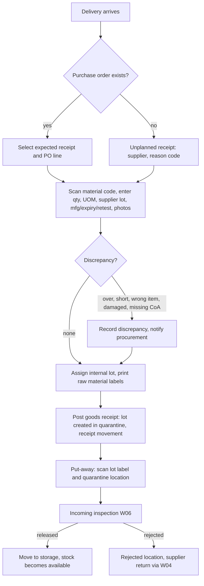

| Step | Role | Device | System action | Data captured | Validations / blocks | State transition | Documents / labels | Audit event | Offline |
|---|---|---|---|---|---|---|---|---|---|
| W01-01 | warehouse_operator (`procurement.goods_receipt.create`) | Phone | Open Receive Materials; pick an expected receipt or choose Unplanned. | `GoodsReceipt` draft: site, warehouse, supplier, PO ref or `unplanned=true` + reason code, supplier DR number, photo of supplier DR. | V-SCOPE; unplanned requires reason code (A-PROC-26). | GoodsReceipt: — → draft | — | procurement.goods_receipt.created | Cached read (expected receipts); draft creation Online-only |
| W01-02 | warehouse_operator | Phone+Scanner | Scan `BC:MAT:<code>` on the supplier pack or pick the PO line. | `GoodsReceiptLine.material_id`, `po_line_id`. | V-MAT: material not on PO → add as unplanned line → CX-QTY (procurement approves before posting). V-ASL: supplier blocked for this material → line blocked until W04 resolves. | — | — | — | Online-only |
| W01-03 | warehouse_operator | Phone | Enter received quantity and unit, container count, supplier lot, manufacture date, expiry or retest date, storage condition confirmation; photograph CoA/labels. | `qty_entered/uom_entered/qty_base/uom_base`, `supplier_lot`, dates, `FileAttachment` (CoA), `SupplierLotDocument`. | V-UOM; V-EXP: expiry already passed → line can only be received as `rejected` candidate with discrepancy; V-OVER: qty > open PO qty + configured over-delivery % (A-PROC-11, default 0) → CX-QTY. | — | — | — | Online-only |
| W01-04 | warehouse_operator | Phone | Record discrepancy if any (short, over, damaged, wrong item, missing document). | `GoodsReceiptLine.discrepancy_type`, note, photos. | Short delivery accepted as complete only via CX-QTY. | — | Discrepancy note (in GR document) | procurement.goods_receipt.discrepancy_recorded | Online-only |
| W01-05 | system | — | Allocate internal lot number from the numbering rule at posting; lot inherits material, supplier lot, dates; initial quality status `quarantine` (A-PROC-10). | `InventoryLot` (lot_number, material, supplier, supplier_lot, mfg, expiry, retest, status=quarantine, site). | V-DUP on GR idempotency key. | InventoryLot: — → quarantine | — | inventory.lot.created | Online-only |
| W01-06 | warehouse_operator (`procurement.goods_receipt.post`) | Phone | Post the receipt in one transaction: lot rows, receipt movements into the receiving location, PO line progress. | `StockMovement` type=receipt per line (lot, location=receiving, qty, user, time, source=GR). | V-SCOPE; V-DUP; V-NEG not applicable. Posting serialized on lot/location rows (ADR-006). | GoodsReceipt: draft → posted; PurchaseOrder: sent → partially_received / received | Goods receipt document (printable) | inventory.stock_movement.posted; procurement.purchase_order.state_changed | Online-only |
| W01-07 | warehouse_operator | Phone+Printer | Print raw material labels, one per container (quantity per container entered). | `LabelJob` (template version, lot, count). | Printer not configured → clear "setup required" state, no fake success. | — | Raw material label: material code/name, internal lot, supplier lot, received date, expiry/retest, status QUARANTINE, QR `BC:LOT:<lot>`. | platform.label.printed | Online-only |
| W01-08 | warehouse_operator (`inventory.stock_movement.post`) | Phone+Scanner | Put-away: scan `BC:LOT`, then `BC:LOC` of the destination. | `StockMovement` type=transfer (from receiving to quarantine location), idempotency key. | V-LOC: quarantined lot only to quarantine-class locations; V-DUP; V-FREEZE. | — | — | inventory.stock_movement.posted | Queueable (validated on replay) |
| W01-09 | system | — | Create incoming `Inspection` from the material's `InspectionPlan`; notify `qa_qc`. | `Inspection` (lot, plan revision, samples required). | Material class with "release on receipt with CoA" rule (A-PROC-10) skips to W06-disposition with CoA evidence; still a QA decision. | Inspection: — → open | — | quality.inspection.created | Online-only |
| W01-10 | qa_qc | Tablet | Disposition (W06). Released lots may then be moved to storage (W02). | `Disposition`. | V-AUTH. | InventoryLot: quarantine → released / rejected / on_hold | Updated status on reprinted label (reprint reason "status change"). | quality.disposition.recorded | Online-only |
| W01-11 | procurement | Desktop | Review unplanned receipts and discrepancies; link to PO, create PO amendment, supplier return or credit request. | PO amendment, `CustomerReturn`-equivalent for suppliers (supplier return movement type=return). | V-AUTH (`procurement.purchase_order.approve`). | — | Supplier discrepancy note | procurement.purchase_order.amended | Online-only |

**Exception paths**

| Situation | Path |
|---|---|
| Material arrives for a PO at another site | V-SCOPE blocks; operator contacts procurement; procurement re-routes the PO line to the receiving site (audit). |
| Over-delivery | V-OVER; procurement approves CX-QTY or the surplus is received on a separate line flagged `return_to_supplier`. |
| Expired or near-expiry on arrival | Line flagged; lot created in `quarantine`; `qa_qc` decides reject/return in W06; never released by the operator. |
| Missing CoA | Receipt posts (stock is physically present) with `document_missing=true`; inspection cannot be closed as released until the document is attached (configurable per material). |
| Label printer offline | Receipt may post; labels queued in `LabelJob` and printed later; lot cannot be put away to storage without a label scan unless manual code entry is used (audited). |
| Duplicate submission (double tap, offline replay) | V-DUP returns the original GR; no second lot or movement. |
| Partial delivery | PO line stays `partially_received`; expected receipt shows remaining quantity and new ETA (W04). |

**Approval gates.** G-W01-A: unplanned line or over-delivery (procurement). G-W01-B: lot release (qa_qc, W06).
**KPIs touched.** Dock-to-stock time, receipt discrepancy rate, supplier on-time/in-full, inspection turnaround, labels printed per receipt.
**Open questions.** Q-WH-01..Q-WH-04 (section 7).

### W02 Scanning and moving a lot or box

**Purpose.** Scan anything (lot, box, location) and see identity and status; move, split, merge or repack with lineage; retries are safe.
**Actors.** `warehouse_operator`, `production_operator` (staging moves), `qa_qc` (moves of blocked stock), `site_manager`.
**Preconditions.** Lot or box labelled; locations labelled with `BC:LOC`; user assigned to the site; device signed in.

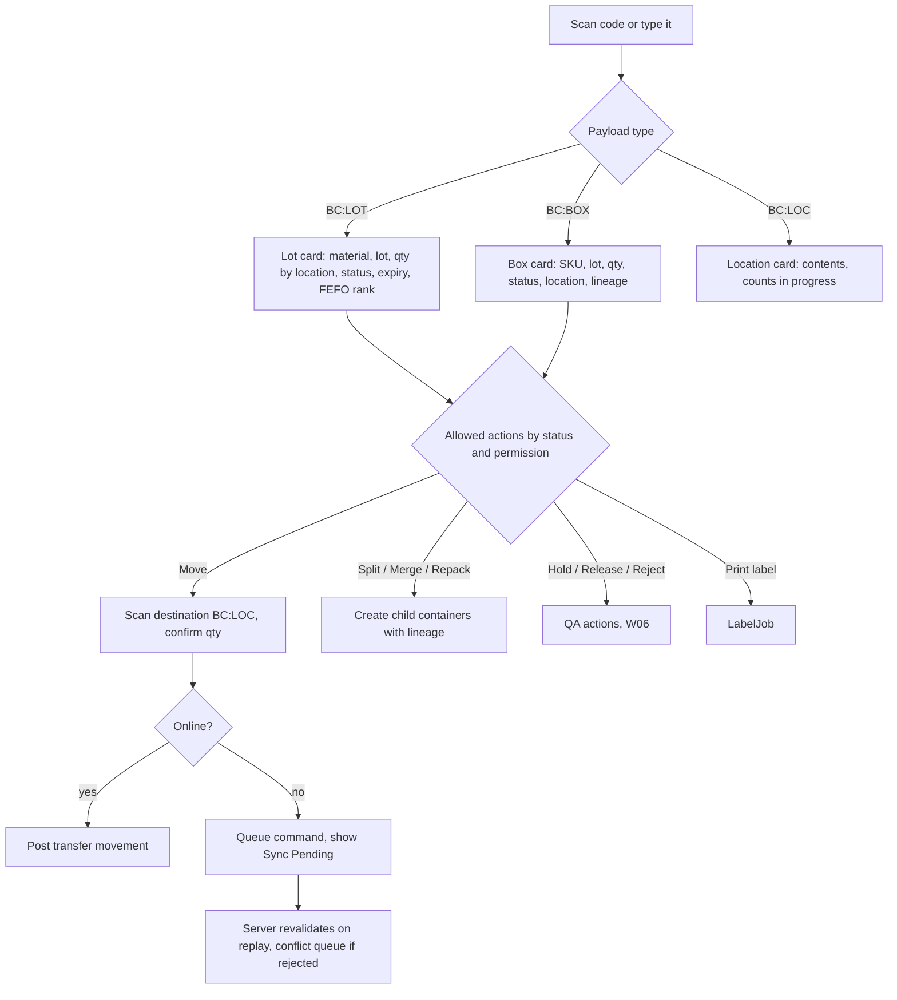

| Step | Role | Device | System action | Data captured | Validations / blocks | State transition | Documents / labels | Audit event | Offline |
|---|---|---|---|---|---|---|---|---|---|
| W02-01 | any operational role (`inventory.lot.view`) | Phone+Scanner | Scan; parse payload (`BC:LOT`, `BC:BOX`, `BC:LOC`, `BC:MAT`, `BC:SKU`); manual entry fallback. | Scan event (device id, user, time, payload). | V-SCOPE: record outside the user's sites shows "not found in your sites". Unknown payload → "not recognised" with manual entry. | — | — | — | Cached read |
| W02-02 | system | — | Show identity card with status badge (icon + text + colour), expiry, FEFO rank among same-material lots, current location(s), reservations/allocations, and only the actions the role may perform in this status. | — | Blocked statuses (`on_hold`, `rejected`, `expired`, `recalled`) show only: view, print, move-to-hold/rejected/recall (qa_qc). | — | — | — | Cached read |
| W02-03 | warehouse_operator (`inventory.stock_movement.post`) | Phone+Scanner | Move: scan destination `BC:LOC`; confirm full or partial quantity. | `StockMovement` type=transfer: lot or container, from/to location, qty, reason (optional), idempotency key = client UUIDv7. | V-LOC (status vs location class; cross-warehouse transfer needs `inventory.transfer.post`); V-FREEZE; V-NEG; V-HOLD/V-EXP/V-REC for destinations outside hold/rejected/recall classes → CX-LOT; V-DUP. | Container.location updated; balances projected | — | inventory.stock_movement.posted | Queueable |
| W02-04 | warehouse_operator (`inventory.container.create`) | Phone | Split: enter quantity to take out; system creates child box id(s) from the numbering rule, copies lot and status, records parent. | `Container` (child, parent_id, lineage_type=split), `ContainerContent` lines. | Child qty ≤ parent content; V-HOLD etc. inherited from the lot (status is a lot property, boxes inherit). | Container(parent): open → open (reduced) ; child: — → open | Box label for each child | inventory.container.split | Queueable (ids are client UUIDv7; box number assigned on replay, label printed after sync) |
| W02-05 | warehouse_operator | Phone | Merge: scan two or more boxes of the same SKU; mixed lots per box only if the SKU config allows (A-PROC-22). | New `Container` with lineage_type=merge, parents closed. | Different quality statuses cannot be merged; V-MAT (different SKU). | Parents: open → merged; new: — → open | New box label | inventory.container.merged | Queueable |
| W02-06 | warehouse_operator | Phone | Repack: move contents between boxes (customer-specific count); packing date and packer recorded. | `ContainerContent` moves with lineage_type=repack. | As W02-05. | — | Box label reprint (reason: repack) | inventory.container.repacked | Queueable |
| W02-07 | warehouse_operator | Phone+Printer | Reprint label with reason code. | `LabelJob` (reprint_reason). | Reprint count visible on the lot/box card. | — | Label | platform.label.reprinted | Online-only |
| W02-08 | system | — | Replay queued commands on reconnect: server re-runs all validations; success → posted; failure → `SyncConflict` for review. | `SyncCommand` status: pending → synced / failed / conflict. | V-DUP guarantees single posting. | — | — | platform.sync_command.replayed | — |
| W02-09 | site_manager (`platform.sync_conflict.edit`) | Desktop | Resolve conflicts: accept server state, re-issue the move with current data, or discard with reason. | `SyncConflict.resolution`. | V-AUTH. | SyncConflict: open → resolved | — | platform.sync_conflict.resolved | Online-only |

**Exception paths**

| Situation | Path |
|---|---|
| Box found in a location different from the system | Operator uses "Found here" action: transfer posted with reason `location_correction`; counts the box; no silent edit of history. |
| Scan of a lot that is `recalled` | Card shows RECALLED; only `qa_qc` may move it, and only to the recall location (CX-LOT recorded automatically with the recall case reference). |
| Same box scanned twice for the same move | V-DUP: "Already moved to LOC-xx at 10:42 by you"; nothing posted. |
| Destination location full or wrong class | V-LOC with suggested locations; operator rescans. |
| Device offline for days | Queue has a maximum age (configurable, see `docs/offline-sync.md`); expired commands require re-authentication and go to conflict review. |
| Partial move leaves fraction in source | Allowed; FEFO rank unchanged; the lot shows two locations. |

**Approval gates.** None for normal moves. CX-LOT for blocked stock. Conflict resolution by `site_manager`.
**KPIs touched.** Moves per operator-hour, sync conflict rate, scan failure rate, label reprints.
**Open questions.** Q-WH-05..Q-WH-07.

### W03 Stock count

**Purpose.** Plan and execute cycle or full counts blind, resolve variances with a second counter and an approver, and post reconciliation adjustments without erasing the original counts.
**Actors.** `site_manager` (plans, approves), `warehouse_operator` (counts, recounts), `finance` (informed of value variance, Phase 6), `auditor` (read).
**Preconditions.** Locations labelled; count reason codes configured; variance thresholds configured (A-PROC-12).

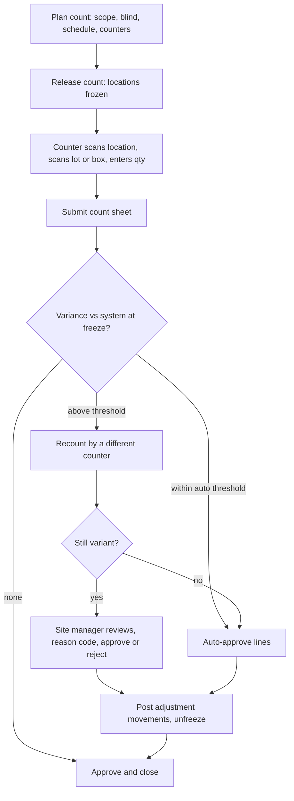

| Step | Role | Device | System action | Data captured | Validations / blocks | State transition | Documents / labels | Audit event | Offline |
|---|---|---|---|---|---|---|---|---|---|
| W03-01 | site_manager (`inventory.stock_count.create`) | Desktop | Create count plan: scope (warehouse, zone, locations, material class or ABC class), blind flag (default on), schedule, assigned counters. | `StockCount` (scope, blind, planned_at, counters). | V-SCOPE. | StockCount: draft → planned | Count sheet (optional print, no quantities when blind) | inventory.stock_count.created | Online-only |
| W03-02 | site_manager | Desktop | Release the count: snapshot expected balances at freeze time; freeze movements in scoped locations. | `StockCountLine.expected_qty` (hidden from counters when blind), `frozen_at`. | V-FREEZE now applies to W01-08, W02-03, W05 staging and W09 picks in those locations. | StockCount: planned → counting | — | inventory.stock_count.released | Online-only |
| W03-03 | warehouse_operator (`inventory.stock_count.edit`) | Phone+Scanner | Scan `BC:LOC`, then each `BC:LOT`/`BC:BOX`; enter counted quantity (or container count × units). Unexpected items can be added ("found"). | `StockCountLine.counted_qty`, counter, time, device. | V-MAT: item outside count scope → recorded as "found, out of scope" for review, not blocked; V-DUP for repeated scans (prompts "already counted, update?"). | — | — | inventory.stock_count_line.counted | Queueable (A-PROC-28) |
| W03-04 | warehouse_operator | Phone | Submit the count sheet. | `submitted_at`. | All assigned locations visited or marked "not counted" with reason. | StockCount: counting → submitted | — | inventory.stock_count.submitted | Online-only |
| W03-05 | system | — | Compare counted vs expected; classify lines: match, within auto-approve threshold, above threshold, missing, found. | `StockCountLine.variance_qty`, `variance_value` (if cost known). | — | — | Variance report | — | — |
| W03-06 | warehouse_operator (a different user) | Phone+Scanner | Recount lines above threshold, blind. | Second `StockCountLine` version (original retained). | V-SOD: recounter ≠ first counter. | — | — | inventory.stock_count_line.recounted | Queueable |
| W03-07 | site_manager (`inventory.stock_count.approve`) | Desktop | Review remaining variances; assign reason code per line (damage, mis-location, unrecorded issue, data entry); approve or reject lines; reject sends to recount. | `StockCount.approval`, reason codes. | V-SOD: approver ≠ any counter; CX-COUNT above the site threshold (A-PROC-12). | StockCount: submitted → approved | — | inventory.stock_count.approved | Online-only |
| W03-08 | system (`inventory.stock_movement.post` on behalf of approver) | — | Post one adjustment movement per approved variant line (positive or negative), linked to the count; unfreeze locations. | `StockMovement` type=adjustment, reason, source=StockCount. | V-NEG; V-DUP. | StockCount: approved → posted → closed | Stock movement report lines | inventory.stock_movement.posted; inventory.stock_count.closed | Online-only |
| W03-09 | site_manager | Desktop | Cancel a count (before posting) with reason; unfreeze. | `cancel_reason`. | V-AUTH. | StockCount: any pre-posted → cancelled | — | inventory.stock_count.cancelled | Online-only |

**Exception paths**

| Situation | Path |
|---|---|
| Movement needed urgently in a frozen location | `site_manager` either submits/cancels the count or excludes the location from scope (audited); no movement bypasses V-FREEZE. |
| Item found with no label | Counter records "unlabelled" with photo and material guess; `site_manager` resolves by creating a lot via unplanned receipt (W01) or adjustment with reason `found_unlabelled`; QA status `on_hold` until identified. |
| Count sheet submitted offline, replayed after locations unfrozen | Server rejects replay (count no longer `counting`) → conflict queue; approver decides to reopen or discard. |
| Variance in quarantined or held stock | Adjustment posts against the lot's actual status; QA notified; no status change through counting. |

**Approval gates.** G-W03-A: release count (site_manager). G-W03-B: variance approval (site_manager, SoD vs counters; CX-COUNT above threshold).
**KPIs touched.** Count accuracy (% lines matching), variance value, recount rate, count cycle time, locations counted per period.
**Open questions.** Q-WH-08, Q-WH-09.

### W04 Purchase request → approval → PO → expected receipt

**Purpose.** Replace memory-based buying with an approved trail: request, approval by threshold, PO to an approved supplier, expected receipt that drives W01, discrepancies and supplier performance.
**Actors.** Requesters (`production_planner`, `warehouse_operator`, `site_manager`), approvers (`site_manager`, `owner_director` by threshold), `procurement`, `qa_qc` (ASL), `finance` (bills, Phase 6).
**Preconditions.** `Supplier` with ASL per material, prices, lead times, MOQ, quality status; approval thresholds (A-PROC-13); PO numbering rule.

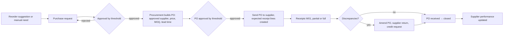

| Step | Role | Device | System action | Data captured | Validations / blocks | State transition | Documents / labels | Audit event | Offline |
|---|---|---|---|---|---|---|---|---|---|
| W04-01 | system | — | Reorder suggestion: lists materials below min, with drivers (on hand, reserved, open POs, lead time, forecast, safety stock, expiry risk) and an explanation; never auto-creates a PO. | `ReorderSuggestion` view (derived, not persisted as orders). | Suggestions require human review. | — | — | — | Cached read |
| W04-02 | requester (`procurement.purchase_request.create`) | Phone / Desktop | Create PR: material, qty, UOM, needed-by date, reason, site; attach suggestion if used. | `PurchaseRequest`, lines. | V-SCOPE; V-UOM. | PurchaseRequest: draft → submitted (on submit) | — | procurement.purchase_request.submitted | Online-only |
| W04-03 | approver (`procurement.purchase_request.approve`) | Phone / Desktop | Approve or reject per threshold (estimated value); may reduce qty with note. | approval, comment. | V-SOD (requester ≠ approver); V-AUTH; threshold is configuration (A-PROC-13). | PurchaseRequest: submitted → approved / rejected | — | procurement.purchase_request.approved | Online-only |
| W04-04 | procurement (`procurement.purchase_order.create`) | Desktop | Convert approved PRs to a PO: choose supplier from ASL, price (contract or last), MOQ rounding shown, lead time → expected date, payment terms, delivery site/warehouse. | `PurchaseOrder`, `PurchaseOrderLine` (pr_line_id). | V-ASL (supplier not approved for material or quality status blocked) → cannot add line; V-UOM (purchase UOM conversion). | PurchaseOrder: draft → submitted | — | procurement.purchase_order.submitted | Online-only |
| W04-05 | approver (`procurement.purchase_order.approve`) | Desktop | Approve PO per value threshold. | approval. | V-SOD; V-AUTH. | PurchaseOrder: submitted → approved | — | procurement.purchase_order.approved | Online-only |
| W04-06 | procurement | Desktop | Send PO (PDF by email or download); record supplier confirmation and promised date. | `sent_at`, supplier confirmation ref, promised dates. | — | PurchaseOrder: approved → sent | Purchase order PDF (template version recorded) | procurement.purchase_order.sent; platform.document.generated | Online-only |
| W04-07 | system | — | Create expected receipt lines visible in W01 and the Action Center (late expected receipts). | expected qty/date per PO line. | — | — | — | — | Cached read |
| W04-08 | warehouse_operator | Phone | Receive (W01); PO progresses with each posted GR. | — | — | PurchaseOrder: sent → partially_received → received | — | — | — |
| W04-09 | procurement | Desktop | Handle discrepancies from W01-11: amend PO (qty/price), create supplier return (movement type=return from the lot's location, QA status must be `rejected` or returned-as-is approved by qa_qc), request credit. | PO amendment (versioned), return document, `SupplierBill` dispute (Phase 6). | V-AUTH; return of a `released` lot requires `qa_qc` status change first. | PurchaseOrder: received → closed | Supplier return note | procurement.purchase_order.amended; inventory.stock_movement.posted | Online-only |
| W04-10 | system | — | Update supplier performance: on-time, in-full, discrepancy count, document completeness, lead-time variance, rejections at inspection. | derived metrics. | — | — | Supplier performance report | — | Cached read |
| W04-11 | qa_qc (`masterdata.supplier.approve`) | Desktop | Maintain ASL: approve/suspend supplier per material with evidence (documents, audit date). | `Supplier.asl` lines, quality_status. | V-SOD vs procurement requester. | — | — | masterdata.supplier.asl_changed | Online-only |

**Exception paths**

| Situation | Path |
|---|---|
| Urgent purchase without PR | `procurement` creates PO with `urgent=true` and reason; approval still required before sending; `owner_director` notified. |
| Supplier not on ASL | V-ASL; `procurement` requests ASL addition; `qa_qc` approves (W04-11); PO line waits. |
| Price changed at delivery | GR posts quantity; price variance recorded on the PO line for finance; no stock impact. |
| PO cancelled after partial receipt | Remaining lines cancelled with reason; received lots unaffected. |

**Approval gates.** G-W04-A PR approval; G-W04-B PO approval; G-W04-C ASL change (qa_qc).
**KPIs touched.** PR-to-PO cycle time, PO approval lead time, supplier OTIF, price variance, stockouts avoided by suggestions.
**Open questions.** Q-WH-10..Q-WH-12.

### W05 Planning and executing a batch

**Purpose.** From demand to a closed batch with a complete electronic BMR: plan, work order, batch with snapshotted revisions, staging, line clearances, dispensing under tolerance with operator and checker, process steps with parameters, in-process QC, filling/cutting, packaging with component reconciliation, output, yield and closure.
**Actors.** `production_planner` (plan, WO, batch), `production_operator` (executes), checker (second `production_operator` or `site_manager`, A-PROC-06), `warehouse_operator` (staging), `qa_qc` (in-process checks, release W06), `site_manager` (exceptions).
**Preconditions.** Approved effective `FormulaRevision`, `RoutingRevision`, `WorkInstructionRevision`, `InspectionPlan` and `LabelTemplate` for the SKU (W12); production line and equipment registered with status (W13); released material lots available; BMR `DocumentTemplateVersion` approved.

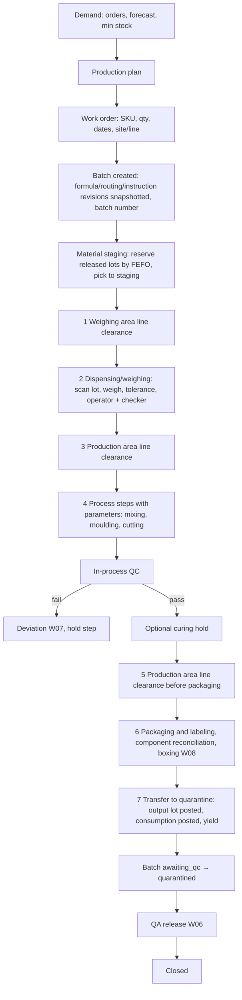

**Batch and work order states used below.** WorkOrder: draft → planned → released → in_progress → completed → closed / cancelled. Batch: draft → planned → materials_staged → in_process → awaiting_qc → quarantined → released / rejected / rework_approved → closed. Interpretation of `awaiting_qc` vs `quarantined` is A-PROC-29.

| Step | Role | Device | System action | Data captured | Validations / blocks | State transition | Documents / labels | Audit event | Offline |
|---|---|---|---|---|---|---|---|---|---|
| W05-01 | production_planner (`production.production_plan.create`) | Desktop | Build plan from demand: open sales orders, forecast (labelled), min-stock; shows material availability and shortages (links to W04). | `ProductionPlan` lines (SKU, qty, week, site/line). | Availability uses the formula in the brief (on hand − reserved − allocated − quarantined − on hold − expired − recalled). | ProductionPlan: draft → approved (site_manager, optional gate A-PROC-30) | Plan vs capacity view | production.production_plan.approved | Online-only |
| W05-02 | production_planner (`production.work_order.create`) | Desktop | Create work order: SKU, target qty (units or mass), planned start/end, site, line, number of batches, batch size from formula. | `WorkOrder`. | V-REV: approved effective revisions must exist for the planned date; V-CAL on line/equipment (W13). | WorkOrder: draft → planned | — | production.work_order.created | Online-only |
| W05-03 | production_planner (`production.batch.create`) | Desktop | Create batch(es): batch number from numbering rule; **snapshot** formula revision (BOM lines scaled to batch size), routing revision (steps, parameters, limits, equipment class, checks), instruction revision, inspection plan revision, label template version. | `Batch`, `BatchMaterial` (theoretical qty per BOM line, tolerance), `ProcessStepRecord` skeletons. | V-REV; V-DUP on batch creation key. Later revisions never alter this batch. | Batch: — → draft → planned | BMR (draft, watermark "NOT STARTED") | production.batch.created; production.batch.revisions_snapshotted | Online-only |
| W05-04 | production_planner (`production.work_order.submit`) | Desktop | Release work order: reserve material by FEFO/FIFO rules (A-PROC-09; `StockReservation` per BatchMaterial); shortages shown. | `StockReservation` (lot, qty, batch). | V-EXP/V-REC/V-HOLD: only `released` lots reservable; expiry must be after planned end date (configurable margin). Shortage blocks release unless `allow_release_with_shortage` (default off). | WorkOrder: planned → released | Material requirement / pick list for staging | production.work_order.released; inventory.stock_reservation.created | Online-only |
| W05-05 | warehouse_operator (`inventory.stock_movement.post`) | Phone+Scanner | Stage materials: pick reserved lots to the staging location by scanning `BC:LOT` and `BC:LOC:staging`; print dispensing sheet. | `StockMovement` type=transfer to staging (status `released` unchanged). | V-MAT: scanned lot ≠ reserved lot → CX-MAT (planner substitutes another released lot of the same material); V-FREEZE; V-DUP. | Batch: planned → materials_staged (when all lines staged) | Dispensing sheet (batch, ingredient, target, tolerance, lot, scale, operator, checker) | inventory.stock_movement.posted; production.batch.state_changed | Queueable |
| W05-06 | production_operator + checker | Tablet | **Checklist 1: Weighing area line clearance.** Configurable checklist (area clean, previous batch materials/labels removed, scale status, balance check record; content per A-PROC-07) with photo option; operator completes, checker verifies. | `ProcessStepRecord` (type=line_clearance, area=weighing), items, operator, checker, timestamps. | V-SOD (operator ≠ checker); V-CAL: scale must be `available` with calibration in date → CX-CAL; any "no" answer blocks the step until resolved or a deviation is raised. | Batch: materials_staged → in_process (first clearance signed); WorkOrder: released → in_progress | BMR checklist line 1 | production.process_step.completed | Queueable (managed device, A-PROC-18) |
| W05-07 | production_operator (`production.dispense_record.create`) | Tablet+Scanner+Scale | **Checklist 2: Dispensing/weighing**, one `DispenseRecord` per BOM line (and per lot if split): select BOM line → scan `BC:LOT` → select scale (equipment id) → tare/gross/net or net only → system compares to target ± tolerance. | `DispenseRecord`: material, lot, expiry (from lot), target, tolerance, actual, UOM, tare/gross/net, scale id, operator, device, time, local sequence. | V-MAT: lot material ≠ BOM line material, or lot not reserved for this batch → blocked ("wrong material/lot", expected lot shown) → CX-MAT; V-EXP/V-REC/V-HOLD on the lot at the time of weighing → blocked → only CX-LOT by qa_qc (expected never); V-TOL: actual outside tolerance → blocked, re-weigh allowed, otherwise CX-TOL with Deviation; V-CAL; V-UOM; V-DUP. | DispenseRecord: — → weighed | BMR ingredient row (theoretical, actual, lot, expiry) | production.dispense_record.created; platform.exception.approved (if CX) | Queueable (managed device, cached formula and limits; server re-validates lot status, tolerance and approvals on replay before final posting) |
| W05-08 | checker (`production.dispense_record.approve`) | Tablet | Checker verifies each dispense: sees material, lot, target, actual, and confirms (or rejects → re-weigh). | `DispenseRecord.checked_by`, time. | V-SOD: checker ≠ operator (same authenticated session cannot do both; checker signs in on the device or uses their own device). | DispenseRecord: weighed → checked | BMR "checked by" | production.dispense_record.checked | Queueable |
| W05-09 | system | — | When all BOM lines are checked, compute dispensed total vs theoretical total and show rounding (F-05); consumption movements are **staged** (not posted) until W05-17 or posted per line if site policy `post_consumption_at_dispense` is on (A-PROC-31). | `BatchMaterial.actual_qty`, `StockMovement` type=consumption (pending or posted). | V-NEG on the lot at staging location. | — | Dispensing sheet complete | inventory.stock_movement.posted (if per-line policy) | Online-only |
| W05-10 | production_operator + checker | Tablet | **Checklist 3: Production area line clearance** (mixer, moulds, cutting tools clean; equipment status; previous product removed). | `ProcessStepRecord` (line_clearance, area=production). | V-SOD; V-CAL on mixer/equipment → CX-CAL. | — | BMR checklist line 3 | production.process_step.completed | Queueable |
| W05-11 | production_operator | Tablet | **Checklist 4: Process steps** from the routing (for Acapulco Soap: mixing, moulding, cutting; configured as separate sub-steps). Enter each parameter with unit against configured limits; select equipment; record start/end. | `ProcessStepRecord` per sub-step: parameters (value, unit, limit, in-limit flag), `EquipmentUse` (equipment id, start, end), operator, checker where required. | V-TOL on parameters → CX-TOL + Deviation; V-CAL; prerequisite steps must be complete (V-STATE); required in-process checks (W05-12) must pass before the step can complete. | ProcessStepRecord: pending → in_progress → completed | BMR procedure section (instruction revision text, actual readings) | production.process_step.completed | Queueable |
| W05-12 | qa_qc or production_operator per plan (`quality.inspection.create`) | Tablet | In-process QC at configured checkpoints (sampling, test, result vs spec). Examples for soap to be configured by QA; none are asserted here (verify with authorized personnel before production use). | `Inspection` (type=in_process), `TestResult` (value, unit, spec, pass/fail, tester, time). | Fail → step blocked; `Deviation` raised (W07); `QualityHold` on the WIP. | Inspection: open → completed | BMR in-process test lines | quality.test_result.recorded | Online-only (results); sample capture Queueable |
| W05-13 | production_operator | Tablet | Optional curing/hold step (A-PROC-05): record start; system shows earliest end from configured minimum; step cannot complete early without CX-TOL. | `ProcessStepRecord` (type=hold, min_duration). | V-TOL on duration. | Batch stays in_process (WIP) | — | production.process_step.completed | Cached read (timer), completion Queueable |
| W05-14 | production_operator + checker | Tablet | **Checklist 5: Production area line clearance before packaging** (A-PROC-32: the second clearance on the paper BMR is interpreted as the packaging-area clearance; packaging components, labels of other products removed). | `ProcessStepRecord` (line_clearance, area=packaging). | V-SOD; V-CAL. | — | BMR checklist line 5 | production.process_step.completed | Queueable |
| W05-15 | production_operator | Tablet+Scanner | **Checklist 6: Packaging and labeling.** Issue packaging components (wrapper/label/carton lots scanned), record units packed, label template version and printed lot/expiry; **component reconciliation**: issued − used − damaged − returned = 0 (tolerance configurable, A-PROC-19). Boxing per W08 produces box ids. | `BatchMaterial` (packaging lines, actual), `ScrapReworkRecord` (damaged labels), `Container` ids, `LabelJob`. | V-MAT on packaging lots; V-EXP/V-HOLD on packaging lots; reconciliation mismatch outside tolerance → blocked until counted again or Deviation. | — | Box labels (W08), BMR checklist line 6, reconciliation table | production.process_step.completed; inventory.container.created | Queueable (scans), label print Online-only |
| W05-16 | production_operator | Tablet | Record actual output: units and/or mass, scrap and rework quantities with reason codes; system computes actual yield vs theoretical yield and variance. | `BatchOutput` (qty, uom), `YieldRecord` (theoretical, actual, variance %, scrap, rework), `ScrapReworkRecord`. | Yield outside configured min/max % (A-PROC-33; limits are configuration, verify with authorized personnel before production use) → `Deviation` required before W05-17. | — | BMR yield section | production.yield.recorded | Queueable |
| W05-17 | production_operator (`production.batch.post`), checker | Tablet+Scanner | **Checklist 7: Transfer to quarantine storage.** Post in one transaction: consumption movements (if not already), output movement creating the finished `InventoryLot` (one lot per batch, A-PROC-21; status `quarantine`, expiry = mfg date + shelf life, A-PROC-08) and its containers in the quarantine location, finished-product `Inspection` from the plan. Scan the quarantine `BC:LOC`. | `StockMovement` type=consumption and output; `InventoryLot` (finished), `Inspection` (finished_product). | V-SOD; V-LOC (must be quarantine class); V-NEG; V-DUP; all required steps completed (V-STATE). | Batch: in_process → awaiting_qc; WorkOrder: in_progress → completed (last batch); InventoryLot(finished): — → quarantine | BMR checklist line 7; finished-goods lot label (status QUARANTINE) | inventory.stock_movement.posted; production.batch.state_changed; quality.inspection.created | Online-only |
| W05-18 | qa_qc | Tablet | Finished-product tests and BMR review (W06). When results and review are complete the batch is `quarantined` awaiting disposition. | `TestResult`, review checklist. | — | Batch: awaiting_qc → quarantined | BMR QC section | quality.inspection.completed | Online-only |
| W05-19 | qa_qc (`quality.disposition.approve`) | Tablet / Desktop | Disposition (W06): release, reject, conditional hold, rework. | `Disposition`. | V-AUTH; V-SOD. | Batch: quarantined → released / rejected / rework_approved; InventoryLot: quarantine → released / rejected / on_hold | BMR disposition and signature block; FG label reprint with status RELEASED | quality.disposition.recorded | Online-only |
| W05-20 | production_planner (`production.batch.edit`) then site_manager | Desktop | Close batch: reconciliation complete, documents attached (scanned paper pages if SOP requires), costing snapshot (estimate vs actual, Phase 6), BMR final PDF generated. | `Batch.closed_at`, `GeneratedDocument` (BMR, template version, source revision). | All deviations closed or accepted by qa_qc; reservations released. | Batch: released/rejected/rework_approved → closed; WorkOrder: completed → closed | BMR final PDF (page numbers, batch id on every page, QR to record) | production.batch.closed; platform.document.generated | Online-only |
| W05-21 | qa_qc (`production.batch.void`-level: `production.batch.admin`) | Desktop | Controlled reopen/amend: reason, scope of amendment; original values retained; new BMR revision generated. | Amendment record. | CX-REOPEN. | Batch: closed → (amending) → closed | BMR revision n+1 with change note | production.batch.reopened; production.batch.amended | Online-only |

**Worked example: Acapulco Soap (from the paper BMR; verify with authorized personnel before production use).**

| BOM line | Ingredient (as printed) | Theoretical (g) | Share of 17,600 g | Tolerance (placeholder, per line; verify with authorized personnel before production use) | Modelled as | Scan at W05-07 |
|---|---|---|---|---|---|---|
| 1 | Coconut Oil | 3,723.2 | 21.15 % | ±1.0 % (±37.2 g) | raw material, FEFO | `BC:LOT` of coconut oil lot |
| 2 | Palm Oil | 8,687.4 | 49.36 % | ±1.0 % (±86.9 g) | raw material, FEFO | `BC:LOT` |
| 3 | 33.33% Lye Solution | 4,964.2 | 28.21 % | ±1.0 % (±49.6 g) | intermediate with its own lot and shelf life (A-PROC-04) | `BC:LOT` of the lye-solution lot |
| 4 | Acapulco Extract | 190.9 | 1.08 % | ±2.0 % or ±1 g, whichever is stricter | raw material (botanical) | `BC:LOT` |
| 5 | 6% Green in Oil | 34.4 | 0.20 % | ±2.0 % or ±1 g, whichever is stricter | intermediate (colour dispersion, A-PROC-04) | `BC:LOT` |
| Total | | 17,600 (lines sum to 17,600.1; F-05) | 100.00 % | | | |

- Header snapshot: product Acapulco Soap, SKU (to be assigned), batch number from the numbering rule, formula revision (the paper "Batch Formula NO" becomes `FormulaRevision.number`), department Production, site/line, batch size 17,600 g, planned start/end, BMR template version.
- Checklist steps 1–7 map to `RoutingStep` types `line_clearance(weighing)`, `dispensing`, `line_clearance(production)`, `process(mixing, moulding, cutting)`, `line_clearance(packaging)`, `packaging`, `transfer_to_quarantine`. Step 4 parameters (for example mixing time, temperature, trace) are **not** on the paper form; the process owner must define them in W12.
- Theoretical yield is blank on the paper form. It will be configured per formula either as expected mass (17,600 g × expected process yield %) or as expected unit count (bars); actual yield is entered at W05-16 (A-PROC-33).
- Expiration date of the finished batch = manufacturing (or packaging) date + shelf life configured on the product; the paper form shows it as a free field (A-PROC-08).
- Test results, test date, conducted/checked by: configured in the finished-product `InspectionPlan`; no tests are asserted in this document.
- Final disposition Approved/Disapproved becomes `Disposition` with values release / reject / conditional hold / rework, QA name becomes the authenticated `qa_qc` user and time (electronic record, see W06 note on signatures).

**How a lotion route differs (example only; to be configured and approved by Bryel's process owners; verify with authorized personnel before production use).** Steps would typically be: line clearance → dispensing (water phase, oil phase, additives as separate BOM groups) → heating of water and oil phases to configured temperatures in separate vessels (parameters: temperature, time) → emulsification with a homogenizer (speed, time, temperature) → cooling with stirring (temperature curve) → addition of heat-sensitive materials below a configured temperature → in-process QC (for example appearance, pH, viscosity: examples only) → bulk hold in a tank or drum as an intermediate lot → filling (fill weight checks with tolerance per container, filling line equipment) → capping/labeling → cartoning → transfer to quarantine. The data model handles this with routing step types `dispensing`, `process`, `hold`, `filling`, `packaging` and parameter definitions; no code change is needed per product.

**Exception paths**

| Situation | Path |
|---|---|
| Lot expires or is placed on hold between staging and weighing | V-EXP/V-HOLD at W05-07 (status is re-read at scan time); planner substitutes another released lot (CX-MAT) and the warehouse returns the blocked lot to its status location. |
| Scale reading out of tolerance after two re-weighs | CX-TOL: site_manager approves with reason, qa_qc acknowledges, Deviation created; the BMR row shows the deviation flag. |
| Checker unavailable | Step waits; `site_manager` may act as checker if configured; the same person can never be both. |
| Equipment overdue for calibration | V-CAL at selection; CX-CAL or use another available piece; Deviation. |
| Label/packaging reconciliation does not balance | Recount; if still unbalanced beyond tolerance, Deviation and QA review before transfer to quarantine. |
| Device offline during dispensing | Captures queue with local sequence; on replay the server re-validates lot status and tolerance; a rejected replay puts the batch on `on_hold` step status and alerts the planner; nothing is silently accepted. |
| Batch must be cancelled mid-process | Batch → rejected via W06 with reason; consumed materials remain consumed; staged unused lots returned to storage by W02; scrap recorded. |
| Paper used because SOP requires handwriting | Paper page scanned and attached to the step; reviewer confirms transcription; both retained. |

**Approval gates.** G-W05-A plan approval (optional); G-W05-B work order release (planner); G-W05-C each line clearance and dispense checked by a second person; G-W05-D exceptions CX-TOL/CX-MAT/CX-CAL; G-W05-E transfer to quarantine (operator + checker); G-W05-F disposition (qa_qc, W06); G-W05-G closure; G-W05-H reopen (qa_qc).
**KPIs touched.** Plan vs actual output, yield %, yield variance, scrap/rework %, cycle time per step, line utilization, deviations per batch, right-first-time (batches with no CX), QC turnaround.
**Open questions.** Q-PR-01..Q-PR-10.

### W06 QA release (incoming, in-process, finished product; disposition)

**Purpose.** Every quality decision is a recorded disposition by an authorized `qa_qc` user who did not request it, based on inspections whose results are append-only. Stock and batches change status only through this workflow.
**Actors.** `qa_qc` (tests, review, disposition), `production_operator` (samples, in-process entries where the plan allows), `warehouse_operator` (sampling moves, status location moves), `site_manager` (informed).
**Preconditions.** `InspectionPlan` revisions per material/SKU/stage with tests, methods, specifications, units, sampling rule and required documents, validated by the company's QA; quarantine/hold/rejected locations.

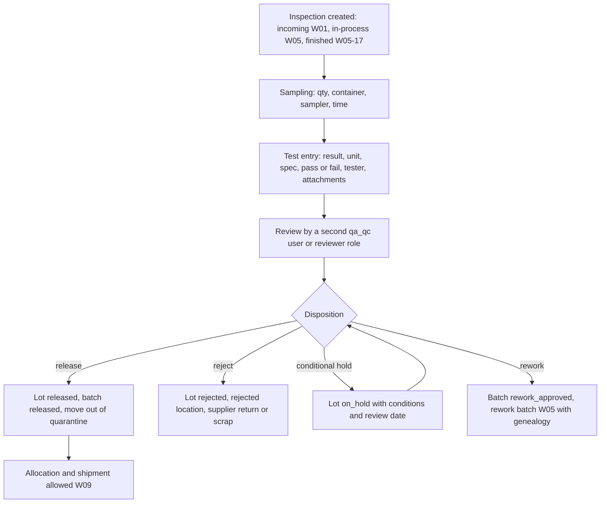

| Step | Role | Device | System action | Data captured | Validations / blocks | State transition | Documents / labels | Audit event | Offline |
|---|---|---|---|---|---|---|---|---|---|
| W06-01 | system | — | Create `Inspection` from the plan at the trigger (receipt, checkpoint, output); list in the QA inspection queue with due time. | `Inspection` (stage, lot or batch, plan revision, required tests). | Lot keeps status `quarantine` (incoming/finished) or WIP step hold (in-process). | Inspection: — → open | — | quality.inspection.created | Online-only |
| W06-02 | qa_qc or production_operator per plan (`quality.inspection.edit`) | Phone / Tablet | Record sampling: quantity taken, container scanned, sampler, time, sample label printed. Sample removal posts a consumption movement with reason `sample` (A-PROC-34). | `Inspection.samples[]`, `StockMovement` type=consumption (reason sample). | V-HOLD does not block sampling from `quarantine`; sampling from `on_hold`/`recalled` requires CX-LOT. | Inspection: open → sampled | Sample label | quality.sample.taken; inventory.stock_movement.posted | Queueable (sample capture), movement Online-only |
| W06-03 | qa_qc (`quality.test_result.create`) | Tablet / Desktop | Enter each test: value, unit, method, instrument id, specification (min/max/text), pass/fail computed, attachments (photos, external lab report). | `TestResult`. | Unit must match the spec; V-CAL on instrument. Results are append-only: a correction is a new `TestResult` row with reason, linked to the superseded row. | — | — | quality.test_result.recorded; quality.test_result.corrected | Online-only |
| W06-04 | qa_qc (a different user) (`quality.inspection.approve`) | Desktop | Review results and, for batches, the BMR (all steps complete, deviations closed or accepted, reconciliation OK, documents attached). Reviewer may request retest. | `Inspection.reviewed_by`, review checklist. | V-SOD: reviewer ≠ tester (configurable to allow same user at small sites with `owner_director` approval, A-PROC-35). | Inspection: sampled → completed; Batch: awaiting_qc → quarantined | BMR QC section | quality.inspection.completed | Online-only |
| W06-05 | qa_qc (`quality.disposition.approve`) | Desktop | Disposition: release, reject, conditional hold (with conditions, review date), rework (with rework instruction reference). Reason and comment required for anything but release. | `Disposition` (decision, reason, conditions, decided_by, time). | V-AUTH: only `qa_qc` with `quality.disposition.approve`; V-SOD: decider ≠ the user who requested the inspection, ran the batch step 7, or entered the results; failed tests block `release` unless a documented OOS investigation (Deviation) concludes otherwise. | InventoryLot: quarantine → released / rejected / on_hold; Batch: quarantined → released / rejected / rework_approved | BMR disposition block; lot label reprint with new status | quality.disposition.recorded; inventory.lot.status_changed | Online-only |
| W06-06 | warehouse_operator | Phone+Scanner | Move stock to the status-appropriate location (released → storage; rejected → rejected location; on_hold → hold location). | `StockMovement` type=transfer. | V-LOC. | — | — | inventory.stock_movement.posted | Queueable |
| W06-07 | qa_qc | Desktop | Place a hold at any time (`QualityHold`) on a lot, batch, box or location; lifting a hold is a disposition. | `QualityHold` (scope, reason, raised_by, lifted_by). | V-SOD on lift. | InventoryLot: released → on_hold → released / rejected | Hold notice | quality.quality_hold.created; quality.quality_hold.lifted | Online-only |
| W06-08 | system | — | Expiry job: lots past expiry become `expired` automatically; retest date passed → `on_hold` with reason retest due (A-PROC-36). | status change with reason. | — | InventoryLot: released → expired / on_hold | Expiry alert in Action Center | inventory.lot.status_changed | — |

**Exception paths**

| Situation | Path |
|---|---|
| Result entered wrongly | Append correction with reason; original visible with strike-through in the UI and in the BMR audit annex. |
| Retest after fail | New `TestResult` rows; both retained; disposition references the OOS Deviation. |
| Release needed urgently before all tests are complete | Conditional hold with conditions (for example pending micro result) only if the company's QA policy allows (configuration `allow_conditional_release`, default off); shipment of conditionally held stock is blocked unless a customer-specific rule and CX-LOT exist. |
| Rework | Batch → rework_approved; a rework batch is created in W05 consuming the held/rejected lot as an input (genealogy preserved); the original batch closes with a link. |
| Customer requires a certificate | Certificate of analysis document generated from `TestResult` rows for the lot (template in `docs/reports-and-templates.md`); reprint audited. |

**Signatures and e-records.** Every sign-off above is an authenticated user action with a timestamp and audit event. It is an electronic record, not a validated electronic signature. If the company intends to rely on it in place of handwritten signatures for regulated records, formal validation (procedures, user training, system validation) is required first; until then the printed BMR carries signature lines (hybrid record, A-PROC-37).
**Approval gates.** G-W06-A review (second qa_qc); G-W06-B disposition (qa_qc, SoD); G-W06-C hold lift.
**KPIs touched.** QC turnaround, first-pass release rate, holds open, OOS rate, rejected quantity/value.
**Open questions.** Q-QA-01..Q-QA-06.

### W07 Deviation / nonconformance → investigation → CAPA; complaint; recall (brief)

**Purpose.** Capture every departure from the expected process at the point it happens, investigate it, and close it with corrective and preventive actions; handle complaints and recalls with reverse genealogy.
**Actors.** Anyone with `quality.deviation.create` raises; `qa_qc` owns investigation and closure; `site_manager` assigns actions; `sales_cs` logs complaints; `owner_director` approves recall decisions.

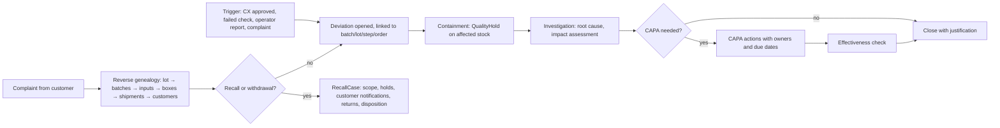

| Step | Role | Device | System action | Data captured | Validations / blocks | State transition | Documents / labels | Audit event | Offline |
|---|---|---|---|---|---|---|---|---|---|
| W07-01 | any (`quality.deviation.create`) | Phone / Tablet | Raise deviation from the step, lot, batch, receipt or order; system pre-fills references; severity classification by `qa_qc`. | `Deviation` (type, description, refs, raised_by, severity). | Automatically created by CX-TOL, CX-CAL, failed in-process check, yield out of range, reconciliation mismatch. | Deviation: — → open | — | quality.deviation.opened | Queueable (capture), classification Online-only |
| W07-02 | qa_qc (`quality.quality_hold.create`) | Desktop | Containment: hold affected lots/boxes/WIP; block the batch step if in process. | `QualityHold` linked to deviation. | — | InventoryLot: released → on_hold | Hold notice | quality.quality_hold.created | Online-only |
| W07-03 | qa_qc | Desktop | Investigation: root cause, impact (other batches using the same lot, same equipment, same operator), attachments. | `Deviation.investigation`, linked records (via genealogy query). | — | Deviation: open → under_investigation | Investigation report | quality.deviation.updated | Online-only |
| W07-04 | qa_qc (`quality.capa.create`), owners assigned | Desktop | CAPA: actions, owners, due dates, verification method; Action Center tracks overdue. | `Capa`, actions. | Closing a deviation with open CAPA requires `qa_qc` justification. | Capa: open → in_progress → verified → closed | — | quality.capa.created; quality.capa.closed | Online-only |
| W07-05 | qa_qc (a different user from the raiser where the raiser is qa_qc) (`quality.deviation.approve`) | Desktop | Close deviation with disposition of affected stock (via W06) and effectiveness check date. | closure. | V-SOD. | Deviation: under_investigation → closed | Deviation report (in BMR annex when batch-related) | quality.deviation.closed | Online-only |
| W07-06 | sales_cs (`sales.complaint.create`) | Desktop / Phone | Log complaint: customer, product, lot/box from the label, description, photos, sample returned. | `Complaint`. | Lot/box id validated against shipments to that customer when known. | Complaint: open → under_review | Complaint acknowledgement to customer | sales.complaint.created | Online-only |
| W07-07 | qa_qc | Desktop | Reverse genealogy from the complaint's lot/box: batch → all input lots → other batches sharing those lots → all boxes → shipments → customers; forward from a supplier lot likewise. | Trace report (point in time). | Scoped to the user's sites; `owner_director` sees all. | — | Traceability report | quality.trace.run | Online-only |
| W07-08 | qa_qc proposes, owner_director approves (`quality.recall_case.approve`) | Desktop | Recall/withdrawal case: classification and legal notification obligations are the company's regulatory responsibility (configuration and templates, not system rules); holds on all affected stock; customer notification list for `sales_cs`; expected returns. | `RecallCase` (scope, affected lots/boxes/shipments, customers, status). | V-SOD; affected lots → `recalled`; shipments of affected lots blocked (V-REC). | RecallCase: open → in_progress → closed; InventoryLot: * → recalled | Recall notification (template), returns list | quality.recall_case.opened; inventory.lot.status_changed | Online-only |
| W07-09 | warehouse_operator, sales_cs | Phone / Desktop | Returns: receive returned boxes by scan (`CustomerReturn`), post return movement to the recall location; QA disposition of returned stock (W06). | `CustomerReturn`, `StockMovement` type=return. | V-LOC (recall location only); V-DUP. | CustomerReturn: open → received → dispositioned | Return receipt | inventory.stock_movement.posted | Queueable (scan), posting Online-only |
| W07-10 | qa_qc | Desktop | Close recall case with reconciliation (shipped − returned − accounted) and final report. | reconciliation. | Unreconciled quantities require explanation. | RecallCase: in_progress → closed | Recall closure report | quality.recall_case.closed | Online-only |

**Approval gates.** G-W07-A severity classification (qa_qc); G-W07-B deviation closure (qa_qc, SoD); G-W07-C recall decision (owner_director); G-W07-D returned-stock disposition (qa_qc).
**KPIs touched.** Deviations per batch, time to close, overdue CAPA, complaints per 10,000 units shipped, recall reconciliation %.
**Open questions.** Q-QA-07..Q-QA-09.

### W08 Boxing finished goods

**Purpose.** Put finished units into uniquely identified boxes according to the SKU and customer packaging configuration, print the box label, and produce a packing list; every box knows its contents, lot, packer and location.
**Actors.** `production_operator` (boxing at the end of W05) or `warehouse_operator` (re-boxing / customer-specific repack), checker, `sales_cs` (customer config).
**Preconditions.** `Sku.packaging_config` (units per box, carton type, inserts, label template, lot/expiry printing) and `CustomerRequirement` overrides (units per box, shipping marks, artwork version, documents); box numbering rule; label printer.

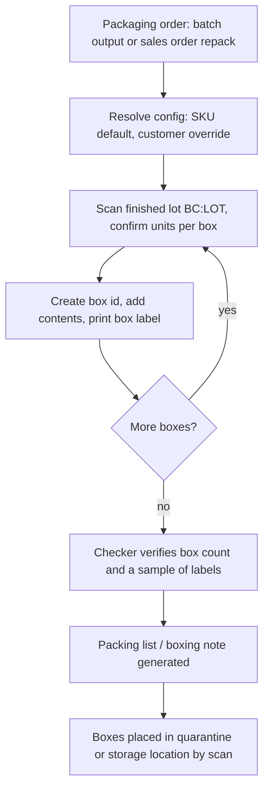

| Step | Role | Device | System action | Data captured | Validations / blocks | State transition | Documents / labels | Audit event | Offline |
|---|---|---|---|---|---|---|---|---|---|
| W08-01 | production_operator / warehouse_operator (`inventory.container.create`) | Tablet | Start boxing from a batch (W05-15) or a packaging order for a sales order; system resolves units per box, carton type, label template, shipping marks (customer override wins, A-PROC-22). | `Pack` (source: batch or sales order), config snapshot. | V-SCOPE; customer override must be an approved `CustomerRequirement` revision. | Pack: — → in_progress | — | inventory.pack.started | Online-only |
| W08-02 | operator | Tablet+Scanner | Scan the finished lot (`BC:LOT`); enter or confirm units per box; system creates `Container` with box id from the numbering rule and `ContainerContent` (SKU, lot, qty, expiry). Mixed lots per box only if config allows. | `Container` (box_id, sku, status=open, packed_at, packer, location), `ContainerContent`. | V-MAT (lot SKU ≠ order/batch SKU); V-EXP/V-REC on the lot; quarantined lot allowed at batch boxing (box inherits lot status); over-count vs lot balance → V-NEG. | Container: — → open → closed (when full) | Box label: box id QR `BC:BOX:<id>`, SKU/product, lot, qty, packed date, expiry, status (inherited), customer marks if any | inventory.container.created; platform.label.printed | Queueable (scans and box creation), label print Online-only |
| W08-03 | operator | Tablet | Partial last box: enter actual qty; flagged `partial=true` on the label. | `ContainerContent.qty`. | — | — | Box label (PARTIAL) | — | Queueable |
| W08-04 | checker (`inventory.pack.approve`) | Tablet+Scanner | Verify: scan a configurable sample of boxes (default all for first batch of a SKU, A-PROC-38), confirm count, confirm label content vs artwork version. | `Pack.checked_by`, scanned box ids. | V-SOD; box count × units ≠ lot output → blocked until reconciled (W05-15). | Pack: in_progress → verified | — | inventory.pack.verified | Queueable |
| W08-05 | system | — | Generate boxing note / packing list: order or batch, customer, SKU, lot, box ids, qty per box, totals, gross/net weight if captured, packer/checker, date, shipping marks. | `GeneratedDocument`. | — | — | Boxing note / packing list (A4) | platform.document.generated | Online-only |
| W08-06 | operator | Phone+Scanner | Put boxes away by scanning each box (or a pallet id containing them) and the location. | `StockMovement` type=transfer (container). | V-LOC. | — | Pallet label (optional) | inventory.stock_movement.posted | Queueable |
| W08-07 | warehouse_operator | Phone | Repack for a customer-specific count later: W02-06 with lineage; new labels; packing list regenerated. | lineage. | Only `released` lots for customer repack. | — | Box labels, packing list v2 | inventory.container.repacked | Queueable |

**Exception paths**

| Situation | Path |
|---|---|
| Label printed but box contents changed | Reprint with reason; old box id retained in lineage; a label that no longer matches is voided (`LabelJob.voided`). |
| Damaged box | Contents moved to a new box (repack); damaged units recorded in `ScrapReworkRecord` with reason. |
| Customer config missing | Falls back to SKU default and flags the pack "default config used" for `sales_cs` review before shipment. |
| Scanner double-reads a box during verification | V-DUP: counted once. |

**Approval gates.** G-W08-A pack verification by checker.
**KPIs touched.** Boxes per labour hour, label reprint rate, pack verification failures.
**Open questions.** Q-WH-13, Q-WH-14.

### W09 Fulfilling a customer order

**Purpose.** Quote → order → credit/approval → allocation by FEFO/FIFO → pick with box scans → pack verification → dispatch posting (stock issued here) → delivery receipt → acknowledgment → invoice handoff; partial shipments allowed, over-shipment blocked.
**Actors.** `sales_cs` (quote, order, customer requirements), credit approver (`finance` or `owner_director`, A-PROC-14), `warehouse_operator` (allocate, pick, pack, dispatch), driver/carrier (external), `finance` (invoice, Phase 6).
**Preconditions.** `Customer` with pricing, terms, credit limit, ship-to addresses, `CustomerRequirement` (packaging, documents, partial shipment allowed, min shelf life at delivery); allocation rule per SKU/customer; DR numbering rule.

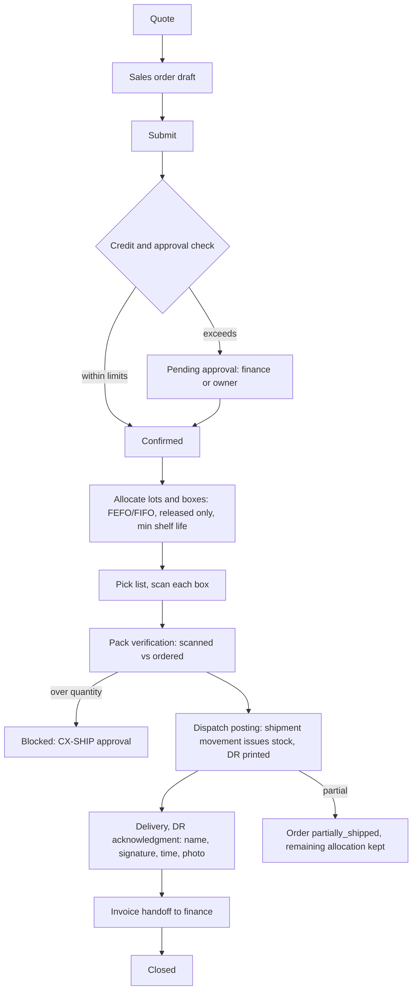

| Step | Role | Device | System action | Data captured | Validations / blocks | State transition | Documents / labels | Audit event | Offline |
|---|---|---|---|---|---|---|---|---|---|
| W09-01 | sales_cs (`sales.quote.create`) | Desktop / Phone | Quote: customer, SKUs, qty, customer price list, lead time, validity; convert to order on acceptance. | `Quote`. | Pricing visible only to roles with `sales.pricing.view`. | Quote: draft → sent → accepted / expired | Quotation PDF | sales.quote.sent | Queueable (draft, later phase) |
| W09-02 | sales_cs (`sales.sales_order.create`) | Desktop | Sales order: lines, requested date, ship-to, customer requirements applied (packaging, documents, partial allowed), notes. | `SalesOrder`, `SalesOrderLine`. | V-SCOPE; SKU must be active and in the customer's approved catalogue (if configured). | SalesOrder: draft → submitted | — | sales.sales_order.submitted | Queueable (draft), submit Online-only |
| W09-03 | system, then approver (`sales.sales_order.approve`) | Desktop | Credit/approval check: open balance + order value vs credit limit, overdue invoices, order value threshold; within limits → auto-confirm; else pending approval (A-PROC-14). | approval record. | V-SOD: approver ≠ order creator; V-AUTH. | SalesOrder: submitted → confirmed, or → pending_approval → confirmed / cancelled | Order confirmation to customer | sales.sales_order.confirmed | Online-only |
| W09-04 | system | — | Reserve quantity per line (`StockReservation`, SKU-level, no lot yet) so availability reflects the order. | `StockReservation`. | Shortage → line flagged `backorder`; planner sees demand in W05-01. | — | — | inventory.stock_reservation.created | — |
| W09-05 | warehouse_operator (`sales.sales_order.edit` + `inventory.stock_allocation.create`) | Desktop / Tablet | Allocate: system proposes lots and boxes by the rule (FEFO where expiry matters, else FIFO; configurable per SKU/customer), honouring customer min remaining shelf life; operator accepts or changes within allowed lots. | `StockAllocation` (order line, lot, box ids, qty). | Only `released` lots in the order's site (V-HOLD/V-EXP/V-REC exclude others; CX-LOT never applies to customer shipment except documented conditional release rule, W06); allocation ≤ available (V-OVER). | SalesOrder: confirmed → allocated | Allocation summary | inventory.stock_allocation.created | Online-only |
| W09-06 | warehouse_operator (`sales.pick.create`) | Phone+Scanner | Pick: pick list by location; scan each allocated `BC:BOX` (or `BC:LOT` + qty for loose units); progress shown. | `Pick` lines (box id, qty, picker, time). | V-MAT: box not in allocation → "not for this order"; a different box of the same SKU/lot may be substituted if allocation rule allows (audited); V-DUP; V-FREEZE. | SalesOrder: allocated → picking; Shipment: draft → picked | Pick list (print or on-screen) | sales.pick.scanned | Queueable |
| W09-07 | warehouse_operator (`sales.pack.approve`) | Tablet+Scanner | Pack verification: scanned boxes vs ordered quantity per line; shortfall → partial shipment decision; carrier, tracking, gross weight, number of packages. | `Pack`/`Shipment` header. | V-OVER: scanned qty > ordered or > allocated → blocked → CX-SHIP; partial shipment when the customer requires full → CX-SHIP (A-PROC-15); V-SOD: verifier ≠ picker where staffing allows (configurable). | Shipment: picked → packed; SalesOrder: picking → packed | Packing list (W08) | sales.shipment.packed | Queueable (scans), decision Online-only |
| W09-08 | warehouse_operator (`sales.shipment.post`) | Tablet | **Dispatch posting**: one transaction posts `StockMovement` type=shipment for every box/lot (stock issued now, not at DR creation), releases allocations and reservations for shipped qty, numbers the DR. | `Shipment.dispatched_at`, driver/carrier, vehicle, `DeliveryReceipt` number. | V-AUTH; V-DUP; V-NEG; lot status re-checked at posting (V-HOLD/V-EXP/V-REC block even if allocated earlier). | Shipment: packed → dispatched; SalesOrder: packed → shipped / partially_shipped; Container: closed → shipped | Delivery receipt (company, customer, ship-to, SO/DR numbers, items, lots, box ids, qty, date/time, driver/carrier, received-by block, remarks) | inventory.stock_movement.posted; sales.shipment.dispatched; platform.document.generated | Online-only |
| W09-09 | driver / warehouse_operator | Phone | Delivery receipt acknowledgment: received-by name, signature capture or photo of signed DR, time, remarks (short, damaged). | `DeliveryReceipt.acknowledged_*`, `FileAttachment`. | Acknowledgment is evidence, not an e-signature (W06 note). | Shipment: dispatched → delivered; SalesOrder: shipped → (awaiting invoice) | DR acknowledgment copy | sales.delivery_receipt.acknowledged | Queueable |
| W09-10 | sales_cs / finance (`finance.invoice.create`, Phase 6) | Desktop | Invoice handoff: invoice created from the dispatched shipment (never from a draft DR); until Phase 6, export of shipment data to the accountant (A-PROC-24). | `Invoice` (Phase 6) or export file. | V-AUTH; shipment must be `dispatched`. | SalesOrder: shipped → invoiced → closed | Invoice / statement (Phase 6) | finance.invoice.created | Online-only |
| W09-11 | sales_cs | Desktop | Returns (`CustomerReturn`): receive by box scan, QA disposition (W06), credit note (Phase 6). | `CustomerReturn`. | V-LOC (returns location, status `quarantine`). | Shipment: delivered → returned (partial allowed) | Return receipt | inventory.stock_movement.posted | Online-only |
| W09-12 | sales_cs (`sales.sales_order.void`) | Desktop | Cancel/controlled reversal: before dispatch, cancel releases allocations; after dispatch, only via return + credit (reversal movements with reason). | reason. | V-STATE. | SalesOrder: * → cancelled (pre-dispatch) | — | sales.sales_order.cancelled | Online-only |

**Exception paths**

| Situation | Path |
|---|---|
| Allocated lot placed on hold before dispatch | W09-08 re-check blocks posting; operator re-allocates (W09-05); customer notified by `sales_cs` if the date slips. |
| Customer wants more than ordered at the dock | Order amended by `sales_cs` (new line, approval re-check) before pack verification; no over-shipment via CX-SHIP for convenience. |
| Box label unreadable | Manual box id entry (audited, flagged `manual_entry`); reprint label after verification. |
| Driver leaves without acknowledgment | Shipment stays `dispatched`; Action Center lists unacknowledged DRs after a configurable number of days. |
| Partial delivery refused by customer | Return of refused boxes (W09-11); credit per Phase 6 rules. |

**Approval gates.** G-W09-A credit/approval (finance or owner_director, SoD vs creator); G-W09-B over-shipment / partial when full required (CX-SHIP); G-W09-C dispatch posting (warehouse_operator with `sales.shipment.post`).
**KPIs touched.** On-time in-full, fill rate, order-to-ship time, picks per hour, unacknowledged DRs, returns rate.
**Open questions.** Q-WH-15..Q-WH-18.

### W10 Importing attendance from the time-clock file

**Purpose.** Bring time-clock punches into the system without losing or silently altering anything: upload, map, preview, surface exceptions, review, post; the original file is retained; corrections are attributed and approved. Follows ADR-019 (locale) and ADR-021 (import-first, reporting-first).
**Actors.** `hr_payroll` (uploads, reviews, posts, approves corrections), supervisors (`site_manager`, request corrections for their teams), `system_admin` (mapping templates), `auditor` (read).
**Preconditions.** `Employee` records with the time-clock identifier; `Shift`/`ShiftAssignment` and holiday calendars; attendance rule configuration with effective dates (timezone per site, rounding/grace, breaks, overtime, night differential, rest days, holidays, incomplete punch handling) validated against company policy and applicable law; an `AttendanceImport` mapping template per file format (A-PROC-16).

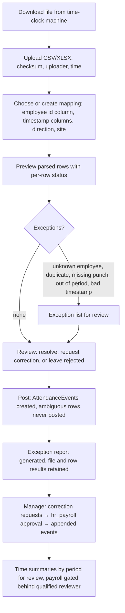

| Step | Role | Device | System action | Data captured | Validations / blocks | State transition | Documents / labels | Audit event | Offline |
|---|---|---|---|---|---|---|---|---|---|
| W10-01 | hr_payroll (`hr.attendance_import.create`) | Desktop | Upload the downloaded file; system stores the original in object storage with checksum, size, uploader, upload time; file type and size checked. | `AttendanceImport` (file ref, checksum, uploader, period hint), `ImportJob`. | Same checksum already imported → V-DUP ("file already imported on …", can proceed only as re-run with reason); unsafe file type/size rejected. | AttendanceImport: — → uploaded | — | hr.attendance_import.uploaded | Online-only |
| W10-02 | hr_payroll | Desktop | Select a mapping template or build one: employee identifier column → `Employee.timeclock_id`, timestamp column(s) and format, in/out indicator or pairing rule, site/device column, timezone (default site timezone, ADR-019). Mapping saved as a version. | `AttendanceImport.mapping_version`. | Mapping must cover employee id and at least one timestamp; format validated on sample rows. | AttendanceImport: uploaded → mapped | — | hr.attendance_mapping.saved | Online-only |
| W10-03 | system (worker) | — | Parse and preview all rows with per-row status: ok, unknown employee, duplicate (same employee + timestamp, or within the configured duplicate window), missing punch (unpaired in/out per pairing rule), outside period, invalid timestamp, inactive employee, employee at another site. | row results (`AttendanceImport.rows[]` with status and message). | Processing resumable; nothing posted yet. | AttendanceImport: mapped → previewed | Preview (on screen) | hr.attendance_import.previewed | — |
| W10-04 | hr_payroll (`hr.attendance_import.edit`) | Desktop | Review exceptions: map an unknown id to an employee (saved for future files), confirm a duplicate as duplicate (ignored) or as a legitimate second punch, mark missing punches for manager correction, reject rows with reason. | `AttendanceException` per row (type, resolution, resolved_by, note). | Each exception needs an explicit resolution or stays `rejected`; no bulk "accept all" for ambiguous types (A-PROC-17). | AttendanceException: open → resolved / rejected | — | hr.attendance_exception.resolved | Online-only |
| W10-05 | hr_payroll (`hr.attendance_import.post`) | Desktop | Post: create immutable `AttendanceEvent` rows for ok and resolved rows; rejected and unresolved rows are listed, never posted; totals shown (rows in file, posted, rejected, duplicates, unknown). | `AttendanceEvent` (employee, timestamp, direction, source import, row no.), posting summary. | V-AUTH; V-SOD not required for posting of raw punches, required for corrections (W10-07); V-DUP on import id. | AttendanceImport: previewed → posted (or partially_posted) | Attendance import exception report (original file, counts, row list, corrections, approver) | hr.attendance_import.posted; platform.document.generated | Online-only |
| W10-06 | system | — | Compute daily attendance per employee from events using the rule configuration in force on that date (shift match, grace, breaks, overtime candidates, night differential candidates, rest days, holidays, absences, incomplete punches). Results are labelled "computed under rule set vX" and are for review, not pay. | derived summaries. | Rule set must be effective-dated and marked validated by the company's reviewer before summaries are shown outside HR. | — | Time summary by period | — | Cached read (HR only) |
| W10-07 | site_manager (`hr.attendance_correction.create`) → hr_payroll (`hr.attendance_correction.approve`) | Phone / Desktop | Correction request for a missing or wrong punch (reason, proposed time, evidence); `hr_payroll` approves or rejects; approval appends a correction `AttendanceEvent` linked to the original (never edits it). | `AttendanceEvent` (type=correction, approved_by). | V-SOD: approver ≠ requester; an employee cannot approve their own correction even if `hr_payroll`. | correction: requested → approved / rejected | — | hr.attendance_correction.approved | Online-only |
| W10-08 | hr_payroll | Desktop | Re-run or roll back an import: rollback creates reversal events for all events of that import with reason; the original file and row results stay. | reversal events. | V-AUTH; events already used by an approved payroll period cannot be reversed without `finance` + `hr_payroll` approval (Phase 6). | AttendanceImport: posted → reversed | — | hr.attendance_import.reversed | Online-only |
| W10-09 | hr_payroll, finance (Phase 6, ADR-021) | Desktop | Payroll period: open → computed → reviewed by a qualified payroll/accounting reviewer → approved → exported; corrections create new lines; not in MVP. | `PayrollPeriod`, `PayrollApproval`. | V-SOD on approval; no statutory values hard-coded. | PayrollPeriod: open → computed → approved → exported → closed | Payslips, payment export | hr.payroll_period.approved | Online-only |

**Access.** Employee personal data, punches and summaries are visible only to `hr_payroll` (all) and to a supervisor for their own team's attendance where configured; every view and export of personal data is audited (`hr.employee.viewed`, `hr.attendance.exported`), see `docs/permissions-matrix.md` sensitive-field rules.

**Exception paths**

| Situation | Path |
|---|---|
| File format changed by the machine firmware | Preview fails on sample rows; `hr_payroll` creates a new mapping version; old versions remain for history. |
| Same punch appears in two files (overlapping downloads) | Duplicate detection against already-posted events, not only within the file; duplicates listed, not posted. |
| Employee works at two sites | Site taken from the device column or the employee's primary site; cross-site events flagged for review. |
| Time-clock clock drift | Detected by comparing device time with server time if the file includes it; otherwise a rule "shift offset" correction requested by the supervisor. |
| Upload interrupted | `ImportJob` resumable; partial parse discarded; nothing posted. |

**Approval gates.** G-W10-A posting (hr_payroll); G-W10-B correction approval (hr_payroll, SoD); G-W10-C payroll period approval (qualified reviewer, Phase 6).
**KPIs touched.** Import exception rate, time-to-post, open correction requests, attendance coverage per shift (labour summary for owners, aggregated only).
**Open questions.** Q-HR-01..Q-HR-06.

### W11 Producing an owner report (short)

**Purpose.** Give owners reconciled, explainable numbers with drill-down and scheduled delivery.
**Actors.** `owner_director`, `site_manager` (site-scoped), `analytics` KPI owner (`analytics-specialist` persona maintains definitions), `auditor`.

| Step | Role | Device | System action | Data captured | Validations / blocks | State transition | Documents / labels | Audit event | Offline |
|---|---|---|---|---|---|---|---|---|---|
| W11-01 | owner_director (`analytics.report.view`) | Desktop / Tablet | Open a report or dashboard; set filters (date range, site, product/SKU, customer, line, status); every KPI tile shows definition, calculation, time basis, source tables, refresh time and "actual / estimate / forecast / overridden" label. | filter state (per user, localStorage). | V-SCOPE: site filter limited to assigned sites; owners see all. | — | On-screen report with generated-at timestamp | analytics.report.viewed | Cached read (snapshot with timestamp; never implies real time) |
| W11-02 | owner_director | Desktop | Drill down from a number to the source records (movements, batches, orders) in the same scope. | — | Source list is the same query the KPI used (reconciliation by construction). | — | — | — | Online-only |
| W11-03 | owner_director (`analytics.report.export`) | Desktop | Export PDF/CSV/XLSX; spreadsheet cells sanitized against formula injection; export carries filters, generated-at and the user. | `GeneratedDocument`. | V-AUTH; sensitive fields (pricing, payroll) follow their own permissions. | — | Report PDF / CSV / XLSX | analytics.report.exported | Online-only |
| W11-04 | owner_director (`analytics.scheduled_report.create`) | Desktop | Schedule: cadence (daily/weekly/monthly), recipients (must be system users with the permission), filters, format; worker generates and delivers in-app and by email. | `ScheduledReport`. | Recipients validated at each run (revoked permission → skipped and logged). | ScheduledReport: active → paused / ended | Delivered report | analytics.scheduled_report.sent | Online-only |

**Approval gates.** None; KPI definition changes go through the analytics owner and are versioned. **KPIs touched.** All owner KPIs (definitions in the analytics catalogue referenced from `docs/PRD.md`). **Open questions.** Q-OW-01, Q-OW-02.

### W12 Formula / routing revision and approval (change control, short)

**Purpose.** Change a formula, routing, work instruction, inspection plan or label template only through a reviewed, approved, effective-dated revision; batches keep the revision they were created with.
**Actors.** Author (`production_planner` or `site_manager` for formulas and routings; `qa_qc` for inspection plans), reviewer, approver (`qa_qc` for anything affecting product quality; `site_manager` for routing-only changes; A-PROC-41), `system_admin` (template versions).

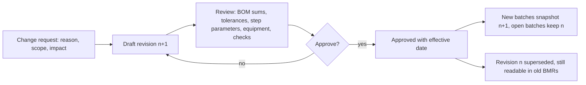

| Step | Role | Device | System action | Data captured | Validations / blocks | State transition | Documents / labels | Audit event | Offline |
|---|---|---|---|---|---|---|---|---|---|
| W12-01 | author (`masterdata.change_control.create`) | Desktop | Open a change control: what changes (formula, routing, instruction, inspection plan, label), why, affected SKUs, open work orders/batches listed. | `ChangeControl`. | — | ChangeControl: draft → submitted | — | masterdata.change_control.submitted | Online-only |
| W12-02 | author (`masterdata.formula_revision.edit`) | Desktop | Draft the revision: BOM lines (material, qty per batch size or %, tolerance per line, allergen notes), expected yield, routing steps (type, order, parameters with units and limits, equipment class, required checks, instruction text), effective date. System checks line sums and shows rounding (F-05). | `FormulaRevision`, `BomLine`, `RoutingRevision`, `RoutingStep`, `WorkInstructionRevision`. | Tolerance required on every line (no system default, A-PROC-03); dimensionally valid UOM (V-UOM). | revision: draft | Redline comparison vs current revision | masterdata.formula_revision.drafted | Online-only |
| W12-03 | reviewer (≠ author) | Desktop | Review with checklist; comments; request changes. | review record. | V-SOD. | revision: draft → in_review | — | masterdata.formula_revision.reviewed | Online-only |
| W12-04 | approver (`masterdata.formula_revision.approve`) | Desktop | Approve with effective date; optionally retire the previous revision at that date. The approved revision is the controlled source for production; verify with authorized personnel before production use. | approval, effective_from. | V-SOD (approver ≠ author, ≠ reviewer where staffing allows); `qa_qc` approval mandatory when quality-relevant (A-PROC-41). | revision: in_review → approved → effective; previous: effective → superseded; ChangeControl: submitted → approved → closed | Approved revision PDF | masterdata.formula_revision.approved | Online-only |
| W12-05 | system | — | Batches created on/after the effective date snapshot the new revision (W05-03); existing batches unchanged; V-REV blocks batch creation when no effective revision exists. | — | — | — | — | — | — |

**Approval gates.** G-W12-A review; G-W12-B approval (qa_qc for quality-relevant changes). **KPIs touched.** Open change controls, revision lead time. **Open questions.** Q-PR-11, Q-QA-10.

### W13 Equipment / calibration gate blocking production (short)

**Purpose.** Equipment that is overdue for calibration, cleaning, maintenance or qualification cannot be used in a step; exceptions are explicit and audited; every weighing and process record links to the equipment used.
**Actors.** `site_manager` (equipment register, maintenance work orders), technician (a `site_manager` or `production_operator` with `production.equipment.edit`), `qa_qc` (calibration records, CX-CAL), `production_operator` (selects equipment).

| Step | Role | Device | System action | Data captured | Validations / blocks | State transition | Documents / labels | Audit event | Offline |
|---|---|---|---|---|---|---|---|---|---|
| W13-01 | site_manager (`production.equipment.create`) | Desktop | Register equipment: id, type (scale, mixer, kettle, filler...), site/line, capacity/range, calibration interval and last date, preventive maintenance plan, cleaning rule (per batch/changeover), qualification status, responsible technician. | `Equipment`, PM plan. | — | Equipment: — → available | Equipment label `BC:EQP:<id>` (extension of the payload scheme, A-PROC-42) | production.equipment.created | Online-only |
| W13-02 | system | — | Nightly and on-change evaluation: calibration due passed → `calibration_due`; PM due passed → `maintenance_due`; cleaning not recorded since last use → `cleaning_required`; downtime logged → `out_of_service`. Action Center lists overdue items. | status with reason. | — | Equipment: available → calibration_due / maintenance_due / cleaning_required / out_of_service | — | production.equipment.status_changed | — |
| W13-03 | production_operator | Tablet | Select or scan equipment at W05-06/07/10/11 and W06-03. | `EquipmentUse` (equipment, step, start/end). | V-CAL: status ≠ available → cannot select; message shows reason and due date. | — | — | production.equipment.used | Queueable (cached status; re-validated on replay) |
| W13-04 | site_manager + qa_qc (`production.equipment.approve`) | Desktop | CX-CAL exception: documented risk assessment, time-boxed, linked Deviation; batch flagged for QA review at disposition. | `EquipmentUse.exception`, `Deviation`. | V-SOD vs the operator requesting. | — | — | platform.exception.approved | Online-only |
| W13-05 | technician (`production.equipment.edit`) | Phone / Desktop | Record cleaning, maintenance or calibration: date, result, certificate attachment, next due; return to service. | service record, `FileAttachment`. | Calibration result out of tolerance → equipment stays blocked and `qa_qc` assesses impact on batches that used it since last good calibration (reverse query via `EquipmentUse`). | Equipment: * → available | Calibration certificate record | production.equipment.serviced | Online-only |

**Approval gates.** G-W13-A exception (site_manager + qa_qc); G-W13-B return to service after failed calibration (qa_qc). **KPIs touched.** Overdue maintenance/calibration count, downtime, batches run under equipment exception. **Open questions.** Q-PR-12.

---

## 4. Role handoff matrix

Which role hands work to which role, at which gate. "Trigger" is the notification in the Action Center and, where configured, email.

| Workflow | From → To | At gate / event | Trigger |
|---|---|---|---|
| W01 | procurement → warehouse_operator | PO sent (W04-06) → expected receipt visible | Expected receipt due today / overdue |
| W01 | warehouse_operator → procurement | Discrepancy or unplanned line (W01-04) | Discrepancy to resolve; CX-QTY pending |
| W01 | warehouse_operator → qa_qc | Receipt posted (W01-06) | Incoming inspection open |
| W01 | qa_qc → warehouse_operator | Disposition recorded (W06-05) | Lot status changed: move to storage / rejected |
| W02 | warehouse_operator → site_manager | Sync conflict (W02-08) | Conflict to resolve |
| W02 | warehouse_operator → qa_qc | Blocked-status stock needs moving | CX-LOT request |
| W03 | site_manager → warehouse_operator | Count released (W03-02) | Count assigned |
| W03 | warehouse_operator → site_manager | Count submitted (W03-04) | Variances to approve |
| W03 | site_manager → warehouse_operator (second) | Recount required (W03-06) | Recount assigned |
| W04 | requester → approver | PR submitted (W04-02) | PR approval pending |
| W04 | approver → procurement | PR approved (W04-03) | PR ready for PO |
| W04 | procurement → approver | PO submitted (W04-04) | PO approval pending |
| W04 | procurement → qa_qc | Supplier not on ASL (V-ASL) | ASL decision requested |
| W05 | sales_cs / planner → production_planner | Demand visible (W05-01) | Shortage / backorder |
| W05 | production_planner → warehouse_operator | WO released (W05-04) | Staging pick list |
| W05 | warehouse_operator → production_operator | Materials staged (W05-05) | Batch ready to start |
| W05 | production_operator → checker | Each clearance and dispense (W05-06..08, 14, 17) | Check requested |
| W05 | production_operator → site_manager (+ qa_qc) | CX-TOL / CX-CAL / CX-MAT needed | Exception approval pending |
| W05 | production_operator → qa_qc | In-process checkpoint (W05-12); transfer to quarantine (W05-17) | Inspection open |
| W05 | qa_qc → production_planner | Disposition (W05-19) | Batch released / rejected / rework |
| W05 | production_planner → site_manager | Closure (W05-20) | Batch to close |
| W06 | qa_qc (tester) → qa_qc (reviewer) | Results complete (W06-03) | Review pending |
| W06 | qa_qc (reviewer) → qa_qc (disposition) | Review complete (W06-04) | Disposition pending |
| W06 | qa_qc → warehouse_operator | Disposition recorded | Move to status location |
| W06 | qa_qc → sales_cs | Lot released / held for an allocated order | Order can ship / order blocked |
| W07 | any → qa_qc | Deviation raised (W07-01) | Deviation to classify |
| W07 | qa_qc → action owners | CAPA assigned (W07-04) | CAPA action due |
| W07 | sales_cs → qa_qc | Complaint logged (W07-06) | Complaint to assess |
| W07 | qa_qc → owner_director | Recall proposed (W07-08) | Recall decision |
| W07 | owner_director → sales_cs, warehouse_operator | Recall approved | Notify customers; prepare recall location |
| W08 | production_operator → checker | Boxes complete (W08-04) | Pack verification |
| W08 | sales_cs → warehouse_operator | Customer packaging config change | Repack needed before shipment |
| W09 | sales_cs → finance / owner_director | Order exceeds credit or threshold (W09-03) | Order approval pending |
| W09 | sales_cs → warehouse_operator | Order confirmed (W09-03) | Allocate and pick |
| W09 | warehouse_operator → site_manager / owner_director | Over-shipment or partial when full required (W09-07) | CX-SHIP pending |
| W09 | warehouse_operator → driver → customer | Dispatch posted (W09-08) | DR to acknowledge |
| W09 | warehouse_operator → finance / sales_cs | Shipment dispatched | Invoice handoff |
| W10 | hr_payroll → site_manager | Missing punches flagged (W10-04) | Correction requests for your team |
| W10 | site_manager → hr_payroll | Correction requested (W10-07) | Correction approval pending |
| W10 | hr_payroll → qualified reviewer | Period computed (W10-09, Phase 6) | Payroll review |
| W11 | analytics owner → owner_director | KPI definition changed | Definition version note on tiles |
| W12 | author → reviewer → approver | Revision submitted / reviewed | Review / approval pending |
| W12 | approver → production_planner | Revision effective | Open work orders listed for re-check |
| W13 | system → site_manager / technician | Equipment status changed | Maintenance / calibration overdue |
| W13 | production_operator → site_manager + qa_qc | Equipment blocked at selection | CX-CAL pending |

---

## 5. Documents and labels produced per workflow

Specifications (fields, layout, page size, template versioning, reprint control, signature assumptions) are in `docs/reports-and-templates.md`; this table lists what each workflow emits and when.

| Workflow | Document / label | Produced at | Printer / format | Reprint control |
|---|---|---|---|---|
| W01 | Raw material label (one per container) | W01-07, status change W01-10 | Thermal label, QR `BC:LOT` | Reprint reason, count on lot card |
| W01 | Goods receipt document; discrepancy note | W01-06, W01-04 | A4 / PDF | Versioned by GR revision |
| W02 | Box / lot label reprint; child box labels after split/merge/repack | W02-04..07 | Thermal label | Reprint reason; voided labels listed |
| W03 | Count sheet (blind, no quantities); variance report; stock movement report lines | W03-01, W03-05, W03-08 | A4 / on screen | — |
| W04 | Purchase order PDF; supplier return note; supplier performance report | W04-06, W04-09, W04-10 | A4 / PDF, email | Template version recorded |
| W05 | Material requirement / staging pick list; dispensing sheet; BMR (draft, in-progress, final with page numbers, batch id on every page, QR to record); finished-goods lot label; reconciliation table; yield section | W05-04, W05-05, W05-03/20, W05-17, W05-15, W05-16 | A4 / PDF; thermal label | BMR reprint audited with reason; amendments produce revision n+1 |
| W06 | Sample label; hold notice; certificate of analysis (if configured); BMR QC and disposition sections | W06-02, W06-07, after W06-05 | Thermal label; A4 / PDF | CoA reprint audited |
| W07 | Deviation report; investigation report; traceability report; recall notification; return receipt; recall closure report | W07-03..10 | A4 / PDF | Versioned |
| W08 | Box label (`BC:BOX`); pallet label (optional); boxing note / packing list | W08-02, W08-06, W08-05 | Thermal label; A4 | Reprint reason; packing list v2 after repack |
| W09 | Quotation; order confirmation; pick list; packing list; delivery receipt and acknowledgment copy; invoice (Phase 6); return receipt | W09-01..11 | A4 / PDF; email | DR reprint audited; DR number from numbering rule |
| W10 | Attendance import exception report; time summary by period; payslips and payment export (Phase 6) | W10-05, W10-06, W10-09 | PDF / XLSX (HR only) | Export audited |
| W11 | Owner and operational reports (PDF/CSV/XLSX); scheduled deliveries | W11-03, W11-04 | PDF / CSV / XLSX | Export audited; generated-at on every page |
| W12 | Revision redline; approved revision PDF | W12-02, W12-04 | PDF | Versioned by revision |
| W13 | Equipment label (`BC:EQP`); calibration certificate record | W13-01, W13-05 | Thermal label; attachment | — |

---

## 6. Offline eligibility summary

Consistent with the brief's offline table and ADR-018. Phase 7 decides the final list; until then, every step marked Queueable is designed with an idempotent command so it can be enabled without redesign.

| Workflow step group | Flag | Notes (server behaviour on replay) |
|---|---|---|
| View assigned tasks, work instructions, cached product/lot/box data (W02-01/02, W05 instructions, W13-03) | Cached read | Shows last sync time and freshness; status badges show "as of". |
| Scan and move lot/box; put-away; split/merge/repack (W01-08, W02-03..06, W06-06, W08-06/07) | Queueable | Server re-validates stock, status, scope, location class, duplicate key; conflicts to review queue (W02-08/09). |
| Line clearance checklists, dispensing/weighing capture, checker confirmation, process parameters, curing timer completion, yield entry (W05-06..08, 10, 11, 13, 14, 16) | Queueable (managed device with preassigned work order and cached formula/limits only) | Captures operator, device, time, local sequence; server validates batch state, lot status, tolerance, SoD and approvals before final posting; rejected replay holds the step. |
| Receipt draft capture (W01-01..04) | Online-only (default); Queueable candidate for Phase 7 | Lot numbers and PO progress need the posting transaction. |
| Goods receipt posting, consumption/output posting, transfer to quarantine, dispatch posting, adjustments (W01-06, W05-09/17, W03-08, W09-08) | Online-only | Stock postings serialize on lot/location rows; numbering inside the transaction. |
| Stock count line capture and recount (W03-03, W03-06) | Queueable (A-PROC-28) | Rejected when the count is no longer `counting`. |
| Pick scans, pack verification scans, box creation at boxing, DR acknowledgment (W09-06/07/09, W08-02..04) | Queueable | Allocation and order state re-checked on replay; over-quantity rejected. |
| QA sampling capture, deviation capture (W06-02, W07-01) | Queueable (capture only) | Classification, results and dispositions are Online-only. |
| QA review and disposition, holds, recall (W06-03..07, W07-02..10) | Online-only | Live authorization and SoD check. |
| Approvals of any kind (PR/PO, credit, variance, exceptions, revisions, corrections) | Online-only | — |
| Label printing and document generation | Online-only | Printer and worker needed; queued `LabelJob` prints when back online. |
| Attendance import and corrections (W10) | Online-only | Personal data is not cached on devices. |
| Reports and dashboards (W11) | Cached read (snapshot) | Snapshot timestamp shown; exports Online-only. |
| Order draft and notes (W09-01/02) | Queueable (later phase) | Price and availability re-resolved before confirmation; duplicate submission prevented by client UUID. |
| Permission changes, finance postings, payroll approval | Online-only | Per brief. |

---

## 7. Assumptions and questions for Bryel's process owners

### 7.1 Assumptions (`A-PROC-nn`)

Each default is configurable and needs owner confirmation; nothing here is a legal, regulatory or quality rule. Every formula, limit and procedure that these defaults touch must be checked by the company's qualified reviewers: verify with authorized personnel before production use.

| ID | Assumption | Default chosen | Where it applies |
|---|---|---|---|
| A-PROC-01 | Buying and selling are done without a formal approval trail today. | To-be adds PR/PO and order approvals with thresholds. | 2.2, W04, W09 |
| A-PROC-02 | No internal lot numbers, location codes or box ids exist today; stock is tracked in spreadsheets. | Go-live includes a labelling and location set-up task (see `docs/data-migration-plan.md`). | 2.2, W01..W03 |
| A-PROC-03 | Dispensing tolerance is not documented today. | No system-wide default; tolerance is a required field per BOM line at revision approval; seed data uses clearly fictional placeholders. | W05-07, W12-02 |
| A-PROC-04 | "33.33% Lye Solution" and "6% Green in Oil" are prepared intermediates. | Modelled as intermediate materials with their own lot, shelf life and preparation routing (or purchased); dispensed by lot scan like any material. | W05 example |
| A-PROC-05 | Soap cures/holds before packaging. | Optional `hold` routing step with a configurable minimum duration; off until the process owner confirms. | W05-13 |
| A-PROC-06 | Checker for dispensing and clearances is a second trained person. | Any user with `production.dispense_record.approve` (second `production_operator` or `site_manager`); CX-TOL needs `site_manager` plus `qa_qc` acknowledgement. | 1.3, W05 |
| A-PROC-07 | Line clearance content is not written down today. | Configurable checklist per routing step and area, with photo option; QA verification optional. | W05-06/10/14 |
| A-PROC-08 | Finished-product expiry is derived. | Manufacturing (or packaging, configurable) date + product shelf life; the shelf life value is QA configuration. | W05-17 |
| A-PROC-09 | Allocation rule. | FEFO for materials and SKUs with expiry, FIFO otherwise; overridable per material class, SKU and customer. | W05-04, W09-05 |
| A-PROC-10 | Received materials are quarantined until QA releases them. | Status `quarantine` at receipt for all material classes; a "release on receipt with CoA" class may be configured by QA. | W01-05/09 |
| A-PROC-11 | Over-delivery tolerance. | 0 % (any over-delivery needs CX-QTY). | W01-03 |
| A-PROC-12 | Count variance approval thresholds. | Every non-zero variance needs `site_manager` approval; auto-approve threshold configurable per site. | W03-07 |
| A-PROC-13 | PR and PO approval thresholds. | All PRs approved by `site_manager`, all POs by `owner_director` until value thresholds are set. | W04-03/05 |
| A-PROC-14 | Credit check at order submission. | Auto-confirm within credit limit and no overdue invoices; otherwise `finance` (Phase 6) or `owner_director` approves. | W09-03 |
| A-PROC-15 | Partial shipments. | Allowed by default; per-customer "full shipment required" flag; over-shipment always blocked without CX-SHIP. | W09-07 |
| A-PROC-16 | Time-clock file format. | CSV or XLSX with an employee id and timestamp per row; mapping layer handles the actual format once a sample is supplied. | W10-02 |
| A-PROC-17 | Attendance posting needs HR review. | No ambiguous row posts without an explicit resolution; no bulk accept for unknown employees or missing punches. | W10-04/05 |
| A-PROC-18 | Scales are not connected. | Weight is typed from the scale display in MVP; scale id is selected; connected scales are a later enhancement. Managed-device offline dispensing is a Phase 7 decision. | W05-07 |
| A-PROC-19 | Packaging component reconciliation tolerance. | 0 units unexplained for labels; configurable per component. | W05-15 |
| A-PROC-20 | In-process and finished-product tests. | None asserted; `InspectionPlan` per SKU configured by QA. | W05-12/18, W06 |
| A-PROC-21 | One finished lot per batch. | Output of a batch creates one `InventoryLot` (lot number = batch number unless the numbering rule differs); multiple outputs allowed by configuration. | W05-17 |
| A-PROC-22 | Boxes hold one SKU and one lot. | Mixed lots per box off by default; customer packaging override wins over SKU default when an approved `CustomerRequirement` exists. | W02-05, W08 |
| A-PROC-23 | Equipment exception approvers. | `site_manager` and `qa_qc` both required for CX-CAL. | W13-04 |
| A-PROC-24 | Invoice handoff before Phase 6. | Export of dispatched shipments to the accountant; `Invoice` entity from Phase 6. | W09-10 |
| A-PROC-25 | Recall classification and notification duties. | Company regulatory responsibility; system provides scope, holds, lists and templates only. | W07-08 |
| A-PROC-26 | Unplanned receipts are allowed. | Allowed for `warehouse_operator` with reason code; `procurement` notified and must link or approve before the lot can be released. | W01-01 |
| A-PROC-27 | Devices are shared per area. | Each user signs in; device id recorded on every capture; idle lock configurable. | all |
| A-PROC-28 | Count capture may be offline. | Queueable; approvals and posting online. | W03-03 |
| A-PROC-29 | Meaning of `awaiting_qc` vs `quarantined`. | `awaiting_qc` = steps complete, output posted, tests open; `quarantined` = results and BMR review complete, disposition pending. | W05-17/18 |
| A-PROC-30 | Production plan approval. | Optional gate by `site_manager`, off by default. | W05-01 |
| A-PROC-31 | Consumption posting timing. | Posted at transfer to quarantine (W05-17) together with output; per-line posting at dispense is a site option. | W05-09 |
| A-PROC-32 | The second "Production Area Line Clearance" on the paper BMR is the clearance before packaging. | Modelled as `line_clearance(packaging)`. | W05-14 |
| A-PROC-33 | Theoretical yield basis and limits. | Configurable per formula as mass or unit count; yield outside configured min/max requires a Deviation; placeholder limits are fictional. | W05-16 |
| A-PROC-34 | QC samples reduce stock. | Sample removal posts a consumption movement with reason `sample`. | W06-02 |
| A-PROC-35 | Reviewer ≠ tester. | Enforced; a small-site waiver can be configured with `owner_director` approval. | W06-04 |
| A-PROC-36 | Expiry and retest automation. | Nightly job sets `expired`; retest due sets `on_hold` with reason. | W06-08 |
| A-PROC-37 | Hybrid records. | Printed BMR keeps signature lines; electronic sign-offs are records, not validated e-signatures, until the company validates them. | W05, W06 |
| A-PROC-38 | Pack verification sampling. | All boxes scanned for the first batch of a SKU, then a configurable sample. | W08-04 |
| A-PROC-39 | Attendance timezone and pairing. | Site timezone (ADR-019); in/out pairing by order within a configurable window when the file has no direction. | W10-02/03 |
| A-PROC-40 | Scheduled report recipients. | Must be system users holding the report permission; no external emails in MVP. | W11-04 |
| A-PROC-41 | Who approves formula/routing revisions. | `qa_qc` approves anything that changes materials, quantities, tolerances, parameters, checks or labels; routing-only sequencing changes may be approved by `site_manager`. | W12-04 |
| A-PROC-42 | Equipment scan payload. | `BC:EQP:<id>` added to the payload scheme (extends ADR-017); confirm with the principal architect. | W13-01 |

### 7.2 Questions for Bryel's process owners

**Production (process owners)**

| ID | Question | Why it matters |
|---|---|---|
| Q-PR-01 | Are the five Acapulco Soap ingredient weights and the 17,600 g batch size the approved current formula, and what is the formula number/revision? | Seeds the first `FormulaRevision`. |
| Q-PR-02 | What tolerance applies to each ingredient (percentage, absolute, or both)? | Required per BOM line (A-PROC-03). |
| Q-PR-03 | How are the 33.33% lye solution and 6% green-in-oil prepared, by whom, in what quantity, with what shelf life? Are they their own batches? | Intermediate modelling (A-PROC-04). |
| Q-PR-04 | What happens in "Mixing and Cutting" step by step, and which readings are taken (temperature, time, trace, mould id)? | Routing step parameters. |
| Q-PR-05 | Is there a curing period before packaging, and how long? | A-PROC-05. |
| Q-PR-06 | What does "Theoretical Yield" mean on the current form: mass, bars, or both? What yield range is normal? | A-PROC-33. |
| Q-PR-07 | Who may act as checker, and may a site manager be the checker when only one operator is present? | A-PROC-06. |
| Q-PR-08 | Which scales and mixers exist, and do they have calibration records? | W13 register, V-CAL. |
| Q-PR-09 | Are the "Procedure 1–5" lines on the form free text written per batch, or a standard SOP? | Instruction revision content. |
| Q-PR-10 | For lotions and other families: which steps, equipment and in-process checks differ? | Routing templates per family. |
| Q-PR-11 | Who authors and who approves formula and routing changes today? | A-PROC-41. |
| Q-PR-12 | Should an overdue scale calibration block weighing outright, or allow a documented exception? | A-PROC-23. |

**Warehouse and procurement**

| ID | Question | Why it matters |
|---|---|---|
| Q-WH-01 | How are deliveries checked today, and what does the supplier's delivery document contain (lot, expiry, CoA)? | W01 fields. |
| Q-WH-02 | Must every material be quarantined until QA releases it, or may some classes be released on receipt with a CoA? | A-PROC-10. |
| Q-WH-03 | Over-delivery: accept, return, or ask? | A-PROC-11. |
| Q-WH-04 | What printers and label sizes exist (thermal, A4)? Curved containers? | ADR-017, label specs. |
| Q-WH-05 | What storage areas exist per site, and which are quarantine, hold, rejected, recall? | Location set-up, V-LOC. |
| Q-WH-06 | Are phones or tablets shared per area, and is there Wi-Fi in storage and production areas? | A-PROC-27, offline scope. |
| Q-WH-07 | Do boxes get moved on pallets, and are pallet ids needed in MVP? | Container hierarchy. |
| Q-WH-08 | How often are counts done, and who approves variances? | A-PROC-12. |
| Q-WH-09 | May stock be moved while a count is in progress? | V-FREEZE policy. |
| Q-WH-10 | Who approves purchases, at what amounts? | A-PROC-13. |
| Q-WH-11 | Is there an approved supplier list per material today, and who maintains it? | V-ASL, W04-11. |
| Q-WH-12 | What lead times and MOQs apply to key materials? | Reorder drivers. |
| Q-WH-13 | Units per box per SKU, and which customers have their own carton counts or marks? | W08 config. |
| Q-WH-14 | May a box contain two lots of the same SKU? | A-PROC-22. |
| Q-WH-15 | How are orders received and confirmed today, and who decides credit? | A-PROC-14. |
| Q-WH-16 | Are partial shipments acceptable to customers by default? | A-PROC-15. |
| Q-WH-17 | What must the delivery receipt contain, and is a signed copy returned? | DR template, W09-09. |
| Q-WH-18 | Minimum remaining shelf life required by customers at delivery? | Allocation rule. |

**QA**

| ID | Question | Why it matters |
|---|---|---|
| Q-QA-01 | What tests are performed on incoming materials, in process and on finished soap/lotion, with which specifications? | `InspectionPlan` content (A-PROC-20). |
| Q-QA-02 | Who may release a batch or a lot, and must the reviewer differ from the tester? | V-AUTH, A-PROC-35. |
| Q-QA-03 | Is conditional release ever practised? Under which conditions? | `allow_conditional_release`. |
| Q-QA-04 | How are shelf life and retest periods set per material and product? | A-PROC-08, A-PROC-36. |
| Q-QA-05 | Do SOPs require handwritten signatures on the BMR? | A-PROC-37, hybrid record. |
| Q-QA-06 | Are QC samples taken from every batch, and how much? | A-PROC-34. |
| Q-QA-07 | How are deviations and complaints recorded today? | W07 migration. |
| Q-QA-08 | Which regulatory notifications apply to a recall, and who is responsible? | A-PROC-25 (company responsibility). |
| Q-QA-09 | How far back must traceability reach for migrated history? | Data migration scope. |
| Q-QA-10 | Must every formula change be QA-approved, including sequencing-only routing changes? | A-PROC-41. |

**HR**

| ID | Question | Why it matters |
|---|---|---|
| Q-HR-01 | Which time-clock model is used and what does its export file look like (sample, anonymized)? | A-PROC-16 mapping. |
| Q-HR-02 | Does the file include in/out direction, device id and site? | A-PROC-39 pairing. |
| Q-HR-03 | Who reviews attendance before payroll today, and who approves corrections? | W10-04/07. |
| Q-HR-04 | What are the shifts, rest days and holiday calendar, and who maintains them? | Rule configuration. |
| Q-HR-05 | Which payroll software or accountant process is used, and what export is needed? | ADR-021 scope. |
| Q-HR-06 | Who may see attendance data for a team (supervisors)? | Sensitive-field rules. |

**Owner / cross-cutting**

| ID | Question | Why it matters |
|---|---|---|
| Q-OW-01 | Which five numbers does the owner want on the first screen, and how often? | W11 KPI priorities. |
| Q-OW-02 | Who outside the company (accountant) should receive scheduled reports? | A-PROC-40. |
