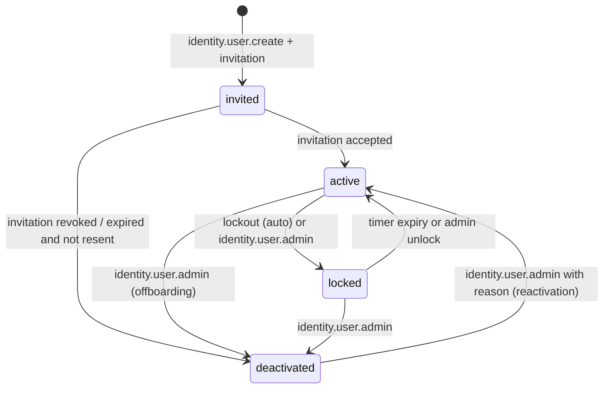

# Security

Owner: security-engineer. Reviewers: principal-architect, devops-engineer, qa-test-engineer.
Status: Phase 0 draft for Gate 0. Binding ADRs: ADR-004 (sessions), ADR-005 (RBAC),
ADR-011 (tenancy), ADR-014 (Railway), ADR-018 (offline), ADR-022 (RLS, deferred).
Related: `docs/permissions-matrix.md` (who may do what), `docs/testing.md` (how it is proven),
`docs/deployment-railway.md` (where secrets live), `docs/operations-runbook.md` (incidents),
`docs/offline-sync.md` (replay rules), `docs/data-model.md` (tables).

Plain-language summary for owners: the system protects five things: the boundary between
sites, the truth of stock and batch records, quality evidence, money, and people's personal
and pay data. Each is protected by the same pattern: the server checks every action, writes a
permanent audit line for anything important, and automated tests try to break the rules on
every code change. Defaults below (timeouts, limits) are proposals marked `A-SEC-nn` until the
owner confirms them.

## 1. Objectives and assets at risk

| Asset | Why it matters | Primary threats | Main controls |
|---|---|---|---|
| Site boundaries | A user at one site must not see or change another site's stock, batches, people or documents | IDOR via ids in URLs, bodies, filters, exports; mis-scoped query | AuthContext + scoped repositories, 404 on out-of-scope ids, negative tests per module (`docs/permissions-matrix.md` section 8), RLS as defense in depth later (ADR-022) |
| Stock truth | Decisions, deliveries and costing rely on the ledger | Duplicate postings (retry, offline replay), concurrent double issue, edits of posted rows, issuing held stock | Idempotency keys, row locks, append-only ledgers (ADR-006), eligibility checks, reversal-only corrections |
| Quality evidence | Batch records, test results and dispositions are the basis for release and for any recall | Overwritten results, unauthorized release, lost evidence, tampered PDFs | Append-only corrections, QA-only disposition, stored template version + source revision, controlled reprint, audit |
| Money | Invoices, bills, payments, approvals; future online payments | Approval bypass, forged webhooks, altered amounts after approval, exfiltration of pricing | SoD, approval rules as data, immutable postings, period locks, signature-verified idempotent webhooks, masked pricing |
| Personal and payroll data | Employees' identities, bank details, pay; customers' contacts | Over-broad access, bulk export, logs leaking data, backups unencrypted | Restricted permissions with re-auth and TOTP, field masking, audited exports, encrypted backups, retention policy |
| Future public portal | First internet-facing surface with outside users and payments | Credential stuffing, tenant crossover, abuse, webhook replay | Separate auth boundary and tables, tenant-scoped context, stricter rate limits, Gate 8 security review |
| Availability of operations | Phones on the floor depend on the service and on offline queues | Resource exhaustion from uploads/imports/PDF jobs, job queue flooding | Size limits, worker isolation, rate limits, monitoring (`docs/deployment-railway.md`) |

## 2. Threat model by surface

Format per surface: STRIDE category (S spoofing, T tampering, R repudiation, I information
disclosure, D denial of service, E elevation of privilege), threat, impact, control, phase it
ships, and the automated test that proves it (names resolve in `docs/testing.md`).

### 2.1 Authentication

| STRIDE | Threat | Impact | Control | Phase | Test |
|---|---|---|---|---|---|
| S | Credential stuffing / password spraying | Account takeover | argon2id, length-based policy, breach-list check (optional), per-account and per-IP rate limits, lockout, generic error messages, TOTP for privileged roles | P1 / P1b | `auth.lockout.after_n_failures`, `auth.ratelimit.login_ip`, `auth.error.generic` |
| S | Account enumeration via login, reset, invitation | Targeted attacks | Identical responses and timing for unknown vs wrong password; reset always "if the account exists we sent an email" | P1 | `auth.enumeration.reset`, `auth.enumeration.login_timing` |
| S | Stolen reset or invitation link | Takeover | Single-use, short-lived, hashed-at-rest tokens bound to the account; sessions revoked on reset | P1 | `auth.reset.single_use`, `auth.reset.expiry`, `auth.reset.revokes_sessions` |
| T | Parameter tampering on reset (changing user id) | Takeover of another account | Token identifies the account; no user id accepted from the client | P1 | `auth.reset.token_bound` |
| R | Disputed logins | Cannot investigate | `auth.*` audit events with IP, user agent, outcome | P1 | `audit.auth_events` |
| E | Deactivated or locked user still authenticates | Ex-employee access | Lifecycle state checked on every request, not only at login; all sessions revoked at deactivation | P1 | `auth.lifecycle.deactivated_denied` |
| D | Login endpoint flood | Nobody can sign in | IP rate limit, proxy-aware client IP, lockout counters per account not global | P1 | `auth.ratelimit.login_ip` |

### 2.2 Session

| STRIDE | Threat | Impact | Control | Phase | Test |
|---|---|---|---|---|---|
| S | Session cookie theft via XSS or network | Impersonation | `__Host-` prefixed, `HttpOnly; Secure; SameSite=Lax; Path=/`; HSTS; CSP; session id 256-bit random stored as SHA-256 hash | P1 | `session.cookie.attributes`, `headers.hsts`, `headers.csp` |
| S | Session fixation | Attacker-known session id | New session id issued at login, at privilege change and at re-authentication; pre-login sessions carry no identity | P1 | `session.rotate_on_login` |
| T | Permissions change not applied to live session | Stale authority | `permissions_version` bump invalidates cached context ≤ 60 s; scope refresh on every request after that | P1 | `authz.session.permissions_changed` |
| R | Cannot tell which device did what | Weak audit | Session row carries device label, IP, user agent, created/last seen; audit events carry `session_id` | P1 | `audit.session_in_events` |
| I | Shared floor tablets expose previous user | Cross-user data | Idle timeout, explicit sign-out button on every operator screen, logout clears IndexedDB caches, `Cache-Control: no-store` on app pages | P1 / P7 | `session.idle_expiry`, `offline.logout_clears_cache` |
| E | Revoked session keeps working offline | Bypass of revocation | Server rejects replay from revoked session; client must re-authenticate and permissions refresh at least every 8 h | P7 | `authz.session.revoked`, `offline.replay.revoked_session` |
| D | Session table growth | Slow auth | Expired sessions purged by a daily job; index on `expires_at` | P1 | `jobs.session_purge` |

### 2.3 Internal web app and API

| STRIDE | Threat | Impact | Control | Phase | Test |
|---|---|---|---|---|---|
| S | CSRF on server actions and route handlers | Unwanted postings | SameSite=Lax cookie + Origin/`Sec-Fetch-Site` check on every mutating request + anti-CSRF token for non-JSON form posts (section 4.2) | P1 | `csrf.origin_mismatch_rejected`, `csrf.form_token_required` |
| T | Mass assignment / unexpected fields | Hidden field changes (`site_id`, `status`, prices) | Zod schemas with `.strict()`; state changes only through state-machine commands; ids from the path, never trusted from the body when a path id exists | P1 | `validation.strict_schema`, `statemachine.no_free_status` |
| T | Numeric precision abuse (floats, scientific notation, negative quantities) | Wrong stock/money | Zod string-decimal schema → `decimal.js`; range and scale per field; `numeric` in Postgres (ADR-010) | P1 | `validation.decimal_only` |
| I | IDOR across sites and across entities | Data leakage | Scoped repositories; 404 for out-of-scope; DTO allow-lists; masked sensitive fields | P1 | `authz.cross_site.*`, `authz.sensitive_fields.masked` |
| I | Verbose errors, stack traces, SQL in responses | Recon | Error envelope `{code, message, requestId}`; stack only in server logs | P1 | `errors.no_stack_in_response` |
| I | Search and autocomplete leak other sites' names | Recon | Search services are scoped like lists | P1 | `authz.cross_site.search` |
| E | Role escalation via custom role edit or self-assignment | Full access | `identity.role.admin`/`site_assignment.admin` restricted; cannot grant yourself; cannot grant R permissions without re-auth; audit | P1 | `authz.role_escalation.*`, `identity.no_self_grant` |
| D | Expensive list queries without limits | Outage | Mandatory pagination (max 200 rows), query timeouts (`statement_timeout` 15 s web, 10 min worker), per-user API rate limit | P1 | `api.pagination_enforced` |
| R | Actions without attribution | Weak audit | Every mutating service call needs an AuthContext; jobs run as `system:<job>` with the originating user recorded | P1 | `audit.required_fields` |

### 2.4 Scan endpoints and label payloads

| STRIDE | Threat | Impact | Control | Phase | Test |
|---|---|---|---|---|---|
| T | Malicious QR content (URLs, scripts, SQL) | Injection, phishing of operators | Payload grammar `^BC:(LOT|BOX|LOC|MAT|SKU):[A-Z0-9][A-Z0-9._-]{0,63}$`; anything else is "Unrecognised code"; payload is treated as an opaque key for a scoped lookup; never rendered as HTML or opened as a link | P2 | `scan.payload_grammar`, `scan.rejects_url` |
| I | Label encodes internal data (prices, customer, location map) | Leakage from a photo of a label | Payload carries only the typed identifier; human-readable label text limited to the fields in `docs/reports-and-templates.md`; no cost, no customer price | P2 | `label.payload_minimal` |
| S | Scanning a code from another site's label | Cross-site read | Lookup is scoped; unknown or out-of-scope code → "not found at your site" | P2 | `authz.cross_site.scan` |
| T | Duplicate scan submission (double tap, retry) | Double movement | Idempotency key per scan action; server returns the first result | P2 | `authz.idempotency.duplicate_key` |
| D | Scan endpoint flood from a device | Slow floor | Per-session rate limit 120/min on scan lookups (A-SEC-14) | P2 | `scan.ratelimit` |

### 2.5 File uploads (BMR scans, photos, supplier certificates, attachments)

| STRIDE | Threat | Impact | Control | Phase | Test |
|---|---|---|---|---|---|
| T | Executable or polyglot file disguised as image/PDF | Stored XSS, malware spread | Allow-list by magic bytes (`file-type`): jpeg, png, webp, heic→converted, pdf, csv, xlsx; extension must match sniffed type; images re-encoded; PDFs served as `attachment` with `nosniff`; never served from the app origin | P2 | `upload.rejects_mismatch`, `upload.reencodes_image` |
| T | Oversized uploads / zip bombs | Storage and worker exhaustion | Size caps (images 10 MB, PDFs 25 MB, imports 20 MB, A-SEC-15); streaming to bucket; no archive extraction | P2 | `upload.size_cap` |
| I | Photo EXIF reveals GPS/device | Personal data leak | Strip metadata on re-encode (A-SEC-16) | P2 | `upload.exif_stripped` |
| I | Direct bucket URL guessing | Document leakage | Opaque object keys `org/<uuid>/<uuid>`, private bucket, access only through signed URLs (section 4.8) | P2 | `files.no_direct_access` |
| E | Upload to a record outside scope | Cross-site write | Attachment command resolves the parent record through the scoped repository first | P2 | `authz.cross_site.body` (attachment case) |
| T | Malware in supplier certificates | Endpoint infection | Optional ClamAV scan in the worker before the file becomes downloadable (A-SEC-17, deferred to Phase 9 evaluation); until then, files open as downloads, never inline | P9 | `upload.av_quarantine` |

### 2.6 Import processing (CSV/XLSX attendance, master data, prices)

| STRIDE | Threat | Impact | Control | Phase | Test |
|---|---|---|---|---|---|
| T | Formula cells, macros, external links in XLSX | Code execution on reviewer machines | Parse with a library that ignores formulas and macros (values only); never re-serve the original file inline; `.xlsm` rejected | P5 | `import.rejects_macro`, `import.values_only` |
| T | CSV injection round trip (value starting with `=`) | Executes when exported later | Values stored verbatim, neutralized on every export (section 4.7) | P5 | `export.formula_neutralized` |
| T | Wrong employee mapping, duplicate rows | Payroll errors | Mapping preview, row-level status, duplicates flagged, review and approval before post, original file + checksum retained (ADR-021) | P5 | `import.duplicates_flagged`, `import.requires_approval` |
| I | Import file contains personal data readable by the wrong role | Leak | Attendance imports need `hr.attendance_import.*`; files stored with data class `restricted`; download audited | P5 | `authz.sensitive_fields.masked` (import case) |
| D | Huge or malformed files block the worker | Jobs starve | Row cap (100,000 rows, A-SEC-18), streaming parser, job timeout, one import job per user at a time | P5 | `import.row_cap` |
| R | Who imported what, with which mapping | Disputes | ImportJob stores uploader, mapping version, checksum; audit `platform.import_posted` | P5 | `audit.import_events` |

### 2.7 Document download links (PDF BMR, DR, labels, exports)

| STRIDE | Threat | Impact | Control | Phase | Test |
|---|---|---|---|---|---|
| I | Shared or leaked link opens a document | Leakage of batch/customer data | Signed URL, 5-minute TTL (A-SEC-19), bound to document id and requesting user id (portal: portal user id); issued only after the permission check; `Content-Disposition: attachment` | P2 | `documents.signed_url_expires`, `documents.signed_url_user_bound` |
| I | QR on printed BMR points to a public URL | Leakage | QR encodes `BC:DOC:<document-number>`; resolving it requires login and permission | P3 | `documents.qr_requires_auth` |
| T | Altered PDF presented as original | Fraud | Stored file hash and template version recorded; reprint has a reason and a visible "Reprint n" marker; hash shown in the document footer | P3 | `documents.reprint_audit`, `documents.hash_recorded` |
| R | Who downloaded or reprinted | Disputes | Audit `documents.downloaded`, `documents.reprinted` | P2 | `audit.document_events` |
| D | Mass generation of PDFs | Worker exhaustion | Generation runs in the worker with a per-user queue limit (10 pending, A-SEC-20) and Chromium memory cap | P3 | `jobs.pdf_queue_limit` |

### 2.8 Background jobs

| STRIDE | Threat | Impact | Control | Phase | Test |
|---|---|---|---|---|---|
| E | Job runs with more authority than the user who triggered it | Scope bypass | Job payload carries the originating `userId` and `siteId`; the job rebuilds an AuthContext from the current assignments at run time (so a revoked user's scheduled report stops) | P2 | `jobs.context_rebuilt`, `jobs.revoked_user_report_skipped` |
| T | Job payload tampering via the database | Wrong postings | Only `bc_app` can write the job tables; payload validated with Zod before execution; idempotent job keys | P2 | `jobs.payload_validated` |
| D | Poison job retried forever | Queue blocked | Retry limit 5 with backoff, dead-letter state, alert (`docs/deployment-railway.md`) | P2 | `jobs.dead_letter` |
| I | Scheduled report emailed to someone who lost access | Leak | Recipient permissions re-checked at generation; dropped recipients listed in the audit event | P5 | `reports.recipient_recheck` |
| R | Job actions not attributable | Audit gaps | Actor `system:<job>` plus `on_behalf_of` user id in audit events | P2 | `audit.job_actor` |

### 2.9 Offline sync replay (Phase 7; API groundwork Phase 2)

| STRIDE | Threat | Impact | Control | Phase | Test |
|---|---|---|---|---|---|
| T | Replayed command referencing stale stock state | Negative stock, wrong lot | Server re-validates every command against current state, scope and permissions; conflicts go to the review queue, never auto-applied | P7 | `offline.replay.revalidated`, `offline.conflict_queued` |
| T | Duplicate replay after partial failure | Double posting | Client UUIDv7 ids + idempotency keys; server returns stored result | P2 | `authz.idempotency.duplicate_key` |
| S | Replay from a stolen device | Unauthorized postings | Session must still be valid; device logout cleanup; online-only list (QA release, finance posting, payroll, permissions) can never be queued | P7 | `offline.replay.revoked_session`, `offline.online_only_rejected` |
| T | Device clock skew backdates records | Wrong timestamps | Client time stored as `client_recorded_at`; server sets `occurred_at`; skew > 15 min flagged | P7 | `offline.time_skew_flagged` |
| I | Cached data on a lost phone | Leak | Cache limited to approved reference data for the user's sites; cleared on logout; no secrets in the PWA; encryption where the platform offers it (`docs/offline-sync.md`) | P7 | `offline.logout_clears_cache` |

### 2.10 Customer portal and payment webhooks (Phase 8)

| STRIDE | Threat | Impact | Control | Phase | Test |
|---|---|---|---|---|---|
| S | Credential stuffing on public login | Customer account takeover | Separate `portal_users`; stricter lockout (5 attempts), TOTP available, breach-list check on by default for portal | P8 | `portal.auth.lockout` |
| I | Tenant crossover by id | Another customer's orders/prices | `PortalAuthContext` with `customer_id` filter on every query; 404 on foreign ids; DTO allow-lists | P8 | `authz.portal.tenant_isolation` |
| S | Forged payment webhook | Order marked paid for free | Verify provider signature (HMAC, constant-time compare), timestamp tolerance 5 min, replay store by provider event id, process in worker, order paid only after server-side confirmation; never from the browser redirect | P8 | `webhook.signature_invalid_rejected`, `webhook.replay_ignored`, `webhook.redirect_not_trusted` |
| T | Amount mismatch between order and payment | Underpayment | Compare webhook amount/currency to the order; mismatch → `pending_reconciliation`, never auto-paid | P8 | `webhook.amount_mismatch_flagged` |
| I | Card data stored | Compliance breach | Provider-hosted payment page; no card fields in our forms; only provider references stored | P8 | `payments.no_card_fields` |
| D | Public API abuse | Outage | Portal rate limits, bot protection at the edge if available, order size caps | P8 | `portal.ratelimit` |
| R | Refund disputes | Loss | `finance.refund.approve` with reason; provider refund id stored; reconciliation report | P8 | `payments.refund_audit` |

### 2.11 Admin and diagnostics

| STRIDE | Threat | Impact | Control | Phase | Test |
|---|---|---|---|---|---|
| I | Diagnostics page shows connection strings, keys, env | Secret leak | Diagnostics renders health booleans, queue depths, versions, counts; env values never rendered; an allow-list of variable **names** only | P1 | `diagnostics.no_secrets` |
| E | Admin grants themselves restricted business permissions | Fraud | `system_admin` excluded from quality release, finance posting, payroll (`docs/permissions-matrix.md` section 3); grant of R permissions audited and surfaced in the owner's weekly access report | P1 | `authz.role_escalation.custom_role_sensitivity` |
| T | Changing numbering rules or settings retroactively | Broken traceability | Numbering changes apply to future numbers only; settings are versioned with actor and reason | P1 | `settings.versioned` |
| R | Admin actions not reviewed | Silent abuse | Audit events for all `identity.*` and `platform.*` admin actions; weekly access report to the owner (Phase 5) | P1 | `audit.admin_events` |

## 3. Authentication and session policy (ADR-004)

### 3.1 Password hashing

| Parameter | Value | Note |
|---|---|---|
| Algorithm | argon2id (`@node-rs/argon2`) | |
| Memory | 64 MiB (`m = 65536`) | A-SEC-01; above the OWASP minimum; measured ≤ 150 ms on the Railway plan at implementation, lowered to `m = 19456, t = 2` only if measured login latency exceeds 500 ms |
| Iterations | `t = 3` | |
| Parallelism | `p = 1` | |
| Salt / hash length | 16 bytes / 32 bytes | random salt per password |
| Pepper | optional HMAC-SHA-256 pre-hash with `AUTH_PEPPER` from env | A-SEC-02, off by default; if enabled, rotation requires re-hash on next login |
| Re-hash | on successful login when stored parameters differ from current | |
| Storage | `users.password_hash` PHC string; never selected by any DTO | |

### 3.2 Password policy

| Rule | Default | Note |
|---|---|---|
| Minimum length | 12 characters (A-SEC-03) | length-based; no composition rules (no forced symbols) |
| Maximum length | 128 characters | prevents hashing DoS |
| Deny list | top 100k breached passwords bundled offline; optional HIBP k-anonymity range check (`AUTH_BREACH_CHECK=hibp`) | A-SEC-04, offline list on by default; HIBP off (outbound dependency) |
| Context deny | must not contain the user's email local part, name or "bryel" | |
| Rotation | none; change on suspected compromise only | |
| Reuse | last 5 hashes kept, reuse rejected | A-SEC-05 |
| Strength meter | zxcvbn-style score shown client-side; server enforces only the rules above | |

### 3.3 Lockout and rate limiting (auth endpoints)

| Control | Default | Behaviour |
|---|---|---|
| Per-account failures | 10 failures in 15 min → soft lock 15 min; doubles each repeat up to 24 h (A-SEC-06) | lock state `locked_until`; user notified by email; admin can unlock (`identity.user.admin`) |
| Per-IP login attempts | 20 per minute, 200 per hour (A-SEC-07) | 429 with `Retry-After`; client IP from the Railway proxy header only (configured trusted proxy) |
| Reset/invitation requests | 3 per account per hour; 10 per IP per hour | |
| TOTP attempts | 5 per 5 min per account, then 15 min lock | |
| Responses | identical message "Sign-in failed" with constant-time comparison; dummy hash computed for unknown users | prevents enumeration |

### 3.4 Session cookie and lifetimes

| Attribute | Value |
|---|---|
| Cookie name | `__Host-bc_session` (requires `Secure`, `Path=/`, no `Domain`) |
| Flags | `HttpOnly; Secure; SameSite=Lax; Path=/` |
| Value | 32 random bytes, base64url; database stores `sha256(value)` only |
| Table | `sessions(id, user_id, token_hash, created_at, last_seen_at, idle_expires_at, absolute_expires_at, ip, user_agent, device_label, mfa_verified_at, reauthenticated_at, permissions_version, revoked_at, revoked_reason)` |
| Idle expiry, standard roles | 12 hours sliding, refreshed at most once per 5 minutes (A-SEC-08) |
| Idle expiry, privileged (holder of any R permission) | 1 hour (A-SEC-09) |
| Absolute expiry | 7 days standard, 24 hours privileged (A-SEC-10) |
| Remember device | not offered in Phase 1; evaluated with MFA in Phase 1b |
| Rotation | new token at login, after re-authentication, after MFA verification, when assignments change role sensitivity |
| Portal | `__Host-bc_portal`, idle 30 min, absolute 24 h (Phase 8) |

All lifetimes are `platform.settings` keys (`session.idle_minutes`, `session.idle_minutes_privileged`,
`session.absolute_hours`, `session.absolute_hours_privileged`) editable with
`platform.settings.admin`.

### 3.5 Session listing, revocation, device logout

1. Users see their own sessions (device label, IP, last seen) and can revoke any of them.
2. `identity.session.void` revokes another user's sessions with a reason; `identity.user.admin`
   "sign out everywhere" revokes all. Password change and password reset revoke all other
   sessions. Deactivation revokes all sessions and pending tokens.
3. Revocation is checked on every request (session row read); the 60-second AuthContext
   cache does not cache revocation.
4. Logout on a device: server marks the session revoked; the PWA clears IndexedDB caches and
   the outbox **after** warning if commands are still pending (user chooses sync-first or
   discard with confirmation; discard is audited `offline.outbox_discarded`), unregisters
   push subscriptions, and removes cached reference data (`docs/offline-sync.md`).
5. A daily job deletes sessions 30 days after expiry/revocation (A-SEC-11); audit events keep
   the `session_id` for correlation.

### 3.6 Re-authentication for privileged actions

Actions on **restricted** permissions (`docs/permissions-matrix.md` section 2) require
`sessions.reauthenticated_at` within the last 10 minutes (A-SEC-12). The server returns
401 `REAUTH_REQUIRED`; the client shows a password (or TOTP, once enrolled) prompt and retries
the same request with the same idempotency key. Re-authentication is also required to change
own email or password, enrol/disable TOTP, view or export payroll and personal data, and
change approval rules.

### 3.7 TOTP multi-factor (Phase 1b)

| Item | Rule |
|---|---|
| Scope | Mandatory for users holding any R permission and for `system_admin`/`owner_director`; optional for everyone else; portal users optional (Phase 8) |
| Algorithm | RFC 6238, SHA-1, 6 digits, 30 s step, ±1 step window; last accepted counter stored to prevent replay |
| Secret storage | Encrypted at rest with `DATA_ENCRYPTION_KEY` (AES-256-GCM, key id stored for rotation) |
| Enrolment | Requires re-authentication; QR + manual key; must verify one code before activation; 10 single-use recovery codes shown once and stored argon2id-hashed |
| Grace | 7 days after a privileged assignment is granted (A-SEC-13), then privileged actions are blocked until enrolled |
| Reset | `identity.mfa.admin` with reason; user notified; audit `auth.mfa_reset` |
| Rate limit | section 3.3 |

### 3.8 Invitation and reset tokens

| Token | Length / storage | Lifetime | Rules |
|---|---|---|---|
| Invitation | 32 random bytes, `sha256` stored in `user_invitations(user_id, token_hash, expires_at, used_at, invited_by)` | 72 hours | single use; bound to the invited email; sets password (and TOTP if required) and moves the user to `active`; resend invalidates the previous token |
| Password reset | same scheme in `password_resets` | 30 minutes | single use; newest token invalidates older ones; success revokes all other sessions and emails the user; request always answered the same way |
| Email change | same scheme, sent to the **new** address, confirmation to the old | 30 minutes | re-auth required to start |
| Portal invitation | same scheme in `portal_invitations` | 72 hours | tenant bound (Phase 8) |

Tokens travel only in the URL path of a GET that renders a form; the form POST carries the
token in the body; tokens are never logged (the logger redacts `token`, `code`, `password`,
`secret`, `authorization`, `cookie` keys and 20+ character base64url values in URLs).

### 3.9 Account lifecycle



Effects: `locked` and `deactivated` fail every request immediately (not only login);
`deactivated` revokes sessions, tokens, scheduled-report subscriptions and portal links, and
keeps the user row for audit attribution (never deleted). Offboarding checklist lives in
`docs/operations-runbook.md`.

## 4. Application controls

### 4.1 Input validation

- Every command and query has a Zod schema (`.strict()`), shared by route handlers, server
  actions, forms and offline replay (ADR-008). Unknown keys are rejected, not stripped.
- Ids are validated as UUIDv7 strings; document numbers as the configured pattern;
  quantities and money as decimal strings matched by `/^-?\d{1,15}(\.\d{1,6})?$/` and
  converted to `decimal.js`; dates as ISO 8601 with explicit time zone.
- Free text has maximum lengths (notes 4,000; reasons 500; names 200) and is stored as-is;
  encoding happens on output.
- Enumerations come from the state machines and reason-code tables, never free strings.

### 4.2 CSRF

1. Session cookie is `SameSite=Lax`, which blocks cross-site POST with cookies in modern
   browsers.
2. Every mutating request (POST/PUT/PATCH/DELETE route handler and every server action)
   must carry an `Origin` (or `Referer`) whose host equals the configured `APP_ORIGIN`;
   additionally `Sec-Fetch-Site` must be `same-origin` or `none` when present. Mismatch →
   403 `ORIGIN_MISMATCH`. Next.js performs a Host/Origin check for server actions; we
   enforce ours as well so route handlers and actions behave identically.
3. Non-JSON form posts (file uploads, legacy `<form>` submissions, print endpoints) also
   require a per-session anti-CSRF token: `HMAC-SHA-256(CSRF_SECRET, session_id)` rendered as
   a hidden field, compared in constant time.
4. JSON APIs require `Content-Type: application/json`; a form-encoded body to a JSON
   endpoint is rejected (prevents simple-request CSRF).
5. The scan endpoints and the offline replay endpoint are JSON only and therefore covered.

### 4.3 Output encoding

- React escapes by default; `dangerouslySetInnerHTML` is banned by ESLint except in one
  reviewed PDF template renderer that receives already-escaped strings.
- PDF/HTML templates (ADR-016) render through the same component layer; user text is never
  concatenated into template HTML.
- Email templates use a text-first renderer with HTML escaping; links are absolute to
  `APP_ORIGIN` only.
- Spreadsheet and CSV exports follow section 4.7.

### 4.4 Security headers

Set by middleware on every response (values for production; staging adds
`X-Robots-Tag: noindex`):

```
Content-Security-Policy: default-src 'self'; script-src 'self' 'nonce-<per-request>' 'strict-dynamic';
  style-src 'self' 'unsafe-inline'; img-src 'self' blob: data:; font-src 'self';
  connect-src 'self'; worker-src 'self'; manifest-src 'self'; media-src 'self' blob:;
  object-src 'none'; base-uri 'self'; form-action 'self'; frame-ancestors 'none';
  upgrade-insecure-requests
Strict-Transport-Security: max-age=31536000; includeSubDomains   (preload only after the custom domain is confirmed)
X-Content-Type-Options: nosniff
Referrer-Policy: strict-origin-when-cross-origin
Permissions-Policy: camera=(self), microphone=(), geolocation=(), payment=(), usb=()
X-Frame-Options: DENY
Cross-Origin-Opener-Policy: same-origin
Cross-Origin-Resource-Policy: same-origin
Cache-Control: no-store                     (all authenticated HTML and API responses)
```

`style-src 'unsafe-inline'` is accepted because Radix and Recharts set inline styles; it is
revisited in Phase 9. Camera access is needed for scanning. Report-only CSP runs in
staging for two weeks before enforcement; violations are logged. Downloads from the bucket
are served with `Content-Disposition: attachment` and `X-Content-Type-Options: nosniff`.

### 4.5 Rate limits (defaults, A-SEC-14)

| Scope | Limit | Response |
|---|---|---|
| Login, reset, invitation | section 3.3 | 429 |
| Authenticated API per session | 600 requests / minute | 429 with `Retry-After` |
| Scan lookups per session | 120 / minute | 429 |
| Exports per user | 20 / hour (S and R exports 5 / hour) | 429 and audit |
| PDF generation per user | 10 pending jobs | 429 |
| Uploads per user | 60 / hour, 500 MB / day | 429 |
| Webhooks (Phase 8) | 300 / minute per provider IP range | 429, provider retries |
| Portal unauthenticated | 30 / minute per IP | 429 |

Implementation: Postgres-backed token buckets in Phase 1 (one table, `ON CONFLICT` update),
reconsidered if load warrants a cache (ADR-002 keeps Redis out until needed).

### 4.6 Upload validation and storage

1. Accept only: `image/jpeg`, `image/png`, `image/webp`, `image/heic` (converted to JPEG),
   `application/pdf`, `text/csv`, `application/vnd.openxmlformats-officedocument.spreadsheetml.sheet`.
2. Sniff with `file-type`; the declared type, the extension and the sniffed type must agree.
3. Enforce size caps (section 2.5) before buffering; stream to the bucket.
4. Images are re-encoded with `sharp` (strips metadata, normalises orientation); PDFs are
   kept as-is but served as attachments; spreadsheets are parsed to values only.
5. Store in the S3-compatible bucket (ADR-014) under `org/<org-uuid>/<attachment-uuid>`
   with the original name kept in the database only; bucket is private; the application
   never executes or includes uploaded content.
6. `file_attachments` records: data class (section 7), sha-256, size, uploader, parent
   entity and site; download goes through section 4.8.
7. Antivirus scanning: deferred (A-SEC-17); re-evaluated at Gate 9 with the owner.

### 4.7 Spreadsheet formula-injection neutralisation

On every CSV/XLSX export, any string cell whose first character is one of `=`, `+`, `-`, `@`,
tab or carriage return is prefixed with a single quote `'`; in XLSX the cell is additionally
written with the string type (never formula); pipes `|` and `%` are not altered. CSV output
quotes every field and uses `\r\n`. The rule is a shared `neutralizeCell()` helper with unit
tests `export.formula_neutralized` and is applied in the export layer, not per report.

### 4.8 Signed short-lived document URLs

- Downloads of GeneratedDocuments, FileAttachments and export files are served via a
  presigned bucket URL (or, if the bucket cannot sign, an application endpoint
  `/api/v1/files/<id>?sig=…&exp=…` using `HMAC-SHA-256(FILE_URL_SECRET, id|user|exp)`).
- TTL 5 minutes (A-SEC-19); bound to the requesting user (or portal user) id; the
  permission check runs at link issue time **and** at redemption for the application
  endpoint.
- Links are never placed in emails or notifications; notifications link to the record page,
  which issues a fresh signed URL after authentication.
- Audit `documents.downloaded` with document id, user, IP.

### 4.9 Scan payload format

`BC:<TYPE>:<CODE>` where `TYPE ∈ {LOT, BOX, LOC, MAT, SKU}` and `CODE` matches
`[A-Z0-9][A-Z0-9._-]{0,63}` (ADR-017). Human-readable label text is limited to the fields
in `docs/reports-and-templates.md`. No URL, no site name, no customer, no price, no person is
ever encoded. `BC:DOC:<number>` (document QR) resolves only after authentication.

### 4.10 Idempotency keys

- Header `Idempotency-Key: <uuid>` is mandatory on every command endpoint that posts or
  creates (stock, production, finance, uploads, sync replay, webhooks use the provider event
  id). Server actions carry the key in the input schema.
- Table `idempotency_keys(key, user_id, endpoint, request_hash, status, response_code,
  response_body, created_at, expires_at)`; unique on `(user_id, key)`; rows kept 7 days
  (A-SEC-21).
- Same key + same request hash → stored response replayed; same key + different hash →
  422 `IDEMPOTENCY_KEY_REUSED`; concurrent duplicates serialize on the key row
  (`INSERT ... ON CONFLICT DO NOTHING` then `SELECT ... FOR UPDATE`).
- Ledger tables additionally carry the key in a partial unique index as a last line of
  defence (ADR-006).

### 4.11 Webhook verification (Phase 8)

Verify the provider signature header with HMAC over the raw body using `PAYMONGO_WEBHOOK_SECRET`
(constant-time compare), reject timestamps older than 5 minutes, store the provider event id
in `payment_provider_events` with a unique constraint, acknowledge quickly and process in the
worker, and reconcile against orders by provider payment id. Secrets per environment; the
sandbox and production secrets never coexist in one environment.

### 4.12 Dependency and code hygiene

- `pnpm audit --prod` and `pnpm outdated` in CI; high/critical vulnerabilities fail the
  build unless an exception with expiry is recorded in `docs/risk-register.md`.
- Lockfile committed; Renovate (or Dependabot) weekly with grouped minor updates.
- `gitleaks` secret scanning on every push; ESLint security rules (`no-eval`, no dynamic
  `require`, no `dangerouslySetInnerHTML`, boundaries between modules per ADR-013).
- Docker image built from a pinned Node LTS base, non-root user, read-only filesystem
  except `/tmp`; Trivy image scan in CI (warn in Phase 1, fail from Phase 9).

## 5. Audit event catalogue

Table `audit_events` is append-only (the runtime role has INSERT and SELECT only; a trigger
rejects UPDATE/DELETE). Every event has the base fields:

| Field | Content |
|---|---|
| `id` | UUIDv7 |
| `occurred_at` | server time (UTC) |
| `organization_id`, `site_id` | site nullable for organization-level events |
| `actor_user_id`, `actor_session_id` | `system:<job>` for jobs; `on_behalf_of_user_id` when a job acts for a user |
| `action` | event name below |
| `entity_type`, `entity_id`, `entity_number` | human-readable number when one exists |
| `request_id` | correlation id shared with logs |
| `ip`, `user_agent` | user agent truncated to 256 chars |
| `reason_code`, `reason_text` | mandatory where the table says so |
| `before`, `after` | JSON diff of changed fields, redacted per data class |
| `data_class` | `normal` / `sensitive` / `restricted` (controls who may read the payload) |
| `outcome` | `success` / `denied` / `failed` |

Never logged anywhere (audit, application logs, error reports): passwords or hashes, session
tokens or ids in clear, TOTP secrets/codes/recovery codes, reset/invitation tokens, API keys,
bucket credentials, webhook secrets, full card or bank account numbers (last 4 only),
government id numbers in clear (masked to last 3), document file contents, request bodies of
auth endpoints, and personal data that the action does not concern.

| Event | Trigger | Extra required fields | Data class | Phase |
|---|---|---|---|---|
| `auth.login_succeeded`, `auth.login_failed`, `auth.locked`, `auth.unlocked` | sign-in flow | method (password/totp), failure reason category | sensitive | P1 |
| `auth.logout`, `auth.session_revoked`, `auth.sessions_revoked_all` | user or admin | revoked session count, reason | sensitive | P1 |
| `auth.password_changed`, `auth.password_reset_requested`, `auth.password_reset_completed` | account flows | – | sensitive | P1 |
| `auth.reauthenticated` | step-up | purpose (action attempted) | sensitive | P1 |
| `auth.mfa_enrolled`, `auth.mfa_disabled`, `auth.mfa_reset`, `auth.mfa_failed` | MFA flows | admin actor for reset | sensitive | P1b |
| `authz.denied` | 403/404-by-scope/409-SoD | permission, site, entity | sensitive | P1 |
| `identity.user_created`, `identity.user_updated`, `identity.user_locked`, `identity.user_deactivated`, `identity.user_reactivated`, `identity.invitation_sent` | user admin | before/after of changed fields | sensitive | P1 |
| `identity.role_created`, `identity.role_updated` | role admin | permission diff with sensitivity of each added permission | restricted | P1 |
| `identity.assignment_granted`, `identity.assignment_revoked`, `identity.assignment_scope_changed` | assignment admin | user, role, site, sub-scope, effective dates | restricted | P1 |
| `identity.owner_break_glass` | owner uses role/assignment admin | – | restricted | P1 |
| `masterdata.formula_submitted`, `masterdata.formula_approved`, `masterdata.formula_obsoleted` (same for routing, work instruction, label/document template, inspection plan) | revision flow | revision number, approvers | sensitive | P3 |
| `masterdata.site_changed`, `masterdata.location_special_designated`, `masterdata.equipment_blocking_rule_changed` | structure admin | before/after | sensitive | P1/P2 |
| `inventory.movement_posted`, `inventory.movement_reversed` | ledger posting | movement type, lot, from/to location, qty base, idempotency key | normal (reversal: sensitive with reason) | P2 |
| `inventory.adjustment_submitted/approved/posted` | adjustment flow | value, reason | sensitive | P2 |
| `inventory.held_stock_issued`, `inventory.negative_balance_posted` | controlled exceptions | approver, reason, purpose | restricted | P2 |
| `inventory.count_variance_approved`, `inventory.count_posted` | stock count | variance value and % | sensitive | P2 |
| `inventory.lot_attributes_changed`, `inventory.container_split/merged/repacked` | lot/container edits | before/after | normal | P2 |
| `procurement.receipt_posted/reversed`, `procurement.discrepancy_approved` | receiving | PO, supplier, lots created | normal/sensitive | P2 |
| `procurement.pr_approved`, `procurement.po_approved`, `procurement.po_sent`, `procurement.po_cancelled` | PO flow | amount, rule step | sensitive | P6 |
| `production.work_order_released/cancelled`, `production.batch_started/submitted/closed/cancelled` | state transitions | from/to state, snapshot revision ids | normal | P3 |
| `production.batch_reopened`, `production.batch_amended` | controlled reopen | reason, fields changed, approvers | restricted | P3 |
| `production.dispense_recorded`, `production.dispense_checked`, `production.dispense_voided` | dispensing | material, lot, target, actual, tolerance result, scale/equipment | normal (void: sensitive) | P3 |
| `production.over_tolerance_approved`, `production.material_substituted`, `production.equipment_override` | controlled exceptions | approver, reason, deviation id | restricted | P3 |
| `production.consumption_posted`, `production.output_posted`, `production.yield_approved`, `production.scrap_approved` | batch postings | quantities, variance | sensitive | P3 |
| `quality.test_result_recorded/reviewed/corrected` | results | spec limits, value, correction reason (original retained) | sensitive | P3 |
| `quality.disposition_approved` | release/reject/rework/conditional | target (lot/batch), from/to status, approvers | restricted | P2 |
| `quality.hold_placed`, `quality.hold_lifted` | holds | scope of hold, reason | restricted (lift) | P2 |
| `quality.deviation_opened/closed`, `quality.capa_closed`, `quality.change_approved`, `quality.complaint_closed` | quality system | linked records | sensitive | P3/P4 |
| `quality.recall_initiated`, `quality.recall_lots_marked`, `quality.recall_closed` | recall | lots, containers, customers affected (ids) | restricted | P4 |
| `sales.price_list_changed/approved`, `sales.credit_terms_changed` | pricing | before/after amounts | sensitive | P4 |
| `sales.order_confirmed/cancelled`, `sales.shipment_dispatched/reversed`, `sales.over_shipment_approved`, `sales.return_posted` | fulfilment | quantities, boxes, DR number | normal (exceptions restricted) | P4 |
| `hr.employee_created/updated`, `hr.employee_personal_data_viewed`, `hr.employee_personal_data_changed` | HR records | field names changed (values for personal data only in restricted payload) | restricted | P5 |
| `hr.attendance_imported/approved/posted/reversed`, `hr.attendance_corrected`, `hr.correction_approved` | attendance | import id, row counts, employee id, before/after times | sensitive | P5 |
| `hr.leave_approved`, `hr.overtime_approved` | approvals | employee id, period | sensitive | P6 |
| `hr.payroll_rule_changed`, `hr.payroll_period_submitted/approved/posted/reopened`, `hr.payroll_line_adjusted`, `hr.payslip_generated`, `hr.payment_export_created` | payroll | period, totals, reviewer sign-off reference, adjustment reason | restricted | P6 |
| `finance.invoice/bill/credit_note/payment_posted` and `_reversed`, `finance.expense_approved/posted`, `finance.period_locked/unlocked`, `finance.tax_config_changed`, `finance.costing_run_posted`, `finance.accountant_export_created` | finance | amounts, counterparties (ids), period, reason | restricted | P6 |
| `documents.generated`, `documents.downloaded`, `documents.reprinted`, `documents.superseded` | document engine | template version, source revision, hash, reprint reason | normal (reprint: sensitive) | P2/P3 |
| `documents.attachment_uploaded/removed` | attachments | parent entity, size, sha-256 | normal | P2 |
| `platform.export_created` | any export of class S/R | module, filters, row count, format, file hash | sensitive/restricted | P1 |
| `platform.settings_changed`, `platform.approval_rule_changed`, `platform.numbering_rule_changed`, `platform.integration_changed`, `platform.notification_rule_changed` | configuration | before/after (secrets never included) | restricted | P1 |
| `platform.import_posted/reversed`, `platform.job_retried/cancelled` | jobs and imports | job id, counts | sensitive | P2/P5 |
| `offline.replay_accepted/rejected/conflicted`, `offline.outbox_discarded`, `offline.conflict_resolved` | sync | command id, client recorded time, resolution choice | sensitive | P7 |
| `portal.user_invited/suspended`, `portal.order_submitted`, `payments.webhook_received/rejected`, `payments.payment_recorded`, `payments.refund_approved` | portal and payments | tenant, provider event id | sensitive/restricted | P8 |

Retention of audit events follows the longest retention of the records they reference
(section 7). Audit reads require `platform.audit.view`; payload redaction by `data_class`
is described in `docs/permissions-matrix.md` section 6. A weekly "access and exceptions"
report (Phase 5) summarises role grants, restricted-permission use, controlled exceptions and
S/R exports for the owner.

## 6. Secrets and infrastructure

| Rule | Detail |
|---|---|
| Secrets live only in environment variables | Railway variables per environment (development, staging, production); never in the repository, images, logs, client bundles or the database; `.env.example` lists names only |
| Variable groups (Railway shared variables) | `db` (`DATABASE_URL` runtime, `MIGRATION_DATABASE_URL`), `auth` (`SESSION_SECRET`, `CSRF_SECRET`, `FILE_URL_SECRET`, `DATA_ENCRYPTION_KEY`, optional `AUTH_PEPPER`), `storage` (`S3_ENDPOINT`, `S3_BUCKET`, `S3_ACCESS_KEY_ID`, `S3_SECRET_ACCESS_KEY`), `mail` (`SMTP_URL`), `observability` (`ERROR_REPORTING_DSN`), `payments` (Phase 8: `PAYMONGO_SECRET_KEY`, `PAYMONGO_WEBHOOK_SECRET`), `backup` (`BACKUP_ENCRYPTION_PUBLIC_KEY`); `web` and `worker` services reference the groups they need, nothing more (details in `docs/deployment-railway.md`) |
| Client exposure | Only `NEXT_PUBLIC_*` variables reach the browser; CI greps the client bundle for secret names |
| Database roles (least privilege) | `bc_migrate`: owner of schema, runs migrations only at deploy; `bc_app`: SELECT/INSERT/UPDATE on application tables, INSERT/SELECT only on ledger and audit tables, no DELETE on ledgers/audit (enforced by grants and triggers), no DDL; `bc_readonly`: SELECT for analytics views, backups and ad-hoc owner queries; `bc_rls` role switching evaluated with ADR-022 |
| Key material | `DATA_ENCRYPTION_KEY` (32 bytes, base64) encrypts TOTP secrets and any field marked encrypted in `docs/data-model.md`; each ciphertext stores a key id so rotation is a background re-encrypt job |
| Rotation | Database passwords and bucket keys every 180 days or on suspected exposure; `SESSION_SECRET`/`CSRF_SECRET` rotation supported with a dual-key window of 24 h; `DATA_ENCRYPTION_KEY` via key id; webhook secrets on provider rotation; all rotations recorded in `docs/operations-runbook.md` log (A-SEC-22) |
| Access to production variables | Owner plus the named operations contact; developers use staging; every change to a production variable noted in the runbook change log |
| Transport | TLS terminated by Railway; HSTS; internal service-to-database traffic on Railway private networking |
| Backups | Railway Postgres backups plus nightly logical dump encrypted client-side with `age` to `BACKUP_ENCRYPTION_PUBLIC_KEY` before upload to a separate private bucket prefix; the private key is held offline by the owner and the operations contact (two copies); restore rehearsal before Gate 9 proves the key works (`docs/deployment-railway.md`) |
| Dependency scanning | section 4.12 |
| Logging | Structured JSON with `request_id`, user id, site id; redaction filter (section 3.8); logs retained 30 days (A-SEC-23); error reporting scrubs request bodies and cookies |
| Development data | Seeded fictional data only; production dumps are never restored to developer machines; anonymised extracts for debugging require owner approval |

## 7. Data retention and access policy

All periods are defaults requiring confirmation by the owner and the company's legal,
accounting and HR advisers (A-SEC-24). The system implements them as `retention_policies`
rows (data class, retention period, action: archive/anonymise/delete, legal hold flag) so
confirmed values are configuration. Nothing is deleted while a legal hold, open complaint,
recall or audit references the record. The Philippine Data Privacy Act and cosmetics record
expectations must be validated by qualified reviewers; the defaults below are engineering
placeholders, not legal advice.

| Data class | Examples | Default retention | After retention | Access |
|---|---|---|---|---|
| Quality and batch records | Batch, BMR PDFs, dispense/step records, test results, dispositions, deviations, CAPA, genealogy | 5 years after batch expiry date, minimum 7 years (A-SEC-25) | archive to cold storage, never delete without QA sign-off | QA, production per matrix; immutable |
| Stock ledger | StockMovement, counts, containers | 7 years | archive | per matrix; immutable |
| Financial | invoices, bills, payments, credit notes, costing, period locks, accountant exports | 10 years (A-SEC-26) | archive | finance, owner, auditor |
| Sales and customer | customers, orders, shipments, DRs, complaints | 7 years after last activity | anonymise contact persons; keep documents | sales, finance, owner |
| Employee master and personal data | Employee, personal fields, documents | employment + 5 years (A-SEC-27) | anonymise personal fields; keep employee number for ledgers | hr_payroll, owner |
| Attendance | imports (original files), events, corrections | 3 years (A-SEC-28) | delete original files, keep summaries | hr_payroll, site_manager (own site) |
| Payroll | periods, lines, payslips, payment exports | 10 years (A-SEC-29) | archive | hr_payroll, finance, owner |
| Audit events | all | longest retention of referenced records; minimum 7 years | archive | per matrix |
| Authentication and security logs | login attempts, session rows, rate-limit counters | sessions 30 days after expiry; auth audit 7 years; counters 24 h | delete | system_admin, owner, auditor |
| Application logs | structured logs, error reports | 30 days | delete | operations |
| Uploaded files | photos, scans, certificates | follow parent record | delete from bucket when parent is deleted/anonymised | parent record access |
| Exports and generated reports | export files in the bucket | 30 days (A-SEC-30) | delete | requesting user |
| Backups | daily dumps | 35 daily + 12 monthly (A-SEC-31) | delete | owner, operations |
| Portal users and sessions | Phase 8 | account lifetime + 2 years | delete | sales_cs admin |

Data subject requests (access, correction, deletion) are handled through
`docs/operations-runbook.md`; deletion is anonymisation that preserves ledgers and audit.

## 8. Security review checklist and incident hooks

### 8.1 At every gate (G1 to G8)

1. Permission catalogue in code equals `docs/permissions-matrix.md` (`authz-coverage` check).
2. Every new entity has `authz.cross_site.*`, `authz.role_escalation.*`, `authz.sod.*` and
   idempotency tests; CI green.
3. New endpoints: Zod `.strict()`, Origin check, pagination, idempotency key where mutating.
4. New sensitive fields are in the masking table and tested.
5. New audit events are in the catalogue with data class.
6. No new secret in code or logs (`gitleaks`, log review on staging).
7. Headers unchanged or change reviewed; CSP report-only violations triaged.
8. Dependency audit clean or exception recorded with expiry.
9. Threat model table for the phase's new surface updated (sections 2.x).
10. Phase-specific: G2 scan grammar and label payload review; G3 document QR and reprint
    audit; G4 pricing masking on pick/pack/DR documents; G5 import and export neutralisation,
    scheduled-report recipient re-check; G6 restricted permissions with re-auth and TOTP, SoD
    on finance/payroll proven, approval rules seeded and reviewed by the accountant; G7 offline
    replay revocation and online-only enforcement; G8 portal tenant isolation, webhook
    signature/replay tests, sandbox payment run.

### 8.2 Before production (G9)

1. External or independent penetration test of the internal app (and portal if live), with
   findings fixed or accepted by the owner in `docs/risk-register.md`.
2. Production variable inventory reviewed; rotation dates recorded; backup key restore
   rehearsed and recorded.
3. Database role grants verified against section 6 (`\dp` output attached to the gate
   report); ledger and audit triggers verified by a failing UPDATE/DELETE test.
4. TOTP enforced for all privileged users; no shared accounts; every floor tablet has its
   own device label; offboarding procedure rehearsed.
5. Retention policies loaded with owner-confirmed values; legal hold tested.
6. Monitoring alerts for failed logins spike, lockouts, `authz.denied` rate, restricted
   permission use, failed webhooks, job dead letters (`docs/deployment-railway.md`).
7. Incident process (8.3) agreed with the owner and the operations contact.
8. RLS decision (ADR-022) recorded: adopted or explicitly deferred with reason.

### 8.3 Incident process hooks

The security incident procedure is part of `docs/operations-runbook.md` (incident section).
Security-specific hooks that the runbook must include:

| Trigger | First actions | Evidence to preserve |
|---|---|---|
| Suspected account compromise | revoke all sessions of the user (`identity.user.admin`), lock account, force reset, review `authz.denied` and restricted actions by that user in the last 30 days | audit events, session rows, logs by `request_id` |
| Suspected site boundary leak | disable the affected endpoint behind a feature switch, run the cross-site test suite against production data shape in staging, list affected records from audit | audit, logs, the failing query |
| Secret exposure | rotate the secret (section 6), revoke sessions if `SESSION_SECRET`, re-encrypt if `DATA_ENCRYPTION_KEY`, review bucket access logs | git history, variable change log |
| Malicious or corrupted import/upload | void the import, quarantine the file (set attachment `blocked`), scan other uploads from the same user | ImportJob, file hashes |
| Webhook fraud attempt (Phase 8) | keep the order unpaid, block the source, reconcile with the provider dashboard | provider event ids, signatures |
| Lost or stolen device | revoke that session, discard its outbox server-side, remove push subscription, note in the device register | session row, last sync time |
| Data subject request | runbook procedure; anonymise, never delete ledgers | request record |

Severity, owner notification within 1 hour for restricted-data incidents, and the
post-incident review template are defined in the runbook; this document only fixes the
security triggers and evidence requirements.

## 9. Assumptions and open questions

| Id | Assumption (default) | Needs confirmation from |
|---|---|---|
| A-SEC-01 | argon2id `m = 64 MiB, t = 3, p = 1`, lowered only if measured login latency > 500 ms | devops (measurement) |
| A-SEC-02 | Password pepper off by default | principal-architect |
| A-SEC-03 | Minimum password length 12, no composition rules | owner |
| A-SEC-04 | Offline breached-password list on; HIBP online check off | owner |
| A-SEC-05 | Last 5 password hashes kept to prevent reuse | owner |
| A-SEC-06 | Lockout: 10 failures / 15 min → 15 min lock, doubling to 24 h | owner |
| A-SEC-07 | Login IP limits 20/min and 200/h | devops |
| A-SEC-08 | Standard idle timeout 12 h sliding | owner (shift length) |
| A-SEC-09 | Privileged idle timeout 1 h | owner |
| A-SEC-10 | Absolute session 7 days standard, 24 h privileged | owner |
| A-SEC-11 | Session rows purged 30 days after expiry | principal-architect |
| A-SEC-12 | Re-authentication window 10 minutes for restricted actions | owner |
| A-SEC-13 | TOTP enrolment grace 7 days for newly privileged users | owner |
| A-SEC-14 | Rate-limit defaults in section 4.5 | devops |
| A-SEC-15 | Upload caps: images 10 MB, PDFs 25 MB, imports 20 MB | owner, IT contact |
| A-SEC-16 | EXIF metadata stripped from photos | owner (no need for GPS evidence) |
| A-SEC-17 | Antivirus scanning deferred to Gate 9 evaluation | owner |
| A-SEC-18 | Import row cap 100,000 | HR (file sizes) |
| A-SEC-19 | Signed URL TTL 5 minutes | owner |
| A-SEC-20 | 10 pending PDF jobs per user | devops |
| A-SEC-21 | Idempotency keys retained 7 days | principal-architect |
| A-SEC-22 | Credential rotation every 180 days | owner, operations contact |
| A-SEC-23 | Application logs retained 30 days | owner |
| A-SEC-24 | All retention periods are placeholders until legal/accounting/HR confirmation | owner, advisers |
| A-SEC-25 | Quality records: 5 years after expiry, minimum 7 years | QA/regulatory reviewer |
| A-SEC-26 | Financial records 10 years | accountant |
| A-SEC-27 | Employee data: employment + 5 years | HR, legal |
| A-SEC-28 | Attendance raw files 3 years | HR |
| A-SEC-29 | Payroll records 10 years | payroll reviewer, accountant |
| A-SEC-30 | Export files deleted after 30 days | owner |
| A-SEC-31 | Backups: 35 daily + 12 monthly | owner, devops |

Open questions for the owner:

1. Who is the named operations contact who shares production secret access and the backup
   decryption key with the owner?
2. Are floor devices shared between operators? (Determines whether operator idle timeout
   should be shorter than 12 h and whether a quick-switch PIN is needed in Phase 1b.)
3. Does the company have a data-privacy officer or external counsel who will confirm the
   retention table and personal-data handling?
4. Is an independent penetration test before go-live (Gate 9) in budget, or should the team
   run an internal one with documented scope?
5. Which email provider will send invitations and resets (affects SPF/DKIM setup and
   phishing resistance)?
6. Should the owner receive the weekly access-and-exceptions report by email or only in the
   action centre?
