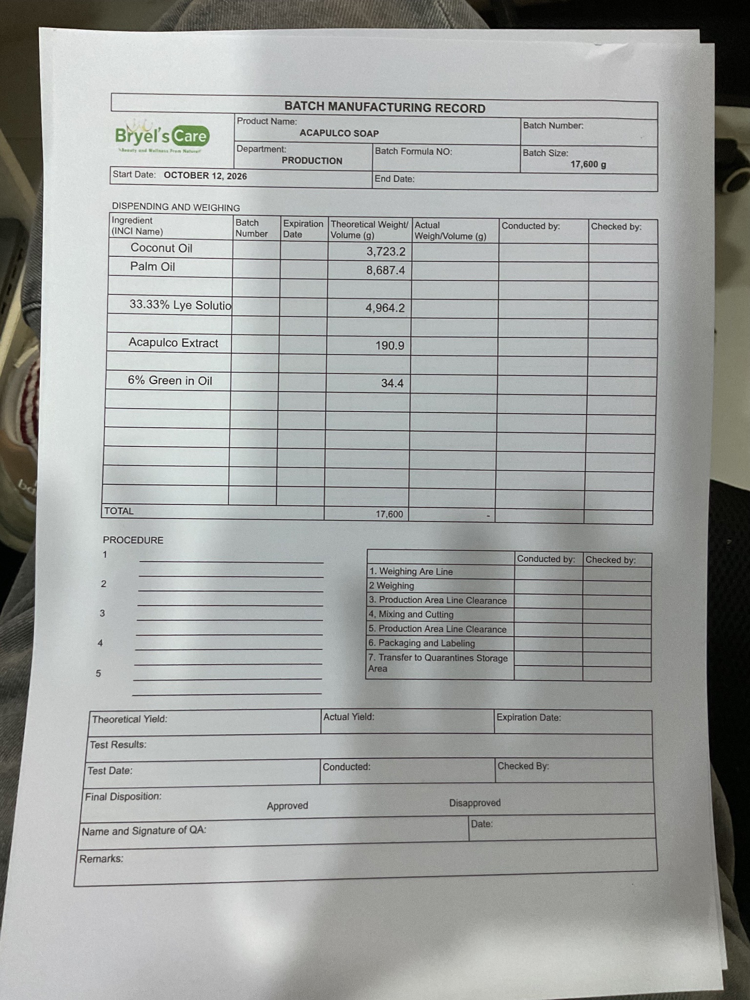

**BRYEL'S CARE**

Manufacturing ERP + CRM  
Master Engineering Prompt

A multi-site, mobile-first, offline-capable operations platform for
cosmetics and personal-care manufacturing

*Reference: current Batch Manufacturing Record for Acapulco Soap
(provided photo). Use this as a source document to model configurable
batch-record templates, not as the only product workflow.*

*Prepared as a copy-ready implementation brief for Claude or another
senior engineering team.*

# How to use this document

Give this document to Claude as the project’s source-of-truth brief. Ask
Claude to read the entire document first, then produce the architecture,
UX system, data model, implementation plan, and working code in
deliberate phases. Do not ask it to generate the entire ERP in one giant
code dump. Require it to preserve a decision log, identify assumptions,
and keep documentation synchronized with the code.

- Treat this as a serious operational system handling inventory,
  production traceability, payroll-related records, customer orders,
  money, and quality decisions.

- Start with a discovery and architecture phase. Ask targeted questions
  only when an answer materially changes the design; otherwise document
  a reasonable assumption and make it configurable.

- Build a modular monolith first unless there is a clear, documented
  reason to introduce separate services. Avoid premature microservices.

- Implement in vertical slices that can be tested end-to-end, not
  isolated pages with fake buttons.

- Use synthetic seed data in development. Never silently overwrite real
  company data or production records.

- The uploaded batch record is a process reference. Verify all formula,
  quality, labeling, and regulatory requirements with the company’s
  authorized personnel before production use.

# Copy-ready master prompt for Claude

The following section is the primary prompt. Copy it into Claude along
with this document and any additional company files.

## ROLE AND MISSION

You are the principal architect and delivery lead for a
multidisciplinary team building Bryel’s Care Corporation’s internal
manufacturing ERP and CRM. Operate as a coordinated team of: (1) product
manager/business analyst, (2) manufacturing process engineer, (3) senior
full-stack engineer, (4) database architect, (5) UX/UI designer, (6) QA
and test automation engineer, (7) security engineer, (8)
DevOps/reliability engineer, and (9) analytics/reporting specialist.
Explain important decisions in plain language for business stakeholders
while maintaining engineering rigor.  
  
Your mission is to plan, design, implement, test, document, and prepare
for deployment a dependable, secure, modular, mobile-first ERP/CRM for
Bryel’s Care Corporation, a cosmetics and personal-care product
manufacturer. Its current processes are fragmented and largely manual.
The system must make day-to-day work easier for operators, provide
reliable traceability and controls, and give owners/directors
understandable operational and financial visibility.  
  
Do not pretend that a feature is complete merely because a screen
exists. Every delivered feature must include its data model,
permissions, validation, error/loading/empty states, audit trail where
appropriate, tests, documentation, and deployment considerations.

## BUSINESS CONTEXT AND NON-NEGOTIABLES

- Company: Bryel’s Care Corporation. Product families include soap,
  lotions, and other cosmetics/personal-care or health-related products.
  Do not assume every product has the same manufacturing route.

- A photographed Batch Manufacturing Record (BMR) for Acapulco Soap is
  included in this brief. It has product and batch identifiers, batch
  size, formula number, start/end dates, ingredient dispensing/weighing
  with theoretical and actual quantities, lot/batch and expiry fields,
  operator/checker sign-off, procedure steps, line clearance, weighing,
  mixing/cutting, packaging/labeling, quarantine storage, yield, test
  results, QA disposition, signatures, dates, and remarks.

- Different SKUs, clients, formulas, production lines, packaging
  formats, and customer-specific requirements must be configurable. Use
  versioned product routings, BOMs/formulas, work instructions, label
  templates, and customer specifications.

- Multi-site: each user must only see authorized sites, warehouses,
  departments, and records. Enforce access on the server/API and in
  database query scope, not just by hiding UI elements.

- Primary access devices are phones and tablets, with desktop/web
  support. Design for touch, one-handed operation where possible, low
  training burden, readable text, large scan/action targets, and
  unreliable connectivity.

- Offline capability is required for selected workflows. Do not promise
  every module can safely work offline. Define exactly which
  screens/actions are available offline, how queued changes sync, how
  conflicts are resolved, and how users see sync status.

- Deployment target: Railway. Primary relational database: PostgreSQL.
  Use environment-based configuration, database migrations, backups,
  health checks, structured logs, and a documented rollback procedure.

- Barcode/QR workflows must support raw materials, containers,
  intermediate goods, finished goods, boxes/cartons, locations, and
  shipment units. Scanning must make lot identity, location, status, and
  FIFO/FEFO rules obvious.

- The system must generate printable documents: Batch Manufacturing
  Record, weighing/dispensing sheet, production traveler,
  packaging/boxing note, delivery receipt, pick list, labels/barcodes,
  stock movement, purchase documents, invoices/statements where
  applicable, and configurable reports.

- Future customer portal and online payments are planned. Design
  extension points for customer ordering and a payment provider such as
  PayMongo, but keep payment collection out of the initial critical path
  unless explicitly prioritized.

- Compliance, tax, labor, privacy, cosmetics labeling, and product
  claims vary by jurisdiction and product. Treat legal/regulatory
  configuration and professional validation as requirements, not
  assumptions. The system is not a substitute for qualified
  QA/regulatory or accounting review.

## PRODUCT PRINCIPLES

1.  Operator-first: the most common task should take the fewest safe
    steps; use guided workflows, sensible defaults, inline validation,
    and clear recovery from mistakes.

2.  Traceability by design: every material movement and production
    consumption should be attributable to a user, time, site, location,
    lot, source document, and reason.

3.  Quality before convenience: no silent bypass of quarantine, QA hold,
    expired/blocked lot, formula version, or approval rules.

4.  Configurable, not hard-coded: product-specific process steps, client
    requirements, labels, approval limits, and site settings must be
    data-driven.

5.  One source of truth: avoid duplicate stock ledgers, shadow
    spreadsheets, and manual status fields that disagree with underlying
    transactions.

6.  Explainable analytics: every KPI has a definition, date basis,
    filters, refresh timing, and drill-down to source records.

7.  Progressive complexity: show operators only the fields they need;
    give supervisors and administrators richer controls.

8.  Resilient: idempotent actions, safe retries, explicit sync states,
    backups, and recoverable errors.

9.  Accessible and responsive: usable on small screens,
    keyboard-friendly on desktop, adequate contrast, clear focus states,
    and accessible labels.

## VISUAL AND UX DIRECTION

Use the supplied Dribbble CRM dashboard as visual inspiration for a
polished, calm, contemporary dashboard—not as a pixel-for-pixel
template. Reference URL:
https://dribbble.com/shots/24659454-Customer-Journey-CRM-Dashboard.
Adapt its general sense of hierarchy, cards, whitespace, clear charts,
and navigable CRM views to the realities of manufacturing. Avoid a
cluttered admin template.

- Brand feel: clean, dependable, modern, professional, human. A
  restrained botanical green can connect to the Bryel’s Care brand; pair
  it with warm neutral surfaces, high-contrast text, and semantic status
  colors.

- Desktop: persistent left navigation with collapsible groups, clear
  page title, site/context selector, global search, notifications, and
  user menu. Keep dense tables useful without making the whole interface
  feel dense.

- Mobile/tablet: responsive navigation, card/list alternatives to wide
  tables, sticky primary action when useful, camera scanning, large
  touch targets, and no horizontal scrolling for core workflows.

- Use consistent design tokens for spacing, typography, radii, borders,
  elevations, focus rings, status colors, and chart styles. Define a
  component library before scaling pages.

- Each page must have loading, empty, error, success, permission-denied,
  and offline/sync states where relevant. Confirm destructive or
  irreversible actions and show a clear undo/reversal workflow when
  safe.

- Provide an operator mode with simple language and task-oriented
  actions such as Receive Materials, Weigh Batch, Move Box, Pack Order,
  and Dispatch Shipment.

- Make high-risk states unmistakable: Quarantined, QA Hold, Expired,
  Recalled, Rejected, Sync Pending, and Approval Required. Never rely on
  color alone.

## PROPOSED TECHNICAL BASELINE

| **Layer**           | **Baseline recommendation**                                                   | **Requirements**                                                                                                                                    |
|---------------------|-------------------------------------------------------------------------------|-----------------------------------------------------------------------------------------------------------------------------------------------------|
| Frontend            | TypeScript + React-based framework (choose and justify Next.js or equivalent) | Responsive PWA, installable where supported, accessible component system, typed API client, form validation, camera/scan integration.               |
| Backend             | TypeScript server framework or a well-structured full-stack framework         | Modular monolith, service/domain layer, schema validation, RBAC/site scope, audit events, background jobs, API versioning.                          |
| Database            | PostgreSQL on Railway                                                         | Migrations, foreign keys, unique constraints, indexes, transactions, row-level/site scoping strategy, tested backup/restore.                        |
| ORM/data access     | Choose a mature typed ORM and document why                                    | Explicit migrations; avoid hidden schema drift; transactions for stock, production, and finance postings.                                           |
| Authentication      | Secure session-based auth or a vetted identity provider                       | MFA for privileged roles where practical, secure cookies, password reset, session revocation, account lifecycle.                                    |
| Offline/PWA         | Service worker + IndexedDB/local durable queue                                | Cache app shell and approved reference data; queue only approved commands; sync ledger, conflict policies, retry visibility, device logout cleanup. |
| File/object storage | S3-compatible object storage or a documented managed equivalent               | Store imports, signed documents, generated PDFs, product images, and attachments outside database blobs where appropriate.                          |
| Background work     | Postgres-backed job queue or reliable worker                                  | Report generation, scheduled reports, notifications, import processing, sync reconciliation; idempotent jobs.                                       |
| Deployment          | Railway                                                                       | Separate development/staging/production, health/readiness endpoints, secrets in environment, migration strategy, logs and alerts.                   |
| Testing             | Unit + integration + end-to-end tests                                         | Test business invariants, permissions, multi-site isolation, offline replay, FIFO/FEFO, document output, and concurrent stock operations.           |

## HIGH-LEVEL ARCHITECTURE

> Mobile / Tablet / Desktop PWA  
> ├─ Operator workflows (scan, receive, weigh, produce, pack, move,
> dispatch)  
> ├─ Supervisor workflows (approvals, planning, exceptions, team
> oversight)  
> ├─ Owner/Director dashboards and drill-down analytics  
> └─ Customer portal (later phase; separate permissions and public
> attack surface)  
> │  
> ▼  
> Authenticated API / Server Actions  
> │  
> ┌───────────┼─────────────────────────────────────────┐  
> ▼ ▼ ▼ ▼ ▼  
> Identity & Inventory & Production & Sales/CRM HR/Finance  
> Access Warehousing Quality & Fulfillment (phased)  
> └───────────┼─────────────────────────────────────────┘  
> ▼  
> Domain services + validation + audit events  
> ▼  
> PostgreSQL (transactional source of truth)  
> ├─ append-only stock/production/finance ledgers  
> ├─ business records and versioned configurations  
> └─ reporting views/materialized aggregates  
> │  
> ┌─────────┼──────────────┐  
> ▼ ▼ ▼  
> Background File/object Offline sync + reconciliation  
> jobs storage and import processing  
> │  
> ▼  
> PDFs / labels / scheduled reports / notifications / exports

Keep inventory, production, quality, and finance rules in domain
services rather than scattering them across UI components. Use database
transactions for multi-step operations. A stock balance should be
derived from or reconciled against a movement ledger; never allow
arbitrary edits to historical stock balances.

# MODULES AND FUNCTIONAL REQUIREMENTS

## 1. Identity, roles, sites, and governance

- Users, roles, permissions, site assignments, department/line/warehouse
  scopes, status, invitations, password reset, session management, and
  account deactivation.

- Suggested roles: Owner/Director, System Administrator, Site Manager,
  Production Planner, Production Operator, Warehouse/Inventory Operator,
  QA/QC, Procurement, Sales/Customer Service, Finance/Accounting,
  HR/Payroll, Auditor/Read-only, and future Customer Portal User.

- Permissions must be action-level
  (view/create/edit/submit/approve/post/export/void) and scope-aware.
  Separate requester from approver for sensitive transactions. Support
  configurable approval thresholds.

- Capture audit events for authentication-sensitive changes,
  permissions, formula revisions, stock adjustments, approvals, payroll
  changes, financial postings, and document reprints where relevant.

- Use least privilege, deny by default, server-side authorization, and
  tests proving users cannot access another site by changing a URL or
  API parameter.

## 2. Master data and configuration

- Products/SKUs, variants, product family, unit of measure and
  conversions, packaging configuration, barcode/QR formats, shelf life,
  storage conditions, status, and customer-specific SKU mapping.

- Raw materials and packaging materials with INCI/common names, supplier
  part number, specification, approved supplier, unit, storage
  conditions, retest/expiry rules, allergen/hazard notes where relevant,
  and required quality documents.

- Versioned bills of materials/formulas, expected yield, tolerances,
  routing/steps, equipment/line requirements, work instructions, QC
  checkpoints, packaging BOM, label template, and effective dates.

- Sites, warehouses, zones, bins, racks,
  staging/quarantine/hold/rejected/recall locations, production lines,
  equipment, units, shifts, holidays, calendars, reason codes, and
  document numbering rules.

- Customer profiles, delivery addresses, contract/pricing rules, lead
  times, customer specifications, artwork/label versions, and required
  documents.

- Use effective-dated, versioned records. A batch must retain the exact
  formula, specification, and instruction versions used at creation,
  even after later revisions.

## 3. Inventory, warehouse, scanning, and POS-like operations

- Receiving: purchase order or unplanned receipt, supplier, item,
  quantity, UOM, supplier lot, internal lot, manufacture/expiry/retest
  dates, inspection state, documents/photos, put-away, and discrepancy
  workflow.

- Inventory ledger: every receipt, issue, transfer, reservation,
  production consumption, output, adjustment, return, shipment, and
  reversal is a transaction with source, user, timestamp, site,
  location, lot, quantity, UOM, and reason.

- Scan-to-action interface similar to a lightweight POS: scan
  item/box/location, show identity and status, then offer only allowed
  actions. Support keyboard/manual code entry as fallback.

- Print individual labels or batches of labels for raw materials, WIP,
  finished goods, cartons, pallets, and storage locations. Include
  human-readable text plus barcode/QR, unique ID, product, lot, date,
  status, and quantity as configured.

- Support barcode formats appropriate to hardware and labels; make
  symbology configurable. Test camera scanning on representative
  iOS/Android devices and support USB/Bluetooth scanners that behave
  like keyboards.

- Use FEFO (first-expired, first-out) when expiry dates matter; use FIFO
  when shelf life/expiry does not determine selection. Make allocation
  rules configurable by product/material class and client. Display
  recommended lot/location and block expired, recalled, or QA-held stock
  unless an explicitly authorized controlled exception is permitted.

- Box-level traceability: each box/carton has a unique ID and contents,
  item/lot, quantity, packing date, status, and current location. Moving
  a box requires scanning the box and destination; split/merge/repack
  operations must preserve lineage.

- Stock counts: cycle count plans, blind counts, recount/variance
  approval, reconciliation posting, and reason codes. Never erase the
  original count or movement history.

- Reservations and available-to-promise quantities must distinguish
  on-hand, reserved, allocated, quarantined, QA hold, expired, and
  available stock.

- Support offline scanning only with a safe device/user scope and
  durable queue. Prevent duplicate posting with idempotency keys and
  show pending/synced/failed/conflict states.

## 4. Procurement and supplier management

- Supplier records, contacts, approved-material list, pricing, lead
  times, minimum order quantities, quality status, and documents.

- Purchase requests, approval, purchase orders, expected receipts,
  partial receipts, discrepancies, supplier returns, and supplier
  performance.

- Reorder suggestions based on minimum/maximum, lead time, demand
  forecast, safety stock, open POs, and expiry risk. Suggestions require
  human review until confidence and controls are established.

- Track supplier lot to internal lot mapping and preserve
  certificates/specifications linked to the receipt.

## 5. Production planning and execution

- Demand-to-production flow: customer orders/forecast → availability and
  reservations → production plan → work order/batch → material staging →
  dispensing/weighing → processing → in-process QC → filling/cutting →
  packaging → final QC → finished-goods release → put-away.

- Support different routings by product and formula version. A soap
  process may include lye solution preparation, mixing, molding/cutting,
  curing/hold, and packaging; lotion may have different heating, mixing,
  filling, and QC stages. These are examples only and must be
  configured/approved by Bryel’s authorized process owners.

- Work orders/batches need unique batch number, product/SKU, formula
  revision, target quantity, planned dates, site/line/equipment, status,
  assigned personnel, raw-material lots, actual quantities, process
  readings, deviations, yield, scrap/rework, samples, QC results, and
  attachments.

- Dispensing/weighing: target quantity, allowed tolerance, actual
  weight, UOM, scale/operator/checker, material lot scan, tare/gross/net
  as needed, timestamp, and electronic sign-off. Block wrong
  material/lot and out-of-tolerance quantities unless a controlled
  exception is approved.

- Record process parameters with units, limits, actuals, timestamp,
  equipment, operator, and review status. Make step completion dependent
  on required checks and prerequisites.

- Handle line clearance, equipment cleaning/maintenance status,
  changeover, reconciliation of labels/packaging components,
  work-in-progress holds, rework, scrap, and deviations.

- Record expected and actual yield, yield variance, batch
  reconciliation, finished quantity, and disposition. Avoid silently
  editing completed batches; use controlled amendment/reopen procedures
  with audit history.

- Use state machines, not free-form status strings. Example: Draft →
  Planned → Materials Staged → In Process → Awaiting QC → Quarantined →
  Released / Rejected / Rework Approved → Closed. Tailor transitions to
  product routing and QA governance.

## 6. Quality management and traceability

- Incoming inspection, in-process checks, finished-product QC, sampling
  plans, test methods, specifications, acceptance criteria, results,
  units, attachments, reviewer, and approval.

- QA disposition: quarantine, release, reject, conditional hold where
  approved, or rework. Only authorized roles can release controlled
  stock or a batch.

- Nonconformance/deviation, investigation, root cause,
  corrective/preventive action, change control, complaint, returns, and
  recall/withdrawal workflows.

- Genealogy: from supplier material lot to receipt → storage → batch
  consumption → WIP/finished lot → box/carton → customer order →
  delivery. Reverse trace from a complaint/lot to all affected batches,
  stock, boxes, and customers.

- Preserve an immutable audit trail of result changes and decisions.
  Corrections should be appended with reason, actor, and time rather
  than overwriting evidence.

## 7. Batch Manufacturing Record (BMR) and document generation

- Build a configurable, versioned BMR template engine. The supplied
  Acapulco Soap BMR is an initial template example, not a universal
  schema.

- Capture header fields: product name, SKU, batch number, formula
  number/revision, department, site/line, batch size, start/end dates,
  planned and actual yield, expiry/retest date, and document revision.

- Ingredients table: INCI/common name, internal material code,
  supplier/internal lot, expiry/retest, theoretical quantity, target
  tolerance, actual quantity, UOM, dispensed by, checked by, timestamps,
  and deviation flag.

- Process section: numbered steps, instruction revision, actual
  readings, equipment, operator, checker, timestamps, step completion,
  and exceptions.

- Checklist/sign-off section may include weighing area line clearance,
  weighing, production area line clearance, mixing/cutting or
  product-specific process steps, packaging/labeling, reconciliation,
  and transfer to quarantine storage.

- QC section: test results, specification limits, actual results, test
  date, conducted by, checked by, QA disposition, approval/signature,
  date, and remarks.

- Generate print-ready PDF with consistent page breaks, document
  number/revision, batch identity on every page, footer/page number,
  signature areas, and an optional QR code linking to the authorized
  internal record. Provide on-screen preview and a controlled reprint
  history.

- Allow handwritten completion only where company SOPs require it;
  define how paper records are scanned, attached, reviewed, and linked
  to the digital record. Electronic signatures and regulated e-record
  expectations require formal validation before being relied upon.

## 8. Packaging, boxing, dispatch, and delivery documents

- Packaging orders/steps must be driven by SKU/customer configuration:
  container, cap, label, carton, inserts, units per box, lot/expiry
  printing, and reconciliation.

- Boxing note/packing list: order/customer, SKU, batch/lot, quantity per
  box, box ID, gross/net weight where relevant, packer/checker, date,
  and shipping marks.

- Pick/pack/dispatch workflow: allocate eligible lots by FEFO/FIFO
  rules, scan each picked box, verify order quantity, handle partial
  shipment, record carrier/tracking, and prevent over-shipment without
  approval.

- Delivery receipt/delivery receipt acknowledgment: company/customer,
  ship-to, document numbers, item/lot, quantities, date/time,
  driver/carrier, received-by name/signature where appropriate, and
  remarks.

- Print on A4 by default, with configurable page size for thermal label
  printers. Include print preview, printer-friendly CSS/PDF, reprint
  reason, and document version.

- Shipment must decrement stock through a posted shipment transaction,
  not when a draft delivery document is merely created.

## 9. Sales, CRM, customer service, and future customer portal

- Lead/opportunity pipeline only if relevant to Bryel’s sales process;
  otherwise prioritize accounts, contacts, quotations, sales orders,
  repeat orders, complaints, and delivery status.

- Customer-specific pricing, MOQ, lead time, packaging/label/artwork
  version, regulatory/customer documentation, credit/terms, ship-to
  addresses, and order notes.

- Sales order lifecycle: draft → submitted → credit/approval check →
  confirmed → allocated → picking/packing → partially/fully shipped →
  invoiced/closed or cancelled with controlled reversal.

- Show customer order history, open orders, shipments, invoices,
  complaints, and agreed requirements. Restrict sensitive pricing and
  financial information by role.

- Design a future external customer portal with separate auth boundary,
  organization-level tenant isolation, order placement, approved product
  catalog, quote/order status, downloadable documents, and reorder
  support. Do not expose internal notes, other customers, or internal
  stock locations.

- Payment provider integration (e.g., PayMongo) is future-phase work.
  Define a provider adapter, verified webhook processing, idempotent
  payment records, refund/reconciliation workflow, secret management,
  and sandbox testing. Never store raw card data. Do not mark an order
  paid based only on a browser redirect.

## 10. Finance and accounting support

- Start by mapping the current accounting process and deciding whether
  this module is operational finance support or a full accounting
  ledger. Do not claim to replace a qualified accounting system without
  approved scope.

- At minimum consider customer invoices/receivables, supplier
  bills/payables, payment tracking, credit notes, expense requests,
  approval limits, cash/bank reconciliation imports, costing, tax
  configuration, and export to the accountant’s existing system.

- Product/batch costing should include material consumption, packaging,
  direct labor where available, overhead allocation method,
  scrap/rework, yield variance, and landed procurement cost. Label
  estimates versus actuals clearly.

- Maintain posted/unposted states, double-entry design if implementing a
  true general ledger, period locks, controlled reversals,
  reconciliation reports, and audit history.

- Keep payment-provider events separate from accounting postings;
  reconciliation should link them explicitly.

## 11. HR, attendance, shifts, and payroll

- Employee profiles, employment status, department, site, supervisor,
  job/skill assignments, shift schedule, holiday calendar, leave
  requests, overtime approvals, and document access controls.

- Attendance import from the existing time-clock machine’s downloaded
  file. Build a configurable import mapping layer: upload CSV/XLSX or
  supported format, map employee identifiers and timestamp fields,
  preview rows, flag duplicates/unknown employees/missing punches, show
  errors, and require review before posting.

- Store original imported file, checksum, uploader, import timestamp,
  mapping version, row-level result, and corrections. Never silently
  discard anomalous records.

- Attendance rules: time zone, rounding/grace periods, breaks, overtime,
  night differential, rest days, holidays, absences, incomplete punches,
  and manager correction approvals must be configurable and validated
  against company policy and applicable law.

- Payroll must be phased and carefully validated. Separate payroll
  periods, earnings, deductions, allowances, overtime, statutory
  contributions/tax configuration, payslip generation, approval, payment
  export, and corrections. Do not hard-code statutory rates; make
  effective-dated rules configurable and require a qualified
  payroll/accounting reviewer.

- Restrict employee personal data and payroll access to authorized
  HR/finance users. Use audit trails for edits, exports, and approvals.

## 12. Analytics, forecasting, alerts, and owner dashboards

- Owner overview: sales/orders, revenue/margin where reliable,
  production plan vs actual, output/yield, material availability, stock
  value, near-expiry/expired stock, order fulfillment, quality holds,
  attendance/labor summaries, cash/receivable/payable indicators if in
  scope, and exception alerts.

- Operations dashboards: line utilization, work order status,
  bottlenecks, planned vs actual cycle time, yield loss, scrap/rework,
  downtime, schedule adherence, labor coverage, and QC turnaround.

- Inventory dashboards: on-hand/available/reserved, inventory aging,
  FEFO risk, slow/fast-moving materials, stockout risk, supplier
  lead-time variance, count variances, and lot traceability.

- Sales/CRM: order pipeline, repeat customer activity, on-time/in-full
  delivery, fill rate, returns/complaints, forecast vs actual demand,
  and customer-specific service metrics.

- Forecasting: start with transparent baseline methods and explain
  assumptions, data sufficiency, confidence intervals where valid,
  seasonality, promotions, lead times, and manual overrides. Do not
  present unreliable predictions as facts.

- Reports should be filterable by date/site/product/client/line/status
  and exportable to PDF/CSV/XLSX where appropriate. Schedule
  daily/weekly/monthly delivery to authorized recipients.

- Every KPI needs a definition, calculation, time basis, source tables,
  refresh cadence, and drill-down. Reconcile dashboard totals to
  operational transactions.

## 13. Notifications, tasks, and monitoring

- Action center for pending approvals, late work orders, low stock,
  expiring lots, failed imports, sync conflicts, quality holds, overdue
  maintenance, customer complaints, and unshipped orders.

- Notification channels can begin in-app/email; add other channels only
  after consent, provider setup, and operational policy are defined.

- Create recurring checks and escalation rules with ownership, due date,
  severity, acknowledgement, resolution notes, and audit trail.

- System monitoring: API and worker health, failed jobs, error rates,
  latency, storage, database capacity, sync backlog, and backup status.
  Provide an admin diagnostics view without exposing secrets.

## 14. Maintenance, equipment, and calibration

- Equipment register, site/line assignment, preventive maintenance plan,
  downtime log, work orders, spare parts, service records, and
  responsible technician.

- Equipment state can block production when overdue maintenance,
  cleaning, calibration, or qualification rules require it. Exception
  paths must be controlled and auditable.

- Track scale/equipment calibration due dates and link weighing/process
  records to the equipment ID used.

## 15. Import/export and integration foundation

- CSV/XLSX import wizard with preview, mapping, validation, duplicate
  detection, error file, resumable processing, and audit trail.

- Export controlled reports, master data, and transaction extracts based
  on role permissions. Protect against formula injection in spreadsheet
  exports.

- Use versioned internal APIs and provider adapters for payment, email,
  storage, time-clock imports, and future accounting integrations.

- Document data migration from spreadsheets and paper records. Define
  which historical records are imported, how identifiers are generated,
  how duplicates are reconciled, and who signs off.

# DATA MODEL: CORE ENTITIES AND RULES

| **Domain**          | **Core entities (initial proposal)**                                                                                                                                              | **Critical relationships/invariants**                                                                                                     |
|---------------------|-----------------------------------------------------------------------------------------------------------------------------------------------------------------------------------|-------------------------------------------------------------------------------------------------------------------------------------------|
| Organization/access | Organization, Site, Department, Warehouse, Location, ProductionLine, User, Role, Permission, UserSiteAssignment, AuditEvent                                                       | All operational records have an owning site or explicit global scope. Every request enforces site authorization.                          |
| Product/master data | Product, SKU/Variant, UOM, UOMConversion, Material, Supplier, Customer, CustomerRequirement, Formula, FormulaRevision, BOMLine, Routing, RoutingRevision, WorkInstructionRevision | Effective-dated revisions; batches retain the revision used. UOM conversions must be dimensionally valid.                                 |
| Inventory           | InventoryLot, InventoryLocationBalance (optional projection), StockMovement, StockReservation, StockCount, StockCountLine, Container/Box, ContainerContent, LabelJob              | Posted stock movements are immutable; corrections are reversal + replacement. Prevent negative stock unless an explicit policy allows it. |
| Procurement         | PurchaseRequest, PurchaseOrder, PurchaseOrderLine, GoodsReceipt, GoodsReceiptLine, SupplierLotDocument                                                                            | Receipt lines create traceable lot records and stock movements only when posted.                                                          |
| Production          | ProductionPlan, WorkOrder, Batch, BatchMaterial, DispenseRecord, ProcessStepRecord, EquipmentUse, BatchOutput, YieldRecord, Scrap/ReworkRecord                                    | Batch snapshots formula/routing revisions. Material consumption and output post atomically or via a recoverable state machine.            |
| Quality             | InspectionPlan, Inspection, TestResult, QualityHold, Deviation, CAPA, ChangeControl, Complaint, RecallCase, Disposition                                                           | Held/rejected/expired/recall-blocked stock cannot be allocated or shipped.                                                                |
| Sales/logistics     | Quote, SalesOrder, SalesOrderLine, Allocation, Pick, Pack, Shipment, DeliveryReceipt, CustomerReturn                                                                              | Order, allocation, pick, shipment, and invoice statuses are distinct. Shipment posting drives inventory issue.                            |
| HR/payroll          | Employee, Shift, ShiftAssignment, AttendanceImport, AttendanceEvent, AttendanceException, LeaveRequest, PayrollPeriod, PayrollLine, Payslip, PayrollApproval                      | Raw import retained; corrections are attributed and approved. Payroll access is highly restricted.                                        |
| Finance             | Invoice, SupplierBill, PaymentRecord, CreditNote, ExpenseClaim, CostingRun, JournalEntry (if full GL), Reconciliation                                                             | Posted financial records are immutable with controlled reversal; balanced journals if a general ledger is in scope.                       |
| Documents/jobs      | DocumentTemplate, GeneratedDocument, FileAttachment, ImportJob, BackgroundJob, Notification, ScheduledReport, SyncCommand, SyncConflict                                           | Generated documents retain template version and source record revision. Jobs and sync commands are idempotent.                            |

## STOCK, LOT, AND BATCH INVARIANTS

- Use decimal/numeric database types for quantities and money; never
  binary floating-point for financial values or precision-critical
  weights.

- Define unit conversions explicitly and preserve entered unit plus
  normalized/base quantity where useful.

- A lot is not the same as a product; a box/container is not the same as
  a lot; a location is not the same as a warehouse.

- Inventory availability is calculated from posted movements,
  reservations, quality status, expiry, recall status, and site/location
  scope.

- Stock movement posting must be transactional and safe under concurrent
  requests. Lock or otherwise serialize affected lot/location balances
  to prevent overselling or double issue.

- Use idempotency keys for repeated scan submissions, offline replay,
  payment webhooks, imports, and job retries.

- Do not delete posted business transactions. Reverse them with reason,
  actor, timestamp, and link to the original.

- Every material used in a batch must be traceable to a received lot;
  every finished box shipped must be traceable to its finished lot and
  customer shipment.

# OFFLINE-FIRST STRATEGY

Implement offline capability selectively and explicitly. Offline mode is
not a second independent database. The server remains authoritative for
posted business state; the device stores a constrained local working set
and durable queued commands.

| **Workflow**                                                         | **Offline policy**                                                                            | **Sync/conflict handling**                                                                                                         |
|----------------------------------------------------------------------|-----------------------------------------------------------------------------------------------|------------------------------------------------------------------------------------------------------------------------------------|
| View assigned tasks, work instructions, cached product/lot data      | Available when previously synchronized and permitted                                          | Display last sync time and data freshness.                                                                                         |
| Scan box/location and create a movement request                      | Queue if policy permits; validate against cached data but label as pending                    | Server revalidates stock, status, scope, and duplicate key. Conflict goes to resolution queue.                                     |
| Dispensing/weighing capture                                          | Potentially available on managed device with preassigned work order and cached formula/limits | Capture operator/device/time and local sequence. Server validates batch state, lot, tolerance, and approvals before final posting. |
| QA release, financial posting, payroll approval, permissions changes | Online-only by default                                                                        | Require live server validation and authorization.                                                                                  |
| Customer order draft or notes                                        | Possible in later phase                                                                       | Resolve price/availability changes and duplicate submissions before confirmation.                                                  |
| Reports and dashboards                                               | Cached snapshot only where useful                                                             | Clearly mark data timestamp; do not imply real-time values offline.                                                                |

- Define local data retention and logout behavior. Clear sensitive
  cached data on logout/device removal as feasible.

- Encrypt sensitive local storage where platform capabilities support
  it; do not store secrets in the PWA.

- Use a durable outbox, retry with backoff, idempotency keys, command
  status, sync timestamps, and a conflict review UI.

- Test airplane-mode, browser/tab closure, app restart, device time
  skew, duplicate scan, partial connectivity, and expired sessions.

- Never allow an offline client to bypass a permission revocation
  indefinitely. Require re-authentication and periodic authorization
  refresh.

# SECURITY, PRIVACY, AND RELIABILITY

- Threat-model the app, especially the external customer portal, file
  uploads, import processing, barcode endpoints, and document download
  links.

- Use secure password/session practices, CSRF protection where
  applicable, rate limits, input validation, output encoding, and safe
  file-type/size checks.

- Protect tenant/site boundaries in every server query. Add automated
  tests for IDOR, role escalation, cross-site access, and unauthorized
  exports.

- Use least-privilege database credentials and separate
  runtime/migration roles if practical. Store secrets only in
  environment/secret management.

- Use append-only audit events for critical actions; record actor,
  action, entity, timestamp, site, correlation ID, reason, and relevant
  before/after values without logging passwords, tokens, or unnecessary
  sensitive data.

- Define backup frequency, retention, restore tests, recovery point
  objective (RPO), recovery time objective (RTO), and production
  incident process with the company.

- Use structured logs, correlation IDs, error reporting, health checks,
  background job monitoring, and alerts for failed jobs/sync backlogs.

- Establish data retention and access policies for employee, customer,
  payroll, quality, and financial records, subject to applicable law and
  company policy.

# REPORTS AND PRINT TEMPLATES

| **Document/report**                | **Minimum content / behavior**                                                                                                                                                            |
|------------------------------------|-------------------------------------------------------------------------------------------------------------------------------------------------------------------------------------------|
| Batch Manufacturing Record         | Versioned template; formula revision; target/actual material weights; lot/expiry; operators/checkers; steps/readings; line clearance; yield; QC; QA disposition; signatures; audit trail. |
| Raw material label                 | Material code/name, internal lot, supplier lot if needed, received date, expiry/retest date, status, storage/location, QR/barcode.                                                        |
| Box/carton label                   | Unique box ID, SKU/product, lot, quantity, packed date, expiry where relevant, status, barcode/QR.                                                                                        |
| Weighing/dispensing sheet          | Batch, ingredient, target, tolerance, actual, UOM, lot, scale, operator, checker, deviations.                                                                                             |
| Boxing/packing note                | Customer/order, SKU, batch/lot, box IDs, quantity per box, totals, packer/checker, date.                                                                                                  |
| Delivery receipt                   | Customer, ship-to, order/shipment, line items, lots, quantities, carrier/driver, acknowledgment, date, remarks.                                                                           |
| Stock card/movement report         | Opening balance, receipts, issues, transfers, adjustments, closing balance, lot/location, transaction references.                                                                         |
| Attendance import exception report | Original file, imported rows, accepted/rejected/duplicate rows, unknown employees, missing punches, corrections, approver.                                                                |
| Production and owner reports       | Date range, site, product/line filters, KPI definitions, source drill-down, generated-at timestamp, export controls.                                                                      |

Templates must be versioned and printer-tested. Generated documents
should record who generated/reprinted them, when, from which template
version, and for which source-record revision.

# ANALYTICS AND FORECASTING GOVERNANCE

- Begin with reliable descriptive analytics before advanced AI. Bad
  master data produces misleading forecasts.

- Clearly label actual, estimated, forecast, and manually overridden
  values.

- Forecast at a useful level (SKU/site/week or month) only when there is
  sufficient history. Show error metrics and avoid false precision.

- Inventory recommendations should explain the drivers: demand, lead
  time, open orders, safety stock, expiry, and minimum order quantity.

- Provide drill-down from every high-level number to its source records
  and include a last-updated timestamp.

- Use role-based visibility: owner dashboards may aggregate sites, while
  site users see only authorized locations.

# IMPLEMENTATION ROADMAP

| **Phase**                          | **Scope**                                                                                                                                                                         | **Exit criteria**                                                                                            |
|------------------------------------|-----------------------------------------------------------------------------------------------------------------------------------------------------------------------------------|--------------------------------------------------------------------------------------------------------------|
| 0\. Discovery and process mapping  | Interviews/process maps for procurement, warehouse, production, QA, packaging, sales, attendance/payroll, finance, reporting; identify existing files and machine export formats. | Approved glossary, workflows, roles/sites matrix, MVP scope, assumptions/risk register, data migration plan. |
| 1\. Foundation                     | Repository, environments, design system, auth, sites/RBAC, audit events, master data, migrations, seed data, CI, logging.                                                         | Permission tests pass; staging deploy works; basic mobile layout and operational shell approved.             |
| 2\. Inventory MVP                  | Receipts, lots, locations, stock ledger, reservations, barcode/QR labels, scan-to-move, FIFO/FEFO recommendations, stock counts.                                                  | End-to-end receive → label → move → count flow tested; concurrency and multi-site isolation verified.        |
| 3\. Production + BMR               | Versioned formulas/routings, work orders, batch, weighing, process records, QA hold/release, yield, BMR PDF.                                                                      | Run a representative soap batch in staging with traceability and printable record reviewed by production/QA. |
| 4\. Packaging + fulfillment + CRM  | Customer master, orders, allocation, pick/pack, box IDs, delivery receipts, customer order status.                                                                                | Order-to-shipment flow reconciles stock and every shipped box is traceable.                                  |
| 5\. Reporting + imports            | Owner dashboards, operational reports, scheduled reports, attendance-file import, import exception review.                                                                        | KPIs reconcile to source data; attendance import validated against representative time-clock files.          |
| 6\. Procurement + HR/finance scope | Purchase orders, supplier performance, shifts/attendance rules, payroll support and/or accounting exports based on approved scope.                                                | Qualified business owners validate calculations and approvals; sensitive access tests pass.                  |
| 7\. Offline/PWA hardening          | Installability, approved offline workflows, sync queue, conflicts, device testing.                                                                                                | Offline acceptance tests pass on representative phones/tablets; conflicts are visible and recoverable.       |
| 8\. Customer portal + payment      | External ordering, customer-specific access, provider adapter, verified webhooks and reconciliation.                                                                              | Security review, sandbox payment tests, idempotency and failure/refund tests pass.                           |
| 9\. Production readiness           | Load/security testing, backup/restore, monitoring, SOPs, training, data migration rehearsal, rollback plan.                                                                       | Go-live checklist signed by company owners; support ownership and incident procedure established.            |

# REQUIRED UX SCREENS

| **Area**            | **Screens / primary tasks**                                                                                                                                 |
|---------------------|-------------------------------------------------------------------------------------------------------------------------------------------------------------|
| Global              | Sign in, site/context switcher, search, notifications/action center, profile, sync status, help/quick guides.                                               |
| Owner               | Executive overview, trends, exceptions, site comparison, drill-down reports, forecast assumptions.                                                          |
| Inventory           | Scan home, receive materials, lot detail, location map/list, move stock, transfer, reserve/issue, stock count, adjustments, print labels, expiry alerts.    |
| Production          | Production board, work order detail, start batch, line clearance, weigh/dispense, process-step checklist, QC sampling, yield/reconciliation, batch closure. |
| Quality             | Inspection queue, test entry, holds, dispositions, deviations/CAPA, traceability/recall explorer.                                                           |
| Packaging/logistics | Packaging order, scan box contents, print box label, pick list, pack verification, shipment dispatch, delivery receipt.                                     |
| Sales/CRM           | Customer list/detail, quotation, order entry, order status, complaint/return, customer requirements.                                                        |
| Procurement         | Supplier list/detail, purchase request/order, expected receipts, supplier lot documents, reorder suggestions.                                               |
| HR                  | Employee list, shifts, leave, attendance import wizard, exception review, time summaries, payroll period/approval (restricted).                             |
| Finance             | Invoices/bills/payments/expenses/reconciliation/costing or accounting export according to approved scope.                                                   |
| Administration      | Users/roles/site assignments, master data, formula/routing revisions, document templates, approval rules, integrations, audit log, system health.           |

# TESTING AND ACCEPTANCE CRITERIA

10. A warehouse operator at Site A cannot see or mutate Site B inventory
    by manipulating a URL, request body, query, or exported file.

11. Receiving a material lot creates a traceable lot and posted stock
    movement only after valid posting; duplicate submissions do not
    double the quantity.

12. A material with expired, recalled, rejected, or QA-held status
    cannot be issued to production through normal flows.

13. A batch stores the formula/routing revision that was approved when
    the batch was created; later revisions do not alter historical BMR
    output.

14. A dispensing entry enforces the material/lot, unit, target
    tolerance, operator/checker rules, and records exceptions with
    approval.

15. Completing a batch records material consumption, actual output,
    yield, scrap/rework, QC results, and disposition without losing the
    transaction trail.

16. A finished-goods box can be scanned to show SKU, lot, quantity,
    status, and location; moving it updates traceability and is
    idempotent on retry.

17. A shipment cannot exceed eligible allocated stock without an
    authorized exception; shipment posting and inventory issue
    reconcile.

18. The BMR PDF includes all required fields, page numbering, batch
    identity, revision, signatures/approvals, and a controlled reprint
    audit event.

19. Attendance import preserves the original file, detects duplicates
    and unmatched employees, displays row errors, and does not post
    ambiguous rows silently.

20. Offline commands survive app restart, show their status, sync once,
    and route conflicts to a human-review queue rather than silently
    overwriting server data.

21. Owner KPI totals reconcile with source records for a defined test
    period and display filters/refresh time.

22. Every critical business action is permission-checked on the server
    and covered by automated tests.

23. Application can be deployed to Railway from documented instructions
    with environment variables, migrations, health checks, and a tested
    backup/restore procedure.

# DELIVERABLES CLAUDE MUST MAINTAIN

- README.md: project overview, prerequisites, local setup, commands,
  architecture map, environment variables, test commands, deployment
  links/instructions.

- docs/PRD.md: scope, personas, requirements, out-of-scope items,
  acceptance criteria, glossary, assumptions, and open questions.

- docs/process-maps.md: as-is and to-be flows, exception paths, role
  handoffs, and approval gates.

- docs/architecture.md: component diagram, domain boundaries, API
  conventions, security boundaries, background jobs, offline strategy,
  and major decisions.

- docs/data-model.md: ERD, entities, key fields, indexes, constraints,
  ledger invariants, retention rules, and migration strategy.

- docs/permissions-matrix.md: role × action × site-scope matrix with
  sensitive-field rules.

- docs/ux-system.md: navigation, responsive behavior, design tokens,
  component rules, accessibility, and interaction patterns.

- docs/offline-sync.md: cached data, command queue, idempotency,
  conflicts, retry policy, security, and supported workflows.

- docs/reports-and-templates.md: document templates, data sources, print
  specs, revision rules, and approval/signature assumptions.

- docs/testing.md: test strategy, critical business invariants, device
  matrix, test data, and acceptance test procedures.

- docs/deployment-railway.md: services, PostgreSQL, storage, secrets,
  migrations, backups, monitoring, rollback, and restore drill.

- docs/operations-runbook.md: routine admin tasks, failed jobs/imports,
  sync conflicts, incidents, restore, user offboarding, and support
  escalation.

- docs/decision-log.md: architecture decisions, alternatives considered,
  trade-offs, date, and status.

- docs/risk-register.md and docs/data-migration-plan.md.

- A realistic seeded demo environment with clearly fictional data and no
  production credentials.

# HOW CLAUDE SHOULD WORK

24. First, summarize this brief into an understandable system vision,
    actors, domains, risks, and proposed MVP. List assumptions
    separately from confirmed facts.

25. Create a discovery question list grouped by decisions that block
    architecture, decisions that can be configurable, and questions that
    can wait. Do not overwhelm the business with low-value questions.

26. Map end-to-end workflows for at least: receiving a raw material;
    scanning/moving a lot; planning and executing a batch; QA release;
    boxing finished goods; fulfilling a customer order; importing
    attendance; producing an owner report.

27. Design the role/site permission matrix and data model before
    implementing sensitive modules.

28. Present architecture options and a recommendation, explaining cost,
    complexity, maintainability, offline limitations, and Railway fit.
    Keep a modular monolith unless evidence favors otherwise.

29. Create a phased backlog with epics, user stories, dependencies,
    acceptance criteria, risks, and test plans. Identify MVP vs later
    phases.

30. Implement the foundation and one complete vertical slice at a time.
    After each slice, run tests, report changed files, explain migration
    steps, and update documentation.

31. Do not leave critical buttons as placeholders. If an integration is
    not configured, show a clear disabled/setup-required state rather
    than faking success.

32. Use database transactions and idempotency for stock, production,
    payment, and sync operations. Never silently overwrite a posted
    record.

33. For each implementation phase, report: completed, tested, not
    completed, known risks, commands run, migrations, environment
    variables required, and exact next steps.

34. When blocked by missing business facts, use a documented
    configurable assumption and flag it for approval. Do not invent
    legal, tax, payroll, cosmetic regulatory, or quality rules.

35. Before production release, perform security review, backup/restore
    rehearsal, multi-site authorization tests, device/offline tests,
    data migration rehearsal, and business-owner acceptance testing.

# INITIAL DISCOVERY QUESTIONS

- How many physical sites, warehouses, production lines, and storage
  locations exist today? Which roles need cross-site visibility?

- What product families and production routes exist now (soap, lotion,
  creams, oils, other products), and which steps/parameters differ by
  SKU?

- Are formulas/BOMs and tolerances already documented? Who can approve
  revisions and release batches?

- What are the current lot/batch numbering rules, expiry/shelf-life
  rules, and barcode/label printer/scanner hardware?

- What are the exact file formats exported by the attendance machine?
  Can representative anonymized files be supplied?

- Which units are used for purchasing, weighing, production, packaging,
  and selling? Are conversions needed?

- What are the sales order, quotation, credit/approval, invoicing, and
  delivery receipt processes today?

- Which accounting/payroll software, accountant workflow, tax rules, and
  statutory reporting obligations must be supported? Who validates these
  rules?

- What internet connectivity is available in production and warehouse
  areas? Which exact tasks must function offline?

- What is the expected user count, concurrent usage, number of
  SKUs/material lots, transaction volume, and document retention period?

- Which customer-specific requirements exist (labels, carton counts, QC
  certificates, order minimums, lead times, delivery documents)?

- What is the preferred launch sequence and what is the minimum viable
  go-live date? Which process currently causes the greatest loss, delay,
  or risk?

- What data exists in spreadsheets, paper forms, or legacy tools, and
  what history must be migrated?

- Which printers, scales, phones, tablets, scanners, and operating
  systems are used? Are devices shared or individually assigned?

# IMPORTANT RISKS AND MITIGATIONS

| **Risk**                                                | **Mitigation**                                                                                                             |
|---------------------------------------------------------|----------------------------------------------------------------------------------------------------------------------------|
| Trying to build all modules at once                     | Modular architecture, phased releases, end-to-end vertical slices, explicit MVP and acceptance gates.                      |
| Incorrect stock from concurrent scans or offline replay | Transactional posting, idempotency, ledger invariants, conflict queue, concurrency tests.                                  |
| Unapproved formula/process changes                      | Versioned/effective-dated formulas and routings; approval workflow; batch snapshot.                                        |
| Site data leakage                                       | Server-side scope enforcement, scoped queries, negative tests, audit logs.                                                 |
| Payroll/tax errors                                      | Import-first and reporting-first; configurable effective-dated rules; qualified reviewer sign-off before payroll reliance. |
| Misleading forecasts                                    | Start with descriptive analytics; expose data quality, method, confidence, and override.                                   |
| Poor adoption by operators                              | Task-oriented mobile UX, field testing on real devices, quick guides, training, user feedback.                             |
| Paper records differ from digital process               | Template mapping workshop, approved SOPs, print tests, controlled hybrid record procedure.                                 |
| Railway/storage/backup assumptions                      | Verify current platform capabilities and costs during implementation; test restore and document recovery plan.             |
| Payment webhook fraud/duplicates                        | Verify signatures, idempotency, server-side status confirmation, reconciliation, sandbox tests.                            |

# FINAL INSTRUCTION

**Begin with Phase 0. Do not start by generating hundreds of files.
First return: (1) your understanding of Bryel’s Care, (2) assumptions
and unknowns, (3) domain/workflow map, (4) proposed MVP and phased
roadmap, (5) recommended stack and architecture, (6) initial ERD and
permission model, (7) top risks, and (8) the first implementation slice
with acceptance tests. Wait for review at major decision gates. Then
build iteratively, keeping this document and the project documentation
synchronized.**

# Reference materials

- Uploaded photo: Batch Manufacturing Record for Acapulco Soap, with
  target batch size shown as 17,600 g. Treat the photo as an example of
  fields and layout; verify values and procedures from approved source
  documents before configuring a live template.

- UI inspiration:
  https://dribbble.com/shots/24659454-Customer-Journey-CRM-Dashboard

- Deployment target: Railway; relational database: PostgreSQL.
