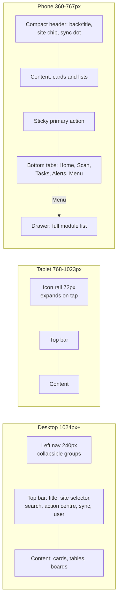

# UX system

Owner: `ux-ui-designer`. Status: **Proposed for Gate 0** (implements ADR-007; depends on
ADR-017 scanning, ADR-018 offline, ADR-019 locale). Companion artifact for the owner's
review: `docs/design/style-tile.html` (open on an iPad and a phone; it has a theme toggle).

This document is what the frontend engineer builds `src/ui` from and what every new page is
reviewed against. Confirmed facts come from `docs/source/master-brief.md`,
`docs/source/ui-inspiration.md` and the BMR photo; everything else is an assumption labelled
`A-UX-nn` in section 11.

| Reader | Start with |
|---|---|
| Owner/Director (Gate 0) | 1 Principles, 3 Navigation, 7 Operator mode, 9 Key screens, 11 Open questions, and the style tile |
| Frontend engineer | 2 Tokens, 4 Responsive rules, 5 Components, 6 Page states, 8 Accessibility, 10 Printing |
| Backend / QA | 6 Page states (copy and permission rules), 9 Key screens (states and actions per screen) |

Cross-references: `docs/decision-log.md`, `docs/permissions-matrix.md` (roles and permission
strings), `docs/data-model.md` (entities, state machines), `docs/offline-sync.md` (which
actions queue), `docs/reports-and-templates.md` (document content), `docs/PRD.md` (glossary).

---

## 1. Design principles

| # | Principle | What it means on screen |
|---|---|---|
| 1 | **Operator-first** | The most common task takes the fewest safe steps. Scan first, type second. One primary action per screen, sticky on phones. Sensible defaults (site, location, lot by FEFO) pre-filled; inline validation; clear recovery from a wrong scan. |
| 2 | **Calm, dependable, modern, professional, human** | Light warm-neutral workspace, white cards with 16 to 20 px radius and hairline borders, whitespace instead of dividers, no heavy shadows, no decorative gradients. Plain-language copy with people's names, not system jargon. |
| 3 | **Progressive complexity** | Operators see only the fields they need. Supervisor controls (override, reassign, approve) sit behind a "More" affordance or in supervisor views. Administrators get dense tables and bulk actions on desktop. |
| 4 | **Never colour alone** | Every status and risk state is icon + label + colour + border. Charts carry legends and a table twin. Delta arrows carry a sign and text. |
| 5 | **State comes from the state machine** | Chips, banners and allowed actions are derived from `docs/data-model.md` state machines and quality status, never from a free-form status string or a UI-only flag. |
| 6 | **Explain every number** | Each KPI has a definition tooltip (definition, time basis, filters, refresh time) and a drill-down to the source records. Estimates and forecasts are labelled as such. |
| 7 | **Safe by default** | Destructive or irreversible actions (post, void, reverse, release, reject, delete draft) use a confirm dialog with a reason field. Undo is offered only where the server supports a safe reversal. No button fakes success; unconfigured integrations show a setup-required state. |
| 8 | **Built for a 360 px phone in a warehouse** | Targets 44 px or larger, high contrast under glare, one-handed reach for the primary action, keyboard-wedge scanner support, readable at arm's length, usable with an unreliable connection. |

The visual reference is the Dribbble "Customer Journey CRM Dashboard" as described in
`docs/source/ui-inspiration.md`. We keep its hierarchy, card language, stage board, avatar
rows, pastel chips and donut KPIs; we replace black-as-accent with botanical green, reserve
a dark fill for the one primary action and the active navigation pill, and trade decorative
density for touch space.

---

## 2. Design tokens (ADR-007)

### 2.1 Delivery rules

1. Tokens are CSS custom properties declared once in `src/ui/tokens.css` on `:root` (light
   values) and redefined for dark under `@media (prefers-color-scheme: dark)` guarded by
   `:root:not([data-theme="light"])` and again under `:root[data-theme="dark"]`. The user's
   theme choice (system / light / dark) is stored in the profile and applied as
   `data-theme` on `<html>` before first paint.
2. Tailwind v4 consumes them through `@theme` (`--color-primary: var(--primary)` etc.).
   Components and pages never use a colour literal; an ESLint/Stylelint rule flags hex and
   `rgb(` outside `tokens.css`.
3. Every colour pair below states its WCAG contrast. Text pairs meet 4.5:1 (AA) unless marked
   "large only" (3:1, allowed at 18 px+ or 14 px bold). Non-text UI boundaries meet 3:1 where
   they carry meaning; hairline borders are decorative and are not relied on.
4. Operator mode (section 7) does not change tokens; it switches the type scale and target
   sizes through a `data-density="operator"` attribute on the shell.

### 2.2 Brand ramp (botanical green)

Hex values are a proposal derived from the green of the Bryel's Care mark on the BMR
(A-UX-03). Steps are named so the brand hex can be swapped without touching components.

| Token | Light | Used for |
|---|---|---|
| `--green-50` | `#EEF6F0` | selected row tint, soft chip background |
| `--green-100` | `#D8ECDE` | primary-soft background (selected nav tint on phone) |
| `--green-200` | `#B3D9BE` | progress track, sparkline area |
| `--green-300` | `#86C19A` | dark-mode focus ring, dark-mode links |
| `--green-400` | `#57A574` | dark-mode primary button, meter fill |
| `--green-500` | `#2F8A54` | brand accent on marks and icons, chart slot 1 (light) |
| `--green-600` | `#28804B` | **primary button background** (white text 4.9:1) |
| `--green-700` | `#23703F` | links, primary text, light-mode focus ring (6.1:1 on white) |
| `--green-800` | `#1B5A33` | primary button hover/pressed |
| `--green-900` | `#0F321E` | text on green-100 chips (12:1) |

### 2.3 Surfaces and text

| Token | Light | Dark | Role | Contrast (light / dark) |
|---|---|---|---|---|
| `--bg` | `#F6F5F1` | `#121311` | page background (warm off-white / warm near-black) | - |
| `--surface` | `#FFFFFF` | `#1B1D1A` | cards, sheets, table rows | - |
| `--surface-2` | `#F1F0EB` | `#23261F` | inset areas, table header, input background on phones | - |
| `--border` | `#E6E4DD` | `#2E312B` | hairline border (1 px), decorative | 1.3 / 1.3 (not relied on) |
| `--border-strong` | `#C9C6BC` | `#4A4E45` | input borders, dividers that carry meaning | 1.9 / 2.3 (paired with fill) |
| `--fg` | `#1C1B18` | `#EDEBE4` | primary text | 17.2 / 14.2 on surface |
| `--fg-2` | `#5B5951` | `#B8B5AA` | secondary text, labels | 7.0 / 8.3 |
| `--fg-muted` | `#6F6C63` | `#8F8C81` | captions, placeholders, axis labels | 5.3 / 5.0 (AA) |
| `--fg-inverse` | `#F6F5F1` | `#1C1B18` | text on `--cta` | 15.8 / 14.4 |
| `--cta` | `#1C1B18` | `#EDEBE4` | the single most important action on a page and the active nav pill | - |
| `--primary` | `#28804B` | `#5FB27E` | primary button fill, selected states | white text 4.9 / dark text (`#0F2A1A`) 6.0 |
| `--primary-hover` | `#1B5A33` | `#6BBE8A` | hover / pressed | - |
| `--primary-text` | `#23703F` | `#8BD0A3` | links, text-only primary, icons | 6.1 / 9.4 on surface |
| `--primary-soft` | `#D8ECDE` | `#1C3A28` | selected tint, soft badge | with `--green-900` / `#B6E6C6` text, 12:1 / 9:1 |
| `--on-primary` | `#FFFFFF` | `#0F2A1A` | text on `--primary` | 4.9 / 6.0 |
| `--ring` | `#23703F` | `#8BD0A3` | focus ring | 6.1 / 9.4 against surface |
| `--scrim` | `rgba(28,27,24,.45)` | `rgba(0,0,0,.6)` | overlay behind sheets and dialogs | - |

### 2.4 Semantic status colours

Each status has four tokens: `-bg` (pastel fill), `-fg` (dark text), `-border`, `-icon`.
Chip text on chip fill is 7.4:1 or better in both themes (validated by script, see 2.7).

| Status | Light bg / fg / border / icon | Dark bg / fg / border / icon | Icon (Lucide) | Meaning |
|---|---|---|---|---|
| `--status-success-*` | `#DDF3E4` / `#14532D` / `#9FD4B2` / `#1E8449` | `#1C3A28` / `#B6E6C6` / `#2F6B45` / `#5FB27E` | `check-circle` | released, posted, synced, within tolerance |
| `--status-warning-*` | `#FDEFCF` / `#6B4400` / `#F0CF7D` / `#B97A00` | `#3E2E0C` / `#F3D592` / `#6B4F12` / `#E0A63A` | `alert-triangle` | near expiry, variance, needs attention |
| `--status-danger-*` | `#FBE1E1` / `#8A1C1C` / `#F0A6A6` / `#C62828` | `#44201F` / `#F5B5B5` / `#7A3634` / `#E57373` | `octagon-alert` | blocked, failed, out of tolerance |
| `--status-info-*` | `#DCEBFA` / `#1C4A80` / `#A9CBF0` / `#2A78D6` | `#1B2E45` / `#B3D1F3` / `#2F4E78` / `#5A9BE6` | `info` | informational, in progress |
| `--status-neutral-*` | `#ECEAE3` / `#45423A` / `#D3D0C7` / `#7D7A70` | `#2A2D27` / `#D5D2C8` / `#45493F` / `#9A978C` | `circle` | draft, planned, closed, cancelled |

### 2.5 Risk-state tokens

High-risk states each get dedicated tokens so they can be tuned independently of the
generic status set. They render as a chip (icon + label) and, where the state blocks an
action, as a banner with a 4 px leading stripe (section 5.9). Hues are distinct where the
palette allows; where two share a hue family (Recalled and Rejected, Quarantined and
warning) the icon and label carry the difference, as the principle requires.

| State | Source of truth | Icon (Lucide) | Light bg / fg / border | Dark bg / fg / border |
|---|---|---|---|---|
| Quarantined | lot quality status `quarantine`; batch state `quarantined` | `lock` | `#FDE9CF` / `#703D00` / `#F2BE7A` | `#43300F` / `#F4CF94` / `#7A5A1F` |
| QA Hold | lot status `on_hold`; `QualityHold` open | `pause-circle` | `#EAE3FA` / `#43307A` / `#C9BBEF` | `#2E2648` / `#CFC3F0` / `#574A8A` |
| Expired | lot status `expired` or expiry date passed | `calendar-x` | `#ECE7E0` / `#514738` / `#CFC7B8` | `#302C25` / `#CFC7B8` / `#5A5447` |
| Recalled | lot status `recalled`; `RecallCase` open | `octagon-alert` | `#FBE1E1` / `#8A1C1C` / `#E07070` (2 px) | `#44201F` / `#F5B5B5` / `#B04444` (2 px) |
| Rejected | lot status `rejected`; batch `rejected`; disposition `reject` | `x-circle` | `#F9E1E8` / `#7A1F3A` / `#EAA7BC` | `#3F1F2A` / `#F0B8C8` / `#7A3C52` |
| Sync Pending | outbox command `pending` / `failed` / `conflict` | `cloud-upload` (pending), `cloud-off` (failed), `git-merge` (conflict) | `#DCEBFA` / `#1C4A80` / `#A9CBF0` | `#1B2E45` / `#B3D1F3` / `#2F4E78` |
| Approval Required | record in `pending_approval` / `submitted` awaiting approver | `user-check` | `#D6EFEC` / `#114B47` / `#9BD6CF` | `#163531` / `#A9DDD6` / `#2C6B63` |
| Released (contrast case) | lot `released`; batch `released` | `check-circle` | status-success | status-success |

Tokens are named `--risk-<state>-bg|fg|border|icon`, for example `--risk-quarantined-fg`.
Icons are 16 px inside chips, 20 px in banners, 24 px on scan result cards.

### 2.6 Chart palette

Validated with the data-viz palette validator (OKLab, Machado 2009 CVD simulation) against
`--surface` in each theme. Rules follow the `docs/analytics-kpis.md` conventions (value
labels in its section 1.2); the palette here is the binding set.

**Categorical (identity), fixed order, never cycled.** Assign slot 1 to the first series and
continue in order; a 7th series folds into "Other" or the chart becomes small multiples.

| Slot | Token | Light | Dark | Hue |
|---|---|---|---|---|
| 1 | `--chart-1` | `#2F8A54` | `#43A668` | botanical green (brand) |
| 2 | `--chart-2` | `#2A78D6` | `#3987E5` | blue |
| 3 | `--chart-3` | `#EB6834` | `#D95926` | orange |
| 4 | `--chart-4` | `#6250D6` | `#9085E9` | violet |
| 5 | `--chart-5` | `#EDA100` | `#C98500` | amber |
| 6 | `--chart-6` | `#E87BA4` | `#D55181` | magenta |

Validation result: worst adjacent CVD ΔE 16.3 (light) / 13.2 (dark), target ≥ 8; worst
adjacent normal-vision ΔE 19.6 / 19.3, floor 15; all slots inside the lightness band and
above the chroma floor. Light-mode slots 5 and 6 sit below 3:1 against white (2.2 and 2.7),
so any chart that uses them must show direct labels or its table view (both are standard,
see 5.12). Scatter and map forms are capped at three series.

**Sequential (magnitude), one hue.** Light: `--seq-1..5` = `#7BBB90`, `#57A574`, `#2F8A54`,
`#23703F`, `#1B5A33` (light end 2.3:1 on white). Dark: `#1B5A33`, `#23703F`, `#2F8A54`,
`#57A574`, `#86C19A` (dark end 2.1:1 on the dark surface). Heatmaps and ordinal tiers use
this ramp; never a rainbow.

**Chart status.** `--viz-good` = status-success-icon, `--viz-bad` = status-danger-icon,
`--viz-warn` = status-warning-icon, `--viz-neutral` = `--fg-muted`. Used only when a series
means good/bad (on-time vs late, pass vs fail), never as "series 4".

**Chrome.** Gridlines `--border` (1 px solid, never dashed), axis `--border-strong`, axis
text `--fg-muted`, tooltip on `--surface` with elevation 2. Line 2 px, markers ≥ 8 px with a
2 px surface ring, bars ≤ 24 px thick with 4 px rounded data ends, 2 px surface gap between
stacked segments, area fills at 10 to 12 % opacity. Text never wears a series colour.

### 2.7 Spacing scale

4 px base. `--space-0` 0, `-1` 4, `-2` 8, `-3` 12, `-4` 16, `-5` 20, `-6` 24, `-8` 32,
`-10` 40, `-12` 48, `-16` 64. Card padding: 16 on phone, 20 on desktop. Page gutter: 16 at
360 px, 24 at 768 px+, 32 at 1280 px+. Gap between cards: 12 on phone, 16 on desktop. Form
field stack: 16. Section stack: 32 (desktop) / 24 (phone).

### 2.8 Type scale

Inter (variable) via `next/font` with the fallback stack
`Inter, "Segoe UI", Roboto, "Helvetica Neue", Arial, sans-serif`. `font-feature-settings:
"cv11", "ss01"` optional; `font-variant-numeric: tabular-nums` only on data roles.

| Role | Default (phone / desktop) | Weight | Line height | Notes |
|---|---|---|---|---|
| `display` | 28 / 32 px | 600 | 36 / 40 | owner overview title, operator greeting; letter-spacing −0.01em |
| `h1` | 22 / 24 px | 600 | 28 / 32 | page title in top bar |
| `h2` | 18 / 20 px | 600 | 24 / 28 | card titles, section headers |
| `h3` | 16 px | 600 | 24 | sub-sections, dialog titles |
| `body` | 15 / 14 px | 400 | 22 / 20 | default text; 14 px on desktop keeps tables dense |
| `body-strong` | as body | 500 | as body | row primary text, nav items |
| `small` | 13 px | 400 | 18 | secondary row text, helper text |
| `caption` | 12 px | 500 | 16 | uppercase labels, letter-spacing 0.04em, `--fg-2` |
| `data` | 14 px | 500 | 20 | table numbers, tabular-nums, right-aligned |
| `data-lg` | 20 px | 600 | 24 | quantities on cards, tabular-nums |
| `hero` | 36 / 40 px | 600 | 40 / 44 | KPI value (proportional figures), live weight readout (tabular) |
| `mono` | 13 px | 400 | 18 | lot/box identifiers in scan results and audit log: `ui-monospace, "SF Mono", Menlo, Consolas, monospace` |

Operator mode (`data-density="operator"`): body 16/24, body-strong 16/24, buttons 18/24,
data-lg 24/28, hero 44/48. Minimum text size anywhere: 12 px; 13 px in operator mode.

### 2.9 Radii

`--radius-xs` 6 (chips, badges), `--radius-sm` 8 (inputs, buttons, menu items),
`--radius-md` 12 (tiles, nested cards, table container), `--radius-lg` 16 (cards on phone,
dialogs), `--radius-xl` 20 (cards on desktop, phone bottom sheets top corners),
`--radius-full` 999 (pills, avatars, tab indicators).

### 2.10 Borders

Hairline `1px solid var(--border)` on every card and table container; `--border-strong`
on inputs and on dividers that separate meaning (table header). Risk banners: 1 px border
in the state's `-border` plus a 4 px leading stripe in the state's `-icon` colour; Recalled
uses a 2 px border. Focused inputs swap the border for the focus ring (2.12). No borders
inside cards: use spacing and `--surface-2` insets instead.

### 2.11 Elevation

| Level | Token | Value (light) | Value (dark) | Used for |
|---|---|---|---|---|
| 0 | none | border only | border only | cards, tables, tiles |
| 1 | `--shadow-1` | `0 1px 2px rgba(28,27,24,.06)` | `0 1px 2px rgba(0,0,0,.4)` | sticky top bar, sticky action bar, bottom tab bar |
| 2 | `--shadow-2` | `0 4px 12px rgba(28,27,24,.08), 0 1px 2px rgba(28,27,24,.06)` | `0 4px 12px rgba(0,0,0,.5)` | dropdowns, popovers, tooltips, toasts |
| 3 | `--shadow-3` | `0 12px 32px rgba(28,27,24,.14)` | `0 12px 32px rgba(0,0,0,.6)` | dialogs, bottom sheets, scanner overlay card |

### 2.12 Focus ring

`outline: 2px solid var(--ring); outline-offset: 2px;` on every focusable element via
`:focus-visible`. On filled controls (primary, cta, chips) use
`box-shadow: 0 0 0 2px var(--surface), 0 0 0 4px var(--ring)` so the ring stays visible
against the fill. Never remove focus styles; never rely on colour change alone for focus.

### 2.13 Motion

`--dur-fast` 120 ms (hover, pressed), `--dur-base` 180 ms (chips, menus, toasts),
`--dur-slow` 260 ms (sheets, dialogs, board column reorder). Easing `--ease-standard`
`cubic-bezier(.2,0,0,1)`, `--ease-exit` `cubic-bezier(.4,0,1,1)`. Skeletons pulse at 1.4 s.
Under `prefers-reduced-motion: reduce` all durations become 1 ms, transforms are replaced by
opacity, skeleton pulse stops, and the scan success flash becomes a static check. Nothing
autoplays or loops except the sync spinner while a sync is in progress.

### 2.14 Z-index layers

`--z-base` 0, `--z-sticky` 10 (sticky table headers, section headers), `--z-nav` 20 (left
nav, bottom tab bar), `--z-dropdown` 30, `--z-action` 40 (sticky primary action bar),
`--z-overlay` 50 (scrim), `--z-modal` 60 (dialog, bottom sheet, drawer), `--z-toast` 70,
`--z-scanner` 80 (camera viewfinder overlay). Only these values are allowed.

### 2.15 Breakpoints

| Name | Min width | Shell |
|---|---|---|
| `xs` (base) | 360 px | phone: bottom tab bar + drawer; single column; card lists |
| `sm` | 640 px | large phone / small tablet portrait: two-column tiles, two-column forms where fields are short |
| `md` | 768 px | tablet: collapsible icon rail (72 px) + content; tables with column priority |
| `lg` | 1024 px | small desktop / tablet landscape: persistent left nav (240 px) collapsible to rail; dense tables |
| `xl` | 1280 px | desktop: left nav + content max 1440 px; side panels for detail views |

Design starts at 360 px and adds, never subtracts. Nothing core needs more than 360 px.

---

## 3. Navigation model

> **Superseded in part by ADR-081 (2026-10-30).** The menu is now five destinations — Home, Operations,
> Inventory, Sales & Customers, Management — with section menus, per-role tab bars and no quick-action
> rail. `docs/NEW_NAVIGATION.md` is the current map; the breakpoints, top bar and accessibility rules
> below still apply.

> **Amended by ADR-024 (2026-10-23).** As built, desktop uses the reference layout instead of
> the 240 px left navigation of §3.1: a top bar (logo, module pills with the active module as a
> solid `--cta` pill, site selector, scan, QA bell, account menu), a second pill row for the
> active module's pages, and a left rail of round quick-action icons filtered by permission
> (`src/app/(app)/shell.tsx`, `src/app/(app)/nav.ts`). Tablet and phone keep the drawer; phone
> bottom tabs are Home, Scan, Batches, QA, Orders. Brand colours (green `--brand-600`, light
> green `--lime-400`) and the Poppins/Inter type pairing are defined in `src/app/globals.css`.
>
> **Wave 1 integration (2026-10-23).** Inventory pages are split into two module pills so each
> sub-tab row stays on one line at 1440 px: **Inventory** (stock visibility: Lots & stock,
> Locations & stock, Boxes, Availability, Expiry alerts, FEFO & reservations, Stock movements)
> and **Warehouse** (tasks in the order goods flow: Receive materials, Goods receipts, Put away,
> Scan to move, Scan / look up, Stock counts, Adjustments, Label print station). Sub-tab pills
> wrap instead of scrolling. The bell counts unread notifications only; the open QA queue count
> is a badge on the QA rail icon, the phone QA tab, the QA queue sub-tab and the drawer entry
> (users with `quality.disposition.view`).

### 3.1 Desktop: persistent left navigation (1024 px and up)

240 px wide, `--surface` with hairline right border, collapsible to a 72 px icon rail
(state remembered per user). Groups are collapsible; the current group is expanded on load.
The active page is a solid `--cta` pill with `--fg-inverse` text (adopted from the reference);
hover is `--surface-2`. Groups and pages appear only when the user holds at least one `view`
permission in that group at the selected site; the server enforces access regardless
(ADR-005), so a deep link to a hidden page shows the permission-denied state, not a leak.

| Group (icon) | Pages, in order | Primary roles |
|---|---|---|
| Home (`home`) | Overview (owner overview, site overview or my tasks by role), Action centre, My tasks, Search | all |
| Inventory (`layers`) | Scan home, Receive materials, Lots, Locations (map/list), Move stock, Transfers, Reserve / issue, Stock counts, Adjustments, Print labels, Expiry alerts | warehouse_operator, site_manager, qa_qc (view) |
| Production (`factory`) | Production board, Work orders, Batches, Production plans. Batch detail hosts: Start batch, Line clearance, Weigh / dispense, Process-step checklist, QC sampling, Yield / reconciliation, Batch closure | production_planner, production_operator, site_manager |
| Quality (`flask-conical`) | Inspection queue, Test entry, Holds, Dispositions, Deviations & CAPA, Complaints, Recalls, Traceability explorer | qa_qc, site_manager (view) |
| Packaging & Dispatch (`package`) | Packaging orders, Scan box contents, Box labels, Pick lists, Pack verification, Shipments / dispatch, Delivery receipts | warehouse_operator, production_operator, sales_cs (view) |
| Sales / CRM (`tag`) | Customers, Quotations, Sales orders, Order status board, Complaints & returns, Customer requirements | sales_cs, owner_director |
| Procurement (`shopping-cart`) | Suppliers, Purchase requests, Purchase orders, Expected receipts, Supplier lot documents, Reorder suggestions | procurement, site_manager |
| HR (`users`) | Employees, Shifts, Leave, Attendance import, Exception review, Time summaries, Payroll periods (restricted) | hr_payroll, site_manager (limited) |
| Finance (`coins`) | Invoices, Supplier bills, Payments, Expenses, Reconciliation, Costing, Accounting export | finance, owner_director |
| Reports (`bar-chart-3`) | Owner overview, Trends, Exceptions, Site comparison, Report library, Scheduled reports, Forecast assumptions | owner_director, site_manager, analytics viewers, auditor |
| Administration (`sliders-horizontal`) | Users, Roles, Site assignments, Master data, Formula & routing revisions, Document templates, Approval rules, Numbering rules, Integrations, Audit log, System health | system_admin, owner_director, auditor (audit log, read-only) |

Nav footer: current user (avatar, name, role at selected site), sync status line, theme and
density toggle, sign out.

### 3.2 Top bar (all breakpoints, condensed on phone)

Left to right on desktop: page title (`h1`) with optional context line (record number,
state chip); **site / context selector** (pill: "Site A · Warehouse 1 ▾"; owners and
auditors can choose "All sites"; changing site re-scopes every list and is written to the
URL as `?site=`); **global search** (`⌘K` / `Ctrl K`; searches lots, boxes, batches, orders,
customers, materials within scope; a scanned payload pasted here resolves like a scan);
**notifications / action centre** (bell with unread count; opens a panel grouped by
approvals, exceptions, alerts, sync); **sync status** (chip: Synced / Syncing / Offline ·
n pending / Failed n / Conflicts n; tap opens the sync queue); **user menu** (profile,
theme, density, help and quick guides, sign out). "Help and quick guides" opens the
guide for the current screen (FR-platform-16 in `docs/PRD.md`): versioned, organization-wide
`help_guides` records authored with `platform.help_guide.admin` (reading needs no
permission) and cached for offline reading (`docs/offline-sync.md` §7).

### 3.3 Tablet (768 to 1023 px)

Icon rail 72 px with group icons and tooltips; tap expands to the full 240 px nav as an
overlay with scrim. Top bar as desktop but search collapses to an icon. Content uses the
desktop card grid at two columns; tables apply column priority (4.3). Supervisors on tablets
get the stage boards in horizontal scroll with snap, one column visible per 320 px.

### 3.4 Phone (360 to 767 px)

Bottom tab bar, 56 px plus safe-area inset, `--surface`, hairline top border, elevation 1:

| Tab | Icon | Destination |
|---|---|---|
| Home | `home` | role-based home: operator mode home, supervisor home or owner overview (compact) |
| Scan | `scan-line` | opens the scanner immediately (camera, keyboard-wedge or manual) |
| Tasks | `list-checks` | my assigned work (batches, picks, counts, receipts); badge = open count |
| Alerts | `bell` | action centre; badge = unread |
| Menu | `menu` | drawer with the full permission-filtered group list, site selector, sync queue, profile |

Phone header is compact: back arrow or menu, title (one line, ellipsis), site chip, sync
dot. Primary action is sticky above the tab bar (4.4). Secondary actions live in a "More"
sheet. Detail pages open as full screens, not side panels. Deep links keep the tab context
so the hardware back button behaves predictably.

### 3.5 Operator mode home

Shown to `production_operator` and `warehouse_operator` by default, and to anyone who
switches density to operator. Content: greeting with first name, site/warehouse chip, sync
chip; then a grid of task tiles (2 columns at 360 px, 3 at 640 px, each ≥ 96 px tall, icon +
verb + live count):

| Tile | Count shown | Opens |
|---|---|---|
| Receive Materials | expected receipts today | receive flow (9.6) |
| Weigh Batch | batches assigned to me in `materials_staged` / `in_process` | batch picker, then weigh step (9.3) |
| Move Box | pending move requests | scan box → scan destination |
| Pack Order | orders in `picking` / `packed` for my site | pack verification |
| Dispatch Shipment | shipments `packed` awaiting dispatch | dispatch step |
| Count Stock | count tasks assigned | stock count (9.7) |

The tile with the most urgent assigned task (configurable rule, default: an in-process batch
assigned to me) renders as the single dark `--cta` tile. Below the tiles: "Continue where you
left off" (last open task) and "Needs your attention" (exceptions assigned to the operator,
each with a risk chip).

### 3.6 Supervisor view

`site_manager`, `production_planner`, `qa_qc`, `procurement`, `sales_cs` get the standard
shell with denser lists and boards, plus: approvals inbox in the action centre, team load
(avatar row with count badges, from the reference), exception queues, reassign and override
actions behind confirm dialogs with reason, and read access to operator task progress.

### 3.7 Owner view

`owner_director` lands on the Owner overview (9.2): KPI row, production board summary,
near-expiry table, fulfilment donut, exceptions, site comparison. Every KPI drills into the
underlying report; "All sites" is the default scope. Finance and HR widgets appear only when
the finance / payroll scopes are approved and the role holds the permissions.

---

## 4. Responsive rules

1. **360 px first.** Every core workflow (receive, weigh, move, pack, dispatch, count, scan,
   approve) is designed at 360 × 640 CSS px before any wider layout.
2. **No horizontal page scroll** for core workflows at any width. Only a table, a code block
   or a diagram may scroll inside its own `overflow-x: auto` container, and never on an
   operator screen.
3. **Tables become card lists below `md`.** Each column declares a priority: P1 columns show
   on the card's first line (identifier, name), P2 on the second line (quantity, date, status
   chip), P3 inside an expandable "Details" area, P4 desktop only. Sorting and filters move
   into a filter sheet. The same priority drives which columns drop first between `md` and
   `lg`.
4. **Sticky primary action.** On phones the one primary action of a flow sits in a sticky
   bar above the tab bar (elevation 1, 16 px padding, button height 52 px). It never
   overlaps content: the scroll area reserves its height. On desktop the primary action
   sits in the page header (right) and in dialog footers.
5. **Touch targets ≥ 44 × 44 px**, ≥ 48 px in operator mode; 8 px minimum between adjacent
   targets. Table rows on phones are at least 56 px; list rows 48 px.
6. **One-handed reach.** Primary action, confirm, scan trigger and the tab bar live in the
   bottom 40 % of the screen; destructive or rare actions sit at the top right or inside a
   sheet so they are not hit by accident.
7. **Keyboard support on desktop.** Every action reachable by Tab; `Enter` submits the
   focused form; `Esc` closes sheets and dialogs; `/` focuses search; arrow keys move within
   boards, menus, tables and segmented controls; a focused keyboard-wedge scan input catches
   scanner input anywhere on scan-enabled pages.
8. **Inputs that fit thumbs.** Inputs are 48 px tall on phones (44 desktop); numeric inputs
   use `inputmode="decimal"` and show the unit as a suffix; date inputs use native pickers.
9. **Images and preview boxes** use `max-width: 100%`; label and document previews scale
   to width with the real aspect ratio.
10. **Text wraps, never clips.** Long identifiers break at hyphens; long names wrap to two
    lines then ellipsis with the full text in a tooltip or on tap.

---

## 5. Component inventory and rules

All components live in `src/ui` on Radix primitives (ADR-007), each with a Storybook-like
gallery route (`/design/gallery`, Phase 1) showing every variant and state.

Numbering note: the numbers 5.1 to 5.25 below are **component rows** of this table, not
sub-headings. Other documents cite a component as "component 5.16 in `docs/ux-system.md` §5".
The detailed rule blocks that follow the table are headed "Rules: 5.n ..." and reuse the row
number of the component they expand.

| # | Component | Variants | Key rules |
|---|---|---|---|
| 5.1 | App shell | desktop nav, tablet rail, phone tabs, operator density | role- and permission-filtered; remembers collapse state; site in URL |
| 5.2 | Page header | title, context line, state chip, actions, breadcrumb (desktop) | one primary action; secondary actions overflow into a menu after two |
| 5.3 | Site switcher | pill (desktop), chip (phone), "All sites" for org-wide roles | switching re-scopes lists and clears unsaved filters with a confirm if a form is dirty |
| 5.4 | Global search | command palette, results grouped by entity, scan-payload aware | results limited to allowed sites; shows "n hidden by scope" never the hidden rows |
| 5.5 | Action centre | panel with tabs Approvals / Exceptions / Alerts / Sync | each item: icon, title, record number, site, age, primary action; acknowledges with audit. As built (W3B): full page `/action-centre` (Home group), kind filter chips, "Group by site" for multi-site users (the §9.15 Exceptions page), acknowledged items stay listed below the others until their record resolves; the bell still opens `/notifications` |
| 5.5a | To approve (ADR-075) | full page `/approvals`; top-bar button "To approve" with a count, Home menu and rail icon | one row per approval waiting for the user: kind, record, who asked, when, Open; Approve and Reject / Send back (reason) inline where the module decision needs no password or measurement. Notifications: every row has **Open** (`/notifications/open/{id}`, marks read, goes to the record via `src/lib/record-links.ts`). Drafts: a "Delete" card at the end of the detail page with a confirm |
| 5.6 | Data table | dense desktop, card list mobile, column priority, bulk actions, sticky header, row selection, inline chips | numbers right-aligned tabular; units in header; max 50 rows per page; empty/error/loading rows |
| 5.7 | Filters | filter bar (desktop), filter sheet (phone), saved views | filters reflected in URL; chips show active filters; "Clear all" |
| 5.8 | Forms and fields | text, number with unit, select, combobox, date, time, toggle, radio cards, textarea, file/photo | see 5.8 rules below |
| 5.9 | Scan input and scan result card | camera, keyboard-wedge, manual; result: identity + status + allowed actions | see 5.9 rules below |
| 5.10 | Status chip and risk banner | chip (sm 24 px, md 28 px), banner (inline, page-top), with action | icon + label + colour + border; never colour alone |
| 5.11 | Stage board | production (work orders / batches by state), orders (sales orders by state) | columns = state machine states; cards drag only where the transition is allowed and permitted; otherwise a transition dialog |
| 5.12 | KPI card and charts | KPI (value, delta, sparkline, definition tooltip), donut, bar, line, meter, table twin | see 5.12 rules |
| 5.13 | Timeline / audit list | record history, audit log rows | actor, action, time (absolute + relative), before/after diff on expand, reason |
| 5.14 | Stepper | horizontal (tablet/desktop), compact "Step n of m" (phone) with progress bar | steps = routing steps or packing steps; completed, current, blocked (with reason), skipped (with approval) |
| 5.15 | Approval card | requester vs approver, amounts, threshold, reason | approver cannot be the requester (ADR-005); approve/reject require reason when rejecting |
| 5.16 | Confirm dialog | destructive (danger), irreversible (post), with reason field, with typed confirmation for void/reverse | states consequence in one sentence; button label is the verb ("Post shipment", "Void invoice") |
| 5.17 | Toast and undo | success, info, warning, error; undo where a safe reversal exists | 5 s; undo keeps toast until done; errors persist until dismissed; which actions offer undo: see 5.17 rules below |
| 5.18 | Document preview and print layout | PDF/HTML preview, page thumbnails, print button, reprint reason | see section 10 |
| 5.19 | Label preview | actual size at 100 % zoom, QR/Code 128, template version | shows the encoded payload text below the code for verification |
| 5.20 | State components | navigation progress, empty, error, permission denied, offline, not found | copy patterns in section 6; never a route `loading.tsx` (ADR-043) |
| 5.21 | Sync status indicator | chip + queue sheet: pending, synced, failed, conflict counts | tap opens queue; failed and conflict rows expose retry / review actions. As built (W4D): `SyncChip` in the top bar (icon and count on phones, text from `sm`), `/sync` page as the queue sheet (Sync now, remove from queue, links to reviews), `FreshnessBadge` "Data as of", `OutboxChip` (Pending sync / Syncing / Synced / Could not reach the server · n attempts / Needs review), `SignOutButton` with the unsent-changes warning (`src/ui/sync-status.tsx`) |
| 5.22 | Avatar and avatar row | initials, photo, count badge, overflow "+n" | team load and approval queues; names on hover/tap |
| 5.23 | Buttons | primary, cta (dark), secondary, ghost, destructive, icon, operator (large) | one cta per page; destructive never as the default focused button |
| 5.24 | Bottom sheet / drawer / dialog | phone sheets, tablet/desktop dialogs and side panels | sheets for pickers and "More"; dialogs for confirm and short forms; side panel for detail on xl |
| 5.25 | Numeric keypad | optional on-screen keypad for weights and counts | shown when the device has no physical keypad in operator mode; large keys 56 px |

### Rules: 5.8 Forms and fields

- Label above the field (never placeholder-only); required marked with text "Required" in
  the caption, not an asterisk alone. Helper text below; error text replaces helper text,
  in `--status-danger-fg`, with icon, and the input border turns danger.
- Validation uses the shared Zod schema (ADR-008): validate on blur and on submit; show
  the first error inline and a summary at the top for forms with more than six fields.
- Numbers: unit as a suffix inside the field ("g", "kg", "pcs", "PHP"); thousands
  separators on display; `inputmode="decimal"` on phones; entered unit and base unit
  both stored (ADR-010); tolerance shown as both percentage and absolute range.
- Error copy pattern: what is wrong + what to do, in one sentence. Example: "Enter a
  weight between 3,704.6 g and 3,741.8 g, or request a tolerance exception."
- Selects with more than eight options become comboboxes with search; lots and locations
  are always scan-or-search fields.
- Dirty forms warn before navigating away; drafts auto-save where the data model has a
  draft state.
- Dates display `DD MMM YYYY` and times 24-hour in the site time zone (ADR-019).

### Rules: 5.8a In-place actions (ADR-043)

An in-place action is a form or button that changes data and leaves the user on the same page
(record a result, release a work order, approve, mark read). One pattern, everywhere:

| # | Rule | Where |
|---|---|---|
| 1 | The server action calls `refreshCurrentPage()` after the change and before it returns its `ActionState`. The response then carries the re-rendered page; the message and the new data appear together. A module helper that calls `revalidatePath` for the page is equivalent. | `src/lib/in-place.ts` |
| 2 | The form uses the shared `ActionForm` (hidden fields, optional fields with server field errors, optional confirm, one submit button with pending text, the server's message) or `useInPlaceAction` when it needs its own layout. Both put an `idempotencyKey` into the form data at submit: a retry of the same payload reuses it. | `src/ui/form.tsx` |
| 3 | The submit button shows its pending text until the refreshed page is on screen; there is no separate "refreshing" state. | `SubmitButton` |
| 4 | Forms never call `router.refresh()` and never retry with timers. Exceptions: REST uploads (no action response) and the MFA recovery codes (refresh after the user confirms). | enforced by `tests/unit/in-place-actions.test.ts` |
| 5 | Client code that calls a server action directly (board drop, staging scan, scan-to-move) wraps the state updates after the `await` in `startTransition`, so they commit with the refreshed page. | board, staging, move |
| 6 | No route `loading.tsx` and no `<Suspense>` around pages: React 19.2 (as shipped by Next.js 15.5) can leave an in-place update uncommitted inside an already-visible Suspense boundary. Navigation feedback is `NavigationProgress` (section 6). | `src/app`, `src/ui` |
| 7 | When the form is only offered in the old state (it disappears after success), the page must show the outcome itself: status chip, timeline row or banner. | page design |
| 8 | Actions that open another page (create, start inspection, raise deviation) `revalidatePath` and `redirect`; the redirect target shows the result (for example `?placed=1` banners). | actions |
| 9 | No form control may be named `reset` or `submit`: it hides the form's own method, and React calls `form.reset()` after every action. | forms |

### Rules: 5.9 Scan input and scan result card

Entry modes, selectable and remembered per device: **camera** (viewfinder overlay,
`BarcodeDetector` with ZXing fallback, torch toggle, tap to focus), **keyboard-wedge** (a
visually quiet always-focused input on scan pages; Enter terminates a scan), **manual**
(type a code; the typed prefix selects the entity type, for example `LOT` → lot number).

Payloads follow ADR-017 (`BC:LOT:`, `BC:BOX:`, `BC:LOC:`, `BC:MAT:`, `BC:SKU:`, `BC:EQP:`,
`BC:DOC:`; grammar in `docs/data-model.md` 9.5). On success the scanner shows a 300 ms check
flash and a short haptic (where supported) and opens the **scan result card**:

1. Identity: entity caption (Lot / Box / Location / Material / SKU / Equipment / Document),
   identifier in `data-lg`, name and code, site and location. For Equipment the card shows
   the availability reason and calibration due date; a `BC:DOC:` scan opens the generated
   document record only after authentication and permission check (`docs/security.md` 4.9),
   never a public URL.
2. Status: quality status chip; expiry with days remaining; quantity on hand / available;
   for a box, contents summary; for a location, what it holds.
3. Risk banner if the status is Quarantined, QA Hold, Expired, Recalled, Rejected or
   Sync Pending, stating what is blocked and the next step.
4. Allowed actions only, from the server (`allowed_actions[]` with reason for each
   disallowed one). Disallowed actions are listed greyed with a lock icon and reason, so
   the operator understands why, and are never clickable.
5. "Scan again" and "Not what you expected?" (report a label problem to the supervisor).

Duplicate scans within 2 s are ignored; the same payload scanned twice in a flow asks
"Already scanned. Scan it again?" to prevent double posting (idempotency keys per ADR-006).

### Rules: 5.10 Status chip and risk banner

- Chip: 24 px (tables) or 28 px (cards), pastel `-bg`, `-fg` text, 1 px `-border`, 16 px
  leading icon, label in sentence case, `--radius-full`. Screen-reader text equals the label
  plus the state family, for example "Quarantined, blocked state".
- Banner: `-bg` fill, 1 px `-border`, 4 px leading stripe in `-icon`, 20 px icon, title
  (`body-strong`), one-line explanation, optional action on the right (phone: below).
- Page-top banner is used when the state blocks the page's primary action (e.g. batch on
  hold). Inline banner is used inside a card (e.g. a lot line in a receipt).
- Sync Pending banner shows counts and a "View queue" action; Approval Required shows
  "Waiting for {role}" and, for the approver, the approve action.

### Rules: 5.12 KPI card and chart conventions

- KPI card: caption label, hero value (proportional figures), delta with sign, arrow icon
  and comparison period in text ("+9 % vs last week"), 12-point sparkline (2 px line, 10 %
  area wash, 8 px end marker) or a meter for ratios against a plan, definition tooltip
  (`info` icon: definition, calculation, time basis, filters, refresh time, source), and
  the whole card links to the drill-down report.
- Donut: part-to-whole only, ≤ 4 segments, 2 px surface gaps, centre shows the total and
  its label, legend to the right (below on phones) with swatch, label, value and percent.
  Not used for comparing close values.
- Bar / column: ≤ 24 px thick, rounded data end, baseline axis, direct labels on extremes
  only, legend when ≥ 2 series. Line: 2 px, markers on hover and on the last point.
- Every chart has a "Table" toggle rendering the same data as a `data` table; every chart
  tooltip is also reachable by keyboard; charts state "Updated HH:MM" and the filter scope.
- Forecast and estimate series render dashed with an "Estimate" legend entry and never in
  the same visual weight as actuals.

### Rules: 5.17 Toast, undo and reversal matrix

The brief asks for "a clear undo/reversal workflow when safe". Undo is never an edit or a
delete: when a toast offers "Undo", the server posts a **linked reversal** (ADR-006: a
`reversal` ledger row that references the original, with actor, time and reason
`undo_by_actor`) and writes an audit event, exactly as a supervisor reversal would, but
without a second person because the window is short and the record is untouched by anything
else. Outside the matrix below, no screen shows "Undo"; the toast instead links to the
record, where the module's `.void` reversal (`docs/permissions-matrix.md` 5.3) or an
append-only correction is the recovery path.

| Action (screen) | Undo in toast? | Mechanism | Window | Permission |
|---|---|---|---|---|
| Draft saves and autosaves (receipt draft, order draft, deviation draft, form fields) | Yes | client restores the previous draft values; nothing posted | until the next save or navigation | the form's own `.create` / `.edit` |
| Checklist tick, line-clearance item, process parameter **before** the step is completed (9.3) | Yes | client-side revert of the unsaved or queued step record | until "Complete step" | `production.process_step_record.create` as for the step |
| Move stock / transfer within a site, put-away, box placement (9.4, W02, W01-08, W08-06) | Yes | server posts a `reversal` movement back to the source lot/location, same actor, idempotency key `undo:<movement_id>`; refused (toast explains) if any later movement, reservation, allocation, count line or status change touched the lot, box or location | `settings.ux.undo_window_seconds`, default 60 (A-UX-15) | `inventory.movement.post` (own movement, in window); afterwards `inventory.movement.void` with reason |
| Queued offline command not yet synced (sync queue sheet, component 5.21) | Yes ("Remove from queue") | removed from the device queue with a reason; logged in the queue history; once replayed the rules of this table apply | until replay | the command's own permission |
| Stock count line capture (9.6) | No | a recount is a new line; original counts are never edited | — | `inventory.stock_count.*` |
| Weigh / dispense confirm (9.3) | No | append-only correction row with reason (`production.dispense_record.void` retains the original), approval per `docs/process-maps.md` W05 exception paths; deviation where tolerance is involved | — | `production.dispense_record.void` (S), `production.dispense_record.approve` |
| Label print (9.4, 9.7a) | No (paper exists) | reprint with reason (`documents.reprint.create`); a label that no longer matches is voided (audit `documents.label_job.voided`, `docs/data-model.md` 8.1) and the scan result card warns "Label voided" | — | `documents.reprint.create` |
| Receipt post (9.5) | No | reversal receipt with reason (`procurement.goods_receipt.void`), replacement receipt | — | `procurement.goods_receipt.void` (S) |
| Consumption / output / yield post, transfer to quarantine (9.3) | No | `production_postings` row of type `reversal` plus linked `stock_movements` reversal with reason; amend via controlled reopen (`production.batch.admin`) | — | `inventory.movement.void` (S); reopen `production.batch.admin` |
| Adjustment post, variance posting (9.6) | No | reversal movement with reason, then a new adjustment | — | `inventory.movement.void` (S) |
| Dispatch post (9.7) | No ("cannot be undone without a return") | `sales.shipment.void` posts the return-to-stock reversal; customer return path otherwise | — | `sales.shipment.void` (S) |
| QA disposition, hold placed or lifted (9.13) | No | a new `dispositions` ledger row with reason by an authorised `qa_qc` user; the earlier row stays | — | `quality.disposition.approve` (R, re-auth) |
| Test result saved (9.13) | No | append correction with reason; original shown struck through | — | `quality.test_result.void` (S) |
| Approval decision (any approval card, 5.15) | No | a further `approval_decisions` row (reject, re-approve) with reason | — | the entity's `.approve` |
| Financial posting (invoice, bill, payment, credit note, expense) | No | module `.void` reversal or credit note with reason; period lock rules apply | — | `finance.<entity>.void` (R, re-auth) |
| Payroll period lock | No | reopen only with two approvals | — | `hr.payroll_period.void` (R) |

Behaviour rules:

1. The "Undo" button is shown only when the server's success response carries
   `undo: { until, command }`; the client never infers undoability.
2. Undo is same actor, same session, same device; it is Online-only (the reversal must
   re-check the ledger). Offline, only the "Remove from queue" row applies.
3. When the window elapses the toast swaps "Undo" for "Request reversal", which opens the
   record with the supervisor reversal action if the user holds the `.void` permission or
   otherwise shows who can.
4. A successful undo shows its own toast ("Move reversed. Movement MOV-26-0000432 →
   MOV-26-0000433.") with no further undo; the record timeline shows both rows.
5. Every undo writes an audit event (`<module>.<entity>.reversed`, `docs/data-model.md` 8.1)
   and never deletes or edits a posted row.

---

## 6. Page state requirements

Every page and every data region implements the states below. Copy is sentence case,
plain language, and names the thing and the site. "{thing}" is the entity in the user's
words (work orders, lots, customers), never a table name.

| State | Trigger | Presentation | Copy pattern |
|---|---|---|---|
| Loading (first) | data not yet available for > 300 ms | client navigation: progress bar along the top edge of the screen (after 150 ms) and the previous page held at 60 % opacity (after 300 ms), `NavigationProgress`; screen reader announces "Loading page". No route skeletons (`loading.tsx`, ADR-043); a client-side data region may still show a skeleton | none visible |
| Loading (refetch) | filters changed, background refresh | previous content held at 60 % opacity, no layout jump; small spinner in the header | none |
| Empty (no data) | query returns nothing and no filters active | icon, title, one line, primary action if the user may create | "No {things} at {site} yet." + "Create {thing}" / for operators: "Nothing to do here right now." |
| Empty (filtered) | filters active, nothing matches | title + "Clear filters" | "No {things} match these filters." |
| Error (load) | request failed | inline card with retry and a reference id; page header stays usable | "Couldn't load {things}. Try again. Reference {id}." |
| Error (action) | mutation failed | toast (persistent) with retry where safe; form keeps values | "Couldn't {verb} {thing}. {reason}. Try again." |
| Validation | client/server validation | inline field errors + summary | "Enter … / Choose … / {field} must be …" |
| Success | mutation posted | toast with the record number and a link; undo when a safe reversal exists (matrix in the 5.17 rules) | "Weight recorded for Coconut Oil." / "Shipment SH-26-00042 posted." |
| Permission denied | user lacks the permission at this site | full-region state with lock icon; no record details | "You don't have access to {page} at {site}. Ask your site manager, or switch site." |
| Not found / out of scope | record missing or belongs to a site the user cannot see | identical state for both cases (no existence leak) | "This record isn't available at your sites." |
| Offline (read) | no connection, cached data present | top banner (info) with last sync time; lists show data freshness | "You're offline. Showing data from 09:41." |
| Offline (write) | no connection, command queued | banner with pending count; queued rows carry the Sync Pending chip | "Saved on this device. 3 changes will sync when you're back online." |
| Online-only action offline | action not allowed offline | button disabled with reason text | "Needs a connection: QA release is online-only." |
| Sync failed / conflict | server rejected a replayed command | action-centre item + row chip; review screen with server vs device values | "1 change needs review: lot L-2610-00171 was moved by Rhea M. at 09:12." |
| Setup required | integration not configured | disabled action with explanation, link for admins | "Label printing isn't set up for Site A yet. Ask an administrator." |

Page-type matrix (which states are mandatory): list pages: all except validation; detail
pages: all except empty-filtered; forms and guided steps: all; dashboards: loading,
refetch, error, permission denied, offline (read) with data timestamp; scanner: error
(camera denied: "Camera access is off. Use the keyboard scanner or type the code."), offline
(write), not found ("No lot matches this code at Site A.").

---

## 7. Operator mode

| Aspect | Rule |
|---|---|
| Language | Verbs people use: Receive, Weigh, Move, Pack, Dispatch, Count, Scan, Confirm. No "submit", "entity", "transaction". One idea per line. Numbers with units always. |
| Steps | A flow shows "Step n of m" with the step name; m is fixed by the routing or packing configuration and known up front. Target: receive ≤ 5 steps per line, weigh ≤ 3 interactions per ingredient (scan lot, read weight, confirm), move = 2 scans + confirm, dispatch = scan boxes + confirm. |
| Targets | Buttons 52 to 56 px tall, tiles ≥ 96 px, keypad keys 56 px, list rows 56 px. Primary action sticky at the bottom. |
| Confirmation | Reading back what was scanned before posting: "Move box BX-00000421 (24 pcs Acapulco Soap, lot L-2610-00011) to WH1-A-03?" One tap confirms; a mistake is fixed by "Undo" within the toast only where the server supports reversal (matrix in the 5.17 rules); otherwise a supervisor reversal with reason. |
| Progress and safety | A step cannot complete until its required checks pass (line clearance ticked, checker signed, tolerance met). Blocked steps show the reason and who can unblock. |
| High-risk states at scan time | The scan result card shows the risk banner before any action; the Issue / Consume / Ship actions are listed as blocked with the reason; the operator can only move within the quarantine area, print a label or request inspection, according to the server's allowed actions. Expired and Recalled also trigger a stronger pattern: full-width danger banner and a required "Report to QA" action. |
| Wrong material or lot | Scanning a lot that does not match the ingredient line: banner "This is Palm Oil, not Coconut Oil. Scan the Coconut Oil lot." with the expected material code; no way to proceed without a supervisor exception. |
| Checker sign-off | Second person signs on the same device: tap "Sign as checker", enter their PIN or scan their badge (A-UX-08); the record stores both users and times. The checker cannot be the operator. |
| Offline | Only the workflows allowed in `docs/offline-sync.md` are available; everything else shows "Needs a connection". Pending items wear the Sync Pending chip until the server confirms. |
| Help | A "?" on every screen opens the help guide for that screen (`help_guides`, FR-platform-16; available offline). On a batch step it falls back to the work instruction revision snapshot for that batch (read-only), not the latest revision. |

---

## 8. Accessibility

1. **Contrast**: text ≥ 4.5:1, large text and icons ≥ 3:1, both themes (values in 2.3 to
   2.5). Chips use dark text on pastel fills. Disabled controls keep ≥ 3:1 for their label
   and add a lock or "not available" text where the reason matters.
2. **Focus**: visible 2 px ring (2.12) on every interactive element; focus order follows
   reading order; focus is trapped in dialogs and sheets and returned on close; after a scan,
   focus moves to the result card heading.
3. **Labels**: every input has a visible label and an accessible name; icon-only buttons
   have `aria-label`; chips expose state family text; tables have column headers and row
   headers (identifier); charts have `role="img"` with a text summary plus the table twin.
4. **Landmarks**: one `main`, `nav` for the left nav and tab bar, `header` for the top bar,
   `aside` for side panels; skip link to content on desktop.
5. **Reduced motion**: respected everywhere (2.13).
6. **Screen-reader text for chips and banners**: "{Label}, {family}" where family ∈
   blocked, warning, pending, approval, released; banners use `role="status"` (info) or
   `role="alert"` (danger) and are announced once.
7. **Colour-blind safe pairing**: distinct icons per state; chart palette validated for
   protan/deutan; good/bad never red/green alone (icon + label + position); the sequential
   ramp is one hue; texture fill is available for print and `forced-colors`.
8. **Font sizing**: rem-based; the UI tolerates 200 % browser zoom and the OS large-text
   setting without clipping; minimum 12 px (13 px in operator mode).
9. **Touch and pointer**: targets per section 4; no hover-only information; long-press
   never required.
10. **Language**: `lang="en"` with locale-aware number and date formatting (ADR-019);
    operator glossary localisation is an open question (section 11).

---

## 9. Key screen specifications

Wireframe-level. "Primary" is the single dark `--cta` action. States follow section 6 and
are listed only where the page adds something. Permissions reference
`docs/permissions-matrix.md`.

### 9.1 Sign in

- Centred card (max 400 px) on `--bg`: wordmark, "Sign in to Bryel's Care", email or
  username, password with show/hide, "Keep me signed in on this device" (hidden on shared
  devices, A-UX-07), primary "Sign in", links "Forgot password" and "Need an account? Ask
  your administrator".
- MFA step for privileged roles (ADR-004): 6-digit code input with `inputmode="numeric"`.
- States: invalid credentials (generic message, no user enumeration), locked account,
  deactivated, password reset required, offline ("You're offline. Sign-in needs a
  connection." unless an offline re-auth policy applies per `docs/offline-sync.md`).
- After sign in: site selection if the user has more than one site and no default.

### 9.2 Owner overview

- Desktop: top bar with "All sites ▾" and period selector (This week / month / custom).
  Row 1: four KPI cards (Orders this week, Production output vs plan, Stock at FEFO risk,
  QA holds), each with delta, sparkline or meter, definition tooltip and drill-down.
  Row 2: Production board summary (four columns Planned / In process / Awaiting QC /
  Released, batch cards with avatar and tick), with "Open board". Row 3: Near-expiry lots
  table (lot, material, expiry, qty, location, status chip; sorted by expiry) and Order
  fulfilment donut (on time / late / open) with legend. Row 4: Exceptions list from the
  action centre and Site comparison (small table per site: output, OTIF, holds, stock
  value where in scope).
- Phone: same cards stacked; board becomes a horizontal snap carousel; table becomes a
  card list; donut legend below the chart.
- Primary action: none (dashboard); the dark element is the active nav pill only.
- States: each card loads independently; "Updated HH:MM · All sites · This week" on every
  card; offline shows cached snapshot with timestamp and a "may be outdated" note.

### 9.3 Production board, work order detail, weigh / dispense step

- **Board** (desktop): columns map to work order and batch states the planner cares
  about (Planned, Materials staged, In process, Awaiting QC, Quarantined, Released;
  configurable set). Card: batch number, product, batch size with unit, line, planned
  start, assignee avatars, progress "step 4 of 7", risk chip if any. Drag moves a card
  only when the transition is permitted; otherwise a dialog explains. Filters: site, line,
  product, date range, assignee. "New work order" is the primary action.
- **Work order detail**: header (WO number, product, state chip, primary action by
  state: Plan → Release → Start batch), tabs Overview / Batches / Materials / History.
  Overview: target quantity, formula revision (snapshot, with "revision in use" notice if
  a newer one exists), routing revision, line, dates, planner. Batches tab: batch cards
  with their own state and stepper. Materials: BOM lines with required vs staged vs
  consumed and the recommended lots (FEFO) with availability.
- **Batch execution (phone-first)**: stepper from the routing snapshot (line clearance →
  weighing → line clearance → mixing and cutting → line clearance → packaging and
  labelling → transfer to quarantine, for the Acapulco Soap example). Each step is a full
  screen with its checks and sign-offs.
- **Weigh / dispense step**: header "Weigh Batch · B-NFD-261012-001 · Acapulco Soap"; "Step 2
  of 7 · Weighing"; ingredient card "Ingredient 1 of 5": name, INCI, internal code, lot
  scan field (shows the FEFO-recommended lot; a wrong lot blocks), target quantity with
  unit, tolerance as ± % and absolute range, actual quantity input (decimal keypad, unit
  suffix, optional tare/gross/net toggle), live within-tolerance indicator (success chip
  or danger chip with the deviation), scale id with calibration due date, operator (signed
  in) and checker (sign on device), primary "Confirm weight". Out-of-tolerance: the primary
  action changes to "Request exception" (approval required) and nothing posts. All five
  ingredients then show a summary with theoretical total 17,600 g and actual total before
  the step completes.

### 9.4 Scan home, lot detail, move stock

- **Scan home**: full-screen viewfinder with mode switch (Camera / Scanner / Type), torch,
  recent scans list below, "What can I scan?" help sheet. Keyboard-wedge input is focused
  silently.
- **Lot detail** (after scan or from Lots list): identity block, status chip and risk
  banner, key facts (material, supplier lot, received, manufactured, expiry/retest, on
  hand, available, reserved, locations with quantities), tabs Movements / Documents /
  Genealogy. Allowed actions from the server: Move, Issue, Reserve, Print label, Request
  inspection, Put on hold (QA only), Release (QA only). Blocked actions listed with
  reasons.
- **Move stock**: step 1 scan source (lot or box) → step 2 quantity (defaults to full; unit
  suffix) → step 3 scan destination location (type-checked: must be a location payload;
  quarantine-to-storage moves require released status) → confirm read-back → posted toast
  with movement number. Offline: queued with Sync Pending chip.

### 9.5 Receive materials

- Start from an expected receipt (PO lines) or "Unplanned receipt" (permission-gated).
- Per line, phone screens: supplier and material confirmation → quantity and unit →
  supplier lot, manufacture and expiry/retest dates (expiry required when the material
  class demands it; retest optional) → photos / documents (CoA) → inspection state
  (defaults to Quarantined when the material requires incoming inspection) → put-away
  location (defaults to the receiving/quarantine location) → label count → review.
- Review screen lists all lines with discrepancies flagged (over/under/short-dated) and
  the primary "Post receipt"; posting creates lots and movements only on success and
  queues label jobs. Discrepancy workflow opens from the flagged line.
- Desktop: a table form with the same fields per row and bulk label printing.

### 9.6 Stock count

- Count tasks list (plan, scope, blind flag, due). Count screen: scan location → list
  expected lots hidden when blind → scan lot/box and enter counted quantity (keypad) →
  "No more items here" → next location. Progress "12 of 40 locations".
- Variance review (supervisor): table of expected vs counted with variance and %,
  recount action, reason code per variance, approval, "Post adjustments" (irreversible,
  confirm with reason). Original counts are never edited; a recount is a new line.

### 9.7 Pick, pack and dispatch

- **Pick list**: order, lines with recommended lots/locations (FEFO), scan each pick
  (lot or box), short-pick reason, progress bar, primary "Finish picking".
- **Pack verification**: scan box id or create a box (prints label), scan contents into
  the box, quantity check against order line, gross/net weight if configured, packer and
  checker, boxing note preview, primary "Close box". Over-pack blocked without approval.
- **Dispatch**: shipment summary (boxes, totals, customer, ship-to), scan every box to
  load, carrier and tracking, driver, primary "Dispatch shipment" (posts stock issue;
  confirm dialog states "This issues stock and cannot be undone without a return").
  Delivery receipt preview and print afterwards, with received-by capture (name,
  signature on screen where allowed, remarks).

### 9.7a Packaging order and scan box contents

Phase 4 (brief module 8; PRD FR-sales-05 and FR-production-12; `docs/process-maps.md` W05-15
and W08). The Pack entity lives in the inventory module (`inventory.pack.*`,
`docs/permissions-matrix.md` 2.3) with state machine `open → verified → closed | cancelled`
(`docs/data-model.md` `packs`). The `packs` and `pack_verification_scans` tables ship in
Phase 3 (batch outputs are packed at W05-15); the packaging screens below ship in Phase 4.

- **Packaging order** (tablet, `inventory.pack.create`): header "Pack PA-26-000031 ·
  Acapulco Soap · lot L-2610-00042", source badge (Batch B-NFD-261012-001 output / Sales
  order SO-26-00018 / Repack), Pack state chip. Card "Resolved configuration": container,
  cap or closure, label template and version, carton type, inserts, units per box,
  lot/expiry printing on or off, shipping marks; every row names its source, "SKU default"
  or a "Customer override: {customer}, requirement rev n" badge (approved
  `CustomerRequirement` revision only, A-PROC-22); a warning banner "Default configuration
  used, sales to review before shipment" when the customer configuration was missing
  (`packs.used_default_config`). Card "Components to issue": packaging BOM lines (wrapper,
  label, carton, insert) with required quantity, scan-or-search lot field (FEFO
  recommended; wrong material, expired or held lots block as in 9.3) and issued quantity.
  Card "Reconciliation": one row per component, issued − used − damaged − returned =
  variance against the tolerance (A-PROC-19, default 0 unexplained units for labels);
  damaged units are entered with a reason and become a `ScrapReworkRecord`; variance
  outside tolerance blocks "Finish boxing" and offers "Raise deviation" (9.14). Expected
  boxes shown as "12 boxes of 24 + 1 partial" from the lot output. Primary "Start boxing".
  Starting is Online-only (W08-01); the list page uses the states of section 6.
- **Scan box contents** (tablet + scanner, operator mode): "Box 7 of 13 · PA-26-000031".
  Step 1 "New box": the server allocates the box number (BX-00000421) and queues its label
  (`BC:BOX:BX-00000421`; box creation is Queueable, label printing Online-only, so the
  label row shows "Will print when back online"). Step 2 scan the lot `BC:LOT:` (must match
  the pack's SKU and lot; mixed lots per box only when the SKU configuration allows) or
  scan units into the box; running count "18 / 24" in `data-lg`, each scan a check flash.
  Step 3 "Close box" when the count equals units per box. Last box: "Partial box" toggle →
  actual quantity, label prints `PARTIAL` and the container is flagged partial (W08-03;
  `containers.is_partial`). Over-count against the lot balance is blocked (V-NEG, no
  exception). Side list (phone: sheet) of boxes created: box number, quantity, Container
  state chip (`open`, `sealed`), label state (queued / printed / failed with "Reprint" that
  asks a reason). Sticky primary action cycles "Close box" → "Next box" → "Finish boxing".
- **Pack verification** (checker, `inventory.pack.approve`; second user on the same device,
  A-UX-08, checker ≠ packer): verification mode `all` or `sample` (A-PROC-38: every box for
  the first batch of a SKU, then a configurable sample); scan each selected box → ok or
  mismatch row; confirm label content against the artwork version; blocking banner "13
  boxes × 24 units = 312 ≠ lot output 300. Reconcile before verifying." until equal.
  Primary "Verify pack" → Pack `verified`; the boxing note / packing list is generated
  (W08-05) and previewed with the 9.12 pattern; then "Put away" scans boxes or a pallet to
  a location (W08-06, Queueable). Mismatches beyond the sample tolerance keep the pack
  `open` and list the boxes to re-check.
- States: all form states; offline per `docs/process-maps.md` 6 (box creation and scans
  Queueable with allocation and lot status re-checked on replay, over-quantity rejected;
  pack start, label print and document generation Online-only).

### 9.8 Customer detail and order entry

- **Customer detail** (desktop two-column, phone stacked): header with name, code, status,
  terms (finance-visible only), primary "New order". Left: contacts, ship-to addresses,
  requirements (packaging, labels, artwork version, documents, MOQ, lead time). Right:
  open orders, recent shipments, complaints, invoices (role-restricted). History tab.
- **Order entry**: customer → ship-to → lines (SKU combobox with customer mapping, qty,
  unit, price if permitted, requested date, availability indicator from ATP) → notes and
  requirements checklist → review (credit/approval rule outcome shown: "Needs approval:
  over credit limit") → "Submit order" (primary) or "Save draft". Status board for
  orders shows the sales order state machine columns.

### 9.9 Attendance import wizard

- Steps: 1 Upload (CSV/XLSX, shows file name, size, checksum, uploader) → 2 Mapping (choose
  saved mapping version or map columns to employee id, timestamp, device; preview 20 rows)
  → 3 Validation (counts: accepted, duplicates, unknown employees, missing punches,
  outside period; each count opens a filtered row table with the raw row and the reason)
  → 4 Review and post (summary, "Post n rows", ambiguous rows excluded and listed; nothing
  posts silently). Each step has Back, and the job can be resumed. Exception review page
  afterwards for HR corrections with approval and audit.

### 9.10 Admin: users, roles, site assignments

- Users table (name, email, status, roles by site, last sign-in, MFA), filters, bulk
  invite. User detail: profile, status actions (invite, lock, deactivate with reason),
  session list with revoke, site assignments editor (site × role grid with add/remove,
  org-wide toggle only for owner_director, system_admin, auditor), audit tab.
- Roles: permission matrix view (module.entity.action) with search; built-in roles
  read-only; custom roles editable with change reason; separation-of-duties warnings.

### 9.11 Audit log

- Desktop table, phone card list: time, actor, action, entity (type + number, link), site,
  reason, correlation id; filters by date, actor, entity type, action, site; expand row to
  see before/after values; export (permission `platform.audit.export`) with a logged
  reason. Read-only for auditors; no edit anywhere.

### 9.12 Document preview (BMR)

- Preview panel with page thumbnails, zoom, "Print / download PDF", "Reprint" (requires
  reason; logged), template version and source record revision shown in the header,
  status watermark from the A-RPT-04 vocabulary in `docs/reports-and-templates.md` (section
  2.6 maps batch states to `DRAFT`, `IN PROGRESS`, `UNDER QA REVIEW`, `FINAL – PENDING
  CLOSURE`, `CONTROLLED COPY`, `REPRINT n`, `AMENDED rev n`, `SUPERSEDED`, `VOID`); the
  same word is shown as a chip in the preview header. Content per
  `docs/reports-and-templates.md`: header fields, dispensing table (INCI name, code, lot,
  expiry, theoretical, tolerance, actual, unit, dispensed by, checked by, time, deviation
  flag), process steps with readings, checklist sign-offs, yield, QC results, disposition,
  signatures, remarks, QR to the internal record, page x of y with batch number on every
  page.

### 9.13 Quality: inspection queue, test entry, holds and dispositions

Phases: lot holds and dispositions ship in Phase 2 (lot release at goods receipt before
full inspection records exist, A-PM-18 in `docs/permissions-matrix.md`); inspection plans,
inspections and test entry in Phase 3. Behaviour is W06 in `docs/process-maps.md`; states
are the Inspection and Quality hold machines in `docs/data-model.md` 6.6 and 6.7; every
quality-status change is a `dispositions` ledger row. Quality evidence is sensitive
(`docs/permissions-matrix.md` 6): production and warehouse roles see status and outcome
only, raw results need `quality.test_result.view`. All quality decisions are Online-only;
only sampling capture queues (`docs/process-maps.md` 6).

- **Inspection queue** (desktop and tablet list; `quality.inspection.view`): tabs by stage
  Incoming / In-process / Finished product; columns inspection number (INS-26-00042), due
  (relative, overdue in danger with icon), subject (lot L-2610-00042 with material, or
  batch B-NFD-261012-001 with product), plan revision, state chip (`pending`,
  `in_progress`, `awaiting_review`, `approved`, `rejected`, `cancelled`), sampling status
  ("Not sampled" / "Sampled by Rhea M. 09:12"), risk chips (hold, near expiry, open
  deviation), assignee avatar. Filters: site, stage, state, overdue only, material or SKU;
  saved views. Per-row primary action by state: `pending` → "Record sampling";
  `in_progress` → "Enter results"; `awaiting_review` → "Review" (hidden for the performer,
  SoD). Phone: card list; sampling capture (quantity, container scan, sampler, time, sample
  label 50 × 30 mm) is Queueable (W06-02) and the sample removal posts a consumption
  movement with reason `sample` when online.
- **Test entry** (tablet or desktop form; `quality.test_result.create`): header subject,
  plan and "Test 3 of 7"; per test: name, method, specification with unit (min to max,
  text, or pass/fail), result input (numeric with unit suffix and `inputmode="decimal"`,
  text, or pass/fail radio cards), live within-spec indicator (success or danger chip; the
  unit must match the specification), instrument field by scan `BC:EQP:` showing the
  calibration due date (an unavailable instrument blocks with its reason, V-CAL), tester
  (signed in), checker sign-off (A-UX-08; checker ≠ tester), attachments (photos, external
  lab report), note. Results are append-only: "Correct result" opens a dialog that requires
  a reason (`quality.test_result.void`); the superseded value stays visible struck through
  with "corrected by {name}, {time}" in the history list and in the BMR annex. Primary
  "Save results", then "Submit for review" (`quality.inspection.submit`) once every
  required test has a value; a failed test does not block submission but shows the banner
  "1 result out of specification. Release will need an OOS deviation." Review by a
  different `qa_qc` user (`quality.inspection.approve`) adds the review checklist (BMR
  complete, deviations closed or accepted, reconciliation OK, documents attached) and
  "Request retest" (new result rows, both kept).
- **Holds** (desktop; `quality.hold.view`): list of QualityHold records (QH-26-0007) with
  scope chips (lot / batch / box / location), reason code, opened by and at, linked
  deviation, state chip (`open`, `investigating`, `closed`), quantity affected. "Place hold"
  (`quality.hold.create`): scope picker (scan-or-search, several records allowed), reason
  code plus text, link an existing deviation or raise one, roles to notify; confirm dialog
  states the consequence in one sentence ("Blocks allocation, issue and shipment for 3
  lots at Northfield Plant."). Hold detail: affected records with their locations, "Move to
  hold location" tasks for the warehouse (9.4), timeline. "Lift hold"
  (`quality.hold.approve`; never the opener): resolution (`released`, `rejected`, `rework`,
  `recalled`) plus reason, writes the closing disposition; re-authentication is required
  (restricted action, `docs/security.md` 3.6).
- **Dispositions** (desktop decision card; `quality.disposition.create` proposes,
  `quality.disposition.approve` decides): header subject, current status chip and quantity
  at decision; summary panel: results (n passed / n failed / n pending, link to test
  entry), open deviations with severity, holds open, BMR review status for batches (from
  W06-04), supplier documents for incoming lots. Decision radio cards Release / Reject /
  Conditional release / Rework / Hold (values of `dispositions.decision`); reason is
  mandatory for anything but release; Conditional release requires conditions and a review
  date and a second approver (`quality.conditional_release.approve`, shown as the Approval
  Required banner; only when the site setting `allow_conditional_release` is on, default
  off); Rework requires the rework instruction reference; failed tests disable Release with
  the reason text unless a linked OOS deviation is closed. Separation of duties is
  server-enforced and mirrored: the decide button is disabled with "You requested this
  inspection" / "You entered these results" for the excluded users. Confirm dialog with
  typed confirmation for Reject, re-authentication for every decision (R permission).
  Result: a new disposition row, lot or batch status change, label reprint job with the
  new status word (W06-05), warehouse move task, toast with link. Dispositions are never
  edited; a correction is a new disposition with reason (5.17 rules).
- **Bulk disposition** (Phase 2 migration helper, `docs/data-migration-plan.md`): the same
  card over a selected set of lots sharing one decision and reason, one disposition row per
  lot, listed in the result toast.
- States: list pages all except validation; forms all; Permission denied for raw results
  shows the status chip and outcome only, never an empty results table.

### 9.14 Deviations / CAPA and traceability / recall explorer

Phase 3 for deviations and the genealogy explorer; Phase 4 for complaints and the recall
explorer (read-only); Phase 6 for CAPA, change control and recall cases (FR-quality-07, FR-quality-08 in
`docs/PRD.md`; backlog US-4-17, US-6-18). Behaviour is W07 in `docs/process-maps.md`; states are those of `docs/data-model.md`
(`deviations`, `capas`, `complaints`, `recall_cases`).

- **Raise deviation** (phone, tablet or desktop; any role with `quality.deviation.create`;
  opened from "More" on a batch step, lot, receipt line, order or equipment): pre-filled
  references as chips, type, description, photos; severity shows "Awaiting QA
  classification" because only `qa_qc` sets `minor` / `major` / `critical`. Capture is
  Queueable (W07-01); classification is Online-only. Deviations the system opened
  (out-of-tolerance dispense, calibration exception, failed in-process check, yield out of
  range, reconciliation mismatch) carry a "System" raiser badge.
- **Deviation detail** (desktop; `qa_qc`): header DEV-26-0031, state chip (`open`,
  `investigating`, `closed`), severity chip, linked records; tabs Investigation (root
  cause, impact assessment with "Find affected": other batches that used the same lots,
  equipment or operator, via the genealogy query), Containment (holds placed from here,
  9.13), CAPA (linked cards; Phase 6), Documents, History. Primary action by state: `open` → "Start
  investigation"; `investigating` → "Close deviation" (`quality.deviation.approve`; closer ≠
  raiser; requires resolution, the disposition of affected stock recorded in 9.13 and an
  effectiveness check date; open CAPA needs a written justification). Batch-linked
  deviations print in the BMR annex (9.12).
- **CAPA** (Phase 6; desktop): list with CAPA-26-004, source (`deviation`, `complaint`, `audit`,
  `change_control`, `other`), owner avatar, due date (overdue in danger and in the Action
  centre), state chip (`open`, `in_progress`, `verification`, `closed`). Detail: root
  cause, corrective action, preventive action, action items each with owner and due date,
  verification method, effectiveness check (date, result, by whom), "Submit for closure"
  (`quality.capa.submit`) and "Close CAPA" (`quality.capa.approve`, different user).
- **Traceability explorer** (desktop; tablet read-only; `quality.genealogy.view`): search
  by scan or typed lot, box, batch, complaint or supplier lot; direction toggle Forward
  (supplier lot → lots → batches → outputs → boxes → shipments → customers) and Reverse
  (finished lot or box → batch → input lots, equipment, operators → other batches sharing
  those lots → boxes → shipments → customers). Tree view with expandable nodes (status
  chip, quantity, dates per lot) and the table twin; large trees load one level at a time
  ("Show 40 more"). Panel "Affected customers": customer, ship-to, shipment, DR number
  (DR-26-00042), boxes, quantity (sensitive; `owner_director` sees every site, others their
  scope). Actions: "Export trace" (`quality.genealogy.export`, reason logged, point-in-time
  stamp on every page), "Place hold on selected" (9.13), "Start recall case"
  (Phase 6; `quality.recall_case.create`; pre-fills affected lots, boxes, shipments and customers).
  Scanning `BC:LOT:` or `BC:BOX:` anywhere in the explorer re-roots the tree. Online-only.
- **Recall case** (Phase 6; desktop; `quality.recall_case.*`): header RC-2026-01, kind (`recall`,
  `withdrawal`, `mock`), state chip (`open`, `notifying`, `recovering`, `closed`), approval
  card (`qa_qc` proposes, `owner_director` approves, two decisions recorded). Panels: scope
  (lots and boxes, "Mark recalled" bulk action `quality.recall_case.admin` that writes
  `recalled` dispositions and blocks shipment), customer notification list for `sales_cs`
  (per customer: to notify / notified / acknowledged; letter templates are company
  configuration), expected versus received returns (scan receipts into the recall location
  only, W07-09), reconciliation shipped − returned − accounted with an explanation field
  for any gap, closure report. Regulatory classification and notification obligations are
  free-text configuration fields validated by the company's QA; the system never computes
  them. Online-only; every action audited.
- **Complaint** (desktop or phone; `quality.complaint.*`, raised by `sales_cs` or
  `qa_qc`): CMP-26-0012, customer, product, lot or box from the label (validated against
  shipments to that customer when known), description, photos, sample returned, state
  chip (`open`, `investigating`, `resolved`, `closed`); "Trace this lot" opens the explorer;
  "Raise deviation" links a DEV; acknowledgement document to the customer per
  `docs/reports-and-templates.md`.
- States: list pages all except validation; detail pages all except empty-filtered; the
  explorer adds "No records trace from this code at your sites." (same text for not found
  and out of scope) and a per-level loading row.

### 9.15 Owner: trends, exceptions and forecast assumptions

9.2 covers the executive overview with exceptions and site comparison. This section adds
the remaining Owner screens of the brief. Value labels follow `docs/analytics-kpis.md` 1.2
(Actual, Estimate, Forecast, Overridden); the governance rules are its section 6.

- **Trends** (Phase 5; desktop and tablet; `analytics.dashboard.view`, cross-site with
  `analytics.owner_dashboard.view`): KPI picker (multi-select from the catalogue in
  `docs/analytics-kpis.md` 2, up to six series assigned to `--chart-1..6` in order),
  period selector with comparison (previous period / same period last year), grain (day,
  week, month, limited to the KPI's time basis), site filter ("All sites" only for
  organization-wide roles). Line chart with its table twin, "Updated HH:MM · {scope}" and a
  definition tooltip per series; each series carries its value label chip (Actual or
  Estimate; estimates dashed). Clicking a point drills to the source report in the same
  scope (W11-02). "Save view" and "Schedule" (`analytics.scheduled_report.create`).
  States: the dashboard set of section 6; offline shows the cached snapshot with its
  timestamp.
- **Exceptions**: the Action centre Exceptions tab (component 5.5) as a full page: grouped
  by kind (late work orders, FEFO risk, holds open longer than n days, overdue CAPA,
  unreconciled imports, sync conflicts), each row with record number, site, age, owner and
  primary action; filters; counts in the header; grouped per site for owner roles.
- **Forecast assumptions** (Phase 6 and later per `docs/analytics-kpis.md` 6;
  `analytics.forecast.view`): persistent info banner "Forecasts are estimates, not
  actuals." Table per SKU × site: method name (MA-3, MA-6, seasonal naive, SES with its α),
  history length ("18 of 24 months"), backtest WAPE, MAE and bias, next-period forecast
  with its P10 to P90 band or the text "no confidence band: too little history",
  intermittent-demand flag, sufficiency state ("Insufficient history (n of 12 months)"
  shows no number at all). Row expand: the drivers in words (demand history, seasonality
  factor, lead time, open orders, safety stock, expiry risk, MOQ, demand events) in the
  sentence form of `docs/analytics-kpis.md` 6.5, the losing method and its error, a chart
  of history versus forecast (dashed line, 10 % band wash) with table twin. "Override"
  (`analytics.forecast.edit`): value with unit, period, reason (required), expiry equal to
  the horizon; it stays `submitted` until a different user approves
  (`analytics.forecast.approve`); states `draft`, `submitted`, `approved`, `rejected`,
  `retired` (`forecast_overrides`); the original forecast stays visible; the Overridden chip
  shows "by {name}, {date}: {reason}" on hover or tap. A forecast or override is labelled
  Forecast or Overridden, never Actual; it never appears in a hero KPI card, on a printed
  document other than a report page titled "Forecast (estimate)", or as an automatic work
  order, purchase order or reservation. Reorder suggestions (Phase 6,
  `procurement.reorder_suggestion.*`) link from here as accept-or-dismiss rows with reason
  and their drivers in words. States: the dashboard set; a SKU that fails sufficiency shows
  the sufficiency text, never an empty chart.

### 9.16 Later-phase screens (outline specs)

The remaining screens the brief requires are built in Phases 5 and 6. Their wireframe
spec is added to this section in the design sprint preceding each phase (A-UX-16); the
outline below fixes what is already decided so that the data model and permissions are
not built around a different screen. "Restricted-data rule" refers to
`docs/permissions-matrix.md` 6 (masking in the service layer, lock icon from `_masked`).

| Screen (brief) | Workflow / authority | Phase | Device | Primary action | Restricted-data rule |
|---|---|---|---|---|---|
| Supplier list / detail | W04; `masterdata.supplier.*` | 2 (records), 6 (prices, performance) | desktop | "New supplier" | prices, MOQ cost terms only with `masterdata.supplier_price.view` |
| Purchase request / purchase order | W04; `procurement.purchase_request.*`, `procurement.purchase_order.*` | 6 | desktop; approvals also on phone via the Action centre | "Submit request" / "Send PO" (`procurement.purchase_order.post`) | approval card 5.15 with SoD; PO prices hidden from warehouse and production |
| Expected receipts | W01, W04 | 2 (manual, opening balances), 6 (from PO) | tablet, phone | "Receive" (opens 9.5) | quantities only; no prices on receipt screens |
| Supplier lot documents | W01; `procurement.supplier_lot_document.*` | 2 | tablet, desktop | "Attach document" | — |
| Reorder suggestions | W04; `docs/analytics-kpis.md` 6.5; `procurement.reorder_suggestion.*` | 6 | desktop | "Accept into request" / "Dismiss" (reason) | drivers in words on every row; never creates an order by itself |
| Employee list / detail | `docs/modules/hr-attendance-payroll.md`; W10 | 5 | desktop | "New employee" | personal fields behind `hr.employee_personal_data.view` with lock icons; exports are R with re-authentication |
| Shifts and assignments | `hr.shift.*`, `hr.shift_assignment.*` | 6 | desktop | "Assign shift" (approval for changes) | — |
| Leave | `hr.leave_request.*` | 6 | phone (self-service), desktop (approve) | "Request leave" / "Approve" | own requests only unless `hr.leave_request.view` |
| Exception review (after 9.9) | W10; `hr.attendance_exception.*` | 5 | desktop | "Resolve" (correction proposed, approved by a different user) | punch detail for hr_payroll and own-site site_manager only |
| Time summaries | `docs/modules/hr-attendance-payroll.md` | 5 | desktop | "Export" (R) | aggregated by default; per-person detail restricted as above |
| Payroll period / approval | ADR-021; `hr.payroll_period.*` | 6 | desktop, Online-only | "Submit period" / "Approve" / "Lock" | every figure R with re-authentication; submit ≠ approve; lock reopened only by `hr.payroll_period.void` with two approvals |
| Invoices, supplier bills (match panel), payments, credit notes and expense claims, reconciliation workspace, costing, accounting export | `docs/modules/finance.md` 3.4 (authoritative list and states); ADR-020 scope | 6 | desktop-first, Online-only | "Post" with the component 5.16 confirm; typed confirmation for void | R permissions with re-authentication; estimate / actual label on every costing figure |
| Master data (products, SKUs, materials, UOMs, locations, equipment) | `masterdata.*`; W13 for equipment | 1 (core), later per entity | desktop | "New {thing}" | formula percentages and supplier prices masked per permissions 6 |
| Formula and routing revisions | W12; `masterdata.formula.*`, `masterdata.routing.*` | 3 | desktop | "Submit for approval" / "Approve" (R) | percentages only with `masterdata.formula.view`; side-by-side diff between revisions; batches keep their snapshot |
| Document templates | ADR-016; `documents.template.*`; `docs/reports-and-templates.md` | 2 (labels), 3 to 4 (BMR, DR) | desktop | "Approve version" | preview with components 5.18 and 5.19; test page per template |
| Approval rules | `docs/permissions-matrix.md` 5.2; `approval_rules` | 1 | desktop | "Save rule" (re-authentication; approval by a second administrator where the registry requires it) | — |
| Numbering rules | `docs/data-model.md` 9; `platform.numbering_rule.admin` | 1 | desktop | "Save" with a preview of the next number | future numbers only, never retroactive |
| Integrations | `docs/security.md` 2.11; brief item 31; `platform.integration.admin` | 5 (email, FR-platform-06), 6 (storage, time-clock, accounting), 8 (payment) | desktop | "Test connection" | one card per adapter with Configured / Setup required / Error and the last check time; an unconfigured adapter renders the Setup required state and every dependent button elsewhere is disabled with the reason (section 6), never a fake success; secrets are write-only fields that are never displayed or returned by the API (only the variable name and "set / not set"); rotation replaces, never reveals |
| Customer portal (as built W4E) | US-8-01, US-8-02; `docs/permissions-matrix.md` 7; portal capabilities, not internal permissions | 8 | phone first (390 px, no sideways scroll), desktop | "Place order" (redirects to the order with a "Thank you" banner) | own customer only; customer status words (Under review, Confirmed, Being prepared, Partly shipped, Shipped, Completed, Cancelled); never internal notes, approval reasons, credit status, sites, warehouses, staff names; documents are customer copies (no driver, plate or box numbers). Own route group `src/app/(portal)`: brand frame for sign-in/invitation, a signed-in shell with four pills (Home, Order, My orders, Documents), account and sign-out in the header; forms follow 5.8a (ADR-043) |
| System health | `platform.diagnostics.view`; `docs/deployment-railway.md` | 1 (Health, Backups, Variables cards), 5 (rest) | desktop | "Run checks" | health booleans, queue depth, sync backlog, versions, backup status; environment values never rendered |

---

## 10. Printing

| Item | Rule |
|---|---|
| Default page | A4 portrait, 15 mm margins; landscape allowed for wide tables (stock card, pick list). US Letter is a per-site setting (A-UX-05). |
| Thermal labels (assumption A-UX-04, aligned to A-RPT-08) | Three media sizes, assigned per label kind by the catalogue in `docs/reports-and-templates.md` section 8.3 (authoritative): 50 × 30 mm (samples, small-container variant of the raw material label, equipment), 100 × 50 mm (raw material containers such as drums and sacks, WIP / intermediates, finished goods lots, boxes / cartons, rack and bin locations), 100 × 150 mm (pallets / shipment units, zone signs). Each label template declares its size, symbology (QR default, Code 128 option, ADR-017), quiet zone ≥ 2 mm, and minimum text 7 pt. |
| Print stylesheet | `@media print`: hide shell, nav, buttons, sticky bars; expand collapsed sections; tables repeat headers (`thead { display: table-header-group }`); avoid page breaks inside rows and signature blocks; black text on white regardless of theme; chart texture fill on; links show no URL; chips print with icon and label and a 1 px border. |
| PDF generation | Same HTML template rendered in the worker (ADR-016); preview on screen uses the same CSS; fonts embedded (Inter). |
| Document header | Company name and mark, document title, document number (`DOC-{YY}-{SEQ}`) and template version, record identifier (batch, order, shipment), site, generated by and at, status watermark word per A-RPT-04 in `docs/reports-and-templates.md` (`DRAFT`, `IN PROGRESS`, `UNDER QA REVIEW`, `FINAL – PENDING CLOSURE`, `CONTROLLED COPY`, `REPRINT n`, `AMENDED rev n`, `SUPERSEDED`, `VOID`), printed diagonally in the body and as text in the header. |
| Document footer | Page x of y, record identifier repeated, template version, generated timestamp, QR to the internal record (optional), "Printed copies are uncontrolled unless signed" (wording validated by QA). |
| Label content | Human-readable text plus code: unique id, product/material, lot, quantity with unit, dates (received, expiry/retest), status word, site/location, as configured per template (see `docs/reports-and-templates.md`). |
| Reprint | Every reprint asks for a reason, increments the reprint counter on the document and writes an audit event. |
| Printer test | Each template ships with a test page; labels are verified on the company's printer before Gate 2. |

---

## 11. Assumptions and open questions

| Id | Assumption (default chosen) | Needs owner confirmation |
|---|---|---|
| A-UX-01 | Primary operator devices are Android phones with 360 to 412 px CSS width and iPads (768 / 820 px); desktop users are supervisors, owners and admins on 1280 px+ screens. | Yes: device list per site |
| A-UX-02 | Some devices are shared between operators per shift; sign-in uses personal credentials, with a quick re-auth (PIN) for checker sign-off on the same device. | Yes |
| A-UX-03 | Brand green is derived from the logo on the BMR; no official brand hex, logo files or typeface were supplied. Tokens are named so values can be swapped. | Yes: brand assets |
| A-UX-04 | Thermal label sizes 50 × 30, 100 × 50 and 100 × 150 mm, assigned per label kind by `docs/reports-and-templates.md` section 8.3 (raw material default 100 × 50 mm with a 50 × 30 mm small-container variant; same assumption as A-RPT-08); printers are network or USB label printers that accept PDF or raster output. | Yes: printer models and stock |
| A-UX-05 | A4 is the default paper size for all documents; Letter is configurable per site. | Yes |
| A-UX-06 | UI language is English; operator vocabulary may need Filipino equivalents in a glossary and, later, a translation layer. | Yes |
| A-UX-07 | Shared devices hide "Keep me signed in" and use a shorter idle timeout (configuration). | Yes |
| A-UX-08 | Checker sign-off is a second authenticated user on the same device (PIN or badge scan), not a drawn signature; regulated e-signature expectations need formal validation (brief, section 7). | Yes: QA |
| A-UX-09 | Weights are typed from the scale display; no scale integration in Phases 1 to 4. | Yes |
| A-UX-10 | Theme follows the OS by default; operators may prefer light mode in bright areas, so density and theme are per-user settings. | No (configurable) |
| A-UX-11 | Keyboard-wedge scanners send a terminator (Enter); camera scanning is the default on phones. | Yes: scanner models |
| A-UX-12 | The production board columns default to the batch state machine states shown; sites can hide columns they do not use. | Yes: production |
| A-UX-13 | Operator home tiles are the six listed; a site can hide tiles it does not use. | No (configurable) |
| A-UX-14 | Dates display `DD MMM YYYY`, times 24-hour, numbers with comma thousands separators, metric units (ADR-019). | Yes |
| A-UX-15 | Toast "Undo" exists only for the actions in the 5.17 rules matrix; the undo window for an operator's own stock move is 60 seconds (`settings.ux.undo_window_seconds`, per organization, registry in `src/lib/settings.ts`) and applies only while nothing else has touched the lot, box or location; every undo is a linked reversal row plus audit event. All other posted actions have no undo and use the module's `.void` reversal with reason. | Yes: warehouse and QA |
| A-UX-16 | Wireframe specs for the Phase 5 and 6 screens listed in 9.16 are produced in the design sprint before each phase; the outline table fixes device, primary action and restricted-data rule now so the data model and permissions are not built around a different screen. | No (process) |

Open questions for the owner (Gate 0):

1. Which phones, tablets, scanners, scales and label printers are in use per site, and are devices shared?
2. Are there brand assets (logo files, brand colour values, typeface) beyond the mark on the BMR?
3. Which label sizes and symbologies does the current labelling use, and do customers require specific carton labels?
4. Do operators need Filipino-language screens, or is an English UI with a glossary acceptable?
5. Is a second-person checker sign-off on the same device acceptable to QA, and which records require it?
6. Should the owner overview show finance indicators at go-live, or only after the finance scope is approved (ADR-020)?
7. Is dark mode wanted on the shop floor, or should operator devices be fixed to light mode?
